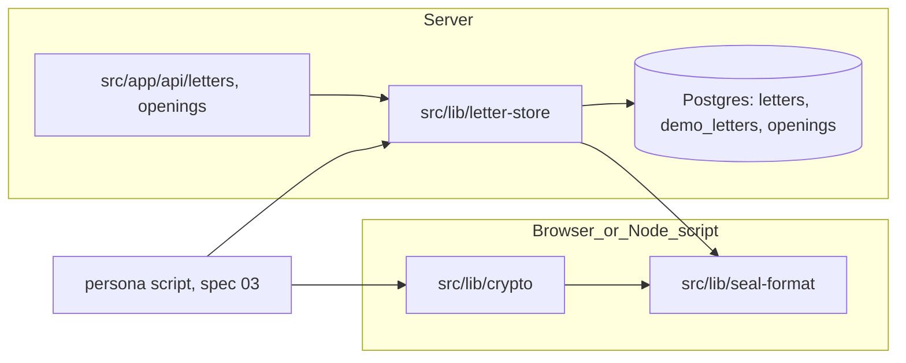
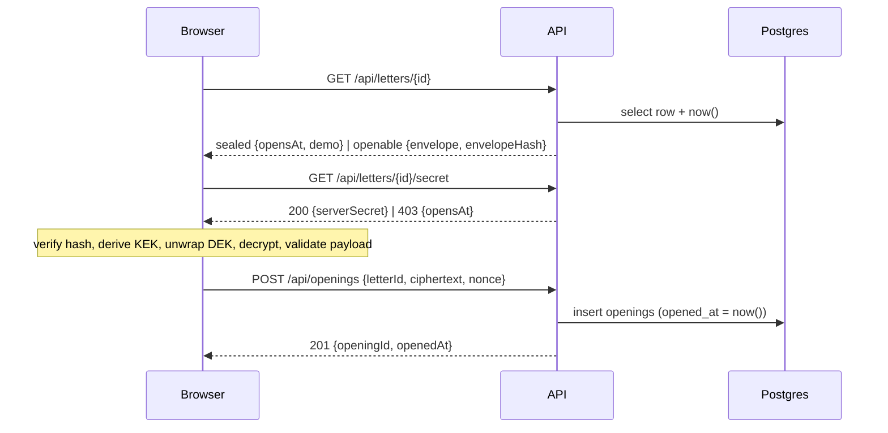

# Design: 02 Sealed letters

Follows `crypto.md`, `tech.md` and `data-integrity.md`; this file records decisions specific to this spec.

## Overview

This spec delivers the sealed format, browser crypto with the published demo key, the first migration, a script-side store function for persona letters, and three routes. Nothing in it seals a letter over HTTP. Spec 03 builds the persona demo on top; the passkey demo spec adds the live flow.

Five tasks, all `crypto-dev`:

1. Seal format (`src/lib/seal-format/`): payload v1, header v1, base64url, RFC 8785 canonical JSON, envelope hash.
2. Crypto (`src/lib/crypto/`): backup key, demo key, seal, open, opening records, import-boundary test.
3. Migration, Drizzle schema and the persona store function.
4. Routes: `GET /api/letters/[id]`, `GET /api/letters/[id]/secret`, `POST /api/openings`.
5. End-to-end integration test against Postgres.

No new environment variables. The Helm chart is not touched. Migrations already run in the web Deployment's init container, so the new migration ships with the image.

## Architecture



- `seal-format` is pure TypeScript plus `globalThis.crypto.subtle.digest`, which exists in browsers and Node 22 (the image's runtime). Both sides import it; it imports nothing from `crypto` or `db`.
- `crypto` is browser-safe and runs unchanged in Node scripts and Vitest. Server code never imports it (R3.2), enforced by a test.
- `letter-store` is a new server-only folder: the persona store function, the read and insert queries used by the routes, and small HTTP helpers. It imports `seal-format` and `lib/db/client`, never `crypto`.

### Opening sequence (this spec's routes)



## Components and Interfaces

### Seal format (`src/lib/seal-format/`)

| File | Exports |
|---|---|
| `base64url.ts` | `encodeBase64url(bytes)`, `decodeBase64url(s, expectedLength?)`, `isLetterId(s)` |
| `canonical-json.ts` | `canonicalize(value): string` |
| `hash.ts` | `envelopeHash(envelope): Promise<string>` (64 lowercase hex) |
| `v1/payload.ts` | `payloadV1Schema` (Zod), `PayloadV1` type |
| `v1/header.ts` | `headerV1Schema` (Zod), `EnvelopeV1` type, `headerWithoutCiphertext(env)` |
| `registry.ts` | `formats: { 1: { payload, header } }`, `parseEnvelope(json)`, `parsePayload(json)` |
| `index.ts` | Re-exports the above |

- **base64url:** unpadded, alphabet `A–Z a–z 0–9 - _`. Decoding is strict: it rejects padding, other characters and non-zero trailing bits, so every byte string has exactly one encoding. A letter ID is 22 characters matching `^[A-Za-z0-9_-]{21}[AQgw]$` (16 bytes; the last character carries 2 data bits).
- **canonicalize:** own implementation, about 40 lines, no dependency. Objects: keys sorted by UTF-16 code units (JavaScript's default string sort), serialised with `JSON.stringify` for strings and numbers, which RFC 8785 adopts. It throws on `NaN`, `±Infinity`, `undefined`, functions, symbols and `BigInt`, at any depth, including inside arrays (R2.9). Test vectors come from [RFC 8785](https://www.rfc-editor.org/rfc/rfc8785) section 3.2 and the reference [cyberphone/json-canonicalization testdata](https://github.com/cyberphone/json-canonicalization/tree/master/testdata). The owner commits those files before task 1 goes out, at `src/lib/seal-format/__fixtures__/rfc8785/input/*.json` and `output/*.json` (arrays, structures, unicode, values, weird). Task 1 reads the committed files and must not download anything; crypto-dev's environment can't reach github.com. The test lists the five expected names, and if any `input/` or `output/` file is missing it fails with a message naming that file. It never skips.
- **envelopeHash:** `SHA-256(UTF-8(canonicalize(envelope)))`, hex encoded. The envelope object is the full header including `payloadCiphertext`; there is no hash field inside it.
- **parseEnvelope / parsePayload:** peek at `formatVersion` (header) or `format_version` (payload) as a positive integer, look it up in `formats`, then run that version's strict schema. An unknown version returns `{ ok: false, error: "unsupported_format" }`; a schema failure returns `{ ok: false, error: "invalid", field }`, where `field` is the first failing Zod issue path joined with `.` (R1.10, R2.6).

### Crypto (`src/lib/crypto/`)

| File | Exports |
|---|---|
| `backup-key.ts` | `generateBackupKey()`, `formatBackupKey(bytes)`, `parseBackupKey(input)` |
| `demo-key.ts` | `PUBLIC_DEMO_BACKUP_KEY` |
| `kdf.ts` | `deriveBackupKek`, `deriveOpeningKey` (internal) |
| `seal.ts` | `sealLetter(input): Promise<{ envelope, envelopeHash }>` |
| `open.ts` | `openLetter(input): Promise<OpenResult>` |
| `opening-records.ts` | `encryptOpeningRecord(key, letterId, value)`, `decryptOpeningRecord(key, letterId, record)` |
| `errors.ts` | `OpenError`, `BackupKeyError` |
| `index.ts` | Public API only |

**Seal** (`sealLetter({ payload, letterId, serverSecret, backupKey, sealedAt, opensAt })`):

1. Check `letterId` is 16 bytes and `serverSecret` is 32 bytes; otherwise throw `invalid_input` before any derivation (R3.3). Validate `payload` with `payloadV1Schema`.
2. If `payload.written_as_of` is present and greater than `sealedAt.slice(0, 10)` (the UTC calendar date of `sealedAt`; both are `YYYY-MM-DD`, so string comparison is date order), throw `invalid_input` with field `written_as_of` before any key derivation (R1.4). The server can't read the payload, so this is the only place the rule is enforced.
3. DEK = 32 random bytes.
4. `KEK_backup = HKDF-SHA256(ikm = backupKey(16) ‖ serverSecret(32), salt = letterId(16), info = "revenant-kek-backup-v1")` as a non-extractable AES-256-GCM key.
5. Wrap: AES-GCM encrypt the 32 raw DEK bytes, fresh 12-byte nonce, AAD = `letterId bytes ‖ UTF-8("backup")`. The wrapped key is 48 bytes (32 + 16-byte tag).
6. Build the header without `payloadCiphertext` (all wraps included), fresh 12-byte `payloadNonce`.
7. Encrypt `UTF-8(canonicalize(payload))` with the DEK, AAD = `UTF-8(canonicalize(headerWithoutCiphertext))` (R3.4).
8. Add `payloadCiphertext`, compute `envelopeHash`, zero the DEK bytes (best effort), return.

**Open** (`openLetter({ envelope, envelopeHash, serverSecret, backupKey })`), where `backupKey` is the output of `parseBackupKey`:

1. Input lengths check (R3.3). `parseEnvelope` on the envelope.
2. Recompute the hash and compare in constant time with the stored hash. Mismatch: `verification_failed`, nothing else runs (R3.11, R3.12).
3. Derive `KEK_backup`, unwrap the `backup` wrap. GCM failure: `wrong_key` (R3.13).
4. Decrypt the payload with AAD from the header. GCM failure: `tampered`.
5. `parsePayload` on the plaintext. Failure: `invalid_payload` or `unsupported_format` (R1.11, R1.13).
6. Derive the opening records key and return it with the payload. Zero the DEK bytes.

```ts
type OpenError =
  | { kind: "invalid_input"; field: "letterId" | "serverSecret" | "envelope" | "written_as_of" }
  | { kind: "verification_failed" }
  | { kind: "wrong_key" }
  | { kind: "tampered" }
  | { kind: "unsupported_format"; formatVersion: number }
  | { kind: "invalid_payload"; field: string };

type OpenResult =
  | { ok: true; payload: PayloadV1; openingKey: CryptoKey } // non-extractable
  | { ok: false; error: OpenError };

type ParsedBackupKey =
  | { ok: true; key: BackupKeyBytes } // branded Uint8Array(16)
  | { ok: false; error: { kind: "mistyped_key" } };
```

Errors carry no key material, plaintext or byte values; messages are fixed strings (R3.16). The UI calls `parseBackupKey` before it fetches the server secret, so a mistyped key never triggers a fetch (R3.8).

**Opening records:** `openingKey = HKDF-SHA256(ikm = DEK, salt = letterId, info = "revenant-opening-v1")`. `encryptOpeningRecord` takes a JSON value, encrypts `UTF-8(canonicalize(value))` with AES-256-GCM, a fresh 12-byte nonce and AAD `letterId ‖ UTF-8("opening")`, and returns `{ ciphertext, nonce }` as base64url. The shape of the recall answers, including how an answer value is encoded inside the opening record, is spec 03's choice. A `number` answer is the reader's own input, not a figure, and is never presented as one.

#### Backup key format and checksum

- 16 random bytes read as a 128-bit big-endian integer, written as 26 Crockford Base32 digits (alphabet `0123456789ABCDEFGHJKMNPQRSTVWXYZ`). The first digit is always `0`–`7`.
- One check digit from the same 32-symbol alphabet is appended, giving 27 characters. Display groups the 27 characters in fours from the left with hyphens, so the last group has three characters and ends with the check digit: `XXXX-XXXX-XXXX-XXXX-XXXX-XXXX-XXC`.
- **Checksum:** in GF(32) with the polynomial x⁵ + x² + 1 and α = x, `c = Σ dᵢ·α^i` for i = 1…26, where addition is XOR.
  - A single substitution at position i changes `c` by `(dᵢ ⊕ d'ᵢ)·α^i`. Both factors are non-zero, and a field has no zero divisors, so it is detected.
  - Swapping distinct adjacent digits at i and i+1 changes `c` by `(dᵢ ⊕ dᵢ₊₁)·α^i·(1 ⊕ α)`, which is non-zero for the same reason, so it is detected.
  - Swapping d₂₆ with the check digit is detected unless α²⁶ = 1. α has order 31, so it never is.
  - A substitution in the check digit itself is detected trivially.
- **Why not Crockford's mod-37 check:** it also detects both error types (37 is prime and doesn't divide 32 or 31), but it needs five extra symbols `* ~ $ = U` outside the 32-character alphabet. R3.8 treats those as invalid characters, and they read badly on a printed card.
- **Parsing (R3.7, R3.8):** uppercase, remove `-` and spaces, map `I`, `L` to `1` and `O` to `0`. Then require exactly 27 characters, all in the alphabet, first digit ≤ 7, and a matching checksum. Any failure returns `mistyped_key`.
- **Demo key:** `PUBLIC_DEMO_BACKUP_KEY` is generated once with `formatBackupKey(generateBackupKey())` and committed as a string literal. The constant's name and a comment say it is public and only for demo letters. A test asserts it parses.

#### Import boundary (R3.2)

`src/lib/crypto/import-boundary.test.ts` collects every `.ts`/`.tsx` file under `src/app/api/`, `src/lib/db/` and `src/lib/letter-store/`, tests included. It extracts module specifiers from static `import`/`export … from`, `import()` and `require()`, resolves `@/` and relative paths inside `src/`, and walks the graph transitively. It fails if any reachable file is under `src/lib/crypto/`. The same test asserts the scan found at least the three route files once they exist, so an empty scan can't pass silently.

### Letter store (`src/lib/letter-store/`, server-only)

| File | Exports |
|---|---|
| `store.ts` | `storePersonaLetter({ envelope, envelopeHash, serverSecret })` |
| `queries.ts` | `findLetter(id)`, `insertOpening(...)` |
| `clock.ts` | `isOpenable(opensAt: Date, now: Date): boolean` (`now.getTime() >= opensAt.getTime()`) |
| `http.ts` | `json(status, body)` with `Cache-Control: no-store`, fixed error bodies |

Every module starts with the same `typeof window` guard as `lib/db/client.ts`.

- **storePersonaLetter (R5):** runs `parseEnvelope`, requires `serverSecret` to be 32 bytes, recomputes the hash and compares it with the submitted one, then in one transaction checks that the ID is absent from both `letters` and `demo_letters` and inserts into `demo_letters` with `kind = 'persona'`. `id`, `sealed_at` and `opens_at` come from the parsed header; `envelope` is `canonicalize(envelope)`. Each failure throws `LetterStoreError` with `check: "envelope" | "server_secret" | "hash_mismatch" | "duplicate_id"` and a fixed message. A primary-key violation is mapped to `duplicate_id`. A cross-table collision between two concurrent inserts is not prevented by a constraint; with 128-bit random IDs and a single script writer this is accepted.
- **findLetter(id):** one parameterised query (`UNION ALL` over both tables) returning `{ id, envelope, envelopeHash, opensAt, serverSecret, demo, dbNow }`, where `dbNow` is `now()` from the same statement. Returns `null` if no row.
- **Clock decision:** the database clock decides, read once per request in the same statement as the row. The route compares with the pure `isOpenable`, so the "equal to the millisecond counts as open" rule (R6.5) is unit-tested directly. Header times have millisecond precision, so `opens_at` is stored exactly and the truncation of `now()` to milliseconds by the driver can't flip the result. No request header, query or body field is read for time.
- **insertOpening:** `INSERT … RETURNING id, opened_at`, with `opened_at` defaulted by Postgres.

### Routes

All three: `export const dynamic = "force-dynamic"`, `export const runtime = "nodejs"`, and the whole handler is wrapped in `try/catch`, which returns the fixed 500 body. No `console.*` call in any route or `letter-store` file. A test asserts that by scanning the source (R8.1). Every response, errors included, has `Cache-Control: no-store` (R6.10, R7.5). Next 15 route params are a `Promise` and are awaited.

`GET /api/letters/[id]`:

| Case | Status | Body |
|---|---|---|
| Before `opens_at` | 200 | `{"status":"sealed","opensAt":"2026-01-01T00:00:00.000Z","demo":true}` |
| At or after | 200 | `{"status":"openable","opensAt":"…Z","demo":true,"envelope":{…},"envelopeHash":"9f86…"}` |
| Malformed or unknown ID | 404 | `{"error":"not_found"}` |
| Any failure | 500 | `{"error":"internal"}` |

`envelope` is `JSON.parse` of the stored canonical text. It holds only strings, arrays, objects and one small integer, so the values are exactly those stored (R6.2).

`GET /api/letters/[id]/secret`:

| Case | Status | Body |
|---|---|---|
| At or after | 200 | `{"serverSecret":"<43 base64url chars>"}` |
| Before | 403 | `{"opensAt":"…Z"}` |
| Malformed or unknown ID | 404 | `{"error":"not_found"}` |
| Any failure | 500 | `{"error":"internal"}` |

`POST /api/openings`, body `{"letterId":"…","ciphertext":"…","nonce":"…"}`. Checks run in this order:

| Step | Status | Body |
|---|---|---|
| `Content-Length` over 100,000, or body text over 100,000 characters | 413 | `{"error":"too_large"}` |
| Not JSON | 400 | `{"error":"invalid_body","field":"body"}` |
| Zod fails (missing field, not base64url, ciphertext 0 bytes, nonce not 12 bytes) | 400 | `{"error":"invalid_body","field":"nonce"}` |
| Ciphertext decodes to more than 65,536 bytes | 413 | `{"error":"too_large"}` |
| `letterId` malformed or unknown | 404 | `{"error":"not_found"}` |
| Before `opens_at` | 403 | `{"opensAt":"…Z"}` |
| Stored | 201 | `{"openingId":"<uuid>","openedAt":"…Z"}` |
| Any failure | 500 | `{"error":"internal"}` |

- The Zod object strips unknown keys, so a client `openedAt` is ignored rather than rejected (R7.1).
- `letterId` is only `z.string()` in Zod and its format is checked afterwards, so a malformed ID gives 404 as R7.2 requires, not 400.
- The `field` value is taken from the Zod issue path; Zod's messages and received values are never copied into responses (R8.3).
- 100,000 characters covers the 87,382-character base64url form of 65,536 bytes plus the other fields.

### Passkey demo compatibility

**Conclusion:** the passkey demo can add passkey wraps and live letters without a new header version, without a new payload version, and without changing how any envelope sealed under this spec validates, hashes or opens.

**Payload v1 is frozen** with the fields in Data Models, including the optional `written_as_of` and the required `answer_type` on recall questions. Any later payload change is format version 2.

1. **No new header fields needed.** Header v1 already defines `rpId`, `credentialId`, `prfSalt` and a `passkey` wrap as conditional fields (R2.4). A live letter with a passkey wrap is a valid v1 envelope. Their constraints are fixed now so v1 never changes: `rpId` is a lowercase hostname of 1–253 characters (`localhost` allowed); `credentialId` is base64url of 1–1,023 bytes (the WebAuthn maximum); `prfSalt` is 32 bytes. The passkey spec adds a new open path (`KEK_passkey`, AAD `letterId ‖ "passkey"`), which is new code, not a schema change.
2. **One version number, `formatVersion`, covers both header and payload.** Each version module in `registry.ts` defines a header schema and a payload schema together. A separate `envelopeVersion` field was rejected because R2.5 makes the header reject any field not listed in R2.1 and R2.4, and because a second number would allow mismatched pairs. If a later change needs a field that v1 doesn't have, it adds format version 2 with its own header and payload schemas. The v1 module is never edited: it stays strict, and old envelopes keep parsing exactly as they did.
3. **Hash stability.** The hash covers exactly the stored fields, canonicalised. A new optional field in v2 doesn't exist in a v1 envelope, so it can't affect a v1 hash. The envelope is stored as **`text` holding the canonical JSON**, the exact bytes that were hashed. `jsonb` would also work, because canonicalisation re-sorts keys and every value is a string or a small integer. `text` was still chosen because it removes the question entirely and lets an auditor hash the column directly. A committed golden fixture (`__fixtures__/golden-v1-envelope.json` with its expected hash) makes any accidental change to v1 hashing fail a test.
4. **AAD ordering.** The payload AAD is the canonical header without the ciphertext, wraps included, so every wrap must exist before the payload is encrypted. The passkey flow therefore runs the PRF check and builds both wraps first. No wrap can be added to a sealed letter later, which matches the immutability rule anyway.
5. **`live` demo kind.** The passkey spec adds a new migration that drops and re-adds the `demo_letters` kind CHECK to allow `'live'`, and adds a check that live letters have `opens_at = sealed_at + interval '30 seconds'` (exact rule decided there). `ALTER TABLE … ADD CONSTRAINT` validates existing rows with a read-only scan. Row triggers fire only on DML, so they don't block it and no existing row is rewritten. Persona rows satisfy both constraints as they are.

## Data Models

### Payload v1 (encrypted)

```jsonc
{
  "format_version": 1,
  "letter_text": "…",                         // 1–5,000 code points, not whitespace-only
  "written_as_of": "2024-10-15",              // optional; YYYY-MM-DD, a real calendar date, payload only.
                                              // Persona letters use it to say "written as of"; real letters omit it.
  "metrics": [{                               // 0–50, unique id
    "id": "us-gasoline", "display_name": "…", "unit": "…",
    "region": "…", "source": "…", "series_id": "…"
  }],
  "figures": [{                               // 0–50, metric_id must match a metric
    "metric_id": "us-gasoline", "kind": "official",
    "value": "3.412", "unit": "USD per gallon", "region": "U.S. city average",
    "period": "2026-09", "source": "U.S. EIA", "series_id": "EMM_EPMR_PTE_NUS_DPG",
    "retrieved_at": "2026-10-30T14:02:11Z",
    "source_url": "https://…"                 // official only, https, ≤ 2,048 chars
  }],
  "recall_questions": [                       // 0–20, unique id, text 1–500 chars
    { "id": "q1", "answer_type": "number", "text": "…", "metric_id": "us-gasoline" },  // metric_id required
    { "id": "q2", "answer_type": "text", "text": "…" }                                 // metric_id optional
  ]
}
```

- Every object is `z.strictObject` (R1.2). `figures` is a discriminated union on `kind`. A `self-reported` figure must have `source: "self-reported"` and has no `source_url` field, so a strict parse rejects one if present.
- `value` matches `^-?[0-9]+(\.[0-9]+)?$`, is at most 40 characters, and must be a string (R1.7).
- `written_as_of` (R1.4) matches `^\d{4}-\d{2}-\d{2}$`, and a refine builds `new Date(Date.UTC(y, m - 1, d))` and requires `toISOString().slice(0, 10)` to equal the input, which rejects dates such as `2024-02-30`. It exists only in the payload; the header has no such field and `sealedAt` is unaffected. The "not later than `sealedAt`" rule needs the header, so `sealLetter` enforces it (Seal step 2), not the schema.
- `recall_questions` items are a `z.discriminatedUnion("answer_type", …)` of two strict objects (R1.9). `number` requires `metric_id`; the answer's unit and region are those of that metric definition. `text` has an optional `metric_id`. A missing or other `answer_type` fails the union.
- `retrieved_at` matches `^\d{4}-\d{2}-\d{2}T\d{2}:\d{2}:\d{2}(\.\d{1,9})?Z$` and must parse to a valid date. It is kept as the published string.
- String fields not sized by R1 (`id`, `metric_id`, `display_name`) are 1–200 characters. The letter text length counts code points (`[...s].length`).
- Cross-reference and uniqueness rules (R1.8, R1.9) are a `superRefine` on the root, reporting the path of the first offending item.

### Header v1 (the stored envelope)

```jsonc
{
  "letterId": "<22 chars>",            // 16 bytes
  "formatVersion": 1,
  "sealedAt": "2026-11-02T10:15:00.000Z",  // persona letters are sealed now and open on their past
  "opensAt":  "2024-11-05T00:00:00.000Z",  // election day; the "as of" date is the payload's written_as_of
  "payloadNonce": "<16 chars>",        // 12 bytes
  "payloadCiphertext": "<…>",          // 16 bytes to 1 MiB decoded
  "wrappedDeks": [                     // 1–2 entries, sorted by factor, unique factor
    { "factor": "backup", "nonce": "<16 chars>", "wrappedKey": "<64 chars>" }  // 12 and 48 bytes
  ]
  // "rpId", "credentialId", "prfSalt": all present if and only if a passkey wrap exists
}
```

- `sealedAt` and `opensAt` must equal `new Date(s).toISOString()`, the exact millisecond `Z` form. That keeps one textual form per instant, which keeps the hash and the database column consistent.
- `wrappedDeks` must be sorted by factor (`backup` before `passkey`). Canonical JSON keeps array order, so a fixed order means one header has exactly one valid form.

### Database (migration `drizzle/0000_sealed_letters.sql`)

Shared column rules for `letters` and `demo_letters`:

| Column | Type | Constraint |
|---|---|---|
| `id` | `text` primary key | `CHECK (id ~ '^[A-Za-z0-9_-]{21}[AQgw]$')` |
| `envelope` | `text` NOT NULL | Canonical JSON |
| `envelope_hash` | `text` NOT NULL | `CHECK (envelope_hash ~ '^[0-9a-f]{64}$')` |
| `sealed_at` | `timestamptz` NOT NULL | |
| `opens_at` | `timestamptz` NOT NULL | |
| `server_secret` | `bytea` NOT NULL | `CHECK (octet_length(server_secret) = 32)` |

- `letters` also has `CHECK ((opens_at AT TIME ZONE 'UTC') >= (sealed_at AT TIME ZONE 'UTC') + interval '3 months')`. The conversion to UTC `timestamp` makes month arithmetic independent of the session's `TimeZone`. Postgres clamps month ends (31 January + 3 months = 30 April), which is accepted.
- `demo_letters` also has `kind text NOT NULL CHECK (kind IN ('persona'))`, with no `opens_at` constraint.
- **Letter ID as `text`:** it is the URL form, needs no conversion in routes and FKs, and the regex CHECK guarantees exactly 16 bytes in a single canonical encoding. `bytea` would save 6 bytes per row and add encode and decode steps everywhere.

`openings`:

| Column | Type | Constraint |
|---|---|---|
| `id` | `uuid` primary key | `DEFAULT gen_random_uuid()` |
| `letter_id` | `text` | FK → `letters(id)` |
| `demo_letter_id` | `text` | FK → `demo_letters(id)` |
| `ciphertext` | `bytea` NOT NULL | `CHECK (octet_length(ciphertext) BETWEEN 1 AND 65536)` |
| `nonce` | `bytea` NOT NULL | `CHECK (octet_length(nonce) = 12)` |
| `opened_at` | `timestamptz` NOT NULL | `DEFAULT now()` |

Table CHECK: `num_nonnulls(letter_id, demo_letter_id) = 1` (R4.9). Index on each FK column.

Immutability (appended to the same migration file after the generated DDL, separated by `--> statement-breakpoint`):

```sql
CREATE FUNCTION revenant_forbid_change() RETURNS trigger LANGUAGE plpgsql AS $$
BEGIN
  RAISE EXCEPTION 'revenant: % on % is not allowed; sealed records are immutable', TG_OP, TG_TABLE_NAME;
END $$;
-- for each of letters, demo_letters, openings:
CREATE TRIGGER letters_no_update_delete BEFORE UPDATE OR DELETE ON letters
  FOR EACH ROW EXECUTE FUNCTION revenant_forbid_change();
CREATE TRIGGER letters_no_truncate BEFORE TRUNCATE ON letters
  FOR EACH STATEMENT EXECUTE FUNCTION revenant_forbid_change();
```

- **Drizzle schema:** `src/lib/db/schema/letters.ts` defines the three tables with `check()` constraints and a `customType` for `bytea` (drizzle-orm 0.45 has no built-in `bytea`). Owners and superusers can still disable triggers or drop tables. That is operator deletion, which `crypto.md` accepts.
- **Schema discovery:** `drizzle.config.ts` currently points at `./src/lib/db/schema.ts`. It changes to `./src/lib/db/schema/*.ts`, so crypto-dev's `letters.ts` and data-dev's later `figures*.ts` both get picked up without a shared barrel file.
- **Generation:** `npx drizzle-kit generate --name sealed_letters` produces `0000_sealed_letters.sql`, `meta/0000_snapshot.json` and the journal entry. The trigger SQL is then appended by hand. drizzle-kit doesn't track triggers, so later generations won't drop them.
- **Atomicity (R4.10, R4.11):** drizzle-orm's Postgres migrator runs all pending migrations inside one `session.transaction` (`node_modules/drizzle-orm/pg-core/dialect.js`), and it skips migrations already in its journal table. A failing statement rolls back the whole migration, and `scripts/migrate.mjs` already exits non-zero on failure.

## Correctness Properties

*A property is a characteristic or behavior that should hold true across all valid executions of a system-essentially, a formal statement about what the system should do. Properties serve as the bridge between human-readable specifications and machine-verifiable correctness guarantees.*

Redundant candidates were merged during reflection. Payload and header rejection rules are one property each, built from mutation generators. The response key, `opensAt` format, `demo` flag and `no-store` checks are folded into the route clock property. The R3.11 hash-first check is folded into the tamper property.

### Property 1: Payload round trip

For any valid v1 payload (with and without `written_as_of`, 0–50 figures of either kind, 0–50 metrics, 0–20 recall questions mixing `number` and `text` types, letter text of 1–5,000 code points including astral characters), `parsePayload(JSON.parse(canonicalize(p)))` succeeds and is deeply equal to `p`, and every figure `value` string and any `written_as_of` string is identical.

**Validates: Requirements 1.2, 1.3, 1.4, 1.5, 1.7, 1.9, 1.14**

### Property 2: Invalid payloads are rejected with a field path

For any valid payload and any single mutation from the generator set, the schema rejects the payload and reports a non-empty field path, and `sealLetter` throws without producing an envelope. The mutations are: an unknown key at any object level, empty, whitespace-only or 5,001-code-point text, a `value` that is a number or uses exponent, `+`, thousands separators or surrounding whitespace, an out-of-range string length, a non-`Z` or non-https field, an official figure without `source_url`, a self-reported figure with another `source`, a dangling `metric_id`, a duplicate metric or question ID, too many items, a `written_as_of` that is malformed (wrong form, extra characters) or names a non-existent date (`2024-02-30`, `2023-02-29`, month 13), a missing or unknown `answer_type`, or a `number` question without `metric_id`.

**Validates: Requirements 1.2, 1.3, 1.4, 1.5, 1.6, 1.7, 1.8, 1.9, 1.10**

### Property 3: Header strictness

For any valid v1 header and any single mutation, `parseEnvelope` rejects it naming the failed rule, and the store function inserts nothing. The mutations are: a missing field, an unknown field, a binary value of the wrong length or with padding or non-canonical trailing bits, a non-millisecond-`Z` timestamp, a duplicate or unsorted wrap factor, passkey fields without a passkey wrap or a passkey wrap without all three, or a `formatVersion` that is not a positive integer. For any positive integer not in the registry, the result is `unsupported_format`.

**Validates: Requirements 1.13, 2.1, 2.2, 2.3, 2.4, 2.5, 2.6**

### Property 4: base64url is a bijection

For any byte array `b`, `decodeBase64url(encodeBase64url(b))` equals `b`. For any string `s` that decodes, `encodeBase64url(decodeBase64url(s))` equals `s`. `isLetterId(s)` holds exactly when `s` decodes to 16 bytes.

**Validates: Requirements 2.2, 6.8**

### Property 5: Canonical JSON is order- and whitespace-independent

For any JSON value `v`: `canonicalize(v)` equals `canonicalize(JSON.parse(canonicalize(v)))` (idempotence); reordering object keys at any depth or re-serialising with arbitrary whitespace and re-parsing gives the same canonical string; and `envelopeHash` returns the same 64-character lowercase hex for all of these forms.

**Validates: Requirements 2.7, 2.8**

### Property 6: Canonical JSON rejects non-JSON values

For any JSON value with one `NaN`, `±Infinity`, `undefined`, function, symbol or `BigInt` inserted at any depth, `canonicalize` throws and returns no output.

**Validates: Requirements 2.9**

### Property 7: Backup key round trip and normalisation

For any 16 bytes `k`, `parseBackupKey(formatBackupKey(k))` returns `k`. Random case changes, removed or extra hyphens and spaces, and replacing `1` with `I` or `L` and `0` with `O` all parse to the same `k`.

**Validates: Requirements 3.6, 3.7**

### Property 8: Checksum catches typos

For any formatted key, replacing one character with a different alphabet character, or swapping two adjacent distinct characters (ignoring hyphens, check digit included), makes `parseBackupKey` return `mistyped_key`. So does any wrong length or any character outside the alphabet after normalisation.

**Validates: Requirements 3.6, 3.8**

### Property 9: Seal and open round trip

For any valid payload, letter ID, server secret, backup key and timestamps, `openLetter` on the output of `sealLetter` with the same backup key and secret returns `ok` with a payload deeply equal to the input. Generators include empty figure lists and letter text of exactly 1 and 5,000 code points.

**Validates: Requirements 3.4, 3.5, 3.14**

### Property 10: Fresh nonces

For any payload and keys, two calls to `sealLetter` with identical inputs produce different `payloadNonce`, wrap nonces and `payloadCiphertext`.

**Validates: Requirements 3.4**

### Property 11: Wrong key or wrong secret fails closed

For any sealed envelope, opening with a different backup key or a different server secret returns `wrong_key` and no payload or key.

**Validates: Requirements 3.13, 3.15**

### Property 12: Any single-byte change is detected

For any sealed envelope and any single byte flipped in a decoded binary field (ciphertext, nonce, wrap) or any character changed in another header field:

- With the original stored hash, `openLetter` returns `verification_failed` and performs no unwrap. A spy on `subtle.decrypt` records zero calls.
- With the hash recomputed over the changed envelope, it returns `wrong_key`, `tampered` or `invalid_input`, and never `ok`.

**Validates: Requirements 3.11, 3.12, 3.13, 3.15**

### Property 13: Opening records round trip

For any JSON value, letter ID and DEK-derived opening key, `decryptOpeningRecord(encryptOpeningRecord(v))` equals `v`. Decrypting under a different letter ID fails.

**Validates: Requirements 3.10**

### Property 14: Bad input lengths are rejected before key derivation

For any byte array whose length is not 16 as the letter ID, or not 32 as the server secret, `sealLetter` and `openLetter` return `invalid_input`, and a spy on `subtle.deriveKey` and `subtle.deriveBits` records zero calls.

**Validates: Requirements 3.3**

### Property 15: No secret leaks during seal and open

For any seal followed by opens that succeed, fail with `wrong_key` and fail with `tampered`, no captured `console.*` output and no thrown or returned error message contains the base64url, hex or UTF-8 form of the DEK, backup key, server secret or letter text. Fewer iterations (25) are acceptable because each run does several WebCrypto operations.

**Validates: Requirements 3.16**

### Property 16: The server clock decides the letter and secret responses

With `findLetter` mocked, for any stored row (demo or not), any `opensAt` and any `dbNow`, and any client-supplied `Date`, `If-Modified-Since` or query time values:

- `GET /api/letters/[id]` returns exactly the keys `{status, opensAt, demo}` with `status: "sealed"` when `dbNow < opensAt`, and exactly the keys `{status, opensAt, demo, envelope, envelopeHash}` with the stored values otherwise.
- `GET /api/letters/[id]/secret` returns 200 `{serverSecret}` exactly when `dbNow >= opensAt`, and otherwise 403 `{opensAt}`.
- `POST /api/openings` with a valid body returns 403 exactly when `dbNow < opensAt` and calls `insertOpening` only otherwise.
- `opensAt` always matches the millisecond `Z` form, `demo` matches the row's table, `Cache-Control` is `no-store`, and client time values make no difference.
- `isOpenable(t, t)` is `true` for any `t`.

**Validates: Requirements 6.1, 6.2, 6.3, 6.4, 6.5, 6.6, 6.7, 6.10, 7.1, 7.3**

### Property 17: 404s are indistinguishable

For any string that is not a valid letter ID, and for any valid letter ID that `findLetter` doesn't find, both GET routes and `POST /api/openings` return 404 with byte-identical bodies and headers, and nothing is stored.

**Validates: Requirements 6.8, 7.2**

### Property 18: Invalid opening bodies are rejected without echo

For any request body with one invalid field (missing, non-base64url, empty ciphertext, nonce not 12 bytes, wrong JSON type) carrying a random marker string, `POST /api/openings` returns 400 with `field` naming that field. The response body doesn't contain the marker, and `findLetter` and `insertOpening` are never called.

**Validates: Requirements 7.7, 8.2, 8.3**

### Property 19: Store rejects mismatched hashes before touching the database

For any valid envelope and any 64-hex hash that differs from its real hash, `storePersonaLetter` throws `hash_mismatch`, and the mocked database receives no query.

**Validates: Requirements 5.2**

### Property 20: `written_as_of` cannot be later than the seal date

For any valid payload and any `sealedAt`, if `written_as_of` is a real date later than `sealedAt.slice(0, 10)`, `sealLetter` throws `invalid_input` with field `written_as_of`, returns no envelope, and a spy on `subtle.deriveKey`, `subtle.deriveBits` and `subtle.encrypt` records zero calls. If `written_as_of` is on or before that date, sealing succeeds. Generators include the boundary dates (the same UTC day, and the next day) and `sealedAt` values just before and after UTC midnight.

**Validates: Requirements 1.4**

## Error Handling

| Where | Condition | Result |
|---|---|---|
| `seal-format` | Schema failure | `{ ok: false, error: "invalid", field }`; no hash computed |
| `seal-format` | Unknown version | `{ ok: false, error: "unsupported_format" }` |
| `canonicalize` | Non-JSON value | Throws `TypeError("value is not representable in JSON")` |
| `crypto` | `written_as_of` later than the UTC date of `sealedAt` | `invalid_input` with field `written_as_of`; no derivation, no envelope |
| `crypto` | Bad lengths, hash mismatch, unwrap fail, decrypt fail, bad payload | `OpenError` union; no partial plaintext, no DEK |
| `crypto` | Mistyped backup key | `{ kind: "mistyped_key" }`; no fetch, no derivation |
| `storePersonaLetter` | Envelope, secret, hash or duplicate check fails | Throws `LetterStoreError` with `check`; transaction rolled back |
| Routes | Validation, size, not found, too early | Fixed bodies listed under Routes |
| Routes | Any thrown error, including database errors | 500 `{"error":"internal"}`; the error object is dropped, not logged |
| Postgres | UPDATE, DELETE or TRUNCATE on sealed tables | Trigger exception; the statement aborts |
| Postgres | CHECK or FK violation | Insert rejected, no row |
| Migration | Any statement fails | Whole migration rolls back; `migrate.mjs` exits 1 |

Logging rules (R8):

- Route and `letter-store` files contain no `console.*` calls, which a source-scan test enforces.
- Error objects are never serialised into responses.
- `LetterStoreError` messages are fixed strings that name the check and never include values.
- postgres-js errors (which can include key values in `detail`) are caught and replaced, never chained with `cause`.
- `DATABASE_URL` handling stays in `lib/db/client.ts`, which already drops the underlying error.

## Testing Strategy

- **Libraries:** Vitest (existing) and **fast-check** as a new dev dependency, pinned exactly, for Properties 1–20. Each property is one `fc.assert` test with `numRuns: 100` (Property 15 uses 25), tagged `// Feature: 02-sealed-letters, Property N: <title>`.
- **New runtime dependency:** **zod** (v4, pinned exactly). `tech.md` requires Zod at route handlers, and the payload and header schemas reuse it. No other runtime dependency. Canonical JSON, base64url and the checksum are implemented in-repo because each is small and auditable, and third-party code on sealing pages is the main privacy risk.
- **Unit and example tests:**
  - RFC 8785 vectors, read from the owner-committed `__fixtures__/rfc8785/` files; a missing file fails the test with its name.
  - The golden v1 envelope hash.
  - A KAT for `KEK_backup`, checked against an independent `node:crypto.hkdfSync` computation inside the test.
  - The demo key parses.
  - `invalid_payload` and `unsupported_format` on open (by sealing a payload through a test-only path that skips validation).
  - The import-boundary scan and the `console.*` source scan.
  - R8.6 leak tests: known secret, ciphertext and answer values, one validation failure and one mocked database failure whose error message contains the secret. Assert that neither captured console output nor the response contains them.
  - 413 at 65,537 bytes and acceptance at 65,536.
- **Integration tests (real Postgres):** in `src/test/integration/`, included by the existing Vitest `include` glob and run by `npm test`. No new script.
  - `setup.ts` exports `describeDb`. It skips with "needs Postgres: set DATABASE_URL to a database whose name contains 'test'" when `DATABASE_URL` is unset or its database name lacks `test`. Sealed rows can never be deleted, so this guard keeps the tests away from a real database.
  - When `CI` is set and the guard would skip, the suite fails instead, so CI can't pass by skipping (R9.8).
  - `beforeAll` runs the drizzle migrator on `./drizzle`, which is idempotent (R4.10).
  - Every run uses fresh random IDs, and assertions only read rows the run created (R9.6). Per-file timeout is 60 s (R9.9).
  - `schema.test.ts` (task 3) covers R4.2–R4.9 and R5.
  - `sealed-letters.test.ts` (task 5) covers R9.1–R9.5 by calling the route handlers' exported `GET` and `POST` with `Request` objects.
- **CI change (owner, before task 3):** add to the `checks` job in `ci.yml` a `postgres:17-alpine` service with `POSTGRES_PASSWORD: ci`, `POSTGRES_DB: revenant_test`, port 5432 and the same health options as `smoke`. Set `DATABASE_URL: postgres://postgres:ci@localhost:5432/revenant_test` on the `scripts/check.sh` step. Nothing else changes; a failing integration test fails `checks`, and so `ci-gate`.
- **Not tested here:** browser UI (none in this spec), Helm (unchanged).

## Task paths and ownership

| Task | Agent | Creates or edits |
|---|---|---|
| 1 Seal format | crypto-dev | `src/lib/seal-format/**` (`base64url.ts`, `canonical-json.ts`, `hash.ts`, `registry.ts`, `index.ts`, `v1/payload.ts`, `v1/header.ts`, `*.test.ts`, `__fixtures__/golden-v1-envelope.json`), `package.json`, `package-lock.json` (zod, fast-check). Reads but does not create `__fixtures__/rfc8785/**`. |
| 2 Crypto | crypto-dev | `src/lib/crypto/**` (`backup-key.ts`, `demo-key.ts`, `kdf.ts`, `seal.ts`, `open.ts`, `opening-records.ts`, `errors.ts`, `index.ts`, `*.test.ts`, `import-boundary.test.ts`) |
| 3 Migration, schema, store | crypto-dev | `src/lib/db/schema/letters.ts`, `drizzle/0000_sealed_letters.sql`, `drizzle/meta/_journal.json`, `drizzle/meta/0000_snapshot.json`, `src/lib/letter-store/store.ts`, `src/lib/letter-store/store.test.ts`, `src/test/integration/setup.ts`, `src/test/integration/schema.test.ts` |
| 4 Routes | crypto-dev | `src/app/api/letters/[id]/route.ts` and `route.test.ts`, `src/app/api/letters/[id]/secret/route.ts` and `route.test.ts`, `src/app/api/openings/route.ts` and `route.test.ts`, `src/lib/letter-store/queries.ts`, `clock.ts`, `http.ts` and their tests, `src/lib/letter-store/no-console.test.ts` |
| 5 End-to-end test | crypto-dev | `src/test/integration/sealed-letters.test.ts` |

All five stay with crypto-dev. The schema and migration only make sense together with the envelope format and the immutability rules in `crypto.md`, and `drizzle/**` and `src/lib/db/schema/letters*` are already crypto-dev's.

### Ownership changes needed

1. **Add `src/lib/letter-store/**` to crypto-dev.** It is a new server-only folder that no role owns today.
2. **Add `src/test/integration/**` to crypto-dev.** It overlaps platform-dev's `src/test/**`; if `pr-policy` needs disjoint paths, narrow platform-dev to `src/test/!(integration)/**` or move the folder to `src/integration/`.
3. **`drizzle.config.ts`:** change `schema: "./src/lib/db/schema.ts"` to `schema: "./src/lib/db/schema/*.ts"`. It is platform-dev's file (`drizzle.config.*`). Simplest is for the owner to make this one-line edit in the same commit as the `agents.json` update. The alternative is granting crypto-dev `drizzle.config.ts` for task 3.
4. **Owner-only, before task 1:** commit the RFC 8785 test vectors from [cyberphone/json-canonicalization testdata](https://github.com/cyberphone/json-canonicalization/tree/master/testdata) as `src/lib/seal-format/__fixtures__/rfc8785/input/{arrays,structures,unicode,values,weird}.json` and the matching `output/*.json`. crypto-dev's environment cannot reach github.com.
5. **Owner-only, before task 3:** the `ci.yml` Postgres service and `DATABASE_URL` from the Testing Strategy.
6. **No change needed** for `src/lib/seal-format/**`, `src/lib/crypto/**`, `src/app/api/letters/**`, `src/app/api/openings/**`, `src/lib/db/schema/letters*`, `drizzle/**`, or the shared `package.json` and `package-lock.json`. `src/lib/db/client.ts` is used as is and not edited. `.env.example` and the Helm chart are not touched.
