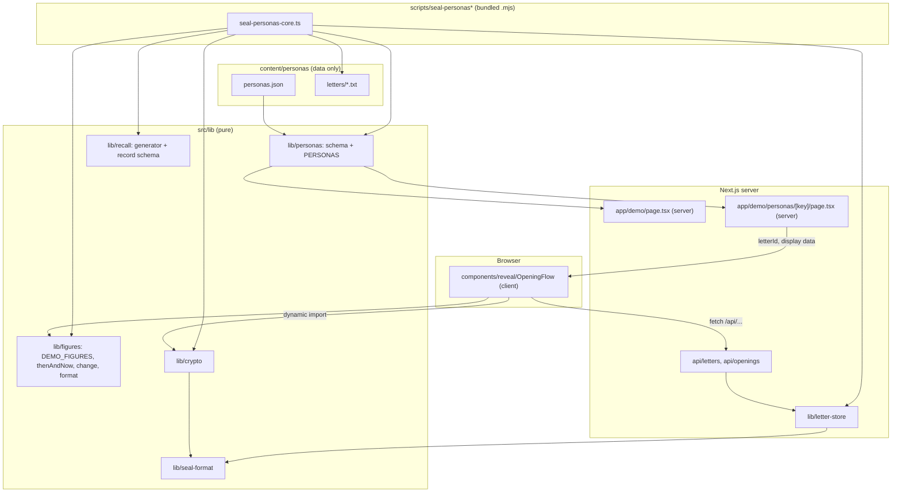
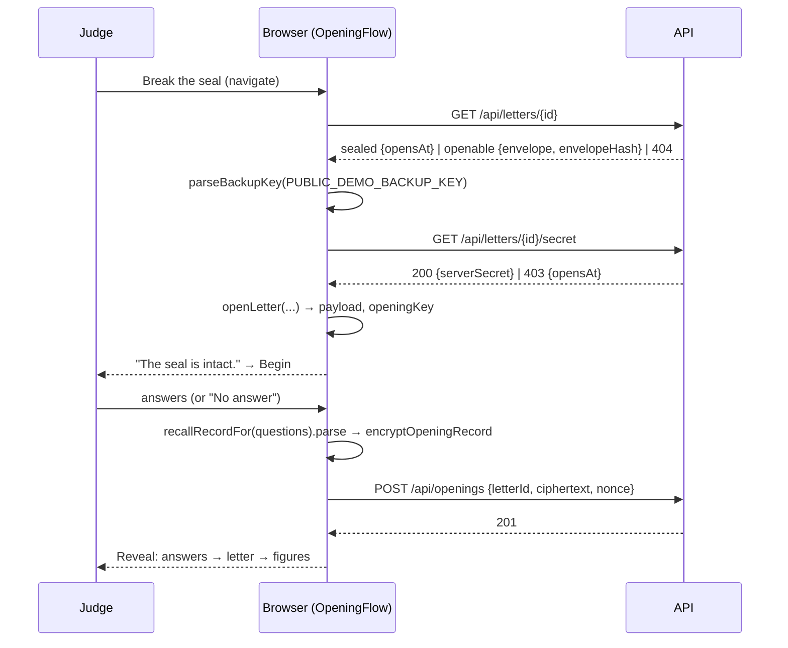
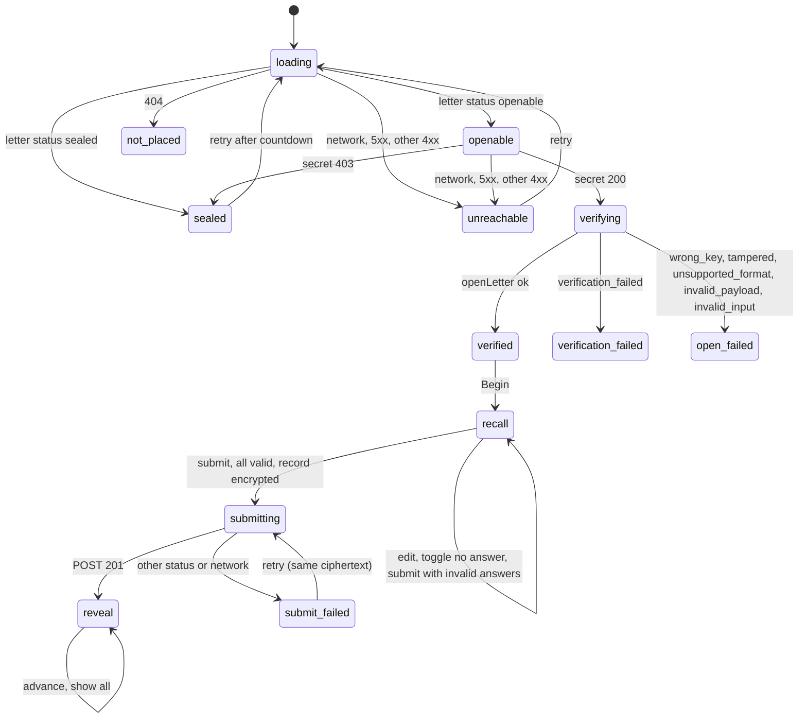
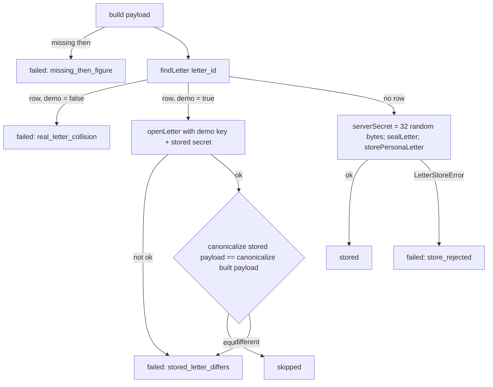

# Design: 03 Persona demo

Follows `product.md`, `data-integrity.md`, `neutrality.md`, `tone.md`, `crypto.md`, `tech.md`, `structure.md` and `deploy.md`. This file records the decisions specific to this spec. Requirement numbers (R1.1 and so on) refer to `requirements.md` in this folder.

## Overview

This spec builds Demo 1: `/demo` lists the personas, and `/demo/personas/[key]` opens one persona letter in the browser with the published demo key. The judge answers the sealed recall questions, the encrypted answers are stored, and then the reveal shows the answers, the letter and the figures then vs now, one part at a time.

The work splits into six parts:

1. **Change_Calculator and its display formatter** in `src/lib/figures` (data-dev). This is exact decimal arithmetic on value strings using `BigInt`, with no floats and no new dependency.
2. **Recall_Generator and Recall_Record schema** in `src/lib/recall` (frontend-dev).
3. **Persona_List**: data in `content/personas/`, plus a typed loader and validation tests in `src/lib/personas/` (frontend-dev, owner decision; see Ownership).
4. **Sealing_Script** in `scripts/seal-personas*` (crypto-dev). The build bundles it with esbuild into one `.mjs` file. It runs in the existing `migrate` init container right after `migrate.mjs`, and the Dockerfile and chart changes for that are platform-dev's.
5. **Demo_Index, landing link and labels** (frontend-dev).
6. **Opening_Flow and Reveal**: a pure reducer, a thin client effect runner and presentational views in `src/components/reveal` (frontend-dev).

The first release has one persona, "Maya" (United States), written as of 12 May 2024 and opening on 5 November 2024. She tracks the two US fixture series from `DEMO_FIGURES`, so every figure in the demo carries a "fixture data" label until a later spec swaps in real data. That swap gives Maya a new letter ID (R5.2).

No new runtime dependency. One new devDependency: `esbuild`, pinned to `0.28.2`, confirmed on the npm registry on 2026-10-31 as `latest`, published 2026-08-08 (see Sealing_Script). No new environment variable. The chart gets one new value and a version bump.

### Names used from spec 02 (status on `main` as of writing)

| Name | Module | Status |
|---|---|---|
| `payloadV1Schema`, `figureV1Schema`, `metricDefinitionV1Schema`, `PayloadV1`, `FigureV1`, `MetricDefinitionV1`, `canonicalize`, `parsePayload`, `decodeBase64url`, `encodeBase64url`, `isLetterId` | `src/lib/seal-format` | **Confirmed** in code on `main`. |
| Recall question type | `src/lib/seal-format/v1/payload.ts` | **Not exported.** `recallQuestionSchema` is module-private. This design uses `PayloadV1["recall_questions"][number]` and never edits seal-format. |
| `getSql` | `src/lib/db/client.ts` | **Confirmed.** The script calls `getSql().end()` when it finishes. |
| `buildContentSecurityPolicy`, `STATIC_SECURITY_HEADERS` (with `Referrer-Policy: no-referrer`) | `src/lib/security-headers.ts`, applied by `src/middleware.ts` to every route except static assets | **Confirmed.** |
| `sealLetter`, `openLetter`, `parseBackupKey`, `PUBLIC_DEMO_BACKUP_KEY`, `encryptOpeningRecord`, `decryptOpeningRecord`, `OpenResult`, `OpenError` | `src/lib/crypto` | **Design only** (02-sealed-letters task 2, not merged). Exact parameter types are **unconfirmed**: this design assumes `letterId` and `serverSecret` are `Uint8Array` (the 02 design checks "16 bytes" and "32 bytes"), `sealedAt` and `opensAt` are millisecond-`Z` strings, and `encryptOpeningRecord(key, letterId, value)` takes the letter ID as bytes. The tasks adapt to whatever task 2 merges. |
| `storePersonaLetter`, `LetterStoreError` | `src/lib/letter-store/store.ts` | **Design only** (02-sealed-letters task 3). |
| `findLetter(id)` returning `{ id, envelope, envelopeHash, opensAt, serverSecret, demo, dbNow }` | `src/lib/letter-store/queries.ts` | **Design only** (02-sealed-letters task 4). The return types are **unconfirmed**: `envelope` is probably the stored canonical text and `serverSecret` probably a `Buffer`. The script needs exactly this read, and no separate read function is required. If task 4 merges without `serverSecret` or `demo` in the result, the crypto-dev task here must stop and ask, because adding a query to `letter-store` is spec 02 territory. |
| `describeDb` | `src/test/integration/setup.ts` | **Design only** (02-sealed-letters task 3). |
| Routes `GET /api/letters/[id]`, `GET /api/letters/[id]/secret`, `POST /api/openings` | `src/app/api/**` | **Design only** (02-sealed-letters task 4). The bodies used here are the ones in the 02 design's Routes tables. |
| `DEMO_FIGURES`, `thenAndNow`, `isFixtureFigure`, `isRealDate`, `isRealMonth`, `periodEnd`, `LoadedFigures` | `src/lib/figures` | **Design only** (02-demo-figures tasks 1 and 2). |

## Architecture



- **Server components never import `src/lib/crypto`.** `app/demo/page.tsx` and `app/demo/personas/[key]/page.tsx` import only `src/lib/personas` and presentational components. `OpeningFlow.tsx` is `"use client"` and loads crypto with `await import("@/lib/crypto")` inside its effect runner, so crypto is not evaluated during server rendering or put in the server bundle (R14.6). A frontend-dev boundary test enforces this (see Testing Strategy).
- **No network request for figures (R11.4).** `OpeningFlow` statically imports `DEMO_FIGURES` from `@/lib/figures`. The fixture JSON is compiled into the client JavaScript chunk, so the only requests the flow makes are the three `/api/...` calls.
- **Letter text never reaches the web bundle.** The pages import `content/personas/personas.json` (keys, names, dates, IDs, metric IDs, subjects) but never the `.txt` files. Only the Sealing_Script and the tests read letter text. The letter text the judge sees comes from the decrypted payload.
- **Adding a persona is content-only (R1.4).** You add one entry to `personas.json` and one `.txt` file. The loader, the index, the persona route, the script and its bundle build all read the list generically.

### Routing

| URL | File | Kind | Does |
|---|---|---|---|
| `/` | `src/app/page.tsx` | server | Existing landing page plus one link to `/demo` (R6.1). |
| `/demo` | `src/app/demo/page.tsx` | server | Demo_Index. Renders `PERSONAS` in list order (R5.3, R6.2). No database access. |
| `/demo/personas/[key]` | `src/app/demo/personas/[key]/page.tsx` | server | Awaits `params` (Next 15), looks up `key` in `PERSONAS`, and calls `notFound()` if it is missing (R5.5). Otherwise renders `<OpeningFlow letterId=… personaName=… />` with the letter ID taken only from the list (R5.4). |
| `/demo/personas/[key]` (missing) | `src/app/demo/personas/[key]/not-found.tsx` | server | Not-found copy and a link back to `/demo`. Makes no API request. |

- `export const dynamicParams = true` and no `generateStaticParams`. The root layout already reads `headers()` so every page renders dynamically with the CSP nonce, and these pages follow that.
- The middleware matcher covers `/demo/**` and not-found responses, so they get the same CSP and `Referrer-Policy: no-referrer` as every other page (R14.1, R14.3). This spec doesn't change the middleware or the CSP.
- The card's "Break the seal" control is a link to `/demo/personas/[key]`. The Opening_Flow starts on mount, so following that link is the activation (R6.7, R7.1). A `useRef` guard makes sure one mount starts one attempt, including under React Strict Mode's double effect.

### Opening sequence



### Opening_Flow state machine

The flow is a pure reducer (`opening-machine.ts`) plus an effect runner (`useOpeningFlow.ts`) that does the fetches and crypto and sends events back. Views render from the state alone. This keeps the gating rules (nothing shown before the record is stored) testable without a browser.



```ts
type Opened = {
  letterId: string;
  header: { sealedAt: string; opensAt: string };   // from the parsed envelope
  payload: PayloadV1;
  openingKey: CryptoKey;                           // non-extractable, memory only
};

type Draft = { text: string; noAnswer: boolean };

type FlowState =
  | { tag: "loading" }
  | { tag: "sealed"; opensAt: string }
  | { tag: "openable"; envelope: unknown; envelopeHash: string }
  | { tag: "verifying" }
  | { tag: "verified"; opened: Opened }
  | { tag: "recall"; opened: Opened; drafts: Record<string, Draft>; invalid: string[] }
  | { tag: "submitting"; opened: Opened; drafts: Record<string, Draft>; record: RecallRecordV1; sealed: { ciphertext: string; nonce: string } }
  | { tag: "submit_failed"; opened: Opened; drafts: Record<string, Draft>; record: RecallRecordV1; sealed: { ciphertext: string; nonce: string } }
  | { tag: "reveal"; opened: Opened; record: RecallRecordV1; stage: 1 | 2 | 3 }
  | { tag: "not_placed" }
  | { tag: "unreachable" }
  | { tag: "verification_failed" }
  | { tag: "open_failed"; kind: "wrong_key" | "tampered" | "unsupported_format" | "invalid_payload" | "invalid_input" };
```

Rules the reducer enforces:

- **One attempt at a time (R7.1).** `START` is accepted only in the initial state, in `unreachable` (retry) and in `sealed` (retry). Every other state ignores it.
- **Seal message first (R7.5).** `verified` shows only the verification statement and a "Begin" button. Recall questions render only in `recall`.
- **Validation (R3.4, R8.3, R8.4).** `SUBMIT` builds the record with `buildRecallRecord(questions, drafts)`. A question with `noAnswer: true` becomes `{ kind: "no_answer" }`, whatever its text. Otherwise the text is trimmed and must match the R3.3 pattern. An empty text without the toggle is invalid. Invalid questions go into `invalid`, and the drafts stay as typed. When every question is valid, the effect runner encrypts the record and sends `RECORD_SEALED`, which moves the state to `submitting`.
- **Single submission (R8.9).** In `submitting`, submit and retry controls are disabled, and the reducer ignores `SUBMIT` and `RETRY_POST`.
- **Retry resends the same record (R8.7).** `submit_failed` keeps `sealed`, and `RETRY_POST` posts those exact bytes again. A new opening (R8.8) only happens on a fresh page load or after "Break the seal" again.
- **Reveal gate (R8.1, R9.1).** Only `POST_OK` from `submitting` enters `reveal`, and it always enters with `stage: 1`. `ADVANCE` adds one stage up to 3. `SHOW_ALL` sets the stage to 3.
- **Error states hold no payload.** `verification_failed`, `open_failed`, `not_placed` and `unreachable` carry no `Opened`, so their views cannot render any payload field (R7.6, R7.7, R7.9).
- **Memory only (R7.10).** State lives in `useReducer`. Nothing is written to storage, cookies, the URL or the console. On unmount, the component drops its state.

The countdown in `sealed` uses the server's `opensAt` and the browser clock for display only. The server still decides when a letter opens. When the countdown reaches zero, the view shows a "Try again" control that sends `START`.

## Components and Interfaces

### Change_Calculator (`src/lib/figures/decimal.ts`, `change.ts`, `format-change.ts`, `locale.ts`, `rescale.ts`)

**Decimal approach.** Payload values match `^-?[0-9]+(\.[0-9]+)?$` and are at most 40 characters. `decimal.ts` parses a value into `{ int: bigint, scale: number }`, where the value is `int / 10^scale`. All arithmetic is exact `BigInt` work on aligned scales. There is no `Number()` on a value anywhere in the module, and a source-scan test enforces that. No dependency is needed; `BigInt` is in every browser the app supports and in Node 22.

```ts
// decimal.ts
type Decimal = { int: bigint; scale: number };
parseDecimal(s: string): Decimal                    // throws RangeError on a non-matching string
toDecimalString(d: Decimal): string                 // canonical: no trailing fractional zeros, "0" not "-0"
sub(a: Decimal, b: Decimal): Decimal                // exact
add(a: Decimal, b: Decimal): Decimal                // exact (used by tests)
isZero(d: Decimal): boolean
ratioPercent(num: Decimal, den: Decimal, sig = 20): { value: string; exact: boolean }
  // (num ÷ den × 100), computed as a BigInt long division to `sig` significant digits,
  // rounded half to even at the last digit. exact = true when the division terminates
  // within those digits.
```

```ts
// change.ts
const CHANGE_FORMULA_ID = "then-now-change-v1";  // difference = now − then; percent = (now − then) ÷ then × 100

type NotComparableReason = "kind" | "source" | "series_id" | "unit" | "region" | "unreadable_period" | "no_newer_figure";

type ChangeResult =
  | { comparable: false; reason: NotComparableReason }
  | {
      comparable: true;
      formula: typeof CHANGE_FORMULA_ID;
      then: { value: string; period: string };
      now: { value: string; period: string };
      difference: string;                               // exact, canonical decimal string
      percent: { value: string; exact: boolean } | null; // null when then = 0 (R12.10)
    };

function computeChange(then: FigureV1, now: FigureV1): ChangeResult;
```

`computeChange` runs these checks in this order:

1. If `then.kind` or `now.kind` is not `official`, the reason is `kind`. A difference in `kind` also gives `kind`.
2. Then `source`, `series_id`, `unit` and `region` are compared in that order. The first one that differs is the reason (R12.2).
3. The period end of each figure is `periodEnd(p, "weekly")` for a real `YYYY-MM-DD` and `periodEnd(p, "monthly")` for a real `YYYY-MM`. If either period is in neither form, the reason is `unreadable_period`. Otherwise, if the now period end is not later than the then period end, the reason is `no_newer_figure` (R12.3).
   *Owner decision:* `unreadable_period` is a reason beyond the list in R11.6 and R12.3, which name only `no_newer_figure`. A requirements update can follow if the owner wants it.
4. Otherwise it returns `difference = now − then`, and `percent = ratioPercent(difference, then)` unless `then` is zero.

It reads only its two arguments, copies the value and period strings into the result, and never mutates its inputs (R12.6). The result stores the inputs' value strings as given, so the formula display shows the published values.

**Display formatter (`format-change.ts`, R12.9, R11.7–R11.9).**

```ts
type ChangeDisplay = {
  direction: "rose" | "fell" | "unchanged";
  difference: string;   // "+3.00", "−3.00" (U+2212), "0.00"
  percent: string | null; // "+150.0%", "−33.3%", "0.0%"
  periods: string;      // "May 6, 2024 to Oct 26, 2026"
  formula: string;      // "(5.00 − 2.00) ÷ 2.00 × 100"
};
function formatChange(result: Extract<ChangeResult, { comparable: true }>, region: string): ChangeDisplay;
function formatValue(value: string, region: string, fractionDigits?: number): string;
function formatPeriod(period: string, region: string): string;
```

- The sign comes from the exact `difference`, never from the rounded text. Positive gets `+`, negative gets `−` (U+2212) and zero gets no sign, with direction `unchanged`.
- Magnitudes are formatted with `Intl.NumberFormat(locale, { minimumFractionDigits, maximumFractionDigits, roundingMode: "halfExpand" }).format(absString)`. `format()` takes a decimal **string** and uses the exact value it represents, without converting to a binary number ([MDN: NumberFormat.format](https://developer.mozilla.org/en-US/docs/Web/JavaScript/Reference/Global_Objects/NumberFormat/format)). I checked this in Node: `"12345678901234567890.125"` formats as `12,345,678,901,234,567,890.13`. The absolute value string is produced by `decimal.ts`, so no float exists at any step.
- The difference uses the larger fraction-digit count of the two inputs (two for the fixture). The percent uses one fraction digit.
- The output contains only digits, grouping and decimal separators, `+`, `−`, `%`, the direction word, the formatted periods and `to`. A mirror-image rise and fall produce outputs that differ only in the sign character and the direction word.
- **Locale by region (`locale.ts`):** `localeForRegion("U.S.") = "en-US"`. EU and Sweden entries are added by the real-data spec. Any other region falls back to `"en"`, so the UI stays English (`tech.md`). Dates use `Intl.DateTimeFormat(locale, { timeZone: "UTC", ... })`, so the viewer's timezone can't shift a period. A `YYYY-MM` period shows as month and year, and a `YYYY-MM-DD` period as a full date. Any other period string is shown exactly as stored.
- **Display rescale (`rescale.ts`, R11.10):** `rescaleForDisplay(value, divisor)` shifts the decimal point by the power of ten in the catalogue's `display_rescale`. It is exact, applies to display only, and the view adds the note "Shown per litre. Published per 1,000 litres." The US series have no rescale, so this code path is only unit-tested in this spec.

### Recall_Generator (`src/lib/recall/generate.ts`)

```ts
type RecallQuestionV1 = PayloadV1["recall_questions"][number];
type RecallInput = { metric: MetricDefinitionV1; recall_subject: string };

function generateRecallQuestions(items: readonly RecallInput[]): Extract<RecallQuestionV1, { answer_type: "number" }>[];
function checkRecallSubject(subject: string, metric: MetricDefinitionV1): RecallSubjectProblem | null;
```

- The output is, per item in order: `{ id: "q" + (i + 1), answer_type: "number", metric_id: metric.id, text: \`What do you think ${subject.trim()} cost then?\` }` (R2.1–R2.3). The IDs depend only on position, so the output is deterministic (R2.5). The text uses no metric field. `unit` is not in the text because the view shows it next to the input (R2.3, R8.2).
- `checkRecallSubject` returns a problem when the subject:
  - has no non-whitespace character, or is longer than 100 characters;
  - contains `!`;
  - contains any digit (this covers figure values and periods, which always contain digits);
  - contains the metric's `source` or `series_id` (case-insensitive);
  - contains a banned direction word as a whole word, case-insensitive. The list is in `banned-words.ts`: more, less, higher, lower, rise, rose, risen, fall, fell, fallen, increase, increased, decrease, decreased, up, down, cheaper, dearer, soar, soared, drop, dropped (R2.4).
- The generator throws `RecallInputError` with a fixed message naming the problem and the item index for: more than 20 items, a duplicate metric ID, or any subject problem (R2.6). It returns nothing in that case. The check runs over the subject, and the fixed sentence template contains none of the banned words, so the generated text meets R2.4 too.
- The Opening_Flow never imports this module (R2.9). The boundary test checks that.

### Recall_Record (`src/lib/recall/record.ts`)

```ts
const numberAnswer = z.string().trim().max(40).regex(/^[0-9]+(\.[0-9]+)?$/);

const answerSchema = z.discriminatedUnion("kind", [
  z.strictObject({ question_id: z.string().min(1).max(200), kind: z.literal("number"), value: numberAnswer }),
  z.strictObject({ question_id: z.string().min(1).max(200), kind: z.literal("no_answer") }),
]);

const recallRecordV1Schema = z.strictObject({ version: z.literal(1), answers: z.array(answerSchema).max(20) });
type RecallRecordV1 = z.infer<typeof recallRecordV1Schema>;

// The schema bound to one letter's questions (R3.2): every payload question ID
// exactly once, no duplicates, no unknown IDs. Answer order is not checked.
function recallRecordSchemaFor(questionIds: readonly string[]): z.ZodType<RecallRecordV1>;

function buildRecallRecord(
  questions: readonly RecallQuestionV1[],
  drafts: Readonly<Record<string, Draft>>,
): { ok: true; record: RecallRecordV1 } | { ok: false; invalid: string[] };
```

- `max(40)` runs after `trim()`, because Zod v4's `trim()` rewrites the value before later checks. So `"  3.50 "` is accepted and stored as `"3.50"` (R3.3, R3.7). Nothing else is reformatted: `"03.50"` stays `"03.50"`.
- `buildRecallRecord` puts answers in payload order and calls `recallRecordSchemaFor(...).parse`. The record is always validated before encryption.
- The record is encrypted with `encryptOpeningRecord(openingKey, letterIdBytes, record)`, which canonicalises it. Reading it back is `recallRecordSchemaFor(ids).parse(await decryptOpeningRecord(...))`. That read path exists only for tests in this spec, because nothing in the demo reads stored answers back.
- This shape is version 1 of the record. Any change adds version 2; v1 is never edited.
- `src/lib/recall/record.ts` holds no text questions. Text answers come with a later version if text questions are ever sealed.

### Persona_List (`content/personas/` and `src/lib/personas/`)

Files:

```
content/personas/
├── personas.json          # the Persona_List
└── letters/
    └── us-maya.txt        # one plain-text letter per persona
src/lib/personas/
├── schema.ts              # Zod schema and cross-checks
├── index.ts               # PERSONAS: the parsed, frozen list (import-time validation)
├── banned-terms.ts        # election/party terms and currency words for letter checks
├── letter-checks.ts       # checkLetterText(key, text): problems[]
└── *.test.ts              # list validation, letter text checks, file existence
```

`personas.json`:

```jsonc
{
  "personas": [
    {
      "key": "us-maya",
      "display_name": "Maya",
      "region": "United States",
      "letter_id": "<22-char base64url, generated once by the task>",
      "written_as_of": "2024-05-12",
      "opens_at": "2024-11-05T00:00:00.000Z",
      "metrics": [
        { "metric_id": "fixture-us-gasoline-regular", "recall_subject": "a gallon of regular gasoline" },
        { "metric_id": "fixture-us-diesel", "recall_subject": "a gallon of diesel" }
      ],
      "letter_path": "letters/us-maya.txt"
    }
  ],
  "retired_letter_ids": []
}
```

- `retired_letter_ids` lists every letter ID that was used before and then replaced (R5.2). A test fails if a current ID is in it, or if any ID appears twice across both lists. It is how "never used for any persona before" is checked without the database. When a persona's payload changes, the task moves the old ID here and generates a new one. The old row stays in `demo_letters` and is never touched.
- `src/lib/personas/schema.ts`:
  - `key` matches `^[a-z0-9]+(-[a-z0-9]+)*$` and is 1–40 characters, because it is a URL segment.
  - `display_name` and `region` are 1–60 characters.
  - `letter_id` must pass `isLetterId` (R1.3).
  - `written_as_of` must pass `isRealDate`.
  - `opens_at` must match `^\d{4}-\d{2}-\d{2}T\d{2}:\d{2}:\d{2}\.\d{3}Z$` and equal `new Date(s).toISOString()`, and it must be later than `${written_as_of}T00:00:00.000Z` (R1.5).
  - `metrics` has 1–20 entries with unique `metric_id`s, each present in `DEMO_FIGURES.series`. Each `recall_subject` passes `checkRecallSubject` against that series' metric (R1.5, R2.4).
  - `letter_path` matches `^letters/[a-z0-9-]+\.txt$`, so it can't escape the folder.
  - Keys and letter IDs are unique (R1.5).
- **Errors name the persona and the field (R1.5).** A `superRefine` reports issues with paths such as `personas.0.metrics.1.metric_id`. The test formats each failure as `persona "<key>": <field>: <problem>`, falling back to the list index when the key itself is invalid.
- `index.ts` exports `PERSONAS: readonly Persona[]`, parsed once at import and deep-frozen. If parsing throws, the build and the tests fail, so a bad list never reaches judges.
- **Letter text checks (`letter-checks.ts`)** run in a test that reads each file with `node:fs` (R1.6, R1.8, R1.10):
  - The text is 1–5,000 code points with at least one non-whitespace character, using the same rule as `payloadV1Schema`.
  - No digit `0–9`, and none of `$ € £`.
  - No currency word, matched as a whole word, case-insensitively, plurals included: `dollars?`, `cents?`, `euros?`, `krona`, `kronor`, `kr`, `usd`, `eur`, `sek`. Whole-word matching is a deliberate reading of R1.8, so that "recent", "Europe" and "centre" don't fail. The letter draft below avoids those substrings anyway.
  - No election or party term at the start of a word, case-insensitive, so inflected forms match (R1.10): `election, vote, voting, ballot, campaign, candidate, party, parties, democrat, republican, president, congress, senate, government, policy, policies, politic, governor, mayor, senator, minister, parliament, riksdag`. The last seven extend the required list. Each failure names the persona key and the matched term.
- The file-existence check resolves `content/personas/${letter_path}` from the repository root.

### Sealing_Script (`scripts/seal-personas*`)

Files, all matching crypto-dev's `scripts/seal-personas*` glob, which doesn't descend into subfolders, so they are flat:

| File | Role |
|---|---|
| `scripts/seal-personas-core.ts` | All the logic, with injected I/O. Imported by tests. |
| `scripts/seal-personas.ts` | Bundle entry: checks `DATABASE_URL`, wires real dependencies, prints lines, sets the exit code, closes the pool. |
| `scripts/seal-personas.build.mjs` | esbuild build that writes `dist/seal-personas.mjs`. |
| `scripts/seal-personas-texts.d.ts` | Type declaration for the virtual module `virtual:persona-letter-texts`. |

```ts
// seal-personas-core.ts
type PersonaResult =
  | { key: string; letterId: string; result: "stored" | "skipped" }
  | { key: string; letterId: string; result: "failed"; reason: FailureReason };

type FailureReason =
  | "missing_then_figure"   // R4.3, message names the metric ID
  | "stored_letter_differs" // R4.8 (also used when the stored letter fails to open)
  | "real_letter_collision" // R4.9
  | "store_rejected"        // storePersonaLetter threw (for example a racing duplicate)
  | "unexpected_error";     // anything else; the original error is dropped, never printed

type Deps = {
  personas: readonly Persona[];
  readLetterText(path: string): string;
  figures: LoadedFigures;
  findLetter(id: string): Promise<FoundLetter | null>;
  storePersonaLetter(input: { envelope: unknown; envelopeHash: string; serverSecret: Uint8Array }): Promise<void>;
  now(): Date;
  randomBytes(n: number): Uint8Array;  // crypto.getRandomValues
};

function buildPersonaPayload(p: Persona, text: string, figures: LoadedFigures):
  { ok: true; payload: PayloadV1 } | { ok: false; metricId: string };

async function sealPersonas(deps: Deps): Promise<{ results: PersonaResult[]; exitCode: 0 | 1 }>;
function formatResultLine(r: PersonaResult): string;
```

**`buildPersonaPayload` (R4.1, R4.2, R4.4, R2.8):**

- For each tracked metric, in list order:
  - `then = thenAndNow(metricId, written_as_of, figures).then`. If it isn't found, return `{ ok: false, metricId }`.
  - The figure is copied with a plain spread. No field is changed or added, and the value string stays the same.
  - The metric definition is `pick(series.metric, ["id","display_name","unit","region","source","series_id"])` from `figures.series.get(metricId)`, so catalogue-only fields like `period_type` never enter the payload.
- The questions are `generateRecallQuestions(metrics.map((m, i) => ({ metric: m, recall_subject: p.metrics[i].recall_subject })))`.
- The payload is `{ format_version: 1, letter_text: text, written_as_of, metrics, figures, recall_questions }`, checked with `payloadV1Schema.parse`.
- The function is deterministic. It reads no clock and no randomness, so the same inputs always build a byte-identical canonical payload. That is what makes the idempotency compare work.

**`sealPersonas` per persona, in list order (R4.5–R4.10, R4.14):**



- The demo key is `parseBackupKey(PUBLIC_DEMO_BACKUP_KEY)`, parsed once at the start. If it doesn't parse, every persona fails with `unexpected_error`. That can't happen if spec 02's test holds.
- Opening a stored row: `envelope = JSON.parse(row.envelope)` if it is a string (it is used as is if `findLetter` already returns an object). The server secret is converted to a `Uint8Array`. Then the script calls `openLetter({ envelope, envelopeHash: row.envelopeHash, serverSecret, backupKey })`. Any `ok: false`, `verification_failed` included, means `stored_letter_differs` (R4.8).
- **Deep equality (R4.7)** is `canonicalize(stored) === canonicalize(built)`. RFC 8785 sorts object keys and keeps array order, so this is exactly "same keys, same values, same array order". It is also the form that was encrypted.
- **Sealing (R4.5):** `sealLetter({ payload, letterId: decodeBase64url(letter_id, 16), serverSecret, backupKey, sealedAt: now().toISOString(), opensAt: opens_at })`. `sealedAt` is the real current time. `written_as_of` is in the past, so spec 02's `written_as_of ≤ sealedAt` check passes.
- **Isolation (R4.14):** each persona runs in its own `try/catch`. A failure records a result and moves on. `exitCode` is 1 if any result failed, otherwise 0.
- The script only reads (`findLetter`) and inserts (`storePersonaLetter`). It never issues `UPDATE`, `DELETE` or `TRUNCATE`, and the triggers would reject them anyway (R5.1).

**Entry (`seal-personas.ts`, R4.11, R4.12):**

1. If `process.env.DATABASE_URL` is unset or empty, print `seal-personas: DATABASE_URL is not set` to stderr and exit 1 before importing anything that connects.
2. Call `sealPersonas` with the real dependencies. `readLetterText` reads from the bundled virtual module, a map from `letter_path` to text.
3. Print one line per persona with `formatResultLine`:
   - `seal-personas us-maya <letterId> stored`
   - `seal-personas us-maya <letterId> skipped`
   - `seal-personas us-maya <letterId> failed: the stored letter can't be reused; give this persona a new letter ID`
   - `seal-personas us-maya <letterId> failed: no then figure for fixture-us-diesel at 2024-05-12`
   - `seal-personas us-maya <letterId> failed: letter ID collides with a real letter`

   The reasons are fixed strings, and no error message from a library is ever printed. Nothing else is printed: no secret, DEK, ciphertext, letter text or `DATABASE_URL`.
4. Call `await getSql().end({ timeout: 5 })` in `finally`, then set `process.exitCode`.

**Bundling (R4.13).** The bundler is **esbuild `0.28.2`**, added to `devDependencies` pinned exactly. The reasons:

- It is already in the lockfile at that exact version, through `tsx` under `drizzle-kit`, so the lockfile barely changes and no new package author enters the supply chain.
- It bundles TypeScript, JSON and `tsconfig` `paths` (`@/…`) without extra plugins.
- It has a small plugin API for the letter-text virtual module.
- It is a build-time tool only, never in the image's runtime.
- `0.28.2` is the `latest` release on the npm registry, checked on 2026-10-31. It was published on 2026-08-08T20:00:55Z, more than two weeks before that check.

`scripts/seal-personas.build.mjs` builds with:

- `entryPoints: ["scripts/seal-personas.ts"]`, `bundle: true`, `platform: "node"`, `format: "esm"`, `target: "node22"`, `outfile: "dist/seal-personas.mjs"`, `sourcemap: false`, `legalComments: "none"`;
- a `banner` that defines `require` with `createRequire(import.meta.url)`, so CommonJS code inside the bundle still works under ESM;
- a plugin that resolves `virtual:persona-letter-texts`. It reads `content/personas/personas.json`, checks each `letter_path` against the same pattern, reads each file and emits `export default { "letters/us-maya.txt": "…" }`. A new persona needs no change to the build file;
- `metafile: true`. After the build, the script fails if any output import is not a Node built-in (`node:*` or a bare built-in name). That makes "single self-contained file, no `node_modules` needed" a checked fact. `postgres`, `drizzle-orm` and `zod` are bundled in.

`package.json` (shared path, crypto-dev task):

- `"build": "next build && node scripts/seal-personas.build.mjs"`. The Dockerfile's `npm run build` and `scripts/check.sh` then build the bundle with no further change, and CI catches a broken bundle.
- `"seal-personas": "node dist/seal-personas.mjs"` for local runs.
- `"esbuild": "0.28.2"` in `devDependencies`.

`dist/` is already in `.gitignore` and `.dockerignore`. The bundle is built inside the image's builder stage, so the ignore doesn't matter.

**Image and chart (platform-dev task):**

- **`.dockerignore`:** add `!scripts/seal-personas*` next to the existing `!scripts/migrate.mjs`. Today `scripts/` is excluded, so the builder stage wouldn't see the sources. `content/` is not excluded and needs no change.
- **`Dockerfile` runner stage:** `COPY --from=builder --chown=1001:1001 /app/dist/seal-personas.mjs ./scripts/seal-personas.mjs`. The bundle carries its own dependencies, so no further `node_modules` copy is needed. The comment block above the migrate copies gets one sentence about the bundle.
- **`templates/deployment.yaml` `migrate` init container:**
  ```yaml
  command:
    - sh
    - -c
    - {{ if .Values.demo.sealPersonas }}node scripts/migrate.mjs && node scripts/seal-personas.mjs{{ else }}node scripts/migrate.mjs{{ end }}
  ```
  `&&` means the bundle runs only after migrations succeed. A non-zero exit from either one fails the init container, and Kubernetes doesn't start `web` (R4.13). The base image is `node:22.14-alpine`, which has `/bin/sh`. The read-only root filesystem is fine because the bundle writes nothing. `DATABASE_URL` already comes from the existing Secret.
- **`values.yaml`:** a new documented value, `demo.sealPersonas: true`, with the comment "Seal the committed demo persona letters into `demo_letters` after migrations, in the migrate init container. Safe to rerun: unchanged personas are skipped. A failure stops the web pod from starting." Deployers who don't want demo letters set it to `false`.
- **Chart `README.md`:** add the value to the Values table, and a short "Demo persona letters" section saying what the step does and that a failure blocks startup.
- **`Chart.yaml`:** bump `version`, from `0.2.1` to `0.3.0` as of writing, or the next minor after whatever is on `main`.
- **`.env.example`:** unchanged. No new variable.
- **Optional, owner-only:** the CI `smoke` job in `ci.yml` could run `node scripts/seal-personas.mjs` after migrations. That isn't required by any requirement here.

### Demo_Index and landing link

- `src/app/demo/page.tsx` (server) renders `<DemoLabel/>`, a heading, the intro note (R6.4), and then `PERSONAS.map(p => <PersonaCard …/>)`. With an empty list it renders the empty state instead (R6.8).
- `src/components/demo/PersonaCard.tsx` shows the display name, region, "Written as of {date}", "Opens {date}" and a "Break the seal" link to `/demo/personas/{key}` (R6.2, R6.7). It receives only list fields, so it can't show payload contents (R6.6).
- `src/components/demo/dates.ts` has `formatCalendarDate("2024-05-12") → "12 May 2024"` and `formatUtcDate(opens_at) → "5 November 2024"`, both with `Intl.DateTimeFormat("en-GB", { day: "numeric", month: "long", year: "numeric", timeZone: "UTC" })` (R6.3, R10.2). The same helpers format "written as of" in the reveal and the retrieved date in the historical-record label.
- `DemoLabel` is a small text badge, "Demo", at the top of the page header on `/demo` and on every Opening_Flow page. It is placed before the heading so it is visible without scrolling on a 360 by 640 viewport (R6.5). The intro note sits directly under the heading for the same reason (R6.4).
- `src/app/page.tsx` gets one `<Link href="/demo">` after the last paragraph, with the text "Open the demo letters". It follows the landing page's existing inline-copy style, because R15.1 covers only the demo pages. The comment about "no call-to-action link" is updated.

### Opening_Flow, recall step and Reveal (`src/components/reveal/`)

| File | Kind | Does |
|---|---|---|
| `opening-machine.ts` | pure | `FlowState`, `FlowEvent`, `reduce(state, event)`. |
| `api.ts` | client | `getLetter(id)`, `getSecret(id)`, `postOpening(body)`. Fixed relative URLs (`/api/letters/${id}`, `/api/letters/${id}/secret`, `/api/openings`), `cache: "no-store"`, `credentials: "same-origin"`, `referrerPolicy: "no-referrer"`. Each response is mapped to an event and the body is validated with a small Zod schema. A request never carries any field other than those the routes define (R7.4, R14.4). |
| `useOpeningFlow.ts` | client | `useReducer` plus effects: on `loading`, fetch the letter; on `openable`, parse the demo key and fetch the secret; on `verifying`, dynamic-import crypto and `openLetter`; on a valid submit, encrypt and post. |
| `OpeningFlow.tsx` | `"use client"` | Chooses a view by `state.tag`. Moves focus to each new view's heading. |
| `StillSealed.tsx`, `SealIntact.tsx`, `FlowError.tsx` | client | Small views for the states with the same names. |
| `RecallStep.tsx` | client | A `<form noValidate>` with one `<fieldset>` per question: legend = question text exactly as sealed (R2.9), a text input with `inputMode="decimal"`, the unit beside it (R8.2), a "No answer" checkbox (R8.3) and an inline error under each invalid question (R8.4). |
| `Reveal.tsx` | client | Stages 1–3: `RememberedAnswers`, `SealedLetter`, `FiguresThenNow`. The next-stage button and "Show everything" are visible while a stage is still hidden (R9.4). |
| `RememberedAnswers.tsx` | client | Question text, unit and "Your answer: 3.50" or "No answer". No provenance and no comparison (R3.8, R9.2, R9.3). |
| `SealedLetter.tsx` | client | The "written as of" line, the demo letter label and a "Sealed for the demo on {sealedAt}" line, then `<p className={styles.letter}>{payload.letter_text}</p>` with `white-space: pre-wrap`. React escapes text, so markup in the letter shows as literal characters (R10.1–R10.5). There is no `dangerouslySetInnerHTML` anywhere in the folder, which a source-scan test checks. |
| `FiguresThenNow.tsx`, `FigureLine.tsx`, `ChangeLine.tsx` | client | One entry per payload figure in payload order (R11.1). Each entry shows the metric display name. `FigureLine` holds the value, unit, period, region and the fixture or historical label in one element, followed by `<details><summary>Source</summary>` with the source, series ID and an `<a href={source_url} rel="noreferrer noopener" target="_blank">` (R11.2, R13.1). |
| `FixtureNote.tsx` | client | Shown once at the top of stage 3 if any shown figure is a fixture (R13.5). |
| `copy.ts` | pure | Every user-facing string for the flow and the reveal (R15.1). |
| `reveal.module.css` | — | Styles. Rise and fall share classes, and the only colour is ink. Transitions are disabled under `@media (prefers-reduced-motion: reduce)` (R9.5). `:focus-visible` gets a 2 px ink outline (R9.6). |

**Now_Figure (R11.4, R11.5):** `nowFor(metricId) = thenAndNow(metricId, sealedAtDate, DEMO_FIGURES).now`, where `sealedAtDate` is the header's `sealedAt.slice(0, 10)`. `now` doesn't depend on the date, and it returns `unknown_series` or `no_figures` as the reason when it is missing. The Then_Figure always comes from the payload (R11.3).

**Change (R11.6, R11.7):** `computeChange(then, now.figure)`. If the result is not comparable, both figures are shown with their own periods, plus the reason sentence. If it is comparable, `formatChange` gives the line "rose · +3.00 USD per gallon · +150.0% · May 6, 2024 to Oct 26, 2026", followed by the formula line "(5.00 − 2.00) ÷ 2.00 × 100". The then and now figure lines above it carry the source links (R11.7). If either input is a fixture, the change line gets its own "fixture data" label (R13.4).

**Pacing (R9.1, R9.4, R9.5):** stage changes come only from the judge's controls, never from timers. Each stage fades in over 600 ms, or appears instantly under reduced motion, and focus moves to its heading. "Show everything" renders all three stages at once, in order.

**Contrast (R9.7, R13.6):** all text uses `--ink` (#1f1b16) or `--ink-soft` (#3a332a) on `--paper` (#f4ecd8), which is well above 4.5:1. Labels use `--seal` (#7a1f1a) or `--gold-text` (#5a4414), both marked AA in `globals.css`. `--ink-faded` and `--gold-leaf` are used only for decorative elements. The "fixture data" label is ink text inside a 1 px ink border, so it is never colour alone.

## Data Models

### Persona draft for owner review

Every field below is a proposal. The owner reviews it against the `neutrality.md` copy test before the persona is sealed (R1.9, R2.10).

| Field | Value |
|---|---|
| `key` | `us-maya` |
| `display_name` | `Maya` |
| `region` | `United States` |
| `letter_id` | Generated once by the frontend-dev task with `node -e "console.log(require('node:crypto').randomBytes(16).toString('base64url'))"`, which gives 22 unpadded characters, then committed. The test checks it with `isLetterId`. |
| `written_as_of` | `2024-05-12`, inside the US window (2023-11-05 to 2024-11-05) |
| `opens_at` | `2024-11-05T00:00:00.000Z` |
| `metrics[0]` | `fixture-us-gasoline-regular`, recall_subject `a gallon of regular gasoline` |
| `metrics[1]` | `fixture-us-diesel`, recall_subject `a gallon of diesel` |
| `letter_path` | `letters/us-maya.txt` |

**Why 12 May 2024.** The fixture has figures for the Mondays 2023-11-06, 2024-05-06 and 2024-11-04 inside the window. For a `written_as_of` of 2024-05-12, `thenAndNow` returns the 2024-05-06 figures as "then" for both series: gasoline `2.00` and diesel `9.00`. "Now" is 2026-10-26: gasoline `5.00` and diesel `6.00`. So the demo shows one series moving each way (+3.00 or +150.0%, and −3.00 or −33.3%), with identical treatment. A spring letter that opens in November also gives the recall question "then" a clear season. Any date from 2023-11-06 to 2024-11-04 would also work. Before 2023-11-06 the script fails with `missing_then_figure`.

**Recall questions as generated:**

1. `q1`: "What do you think a gallon of regular gasoline cost then?" (unit shown next to the input: USD per gallon)
2. `q2`: "What do you think a gallon of diesel cost then?" (USD per gallon)

**Letter text (`content/personas/letters/us-maya.txt`):**

```text
Dear future me,

It is a Sunday evening in May, and the windows are open for the first time this year. The lilac next door is out. I wanted to write this down before the week starts again.

Work is steady. The early shifts at the clinic are hard on the alarm clock, but I like the quiet drive in, when the roads are empty and the sky is still grey. I fill the tank on Thursdays at the station by the bridge. I have started keeping the receipts in the glove box, though I never look at them.

On Saturdays I ride along with Jess in her van for the bakery deliveries. She drives, I carry the trays, and we eat the broken scones on the way home. She says she wants a second van by next spring. I hope she gets it.

Mom's knee is better. We are planning to drive out to the lake this summer, all of us, if the car holds up. I keep saying I will learn to fix the small things on it myself. Maybe by the time you read this, I will have.

The bills are paid this month, with a little left over. I would like to put some aside for an evening class in the fall. I have not decided which one yet.

I don't know what you will remember of this spring. I think you will remember the lilac.

Love,
Maya
```

I checked the draft against the rules:

- **R1.6:** 1,189 code points, plain text.
- **R1.8:** no digits and no currency symbols or words. It also avoids the substrings `cent`, `euro` and `kr`.
- **R1.10:** none of the election or party terms at a word start. There is no "party", "policy", "vote", "president" or "government", including in everyday senses such as "birthday party" or "insurance policy".
- **R1.7:** about everyday life only: work, family, bills, plans and hopes. Diesel is tracked because of the bakery van, and the letter mentions driving and filling the tank without numbers or judgement.
- **R1.9 (owner's check):** the letter gives no income level, background or place beyond the country, and it doesn't present her situation as good or bad.

### Recall_Record example

```json
{ "version": 1, "answers": [
  { "question_id": "q1", "kind": "number", "value": "3.10" },
  { "question_id": "q2", "kind": "no_answer" }
] }
```

### Draft copy

All strings live in copy modules. `src/components/demo/copy.ts` holds the Demo_Index, labels and not-found strings, and `src/components/reveal/copy.ts` holds the flow, recall and reveal strings (R15.1). `{…}` marks values filled in at render time. Every sentence has at most 25 words, uses the second person where it addresses the judge, has no exclamation marks, and reads the same to readers of any political view (R15.2, R15.3). Every error or empty state names an action (R15.4).

**Demo_Index (`components/demo/copy.ts`)**

| Key | Text |
|---|---|
| `demoLabel` | Demo |
| `indexTitle` | Demo letters |
| `indexIntro` | The people who wrote these letters are fictional. We prepared each letter later, as a demo. You don't need a passkey to open one. |
| `cardWrittenAsOf` | Written as of {date} |
| `cardOpens` | Opens {date} |
| `cardBreakSeal` | Break the seal |
| `indexEmpty` | No demo letters are ready yet. Come back later, or return to the front page. |
| `notFoundTitle` | No letter here |
| `notFoundBody` | There is no demo letter at this address. Go back to the demo letters to choose one. |
| `backToDemo` | Back to the demo letters |

**Opening, still sealed and verification (`components/reveal/copy.ts`)**

| Key | Text |
|---|---|
| `loading` | Breaking the seal. |
| `sealedTitle` | Still sealed |
| `sealedBody` | This letter is still sealed. It opens on {date}. |
| `sealedRemaining` | Time remaining: {days} days, {hours} hours and {minutes} minutes. |
| `sealedRetry` | Try again |
| `verifying` | Checking the seal. |
| `sealIntact` | The seal is intact. Nothing here has changed since it was sealed. |
| `begin` | Begin |

**Errors**

| Key | Text |
|---|---|
| `notPlaced` | This demo letter hasn't been placed yet. Try again later, or go back to the demo letters. |
| `unreachable` | The letter could not be reached. Check your connection and try again. |
| `retry` | Try again |
| `verificationFailed` | This letter failed verification. Its contents may have changed since sealing, so they can't be trusted. Nothing from it is shown. Go back to the demo letters. |
| `wrongKey` | The demo key did not open this letter. Nothing from it is shown. Go back to the demo letters and choose another. |
| `tampered` | The sealed contents did not match their seal, so nothing from them is shown. Go back to the demo letters. |
| `unsupportedFormat` | This letter was sealed in a format this version of Revenant can't read. Try again after the next update, or go back to the demo letters. |
| `invalidPayload` | This letter opened, but its contents are not in the expected form. Nothing from it is shown. Go back to the demo letters. |
| `invalidInput` | This letter's record is incomplete, so it can't be opened. Go back to the demo letters. |

**Recall step**

| Key | Text |
|---|---|
| `recallTitle` | Before you read it |
| `recallIntro` | This letter was written as of {date}. Before you read it, tell us how you remember that time. |
| `recallHint` | Answer from memory. You can mark any question as no answer. |
| `unitLabel` | in {unit} |
| `noAnswer` | No answer |
| `answerInvalid` | Enter a number, such as 3.50, or mark this question as no answer. |
| `submit` | Record my answers |
| `submitting` | Recording your answers. |
| `submitFailed` | Your answers could not be recorded. Nothing has been revealed yet. Try again when you're ready. |

**Reveal**

| Key | Text |
|---|---|
| `stage1Title` | What you remembered |
| `yourAnswer` | Your answer |
| `stage1Next` | Read the letter |
| `stage2Title` | What was written then |
| `writtenAsOf` | Written as of {date} |
| `demoLetterLabel` | A demo letter. {name} is fictional, and this letter was prepared later than its written as of date. |
| `sealedForDemo` | Sealed for the demo on {date} |
| `stage2Next` | See the numbers |
| `stage3Title` | The numbers, then and now |
| `showAll` | Show everything |
| `then` | Then |
| `now` | Now |
| `source` | Source |
| `seriesLabel` | Series |
| `checkAtSource` | Check this figure at the source |
| `fixtureLabel` | fixture data |
| `fixtureNote` | Some figures here are fixture data. They were made up for building the demo and are not real prices. |
| `historicalRecord` | historical record, retrieved {date} |
| `retrieved` | retrieved {date} |
| `changeLine` | {direction} · {difference} {unit} · {percent} · {periods} |
| `changeLineNoPercent` | {direction} · {difference} {unit} · {periods} |
| `formulaLabel` | Formula |
| `rescaled` | Shown per {toUnit}. Published per {fromUnit}. |
| `nowUnavailableUnknown` | The current figure is unavailable. This series is no longer in the catalogue. |
| `nowUnavailableEmpty` | The current figure is unavailable. This series has no figures yet. |
| `notComparable` | These figures can't be compared, so no change is shown. |
| `reason.kind` | One of them is not official data. |
| `reason.source` | They come from different sources. |
| `reason.series_id` | They come from different series. |
| `reason.unit` | They use different units. |
| `reason.region` | They cover different regions. |
| `reason.unreadable_period` | A figure's period could not be read, so no change is shown. |
| `reason.no_newer_figure` | There is no newer figure for this series yet. |

The direction words come from `format-change.ts` (`rose`, `fell`, `unchanged`), not from the copy module, so only one module can produce them (R12.9).

The "Now" figure gets `retrieved {date}` rather than "historical record", because it is the latest figure the app holds, not a record from the letter's time. The "Then" figure gets `historicalRecord` unless it is a fixture (R13.2, R13.3). Fixture figures get only `fixtureLabel`, never either retrieved label.


## Correctness Properties

*A property is a characteristic or behavior that should hold true across all valid executions of a system-essentially, a formal statement about what the system should do. Properties serve as the bridge between human-readable specifications and machine-verifiable correctness guarantees.*

During reflection, overlapping candidates were merged:

- The zero-then case and purity are part of Property 1.
- The R3.5 "no partial record" rule is part of Property 10.
- The R8.3 and R8.4 draft rules are part of Property 12.
- R4.11 output and R5.1 write restrictions are part of Property 16.
- All flow ordering rules are one model-based property (17).
- All fixture and provenance labels are one rendering property (19).

Each property is one fast-check test, tagged `// Feature: 03-persona-demo, Property N: <title>`. Each runs `numRuns: 100`, except Properties 11 and 16, which do WebCrypto work per run and use 25.

Value generators produce strings matching `^-?[0-9]+(\.[0-9]+)?$` of up to 40 characters, with scales 0–12, zero, and very large and very small magnitudes. Figure generators use `FIXTURE` sources and real `YYYY-MM-DD` or `YYYY-MM` periods.

### Property 1: The change is exact and leaves its inputs alone

For any two Comparable figures, `computeChange` returns a change result in which `add(parseDecimal(then.value), parseDecimal(difference))` equals `parseDecimal(now.value)` exactly, as canonical decimal strings. `formula` is `then-now-change-v1`, and the periods are the inputs' periods. `percent` is `null` exactly when the then value is zero. Both inputs are deep-equal before and after the call.

**Validates: Requirements 12.1, 12.4, 12.5, 12.6, 12.7, 12.10**

### Property 2: A rise and its mirror-image fall differ only in sign

For any Comparable pair with then value `t`, now value `t + d` and `d ≠ 0`, and the mirror pair with now value `t − d`, the differences are each other's negation. The percents have equal magnitude strings and opposite signs.

**Validates: Requirements 12.7**

### Property 3: Trailing fractional zeros don't change the result

For any Comparable pair, appending any number of trailing fractional zeros to either value string (adding a `.` if needed) leaves `difference` and `percent` unchanged.

**Validates: Requirements 12.7**

### Property 4: The percentage carries at least ten significant digits

For any Comparable pair with a non-zero then value, `percent.value` has at most 20 significant digits. If `percent.exact` is true, `percent.value × then ÷ 100` equals `difference` exactly. If not, the relative error against the exact rational `difference × 100 ÷ then` (computed in the test with `BigInt` numerator and denominator) is below `10^-10`.

**Validates: Requirements 12.5**

### Property 5: Non-comparable pairs are reported with the first failing field

For any valid pair of figures and any mutation that makes either `kind` non-official, or changes one or more of `kind`, `source`, `series_id`, `unit` and `region`, or replaces either period with a string in neither `YYYY-MM-DD` nor `YYYY-MM` form, or makes the now period end equal to or earlier than the then period end, `computeChange` returns `comparable: false`. The reason is the first failing check in the order `kind`, `source`, `series_id`, `unit`, `region`, `unreadable_period`, `no_newer_figure`, and there is no difference or percent.

**Validates: Requirements 12.2, 12.3, 12.8**

### Property 6: Change text shows direction only through sign or the three words

For any Comparable pair and any region, `formatChange` output contains no letters except those of `rose`, `fell`, `unchanged`, `to` and the month names produced by `formatPeriod`. Exactly one direction word appears, matching the sign of the exact difference. For the pair and its mirror image (Property 2), the two outputs are equal after replacing `+` with `−` and `rose` with `fell`.

**Validates: Requirements 11.8, 12.9, 15.3**

### Property 7: Display rounding is exact decimal rounding

For any value string and fraction digits 0–6, `formatValue(v, "U.S.", n)` with grouping separators removed equals a reference half-away-from-zero rounding of `v` to `n` digits computed with `BigInt`. For any value and any `display_rescale` divisor, `rescaleForDisplay(v, divisor)` multiplied back by the divisor (by decimal-point shift) equals `v`.

**Validates: Requirements 11.9, 11.10**

### Property 8: Generated recall questions are valid, ordered and deterministic

For any list of 0 to 20 metric definitions with unique IDs, each paired with a valid `recall_subject`:

- `generateRecallQuestions` returns one question per item, in order, each with `answer_type: "number"`, the item's `metric_id`, a unique `id` and text equal to `What do you think ${subject.trim()} cost then?`.
- Calling it twice returns deep-equal output.
- Changing any item's `display_name`, `region`, `source` or `series_id`, while keeping the subject free of the new source and series ID, leaves every text unchanged.
- A payload holding those metrics and questions passes `payloadV1Schema`.

**Validates: Requirements 2.1, 2.2, 2.3, 2.5, 2.7**

### Property 9: The generator rejects bad input and returns nothing

For any valid input list and any single mutation, `generateRecallQuestions` throws `RecallInputError` naming the problem. The mutations are: more than 20 items, a duplicated metric ID, a subject that is whitespace only or longer than 100 characters, or a subject containing `!`, a digit, the metric's `source` or `series_id`, or a banned direction word as a whole word in any case. Inserting a banned word inside another word, such as "upland" or "dropout", does not cause a rejection.

**Validates: Requirements 2.4, 2.6**

### Property 10: The Recall_Record schema accepts exactly the valid records

For any list of question IDs and any record holding exactly one entry per ID (number answers matching R3.3 after trimming, or `no_answer`), `recallRecordSchemaFor(ids)` accepts it. For any such record and any single mutation, it rejects the value and returns no record. The mutations are: version other than 1, a missing ID, an extra ID, a duplicate ID, an unknown key at either level, or a number value that is negative, empty, longer than 40 characters, uses an exponent or separators, or ends with a dot.

**Validates: Requirements 3.1, 3.2, 3.3, 3.5**

### Property 11: Recall records survive encryption unchanged

For any valid Recall_Record, any 16-byte letter ID and an opening key from a freshly sealed letter, `recallRecordSchemaFor(ids).parse(await decryptOpeningRecord(key, id, await encryptOpeningRecord(key, id, record)))` deep-equals the record.

**Validates: Requirements 3.6**

### Property 12: Drafts become records only as typed

For any payload questions and any drafts:

- A question with `noAnswer: true` becomes `no_answer`, whatever its text.
- A question without the toggle whose trimmed text matches R3.3 becomes a number answer whose `value` equals the trimmed text exactly.
- Every other question, empty text included, is listed in `invalid`. In that case `buildRecallRecord` returns no record, and the drafts passed in are unchanged.

**Validates: Requirements 3.4, 3.7, 8.3, 8.4**

### Property 13: Persona_List validation names the persona and the field

For any valid generated Persona_List and any single mutation from the R1.5 set, validation fails with a message containing the persona key (or index, when the key itself is the fault) and the field name. The mutations are: a duplicate key or letter ID, a letter ID that is not 22 base64url characters decoding to 16 bytes, a non-real `written_as_of`, an `opens_at` not in millisecond `Z` form or not later than the `written_as_of` midnight, empty metrics, a repeated metric ID, a metric ID missing from `DEMO_FIGURES`, a bad `recall_subject`, a bad `letter_path`, or a current ID that is also in `retired_letter_ids`. The unmutated list passes.

**Validates: Requirements 1.3, 1.5, 5.2**

### Property 14: Letter text checks catch digits, currency and political terms

For any text built from a vocabulary with no banned term, no digit and no currency symbol, `checkLetterText` passes if the text is 1 to 5,000 code points and not whitespace only. Inserting any digit, currency symbol or whole currency word at a random position makes it fail, naming the persona key. So does inserting any election or party term, in random case and with an optional suffix, at the start of a word, and that failure also names the term. Inserting a term in the middle of a word, such as "devote" or "apolicy", doesn't make it fail.

**Validates: Requirements 1.6, 1.8, 1.10**

### Property 15: Persona payloads hold the "then" figures untouched

For any generated persona whose metrics are in a generated `LoadedFigures` and whose `written_as_of` is on or after each series' first period end:

- `buildPersonaPayload` returns a payload that passes `payloadV1Schema`.
- `figures[i]` deep-equals `thenAndNow(metric_i, written_as_of, data).then.figure`, with identical value strings.
- `metrics[i]` has exactly the six `metricDefinitionV1Schema` keys, with values equal to the series metric.
- `recall_questions` equals `generateRecallQuestions` for those metrics and subjects.
- Calling it twice gives the same canonical JSON.

If any metric has no figure at or before the date, it returns `{ ok: false, metricId }` for the first such metric.

**Validates: Requirements 2.8, 4.1, 4.2, 4.3, 4.4**

### Property 16: Sealing is idempotent and never rewrites a row

With an in-memory fake store (`findLetter` and an insert-only `storePersonaLetter`, with no update or delete method) and real crypto, take any generated Persona_List, any pre-existing rows and any sequence of runs. Each run may edit some personas' letter text, and some letter IDs may be pre-placed in a fake `letters` set.

- Every persona gets exactly one result.
- A persona whose ID has no row is `stored`, with one new row.
- A persona whose stored payload canonically equals the built one is `skipped`.
- A persona whose stored payload differs, or whose stored letter fails to open, is `failed: stored_letter_differs`.
- A persona whose ID is in `letters` is `failed: real_letter_collision`.
- A persona with no "then" figure is `failed: missing_then_figure`, with no row stored.
- No existing row changes byte-for-byte.
- `exitCode` is 1 exactly when some result failed.
- A second run with unchanged inputs gives all `skipped` and inserts nothing.
- Every printed line matches `^seal-personas [a-z0-9-]+ [A-Za-z0-9_-]{22} (stored|skipped|failed: .+)$` and contains none of the generated letter texts or the base64url or hex forms of any server secret.

**Validates: Requirements 4.3, 4.7, 4.8, 4.9, 4.10, 4.11, 4.14, 5.1**

### Property 17: Nothing is revealed before the answers are stored

For any sequence of `FlowEvent`s applied to `reduce` from the initial state (all event types, in random order and with repeats), the following hold:

- The state is `recall` only after passing through `verified`.
- The state is `reveal` only directly after `POST_OK` in `submitting`.
- `reveal.stage` only increases, by 1 per `ADVANCE`, or straight to 3 per `SHOW_ALL`.
- In `submitting`, `SUBMIT` and `RETRY_POST` leave the state unchanged.
- A `RETRY_POST` from `submit_failed` carries the same `sealed` ciphertext and nonce as the failed attempt.
- `START` is accepted only in the initial, `unreachable` and `sealed` states.
- Rendering the view for any reached state with `renderToStaticMarkup` contains the letter text only when the state is `reveal` with stage ≥ 2. It contains a figure value only when the stage is 3, and a recall question text only in `recall`, `submitting`, `submit_failed` and `reveal`. In `verification_failed`, `open_failed`, `not_placed` and `unreachable`, the view contains no payload string at all.

**Validates: Requirements 7.1, 7.5, 7.6, 7.7, 8.1, 8.6, 8.7, 8.9, 9.1, 9.4**

### Property 18: Letter text is shown literally

For any letter text of 1 to 5,000 code points, including `<`, `>`, `&`, quotes, HTML tags, `\r\n` and `\n` runs, and astral characters, `renderToStaticMarkup(<SealedLetter …/>)` contains the HTML-escaped text exactly once. Unescaping that element's content gives back the original string, and the element has `white-space: pre-wrap` via its class.

**Validates: Requirements 10.1, 10.4**

### Property 19: Every figure shows its provenance and the right label

For any payload figures (a random mix of fixture and non-fixture, in random order) and any `DEMO_FIGURES`-shaped now data, the rendered stage 3 meets all of these:

- One entry per payload figure, in payload order. Changing values doesn't change the order.
- Each then line shows the payload's value, unit, period and region, never a value from the now data.
- Each entry's source details hold the source, series ID and `source_url`.
- Every fixture figure has `fixture data` inside the same element as its value, and no "historical record" text.
- Every non-fixture then figure has `historical record, retrieved {UTC date}`.
- Every change line with a fixture input carries `fixture data`.
- The fixture note appears exactly once if any shown figure is a fixture, and not otherwise.

**Validates: Requirements 11.1, 11.2, 11.3, 13.1, 13.2, 13.3, 13.4, 13.5**

### Property 20: A rise and a fall render the same markup

For any Comparable pair and its mirror image (Property 2), the rendered `FigureLine`s and `ChangeLine` markup are identical after replacing the now value text, the difference and percent text, and the direction word. The elements, attributes and class names are the same.

**Validates: Requirements 11.8, 16.4**

### Property 21: Calendar dates don't depend on the viewer's timezone

For any real `YYYY-MM-DD` date and any millisecond `Z` timestamp, `formatCalendarDate` and `formatUtcDate` return `{day} {Month name} {year}` matching the UTC calendar date of the input. The result is identical when the test runs with `process.env.TZ` set to `UTC`, `Pacific/Kiritimati` and `America/Adak`.

**Validates: Requirements 6.3, 10.2, 13.3**

## Error Handling

| Where | Condition | Result |
|---|---|---|
| `computeChange` | Not comparable | `{ comparable: false, reason }`, no numbers |
| `computeChange` | Either period in neither `YYYY-MM-DD` nor `YYYY-MM` form | `{ comparable: false, reason: "unreadable_period" }`; the reveal shows both figures with their periods as stored and the `reason.unreadable_period` line |
| `parseDecimal` | String not matching the value pattern | Throws `RangeError`. It can't happen for payload or `DEMO_FIGURES` values, which are already schema-checked. |
| `generateRecallQuestions` | Over 20 items, duplicate ID, bad subject | Throws `RecallInputError` with a fixed message and the item index |
| `recallRecordSchemaFor` | Any rule broken | Zod error; no record |
| `PERSONAS` import | List invalid | Throws at import, so tests and `next build` fail |
| Sealing_Script | `DATABASE_URL` unset or empty | stderr line, exit 1, nothing stored |
| Sealing_Script | Per-persona failure | One `failed: <fixed reason>` line, other personas continue, exit 1 at the end |
| Sealing_Script | Unexpected throw (for example a database error) | `failed: unexpected error` for that persona. The error object is dropped and never printed, because postgres-js `detail` can include values. |
| `migrate` init container | Migrations or Sealing_Script exit non-zero | Init container fails, the web container doesn't start, and Kubernetes retries with back-off |
| `GET /api/letters/{id}` | `sealed` | `sealed` state with countdown |
| | 404 | `not_placed` |
| | Network error, 5xx, other 4xx | `unreachable` with retry |
| `GET …/secret` | 403 | `sealed` with the returned `opensAt` |
| | Network error, 5xx, other 4xx | `unreachable` |
| `openLetter` | `verification_failed` | Dedicated message; no payload kept |
| | Any other `OpenError` kind | `open_failed` with a message specific to that kind |
| `POST /api/openings` | Anything other than 201 | `submit_failed`; answers kept; retry resends the same ciphertext |
| Persona route | Unknown key | `notFound()` and the not-found page, with no API request |
| Response body | Doesn't match the expected shape | Treated as `unreachable`, so a malformed body never reaches `openLetter` |

The flow never logs. `console.*` is banned in `src/components/reveal/**` and `src/components/demo/**` by a source-scan test. Errors show fixed copy from `copy.ts`, never an exception message.

## Testing Strategy

- **Runner:** Vitest through `npm test` (existing config, `environment: "node"`, `include: src/**/*.{test,spec}.{ts,tsx}`). fast-check `4.10.2` is already a devDependency. **No new test dependency.** Components are tested with `react-dom/server` `renderToStaticMarkup`, and the flow logic is the pure reducer, so no DOM library (jsdom, Testing Library) is needed. If the first frontend-dev task finds `.tsx` tests don't compile under the current Vitest config, it stops and asks. `vitest.config.ts` is platform-dev's.
- **No network (R16.1):** `fetch` is stubbed in every flow test, and a guard fails any test that calls an unstubbed `fetch`. Only the integration tests open a database connection.

**Unit and example tests by area:**

- **`src/lib/figures`:**
  - The fixture change for Maya: gasoline `2.00 → 5.00` gives `+3.00` and `+150.0%`; diesel `9.00 → 6.00` gives `−3.00` and `−33.3%`.
  - A zero then value gives no percent.
  - A `YYYY-MM` versus `YYYY-MM-DD` pair compares by period end.
  - An unreadable period gives `unreadable_period`, and a now period end equal to the then period end gives `no_newer_figure`.
  - A source scan finds no `Number(`, `parseFloat`, `parseInt` or unary `+` on values in `decimal.ts`, `change.ts` and `format-change.ts`.
- **`src/lib/recall`:**
  - The two question texts for Maya.
  - The banned-word list matches R2.4 exactly.
  - `"  3.50 "` is stored as `"3.50"`, and `"03.50"` stays as typed.
- **`src/lib/personas`:**
  - The committed list parses and has exactly the R1.2 persona.
  - Each letter file exists and passes `checkLetterText`.
  - Each `recall_subject` contains no `DEMO_FIGURES` value, period, source or series ID string.
  - Failure messages have the form `persona "<key>": <field>: …`.
- **`src/components/demo`, `src/app/demo`:**
  - The index renders exactly `PERSONAS` in order (R16.5), and a two-persona list injected through props renders two cards (R1.4).
  - The empty state appears with no cards.
  - Cards contain no payload strings.
  - The intro note and the Demo label come before the first card in document order.
  - The persona route calls `notFound()` for a missing key.
  - The landing page links to `/demo` with text containing "demo".
- **`src/components/reveal`:**
  - One test per error kind, showing distinct copy and no payload strings (R7.6–R7.9, R16.4).
  - A failed POST shows the retry control and no reveal (R16.4).
  - With a stubbed `fetch`, every request URL starts with `/api/` and the only POST body has exactly the keys `letterId`, `ciphertext` and `nonce` (R7.4, R14.4).
  - A source scan finds no `localStorage`, `sessionStorage`, `indexedDB`, `document.cookie`, `console.`, `history.` or `dangerouslySetInnerHTML` (R7.10, R10.1).
  - The CSS contains a `prefers-reduced-motion: reduce` block that sets `transition: none` and `animation: none` (R9.5).
  - Computed contrast ratios for the label and text token pairs from `globals.css` are at least 4.5:1 (R9.7, R13.6).
- **Copy checks (R15.1–R15.4):** these scan every value in both `copy.ts` modules.
  - No `!`, no sentence over 25 words, none of the `tone.md` clichés, and none of the evaluative words "soared", "plunged", "finally", "better", "worse", "cheaper", "expensive".
  - Every error and empty-state string contains one of "try again", "go back", "come back" or "return".
  - A scan of the `.tsx` files in `src/components/demo`, `src/components/reveal` and `src/app/demo` finds no JSX text nodes made of letters, so all strings come from copy.
- **Boundary test (`src/components/reveal/import-boundary.test.ts`, R2.9, R14.6):**
  - For each file under `src/app/demo/**`, it walks static imports transitively and stops at any module that begins with `"use client"`. It fails if any server-side file reached imports `src/lib/crypto`.
  - It also fails if any file in `src/components/**` statically imports `@/lib/crypto`; only `import("@/lib/crypto")` is allowed.
  - It fails if anything under `src/components/reveal` imports `src/lib/recall/generate`.
  - Spec 02's `src/lib/crypto/import-boundary.test.ts` stays unchanged and must still pass.

**Integration tests (crypto-dev, `describeDb` from spec 02):**

- `src/test/integration/seal-personas.test.ts` (R16.2, R16.3):
  - It runs `sealPersonas` with the real `findLetter` and `storePersonaLetter` and the committed list, with letter IDs swapped for fresh random ones each test run, so repeated local runs don't collide.
  - The first run gives exactly one new `demo_letters` row of kind `persona` per persona. The second gives all `skipped` and no new row.
  - A third run with an edited letter text under the same IDs reports `failed` naming each letter ID, and every row's `envelope` and `envelope_hash` equals its earlier value byte for byte.
  - It opens each stored letter with the demo key and asserts the payload's figures deep-equal `thenAndNow(…, written_as_of, DEMO_FIGURES).then.figure`.
  - A persona whose ID was pre-inserted into `letters` reports `real_letter_collision`.
- `src/test/integration/seal-personas-core.test.ts`: Properties 15 and 16, and the entry's `DATABASE_URL` check run as a child process with an empty `DATABASE_URL`. These need no database. They live under `src/test/integration/` because Vitest only collects `src/**` and crypto-dev owns that folder.
- **Bundle smoke check:** `scripts/seal-personas.build.mjs` itself fails if the metafile shows a non-built-in import. CI's `scripts/check.sh` runs `npm run build`, which runs it.
- **Chart:** `helm lint` and `helm template` in `scripts/check.sh`. The platform-dev task also renders the template with `demo.sealPersonas=false` and checks that the `migrate` command is only `node scripts/migrate.mjs`.

## Security and privacy

- **CSP and headers (R14.1–R14.3):** these pages add nothing to `src/lib/security-headers.ts` or the middleware. All scripts, styles and fonts are first-party bundles. There are no images, and the wax seal is CSS. The only `<a href>` to another origin is each figure's `source_url`, which the judge opens deliberately with `rel="noreferrer noopener"`. The page never loads it. Every page, 404s included, gets `Referrer-Policy: no-referrer`.
- **What leaves the browser (R7.4, R14.4):** the letter ID in two GET paths, and `{ letterId, ciphertext, nonce }` in one POST. The demo key, the DEK, the opening key, the plaintext and the answers never leave the browser. The demo key is a public constant compiled into the client chunk, which is its intended use (`crypto.md`).
- **Dependencies (R14.5):** no new runtime dependency. `esbuild` is a pinned devDependency, used only at build time, and its output contains code already in the lockfile (`postgres`, `drizzle-orm`, `zod` and in-repo code).
- **Server code and crypto (R14.6):** the demo pages are server components that import only `src/lib/personas` and presentational components. Crypto loads in the browser only, by dynamic import. The Sealing_Script imports crypto and `letter-store` together, which the R14.6 exemption allows. It is never imported by the web app: nothing under `src/` imports `scripts/`, and the boundary test checks that.
- **No route changes (R14.7):** this spec adds no route handler. It uses spec 02's routes as they are.
- **Script output (R4.11):** fixed lines only. Library error messages are never printed.

## Ownership

| Path | Role | Notes |
|---|---|---|
| `src/lib/figures/decimal.ts`, `change.ts`, `format-change.ts`, `locale.ts`, `rescale.ts`, `index.ts` (add exports) and tests | data-dev | Already owned (`src/lib/figures/**`). |
| `src/lib/recall/**` (`generate.ts`, `banned-words.ts`, `record.ts`, `index.ts`, tests) | frontend-dev | Already owned. |
| `content/personas/**` (`personas.json`, `letters/*.txt`) | frontend-dev | Already owned. |
| `src/lib/personas/**` | frontend-dev | Decided by the owner. Already in `.github/agents.json` and the generated `.kiro/agents/frontend-dev.json`. |
| `src/app/demo/**/*.tsx`, `src/app/demo/**/*.css` | frontend-dev | Already owned (`src/app/**/*.tsx`, `src/app/**/*.css`). Page-level tests are `.test.tsx`. |
| `src/app/page.tsx` | frontend-dev | Decided by the owner (R17.4). |
| `src/components/demo/**`, `src/components/reveal/**` | frontend-dev | Already owned. |
| `scripts/seal-personas-core.ts`, `scripts/seal-personas.ts`, `scripts/seal-personas.build.mjs`, `scripts/seal-personas-texts.d.ts` | crypto-dev | Already owned (`scripts/seal-personas*`). Flat files, because the glob doesn't match subfolders. |
| `src/test/integration/seal-personas*.test.ts` | crypto-dev | Decided by the owner (R17.4). |
| `package.json`, `package-lock.json` (`build` and `seal-personas` scripts, `esbuild` devDependency) | crypto-dev | `shared` paths. |
| `Dockerfile`, `.dockerignore` | platform-dev | `.dockerignore` gets `!scripts/seal-personas*`. |
| `deploy/helm/revenant/**` (`templates/deployment.yaml`, `values.yaml`, `README.md`, `Chart.yaml`) | platform-dev | |
| `.github/agents.json` | owner | Already updated for `src/lib/personas/**`. No task in this spec changes it. |

**Cross-role reads (no conflict):**

- The crypto-dev script reads `content/personas/**` and imports `src/lib/personas`, `src/lib/recall` and `src/lib/figures`.
- frontend-dev code imports `src/lib/figures` and `src/lib/crypto`.
- crypto-dev tests import `src/lib/personas`.

Reading or importing another role's files is fine. Only changes are path-limited.

**No other conflicts found.** `tsconfig.json`, `vitest.config.ts`, `next.config.ts`, `.env.example`, `src/middleware.ts` and `src/lib/security-headers.ts` are not changed.

## Task split plan (for `tasks.md`, after review)

Each task is one issue and one PR, under 3,000 counted lines, inside one role's paths plus `shared` (R17.1, R17.2).

| # | Role | Scope | Depends on (this spec) | Before this task (other specs) |
|---|---|---|---|---|
| 1 | data-dev | Change_Calculator, decimal, display formatter, locale, rescale; Properties 1–7 | none | 02-demo-figures task 1 (`periodEnd`, `isRealDate`, `isRealMonth`, `FigureV1` on `main`) |
| 2 | frontend-dev | Recall_Generator and Recall_Record; Properties 8–12 | none | 02-sealed-letters task 2 (`encryptOpeningRecord`, `decryptOpeningRecord` for Property 11) |
| 3 | frontend-dev | Persona_List data, Maya's letter, `src/lib/personas`, letter checks; Properties 13–14 | 2 | 02-demo-figures task 2 (`DEMO_FIGURES`) |
| 4 | crypto-dev | Sealing_Script core, entry, esbuild build, `package.json`, integration tests; Properties 15–16 | 2, 3 | 02-sealed-letters tasks 2, 3 and 4 (`sealLetter`, `openLetter`, `storePersonaLetter`, `findLetter`, `describeDb`); 02-demo-figures task 2 |
| 5 | platform-dev | `.dockerignore`, Dockerfile copy, `migrate` init container command, `demo.sealPersonas` value, README, chart version | 4 | none |
| 6 | frontend-dev | Demo_Index, persona route and not-found page, landing link, demo labels, `components/demo/copy.ts`; Property 21 | 3 | none |
| 7 | frontend-dev | Opening_Flow machine, effect runner, API client, still-sealed, verification, error and recall views, `components/reveal/copy.ts` (flow and recall strings), boundary test; Property 17 | 2, 3 | 02-sealed-letters tasks 2 and 4 (crypto API, route shapes) |
| 8 | frontend-dev | Reveal stages, letter view, figures then vs now, fixture labels and note, reveal copy; Properties 18–20 | 1, 7 | 02-demo-figures task 2 |

Waves: {1, 2} → {3} → {4, 6, 7} → {5, 8}. Tasks 4, 6 and 7 can run in parallel because they are different roles or touch disjoint folders.

Task 5 is what makes the demo appear on the deployed site. Until it merges, the owner can run `npm run build && DATABASE_URL=… npm run seal-personas` locally against a test database.
