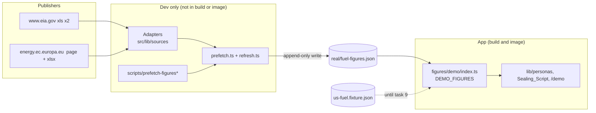

# Design: 04 Real figures

Follows `data-integrity.md`, `neutrality.md`, `product.md`, `structure.md`, `tech.md` and `deploy.md`; this file records the decisions specific to this spec. Requirement numbers (R1.1 and so on) refer to `requirements.md` in this folder. Task numbers 1 to 10 are the whole-number order from R15.4 and match `tasks.md`.

## Blocker check (R2.3): none

Neither publisher asks for a key, token or cookie for the files this spec uses. Checked on **2026-10-31** with `curl` and with Node's `fetch` (no headers beyond the defaults): all four downloads answered `200` and returned the real files (details under "Source files"). The EIA API (`api.eia.gov`) and the EIA bulk file do need or involve a key or a 55 MB download. They are **not** used, and nothing in this design depends on a key.

## Owner decisions

All six decisions from the first review round are settled. D2 and D5 were changed by the owner; the rest were accepted as proposed.

| # | Decision | Status |
|---|---|---|
| D1 | **Value precision for the EU series.** The Oil Bulletin stores the EU27 weighted average at full double precision (for example `1954.037871213403`) and only *displays* two decimals (`1,954.04`). The Decimal_Rule stores the stored number, not the display text. Display rounding stays in `formatValue`. | **Accepted.** Full precision (`tech.md`: "full published precision … round only for display"). |
| D2 | **Parser package.** `@e965/xlsx` 0.20.3, a registry republish of the official SheetJS 0.20.3 release, written in `devDependencies` as the exact string `"0.20.3"` (no range operator). Imports are `from "@e965/xlsx"`. **Why not the SheetJS tarball URL:** a URL dependency needs a root `.npmrc` (`allow-remote=root` under npm 12), which only the owner can add, and it makes every CI run and every Docker build fetch from `cdn.sheetjs.com` (the `deps` stage runs `npm ci` with devDependencies). The registry package avoids both. Details, advisory notes and provenance under "Parser package". | **Accepted, changed by the owner** back from the SheetJS tarball URL to the `@e965/xlsx` registry package. |
| D3 | **How "plain `node`" runs TypeScript (R6.1).** A tiny `.mjs` launcher bundles the TypeScript entry with `esbuild` in memory and runs it. `esbuild` `0.28.2` is already a direct, exactly pinned `devDependency` on `main` (added by spec 03 task 4), so this spec adds no `esbuild` line. | **Accepted.** |
| D4 | **EIA excerpts are re-encoded, not byte slices (R8.3).** EIA only offers legacy `.xls` (BIFF8) files of 118 to 128 KB, above the 100,000-byte limit, and a BIFF file can't be cut by hand. The excerpts are written by SheetJS from the real file with rows removed. Every kept cell keeps its stored number, text and number format. The Oil Bulletin excerpt *is* a byte-level slice (XML rows and columns removed). | **Accepted**, with the note file saying so plainly. |
| D5 | **Backfills fail the run.** A refresh that would add a period earlier than the series' latest Existing_Figure prints one `backfill` line per period, exits non-zero and leaves the Real_File unchanged (the same path as an Adapter failure, R6.3). The first run, with no Real_File, has no backfills. The check protects the Sealing_Script: a period added before a persona's `written_as_of` could change that persona's "then" figure. | **Accepted, changed by the owner** from the earlier "report only" proposal. See R7.1 and R7.8. |
| D6 | **Two existing assertions change in task 7.** `src/lib/figures/demo/index.test.ts` and `src/lib/figures/then-now.test.ts` each assert that a catalogue series has no figures in `DEMO_FIGURES` (the second one: "a real catalogue series id has no figures in the demo file: no_figures"). Both stop being true once the Real_File is merged in. They read catalogue emptiness, not fixture values or IDs, so I read them as outside R9.5's "keep passing unchanged", and task 7 changes exactly those two assertions. | **Accepted.** The first review found one such assertion; reading the real code on `main` found the second. |

## Overview

This spec swaps the data behind the persona demo. The catalogue, `loadFigureFile` and `thenAndNow` do not change. What is new:

1. **Two Adapters** in `src/lib/sources/`: `eia` (U.S. EIA, two series) and `oil-bulletin` (European Commission, two series), on top of shared modules (errors, download, date serials, the Decimal_Rule). Each Adapter downloads a public spreadsheet, finds its series by identity (series ID or header key), and returns figures plus gaps. No Adapter reads an environment variable or sends a credential.
2. **An append-only refresh** (`refresh.ts`) and **a Prefetch_Script** (`scripts/prefetch-figures*`, run by hand) that runs both Adapters, merges the result into `src/lib/figures/real/fuel-figures.json` append-only, refuses backfills, checks the would-be file with `loadFigureFile`, and writes it only if it loads.
3. **The Real_File**: 712 weekly figures, 178 per series, from 2023-06-05 to 2026-10-26, 332,269 bytes (measured on a trial file on 2026-10-31; task 6 commits the real one).
4. **A Merged_Set step and a final step for `DEMO_FIGURES`** (tasks 7 and 9), **Maya's move to catalogue IDs** with a new letter ID (task 8), and **the reveal's no-fixture check** (task 10).

Nothing in this spec reaches the runtime image or the browser bundle through the tools: the Adapters, the Prefetch_Script and the spreadsheet parser are dev-only, kept out of the Next.js build by an import-boundary test (R6.7). Only the committed JSON file travels.

### State of `main` this design was written against

Read from the code on `main` at commit `c24099d` ("Reveal views, styles and flow property test (part 2 of #48)"), on 2026-11-01.

| Item | State | Consequence |
|---|---|---|
| `src/lib/figures` (catalogue, `loadFigureFile`, `thenAndNow`, `isFixtureFigure`, `computeChange`, `format-change`) | Merged. `src/lib/figures/demo/index.ts` exports `DEMO_FIGURES = loadFigureFile(fixture, CATALOGUE)` (fixture only). | Tasks 7 and 9 edit `demo/index.ts`. |
| `src/lib/personas` (`PERSONAS`, `RETIRED_LETTER_IDS`, `parsePersonaList`, `checkLetterText`) and `content/personas/personas.json` | Merged. `src/lib/personas/schema.ts` imports `DEMO_FIGURES` and fails at import if a tracked `metric_id` is not in `DEMO_FIGURES.series`. Maya uses `fixture-us-gasoline-regular` and `fixture-us-diesel`, letter ID `wom_GdH6gqP6AGgnyhIMgA`, and `retired_letter_ids` is `[]`. | Task 8 edits `personas.json`. |
| Sealing_Script (`scripts/seal-personas-core.ts`, `scripts/seal-personas.ts`, `scripts/seal-personas.build.mjs`, `dist/seal-personas.mjs`) | **Merged** (issue #45, PR #63). Exports `buildPersonaPayload(p, text, figures)`, `sealPersonas(deps)`, `formatResultLine`, and the types `Deps`, `PersonaResult`, `FailureReason`. The entry loads `PERSONAS` and `DEMO_FIGURES` by dynamic import after a `DATABASE_URL` guard. | The consistency argument below is checked against this code. |
| `migrate` init container | **Merged** (issue #46, PR #71). `deployment.yaml` runs `node scripts/migrate.mjs && node scripts/seal-personas.mjs` when `demo.sealPersonas` is true; the `Dockerfile` copies `dist/seal-personas.mjs` to `scripts/seal-personas.mjs`. Chart version is `0.3.0`. | A mismatch fails the init container and the web pod does not start. Nothing in this spec changes the chart. |
| `esbuild` | `0.28.2`, a direct, exactly pinned `devDependency` (`package.json`). `npm run build` is `next build && node scripts/seal-personas.build.mjs`. | The Prefetch_Script launcher reuses it; no `package.json` change for D3. |
| `/demo` index (`src/app/demo/page.tsx`, `PersonaCard`, `DemoLabel`) | Merged (issue #47). A server component that imports `PERSONAS`. | Measured below: `DEMO_FIGURES` is in the server bundle only. |
| Opening flow and reveal views (`src/components/reveal/`: `OpeningFlow.tsx`, `useOpeningFlow.ts`, `opening-machine.ts`, `api.ts`, `StillSealed`, `SealIntact`, `RecallStep`, `FlowError`, `RememberedAnswers`, `Reveal.tsx`) | Merged as parts 1 and 2 of issue #48 (PRs #72, #73). `Reveal.tsx` renders stage 1 only; stages 2 and 3 render nothing yet. | No component imports `DEMO_FIGURES` yet. |
| Persona route `src/app/demo/personas/[key]/` | **Not on `main`.** Issue #48 is open and PR #69 is in review. | Nothing in this spec depends on it. |
| Reveal stage 2 and 3 (`SealedLetter`, `FiguresThenNow`, fixture labels; spec 03 task 8, issue #49) | **Not on `main`.** | Tasks 9 and 10 are blocked by #49. It is also the change that will put `DEMO_FIGURES` into a client chunk (see "Real_File size"). |
| `src/lib/sources/`, `scripts/prefetch*`, `src/lib/figures/real/` | Do not exist. | Created by tasks 1 to 6. |

## Source files

All checked on **2026-10-31** (UTC). Neither publisher offers a CSV for these series. EIA's history page links only an `.xls` file, and `…w.csv` answers `404`. The Bulletin page lists only `.xlsx` files. So R13.1's "prefer CSV" cannot apply, and a spreadsheet parser is needed.

| | EIA gasoline | EIA diesel | Weekly Oil Bulletin history |
|---|---|---|---|
| Download URL | `https://www.eia.gov/dnav/pet/hist_xls/EMM_EPMR_PTE_NUS_DPGw.xls` | `https://www.eia.gov/dnav/pet/hist_xls/EMD_EPD2D_PTE_NUS_DPGw.xls` | Found on `https://energy.ec.europa.eu/data-and-analysis/weekly-oil-bulletin_en` (see below); today `https://energy.ec.europa.eu/document/download/906e60ca-8b6a-44e7-8589-652854d2fd3f_en?filename=Weekly_Oil_Bulletin_Prices_History_maticni_4web.xlsx` |
| Response | `200`, `application/vnd.ms-excel`, 128,000 bytes | `200`, same type, 117,760 bytes | `200`, `application/vnd.openxmlformats-officedocument.spreadsheetml.sheet`, 4,497,830 bytes |
| Format | Legacy `.xls` (BIFF8, Composite Document File V2) | same | `.xlsx` (OOXML), 7 sheets |
| Key needed | No | No | No |
| Host | `www.eia.gov` | `www.eia.gov` | `energy.ec.europa.eu` |

The EIA URL pattern is the one EIA's own page uses: the series history page `…/hist/LeafHandler.ashx?n=PET&s=<ID>&f=W` links `hist_xls/<ID>w.xls`. The page also says "Release Date: 10/27/2026, Next Release Date: 11/3/2026", which matches the newest data row (week of 2026-10-26).

**Finding the Bulletin file (a design choice).** The history file's link contains a document UUID (`906e60ca-…`) that the Commission may change when it republishes. The Oil_Bulletin_Adapter therefore downloads the Bulletin page first and picks the single `href` whose `filename=` query value is exactly `Weekly_Oil_Bulletin_Prices_History_maticni_4web.xlsx`, then downloads that link. Both requests go to `energy.ec.europa.eu`. Zero matches or more than one match is an error naming the page URL (`link_not_found`). On 2026-10-31 the page had exactly one match.

### How each file identifies its series

**EIA (`Data 1` sheet; the `Contents` sheet is ignored).**

| Cell | Content (gasoline) | Use |
|---|---|---|
| `A1` / `B1` | `Back to Contents` / `Data 1: Weekly U.S. Regular All Formulations Retail Gasoline Prices  (Dollars per Gallon)` | none |
| `A2` / `B2` | `Sourcekey` / `EMM_EPMR_PTE_NUS_DPG` | **Series identity (R3.2)**: `A2` must be `Sourcekey` and `B2` must equal the requested series ID. |
| `A3` / `B3` | `Date` / `Weekly U.S. Regular All Formulations Retail Gasoline Prices  (Dollars per Gallon)` | **Unit (R3.3)**: `B3` must end with `(Dollars per Gallon)`. |
| `A4…` / `B4…` | numeric date serial / numeric price, oldest first | Data rows. Date cells are numbers with the format `Mmm dd, yyyy` (for example `45418` shown as `May 06, 2024`). |

The diesel file is the same layout with `B2` = `EMD_EPD2D_PTE_NUS_DPG` and title `Weekly U.S. No 2 Diesel Retail Prices  (Dollars per Gallon)`. Data starts in 1990 (gasoline) and 1994 (diesel). All 178 dates from 2023-06-05 to 2026-10-26 are Mondays in both, with no gaps.

**Oil Bulletin (`Prices with taxes` sheet, `A1:HR1118`).**

| Row | Column A | Column B | Column C | Column D |
|---|---|---|---|---|
| 1 (header keys) | `Consumer prices of petroleum products inclusive of duties and taxes` | `CTR` | `EU_price_with_tax_euro95` | `EU_price_with_tax_diesel` |
| 2 (product names) | empty | empty | `Euro-super 95  (I)` | `Gas oil automobile Automotive gas oil Dieselkraftstoff (I)` |
| 3 (unit labels) | `Date` | empty | `1000 l` | `1000 l` |
| 4 and down | numeric date serial (format `dd/mm/yy`), newest first | `EU_` | number | number |

- The header key `EU_price_with_tax_euro95` appears in exactly one column (`C`), and `EU_price_with_tax_diesel` in exactly one (`D`). The only repeated header key in row 1 is `CTR`. The catalogue text says column C and column D, so **no `catalogue.ts` correction is needed** (R4.4).
- Column B holds `EU_` on every data row in the window. The EU key means the EU27 weighted average: the file's own notes (rows 1097 to 1103) list `2020-` as the 27 current member states, and the latest weekly file's `CE/EC/EG EUR27_2020 … Moyenne pondérée / Weighted average` row holds the same numbers (see "Decimal_Rule"). Coverage_Start (2023-06-01) is after 2020, so the whole window has one membership.
- Data rows run from row 4 (2026-10-26) down to row 1093 (2005-01-03). Rows 1094 and below are footnotes, all in text cells (`Notes:`, `EU - European Union`, …). The notes include: "preliminary; weighted averages for EU and EUR may change when final weights (annual consumption) for corresponding years arrive". So the **publisher itself says past EU values can be revised**. This is the reason for the append-only rule and the Revision report (R7.3).
- The date system is the 1900 system (`date1904 = false`).
- In the window there are 178 data rows (2023-06-05 to 2026-10-26, all Mondays), no empty C or D cell, no duplicate date, and strictly descending dates.

## Architecture

```
src/lib/sources/                  # dev-only; nothing outside this folder imports it (R6.7)
├── types.ts                      # SourceFigure, SourceGap, SeriesResult, AdapterDeps (task 1)
├── errors.ts                     # SourceError and its kinds (task 1)
├── fetcher.ts                    # Fetcher type, defaultFetcher, allowed-host check, download() (task 1)
├── serial-date.ts                # spreadsheet date serial -> "YYYY-MM-DD", UTC only (task 1)
├── decimal-rule.ts               # cell -> decimal string (R5) (task 1)
├── test-support/workbook.ts      # builds clearly fake .xls/.xlsx bytes for tests (task 1)
├── boundary.test.ts              # R6.7, R13.1, R13.3; extended in task 5 (task 1)
├── eia.ts                        # EIA_Adapter (task 2)
├── oil-bulletin.ts               # Oil_Bulletin_Adapter (task 3)
├── refresh.ts                    # append-only merge, backfill detection, deterministic serialisation (task 4)
├── prefetch.ts                   # runPrefetch(deps): both Adapters + refresh + checks, no fs (task 5)
├── __recorded__/                 # Recorded_Excerpts, tests only (R8)
│   ├── eia-gasoline.xls          # + .note.txt   (task 2)
│   ├── eia-diesel.xls            # + .note.txt   (task 2)
│   ├── oil-bulletin-prices-with-taxes.xlsx  # + .note.txt  (task 3)
│   └── oil-bulletin-page.html    # + .note.txt   (task 3)
└── *.test.ts
scripts/
├── prefetch-figures.mjs          # launcher: bundles the .ts entry in memory, runs it with plain node (task 5)
├── prefetch-figures-main.ts      # wiring only: real fetch, fs read/atomic write, printing, exit code (task 5)
├── prefetch-excerpt-eia.mjs      # one-off: writes the EIA Recorded_Excerpts from the real files (task 2)
└── prefetch-excerpt-bulletin.mjs # one-off: writes the Bulletin Recorded_Excerpts (task 3)
src/lib/figures/real/
└── fuel-figures.json             # the Real_File (task 6)
src/lib/figures/merge.ts          # mergeLoadedFigures (task 7)
src/lib/figures/demo/index.ts     # DEMO_FIGURES (tasks 7 and 9)
```

There is no `src/lib/sources/index.ts` barrel: each task imports from the file it needs, so tasks 2, 3 and 4 can run side by side without touching the same file.



- **The only link from the dev side to the app side is a committed JSON file.** The app never imports an Adapter, and the Prefetch_Script never imports the app's pages. The Prefetch_Script and `prefetch.ts` do import `CATALOGUE`, `loadFigureFile` and the figure types from `@/lib/figures`, which is the allowed direction.
- `src/lib/sources/**` and `scripts/prefetch*` are data-dev paths in `.github/agents.json` already.
- `.dockerignore` excludes `scripts/` except `scripts/migrate.mjs` and `scripts/seal-personas*`, so the launcher and the entry never enter the image build. `src/lib/sources/**` is in the context (it is under `src/`) but nothing imports it, so `next build` does not bundle it. The final stage copies only `.next/standalone`, `.next/static`, the migration files, `dist/seal-personas.mjs` and two packages. **No change to the `Dockerfile`, `.dockerignore` or the Helm chart is needed**, so R6.8 does not apply. This was checked by reading the current files, not assumed.
- `@e965/xlsx` is a devDependency. `npm ci` in the `deps` stage installs it (dev dependencies are included there), `tsc` inside `next build` type-checks `src/lib/sources/**` against its types, and the standalone output does not contain it. The `seal-personas.build.mjs` bundle fails if its output imports anything that is not a Node built-in, which would catch an accidental `@e965/xlsx` import.

## Components and Interfaces

### Shared types, errors and download (`types.ts`, `errors.ts`, `fetcher.ts`)

```ts
// types.ts
interface SourceFigure { period: string; value: string }          // period: YYYY-MM-DD
interface SourceGap { period: string; reason: "no_number" | "not_a_number" }
interface SeriesResult { points: SourceFigure[]; gaps: SourceGap[] } // points ascending by period
interface AdapterDeps { fetcher?: Fetcher; now?: () => Date }
```

```ts
// errors.ts
type SourceErrorKind =
  | "auth_required"      // 401, 403, 407 (R2.3)
  | "http_status"        // any other non-2xx
  | "network"            // fetch threw or timed out
  | "empty_body"         // 0 bytes
  | "wrong_host"         // request or final URL host not in the allowed set (R2.5)
  | "unreadable_file"    // the parser could not open the bytes
  | "link_not_found"     // Bulletin page has zero or several matching links
  | "series_mismatch"    // EIA: Sourcekey differs or is missing (R3.2)
  | "unit_mismatch"      // EIA title unit, or Bulletin unit label (R3.3, R4.3)
  | "sheet_missing"      // R4.2
  | "header_missing"     // R4.2, incl. the date column header
  | "header_duplicated"  // R4.2
  | "bad_date"           // R3.6, R4.7
  | "duplicate_date"     // R4.8
  | "bad_cell"           // R5.6
  | "bad_row_marker"     // Bulletin column B is not "EU_" on a row that would be emitted
  | "date_system";       // workbook uses the 1904 date system

class SourceError extends Error {
  readonly publisher: "eia" | "oil-bulletin";
  readonly kind: SourceErrorKind;
  // message: fixed text naming publisher, kind and the identifying detail
  // (URL, status, series IDs, header key, row number, date). Never cell contents
  // beyond the single offending value in `bad_cell`.
}
```

```ts
// fetcher.ts
type FetchResult = { status: number; url: string; body: Uint8Array };
type Fetcher = (url: string) => Promise<FetchResult>;

const ALLOWED_HOSTS = ["www.eia.gov", "energy.ec.europa.eu"] as const;
const defaultFetcher: Fetcher; // global fetch, redirect: "follow", 60 s timeout, no headers set, no credentials
```

`download(fetcher, url, publisher)` is the one place that applies R2: it refuses a URL whose host is not in `ALLOWED_HOSTS` before sending, checks the final URL's host after redirects, turns `401/403/407` into `auth_required` (message: publisher and status), other non-2xx into `http_status`, a thrown error into `network` (message names publisher and URL, never the underlying library message), and an empty body into `empty_body`. A body over 20 MB is `unreadable_file`. The Adapters take `AdapterDeps`, so tests pass recorded bytes and never touch the network (R2.6).

### Date serials (`serial-date.ts`)

`serialToDate(serial: number): string` accepts an integer from 61 to 2,958,465 and returns `YYYY-MM-DD` from `Date.UTC(1899, 11, 30) + serial * 86_400_000` read with `getUTCFullYear/Month/Date`. Anything else (a fraction, a string, a number below 61 where the 1900 leap-year quirk lives, a number past year 9999) throws `RangeError`, which the Adapters turn into `bad_date` with the row number. It uses no local-time method, so the result cannot depend on the machine's timezone (R3.4, R4.5). The package's own date helpers are not used.

### Decimal_Rule (`decimal-rule.ts`)

```ts
interface Cell { t: string; v?: unknown; w?: string } // as the parser gives it, text generation on
function cellToDecimal(cell: Cell): string;           // throws a plain Error; Adapters wrap it as bad_cell
```

The rule, stated once for both Adapters (the derivation is under "Decimal_Rule: what the real files contain"):

1. The cell type must be numeric (`t === "n"`) and `v` a finite number. Otherwise: error.
2. `s = String(v)`. This is the ECMAScript shortest-round-trip decimal for the stored double.
3. `d` = the cell's displayed text with spaces and thousands commas removed (the Bulletin shows ` 1,954.04 `, EIA shows `3.643`).
4. **Noise guard.** If `d` matches the value pattern, `d !== s`, and `v.toPrecision(15) === Number(d).toPrecision(15)`, the stored number is a display value plus noise below Excel's own 15-digit precision, and the result is `d`. Otherwise the result is `s`. (`toPrecision` is used only to compare. Neither it nor any arithmetic produces the output.)
5. The result must match `^-?[0-9]+(\.[0-9]+)?$` and be at most 40 characters. An exponent form (a value of 1e21 or more, or below 1e-6) fails this and is an error.

The output is always one of two strings that already exist: the shortest round-trip form of the stored number, or the publisher's displayed text. No rounding, scaling or `toFixed` is applied (R5.3).

### EIA_Adapter (`eia.ts`, task 2)

```ts
interface EiaResult {
  seriesId: string;
  downloadUrl: string;
  downloadedAt: string;     // UTC, YYYY-MM-DDTHH:MM:SSZ, taken when the download finished
  result: SeriesResult;
}

function eiaDownloadUrl(seriesId: string): string;       // https://www.eia.gov/dnav/pet/hist_xls/<ID>w.xls; ID must match ^[A-Z0-9_]+$
function parseEiaWorkbook(bytes: Uint8Array, seriesId: string): SeriesResult;   // pure
function fetchEiaSeries(seriesId: string, deps?: AdapterDeps): Promise<EiaResult>;
```

`parseEiaWorkbook`:

1. Opens the bytes with the parser; failure is `unreadable_file`. Requires a sheet named `Data 1`.
2. Checks `A2 = "Sourcekey"` and `B2 = seriesId` (`series_mismatch`, message names both IDs, or `none`), and that `B3` ends with `(Dollars per Gallon)` (`unit_mismatch`, message names the found title).
3. For each row from 4: if `A` is a number, it is a data row, and `serialToDate(A)` gives the period (failure: `bad_date` naming the row). If `A` is not a number but `B` is, that is `bad_date` too. Otherwise the row is skipped (this is how an excerpt with removed rows, or a blank row, is handled).
4. Rows with a period before `2023-06-01` are dropped (R3.7). Of the rest, a row whose `B` is empty is a `no_number` gap, one whose `B` is a text cell is a `not_a_number` gap, and a numeric `B` goes through `cellToDecimal`; a failure there is `bad_cell` naming the series ID, period and the raw cell text (R5.6).
5. Points are sorted ascending by period. A period seen twice is `duplicate_date`.

### Oil_Bulletin_Adapter (`oil-bulletin.ts`, task 3)

```ts
const BULLETIN_PAGE = "https://energy.ec.europa.eu/data-and-analysis/weekly-oil-bulletin_en";
const BULLETIN_FILE_NAME = "Weekly_Oil_Bulletin_Prices_History_maticni_4web.xlsx";
type BulletinKey = "EU_price_with_tax_euro95" | "EU_price_with_tax_diesel";

interface BulletinResult {
  pageUrl: string;
  downloadUrl: string;
  downloadedAt: string;                                    // UTC, taken when the xlsx download finished
  columns: Record<BulletinKey, string>;                    // column letter where each key was found (R4.4)
  series: Record<BulletinKey, SeriesResult>;
}

function findBulletinLink(pageHtml: string, pageUrl: string): string;                 // pure
function parseBulletinWorkbook(bytes: Uint8Array): { columns: Record<BulletinKey, string>; series: Record<BulletinKey, SeriesResult> }; // pure
function fetchBulletin(deps?: AdapterDeps): Promise<BulletinResult>;
```

`parseBulletinWorkbook`:

1. Opens only the sheet `Prices with taxes` (`sheet_missing` if absent). Rejects a workbook with `date1904` set (`date_system`).
2. Scans row 1 for the two header keys. A key found in no column is `header_missing`; found in two or more is `header_duplicated`. The date column is the cell in row 3 whose text is `Date`; none is `header_missing`. **No column letter or position is used to find anything** (R4.1); letters are only reported.
3. The unit label for each value column is the text in row 3 of that column. It must be exactly `1000 l` (`unit_mismatch`, message names the found label).
4. Data rows: for each row from 4, if the date cell is a number it is a data row (`serialToDate`; failure is `bad_date` naming the row). If it is not a number but a value cell in either column *is* a number, that is `bad_date`. Otherwise the row is skipped. The footnote rows (text only) fall in the last case, so they are skipped.
5. For rows with a period on or after `2023-06-01`: column B must hold `EU_` (`bad_row_marker` naming the row). An empty value cell is a `no_number` gap, a text cell a `not_a_number` gap, and a number goes through `cellToDecimal` (failure `bad_cell`). The value stays in EUR per 1,000 litres exactly as published.
6. A period seen twice in the same column is `duplicate_date`. Points are sorted ascending (the file is newest first, so the order is reversed).

Opening the 4.5 MB workbook with only that one sheet takes about 1.1 seconds and a few tens of MB on the machine used (measured). `fetchBulletin` makes two requests: the page, then the file. The Adapter reports the found column letters and does not compare them to the catalogue; the comparison is in `runPrefetch` (task 5), the task that can act on it (R4.4).

### Refresh (`refresh.ts`, task 4)

```ts
interface FreshSeries { metricId: string; points: SourceFigure[]; downloadedAt: string; sourceUrl: string }

interface Report {
  perSeries: { metricId: string; kept: number; added: number; first: string; last: string }[];
  gaps: { metricId: string; period: string; reason: string }[];
  revisions: { metricId: string; period: string; committed: string; source: string }[];
  missingFromSource: { metricId: string; period: string }[];
  backfills: { metricId: string; period: string; latest: string }[];
}

type MergeResult =
  | { ok: true; figures: FigureV1[]; report: Report }
  | { ok: false; report: Report };      // ok:false only when report.backfills is non-empty

function mergeRefresh(existing: readonly FigureV1[], fresh: readonly FreshSeries[]): MergeResult;
function serialiseFigureFile(figures: readonly FigureV1[]): string;
```

**Append-only merge with backfill refusal (D5).**

```
existing = figures parsed from the current file (empty when the file is absent)
key(fig) = metric_id + "|" + period
for each catalogue series S in catalogue order:
  latest = the greatest period among existing figures of S, or none if S has no existing figure
  for each fresh point P of S, ascending:
    if key(P) in existing:
        if existing.value != P.value:  -> report revision (committed, source); keep existing untouched
    else if latest is not none and P.period < latest:
        -> report backfill (series, period, latest); do not add
    else:
        add a new figure built from P and the download time and URL     -> report added
  for each existing figure E of S whose key is not among the fresh points:
        -> report missingFromSource; keep E
if report.backfills is non-empty: return { ok: false, report }      // nothing is added, not even the later periods
result = every existing figure unchanged + the added ones
```

- An existing figure is carried through as the parsed object. Its `value` and `retrieved_at` are never recomputed (R7.1, R7.2).
- "Earlier than `latest`" is a string comparison of `YYYY-MM-DD`, the same order `loadFigureFile` sorts by for weekly series.
- A series with no existing figure has `latest = none`, so on the first run (no file) every period is added and no backfill is possible. A file that exists but holds no figure for one series treats that series the same way.
- A second run against the same bytes finds every key present with an equal value, adds nothing, and so serialises to the same bytes (R7.5).
- A period that appears in `existing` but whose fresh point is a gap is `missingFromSource`, not a revision.
- Adapters return nothing before Coverage_Start, so an `existing` figure older than that (not possible from this script) would simply be kept and reported as missing.
- A source gap that is filled in later (the publisher adds a week that was missing) is a backfill and fails the run. That is the behaviour the owner chose; what to do about it is left to the owner at that time.

**Deterministic serialisation (`serialiseFigureFile`, R1.9).** The file is written as:

```
{
  "fixture": false,
  "note": "<fixed text>",
  "series": [],
  "figures": [
    {"kind":"official","metric_id":"…", …},
    …
  ]
}
```

- Top-level key order is `fixture`, `note`, `series`, `figures`, then a final newline.
- Figures are ordered by catalogue position of `metric_id`, then `period` ascending (string order of `YYYY-MM-DD`).
- Each figure is `JSON.stringify` of an object built with the fixed key order `kind, metric_id, value, unit, region, period, source, series_id, retrieved_at, source_url` (the fixture's order), on one line indented four spaces, with `,` at the end of every line but the last.
- `note` is `Official weekly fuel prices from the U.S. EIA and the European Commission Weekly Oil Bulletin, from 2023-06-01. Written by scripts/prefetch-figures; existing figures are never changed.` (fixed, neutral, under 500 characters).
- Serialising the parsed output of a serialisation gives the same bytes, and the input order never matters.

A new figure is: `kind: "official"`, `metric_id`, `value` (from the Decimal_Rule), `unit`, `region`, `source` and `series_id` copied from the catalogue entry, `period`, `retrieved_at` = the UTC time of the download of the file it came from (`YYYY-MM-DDTHH:MM:SSZ`, no milliseconds, so never the placeholder), and `source_url` = the series' reference page recorded in `catalogue.ts` (the EIA history page for each EIA series, and `https://energy.ec.europa.eu/data-and-analysis/weekly-oil-bulletin_en` for both EU series). The URLs are taken from one small table in `prefetch.ts` that the Real_File test checks against the comments in `catalogue.ts`.

**Report wording (R7.6).** One line per item, in these fixed forms:

```
revision eu-petrol-euro95 2026-09-14 committed 2063.461446676449 source now shows 2063.47
backfill us-diesel 2024-02-12 latest 2026-10-26
added us-diesel 4 first 2026-10-26 last 2026-10-26
gap eu-diesel 2025-03-10 no_number
missing-from-source us-diesel 2024-02-12
```

The words "rose", "fell", "improved", "worsened", "corrected" and "revised" appear nowhere in the script's output or in Adapter errors; a test scans the strings.

### Prefetch (`prefetch.ts`, task 5)

```ts
interface PrefetchDeps { fetcher?: Fetcher; now?: () => Date }

type PrefetchErrorKind = "backfill" | "column_letter" | "coverage";
class PrefetchError extends Error {
  readonly kind: PrefetchErrorKind;
  readonly report: Report | null;   // set for "backfill" and "coverage", so the entry can still print what it found
}

function runPrefetch(existingJson: unknown | null, deps?: PrefetchDeps):
  Promise<{ text: string; report: Report }>;   // throws SourceError, PrefetchError or FigureDataError; touches no file
```

`runPrefetch` does, in order:

1. Run `fetchEiaSeries` for the two EIA IDs and `fetchBulletin` once (sequentially, so a failure names one publisher).
2. **Column check (R4.4).** For each Bulletin catalogue entry, read `column <LETTER> "<KEY>"` out of its `series_id` text with a pattern and compare it with `BulletinResult.columns`. A difference is a `PrefetchError` of kind `column_letter` naming both letters, and nothing is written. Today both match (`C`, `D`), so no catalogue edit is expected; if a letter ever differs, task 5 corrects only that letter and says so in its PR description.
3. Build `fresh`: for each catalogue series, its points tagged with the `downloadedAt` and `source_url` of the download they came from. Metric IDs map to sources: `us-gasoline-regular` and `us-diesel` to EIA by their `series_id`; `eu-petrol-euro95` to `EU_price_with_tax_euro95`; `eu-diesel` to `EU_price_with_tax_diesel`.
4. `mergeRefresh(existing, fresh)`. If it returns `ok: false`, throw `PrefetchError` of kind `backfill` carrying the report.
5. **Coverage check (R6.5).** For each series, the earliest figure's period must be on or before `2023-06-07`. Otherwise `PrefetchError` of kind `coverage`, naming the series and the earliest period.
6. `serialiseFigureFile(figures)` produces the text. Then `loadFigureFile(JSON.parse(text), CATALOGUE)` must succeed (R6.4). Only then is the text returned.

### Script entry (`scripts/prefetch-figures*`, task 5)

- **`prefetch-figures.mjs`** (what you run: `node scripts/prefetch-figures.mjs`). It uses `esbuild`'s `build()` to bundle `scripts/prefetch-figures-main.ts` with `bundle: true`, `platform: "node"`, `format: "esm"`, `packages: "external"` and `write: false`, writes the one output to `node_modules/.cache/revenant/prefetch-figures.mjs` (git-ignored, and inside the repo so bare imports like `@e965/xlsx` and `zod` resolve), then `await import()`s it. `tsconfig` `paths` (`@/…`) are resolved by esbuild. `esbuild` is already a pinned direct `devDependency` (D3).
- **`prefetch-figures-main.ts`** reads no environment variable and no argument. It reads `src/lib/figures/real/fuel-figures.json` if it exists, calls `runPrefetch`, and on success writes the text to a temporary file next to the target and renames it over it. On success it prints the Report (R6.6) and exits `0`, also when revisions or gaps were reported. On any thrown error it prints the error as one `prefetch failed: <publisher or kind> <detail>` line, exits `1`, and has not touched the target file (R6.3), because the file is replaced only by a rename after a successful full run. For a `PrefetchError` of kind `backfill` or `coverage` it first prints the Report lines it holds (so every `backfill` line is visible), then the failure line. It prints nothing from inside a Source_File except the single value in a `bad_cell` error.
- `package.json` gets `"prefetch": "node scripts/prefetch-figures.mjs"`. `build`, `test`, `lint` and `typecheck` do not call it (R6.9).
- **`prefetch-excerpt-eia.mjs`** (task 2) and **`prefetch-excerpt-bulletin.mjs`** (task 3) are one-off tools used to write the Recorded_Excerpts (see "Recorded excerpts"). Nothing runs them.

## Data Models

### Decimal_Rule: what the real files contain

Compared on the files downloaded on 2026-10-31, all cells in the window (2023-06-05 to 2026-10-26, 178 weeks per series), with the stored number read by the parser and the displayed text it produces from the cell's number format.

| Source | Cells | Number format | Stored number = shortest round-trip of itself, and equals the displayed text? | Cells where the noise guard changes the result |
|---|---|---|---|---|
| EIA gasoline | 178 | `0.000` | 178 of 178 (`String(v) === w`) | 0 |
| EIA diesel | 178 | `0.000` | 178 of 178 | 0 |
| Bulletin column C | 178 | accounting, 2 decimals (` 1,954.04 `) | stored number has up to 13 decimals; the displayed text is a 2-decimal rounding of it in 178 of 178 | 0 |
| Bulletin column D | 178 | same | same | 0 |

Over each file's **whole history** (3,585 EIA cells and 2,180 Bulletin EU cells) the noise guard also changed nothing.

Concrete cells (real data, fetched 2026-10-31):

| Series | Period | Stored in the file | Displayed | Rule result |
|---|---|---|---|---|
| `us-gasoline-regular` | 2024-05-06 | number `3.643` | `3.643` | `3.643` |
| `us-gasoline-regular` | 2024-11-04 | number `3.069` | `3.069` | `3.069` |
| `us-gasoline-regular` | 2026-10-26 | number `4.269` | `4.269` | `4.269` |
| `us-diesel` | 2024-05-06 | number `3.894` | `3.894` | `3.894` |
| `us-diesel` | 2026-10-26 | number `6.352` | `6.352` | `6.352` |
| `eu-petrol-euro95` | 2026-10-26 | XML text `1954.0378712134029` (read as the double `1954.037871213403`) | ` 1,954.04 ` | `1954.037871213403` |
| `eu-diesel` | 2026-10-26 | XML text `2146.1859738900539` | ` 2,146.19 ` | `2146.185973890054` |
| `eu-petrol-euro95` | 2024-11-04 | XML text `1629.2663410422444` | ` 1,629.27 ` | `1629.2663410422444` |
| `eu-diesel` | 2024-11-04 | XML text `1524.580178432713` | ` 1,524.58 ` | `1524.580178432713` |

**Why the rule equals the published number.**

- **EIA.** The stored number is the decimal EIA typed (three decimals). Its shortest round-trip text is that same decimal, and equals the displayed text on every cell. Nothing needs cleaning.
- **Bulletin.** The 17-digit text Excel writes into the XML (`1954.0378712134029`) is a rendering of the same double with a spurious last digit. In 41 of the 356 cells in the window it differs from the shortest round-trip form (`1954.037871213403`). Both denote the same stored number; the shortest form is the canonical one. The publisher itself stores the shortest form: the latest weekly file (`Prices with taxes`, row `CE/EC/EG EUR27_2020 (IV) Moyenne pondérée / Weighted average`, dated 26/10/2026) holds `1954.037871213403` and `2146.185973890054`, the same numbers as the history file for that week.
- **What the rule does not do.** It does not round the Bulletin's value to its two displayed decimals. That would discard published digits, and it is exactly the choice in D1 (accepted).
- **The R5.2 example** (`1463.0100000000002` displayed as `1463.01`) does not occur in these columns. The noise guard exists for it. For a stored `1463.0100000000002` with display `1,463.01`, `toPrecision(15)` is `1463.01000000000` for both, so the guard returns `1463.01`. A genuine long value such as `1751.1076729999997` shown as `1,751.11` (a national figure in the weekly file, not one of ours) does not match at 15 digits and stays as stored.
- **Cross-platform (R5.4).** `String(number)` is fixed by the ECMAScript specification (shortest digits that round-trip, closest on ties), so Node versions and operating systems agree. The displayed text comes from the parser's own pure-JavaScript number formatter, not from `Intl`.
- **BIFF numbers.** In `.xls` a cell is either a full double or a 30-bit integer optionally divided by 100. A division of two exact integers by 100 is correctly rounded by IEEE arithmetic, so it equals the double nearest the decimal literal; the rule's output is that literal.

**Test plan for the rule** (`decimal-rule.test.ts`, `decimal-rule.property.test.ts`, adapter tests):

- A table test with every row of the table above (stored number, display text, expected string), written by hand from the publisher's displayed numbers (R5.5). The Bulletin excerpt carries the real `1954.0378712134029` cell, so the "stored text is not shortest" case is exercised through a real file (task 3).
- The noise example `{ v: 1463.0100000000002, w: "1,463.01" }` gives `1463.01`; `{ v: 1751.1076729999997, w: " 1,751.11 " }` gives `1751.1076729999997`.
- Error cases: text cell, empty cell, `NaN`, `Infinity`, `1e21`, `1e-7`, a value that would be longer than 40 characters.
- A cross-check over every kept excerpt cell: the displayed text with separators removed equals the stored number rounded half up to the displayed number of decimals, computed with `BigInt` on the decimal string (a test-only check, never in the Adapter).
- Property 1 (below).

### Parser package (R13.1)

The files need two readers: legacy `.xls` (EIA) and `.xlsx` (Bulletin). Checked on 2026-10-31 and 2026-11-01 in temporary directories outside the repo (`npm view`, `npm audit`, and a trial parse of the real files):

| Package | Version | Reads `.xls`? | Reads `.xlsx`? | Findings |
|---|---|---|---|---|
| `xlsx` from the npm registry (`latest`) | 0.18.5 | yes | yes | **Rejected.** `npm audit`: high, prototype pollution (GHSA-4r6h-8v6p-xvw6, fixed in 0.19.3) and ReDoS (GHSA-5pgg-2g8v-p4x9, fixed in 0.20.2). SheetJS no longer publishes to the registry, so it stays on this version. |
| `exceljs` | 4.4.0 | **no** | yes | **Rejected.** Cannot read `.xls`. `npm audit`: 9 moderate advisories through `archiver`, `glob`, `minimatch` and `uuid`. Last release December 2024. |
| `read-excel-file` | 9.3.14 | **no** (it throws "Only `.xlsx` files are supported") | yes | **Rejected** for the same reason. Current (published 2026-10-29). |
| `@e965/xlsx` | **0.20.3** | yes | yes | **Chosen (D2).** A registry republish of the official SheetJS 0.20.3 release, which fixes both advisories above. `npm audit` on `@e965/xlsx@0.20.3` (re-run 2026-11-01 in a scratch directory): found 0 vulnerabilities. No dependencies. Apache-2.0. Provenance below. |
| `xlsx` 0.20.3 from the SheetJS CDN tarball | 0.20.3 | yes | yes | Chosen in the previous version of this design and replaced at the owner's request (D2). It needs a root `.npmrc` and a fetch from `cdn.sheetjs.com` on every CI run and Docker build. The content is the same as the row above. |

**How it is declared.** In `package.json`, under `devDependencies` only, as an exact version with no range operator:

```json
"@e965/xlsx": "0.20.3"
```

Imports are `import * as XLSX from "@e965/xlsx"` (and named imports as needed). Not in `dependencies`; a boundary test checks that (task 1).

**Why the registry package and not the SheetJS tarball URL.** The earlier version of this design used `https://cdn.sheetjs.com/xlsx-0.20.3/xlsx-0.20.3.tgz`. A URL dependency needs a root `.npmrc` (`allow-remote=root`, because npm 12 refuses URL dependencies by default), and `.npmrc` is in no role's paths, so only the owner can add it. It would also make every CI run and every Docker build fetch from `cdn.sheetjs.com`: the `deps` stage runs `npm ci` with devDependencies. A registry package needs neither, so no `.npmrc` is needed anywhere in this spec.

**Provenance (checked 2026-11-01 in a scratch directory outside the repo, files deleted afterwards).** `@e965/xlsx@0.20.3` is a republish of the official SheetJS 0.20.3 build. It is byte-identical to the official tarball `https://cdn.sheetjs.com/xlsx-0.20.3/xlsx-0.20.3.tgz` in every file except `package.json` and `README.md`; `xlsx.mjs` has SHA-256 `1a0fb062ee9781b13f6687371b202aaefc53b6ce55b530c027e01f9c087b77db` in both (recorded when the two were first compared, and re-checked now against the published `@e965/xlsx` tarball from `npm pack`). The registry package reports licence Apache-2.0 and `npm audit` on it finds 0 vulnerabilities, against the high advisories on `xlsx@0.18.5` (the last version SheetJS published to the registry).

**What the lockfile pins (verified, not assumed).** `npm view @e965/xlsx@0.20.3 dist.integrity` and a `npm install --package-lock-only` in the scratch directory give, for lockfile version 3, as this repo uses:

```json
"node_modules/@e965/xlsx": {
  "version": "0.20.3",
  "resolved": "https://registry.npmjs.org/@e965/xlsx/-/xlsx-0.20.3.tgz",
  "integrity": "sha512-703RN/3OdsRD5mtse2HBX7Um7xwaP9tlswEG6svOtjqokXoX7rJdQj7DyabD2I+xk22RgaIIU+R6BHgkpZGB/w==",
  "dev": true,
  "license": "Apache-2.0",
  "bin": { "xlsx": "bin/xlsx.njs" }
}
```

So `package-lock.json` pins the registry URL and an SHA-512 integrity hash of the tarball, and `npm ci` rejects a tarball that does not match it. **Task 1 adds the dependency and must commit the resulting `package-lock.json` entry**, and its PR description must state the committed `integrity` hash and that it equals the value above (a different value means the registry package changed and the task stops and asks the owner). `package-lock.json` is excluded from the PR size count. Nothing is installed in this repo by this design.

- **How the Decimal_Rule stays exact with it.** The parser turns an `.xlsx` `<v>` text or a BIFF number record into a JavaScript double with the standard parse, and gives the displayed text in `cell.w`. `cellToDecimal` reads only `t`, `v` and `w`. No parser option that applies rounding or date conversion is used: `cellDates` stays `false`, so dates arrive as raw serials.
- Parse options: `type: "buffer"`; for the Bulletin, `sheets: ["Prices with taxes"]`; nothing else.
- The parser is untrusted-input code, but the inputs come from two fixed public hosts, the script runs by hand on a dev machine, and the version has no known advisory.

### Real_File: size, and effect on the browser (R13.4)

Measured by building a trial file from the real data with the layout above (one figure per line, 4-space indent):

| Measure | Value |
|---|---|
| Figures | 712 (178 per series × 4), periods 2023-06-05 to 2026-10-26 |
| Average line | 467 bytes (the EU `series_id` text is about 190 characters, repeated per line) |
| Size | **332,269 bytes** (limit 1,000,000, R1.10) |
| gzip -9 / brotli | 9,774 bytes / 6,397 bytes |
| Lines in the task 6 diff | about 720 (limit 3,000) |
| Growth per weekly refresh | 4 lines, about 1.9 KB |

**Does `DEMO_FIGURES` reach the browser today? No. Measured on `main` (commit `c24099d`, 2026-11-01).**

How I checked:

1. `grep` over `src/` and `scripts/` for importers of `@/lib/figures/demo` and `@/lib/personas`. The non-test importers of `DEMO_FIGURES` are `src/lib/personas/schema.ts` and `scripts/seal-personas.ts`. The non-test importer of `@/lib/personas` is `src/app/demo/page.tsx`, a server component. No `"use client"` module imports either; `PersonaCard` and `DemoLabel` are client modules that receive plain list fields through props. `src/components/reveal/**` imports neither.
2. `npm run build` on that commit. Result for `/demo`: page chunk 617 B, First Load JS **107 kB** (of which 103 kB is the chunk set shared by every route).
3. `grep` of every file under `.next/static/` (all client JavaScript) for the strings `fixture-us-gasoline`, `EMM_EPMR_PTE_NUS_DPG` and `FIXTURE`: **no matches**. The same strings are in `.next/server/app/demo/page.js` (34,549 bytes), the server bundle of `/demo`, and in `dist/seal-personas.mjs` (1,323,078 bytes).

So today `DEMO_FIGURES` contributes **0 bytes** to any client chunk. Replacing the fixture with the Real_File changes two files that are not sent to the browser: the `/demo` server bundle and `dist/seal-personas.mjs` (the init-container script that is copied into the image), each growing by about the 332 KB of JSON (the fixture it replaces is a few KB). Neither is a client download. I could not take a before and after measurement of the Real_File itself, because it does not exist yet; the 9,774-byte gzip figure comes from the trial file built on 2026-10-31, and the sizes above are measured on the current build.

**When it will reach the browser.** The reveal's figures stage (spec 03 task 8, issue #49, which blocks tasks 9 and 10: `FiguresThenNow`, "`DEMO_FIGURES` is a static import") is a client component, so once it merges, the client chunk of the persona route will include the figure data. The persona route itself (issue #48) is also not on `main` yet. **Estimated effect: about 10 to 11 KB gzipped** (9.8 KB at maximum gzip level; about 6.4 KB with brotli), against the roughly 50 KB gzipped threshold in R13.4. That is under the threshold, so **I do not propose server-side picking**, and none is adopted. If the owner later adds more series (groceries, rent, more regions) and the total passes about 50 KB gzipped, the picking option from R13.4 is the next step. Task 6 re-checks the measured raw and gzip size of the committed file and states it in its PR description.

### Recorded excerpts

All under `src/lib/sources/__recorded__/`, tests only (nothing outside `*.test.ts` imports them, R8.9). Recorded 2026-10-31. Each has a `<file>.note.txt` saying: it is a recorded excerpt of a real file, the download URL, the UTC recording time, which rows and columns it keeps, how it was made, and that its numbers must not be used for display (R8.2). Each is under 100,000 bytes. Binary excerpts count as 0 changed lines for the PR size limit.

| File | Source | Keeps | Size | Task |
|---|---|---|---|---|
| `eia-gasoline.xls`, `eia-diesel.xls` | the two EIA `.xls` files | Sheet `Data 1`, rows 1 to 3 (headers), and the data rows for 2023-05-29 (before Coverage_Start), 2023-06-05, 2023-06-12, 2024-05-06, 2024-11-04 and 2026-10-26; the `Contents` sheet is dropped | about 6 KB each | 2 |
| `oil-bulletin-prices-with-taxes.xlsx` | the history workbook | Sheet `Prices with taxes` only, columns A to D, rows 1 to 3, the rows for 2026-10-26, 2026-10-19, 2026-10-12, 2024-11-04, 2024-05-06, 2023-06-05 and 2023-05-29, and footer rows 1096 (`Notes:`) and 1097; other sheets, comments, drawings and printer settings removed | about 13 KB (a trial slice measured 12,557 bytes) | 3 |
| `oil-bulletin-page.html` | the Bulletin page | The text around the "Price developments" links, including the history-file link and at least one other `.xlsx` link, so the "exactly one match" rule is tested | a few KB | 3 |

- **The Bulletin excerpt is a byte-level slice.** `prefetch-excerpt-bulletin.mjs` unzips the real workbook, deletes rows and cells in `sheet1.xml` as XML text, removes the other sheets and parts from the package files, and zips the result. Every `<v>` text, style and shared string kept is the publisher's, byte for byte. A trial slice with this method was read back by the parser and gave the same cells (for example `C4` = `1954.037871213403`, displayed ` 1,954.04 `).
- **The EIA excerpts are re-encoded** (D4). `prefetch-excerpt-eia.mjs` reads the real `.xls`, removes rows and the `Contents` sheet, and writes `.xls` again. After writing, it reads the excerpt back and compares every kept cell's type, stored number, displayed text and number format with the original; the note file records that this passed.
- The real files have **no gap cells in the window**. The gap tests therefore build their input in memory: they read an excerpt, delete a number cell or replace it with text, and write the workbook back to bytes (R8.5). `test-support/workbook.ts` (task 1) builds the clearly fake workbooks that the property tests and the failure-case tests need; these never reach the Real_File.

### Merged_Set (task 7)

`src/lib/figures/merge.ts`:

```ts
function mergeLoadedFigures(a: LoadedFigures, b: LoadedFigures): LoadedFigures;
```

- **Series.** The result's series map starts with all of `a`'s entries in order, then adds each of `b`'s entries whose ID is not in `a`. The entries are the existing frozen `LoadedSeries` objects, not copies, so every figure keeps its reference.
- **An ID in both** (this is the case for the four catalogue series, which both loads include; `loadFigureFile` adds every catalogue series to its result, with no figures when the file has none for it) is allowed only if both entries hold the same catalogue metric object (`===`; both loads read the one `CATALOGUE` array) and at most one of them has figures. The one with figures wins. Any other case throws `FigureDataError("duplicate_metric_id", "merged.series.<id>")` (R9.2). So a real series and a fixture series can never share an ID, and the check is the same one the single-file loader applies to its own duplicates.
- **`fixture` flag.** `merged.fixture = a.fixture || b.fixture`. For a single loaded file the flag keeps its existing meaning ("every figure in this file is fixture data" for `true`, none for `false`). For a Merged_Set it means "this set contains fixture data". It tells you nothing about any one figure. `loadFigureFile` and `isFixtureFigure` are not changed and stay correct per figure: each figure still carries its own `source` and `series_id`, no figure is copied or edited, and a real figure still returns `false` from `isFixtureFigure` while a fixture figure returns `true`. The only readers of the flag in non-test code today are `load.ts` and `demo/index.ts` (searched again on `main`), so no label or reveal code depends on it; the reveal uses `isFixtureFigure` per figure (spec 03 R13). A doc comment in `types.ts` and in `merge.ts` says so (R9.3).
- The result and its map are frozen the same way `loadFigureFile` freezes its own.

`src/lib/figures/demo/index.ts` in task 7:

```ts
const realSet = loadFigureFile(realFile, CATALOGUE);
const fixtureSet = loadFigureFile(fixtureFile, CATALOGUE);
export const DEMO_FIGURES: LoadedFigures = mergeLoadedFigures(realSet, fixtureSet);
```

and in task 9 it becomes `export const DEMO_FIGURES = loadFigureFile(realFile, CATALOGUE);` with the fixture import removed.

### Maya (task 8)

`content/personas/personas.json`, entry `us-maya`: `metrics` becomes `us-gasoline-regular` then `us-diesel`, with the same two `recall_subject` strings. `letter_id` becomes a new 22-character value generated once from a cryptographic random source (`node -e "console.log(require('node:crypto').randomBytes(16).toString('base64url'))"`) and checked with `isLetterId`; the old `wom_GdH6gqP6AGgnyhIMgA` goes into `retired_letter_ids`. Everything else, and `letters/us-maya.txt`, stay as they are.

What the demo will show for her, from the real files (illustrative; it follows from the data, and nothing in the entry was chosen for it, R10.5):

| Series | Then (2024-05-06, the last week on or before 2024-05-12) | Now (2026-10-26) | Difference | Percent |
|---|---|---|---|---|
| `us-gasoline-regular` (USD per gallon) | 3.643 | 4.269 | +0.626 | +17.2% |
| `us-diesel` (USD per gallon) | 3.894 | 6.352 | +2.458 | +63.1% |

(Percent is shown rounded; `computeChange` keeps the exact value.)

## Consistency across tasks 7, 8 and 9 (R12.3)

The invariant: **after every merge, every persona's tracked metric is in `DEMO_FIGURES`, has a "then" figure at the persona's `written_as_of`, and the payload the Sealing_Script rebuilds for each persona either matches its stored letter or has no stored letter yet.** The test from R10.7 and R12.1 (for each persona and each tracked metric, `thenAndNow(metric_id, written_as_of, DEMO_FIGURES).then.found`) runs in `npm test` and passes after each.

This was re-checked against the code on `main`:

- `src/lib/personas/schema.ts` runs at import and rejects any persona metric whose `metric_id` is not in `DEMO_FIGURES.series` (and runs `checkRecallSubject` against that series' metric). The Merged_Set contains every ID that Maya uses before and after task 8, so the list parses after each merge.
- `buildPersonaPayload(p, text, figures)` reads, for each tracked metric in list order, only `thenAndNow(metric_id, p.written_as_of, figures).then` (copied with a plain spread) and `figures.series.get(metric_id).metric` (picked to the six `MetricDefinitionV1` keys), then `generateRecallQuestions` and `payloadV1Schema.parse`. It reads no other part of `figures`, including the `fixture` flag.
- `sealPersonas(deps)` skips a persona only when `canonicalize(opened.payload) === canonicalize(built.payload)`; a row that opens but differs is `failed: stored_letter_differs`, and the entry exits `1`, which fails the `migrate` init container.

| After this merge | `DEMO_FIGURES` | Maya | Deploy (init container: `migrate`, then `seal-personas`) |
|---|---|---|---|
| **Task 6** (Real_File) | unchanged (fixture only) | unchanged | Unchanged. The Real_File is imported by nothing but its own tests. |
| **Task 7** | Merged_Set: the four catalogue series with real figures, plus the two fixture series, flag `true` | still `fixture-…` IDs, same letter ID | **Payload byte-identical** (below), so her stored row is `skipped`. |
| **Task 8** | unchanged (Merged_Set) | catalogue IDs, new letter ID, old ID retired | The new ID has no row, so the script builds the payload from the Real_File figures (2024-05-06: 3.643 and 3.894, both present) and `stored`s a new row. The old row stays in `demo_letters` untouched and no `/demo` page reaches it. |
| **Task 9** | real only, flag `false` | unchanged | Her payload is built from the same catalogue series and real figure objects as in task 8, so it is byte-identical and `skipped`. No persona names a `fixture-…` ID any more, so dropping the fixture removes nothing a persona needs. |
| **Task 10** | unchanged | unchanged | Tests only. |

**Why the task 7 payload is byte-identical.** In the Merged_Set the two fixture entries are the very `LoadedSeries` objects from the fixture-only load (reference-preserved, never copied), so the metric, the figure object and every string in them are the same objects as before, and `buildPersonaPayload` reads nothing else. The payload's `canonicalize` output cannot differ. Task 7's tests prove it for Maya's metrics and date: `thenAndNow` on the Merged_Set returns figure objects that are `===` to the ones from `loadFigureFile(fixture, CATALOGUE)`, and `merged.series.get(id)` is `===` the fixture-only `LoadedSeries`. The existing `src/test/integration/seal-personas-core.test.ts` (no database) passes unchanged, and `src/test/integration/seal-personas.test.ts` (database, generic over `PERSONAS` and `DEMO_FIGURES`) passes unchanged; the task validation runs both.

**A refresh after the switch** adds only periods later than a series' latest figure and never edits a committed figure, so "then" figures already in the file cannot change (R12.4). A refresh that would add an earlier period (a backfill) fails and writes nothing (D5, R7.8), which closes the one case that could have changed a persona's "then" figure.

Tests that change with each task:

- **Task 7**: two assertions that say the catalogue series have no figures in `DEMO_FIGURES` (D6): the `holds the two fixture series (alongside the empty catalogue series)` test in `src/lib/figures/demo/index.test.ts`, and `a real catalogue series id has no figures in the demo file: no_figures` in `src/lib/figures/then-now.test.ts`. Both change to the new state. Every other test keeps passing unchanged: they read fixture IDs, which the Merged_Set still holds, or iterate all series. `src/lib/personas/letter-checks.test.ts` collects every value, period, source and series ID in `DEMO_FIGURES` and checks Maya's subjects don't contain them, which still holds: the subjects have no digits and the new strings are not substrings of them (the task re-runs it).
- **Task 8**: `src/lib/personas/schema.test.ts` and `schema.property.test.ts` name `fixture-us-gasoline-regular` and `fixture-us-diesel` (R10.8). They change to `us-gasoline-regular` and `us-diesel`, which `DEMO_FIGURES` holds in both the Merged_Set and the final state, so they pass after task 8 and after task 9. No test in `src/lib/seal-format/` or `src/test/integration/` reads a fixture ID through `DEMO_FIGURES` (they build their own `FIXTURE` data, or iterate `PERSONAS`).
- **Task 9**: the tests in `src/lib/figures/` that read fixture IDs or values through `DEMO_FIGURES` (`then-now.test.ts`, `demo/index.test.ts`) load the fixture themselves with `loadFigureFile(fixture, CATALOGUE)` (R9.10); then the R11.1 and R11.3 checks are added.
- **Coordination with spec 03 task 8 (#49).** At the time of writing no test outside `src/lib/figures/` and `src/lib/personas/` reads a fixture ID through `DEMO_FIGURES`. Its tests must load the fixture file themselves rather than read fixture IDs through `DEMO_FIGURES` (R9.10), or task 9 breaks them. Task 9 is blocked by #49 ("Blocked by #49"), so that stage and its tests are on `main` when task 9 runs; task 9's grep check finds any such test and stops, and the line added to spec 03 task 8 tells the #49 agent to load the fixture itself.

## Correctness Properties

*A property is a characteristic or behavior that should hold true across all valid executions of a system-essentially, a formal statement about what the system should do. Properties serve as the bridge between human-readable specifications and machine-verifiable correctness guarantees.*

PBT applies here: the Decimal_Rule, date conversion, the sheet readers, the append-only merge and the serialiser are pure functions over large input spaces. It does not apply to the downloads, the launcher, the `package.json` and import checks, or the committed file checks; those get example and smoke tests (see Testing Strategy). Each property is one fast-check test (`fast-check` 4.10.2 is already a devDependency) with `numRuns: 100`, tagged `// Feature: 04-real-figures, Property N: <title>`. Synthetic workbooks used as inputs are built in the test with the parser's own writer from generated, clearly fake numbers (they never reach the Real_File).

During reflection, these were merged: the "no network", "no secret" and "no logging" rules are smoke tests, not properties; the gap rules of R3.5 and R4.6 are one property (4); "second run changes nothing", "existing figures unchanged" and "backfills are refused" are one property (6).

### Property 1: The Decimal_Rule is exact and idempotent on typed values

For any finite double `v` with `1e-6 <= |v| < 1e21`, `cellToDecimal({ t: "n", v, w: <any display text> })` matches `^-?[0-9]+(\.[0-9]+)?$`, has at most 40 characters, and `Number(result) === v` unless the noise guard fired. For any decimal literal `D` with at most 15 significant digits, up to 6 decimals and no trailing zeros, `cellToDecimal({ t: "n", v: Number(D), w: D })` equals `D`. For any such `D` and any double within 1 to 3 representable steps of `Number(D)` (made by bumping the IEEE bit pattern), with `w` set to `D`, the result is `D`. For any `v` outside the range, `NaN`, `±Infinity`, or a non-numeric cell, it throws.

**Validates: Requirements 5.2, 5.3, 5.4, 5.6**

### Property 2: Date serials convert to the right calendar date in any timezone

For any integer serial from 61 to 2,958,465, `serialToDate` returns the calendar date given by an independent day-count algorithm (written in the test with `BigInt` civil-from-days arithmetic), the result is a real date accepted by `isRealDate`, and it is the same string when the process runs with `TZ` set to `UTC`, `Pacific/Kiritimati` and `America/Adak`. For any non-integer, any value below 61 and any value above 2,958,465, it throws `RangeError`.

**Validates: Requirements 3.4, 3.6, 4.5, 4.7, 8.6**

### Property 3: EIA readback returns exactly the published in-window cells

For any generated EIA-shaped workbook (`Data 1` sheet, `A2`/`B2` = `Sourcekey`/series ID, `B3` ending `(Dollars per Gallon)`, rows of unique date serials in any order, each with a number or a gap) written as both `.xls` and `.xlsx` bytes, `parseEiaWorkbook` returns points equal to the numeric rows whose date is on or after `2023-06-01`, in ascending order, each with the Decimal_Rule's output for its cell, and no point for any earlier date. A workbook whose `B2` differs from the requested ID, or whose `B3` unit differs, throws `series_mismatch` or `unit_mismatch` and returns nothing.

**Validates: Requirements 3.1, 3.2, 3.3, 3.7**

### Property 4: Gaps are reported and never filled

For any generated EIA or Bulletin workbook in which some in-window value cells are emptied or replaced with text, every such period appears in `gaps` with the matching reason, appears in no `points`, and the other periods' points are exactly as in the same workbook without the damage. No point has a value taken from a neighbouring period. (The EIA half of this property is tested in task 2 and the Bulletin half in task 3.)

**Validates: Requirements 3.5, 4.6, 14.4**

### Property 5: The Bulletin columns are found by header key, wherever they are

For any generated Bulletin-shaped workbook where the two header keys sit in any two distinct columns (and any other columns, headers and row-1 text surround them), `parseBulletinWorkbook` returns the same series for any placement and reports each key's actual column letter. Removing a key throws `header_missing`; repeating a key in a second column throws `header_duplicated`; changing a unit label from `1000 l` throws `unit_mismatch`; two rows with the same date throw `duplicate_date`.

**Validates: Requirements 4.1, 4.2, 4.3, 4.4, 4.5, 4.8, 4.9**

### Property 6: A refresh never changes what is already committed and refuses backfills

For any valid existing Real_File content (possibly none, with arbitrary `retrieved_at` values) and any fresh Adapter data (with additional periods, differing values, gaps and missing periods), let a *backfill* be a fresh period absent from the existing figures of a series that has at least one existing figure, earlier than that series' latest existing period. Then:

- If there is no backfill, `mergeRefresh` returns `ok: true` with every existing figure deep-equal to its former self; every added figure has a key not present before and a period later than the series' latest existing period (or the series had no existing figure); `revisions` lists exactly the keys present in both with different values, each with the committed and the source value; `missingFromSource` lists exactly the existing keys with no fresh point; the serialised result loads through `loadFigureFile`; and running the refresh again with the same fresh data gives byte-identical text.
- If there is a backfill, `mergeRefresh` returns `ok: false`, `report.backfills` lists exactly the backfill periods with the series' latest existing period, and no figures are returned (so no other new period is added).
- With no existing figures at all, `mergeRefresh` never reports a backfill.

**Validates: Requirements 7.1, 7.2, 7.3, 7.4, 7.5, 7.7, 7.8**

### Property 7: Serialisation is deterministic, ordered and stable

For any valid set of figures in any order, `serialiseFigureFile` produces identical bytes for every permutation of the input; figures appear ordered by catalogue position then ascending period; each figure is on exactly one line; `serialiseFigureFile(parse(serialiseFigureFile(x)))` equals `serialiseFigureFile(x)`; and the number of lines equals the number of figures plus a fixed constant.

**Validates: Requirements 1.9, 7.7**

### Property 8: The merged set keeps every figure and every lookup

For any two loaded sets whose figure-bearing series IDs are disjoint (catalogue series may appear in both), `mergeLoadedFigures` holds every series of both; each series' figures array is the same object as in its source set; `merged.fixture` is true exactly when either input's flag is true; and for any series ID and any real date, `thenAndNow` on the merged set returns figures `===` to those `thenAndNow` returns on the set the series came from. For any ID that has figures in both sets, or any ID defined by two different metrics, it throws `FigureDataError` with rule `duplicate_metric_id`.

**Validates: Requirements 9.1, 9.2, 9.3, 9.4, 9.5**

## Error Handling

| Where | Condition | Result |
|---|---|---|
| `download` | Host not in the allowed list, before or after redirects | `SourceError wrong_host`; nothing parsed |
| `download` | `401`, `403`, `407` | `auth_required`, message names the publisher and status. The run stops. The work does not continue with a key, another source or a scraped page, and the owner is told (R2.3) |
| `download` | Other non-2xx; network error or timeout; empty body | `http_status`; `network`; `empty_body`. Each message names the publisher and the URL, never the library's own message (R2.4) |
| `findBulletinLink` | Zero or several links with the file name | `link_not_found`, message names the page URL |
| EIA parser | Unreadable bytes; sheet `Data 1` missing | `unreadable_file`; `sheet_missing` |
| EIA parser | `Sourcekey` differs; unit not dollars per gallon | `series_mismatch` (requested and found ID); `unit_mismatch` (found title) |
| Bulletin parser | Sheet, header key or date column missing; key repeated | `sheet_missing`; `header_missing`; `header_duplicated` |
| Bulletin parser | Unit label not `1000 l`; 1904 date system | `unit_mismatch` (found label); `date_system` |
| Both parsers | Date cell unreadable; same date twice | `bad_date` (row number); `duplicate_date` (date) |
| Both parsers | Value cell cannot become a decimal string | `bad_cell` (series, period, raw cell text) (R5.6) |
| Bulletin parser | Column B is not `EU_` on an emitted row | `bad_row_marker` (row number) |
| Both parsers | Number cell missing or text in the window | Not an error: the period is left out and reported as a gap |
| `runPrefetch` | Catalogue column letter differs from the found letter | `PrefetchError` `column_letter` naming both letters; the catalogue text is fixed (only the letter) in task 5 before any figure is committed (R4.4) |
| `runPrefetch` | A refresh would add a period earlier than the series' latest existing figure (backfill) | `PrefetchError` `backfill` carrying the report; the entry prints every `backfill` line, then the failure line, exits `1`, and the Real_File is untouched (R7.8) |
| `runPrefetch` | A series' earliest figure is later than 2023-06-07 | `PrefetchError` `coverage` naming the series and the earliest period (R6.5) |
| `runPrefetch` | The would-be file fails `loadFigureFile` | `FigureDataError` (`rule`, `path`); nothing is written (R6.4) |
| `prefetch-figures-main.ts` | Any thrown error | One `prefetch failed: …` line, exit `1`, the Real_File untouched, because the file is replaced only by a rename after a successful full run (R6.3) |
| Revision, missing period, gap | A difference between the file and the source | Printed in the Report, exit `0`; the committed figure is never touched |
| `mergeLoadedFigures` | A series ID with figures in both sets, or two different metrics under one ID | `FigureDataError duplicate_metric_id` at import of `demo/index.ts`, so tests and `next build` fail before any wrong data ships |
| `DEMO_FIGURES` | Real_File fails `loadFigureFile` | Throws at import (as the fixture does today) |

Nothing in the Adapters or the Prefetch_Script reads a secret or logs a Source_File's content beyond the Report and the one value in `bad_cell`. No message uses "rose", "fell", "improved", "worsened" or "corrected".

## Testing Strategy

- **Runner:** Vitest through `npm test`, no network, no database (R8.1). A global guard in the `src/lib/sources` tests replaces `fetch` with a function that fails the test, so an unstubbed request cannot pass (R8.1). Tests give the Adapters a `Fetcher` that returns the Recorded_Excerpt bytes (R2.6).
- **Example tests (Adapters, tasks 2 and 3):**
  - Each failure case of R3 and R4 once, built from an excerpt in memory (R8.5): wrong `Sourcekey`, wrong unit title, missing `Data 1`, missing sheet `Prices with taxes`, missing header key, repeated header key, unit label `1000 m`, text date cell, duplicate date, text value cell, `1904` workbook, Bulletin page with zero and with two matching links, `403` and `500` responses, a final URL on another host.
  - The listed cells of the excerpts (R8.4): the periods and expected strings in the table above, that `2023-05-29` is left out, and the in-memory gap cases.
  - Column letters: the Bulletin excerpt reports `C` and `D` (task 3); the catalogue-text pattern reads `C` and `D` from `catalogue.ts` and `runPrefetch` compares them (task 5).
- **Example tests (Refresh and Prefetch, tasks 4 and 5):**
  - `mergeRefresh`: a first run with no existing figures adds everything; a later week is added; a differing value is a revision and the figure stays; a source gap or a missing period keeps the figure; **an earlier missing period is a backfill: `ok: false`, the backfill line is reported, and no later period is added either**.
  - `runPrefetch` over the excerpts with a stub `Fetcher` and a fixed clock, from "no file" and from a file with existing figures: added counts, `retrieved_at` taken from the clock, the second run changing nothing (R8.7), a failing Adapter leaving the input untouched, the column-letter mismatch, and the coverage check.
  - **The entry with a backfill:** an end-to-end test of `prefetch-figures-main.ts` with injected read/write functions and a stub `Fetcher` where the existing file is missing an earlier week that the source has: it exits non-zero, prints the `backfill` line, calls the write function zero times, and a temp-directory variant checks the target file is byte-identical before and after (R6.3, R7.8, R8.7).
  - The printed Report lines are matched against the fixed forms, and every printed and error string is scanned for the banned direction words (R7.6, R14.1).
- **Real_File tests** (`src/lib/figures/real/real-file.test.ts`, task 6, offline; R8.8): reads the file with `node:fs`; it loads through `loadFigureFile(json, CATALOGUE)`; `fixture` is `false` and `series` is `[]`; every figure has `kind` `official`, one of the four IDs, a `YYYY-MM-DD` period on or after `2023-06-01`, no `FIXTURE` prefix, an `https` `source_url` equal to the catalogue reference URL for its series, a `retrieved_at` that is not `2000-01-01T00:00:00Z` and matches `YYYY-MM-DDTHH:MM:SSZ`, and a period not later than the UTC date of its `retrieved_at`; the file is at most 1,000,000 bytes; it is exactly what `serialiseFigureFile` writes from its own parsed content (R1.9); each series has a period on or before `2023-06-07` and one after `2024-11-05`; the weekly spacing is 7 days with no repeated period (a missing week would show as a gap); and it holds at least 178 figures per series (the only count that grows with refreshes).
- **Boundary tests** (`src/lib/sources/boundary.test.ts`, task 1 and extended in task 5; R6.7, R13.1, R13.3, R6.9, R13.2): read `src/**` and `scripts/seal-personas*` with `node:fs`, skip `*.test.ts` and `src/lib/sources/**`, and fail on any import specifier containing `lib/sources`, `scripts/prefetch` or `@e965/xlsx`; fail if any non-test file other than `src/lib/figures/demo/index.ts` imports `real/fuel-figures`; fail if `@e965/xlsx` is in `dependencies` or is not the exact string `"0.20.3"` for `@e965/xlsx` in `devDependencies`; fail if `build`, `test`, `lint` or `typecheck` in `package.json` mention `prefetch`; fail if any file in `src/lib/sources` imports `@/lib/crypto`, `@/lib/db` or `@/lib/letter-store`, reads `process.env`, or contains `console.`. (The `scripts/prefetch*` half is added in task 5, when those files exist.)
- **Merge and switch tests (tasks 7 to 10):** the example tests in "Consistency" above; the R10.7 / R12.1 test over `PERSONAS` and `DEMO_FIGURES`; in task 9, `DEMO_FIGURES.fixture === false` with the four series and no fixture figure, and the R11.1 and R11.3 checks (via `thenAndNow` over `PERSONAS`, and a scan of `content/personas/` and `src/app/demo/` for `fixture-`); in task 10, the R11.2 check (the reveal's figures stage for the committed list shows neither the "fixture data" label nor the fixture note and shows "historical record, retrieved [date]" for each Then_Figure).
- **Property tests:** Properties 1 to 8 above.
- **Lint and typecheck** cover the Adapters, `refresh.ts`, `prefetch.ts` and `scripts/prefetch-figures-main.ts` (`tsconfig` includes `**/*.ts`) (R13.5). The launcher `.mjs` is covered by ESLint only; it has no logic beyond building and importing.
- **Not tested offline, by design:** the live download. Task 6 runs the script once on a machine with internet access, and the PR description records the Report output.

## Requirement coverage

| Requirement | Covered by |
|---|---|
| R1 (Real_File) | Source files; Architecture; Real_File size; deterministic serialisation; Real_File tests; Property 7 |
| R2 (access) | Blocker check; Source files; `download` and `ALLOWED_HOSTS`; Error Handling; boundary tests |
| R3 (EIA) | EIA_Adapter; Date serials; Properties 2, 3, 4 |
| R4 (Bulletin) | Oil_Bulletin_Adapter; column check in `runPrefetch`; Properties 2, 4, 5 |
| R5 (exact values) | Decimal_Rule; "what the real files contain"; Property 1 |
| R6 (script) | Script entry; `runPrefetch`; Error Handling; boundary tests; no Docker change |
| R7 (append-only, backfill) | `mergeRefresh`; report wording; D5; Properties 6, 7 |
| R8 (tests, excerpts) | Recorded excerpts; Testing Strategy; D4 |
| R9 (`DEMO_FIGURES`) | Merged_Set; `fixture` flag; Property 8; Consistency |
| R10 (Maya) | Maya (task 8); Consistency |
| R11 (no fixture on the demo) | Task 9 and 10 tests in Testing Strategy |
| R12 (consistency) | Consistency table; the R10.7 / R12.1 test |
| R13 (dependencies) | Parser package; Real_File size (measured); boundary tests |
| R14 (honesty, neutrality) | Report wording; Property 4; Error Handling; the banned-word scan |
| R15 (tasks) | Ownership and Task split plan; `tasks.md` |

## Ownership

| Path | Role | Notes |
|---|---|---|
| `src/lib/sources/**` (shared modules, Adapters, `refresh.ts`, `prefetch.ts`, `__recorded__`, tests) | data-dev | Already owned. |
| `scripts/prefetch-figures.mjs`, `prefetch-figures-main.ts`, `prefetch-excerpt-*.mjs` | data-dev | Already owned (`scripts/prefetch*`). |
| `src/lib/figures/real/**`, `merge.ts`, `demo/index.ts`, and figures tests | data-dev | Already owned. |
| `package.json`, `package-lock.json` | shared | Task 1 adds the `@e965/xlsx` `devDependency` (exact `0.20.3`) and its lockfile entry; task 5 adds `"prefetch"`. `esbuild` is already pinned. |
| `content/personas/personas.json`, `src/lib/personas/*.test.ts` | frontend-dev | Task 8. Already owned. |
| `src/components/reveal/**` (task 10 test) | frontend-dev | Already owned. |
| `.gitignore` | platform-dev | **No change needed**: `node_modules/` is already ignored, and the launcher's cache is inside it. |
| `Dockerfile`, `.dockerignore`, `deploy/**`, `.env.example` | platform-dev | **No change** (checked). No new environment variable, port, secret, health endpoint, migration step or scheduled job, so the chart does not change either (`tech.md`). |
| `.github/agents.json` | owner | No change needed. |

## Task split plan

The final list is in `tasks.md`. Summary (estimated changed lines, `package-lock.json` excluded, binary excerpts as 0; the estimates are based on the real sizes of comparable spec 02 and spec 03 work, for example the Sealing_Script task at 1,864 changed lines and the reveal parts at 2,131 and 2,356):

| # | Role | Scope | Depends on | Est. lines |
|---|---|---|---|---|
| 1 | data-dev | `@e965/xlsx` devDependency; `types`, `errors`, `fetcher`, `serial-date`, `decimal-rule`, `test-support/workbook`, boundary test; Properties 1, 2 | none | ~1,550 |
| 2 | data-dev | `eia.ts`, EIA excerpts and notes, `prefetch-excerpt-eia.mjs`; Property 3; EIA half of Property 4 | 1 | ~1,150 |
| 3 | data-dev | `oil-bulletin.ts`, Bulletin excerpts and notes, `prefetch-excerpt-bulletin.mjs`; Property 5; Bulletin half of Property 4 | 1 | ~1,200 |
| 4 | data-dev | `refresh.ts` (merge, backfill refusal, serialisation); Properties 6, 7 | 1 | ~1,100 |
| 5 | data-dev | `prefetch.ts`, launcher, entry, `package.json` script, column-letter and coverage checks, boundary extension | 2, 3, 4 | ~1,000 |
| 6 | data-dev | Commit `real/fuel-figures.json` and its tests | 5 | ~970 |
| 7 | data-dev | `merge.ts`, `demo/index.ts` loads both files, two assertion changes, consistency test; Property 8 | 6 | ~700 |
| 8 | frontend-dev | Maya to catalogue IDs, new letter ID, persona test updates | 7 | ~150 |
| 9 | data-dev | `demo/index.ts` drops the fixture, test moves, R11.1 and R11.3 checks (Blocked by #49) | 8 | ~450 |
| 10 | frontend-dev | R11.2 reveal check (Blocked by #49) | 9 | ~150 |

Waves: 1; then 2, 3 and 4 in parallel (disjoint files, no barrel file); then 5; then 6, 7, 8, 9 and 10 in that order. Tasks 7, 8 and 9 must merge in that order, each as its own PR (R15.4, R15.5). Tasks 1 to 8 have no cross-spec blockers. Tasks 9 and 10 carry "Blocked by #49" (spec 03 task 8, the reveal's figures stage), so the dispatcher holds them until it is on `main`.
