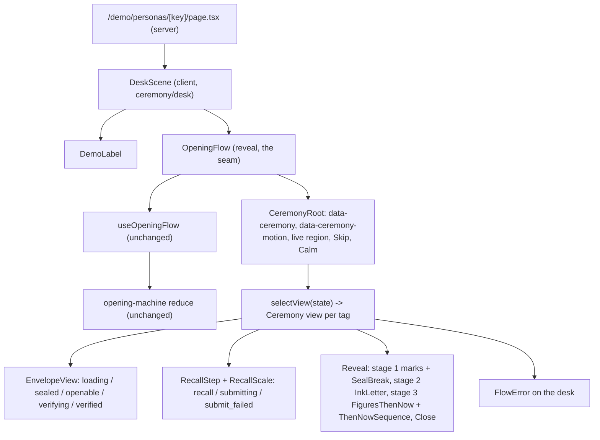

# Design Document

Spec: 05 Reveal ceremony

## Overview

This design turns the spec 03 persona demo into the "One Desk" ceremony set out in `requirements.md`. It is a skin on the working flow. `useOpeningFlow` and `opening-machine.ts` stay exactly as they are. `OpeningFlow.tsx` stays the single seam between the hook and the views, and its view switch hands each state to a Ceremony view instead of a bare spec 03 view. Each task swaps in the Ceremony views for its own Stages, so the flow works after every merge.

It is written against `main` at `55beba7`, after #49 (PR #87) merged. #84 (spec 04 task 10) is still open and waits on the end of the spec 04 data chain, not on this spec. It will add one test that renders `FiguresThenNow({ opened })` with `renderToStaticMarkup` and checks the labels. No task here is blocked by it; "Final state first" and R9.7 and R9.8 keep that signature and those labels working.

### What #49 left, and what this design keeps

| File | State after #49 | What the Ceremony does with it |
|---|---|---|
| `opening-machine.ts`, `useOpeningFlow.ts`, `api.ts` | Unchanged since spec 03 task 7 | Not touched (R1.2). |
| `OpeningFlow.tsx` | Root `div` (`role="region"`, `aria-label`, `tabIndex={-1}`, focus on tag change) and `selectView(state, flow, personaName)` | The root `div` becomes `CeremonyRoot`, with the same three attributes and the same focus effect. `selectView` keeps its switch; its cases point at Ceremony views as tasks land. One new optional prop, `persona` (R3.7, R8.4). |
| `Reveal.tsx` | Stages 1 to 3, each in a `.stage.fade` container; focus on the new `<h2>`; buttons `stage1Next` ("Read the letter"), `stage2Next` ("See the numbers") and `showAll` | The stage 1 to 2 move is sent by the Seal_Break instead of the "Read the letter" button (task 3). The stage 2 to 3 button stays. `showAll` stays. |
| `RememberedAnswers.tsx` | `dl` of question, unit and "Your answer: …" or "No answer" | Kept as the text of the `marks` Stage, next to the read-only Recall_Scales (task 8). |
| `SealedLetter.tsx` | `h2`, written-as-of, demo label, sealed-for-demo date, then `p.letter` with the text | Kept. Gains `data-ink-text` on the letter `p` for the ink effect (task 6). |
| `FiguresThenNow.tsx` | Takes `{ opened }`. For each payload figure: name, "Then" + `FigureLine`, "Now" + `FigureLine`, then `ChangeLine`, or the unavailable or not-comparable sentences | Keeps the signature and adds an optional `record` (task 4). Each comparable entry gains a `NumberLine` and Stamps. Entries that are unavailable or not comparable keep exactly their #49 markup (R9.6). |
| `FigureLine.tsx`, `ChangeLine.tsx`, `FixtureNote.tsx` | Labels, value, unit, period, region, `<details>` with the source | Kept, unchanged in markup. They become the text of the Stamps and the change line (R9.8). |
| `change-neutral.property.test.tsx` | Property 20 over `ChangeLine` only | Extended to the whole comparable entry, with the Mark (task 4, then 5). |
| `contrast.test.ts` | Text tokens on `--paper` and `--paper-deep` | Kept. A Ceremony contrast test adds the desk tokens (task 1). |
| `opening-machine.property.test.ts` | Property 17 with render clauses over `OpeningFlow` with a mocked hook | Kept, so it now covers the Ceremony views. Extended for the Stage names (task 2) and the gestures (task 9). |

### Measured starting point

`bash scripts/check.sh` passes on `main` with the edited QA prompt. `scripts/check-js-budget.mjs` reports `/` 106.5 kB, `/demo` 106.8 kB and `/demo/personas/[key]` 145.3 kB, gzipped first load. #49 added 5.7 kB to the persona route, so its headroom under 175 kB is now 29.7 kB.

## Architecture

### How the Ceremony wraps the flow



- Events still go one way. A Ceremony view gets the same handlers `selectView` hands out today (`retry`, `begin`, `editDraft`, `toggleNoAnswer`, `submit`, `retryPost`, `advance`, `showAll`). It calls them, or not. It holds no copy of flow state.
- View-local state is only animation state: whether a Seal_Break is in progress, the Step in stage 3 (`then`, `passage`, `now`, `done`), the ink progress, and the recall zoom level. It is reported to `CeremonyRoot` through a small context, so `data-ceremony` can name the Stage.
- The tests render `OpeningFlow` with a mocked `useOpeningFlow` and `renderToStaticMarkup` in Vitest's `node` environment, where effects don't run. So every Ceremony view renders its final state on first render, and full motion is applied in a `useLayoutEffect` on the client, before the first paint (see "Final state first"). This keeps the spec 03 tests, Property 17 and #84 valid against the real views.

### Final state first

Every animated view follows one rule: the first render is the final, settled state, with every label, number and line in place. On the client, in full motion only, a `useLayoutEffect` moves the view to its start state before the browser paints, then runs the sequence with the Web Animations API. Calm_Mode never leaves the final state. Skip jumps back to it.

This gives four things at once: no flash before an animation starts, a static render that holds the final state (R9.7, R12.6), Calm_Mode for free (R11.2), and Skip as "go to the state you would have rendered anyway" (R11.4).

Sequences use `element.animate()` with timings from `constants.ts`. The global rule in `globals.css` that shortens CSS animations under reduced motion doesn't affect Web Animations. The Ceremony checks Calm_Mode itself and doesn't start them.

### Stage resolution

`stages.ts` exports one pure function. The table is R3.1; the function is its executable form.

```ts
type Stage =
  | "desk" | "envelope" | "intact" | "recall" | "marks" | "seal"
  | "letter" | "then" | "passage" | "now" | "close" | "error";

type LocalView = {
  sealing: boolean;                        // a Seal_Break is in progress
  step: "then" | "passage" | "now" | "done"; // stage 3 Step; "done" in the final state
};

function stageFor(state: FlowState, local: LocalView): Stage;
```

| Flow state | Local view | Stage |
|---|---|---|
| `loading`, `sealed`, `openable`, `verifying` | any | `envelope` |
| `verified` | any | `intact` |
| `recall`, `submitting`, `submit_failed` | any | `recall` |
| `reveal`, stage 1 | `sealing: false` | `marks` |
| `reveal`, stage 1 | `sealing: true` | `seal` |
| `reveal`, stage 2 | any | `letter` |
| `reveal`, stage 3 | `step` is `then`, `passage` or `now` | that step |
| `reveal`, stage 3 | `step: "done"` | `close` |
| `not_placed`, `unreachable`, `verification_failed`, `open_failed` | any | `error` |

The default local view is `{ sealing: false, step: "done" }`, so a static render of stage 3 reports `close`, its final state. `/demo` sets `desk` on its own root; it has no Flow.

`data-ceremony-motion` is `full` or `calm` from the motion context. Low-power mode counts as `full`, because Stages still change by motion, only lighter.

### Motion modes

`motion.ts` exports a `MotionProvider` and `useMotion()`, returning `{ mode: "full" | "light" | "calm", setCalm(on) }`.

- `calm` when `matchMedia("(prefers-reduced-motion: reduce)")` matches, or the judge has pressed the Calm control. The control flips a boolean in React state only (R1.5).
- `light` when `navigator.hardwareConcurrency < LOW_POWER_CORES`, or `navigator.connection?.saveData` is true, or a one-second frame probe after mount averages over `LOW_POWER_FRAME_MS`. Light mode turns off dust, parallax and tilt, and replaces camera moves with cross-fades (R13.6). The Flow is unchanged.
- `full` otherwise.
- The server render and the first client render use `full` and the final state. The mode is read in a layout effect, so the server and client markup match (hydration, R17.3).

### Camera moves without a transition API (R8.7)

There is no View Transitions API, no change to `next.config.ts`, `layout.tsx` or `globals.css`, and no shared layout across routes. The envelope's resting place on the persona page is a fixed geometry in `constants.ts`, used by both pages:

```ts
ENVELOPE_TARGET = {
  width: "min(84vw, 26rem)", // CSS length
  aspect: 1.6,               // width / height
  top: "max(6rem, 14vh)",    // from the top of the viewport, below the Demo label
} // centred horizontally
```

1. On `/demo`, each envelope is a `DeskEnvelopeLink`: a client component around a real `<a href="/demo/personas/{key}">` (from `next/link`). Without JavaScript it is a plain link.
2. On `pointerenter` and `focus` it calls `router.prefetch(href)`.
3. On click in `full` mode, it calls `preventDefault()`. It measures the envelope's rect and the target rect, computed from `ENVELOPE_TARGET` against the viewport. It animates the envelope with one `element.animate()` FLIP transform over `DESK_TO_ENVELOPE_MS` (450 ms), while the other envelopes and the heading fade to 0. Then it calls `router.push(href, { scroll: true })`. If the animation is cancelled or throws, it navigates at once.
4. Next keeps the old page on screen until the new route is ready. The animated envelope stays at the target rect until the persona page replaces it.
5. The persona page renders the envelope in the `envelope` Stage at exactly `ENVELOPE_TARGET`, in server markup, so the first paint matches the last frame on `/demo`.
6. In `light` mode the click cross-fades the desk to dark over `CALM_FADE_MS`, then navigates. In `calm` mode, or with modifier keys or a middle click, there is no `preventDefault()`: it is plain navigation (R8.7).

Inside the persona page, the "camera" is the desk plane: one `transform` on one composited element, moved between named stations (`envelope`, `back`, `seal`, `letter`, `ledger`) over `CAMERA_MOVE_MS`. Only decorative layers (dust, light, flakes, wheels) unmount when a station is out of view (R13.7). The answers, the letter and the figures stay in the document once shown, because the reveal stages accumulate and "Show everything" shows all three. An off-screen station is moved with `transform`, not unmounted. In `calm` there is no move: each station is laid out as a normal page section and focus moves to its heading.

#### Paths this needs

None outside frontend-dev. `src/app/demo/page.tsx`, `src/app/demo/personas/[key]/page.tsx`, their CSS modules, `src/components/**` and `next/navigation` cover it. One cosmetic limit follows from not touching `globals.css`: `html` and `body` keep the paper background, so iOS overscroll bounce can show a paper strip at the very top or bottom of the dark desk. Fixing that needs a platform-dev change to `globals.css`. The design accepts it.

## Components and Interfaces

### File layout

```
src/components/ceremony/
├── constants.ts            # every timing, easing, limit, geometry and the Position_Property list (one module, R10.3, R10.5)
├── stages.ts               # Stage type, stageFor()
├── motion.ts               # MotionProvider, useMotion(), low-power probe
├── CeremonyRoot.tsx        # data-ceremony, data-ceremony-motion, live region, Skip and Calm controls, local-view context
├── skip.tsx                # SkipProvider, useSequence(): register/unregister a running sequence; Skip ends all
├── LiveRegion.tsx          # one polite live region per page
├── copy.ts                 # every Ceremony string (R16)
├── ceremony.module.css     # desk tokens, focus rings, shared Ceremony rules (R1.7)
├── ASSETS.md               # one entry per asset file (R15.2)
├── assets/                 # texture files, if any (R13.5)
├── desk/
│   ├── DeskScene.tsx        # dark desk, candle light layer, parallax wrapper, Calm control placement
│   ├── DeskScene.module.css
│   ├── useLight.ts          # pointer -> --light-x/--light-y; rAF-throttled; tilt in task 7
│   ├── tilt.ts              # DeviceOrientation, iOS permission (dynamic import, task 7)
│   ├── dust.ts              # canvas dust (dynamic import, task 7)
│   └── DeskEnvelopeLink.tsx # FLIP then router.push (task 7)
├── envelope/
│   ├── Envelope.tsx         # one SVG envelope: front, back, flap; states closed | turned | open
│   ├── Envelope.module.css
│   ├── WaxSeal.tsx          # SVG seal: wax disc, seeded pattern, crack overlay
│   ├── seal-pattern.ts      # key -> pattern (pure, seeded)
│   └── EnvelopeView.tsx     # envelope, intact and still-sealed Stages
├── seal/
│   ├── cracks.ts            # fixed crack paths from the centre, in draw order
│   ├── hold.ts              # pure hold model
│   ├── SealBreak.tsx        # pointer hold, "Break the seal" button, flakes, flap, slide
│   └── SealBreak.module.css
├── recall/
│   ├── scale-math.ts        # log map, 3-sig-fig decimals, zoom windows, key steps (pure)
│   ├── RecallScale.tsx      # the slider, the drag, the zoom, the read-only mode
│   └── RecallScale.module.css
├── letter/
│   ├── InkLetter.tsx        # line-by-line mask over SealedLetter's text
│   └── InkLetter.module.css
├── figures/
│   ├── number-line.ts       # range, padding, positions, clamp (pure)
│   ├── NumberLine.tsx       # axis, pins, Mark; positions only through Position_Properties
│   ├── Stamp.tsx            # pressed frame around a FigureLine, with face value and source name
│   ├── Counter.tsx          # digit strips, aria-hidden, final digits in static render (task 5)
│   ├── Passage.tsx          # pages and light shift, aria-hidden (task 5)
│   ├── ThenNowSequence.tsx  # the Steps then, passage, now for all lines together (task 5)
│   └── figures.module.css
├── close/
│   └── Close.tsx
└── sound/                   # task 10 only
    ├── sound.ts             # Web Audio synthesis, dynamic import
    └── SoundToggle.tsx
```

The tests sit next to the files they test, as in the rest of `src/components`.

Files outside `ceremony/` that the tasks edit, all frontend-dev paths:

| File | Change | Task |
|---|---|---|
| `src/components/reveal/OpeningFlow.tsx` | Root becomes `CeremonyRoot`; optional `persona` prop; `selectView` cases point at Ceremony views | 1, 2, 3, 6, 8, 9 |
| `src/components/reveal/Reveal.tsx` | Stage 1 shows the Marks and `SealBreak` in place of the "Read the letter" button; stage 2 wraps `SealedLetter` in `InkLetter`; stage 3 passes `record` and wraps in `ThenNowSequence`; `Close` after stage 3 | 3, 4, 5, 6, 9 |
| `src/components/reveal/RecallStep.tsx` | One `RecallScale` inside each fieldset, above the existing input | 8 |
| `src/components/reveal/SealedLetter.tsx` | `data-ink-text` on the letter `p` | 6 |
| `src/components/reveal/FiguresThenNow.tsx` | Optional `record`; comparable entries rendered by `FigureEntry` with `NumberLine` and Stamps | 4 |
| `src/components/reveal/FigureEntry.tsx` (new) | One comparable entry, pure, so Property 20 can render it from given figures | 4 |
| `src/components/reveal/copy.ts` | `loading` text | 2 |
| `src/components/reveal/change-neutral.property.test.tsx` | Extended Property 20 | 4, 5 |
| `src/components/demo/copy.ts`, `PersonaCard.tsx`, `PersonaCard.test.tsx`, `PersonaCard.module.css` | Card link text; the card is drawn as an envelope | 2, 7 |
| `src/app/demo/page.tsx`, `page.module.css`, `page.test.tsx` | Desk layout; card link test | 2, 7 |
| `src/app/demo/personas/[key]/page.tsx` | `DeskScene` replaces `PageShell`; passes `persona` | 1, 2 |
| The scan tests in `src/components/reveal` and `src/components/demo` | Add `src/components/ceremony` to their file walks | 1 |

Never edited: `src/app/layout.tsx`, `src/app/page.tsx`, `src/app/globals.css` (R1.7), `opening-machine.ts`, `useOpeningFlow.ts`, `api.ts`, anything in R1.1, `scripts/check.sh`, `scripts/check-js-budget.mjs`, `public/**`.

### OpeningFlow changes

```ts
export type OpeningFlowProps = {
  letterId: string;
  personaName: string;
  /** List fields for the envelope (R3.7) and the seal pattern (R8.4). Optional, so spec 03 tests render as before. */
  persona?: { key: string; written_as_of: string; opens_at: string };
};
```

- The root keeps `ref`, `tabIndex={-1}`, `role="region"`, `aria-label={personaName}` and the focus-on-`state.tag` effect. It adds `data-ceremony` and `data-ceremony-motion`. A second effect announces the new Stage in the live region.
- With no `persona` (spec 03 tests), the envelope uses a fixed default seal pattern and shows no dates.
- `selectView` keeps one case per tag. A tag whose Stage hasn't been rebuilt yet renders its spec 03 view inside a `ParchmentSurface` on the desk (R18.4).

### Constants (`constants.ts`)

Every value the requirements leave to the design, in one module. Nothing here is computed from data. Property 14 imports this module and checks that rendered timings equal these values.

```ts
// --- Stage motion (ms) ---
export const CAMERA_MOVE_MS = 700;
export const DESK_TO_ENVELOPE_MS = 450;   // R8.7
export const STAGE_FADE_MS = 400;
export const CALM_FADE_MS = 120;          // R11.2: at most 150

// --- Seal_Break (R6) ---
export const SEAL_HOLD_MS = 1500;         // R6.2: press and hold this long to break
export const SEAL_SETTLE_MS = 450;        // R6.4: cracks recede on early release
export const SEAL_SHORT_MS = 600;         // R6.3: the button's non-gesture version
export const SEAL_SPLIT_MS = 900;         // split and flakes
export const FLAP_LIFT_MS = 700;
export const LETTER_SLIDE_MS = 800;
export const FLAKE_COUNT = 14;

// --- Ink (R7.2) ---
export const INK_LINE_DELAY_MS = 220;     // per visual line
export const INK_LINE_FADE_MS = 600;
export const INK_TOTAL_MAX_MS = 8000;
// delay actually used: min(INK_LINE_DELAY_MS, floor((INK_TOTAL_MAX_MS - INK_LINE_FADE_MS) / max(lines, 1)))
// It depends only on the number of lines, and the last line ends by 8 s.

// --- Then and now (R12.5, R10.6) ---
export const STAMP_DROP_MS = 520;
export const COUNTER_ROLL_MS = 1100;
export const STEP_HOLD_MS = 600;          // pause after the then Step
export const PASSAGE_MS = 2400;           // the time-passing transition, any span
export const CHANGE_FADE_MS = 400;

// --- Easing ---
export const EASE_STANDARD = "cubic-bezier(0.2, 0, 0, 1)";
export const EASE_STAMP = "cubic-bezier(0.3, 0, 0.2, 1)";
export const EASE_LINEAR = "linear";

// --- Candle and desk (R11.5, R8.6, R13.6) ---
export const CANDLE_FLICKER_AMPLITUDE = 0.04;   // max change in the light layer's opacity
export const CANDLE_FLICKER_MIN_PERIOD_MS = 900; // smooth, no steps; at most about 1.1 changes a second
export const PARALLAX_MAX_DEG = 2;
export const PARALLAX_MAX_PX = 12;
export const DUST_MAX_PARTICLES = 36;
export const DUST_MAX_FPS = 30;
export const LOW_POWER_CORES = 4;
export const LOW_POWER_FRAME_MS = 24;
export const LOW_POWER_PROBE_MS = 1000;

// --- Envelope geometry shared by /demo and the persona page (R8.7) ---
export const ENVELOPE_TARGET = { width: "min(84vw, 26rem)", aspect: 1.6, top: "max(6rem, 14vh)" } as const;

// --- Recall_Scale (R4) ---
export const SCALE_MIN_EXP = -2;          // 0.01
export const SCALE_MAX_EXP = 5;           // 100,000
export const SCALE_SIG_FIGS = 3;
export const ZOOM_DWELL_MS = 450;
export const ZOOM_DWELL_SLOP_PX = 4;
export const ZOOM_MAX_LEVEL = 2;          // 0 whole track, 1 one decade, 2 one tenth of a decade
export const ZOOM_OUT_EDGE_PX = 16;
export const MARKER_HIT_PX = 44;

// --- Number_Line (R12.2) ---
export const LINE_PAD_SPAN_FRACTION = 0.25;
export const LINE_PAD_VALUE_FRACTION = 0.05;
export const LINE_PAD_ZERO = 1;           // in the figure's unit, only when then = now = 0

// --- Neutrality (R10.3) ---
export const POSITION_PROPERTIES = ["--pos-mark", "--pos-then", "--pos-now"] as const;
```

Why these values:

- **Hold time, 1.5 s.** Long enough that a tap never breaks the seal by accident, short enough that a judge doesn't wonder whether it's working. The cracks start at once, so the hold is visibly doing something.
- **Candle limit, 4 % opacity, at least 900 ms per change.** The light layer is a radial gradient above the desk and below every text surface. A 4 % swing keeps the brightest lit desk at or below `--desk-lit-max` (`#4a3522`), where every desk text token still clears AA (see "Colour and contrast"). The smooth period keeps it far from the WCAG 2.3.1 limit of three flashes a second (R11.5).
- **Ink, 220 ms per line, capped.** Maya's letter is 16 source lines, about 24 visual lines at 360 px, so about 5.3 s plus the last fade. A long letter keeps a shorter delay and still finishes by 8 s.
- **Passage, 2.4 s.** Long enough to read as time passing, short enough for the 3-minute video. It is the same for a gap of six months or six years (R10.6).
- **Minimum span (R12.2).** See "Number_Line geometry".
- **Drag refine (R4.12).** See "Recall_Scale".

### Recall_Scale (`recall/scale-math.ts`, `RecallScale.tsx`)

#### The track

One logarithmic track for every question, 10^−2 to 10^5. A track position `x` in [0, 1] maps to `v = 10^(SCALE_MIN_EXP + 7x)`, rounded to `SCALE_SIG_FIGS` significant figures, and written as a plain decimal string by `toPlainDecimal`. That function never uses an exponent, drops trailing fractional zeros only where the rounding leaves them, and always matches `^[0-9]+(\.[0-9]+)?$`. For example, 3.4719 gives "3.47", 1712.4 gives "1710" and 0.012345 gives "0.0123". The inverse maps a value to `x` and clamps to [0, 1].

Faint labels at the eight decade marks: 0.01, 0.1, 1, 10, 100, 1,000, 10,000 and 100,000. Nothing else on the track.

#### Dragging

- `pointerdown` on the marker or the track places the marker under the pointer and captures it with `setPointerCapture`, inside a `try`. If capture throws (for example for a synthetic pointer the browser doesn't know), the drag carries on with listeners on the window. The track has `touch-action: none`, so a drag never scrolls the page (R4.11).
- While dragging, the ink readout above the marker shows `{value} {unit}`, the exact string that release will send (R4.3).
- On `pointerup` it calls `onEdit(question.id, value)`, which is `EDIT_DRAFT` (R4.4).

#### Refining by drag (R4.12)

On a 360 px viewport the track is about 296 px wide, so one decade is about 42 px. That is too coarse for two significant figures, so the track zooms on dwell.

| Level | Window shown across the full track | Scale | Step for 2 sig figs | Pixels per step at 296 px |
|---|---|---|---|---|
| 0 | 0.01 to 100,000 | log | n/a | n/a |
| 1 | the decade under the marker, `[10^k, 10^(k+1)]` | linear | `10^(k−1)` | 296 / 90 ≈ 3.3 |
| 2 | the tenth of that decade under the marker, `[a·10^k, (a+1)·10^k]` | linear | `10^(k−1)` | 296 / 10 ≈ 30 |

- Holding the pointer still for `ZOOM_DWELL_MS` (450 ms, moving less than `ZOOM_DWELL_SLOP_PX`) zooms in one level, centred so the marker stays under the finger. `k = floor(log10 v)` and `a = floor(v / 10^k)` come from the marker's current value only.
- Holding the marker within `ZOOM_OUT_EDGE_PX` of either end of a zoomed track for the dwell time zooms out one level. A "Whole scale" button appears while zoomed and resets to level 0. Releasing the pointer keeps the level until the next press.
- At level 2 two significant figures are 30 px apart, which is enough for a finger. Three are 3 px apart, which is enough for a mouse.
- A zoomed track shows its two window ends as faint labels, for example "3" and "4". They come only from the marker's position, never from data. R4.1 allows these labels at levels 1 and 2.
- Nothing about the zoom reads the payload, the metric, the unit or any figure (R4.8, R4.12). Property 10 checks this.

#### Keyboard and assistive technology (R4.5, R4.6)

- The marker is `role="slider"` with `aria-valuemin`, `aria-valuemax` and `aria-valuenow` on the log scale (`x × 1000`), and `aria-valuetext` "{value} {unit}", or "No answer yet".
- Left and Down step down one unit in the third significant figure (3.47 to 3.46; 1,710 to 1,700). Right and Up step up. Page Down and Page Up move one decade. Home and End go to 0.01 and 100,000. Every step sends `EDIT_DRAFT`.
- The existing text input and "No answer" checkbox stay in the fieldset, under the scale. Typing moves the Mark to `clamp(x(v))`. Moving the Mark writes the value into the input through the same `EDIT_DRAFT`, so the draft is the single source. "No answer" sends `TOGGLE_NO_ANSWER`, hides the Mark and sets `aria-disabled` on the slider.
- A typed value below 0.01 (including 0) or above 100,000 draws the Mark at that end, with identical markup at both ends (R4.7).

#### Read-only mode

In the `marks` Stage each scale renders `readOnly`, at level 0, with the Mark at the recorded value. It has no slider role, and the Mark's text is "Your answer: {value} {unit}" from `REVEAL_COPY.yourAnswer`, or no Mark for "No answer" (R4.10).

### Envelope and seal (`envelope/`)

- `Envelope` is one inline SVG drawn with a `viewBox`. Its states are `closed` (front, with postmark), `turned` (back, flap down, seal on the flap) and `open` (flap up, letter showing). The SVG, its size and its folds are the same for every letter (R3.6). It takes only `persona` list fields and the state name.
- The front shows "Written as of {date}", "Opens {date}" and "Prepared later as a demo." It never shows `sealedAt` (R3.7).
- `WaxSeal` draws a disc in one wax colour (`--seal-wax`). Its pattern comes from `sealPattern(key)`:
  - The key is hashed with FNV-1a 32-bit.
  - That seeds mulberry32.
  - The output picks one of 8 rim styles and one of 12 centre glyphs (simple ring, star and leaf marks drawn as SVG paths in this repo), plus a rotation in 15° steps.
  - It is pure and deterministic, reads nothing but `key`, and is the same on the server and the client (R8.4, Property 4).
- `EnvelopeView` renders the `envelope` Stage for `loading`, `openable` and `verifying` (statement in `role="status"`), the still-sealed variant for `sealed` (the `StillSealed` text and "Try again" control, inside the envelope's front panel), and the `intact` Stage for `verified`: the statement "The seal is intact. …" and "Begin". `BEGIN` turns the envelope over (R5).

### Seal_Break (`seal/`)

#### Hold model (`hold.ts`, pure)

```ts
type HoldState = { phase: "idle" | "holding" | "settling" | "broken"; progress: number }; // progress 0..1
function onPress(s: HoldState, now: number): HoldState;
function onTick(s: HoldState, now: number): HoldState;    // progress = (now - start) / SEAL_HOLD_MS, clamped
function onRelease(s: HoldState, now: number): HoldState; // < 1 -> settling; settles to 0 over SEAL_SETTLE_MS
function isBreak(prev: HoldState, next: HoldState): boolean; // true exactly once, on the move to "broken"
```

`SealBreak` calls `onAdvance()` only when `isBreak` is true, and never again once `broken` (R6.5). A drag counts as holding: pointer movement doesn't reset or pause the clock.

#### Cracks (`cracks.ts`)

A fixed list of 9 SVG paths, all starting at the seal's centre and branching outward, in a fixed draw order. Path `i` draws when `progress ≥ i / 9`, with `stroke-dashoffset` animating its length. The contact point is ignored for drawing (R6.2, R6.6). Every persona's seal cracks the same way; only its decorative pattern differs.

#### The view

- The seal is the pointer target (`aria-hidden`, not focusable). `setPointerCapture` is called inside a `try`; if it throws, the hold carries on with listeners on the window. Under it sit the instruction line and a real `<button>` "Break the seal" (R6.3).
- Pressing the button plays the short version over `SEAL_SHORT_MS` in full motion (all cracks, split), then sends `ADVANCE`. In Calm_Mode it shows the split seal at once and sends `ADVANCE`.
- On break in full motion:
  1. The seal splits along the cracks into `FLAKE_COUNT` flakes. Their fall paths are fixed per index, in the constants, not random.
  2. The flap lifts over `FLAP_LIFT_MS`.
  3. The letter slides out over `LETTER_SLIDE_MS`, and the camera moves to the `letter` station.
- `ADVANCE` is sent when the split starts, so stage 2's text is in the document under the slide animation, and focus moves to the stage 2 heading when the slide ends.
- Skip during the hold or the split goes to the end state and sends `ADVANCE` if it hasn't been sent (R6.7). "Show everything" sends `SHOW_ALL` and the seal renders split (R6.8).
- Early release: the cracks recede over `SEAL_SETTLE_MS`, nothing is sent, and the live region says "The seal holds." (R6.4).

### The letter (`letter/InkLetter.tsx`)

`InkLetter` wraps `SealedLetter`. The labels render normally and are never masked (R7.4). In full motion, a layout effect:

1. Measures the letter paragraph's height and computed `line-height`, and takes `lines = round(height / lineHeight)`.
2. Sets a `mask-image` linear gradient on the paragraph that reveals one visual line at a time. A Web Animation moves `mask-position` in `lines` steps, each step taking `delay(lines)` from the constants, with each line fading in over `INK_LINE_FADE_MS`.
3. Leaves the text node untouched (R7.1). Selection, copy, screen readers and find-in-page see the whole text at once.

Skip and Calm remove the mask. The paragraph keeps the paper surface and `--ink` text, so AA holds (R7.5).

### Number_Line geometry (`figures/number-line.ts`, pure)

Inputs are the then value `t`, the now value `n` (both from the figures' value strings) and optionally the Mark value `m`. `Number()` is used here for drawing only. No displayed number is ever computed from a position (R12.4).

```
lo = min(t, n); hi = max(t, n); span = hi - lo
pad = max(LINE_PAD_SPAN_FRACTION × span, LINE_PAD_VALUE_FRACTION × |t|)
if pad == 0: pad = LINE_PAD_ZERO                     // only when t = n = 0
range = [lo - pad, hi + pad]
pos(v) = clamp01((v - (lo - pad)) / (span + 2 × pad))
--pos-then = pos(t); --pos-now = pos(n); --pos-mark = pos(m)   // only when m is a number
```

- **Range from then and now only.** `pad` reads `t` and the span, never `m`, so the Mark can't move a stamp (R12.2, Property 11).
- **Minimum span.** When `t = n`, the span is `2 × 0.05 × |t|`, 10 % of the value, with both pins at the centre. When `t = n = 0`, the span is 2 units of the figure's unit.
- **Equal padding** on both sides of the span.
- **Mirror.** Spec 03's mirror keeps `t` and moves `n` from `t + d` to `t − d`. The span stays `d`, and `pad` depends only on `|t|` and `d`, so the fall's range is the rise's reflected about `t`. With the Mark reflected `m → 2t − m`, every position becomes `1 − p` exactly (up to floating-point error well under 1e-9). The algebra: rise `pos(t) = pad / (d + 2·pad)`, fall `pos(t) = (d + pad) / (d + 2·pad)`, which sum to 1. The same holds for `n` and `m`, and `clamp01` is symmetric, so an out-of-range Mark lands on the opposite edge (R10.4).
- **Out of range.** `clamp01` puts the Mark at 0 or 1. The markup carries no edge flag, so both edges look identical (R12.3, Property 12).

#### What the Number_Line draws

- A plain horizontal axis in ink, ascending left to right (R10.6), with no numbers of its own (R12.4).
- The Then_Stamp sits above the axis and the Now_Stamp below. Each is a full-width text block, so it reads at 320 px and 200 % text (R11.10). From each stamp a short pin drops to the axis at `left: calc(var(--pos-then) * 100%)` or `var(--pos-now)`. Only the pins and the Mark use the position variables; the text doesn't move.
- The Mark is a small ink stroke on the axis at `--pos-mark`, in the same ink as on the Recall_Scale, with a visually hidden "Your answer: {value} {unit}". With "No answer" there is no Mark element at all (R12.1).
- `aria-hidden` on the axis, pins and Mark stroke. The stamps' text and the Mark's hidden text carry the meaning (R11.9).

#### Which entries get a line

Only comparable entries. Unavailable and not-comparable entries keep exactly their #49 markup: the Then_Figure and, where present, the Now_Figure with their own periods, plus the sentence (R9.6).

### Stamps and counter (`figures/Stamp.tsx`, `Counter.tsx`)

- `Stamp` takes `{ figure, role, displayRescale }`. It renders a pressed frame (`.stamp`, the same class for then and now) holding:
  1. the face: `<Counter text={faceText} />`, where `faceText` is `formatValue(value or rescaled value, region)`, the same function `FigureLine` uses, followed by the unit (R12.6);
  2. the source name as text (R9.2);
  3. `<FigureLine figure role displayRescale />`, unchanged: label, value, unit, period, region and the `<details>` source (R9.1, R9.8).
- `Counter` renders one cell per character of `faceText`, all `aria-hidden` (FigureLine already carries the value in text).
  - A digit cell holds a strip of ten digits in a fixed rotation ending on the target digit: for 7 the strip is `8 9 0 1 2 3 4 5 6 7`.
  - In the static and final state the strip sits at its last digit.
  - The roll animates every strip from its first digit to its last: the same distance (9 digit heights), the same direction (upward), the same `COUNTER_ROLL_MS` and `EASE_STAMP`, for every digit of every number (R10.6).
  - Non-digit characters (separators, the decimal point) are static cells.
  - The only difference between any two counters is which characters they hold.
- Stamps land by `translateY` from above plus `scale` 1.04 to 1, over `STAMP_DROP_MS`, always vertical (R10.6).

### The stage 3 sequence (`figures/ThenNowSequence.tsx`)

It wraps the list of entries and runs the Steps for all lines at once (R12.8):

1. `then`: every Then_Stamp drops and its counter rolls, at the same moment. The Marks are already there.
2. A pause of `STEP_HOLD_MS`.
3. `passage`: `Passage` plays over `PASSAGE_MS`. Three paper sheets turn (SVG, `rotateY` transform) and the light layer drifts from candle-warm toward a cooler morning tone. It is decoration, `aria-hidden`. The live region says "Time passes between then and now."
4. `now`: every Now_Stamp drops and its counter rolls.
5. Each change line and formula line fades in over `CHANGE_FADE_MS`.
6. `done`: the Stage becomes `close`.

Skip at any point sets `done`, and the final markup shows (R11.4). Calm starts at `done`. The Steps send no flow event (R12.7). The order is payload order throughout (R9.3). The sequence never reads a value, a span or a distance to decide a timing (R10.5).

### Close (`close/Close.tsx`)

Rendered after stage 3 when the Step is `done`. It is a still desk view of the open letter, the heading "That is the whole letter", one line ("Nothing has been added to what you remembered, what was written, or the record."), and a link "Back to the desk" to `/demo` (R12.9). No summary, no score, no call to compare.

### Desk (`/demo`, task 7)

- `src/app/demo/page.tsx` stays a server component. It renders `DeskScene` (client) with, as children, the server markup spec 03 requires, in the same order: `DemoLabel`, the `h1`, the intro note, then the list of `PersonaCard`s, or the empty state (R8.2). The Demo_Index test keeps passing.
- `PersonaCard` keeps its props and its text. Its CSS module draws it as an envelope lying on the desk, with a `WaxSeal` seeded by `personaKey`. Its `<Link>` is wrapped by `DeskEnvelopeLink`.
- The layout is a centred flex wrap with a fixed envelope width (`min(84vw, 18rem)`), so 1 to 6 envelopes fit without a layout change. One envelope sits centred. No decorative envelopes, slots or placeholders (R8.5).
- Without JavaScript the desk is a CSS gradient on the `DeskScene` root, and the cards are links (R8.2).
- Dust (`dust.ts`) and tilt (`tilt.ts`) load by dynamic `import()` after mount, only in `full` mode (R13.3).
  - Dust: at most 36 soft dots in a cone under the candle, at most 30 frames a second, paused when the tab is hidden. It is the only use of `Math.random`, and it is outside React render.
  - Tilt: `deviceorientation` maps to the same light variables as the pointer. Where `DeviceOrientationEvent.requestPermission` exists (iOS), a "Let the light follow your phone" button asks on tap. The page works without it (R8.6).

### Colour and contrast

Desk tokens live in `ceremony.module.css` (R1.7). Ratios are computed with the WCAG formula, as `contrast.test.ts` does.

| Text token | Hex | on `--desk` `#17100b` | on `--desk-lit` `#3b2a1b` | on `--desk-lit-max` `#4a3522` |
|---|---|---|---|---|
| `--desk-ink` | `#f1e6cf` | 15.21 | 11.06 | 9.30 |
| `--desk-ink-soft` | `#d9c9a8` | 11.54 | 8.40 | 7.06 |
| `--desk-gold` | `#d9b866` | 9.86 | 7.17 | 6.03 |

Paper panels (the envelope, the letter, the stamps) keep `--paper` and `--paper-deep` and the `globals.css` text tokens. Their darkest shading under text is `--paper-shadowed` `#d9cba9`, on which the lowest text token `--gold-text` is 5.75:1. Wax `--seal-wax` reuses `#7a1f1a` and never carries text. Focus rings are 2 px: `--ink` on paper, `--desk-ink` on the desk, both at least 9:1 against their surface (R11.8). No colour depends on any value or direction (R10.1).

Each surface sets its own text colour. Desk text uses the desk tokens (`--desk-ink`, `--desk-ink-soft`, `--desk-gold`), and every paper panel sets `color: var(--ink)` itself (ParchmentSurface `.surface` does). Text never inherits across surfaces: `.desk` sets `--desk-ink`, so a paper panel that sets no colour renders cream on cream. The Demo label and every control on the desk (including the Calm control) must meet AA on the desk. The ring belongs to controls and Stage headings, not to the ceremony region.

### Copy (`ceremony/copy.ts`)

All new strings, for the owner's tone and neutrality review. Existing strings in `reveal/copy.ts` and `demo/copy.ts` stay where they are; R2 changes two of them.

| Key | Text |
|---|---|
| `calmOn` | Turn off motion |
| `calmOff` | Turn motion back on |
| `skip` | Skip |
| `envelopeWrittenAsOf` | Written as of {date} |
| `envelopeOpens` | Opens {date} |
| `envelopeDemoNote` | Prepared later as a demo. |
| `sealInstruction` | Press and hold the seal to break it, or use the button below. |
| `sealButton` | Break the seal |
| `sealHolds` (live) | The seal holds. Press and hold a little longer to break it. |
| `sealBroken` (live) | The seal is broken. The letter is open. |
| `recallScaleHint` | Drag the ink mark to where you remember it. You can also type the number, or choose no answer. |
| `recallZoomHint` | Hold still to look closer. |
| `recallWholeScale` | Show the whole scale |
| `recallNoMarkYet` | No answer yet |
| `passageLive` (live) | Time passes between then and now. |
| `figuresLive` (live) | The figures are in place. |
| `closeTitle` | That is the whole letter |
| `closeBody` | Nothing has been added to what you remembered, what was written, or the record. |
| `closeBack` | Back to the desk |
| `tiltEnable` | Let the light follow your phone |
| `soundOn` | Turn sound on |
| `soundOff` | Turn sound off |
| `soundNote` | Sound and vibration are off unless you turn them on. |
| `stageLive.<stage>` (live) | One short line per Stage, for example "The envelope is on the desk." and "The letter is open." |

Decided in R2: `demo/copy.ts` `breakSeal` is "Pick up the letter", and `reveal/copy.ts` `loading` is "Bringing the letter into the light." The key `breakSeal` is renamed `openLetter` in task 2.

## Data Models

The Ceremony adds no stored data, no schema and no request. Its only data is in memory:

| Value | Where | Lifetime |
|---|---|---|
| Motion mode, Calm on or off | `MotionProvider` state | The page visit |
| Tilt permission granted | `tilt.ts` module state | The page visit |
| Sound on or off | `SoundToggle` state | The page visit |
| Local view (`sealing`, `step`) | `CeremonyRoot` context | The Flow's `reveal` state |
| Recall zoom level, drag value | `RecallScale` state | The `recall` Stage; the value is sent as `EDIT_DRAFT` |
| Hold progress | `SealBreak` state | The `seal` Stage |

The draft text sent by the Recall_Scale is the same `Draft` the text input writes. `buildRecallRecord`, the record schema and its encryption are unchanged (R1.3).

## QA browser steps (R3.9)

These steps are for the QA agent's Playwright run in `.kiro/agents/prompts/qa.md`. Setup is that prompt's steps 1 to 3, with Postgres, `npm run db:migrate` and `npm run seal-personas`, because the persona page needs the sealed letter. Screenshots go to `<qa-shots>/pr-<number>/<nn>-<stage>[-calm|-360].png`. Before every screenshot, wait for the selector named in the step.

### Stubbing a response

Prefer Playwright request interception if the MCP tools expose it (`browser_route`, or `browser_run_code` with `page.route`). Otherwise use the in-page fetch wrapper below. It survives because the desk link navigates client-side (`router.push`) in full motion. Install it on `/demo` with `browser_evaluate`, then click the envelope.

```js
// Stub for GET /api/letters/{id} only. The secret route and /api/openings pass through.
(() => {
  const real = window.fetch;
  window.__qaStub = { letter: null, delayMs: 0, openings: null };
  window.fetch = async (input, init) => {
    const url = String(input instanceof Request ? input.url : input);
    const s = window.__qaStub;
    if (/\/api\/letters\/[^/]+$/.test(new URL(url, location.href).pathname)) {
      if (s.delayMs) await new Promise((r) => setTimeout(r, s.delayMs));
      if (s.letter) return new Response(s.letter.body, { status: s.letter.status, headers: { "content-type": "application/json" } });
    }
    if (s.openings && /\/api\/openings$/.test(new URL(url, location.href).pathname)) {
      return new Response("{}", { status: s.openings, headers: { "content-type": "application/json" } });
    }
    return real(input, init);
  };
})();
```

With `page.route` the same stubs are:

- sealed: `page.route("**/api/letters/*", r => r.fulfill({ status: 200, contentType: "application/json", body: JSON.stringify({ status: "sealed", opensAt: "2099-01-01T00:00:00.000Z" }) }))`. The glob `*` stops at `/`, so `/secret` is not matched.
- slow: `page.route("**/api/letters/*", async r => { await new Promise(x => setTimeout(x, 4000)); await r.continue(); })`.

### Steps

| # | Stage | Steps | Wait for |
|---|---|---|---|
| 01 | `desk` | Open `/demo` at 1280×800. | `[data-ceremony="desk"]` |
| 02 | `desk` (360) | Resize to 360×640. Check the Demo label and intro note are visible without scrolling. Resize back. | same |
| 03 | `envelope` (loading) | Install the wrapper with `__qaStub.delayMs = 4000`. Click the link named "Pick up the letter". Screenshot within the 4 s. | `[data-ceremony="envelope"]` |
| 04 | `intact` | Wait for the delay to pass. | `[data-ceremony="intact"]` |
| 05 | `recall` | Click "Begin". | `[data-ceremony="recall"]` |
| 06 | `recall` (dragging) | `browser_evaluate`: dispatch `new PointerEvent("pointerdown", { pointerId: 1, pointerType: "touch", isPrimary: true, bubbles: true, clientX, clientY })` at the first track's 60 % point, then `pointermove` to 62 % with the same `pointerId`, with no `pointerup`. Screenshot shows the readout. Then dispatch `pointerup` with `pointerId: 1`. | `[role="slider"]` with `aria-valuetext` set |
| 07 | `recall` (filled) | Type `3.50` in the second question's input. Check its Mark moved. Screenshot. | same |
| 08 | `marks` | Click "Record my answers". | `[data-ceremony="marks"]` |
| 09 | `seal` | `browser_evaluate`: dispatch `new PointerEvent("pointerdown", { pointerId: 1, pointerType: "touch", isPrimary: true, bubbles: true, clientX, clientY })` at the seal's centre. Wait 700 ms. Screenshot shows part of the cracks. | `[data-ceremony="seal"]` |
| 10 | `marks` (settled) | Dispatch `pointerup` with `pointerId: 1`. Wait 600 ms. Check no stage 2 heading is in the document. | `[data-ceremony="marks"]` |
| 11 | `letter` | Click "Break the seal". Screenshot during the ink. | `[data-ceremony="letter"]` |
| 12 | `letter` (final) | Click "Skip". | the whole text visible |
| 13 | `then` | Click "See the numbers". | `[data-ceremony="then"]` |
| 14 | `passage` | Screenshot at once (2.4 s window). | `[data-ceremony="passage"]` |
| 15 | `now` | | `[data-ceremony="now"]` |
| 16 | `close` | Check every figure shows its label ("fixture data", or "historical record, retrieved …"), period, unit and region. | `[data-ceremony="close"]` |
| 17 | Skip in stage 3 | Reload the persona page and repeat 05, 08, 11 and 13 using buttons. During `then` click "Skip". Check every Stamp and change line is there at once. | `[data-ceremony="close"]` |
| 18 | Calm path | Reload. Click "Turn off motion". Check `data-ceremony-motion="calm"`. Repeat 05, 08 ("Break the seal" button), 11 and 13 with buttons only and the keyboard (Tab, Enter, Space, the slider's arrow keys). Screenshots `-calm` of `intact`, `recall`, `marks`, `letter` and `close`. In Calm, stage 3 goes straight to `close`. | each Stage |
| 19 | `envelope` (still sealed) | Open `/demo`. Install the wrapper with `__qaStub.letter = { status: 200, body: JSON.stringify({ status: "sealed", opensAt: "2099-01-01T00:00:00.000Z" }) }`. Click "Pick up the letter". Check the opening date, the time remaining and no contents. | `[data-ceremony="envelope"]` |
| 20 | `error` | Repeat 19 with `{ status: 404, body: "{}" }` (not placed) and `{ status: 500, body: "{}" }` (unreachable, shows "Try again"). | `[data-ceremony="error"]` |
| 21 | `recall` (submit failed) | Fresh run to `recall`, with `__qaStub.openings = 500` set on `/demo` before clicking. Fill both answers, submit. Check the retry control and no reveal. | `[data-ceremony="recall"]` and the alert |
| 22 | 360 width | Repeat 03 to 16 at 360×640, with screenshots `-360` of `intact`, `recall`, `seal`, `letter` and `close`. | each Stage |
| 23 | Sound and vibration | Before step 09, `browser_evaluate`: wrap `navigator.vibrate` with a counter. With the sound toggle off (its default, `aria-pressed="false"`), run 09 to 11 and check the count is 0. Reload, turn the toggle on, run 09 to 11 again and check the count is at least 1 where the browser has the API. | `[data-ceremony="letter"]` |

If the stub can't be installed (a full page load happened), QA records a minor finding and skips 19 to 21; it is not a blocker.

## Correctness Properties

*A property is a characteristic or behaviour that should hold true across all valid executions of a system: a formal statement about what the system should do. Properties are the bridge between human-readable specifications and machine-verifiable correctness guarantees.*

Every property test is a fast-check test tagged `// Feature: 05-reveal-ceremony, Property N: <title>`, with `numRuns: 100` unless stated. All run in Vitest's `node` environment with `renderToStaticMarkup`, or as pure function tests. None needs a DOM, a browser or a network.

### Property 1: Every Flow state maps to exactly one Stage

For every `FlowState` (generated across all tags and reveal stages) and every `LocalView`, `stageFor` returns the Stage that R3.1's table names. The `OpeningFlow` render with the mocked hook carries that value in `data-ceremony` and a `data-ceremony-motion` of `full` or `calm`.

**Validates: Requirements 3.1, 3.2**

### Property 2: Nothing from a later Stage is in the document early

Extends spec 03 Property 17's render clauses to the Ceremony views:

- No recall question text before `recall`.
- No letter text before reveal stage 2.
- No figure value or period before reveal stage 3.
- No split seal, open flap or letter before stage 2.
- No Mark in any state before `recall`.

**Validates: Requirements 3.5, 5.3, 5.4**

### Property 3: The envelope is the same for every letter

For generated payloads of any letter length (1 to 5,000 code points) and any number of figures (0 to 20), the rendered `envelope`, `intact` and still-sealed views are byte-identical once the persona's list fields are fixed.

**Validates: Requirements 3.6**

### Property 4: A seal's pattern depends only on the persona key

For any key, `sealPattern(key)` is deeply equal across calls, and `WaxSeal`'s markup for that key is identical across renders. Its signature takes only a key (a type-level test), and the wax colour is the same for every key.

**Validates: Requirements 8.4**

### Property 5: The hold sends exactly one ADVANCE, and only when complete

For any sequence of press, tick, release and Skip events with arbitrary timestamps:

- `isBreak` is true at most once.
- It is true only when the hold reached `SEAL_HOLD_MS` or Skip or the button ended it.
- A release below full progress leaves `phase` at `settling` and then `idle`, with progress 0 and no event.
- In a `SealBreak` driven by these events through stubbed handlers, `onAdvance` is called the number of times `isBreak` was true: 0 or 1.

**Validates: Requirements 6.2, 6.3, 6.4, 6.5, 6.7**

### Property 6: Cracks don't depend on where the seal was pressed or whose it is

For any contact point inside the seal, any persona key and any progress `p`, the set of drawn crack paths and their dash offsets are equal to those for the centre point and the default key at the same `p`.

**Validates: Requirements 6.2, 6.6**

### Property 7: The Recall_Scale only produces values the record accepts

For any track position `x` in [0, 1], any zoom level and window, and any key step from any value:

- The value string matches `^[0-9]+(\.[0-9]+)?$`, is 1 to 40 characters, and has at most 3 significant figures.
- `buildRecallRecord` accepts it.
- `x(value(x))` rounds back to the same value.
- The readout text equals the string `EDIT_DRAFT` sends.

**Validates: Requirements 4.1, 4.3, 4.4, 4.5**

### Property 8: A Mark and the same typed text give the same record

For any valid number answer reachable on the track, the Recall_Record built from drafts set by `RecallScale`'s `onEdit` is deeply equal to the one built from the text input set to the same string. A "No answer" toggle gives the same record either way.

**Validates: Requirements 1.3, 4.6**

### Property 9: Values beyond the track sit at the ends and look the same

For any value below 0.01 (including 0) or above 100,000, the Mark's position is 0 or 1. The scale's markup for a value below the track and for one above it differs only in the `--pos-mark` value and the value text.

**Validates: Requirements 4.7**

### Property 10: The zoom reads nothing but the marker and the pointer

For any two payloads, metrics, units and figure sets, and the same pointer path, the zoom level, the window and the produced values are equal. The `scale-math` functions take only numbers and pixel inputs (a type-level test), and at a 296 px track, level 2 puts two-significant-figure values at least 24 px apart.

**Validates: Requirements 4.8, 4.12**

### Property 11: The line's range comes from then and now only

For any comparable pair and any two Marks `m1` and `m2`:

- `--pos-then`, `--pos-now`, the range and the padding are equal for both Marks.
- The padding is equal on both sides.
- When `t = n`, the span is `0.1 × |t|`, or 2 when `t = 0`.

**Validates: Requirements 12.2**

### Property 12: A Mark outside the range sits at an edge that looks the same on both sides

For any comparable pair and any Mark outside its range, `--pos-mark` is 0 or 1. The entry's markup for a Mark beyond the low end and for one beyond the high end differs only in the Position_Property values and the Mark's value text.

**Validates: Requirements 12.3**

### Property 13: A rise and its mirror fall render the same markup (extends spec 03 Property 20)

This is the existing `change-neutral.property.test.tsx`, extended from `ChangeLine` to the whole comparable entry (`FigureEntry`: Stamps, Counter faces, FigureLines, NumberLine, Mark, ChangeLine). Spec 03's mirror is kept: then `t` fixed, now `t + d` for the rise and `t − d` for the fall.

The generator draws a Mark `m` in `[0, 2t]` or "No answer", and the fall uses the reflected Mark `2t − m`, so both are valid answers. The test then:

1. Collects every `style` attribute in both renders. In each, the only properties allowed are the names in `POSITION_PROPERTIES` plus a fixed list of constant properties defined next to them. A style property not on either list fails the test.
2. For each Position_Property in document order, checks `p_rise + p_fall = 1` within 1e-9.
3. Replaces each Position_Property value with `§`.
4. Checks every `[data-counter]` cell has the same markup as every other cell once its digits are replaced, then collapses each counter to `§`.
5. In text nodes, replaces each run matching `[+−]?[0-9][0-9.,\u00a0\u202f]*` with `#`, and the direction words `rose` and `fell` with `§`.
6. Checks the two skeletons are byte-identical. No class attribute contains "rose", "fell", "up" or "down".

The spec 03 assertions stay in the same test.

**Validates: Requirements 10.2, 10.3, 10.4, spec 03 Requirements 11.8, 16.4**

### Property 14: Timings are constants, never data

For any generated figures, answers, periods (with spans from 0 to 50 years), letter lengths and numbers of entries:

- Every duration, delay and easing value in the rendered markup and in each sequence's animation plan (the pure `plan*()` functions that `SealBreak`, `InkLetter`, `ThenNowSequence`, `Counter` and `Passage` hand to `element.animate`) is a value from `constants.ts`.
- They are equal across all generated inputs, except the ink delay, which equals `delay(lines)` and depends on `lines` alone.
- The total ink time is at most 8 s.
- The stage 3 plan's length doesn't grow with the number of entries.

**Validates: Requirements 10.5, 10.6, 7.2, 12.8**

### Property 15: The static render is the final state

For any opened payload with comparable, not-comparable and unavailable entries, `renderToStaticMarkup` of `FiguresThenNow` (with and without `record`) and of `Reveal` at stage 3:

- contains every FigureLine label, the fixture label and note where #49 shows them, every Stamp's face and source text, every change line, and the final counter digits equal to the `formatValue` text;
- contains no start-state class.

The #84 test file and the #49 tests pass unchanged.

**Validates: Requirements 9.1, 9.7, 9.8, 12.6**

### Property 16: The ink effect never touches the letter's characters

Extends spec 03 Property 18. For any letter text, the `InkLetter`-wrapped render contains the text exactly once, character for character, in the `data-ink-text` paragraph, with the labels before it. The animation plan touches only `mask-*` properties.

**Validates: Requirements 7.1, 7.4**

### Property 17: Figures stay in payload order

For any payload and any then and now values, the order of entries in stage 3 equals the payload's `figures` order. It doesn't change when values, changes or Marks are permuted.

**Validates: Requirements 9.3, 12.1**

### Property 18: Not-comparable and unavailable entries draw no line

For any pair that `computeChange` reports not comparable, and any figure with no now figure, the entry has no NumberLine and no Mark element. Its markup equals #49's markup for that entry.

**Validates: Requirements 9.6**

### Property 19: Every gesture has a plain control

A source and render check over the Ceremony views:

- every element with a pointer-gesture handler (`onPointerDown` with hold or drag) has, in the same Stage, a `button`, a link, or a focusable element with key handlers that sends the same flow event;
- every sequence that registers with `useSequence` renders while running with a visible Skip.

**Validates: Requirements 11.1, 11.4, 6.3**

### Property 20: Calm_Mode starts no animation

With motion `calm`, every `plan*()` returns an empty plan, `dust.ts` and `tilt.ts` are not imported, and every view's render equals its final state.

**Validates: Requirements 11.2, 11.3, 13.3**

### Property 21: The same render on the server and the client

For any Flow state, rendering twice with `renderToStaticMarkup`, with `Math.random` and `Date.now` stubbed to different values between the two, gives identical markup.

**Validates: Requirements 17.3 (hydration), 8.4**

### Property 22: Desk text and focus rings clear AA on every desk surface

An example test, not a generator. It reads the desk tokens from `ceremony.module.css` and the paper tokens from `globals.css`, and checks every text token on `--desk`, `--desk-lit-max`, `--paper`, `--paper-deep` and `--paper-shadowed` at 4.5:1 or more, and the focus rings at 3:1 or more.

**Validates: Requirements 11.6, 11.8**

### Property 23: Every asset is on record

An example test. Every file under `src/components/ceremony/assets/` has an entry in `ASSETS.md` with a licence of `original` or `CC0`. The total size is at most 150 kB.

**Validates: Requirements 15.2, 13.5**

### Property 24: Sound and vibration are off until asked, and the same both ways

The default sound state is off, `sound.ts` is not imported before the toggle, and `navigator.vibrate` is not called while sound is off. With sound on, the sound and vibration plans for a rise and its mirror fall, and for any Mark, are equal.

**Validates: Requirements 14.1, 14.3, 14.4, 14.5**

## Error Handling

- **Flow errors.** `not_placed`, `unreachable`, `verification_failed` and `open_failed` keep their `FlowError` copy and controls. They render on a paper panel on the desk, with `data-ceremony="error"`, and nothing from the envelope's back, seal or letter. The spec 03 error tests pass unchanged.
- **Submit failed.** The `recall` Stage stays with the scales as entered and the existing alert and retry. The Marks keep their place.
- **Web Animations missing or throwing.** Each `plan*()` runner wraps `element.animate` in `try`. On failure it goes to the final state and, for the Seal_Break, sends `ADVANCE` once.
- **Navigation failure during the desk move.** `router.push` is called in a `finally`. If the push throws, the link's `href` is followed with `location.assign`.
- **Tilt permission denied.** The button hides and pointer light stays.
- **Low frame rate after start.** The probe can drop the mode from `full` to `light` once per visit. Running sequences finish at the lighter setting; nothing restarts.
- **Text the Ceremony can't measure.** If `InkLetter` can't read a line height, it skips the effect and shows the text.

## Testing Strategy

- **Unit and property tests** (Vitest, `node`, fast-check). These cover the pure modules (`stages`, `hold`, `cracks`, `seal-pattern`, `scale-math`, `number-line`, `plan*()`) and renders through `renderToStaticMarkup`, as the reveal tests do today. Properties 1 to 24 above.
- **Existing tests.** Every spec 03 test and #49 test keeps passing. The only planned edits:
  - task 2: `PersonaCard.test.tsx` and `page.test.tsx` for the new link text and the "no Break the seal on a card" check; `OpeningFlow.test.tsx`'s loading-copy name, if the key is renamed;
  - task 3: `Reveal`'s stage 1 test, because the "Read the letter" button is replaced by the Seal_Break;
  - tasks 4 and 5: Property 20 file, extended;
  - task 8: `RecallStep.test.tsx` for the scale inside each fieldset.
- **Scan tests.** `no-jsx-text.test.ts` (reveal and demo), `copy.test.ts`, `source-scan.test.ts` and `import-boundary.test.ts` gain `src/components/ceremony` in task 1. The source scan also bans `Math.random` and `Date.now` in render code under `ceremony/`, with `dust.ts` allow-listed (Property 21).
- **Fixture data.** Tests that need fixture figures load `us-fuel.fixture.json` with `loadFigureFile`, as #49's tests do, and never read fixture IDs or values through `DEMO_FIGURES` (spec 04 task 9).
- **Browser.** The QA steps above, from the QA agent. No browser framework is added to the repo (R17.4).
- **Budget.** `check.sh` runs `check-js-budget.mjs`. Each PR states the three numbers. A manual Lighthouse mobile run on `/demo` is recorded in task 7's and task 9's PRs (R13.4).

## Task plan and fresh line estimates

All frontend-dev, each one issue and one PR, each with "Before this task: Blocked by #49". No task is blocked by #84. The estimates count code and tests.

| # | Task | Depends on | Main files | Lines |
|---|---|---|---|---|
| 1 | Scene base on the persona page: `constants.ts`, `stages.ts`, `motion.ts`, `CeremonyRoot`, Skip context, live region, Calm control, `DeskScene` (desk, candle light, pointer parallax; no dust, no tilt), desk tokens and Property 22, `ASSETS.md` and Property 23, `OpeningFlow` root swap and `persona` prop, persona page on the desk, scan tests extended, Property 1. Every view still the spec 03 view, on paper panels. | none | ceremony root, desk, persona page | 1,950 |
| 2 | Envelope and checking views: `Envelope`, `WaxSeal`, `seal-pattern`, `EnvelopeView` for `envelope`, still-sealed and `intact`; R2 copy (`openLetter` "Pick up the letter", `loading`) and its test updates; Properties 2 (envelope clauses), 3, 4. | 1 | envelope/, demo copy, reveal copy | 1,650 |
| 3 | Seal_Break: `hold.ts`, `cracks.ts`, `SealBreak`, flakes, flap and slide, the `marks` and `seal` Stages (the Marks as plain answers for now), `Reveal` stage 1 change; Properties 5, 6, and the gesture clause of 19 for the seal. | 2 | seal/, Reveal | 1,500 |
| 4 | Number_Line and Stamps: `number-line.ts`, `NumberLine`, `Stamp` with a static face, `FigureEntry` extraction, `FiguresThenNow` optional `record`, `Reveal` passing `record`; extended Property 20 (Property 13, without counter cells); Properties 11, 12, 15, 17, 18. | 3 | figures/, FiguresThenNow, FigureEntry | 1,750 |
| 5 | Passage, counter and the Steps: `Counter`, `Passage`, `ThenNowSequence`, `then`, `passage`, `now` Stages, Skip for the Steps; Property 13's counter-cell clause; Property 14. | 4 | figures/ | 1,400 |
| 6 | Letter ink: `InkLetter`, `data-ink-text`; Property 16 and the ink clause of 14. | 5 | letter/, SealedLetter | 600 |
| 7 | Desk on `/demo`: `DeskScene` on the index, envelopes for `PersonaCard` with seeded seals, `DeskEnvelopeLink` and the FLIP move, dust, tilt and its control, low-power probe; Lighthouse note. | 6 | demo page, PersonaCard, desk/ | 1,600 |
| 8 | Recall_Scale: `scale-math.ts`, `RecallScale` with drag, zoom, keys and read-only mode, `RecallStep` integration, Marks in the `marks` Stage; Properties 7, 8, 9, 10. | 7 | recall/, RecallStep | 1,800 |
| 9 | Close, Skip across all sequences, the reduced-motion and contrast review: `Close`, the `close` Stage, Skip coordination across sequences, Property 19 in full, Property 20, Property 21, Property 2's remaining clauses, focus and live-region checks; Lighthouse note. | 8 | close/, CeremonyRoot | 1,150 |
| 10 | Sound and vibration (optional): `sound.ts` (Web Audio, dynamic import), `SoundToggle`, vibration on the Seal_Break while sound is on; Property 24. | 9 | sound/ | 650 |

Total about 14,050 lines. No task is over 2,500, so no further split is needed. Task 1 is the closest at 1,950. If it runs over, the Calm control and Property 22 move to task 2.

Tasks 3, 4, 5, 6, 8 and 9 all edit `Reveal.tsx` or `OpeningFlow.tsx`, and several edit `ceremony/copy.ts`. The tasks are a straight chain, each depending on the one before it, so only one spec 05 PR is open at a time. The dispatcher frees `frontend-dev` when a PR goes to review and nothing rebases open PRs, so parallel tasks could leave two PRs that can't both merge.

Expected JS growth (gzipped first load): the persona route gains about 18 to 24 kB across tasks 1 to 9, against 29.7 kB of headroom. Dust, tilt and sound load on demand and don't count. `/demo` gains about 6 to 9 kB in task 7. `/` is unchanged.

## Open items for the owner

1. **The retrieved date in `FigureLine` doesn't match spec 03 R13.3.** #49 writes the label as `historical record, retrieved 2024-10-30` (the first ten characters of `retrieved_at`). Spec 03 R13.3 and `data-integrity.md` ask for day, month name and year ("30 October 2026"). `FigureLine.test.tsx` asserts the raw form. This is a spec 03 defect, not a Ceremony change, and it is handled in a separate issue, which formats with `formatUtcDate` and not `formatCalendarDate`. This design doesn't change it, so no task here touches that label.
2. **Stage 3 in Calm_Mode skips `then`, `passage` and `now`** and goes straight to `close`, with everything in place. R3.1 lists those Stages, and R11.2 replaces sequences by their end state. QA screenshots them in full motion only.
3. **iOS overscroll can show a paper strip** at the edges of the dark desk, because `html` and `body` keep `--paper` from `globals.css`. Fixing it needs a platform-dev change; this design accepts it.
4. **"Read the letter" goes away.** Spec 03 `stage1Next` ("Read the letter") was the stage 1 to 2 button. The Seal_Break and its "Break the seal" button replace it in task 3. The key stays in `reveal/copy.ts` until task 3 removes it with its test.
