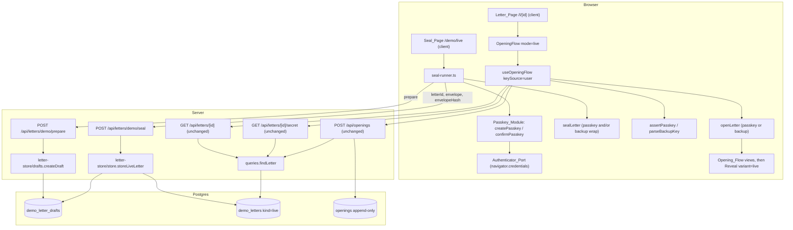
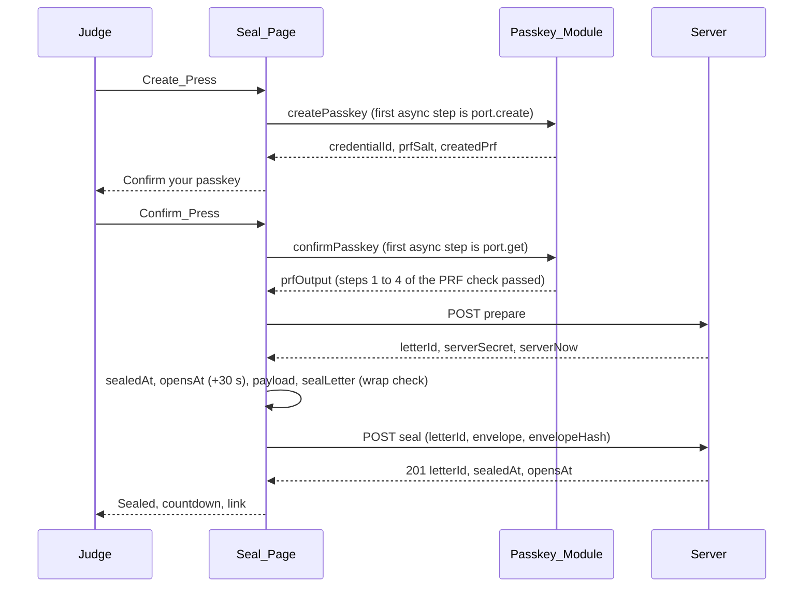
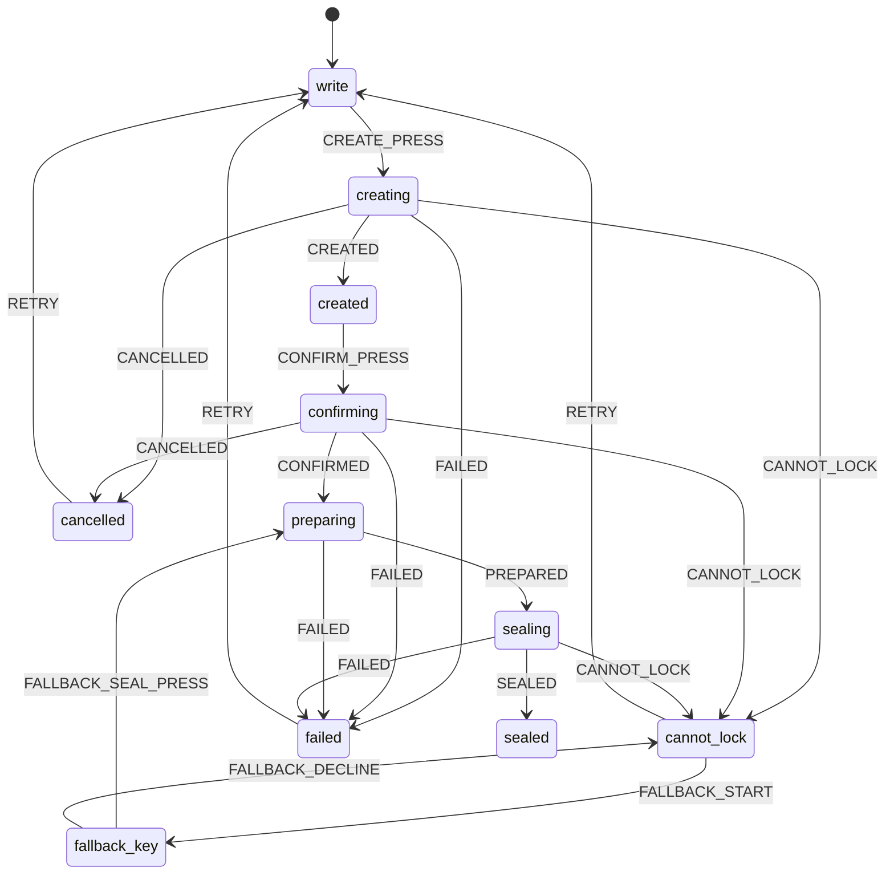
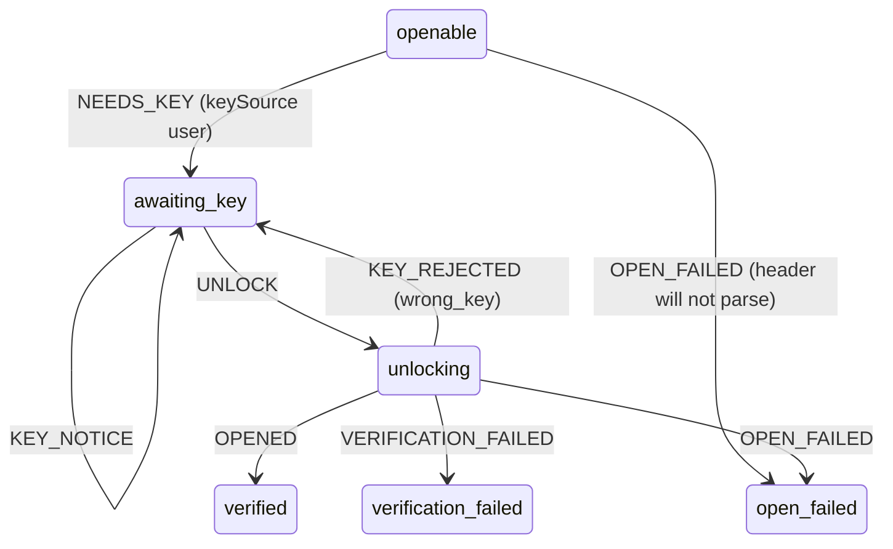

# Design Document

Spec: 06 Lock and unlock (Demo 2)

## Overview

This design adds Demo 2 to Revenant. A judge writes a short letter at `/demo/live`, picks figures from the demo catalogue, and seals the letter in their own browser with their own passkey (WebAuthn PRF). The letter is locked for exactly 30 seconds. The judge then opens `/l/{letterId}`, unlocks with the same passkey, answers the sealed recall questions and sees the reveal.

Almost everything is reused. The sealed format (`src/lib/seal-format`), the three letter routes, the `openings` table, the Recall_Record, the Opening_Flow and the Reveal components stay. This spec adds:

- the passkey wrap and the PRF check in `src/lib/crypto`;
- a prepare route and a seal route, and one new table for drafts;
- the Seal_Page (`/demo/live`) and the Letter_Page (`/l/[id]`);
- a small extension of the Opening_Flow state machine for the passkey press and the backup key field;
- optional keepsakes: letter card, `.ics`, backup key card, and an in-repo QR encoder.

### Baseline

Written against `main` at `36b46ac`. Spec 05 tasks 1 to 4 and 11 are merged; tasks 5 to 10 are not. Spec 06 UI tasks wait for spec 05 task 9 (R24), so file names under `src/components/ceremony` may move by then. Re-read them before starting a UI task.

### What exists and what changes

| File or area | State on `main` | Change in this spec |
|---|---|---|
| `drizzle/0000_sealed_letters.sql` | `demo_letters_kind` allows only `persona`. Immutability triggers on `letters`, `demo_letters`, `openings`. | Untouched. `0001_live_letters.sql` replaces the kind check, adds the live-gap check and the drafts table. |
| `src/lib/db/schema/letters.ts` | Three tables. Comment says a later migration widens `kind`. | `kind` check widened, live-gap check added, `demoLetterDrafts` table added. |
| `src/lib/letter-store/store.ts` | `storePersonaLetter`, `LetterStoreError` with four checks. | Adds `storeLiveLetter` and three checks. |
| `src/lib/letter-store/{queries,clock}.ts` and the three letter routes | `findLetter` reads row and `now()` together. | Not changed (R6.5). |
| `src/lib/crypto/seal.ts` | Backup factor only. `backupKey` required. | Optional passkey factor, optional `backupKey`, wrap check. |
| `src/lib/crypto/open.ts` | Backup factor only. | Backup or passkey factor. |
| `src/lib/crypto/kdf.ts` | `deriveBackupKek`, `deriveOpeningKey`. | Adds `derivePasskeyKek`. |
| `src/components/reveal/opening-machine.ts` | 12 tags, demo key fixed in the hook. | Two tags (`awaiting_key`, `unlocking`) and four events. No existing transition changes. |
| `src/components/reveal/useOpeningFlow.ts` | Opens with `PUBLIC_DEMO_BACKUP_KEY`. | Optional `keySource: "user"` branch. Default behaviour unchanged. |
| `src/components/reveal/api.ts` | `getLetter` drops `demo`. | Passes `demo: true` through when the route says so. |
| `src/components/reveal/{Reveal,SealedLetter,FiguresThenNow,StillSealed}.tsx` | Persona wording. | Optional `variant="live"` or props. Defaults keep the persona output byte for byte. |
| `src/components/ceremony/stages.ts`, `envelope/EnvelopeView.tsx` | Exhaustive on current tags. | Two tags map to `envelope`. One extra `EnvelopeView` variant. |
| `src/app/demo/page.tsx` | Persona list only. | One entry outside the `<ul>`. |
| `.env.example` | `APP_VERSION`, `DATABASE_URL` only. | Adds `RP_ID` and `APP_ORIGIN` (names only). The Helm ConfigMap already sets both. |

### Design decisions where the requirements are silent or meet the code

1. **Shared constants in two places.** The browser and the server both need `LOCK_DURATION_MS`. `letter-store` is server-only (it throws if bundled for the browser), so the shared values live in a pure module, `src/lib/seal-format/live-constants.ts`. Server-only caps live in `src/lib/letter-store/live-constants.ts`.
2. **Race-free caps.** Prepare and seal each take `pg_advisory_xact_lock(key)` first, so the count and the insert cannot interleave. Simplest option that makes "exactly 1,000" and "exactly 500" true under concurrency.
3. **One clock read.** After the lock, each transaction reads `clock_timestamp()` once and uses that value as the Server_Clock `T` for cleanup, freshness, the 24-hour window and the Lock rule. `clock_timestamp()` is used, not `now()`, because `now()` is the transaction start and could be stale after a lock wait.
4. **Draft `created_at` is written explicitly** as `T`, so freshness compares like with like.
5. **Envelope `letterId` must equal the body `letterId`.** R22.4 asks for this test but R4.1 has no row for it. It fails at step 4 as `400 invalid_envelope`.
6. **Used Draft and duplicate ID both give 404 `not_found`** (R4.6).
7. **The fake Authenticator_Port lives in `src/lib/crypto/testing/`.** A scan test fails if any file outside `*.test.ts(x)` and that folder imports it, and the barrel never exports it (R11.4).
8. **No jsdom.** R22.9 forbids a browser test framework and the repo has no DOM test library. So all flow logic sits in plain async functions and pure reducers (`seal-runner.ts`, `seal-machine.ts`, `unlock.ts`, `opening-machine.ts`). Hooks are thin glue. Tests drive the functions with the fake port and stub routes.
9. **`browserAuthenticatorPort` is duck-typed.** It never uses `instanceof PublicKeyCredential`. It reads `rawId` and `getClientExtensionResults()` only. This lets the QA agent install a fake `navigator.credentials` in the page (see QA browser steps).
10. **The same-figure change needs a data-dev change.** R18.5 wants a change of 0 from the existing calculator, but `computeChange` returns `no_newer_figure` whenever the now period end is not later than the then period end. A Live_Letter's then and now are the same figure. See "Prerequisite P1" under Task boundaries. It is outside R24's list and outside frontend-dev's paths.
11. **`/l/{id}` for a persona letter** shows the backup key field (a persona letter has only a backup wrap). That is acceptable and is not tested beyond "no crash".
12. **Letter_Page envelope uses the default seal pattern.** The persona list fields are unknown there. No dates are drawn on the envelope front. The still-sealed panel gets its date from the flow state.
13. **Automatic re-check is once per page load**, held in a ref in `OpeningFlow`. This avoids a loop when the browser clock runs ahead of the server clock (R17.4).
14. **Part D `#k=` handling is gated.** `LiveLetter` reads and strips the fragment in its own mount effect and renders `OpeningFlow` only after that, so no request starts before the fragment is gone (R21.6).

## Architecture

### System diagram



### Sealing sequence



No passkey prompt follows the prepare call. That keeps the two prompts out of the 30 seconds (R15.5).

### Key hierarchy with both factors

```
DEK (random 32 bytes)
 |- passkey wrap: AES-GCM(KEK_passkey, nonce, AAD = letterId(16) || "passkey")
 |    KEK_passkey = HKDF-SHA256(ikm = prfOutput(32) || serverSecret(32), salt = letterId(16), info = "revenant-kek-passkey-v1")
 |- backup wrap:  AES-GCM(KEK_backup,  nonce, AAD = letterId(16) || "backup")
 |    KEK_backup  = HKDF-SHA256(ikm = backupKey(16) || serverSecret(32),  salt = letterId(16), info = "revenant-kek-backup-v1")
payload ciphertext: AES-GCM(DEK, payloadNonce, AAD = canonical(header without ciphertext))
openingKey = HKDF-SHA256(ikm = DEK, salt = letterId, info = "revenant-opening-v1")
```

### Seal_Page state machine

`src/components/live/seal-machine.ts` is a pure reducer. Form data (text, chosen series, warning checkbox) is React state in `SealPage`, not machine state. Secrets (credential, PRF output, Server_Secret, backup key) are refs, not state.



```ts
export type SealFailureKind = "network" | "server" | "clock" | "busy" | "missing_then";
export type SealState =
  | { tag: "write" }
  | { tag: "creating" }
  | { tag: "created" }
  | { tag: "confirming" }
  | { tag: "preparing" }
  | { tag: "sealing" }
  | { tag: "fallback_key" }
  | { tag: "sealed"; letterId: string; sealedAt: string; opensAt: string; offsetMs: number; factors: "passkey" | "backup" | "both" }
  | { tag: "cannot_lock"; passkeyCreated: boolean }
  | { tag: "cancelled" }
  | { tag: "failed"; kind: SealFailureKind; metricId?: string; passkeyCreated: boolean };
```

Rules: each press event is accepted only in its source state, so a second press in flight is a no-op (R15.10). No transition leads from `preparing` or `sealing` back to `creating` or `confirming` (no prompt after prepare). `sealed` is reachable only from `sealing`. The page root carries `data-live-step={state.tag}` for the QA agent.

### Opening_Flow additions

Two tags and four events are added. Every existing transition is kept as it is, so `opening-machine.test.ts` and `opening-machine.property.test.ts` pass unchanged.



```ts
export type UnlockInfo = { passkey: { rpId: string } | null; backup: boolean };
export type KeyNotice =
  | "cancelled" | "no_prf" | "failed" | "wrong_domain"
  | "mistyped_key" | "wrong_passkey" | "wrong_backup";

// FlowState gains:
  | { tag: "awaiting_key"; envelope: unknown; envelopeHash: string; unlock: UnlockInfo; notice: KeyNotice | null }
  | { tag: "unlocking"; envelope: unknown; envelopeHash: string; unlock: UnlockInfo }
// FlowEvent gains:
  | { type: "NEEDS_KEY"; unlock: UnlockInfo }
  | { type: "KEY_NOTICE"; notice: KeyNotice }
  | { type: "UNLOCK" }
  | { type: "KEY_REJECTED"; factor: "passkey" | "backup" }
```

| From | Event | To |
|---|---|---|
| `openable` | `NEEDS_KEY` | `awaiting_key` (envelope and hash copied from `openable`, `notice: null`) |
| `openable` | `OPEN_FAILED` | `open_failed` (new; used when the header will not parse in user mode) |
| `awaiting_key` | `KEY_NOTICE` | `awaiting_key` with the notice |
| `awaiting_key` | `UNLOCK` | `unlocking` |
| `unlocking` | `OPENED` / `VERIFICATION_FAILED` / `OPEN_FAILED` | `verified` / `verification_failed` / `open_failed` |
| `unlocking` | `KEY_REJECTED` | `awaiting_key` with notice `wrong_passkey` or `wrong_backup` |
| any other pair | any | unchanged |

`awaiting_key` and `unlocking` carry no `Opened`, so no view can render payload fields. Secrets are not in state. The hook keeps the Server_Secret, the PRF output or the parsed backup key in refs.

### Server clock and time rules

| Rule | Where | How |
|---|---|---|
| Server_Clock `T` | `createDraft`, `storeLiveLetter` | `SELECT clock_timestamp() AS t` after the advisory lock, once per transaction |
| Draft fresh | `draftIsFresh(createdAt, T)` in `live-rules.ts` | `0 <= T - createdAt < DRAFT_LIFETIME_MS` |
| Lock rule | `lockRuleHolds(sealedAt, opensAt, T)` in `live-rules.ts` | `opensAt - sealedAt == LOCK_DURATION_MS` and `opensAt > T` and `opensAt - T <= LOCK_MAX_AHEAD_MS` |
| Open or sealed | `isOpenable` in `clock.ts` (unchanged) | `findLetter` reads `now()` in the same statement |
| Browser offset | `computeSealTimes` in `src/components/live/clock.ts` | `offsetMs = Date.parse(serverNow) - arrivedMs`; `sealedAtMs = nowMs() + offsetMs`; `opensAtMs = sealedAtMs + 30000` |
| Countdown | `remainingSeconds(opensAtMs, nowMs, offsetMs)` | `max(0, ceil((opensAtMs - (nowMs + offsetMs)) / 1000))`. Display only. |

The Letter_Page has no offset (it did not call prepare). Its countdown uses the browser clock, and the server answer to "Try again" decides (R17.4).

### The first-async-step rule and crypto preload

Safari and some providers refuse or add a dialog to a WebAuthn call that is not started directly by a click. So in every click handler that starts a prompt:

1. Everything before the port call is synchronous: validation, building the options object, `getRandomValues`, reading refs.
2. The handler calls the Passkey_Module function without `await` first. An `async` function runs synchronously up to its first `await`, so `port.create` or `port.get` is called in the same tick as the click.
3. `@/lib/crypto` is already loaded. `useCryptoModule()` starts `import("@/lib/crypto")` in an effect once the component mounts and returns the module or `null`. The prompt controls stay disabled while it is `null` (R15.3). On the Letter_Page the hook preloads it on entering `awaiting_key`, and the passkey control stays disabled until `ready` (R17.2).
4. A unit test proves it: call `createPasskey(fakePort, ...)` and, before awaiting, assert `fakePort.calls.length === 1`. Same for `confirmPasskey` and `assertPasskey`.

`@/lib/crypto` is imported dynamically in exactly two files under `src/components`: `live/useCryptoModule.ts` and `reveal/useOpeningFlow.ts`. The existing boundary test (no static import) covers both.

## Components and Interfaces

### Constants

| Name | Value | File | Used by |
|---|---|---|---|
| `LOCK_DURATION_MS` | `30_000` | `src/lib/seal-format/live-constants.ts` | store, browser |
| `DRAFT_LIFETIME_MS` | `600_000` | same | store |
| `LOCK_MAX_AHEAD_MS` | `60_000` | same | store |
| `DRAFT_CAP` | `1_000` | `src/lib/letter-store/live-constants.ts` | `createDraft` |
| `LIVE_SEAL_CAP` | `500` | same | `storeLiveLetter` |
| `LIVE_SEAL_WINDOW_MS` | `86_400_000` (24 hours) | same | `storeLiveLetter` |
| `SEAL_BODY_MAX_CHARS` | `100_000` | same | Seal_Route |
| `PREPARE_ID_ATTEMPTS` | `3` | same | `createDraft` |
| `PREPARE_LOCK_KEY` | `70601` | same | advisory lock in `createDraft` |
| `SEAL_LOCK_KEY` | `70602` | same | advisory lock in `storeLiveLetter` |
| `LIVE_KIND` | `"live"` | same | store |
| `INFO_KEK_PASSKEY` | `"revenant-kek-passkey-v1"` | `src/lib/crypto/kdf.ts` | `derivePasskeyKek` |
| `INFO_KEK_BACKUP`, `INFO_OPENING` | existing | `kdf.ts` | unchanged |
| `PASSKEY_RP_NAME` | `"Revenant"` | `src/lib/crypto/passkey.ts` | create options |
| `PASSKEY_USER_NAME`, `PASSKEY_USER_DISPLAY_NAME` | `"Revenant demo"` | same | create options |
| `PASSKEY_TIMEOUT_MS` | `120_000` | same | create and get options |
| `PASSKEY_PUBKEY_ALGS` | `[-7, -257]` | same | `pubKeyCredParams` |
| `PRF_SALT_BYTES`, `PRF_OUTPUT_BYTES`, `CHALLENGE_BYTES` | `32` | same | lengths |
| `USER_ID_BYTES` | `16` | same | `user.id` |
| `CREDENTIAL_ID_MAX_BYTES` | `1023` | same | credential check |
| `MAX_LETTER_CODE_POINTS` | `5000` | `src/components/live/constants.ts` | form |
| `MIN_FIGURES`, `MAX_FIGURES` | `1`, `6` | same | form |
| `COUNTDOWN_TICK_MS` | `250` | same | countdown |
| `PREPARE_PATH`, `SEAL_PATH` | `/api/letters/demo/prepare`, `/api/letters/demo/seal` | `src/components/live/api.ts` | client |
| `ICS_EVENT_MINUTES`, `ICS_ALARM_TRIGGER` | `15`, `"PT0S"` | `src/lib/ics/build-ics.ts` | Part D |

The static path `demo` under `api/letters` wins over `[id]`. A letter ID is 22 characters, so no real letter can be called `demo`, and `/api/letters/demo/secret` returns Next's 404.

### Migration `drizzle/0001_live_letters.sql`

Approach, consistent with how 0000 was made: edit `src/lib/db/schema/letters.ts`, then run `npm run db:generate -- --name live_letters`. drizzle-kit writes the SQL file, `drizzle/meta/0001_snapshot.json` and the journal entry. No database connection is needed. Do not hand-edit the snapshot or journal. Then compare the generated `.sql` with the text below and fix it to match exactly (keep the `--> statement-breakpoint` markers). If drizzle-kit asks an interactive question, stop and ask the owner; do not switch to `--custom`, because that leaves the snapshot out of date. 0000 needed hand-added triggers. 0001 adds none and touches none.

```sql
ALTER TABLE "demo_letters" DROP CONSTRAINT "demo_letters_kind";--> statement-breakpoint
ALTER TABLE "demo_letters" ADD CONSTRAINT "demo_letters_kind" CHECK ("demo_letters"."kind" IN ('persona', 'live'));--> statement-breakpoint
ALTER TABLE "demo_letters" ADD CONSTRAINT "demo_letters_live_lock" CHECK ("demo_letters"."kind" <> 'live' OR "demo_letters"."opens_at" = "demo_letters"."sealed_at" + interval '30 seconds');--> statement-breakpoint
CREATE TABLE "demo_letter_drafts" (
	"id" text PRIMARY KEY NOT NULL,
	"server_secret" "bytea" NOT NULL,
	"created_at" timestamp with time zone DEFAULT now() NOT NULL,
	CONSTRAINT "demo_letter_drafts_id_format" CHECK ("demo_letter_drafts"."id" ~ '^[A-Za-z0-9_-]{21}[AQgw]$'),
	CONSTRAINT "demo_letter_drafts_server_secret_len" CHECK (octet_length("demo_letter_drafts"."server_secret") = 32)
);
--> statement-breakpoint
CREATE INDEX "demo_letter_drafts_created_at_idx" ON "demo_letter_drafts" USING btree ("created_at");
```

- `interval '30 seconds'` is an exact duration, so the check does not depend on the session time zone.
- `ALTER TABLE ... ADD CONSTRAINT` validates existing rows and does not fire the row triggers, so persona rows stay byte for byte unchanged (R2.3).
- The drafts table has no trigger. A Draft is deleted when used or expired.
- The drizzle migrator applies all pending migrations in one transaction, so a failing statement rolls back the whole file and exits non-zero (R2.8). This is how drizzle-orm's pg migrator works (its `migrate()` runs all pending migrations in one transaction), so the SQL file holds no `BEGIN` or `COMMIT`; an inner `COMMIT` would end that transaction early. The task verifies it with a test: on a fresh database run 0000, create an empty table named `demo_letter_drafts`, run the migrator, then assert it throws, `demo_letters_kind` still rejects kind `live`, and the journal table has no 0001 row.
- Schema change in `letters.ts`:

```ts
check("demo_letters_kind", sql`${table.kind} IN ('persona', 'live')`),
check("demo_letters_live_lock",
  sql`${table.kind} <> 'live' OR ${table.opensAt} = ${table.sealedAt} + interval '30 seconds'`),
// ...
export const demoLetterDrafts = pgTable("demo_letter_drafts", {
  id: text("id").primaryKey(),
  serverSecret: bytea("server_secret").notNull(),
  createdAt: timestamp("created_at", { withTimezone: true }).notNull().default(sql`now()`),
}, (t) => [
  check("demo_letter_drafts_id_format", sql`${t.id} ~ '^[A-Za-z0-9_-]{21}[AQgw]$'`),
  check("demo_letter_drafts_server_secret_len", sql`octet_length(${t.serverSecret}) = 32`),
  index("demo_letter_drafts_created_at_idx").on(t.createdAt),
]);
```

### Prepare_Route `src/app/api/letters/demo/prepare/route.ts`

`export const dynamic = "force-dynamic"; export const runtime = "nodejs";` `export async function POST(request: Request): Promise<Response>`. The body is never read (R3.4). Every response goes through `json()` from `http.ts`, so `Cache-Control: no-store` is always set. No `console` call anywhere.

| Step | Check | Status and body |
|---|---|---|
| 1 | `readRpId()` is `null` (env `RP_ID` unset or blank) | 503 `{"error":"not_configured"}`, no database call |
| 2 | `createDraft()` throws `LetterStoreError("busy")` | 429 `{"error":"busy"}` |
| 3 | `createDraft()` throws anything else (including 3 ID collisions) | 500 `{"error":"internal"}` |
| 4 | Success | 201 `{"letterId","serverSecret","serverNow"}` |

`createDraft(randomBytes = defaultRandomBytes)` in `src/lib/letter-store/drafts.ts`, one transaction:

1. `SELECT pg_advisory_xact_lock(PREPARE_LOCK_KEY)`.
2. `T = clock_timestamp()`.
3. `DELETE FROM demo_letter_drafts WHERE created_at < T - DRAFT_LIFETIME_MS` (the only cleanup, R3.6).
4. `SELECT count(*)::int FROM demo_letter_drafts`. If `> DRAFT_CAP`, throw `LetterStoreError("busy")`. Every row left is unexpired.
5. Up to `PREPARE_ID_ATTEMPTS` times: `id = encodeBase64url(randomBytes(16))`; if the id exists in `demo_letter_drafts`, `demo_letters` or `letters`, try again. After the last failure throw a plain `Error("The draft could not be created.")`.
6. `secret = randomBytes(32)`; insert `{ id, server_secret, created_at: T }`.
7. Return `{ letterId: id, serverSecret: secret, serverNow: T }`.

`defaultRandomBytes(n)` fills a `Uint8Array` with `globalThis.crypto.getRandomValues`. Tests inject a function to force collisions. Driver errors never leave `createDraft`: the outer `catch` rethrows `LetterStoreError` as is and replaces anything else with a value-free `Error`. The route turns it into the fixed 500 body, so the Server_Secret cannot appear in a response or a log (R3.9).

### Seal_Route `src/app/api/letters/demo/seal/route.ts`

`POST(request: Request)`. Checks run in this order and stop at the first failure. The route owns steps 1 to 6. `storeLiveLetter` owns steps 7 to 10, because they need the transaction.

| Step | Check | Where | Status | Body |
|---|---|---|---|---|
| 1 | `Content-Length` over `SEAL_BODY_MAX_CHARS`, or `request.text()` longer | route | 413 | `TOO_LARGE` |
| 2 | `JSON.parse` fails | route | 400 | `invalidBody("body")` |
| 3 | Zod `bodySchema` fails (first failing field name only) | route | 400 | `invalidBody(field)` |
| 4 | `parseEnvelope` fails, or `envelope.letterId !== body.letterId` | route | 400 | `{"error":"invalid_envelope"}` |
| 5a | `readRpId()` is `null` | route | 503 | `{"error":"not_configured"}` |
| 5b | header has `rpId` and it differs from `RP_ID` | route | 400 | `{"error":"invalid_envelope"}` |
| 6 | `envelopeHash(envelope) !== body.envelopeHash` | route | 400 | `{"error":"hash_mismatch"}` |
| 7 | no Draft for this ID, or Draft not fresh, or duplicate ID | `storeLiveLetter` | 404 | `NOT_FOUND` |
| 8 | more than `LIVE_SEAL_CAP` live rows with `sealed_at` in the last `LIVE_SEAL_WINDOW_MS` | `storeLiveLetter` | 429 | `{"error":"busy"}` |
| 9 | `lockRuleHolds` is false | `storeLiveLetter` | 422 | `{"error":"lock_out_of_range"}` |
| 10 | insert and Draft delete succeed | `storeLiveLetter` | 201 | `{"letterId","sealedAt","opensAt"}` (from the header, millisecond `Z`) |

```ts
const bodySchema = z.object({
  letterId: z.string(),
  envelope: z.record(z.string(), z.unknown()),
  envelopeHash: z.string(),
}); // plain z.object strips unknown keys (R4.1 step 3)
```

Any other throw gives 500 `INTERNAL` with the error dropped. Failure messages name a field but never echo a value. The route contains no SQL and never imports `@/lib/crypto`. A `LetterStoreError` maps as: `envelope` to 400 `invalid_envelope`, `hash_mismatch` to 400 `hash_mismatch`, `draft_not_found` and `duplicate_id` to 404, `busy` to 429, `lock_out_of_range` to 422, `server_secret` to 500. The draft check precedes the busy check, so an unknown ID still gets 404 (R4.11). A busy rejection leaves the Draft in place.

### Letter store additions `src/lib/letter-store`

```ts
// store.ts
export type LetterStoreCheck =
  | "envelope" | "server_secret" | "hash_mismatch" | "duplicate_id"
  | "draft_not_found" | "busy" | "lock_out_of_range";
// MESSAGES gains one fixed sentence per new check (no value in any of them).
export interface StoreLiveLetterArgs { envelope: unknown; envelopeHash: string }
export interface StoreLiveLetterResult { letterId: string; sealedAt: Date; opensAt: Date }
export async function storeLiveLetter(args: StoreLiveLetterArgs): Promise<StoreLiveLetterResult>;

// live-rules.ts (pure, server-only guard like clock.ts)
export function lockRuleHolds(sealedAt: Date, opensAt: Date, now: Date): boolean;
export function draftIsFresh(createdAt: Date, now: Date): boolean;

// config.ts
export function readRpId(): string | null; // process.env.RP_ID trimmed, null if empty

// drafts.ts
export interface Draft { letterId: string; serverSecret: Uint8Array; serverNow: Date }
export async function createDraft(randomBytes?: (n: number) => Uint8Array): Promise<Draft>;

// http.ts gains frozen bodies:
export const BUSY = Object.freeze({ error: "busy" } as const);
export const NOT_CONFIGURED = Object.freeze({ error: "not_configured" } as const);
export const INVALID_ENVELOPE = Object.freeze({ error: "invalid_envelope" } as const);
export const HASH_MISMATCH = Object.freeze({ error: "hash_mismatch" } as const);
export const LOCK_OUT_OF_RANGE = Object.freeze({ error: "lock_out_of_range" } as const);
```

`storeLiveLetter` re-parses the envelope and re-checks the hash first (defence in depth, same as `storePersonaLetter`), then one transaction: advisory lock on `SEAL_LOCK_KEY`; `T`; `SELECT server_secret, created_at FROM demo_letter_drafts WHERE id = $1 FOR UPDATE`; freshness; the 24-hour count with `sealed_at > T - LIVE_SEAL_WINDOW_MS` and `kind = 'live'`; `lockRuleHolds`; `INSERT INTO demo_letters (kind = 'live', server_secret from the Draft, envelope = canonicalize(envelope), envelope_hash, sealed_at, opens_at)`; `DELETE FROM demo_letter_drafts WHERE id = $1`. A thrown error rolls the whole transaction back and the Draft stays. The count test is `count > LIVE_SEAL_CAP`, so exactly 500 existing rows still accepts one more.

### Authenticator_Port and Passkey_Module

`src/lib/crypto/authenticator-port.ts` holds the port types and the browser port. Options and results use `Uint8Array` only, so tests need no DOM (R11.1).

```ts
export interface PortCreateOptions {
  rpId: string; rpName: string;
  userId: Uint8Array; userName: string; userDisplayName: string;
  challenge: Uint8Array;
  pubKeyCredParams: ReadonlyArray<{ type: "public-key"; alg: number }>;
  residentKey: "required"; userVerification: "required";
  attestation: "none";
  prfSalt: Uint8Array;
  timeoutMs: number;
}
export interface PortGetOptions {
  rpId: string; challenge: Uint8Array;
  allowCredentialIds: readonly Uint8Array[];
  userVerification: "required";
  prfSalt: Uint8Array; timeoutMs: number;
}
export interface PortResult { credentialId: Uint8Array; prfResult: Uint8Array | null }
export class PortError extends Error {
  readonly kind: "cancelled" | "failed";
  constructor(kind: "cancelled" | "failed"); // fixed message, no detail
}
export interface AuthenticatorPort {
  isAvailable(): boolean;                              // synchronous
  create(options: PortCreateOptions): Promise<PortResult>;
  get(options: PortGetOptions): Promise<PortResult>;
}
export const browserAuthenticatorPort: AuthenticatorPort;
```

`browserAuthenticatorPort`:

- `isAvailable()` is `typeof globalThis.PublicKeyCredential !== "undefined" && typeof globalThis.navigator?.credentials?.create === "function"`.
- It looks up `navigator.credentials.create` and `.get` at call time, never at module load, because the crypto module is preloaded before the QA stub is installed. A unit test replaces `navigator.credentials` after import and asserts the replacement is called.
- `create` and `get` call `navigator.credentials.create({ publicKey })` and `.get({ publicKey })` with `extensions: { prf: { eval: { first: prfSalt } } }` and no `authenticatorAttachment` (so the browser can offer "use a phone or tablet").
- They read the result by duck typing: `rawId` (an `ArrayBuffer`) and `getClientExtensionResults().prf?.results?.first` (an `ArrayBuffer` or absent). No `instanceof`.
- A `DOMException` named `NotAllowedError` or `AbortError` becomes `PortError("cancelled")`. Any other throw, and a `null` credential, becomes `PortError("failed")`. The thrown message is never copied.

`src/lib/crypto/passkey.ts`:

```ts
export type CreatePasskeyResult =
  | { ok: true; credentialId: Uint8Array; prfSalt: Uint8Array; createdPrf: Uint8Array | null }
  | { ok: false; reason: "unsupported" | "cancelled" | "failed" };
export type ConfirmPasskeyResult =
  | { ok: true; credentialId: Uint8Array; prfSalt: Uint8Array; prfOutput: Uint8Array }
  | { ok: false; reason: "cancelled" | "no_prf" | "prf_mismatch" | "failed" };
export type AssertPasskeyResult =
  | { ok: true; prfOutput: Uint8Array }
  | { ok: false; reason: "unsupported" | "cancelled" | "no_prf" | "wrong_domain" | "failed" };

export function createPasskey(port: AuthenticatorPort, input: { rpId: string }): Promise<CreatePasskeyResult>;
export function confirmPasskey(port: AuthenticatorPort, input: {
  rpId: string; credentialId: Uint8Array; prfSalt: Uint8Array; createdPrf: Uint8Array | null;
}): Promise<ConfirmPasskeyResult>;
export function assertPasskey(port: AuthenticatorPort, input: {
  rpId: string; credentialId: Uint8Array; prfSalt: Uint8Array; pageHostname?: string; // default globalThis.location?.hostname
}): Promise<AssertPasskeyResult>;
```

- `createPasskey`: if `!port.isAvailable()` return `unsupported` (synchronous check). Build options synchronously with the constants (`userId` 16 random bytes, `challenge` and `prfSalt` 32 random bytes each). `await port.create(options)` is the first `await`. Then require `credentialId.length` in 1..1023, else `failed`. Return `createdPrf` as the port gave it (or `null`).
- `confirmPasskey`: build options, then `await port.get(...)` as the first `await`, with `allowCredentialIds: [credentialId]`, a fresh challenge and the same salt. Then, in order: `prfResult` null or not 32 bytes gives `no_prf`; returned `credentialId` different from the created one gives `failed`; `createdPrf` not null and not equal to `prfResult` gives `prf_mismatch`. Success returns `prfOutput` (a copy).
- `assertPasskey`: if `pageHostname !== rpId` return `wrong_domain` without calling `get`. If unavailable return `unsupported`. Then `await port.get(...)` first, with the stored `prfSalt`. A missing or wrong-length result is `no_prf`.
- None of the three throws for an expected failure. Port errors map: `PortError.kind === "cancelled"` to `cancelled`, everything else to `failed`.
- Nothing is logged or stored. Error objects are never rethrown or chained.
- `wrap_failed` is raised by `sealLetter`, not here (R7.3 step 5). The Seal_Page treats `unsupported`, `no_prf`, `prf_mismatch` and `wrap_failed` as one group, `cannot_lock`.

Fake port, `src/lib/crypto/testing/fake-authenticator.ts`:

```ts
export interface FakeAuthenticatorConfig {
  prfKey?: Uint8Array;                                  // default: 32 fixed test bytes
  available?: boolean;                                  // default true
  createPrf?: "results" | "none";                       // default "results"
  getPrf?: "results" | "none" | "short" | "mismatch";   // default "results"
  failure?: null | "cancel_create" | "cancel_get" | "error_create" | "error_get";
}
export interface FakeAuthenticator extends AuthenticatorPort {
  readonly calls: ReadonlyArray<{ method: "create" | "get"; options: PortCreateOptions | PortGetOptions }>;
  configure(patch: Partial<FakeAuthenticatorConfig>): void;
}
export function createFakeAuthenticator(config?: FakeAuthenticatorConfig): FakeAuthenticator;
```

The PRF is `HMAC-SHA-256(prfKey, prfSalt)` through `globalThis.crypto.subtle`, so the same credential and salt give the same 32 bytes on `create` and `get`. `short` returns 31 bytes. `mismatch` flips the first byte of the `get` result. The credential ID is 32 random bytes made on `create`. The fake records every call and its options. `src/lib/crypto/index.ts` exports `createPasskey`, `confirmPasskey`, `assertPasskey`, `browserAuthenticatorPort`, the result types and `PASSKEY_USER_NAME`. It never exports the fake. `no-fake-import.test.ts` scans all of `src/` and fails if any non-test file outside `src/lib/crypto/testing/` imports `crypto/testing` (R11.4).

### sealLetter and openLetter changes

```ts
// seal.ts
export interface PasskeyFactor {
  prfOutput: Uint8Array;    // 32 bytes, zeroed by sealLetter in finally
  credentialId: Uint8Array; // 1..1023 bytes
  prfSalt: Uint8Array;      // 32 bytes
  rpId: string;             // lowercase hostname
}
export interface SealInput {
  payload: unknown; letterId: Uint8Array; serverSecret: Uint8Array;
  backupKey?: BackupKeyBytes;        // was required
  passkey?: PasskeyFactor;           // new
  sealedAt: string; opensAt: string;
}
export type SealErrorDetail = Extract<OpenError, { kind: "invalid_input" }> | { kind: "wrap_failed" };
// SealError.error is now SealErrorDetail. new SealError("letterId") still works; SealError.wrapFailed() is new.
```

- `OpenError` gains two `invalid_input` fields: `"backupKey"` and `"passkey"`. No new `OpenError` kind is added, so exhaustive switches on `OpenResult` elsewhere keep compiling.
- Input checks run before any derivation (R8.7): neither factor gives `invalid_input` with field `backupKey`; `prfOutput` not 32 bytes, `prfSalt` not 32 bytes, empty or over-long `credentialId`, or `rpId` not matching `isRpId` give field `passkey`. `isRpId(s)` is a new export from `src/lib/seal-format/v1/header.ts`, extracted from the existing refine with identical logic. `seal.ts` imports it by deep path (`../seal-format/v1/header`) so task 2 does not touch `seal-format/index.ts`, which task 1 edits.
- `derivePasskeyKek(prfOutput, serverSecret, letterId)` in `kdf.ts` is `hkdfToAesGcmKey(prfOutput || serverSecret, letterId, INFO_KEK_PASSKEY)`. It is not exported from `index.ts`.
- Shared helper in `seal.ts`: `wrapDek(kek, dek, letterId, factor)` returns `{ factor, nonce, wrappedKey }` with a fresh 12-byte nonce and AAD `letterId || utf8(factor)`.
- Wrap check (R8.5): right after the passkey wrap, `unwrapCheck` decrypts it with the same KEK, nonce and AAD and compares the bytes with the DEK. A throw or a difference gives `throw SealError.wrapFailed()` and no envelope. The backup wrap needs no check.
- Header: `wrappedDeks` is `[backup?, passkey?]` (sorted). When a passkey factor is given, add `rpId`, `credentialId: encodeBase64url(...)` and `prfSalt: encodeBase64url(...)`. When not given, add none (matches `headerV1Schema`). No other field is added (R8.8).
- `finally` zeroes the DEK and `passkey.prfOutput`.
- Seal with only a `backupKey` produces the same structure as on `main`, so the Sealing_Script and the Persona_Letters are unchanged.

```ts
// open.ts
export interface OpenInput {
  envelope: unknown; envelopeHash: string; serverSecret: Uint8Array;
  backupKey?: BackupKeyBytes;
  passkey?: { prfOutput: Uint8Array }; // consumed: zeroed in finally
}
```

- Order is unchanged: server secret length; neither factor (`invalid_input`, field `backupKey`) or a `prfOutput` not 32 bytes (field `passkey`); `parseEnvelope`; constant-time hash check (`verification_failed`); then the wrap lookup by factor. If both factors are given, the passkey is used.
- Passkey path: find the `passkey` wrap (absent gives `wrong_key`), `derivePasskeyKek`, AAD `letterId || "passkey"`, unwrap (failure gives `wrong_key`), decrypt (failure gives `tampered`), parse, derive the opening key. Backup path is the existing code with the wrap lookup generalised.
- The caller must not reuse a `prfOutput` after `openLetter` returns (R9.9).

### Seal_Page `src/app/demo/live/page.tsx` and `src/components/live/`

The page is a server component:

```tsx
export const dynamic = "force-dynamic"; // RP_ID is read at request time (R12.8)
export default function LiveSealPage() {
  const rpId = (process.env.RP_ID ?? "").trim();
  const appOrigin = (process.env.APP_ORIGIN ?? "").trim().replace(/\/+$/, "");
  return (
    <MotionProvider><DeskScene>
      <DemoLabel />
      {rpId === "" ? <Unavailable /> : <SealPage rpId={rpId} appOrigin={appOrigin} />}
    </DeskScene></MotionProvider>
  );
}
```

`Unavailable` shows `LIVE_COPY.unavailable` and a link to `/demo`, with no seal control. The page does not import `letter-store`.

Files in `src/components/live/` (all frontend-dev):

| File | Exports | Purpose |
|---|---|---|
| `constants.ts` | `MAX_LETTER_CODE_POINTS`, `MIN_FIGURES`, `MAX_FIGURES`, `COUNTDOWN_TICK_MS` | UI limits |
| `copy.ts` | `LIVE_COPY` | every string (R19.1) |
| `recall-subjects.ts` | `RECALL_SUBJECTS: Readonly<Record<string, string>>` | one subject per listable metric id |
| `catalogue-list.ts` | `listPickableSeries(figures: LoadedFigures): PickableSeries[]` | R13.1, R13.7 |
| `form.ts` | `countCodePoints`, `validateWrite` | R12.4, R13.2, R15.11 |
| `build-payload.ts` | `buildLivePayload` | R13.4 to R13.6, R14 |
| `format.ts` | `formatLocalDateTime(iso)`, `formatRemaining(seconds)` | display only |
| `clock.ts` | `computeSealTimes`, `remainingSeconds` | R15.5, R16.2 |
| `api.ts` | `prepareLetter`, `postSeal`, `SealApi` | the two fetch calls |
| `seal-machine.ts` | `SealState`, `SealEvent`, `sealReducer`, `INITIAL_SEAL_STATE` | pure reducer |
| `seal-runner.ts` | `SealDeps`, `pressCreate`, `pressConfirm`, `sealWithPasskey`, `sealWithBackupKey` | async flow, no React |
| `crypto-module.ts` | `type CryptoModule = typeof import("@/lib/crypto")` | the only type-level reference to the crypto barrel; `seal-runner.ts`, `useCryptoModule.ts` and `reveal/unlock.ts` import this type |
| `useCryptoModule.ts` | `useCryptoModule(): CryptoModule \| null` | dynamic `import("@/lib/crypto")` after mount |
| `useSealFlow.ts` | `useSealFlow` | glue between the reducer and the runner |
| `SealPage.tsx`, `WriteForm.tsx`, `FigurePicker.tsx`, `StepStatus.tsx`, `SealFailure.tsx`, `BackupFallback.tsx`, `SealedView.tsx` | components | views |
| `LiveLetter.tsx`, `UnlockView.tsx`, `LiveLockNote.tsx` | components | Letter_Page (the helper `unlock.ts` sits in `src/components/reveal/` next to the hook) |
| `live.module.css` | styles | desk and paper tokens from `globals.css` only |

```ts
// catalogue-list.ts
export interface PickableSeries {
  metricId: string; displayName: string; unit: string; region: string;
  latestPeriod: string; isFixture: boolean;
}
// catalogue order, only series with at least one figure, isFixture via isFixtureFigure on the latest figure.

// form.ts
export function countCodePoints(s: string): number; // [...s].length
export type WriteProblem = "letter_empty" | "letter_too_long" | "figures_none" | "figures_too_many" | "warning_unticked";
export function validateWrite(input: { text: string; metricIds: readonly string[]; warningTicked: boolean }): WriteProblem[]; // empty array means valid

// build-payload.ts
export function buildLivePayload(input: {
  text: string; metricIds: readonly string[]; sealedDate: string; figures: LoadedFigures;
}): { ok: true; payload: PayloadV1 } | { ok: false; metricId: string };
```

`buildLivePayload` follows `buildPersonaPayload` in `scripts/seal-personas-core.ts`: for each id in order, `thenAndNow(id, sealedDate, figures).then`; if missing return `{ ok: false, metricId }` (nothing else is tried, R13.5); copy the figure with a spread; push the six-key metric definition picked from `figures.series.get(id).metric`; build questions with `generateRecallQuestions` using `RECALL_SUBJECTS[id]`; omit `written_as_of`; validate with `payloadV1Schema.parse`. `sealedDate` is `sealedAt.slice(0, 10)` (UTC).

`RECALL_SUBJECTS` content (a test runs `checkRecallSubject` over every listable id and fails if one is missing or rejected; adjust the wording, not the check, if one is rejected):

| Metric id | Subject |
|---|---|
| `us-gasoline-regular` | `a gallon of regular gasoline` |
| `us-diesel` | `a gallon of diesel` |
| `eu-petrol-euro95` | `a thousand litres of petrol` |
| `eu-diesel` | `a thousand litres of diesel` |
| `fixture-us-gasoline-regular` | `a gallon of regular gasoline in the fixture data` |
| `fixture-us-diesel` | `a gallon of diesel in the fixture data` |

The EU subjects say "a thousand litres" because the sealed unit is "EUR per 1,000 litres" and a subject may hold no digit.

```ts
// clock.ts
export function computeSealTimes(args: { serverNow: string; arrivedMs: number; nowMs: number }):
  { offsetMs: number; sealedAt: string; opensAt: string };
// offsetMs = Date.parse(serverNow) - arrivedMs; sealedAt = new Date(nowMs + offsetMs).toISOString();
// opensAt = new Date(Date.parse(sealedAt) + LOCK_DURATION_MS).toISOString()
export function remainingSeconds(opensAtMs: number, nowMs: number, offsetMs: number): number;

// api.ts
export type PrepareResult =
  | { ok: true; letterId: string; serverSecret: string; serverNow: string }
  | { ok: false; kind: "busy" | "not_configured" | "server" | "network" };
export type SealPostResult =
  | { ok: true; letterId: string; sealedAt: string; opensAt: string }
  | { ok: false; kind: "busy" | "clock" | "not_found" | "invalid" | "server" | "network" };
export interface SealApi {
  prepare(): Promise<PrepareResult>;
  seal(body: { letterId: string; envelope: unknown; envelopeHash: string }): Promise<SealPostResult>;
}
export const realSealApi: SealApi;
```

`realSealApi` calls the global `fetch` at call time, never captured at module load, because the QA stub replaces `window.fetch` after the page has loaded; a unit test replaces `globalThis.fetch` after import and asserts the replacement is called. It uses `cache: "no-store"`, `credentials: "same-origin"`, `referrerPolicy: "no-referrer"` and only the two fixed relative paths (R15.4). Response bodies are parsed with small Zod schemas; a body that does not match is `server`. It never throws.

```ts
// seal-runner.ts
import type { CryptoModule } from "./crypto-module";
export interface SealDeps {
  crypto: CryptoModule; port: AuthenticatorPort; api: SealApi;
  figures: LoadedFigures; nowMs: () => number; rpId: string;
}
export interface Created { credentialId: Uint8Array; prfSalt: Uint8Array; createdPrf: Uint8Array | null }
export type SealOutcome =
  | { ok: true; letterId: string; sealedAt: string; opensAt: string; offsetMs: number; factors: "passkey" | "backup" | "both" }
  | { ok: false; kind: "cannot_lock"; passkeyCreated: boolean }
  | { ok: false; kind: "cancelled" | "failed" }
  | { ok: false; kind: SealFailureKind; metricId?: string; passkeyCreated: boolean };

export function pressCreate(d: SealDeps): ReturnType<CryptoModule["createPasskey"]>;   // = d.crypto.createPasskey(d.port, { rpId: d.rpId })
export function pressConfirm(d: SealDeps, created: Created): ReturnType<CryptoModule["confirmPasskey"]>;
export function sealWithPasskey(d: SealDeps, input: {
  text: string; metricIds: readonly string[]; confirmed: { credentialId: Uint8Array; prfSalt: Uint8Array; prfOutput: Uint8Array };
  backupKey?: BackupKeyBytes; // Part D only
}): Promise<SealOutcome>;
export function sealWithBackupKey(d: SealDeps, input: {
  text: string; metricIds: readonly string[]; backupKey: BackupKeyBytes;
}): Promise<SealOutcome>;
```

`sealWithPasskey` order (R15.1 steps 3 to 8): `api.prepare()`; `computeSealTimes`; `buildLivePayload` (a missing "then" gives `failed` with kind `missing_then` and the metric id); decode the letter ID (16 bytes) and secret (32 bytes) with `decodeBase64url`; `crypto.sealLetter` (`SealError` with `wrap_failed` gives `cannot_lock` with `passkeyCreated: true`; other `SealError` gives `failed`); `api.seal`; map the result. Success returns `factors`. `sealWithBackupKey` is the same without the passkey and with `passkeyCreated: false`. Neither function reads or writes storage or the console. Because `pressCreate` and `pressConfirm` are plain pass-throughs that make no `await` of their own, the first async step is the port call (see the rule above).

`useSealFlow(deps)` returns `{ state, onCreatePress, onConfirmPress, onFallbackStart, onFallbackSealPress, onFallbackDecline, onRetry, backupKeyText }`. It owns the refs (`created`, `confirmed`, `backupKey`), guards against double presses with an `inFlight` ref, and dispatches reducer events from the runner results. `SealPage` takes an optional `deps?: Partial<Pick<SealDeps, "port" | "api" | "figures" | "nowMs">>` prop, the one injection point for the port and routes (R11.5). The default is `{ port: browserAuthenticatorPort, api: realSealApi, figures: DEMO_FIGURES, nowMs: Date.now }`.

`WriteForm` renders, in this order: heading and note, letter field with the live count, `FigurePicker`, the passkey explanation (two steps, name "Revenant demo", cross-device note), the lost-passkey warning with its checkbox, and the "Create your passkey" button (at least 44 by 44 CSS pixels). Messages from `validateWrite` show next to the field they concern; the text and the choices stay as typed. The button is disabled with a status line until `useCryptoModule()` has loaded. After "Create your passkey" succeeds the same area shows "Confirm your passkey". The status line is a `role="status"` region (R15.10).

`SealFailure` renders three screens: `cannot_lock` (R15.6: plain explanation, what to do, "Seal with a backup key instead", the passkey-deletion note when `passkeyCreated`, link back to `/demo`), `cancelled` (calm text, "Try again"), and `failed` (one body per kind, "Try again"; `clock` and `busy` have their own text). `BackupFallback` shows the key from `formatBackupKey`, a Copy control, the loss warning, the "I have saved this key" checkbox, a seal button disabled until ticked, and "Not now". `SealedView` shows the sealed statement, the local opening time, the countdown, the link as text with Copy, "Go to your letter" (a `next/link` to the relative path `/l/{id}`, never built from `APP_ORIGIN`, enabled when the countdown is 0; only the displayed and copied link text uses `APP_ORIGIN`), the keep-the-link note and, for the fallback, the backup-key reminder. It shows no letter text or figure. Under `calm` motion it has no decorative motion; the countdown text still updates.

### Letter_Page `src/app/l/[id]/page.tsx` and the Opening_Flow changes

```tsx
// page.tsx (server component)
export default async function LetterPage({ params }: { params: Promise<{ id: string }> }) {
  const { id } = await params;
  if (!isLetterId(id)) notFound();
  return <MotionProvider><DeskScene><LiveLetter letterId={id} /></DeskScene></MotionProvider>;
}
```

`src/app/l/[id]/not-found.tsx` shows `LIVE_COPY.letterNotFound` and a link to `/demo`. The page imports no crypto and no database module. `Referrer-Policy: no-referrer` already applies to every route through `middleware.ts` (R1.7, no CSP change).

`LiveLetter` (client) renders `<OpeningFlow mode="live" letterId personaName={LIVE_COPY.regionLabel} />`. In Part D it first reads and strips `#k=` (see Part D) and then renders the flow.

`OpeningFlowProps` gains two optional props:

```ts
mode?: "persona" | "live";      // default "persona"
port?: AuthenticatorPort;       // live mode only; default browserAuthenticatorPort
```

In `live` mode `OpeningFlow`:

- calls `useOpeningFlow(letterId, { keySource: "user", port })`;
- renders `<DemoLabel />` first when `flow.live?.demo` is true (R17.11);
- renders `awaiting_key` as `EnvelopeView variant="unlock"` containing `<UnlockView />`; renders `unlocking` as the `verifying` variant;
- renders `sealed` with `sealedOpensAt={state.opensAt}` and `stillSealed={{ precise: true, onZero }}`, where `onZero` calls `flow.retry()` once per page load (ref guard, decision 13);
- passes `variant="live"` and `letterId` to `Reveal`.

`useOpeningFlow(letterId, options?: { keySource?: "demo" | "user"; port?: AuthenticatorPort })`. Default `keySource` is `"demo"` and the hook then behaves exactly as on `main`. Changes for `"user"`:

- Return type gains `live?: { demo: boolean; unlock: UnlockControls }` (undefined in demo mode, so existing stubs still type-check).
- `getLetter` result may carry `demo: true`; the hook keeps it in a `useState` and returns it as `live.demo`.
- `openable` effect: after `getSecret` is `ok`, parse the envelope with `parseEnvelope` (a parse failure dispatches `OPEN_FAILED` with the same kinds the `verifying` effect uses). Otherwise keep the decoded 32-byte secret in `secretRef`, keep `{ rpId, credentialId, prfSalt }` bytes in `headerRef`, and dispatch `NEEDS_KEY` with `UnlockInfo` built from the wraps (`passkey` when a `passkey` wrap exists, with the header `rpId`; `backup` when a `backup` wrap exists). It does not dispatch `SECRET_OK`.
- Preload effect: on `awaiting_key`, `import("@/lib/crypto")` into `cryptoRef` and set `ready`.
- `unlocking` effect (claimed once per unlock cycle; the occurrence key gains a counter that increments each time the state enters `unlocking`): call `openLetter` with `passkey: { prfOutput }` or `backupKey`, then dispatch `OPENED`, `VERIFICATION_FAILED`, `KEY_REJECTED` (for `wrong_key`) or `OPEN_FAILED`. It clears `factorRef` afterwards.

```ts
// reveal/unlock.ts (new, pure of React; reveal/ is frontend-dev)
export interface UnlockControls { ready: boolean; passkey: () => void; backup: (text: string) => void }
export function startPasskeyAssertion(
  crypto: CryptoModule, port: AuthenticatorPort,
  header: { rpId: string; credentialId: Uint8Array; prfSalt: Uint8Array },
): ReturnType<CryptoModule["assertPasskey"]>;          // calls crypto.assertPasskey synchronously
export function noticeForAssertFailure(reason: "unsupported" | "cancelled" | "no_prf" | "wrong_domain" | "failed"): KeyNotice;
// unsupported -> "no_prf"; the other four map to the same name
export function readBackupKeyField(crypto: CryptoModule, text: string):
  { ok: true; key: BackupKeyBytes } | { ok: false; notice: "mistyped_key" };  // parseBackupKey only, no request
```

`UnlockControls.passkey` is wired directly to the button `onClick`; it calls `startPasskeyAssertion` with no `await` first, then on `ok` sets `factorRef` and dispatches `UNLOCK`, otherwise dispatches `KEY_NOTICE`. `backup(text)` calls `readBackupKeyField`; on `ok` it sets `factorRef` and dispatches `UNLOCK`, otherwise `KEY_NOTICE` with `mistyped_key` and sends nothing.

`UnlockView` (in `src/components/live/`) shows, from `state.unlock`:

- both wraps: the passkey button "Unlock with your passkey" and the key field;
- passkey only: the button;
- backup only: "This letter needs its backup key" and the field, no passkey control (R17.10);
- the notice for `state.notice` in a `role="status"` region: `cancelled`, `no_prf`, `wrong_domain` (naming `state.unlock.passkey.rpId`), `wrong_passkey`, `mistyped_key`, `wrong_backup`;
- the key field is `type="text"`, `autocomplete="off"`, `autocorrect="off"`, `autocapitalize="off"`, `spellcheck={false}`, with no `onPaste` handler; pasted text goes straight to `parseBackupKey`, which accepts groups, dashes, spaces and any letter case.

`api.ts` (reveal) change: the two success shapes may carry `demo: true`. It is added only when the route said `demo: true`, so existing `api.test.ts` expectations stay equal.

`StillSealed` gains two optional props, `precise?: boolean` and `onZero?: () => void`. With `precise` it ticks every second, shows `sealedRemainingSeconds` (minutes and seconds), and calls `onZero` once when the countdown moves from above zero to zero in that mount (not when it mounts already at zero). Without them nothing changes. `EnvelopeView` gains `sealedOpensAt?: string` (used for the date when there is no `persona`), `stillSealed?` (passed through) and the `unlock` variant with `children`.

`stages.ts`: `awaiting_key` and `unlocking` return `"envelope"`. `stages.test.ts` Property 1 adds the two tags.

#### The reveal for a letter sealed 30 seconds ago

`Reveal` gains `variant?: "persona" | "live"` (default `persona`) and `letterId?: string`. `SealedLetter` gains `variant` too. Defaults keep today's markup byte for byte, so `SealedLetter.test.tsx` and the spec 05 tests pass unchanged.

| Part | Persona (today) | Live |
|---|---|---|
| Stage 1 and seal break | seed `patternKey = personaName` | seed `patternKey = letterId`; no persona wording |
| Stage 2 labels | "Written as of" if present, demo label naming the persona, "Sealed for the demo on" | none of those. One line `LIVE_COPY.sealedOn` with `formatLocalDateTime(header.sealedAt)` (R18.2) |
| Stage 2 letter text | `<p className=letter>{payload.letter_text}</p>` | same element, same plain text |
| Stage 3 figures | `FiguresThenNow` | same component. Then figure from the payload; now figure from `thenAndNow(...).now` over `DEMO_FIGURES`; fixture label, fixture note, "historical record, retrieved" label and source details come from the existing components (R18.3, R18.4, R18.7) |
| Same figure then and now | not possible | `FiguresThenNow allowSamePeriod` passes `{ allowSamePeriod: true }` to `computeChange` (Prerequisite P1). The pair shows with its own periods, `ChangeLine` shows 0 and the formula line, no extra words (R18.5) |
| After stage 3 | nothing | `LiveLockNote`: `LIVE_COPY.lockNote` and a link to `/demo` (R18.6). It says nothing about whether numbers changed |

If Prerequisite P1 is not merged when task 5b ships, `computeChange` returns `no_newer_figure` and the existing "not comparable" branch of `FiguresThenNow` shows both figures with their periods and the sentence "There is no newer figure for this series yet." That is honest and neutral but does not meet R18.5. Task 5b must not ship its R18.5 acceptance until P1 is on `main`.

The neutrality property test (a rise and its mirror fall render alike) runs on `FigureEntry` and is not changed. A change of 0 draws a Number_Line with both pins at the centre (spec 05 Property 11, minimum span).

### Part D: keepsakes (tasks 7 and 8, optional)

**QR encoder `src/lib/cards/qr/`** (frontend-dev, no dependency). Subset: byte mode only, versions 1 to 10, error correction levels L and M (default M), mask chosen by the standard penalty rules, no ECI, no structured append. Files: `tables.ts` (per version and level: total data codewords, EC codewords per block, block groups; alignment pattern centres; remaining bits), `gf256.ts` (exp and log tables for polynomial `0x11D`), `reed-solomon.ts` (`generatorPoly(n)`, `rsEncode(data, n)`), `encode.ts` (`encodeQr(text: string, level?: "L" | "M"): QrMatrix`, picks the smallest version that fits, throws `RangeError` if none), `matrix.ts` (function patterns, zigzag data placement, format and version info), `mask.ts` (8 masks and penalty scoring). Capacity at level M is 14 bytes at version 1 up to 213 at version 10. The longest URL we encode is about 90 bytes (`https://<domain>/l/<22>#k=<27>`), so it fits in version 5 or 6 at M.

```ts
export interface QrMatrix { size: number; version: number; level: "L" | "M"; mask: number; modules: readonly (readonly boolean[])[] }
```

`src/lib/cards/qr-svg.ts`: `qrToSvg(matrix, { quiet?: number }): string` returns one `<svg>` with a single `<path>` of unit squares, shape-rendering `crispEdges`, a 4-module quiet zone, black on white.

Testing a QR encoder with no decoder needs layers. (1) Known vectors that need no reference tool: the generator polynomial for 10 EC codewords has exponents `0, 251, 67, 46, 61, 118, 70, 64, 94, 32, 45`; the worked "HELLO WORLD" 1-M example (alphanumeric, so the test feeds the data codewords `32 91 11 120 209 114 220 77 67 64 236 17 236 17 236 17` straight to `rsEncode`) gives EC codewords `196 35 39 119 235 215 231 226 93 23`; format information for level M mask 0 is `101010000010010` and for level L mask 0 is `111011111000100`; version information for version 7 is `000111110010010100`. (2) A property: every full codeword block has zero syndromes. (3) A test-only `extractCodewords(matrix)` helper that unmasks and reads the zigzag order, then a byte-mode parser, must give back the input string. (4) Golden matrices in `__fixtures__/vectors.json` made once with a reference encoder (`qrencode` or Python `segno`) for three strings, with the tool name and version recorded in the file. If no reference tool is available in the task's sandbox, the task stops and asks the owner. (5) The owner scans a printed card with a phone (see Owner_Check, Part D step).

**`.ics` `src/lib/ics/build-ics.ts`**:

```ts
export interface IcsInput { letterId: string; opensAt: string; link: string; summary: string; description: string; domain: string; dtstamp: string }
export function buildIcs(input: IcsInput): string;
```

CRLF line endings, `BEGIN:VCALENDAR`, `VERSION:2.0`, `PRODID:-//Revenant//Live demo//EN`, one `VEVENT` with `UID:{letterId}@{domain}`, `DTSTAMP`, `DTSTART` and `DTEND` (`opensAt` plus `ICS_EVENT_MINUTES`) in UTC basic format, `SUMMARY`, `DESCRIPTION` (with the link), `URL`, and a `VALARM` (`ACTION:DISPLAY`, `TRIGGER:PT0S`, `DESCRIPTION`). Text values escape `\`, `;`, `,` and newline. Lines fold at 75 octets (counted in UTF-8, never splitting a multi-byte character) with CRLF plus one space. The file holds no letter text, figure or key. The download is a `Blob` and an `<a download>` created in the click handler. A test-only `parseIcs` unfolds and unescapes for the round trip.

**Letter card** (`LetterCard.tsx`): an in-page printable section with the QR of `{origin}/l/{letterId}`, the opening date and time, and the link as text. `window.print()` from a button; the rest of the page is hidden in print through a `.noPrint` class in the module CSS. Nothing is uploaded and no service worker exists (a source scan fails on `serviceWorker` under `src/`).

**Backup key card** (`BackupKeyCard.tsx`) shows what it is, that after the opening date it opens the letter on its own, the keep-it-like-a-house-key line, the link as text, the key in groups of four, and a QR of `{origin}/l/{letterId}#k={key without hyphens}`. The key sits in a ref from sealing until the judge leaves the page.

**Fragment** `src/lib/cards/fragment.ts`: `readKeyFragment(hash: string): string | null` (accepts `#k=...`) and `stripFragment(win)` (`history.replaceState(null, "", pathname + search)`). `LiveLetter` runs both in a mount effect, stores the text in state and only then sets `ready`, which renders `OpeningFlow` with `initialBackupKey`. `UnlockView` pre-fills the field and does not submit by itself.

`appOrigin` for displayed and copied link text and for cards comes from the server page (`APP_ORIGIN`), falling back to `window.location.origin` when empty. In-app navigation such as "Go to your letter" uses a relative `next/link` to `/l/{id}` and never `APP_ORIGIN`.

### Copy

All strings sit in `src/components/live/copy.ts` as `LIVE_COPY`, except the Demo_Index entry, which sits in `src/components/demo/copy.ts` as `DEMO_COPY.liveEntry*`. `{...}` marks a value filled in at render time. Rules from `copy.test.ts` apply: no `!`, no sentence over 25 words, no tone.md clichés, every error string names an action. No string names a party, a policy or a judgement (neutrality.md). Each live string is written to read the same to any reader.

| Key | Text |
|---|---|
| `heading` | Seal a letter of your own |
| `intro` | This is a real sealed letter. It is locked for 30 seconds only because this is a demo. It opens with your own passkey. |
| `letterLabel` | Your letter |
| `letterHint` | Plain text. Up to 5,000 characters. |
| `letterCount` | {count} of 5,000 characters |
| `figuresLegend` | Choose the figures to seal with it |
| `figuresHint` | Choose between 1 and 6. Each is sealed as published, with its period and source. |
| `figureLatest` | Latest period: {period} |
| `passkeySteps` | Your device will ask for the passkey twice. Each time, you press a button first. The passkey will be named "Revenant demo" in your passkey manager. |
| `crossDevice` | A passkey may not work on a device from a different ecosystem. To open this letter, use a device that has the passkey, or your computer's "use a phone" option. |
| `warning` | A lost or deleted passkey means this letter can never be opened. Revenant cannot recover it. |
| `warningLabel` | I understand that a lost or deleted passkey means this letter can never be opened. |
| `createButton` | Create your passkey |
| `confirmButton` | Confirm your passkey |
| `preparing` | Getting ready. |
| `notYet` | Sealing opens soon. (shown only until task 4b merges) |
| `stepCreating` | Waiting for your device. Create the passkey when it asks. |
| `stepCreated` | Your passkey is created. Press the button to confirm it. |
| `stepConfirming` | Waiting for your device. Confirm the passkey when it asks. |
| `stepPreparing` | Preparing your letter. |
| `stepSealing` | Sealing your letter. |
| `letterEmpty` | Write something first. A letter needs at least one character that is not a space. |
| `letterTooLong` | This letter is longer than 5,000 characters. Shorten it and try again. |
| `figuresNone` | Choose at least one figure before you seal. |
| `figuresTooMany` | Choose no more than 6 figures. |
| `warningUnticked` | Tick the box to confirm you understand, then create your passkey. |
| `unavailable` | Sealing your own letter is not available on this server. Go back to the demo. |
| `cannotLockTitle` | This device cannot lock a letter with a passkey |
| `cannotLockBody` | Your letter has not been sealed, and nothing was stored. |
| `cannotLockNext1` | Try another device or browser. If your browser offers it, choose "use a phone or tablet". |
| `cannotLockNext2` | You can also seal with a backup key instead, or open a persona letter. |
| `passkeyDeleteNote` | If your device created a passkey named "Revenant demo", you can delete it from your passkey manager. |
| `fallbackButton` | Seal with a backup key instead |
| `backToDemo` | Back to the demo |
| `cancelledTitle` | Nothing was sealed |
| `cancelledBody` | You closed the prompt, or it timed out. Your letter is still here. |
| `tryAgain` | Try again |
| `failedBody` | Your letter was not sealed. Check your connection and try again. |
| `clockBody` | Your device clock differs from Revenant's clock by more than the demo allows. Nothing was sealed. Check your device time and try again. |
| `busyBody` | Demo 2 is busy right now. Nothing was sealed. Try again later. |
| `missingThenBody` | No figure is available for {name}. Nothing was sealed. Choose different figures and try again. |
| `fallbackTitle` | Your backup key |
| `fallbackIntro` | This key is the only way to open this letter. Save it somewhere safe. |
| `fallbackWarning` | A lost key means a lost letter. Revenant cannot recover it. |
| `copyKey` | Copy |
| `copied` | Copied |
| `savedLabel` | I have saved this key |
| `sealWithKey` | Seal with this key |
| `notNow` | Not now |
| `sealedTitle` | Your letter is sealed |
| `sealedBody` | It cannot be changed now. |
| `opensAt` | Opens at {time} |
| `countdown` | Time remaining: {seconds} seconds. |
| `countdownDone` | The time has come. |
| `linkLabel` | Your letter link |
| `copyLink` | Copy link |
| `goToLetter` | Go to your letter |
| `keepLink` | Keep this link. This page keeps nothing once you close it. |
| `keyReminder` | This letter opens only with your backup key. Paste it into the key field on the letter page. |
| `regionLabel` | Your letter |
| `unlockTitle` | Unlock your letter |
| `unlockPasskey` | Unlock with your passkey |
| `unlockPreparing` | Getting ready. |
| `backupOnly` | This letter needs its backup key. Paste it below. |
| `backupLabel` | Backup key |
| `backupHint` | Paste the key from your backup card. |
| `backupSubmit` | Unlock with this key |
| `noticeCancelled` | Nothing was opened. Press the button to try again. |
| `noticeNoPrf` | This device could not produce the key for this passkey. Your letter is unchanged. Try a device that has the passkey, or your computer's "use a phone" option. |
| `noticeWrongDomain` | This letter's passkey belongs to {domain}. The letter can only be unlocked there. |
| `noticeWrongPasskey` | This is probably not the passkey that sealed this letter. Try another. |
| `noticeMistyped` | That key does not look right. Check it and try again. |
| `noticeWrongBackup` | That key does not match this letter. |
| `sealedRemainingSeconds` | Time remaining: {minutes} minutes and {seconds} seconds. |
| `sealedOn` | Sealed on {sealedAt} |
| `lockNote` | This letter was locked for 30 seconds. For a longer comparison, open a persona letter. |
| `lockNoteLink` | Open a persona letter |
| `letterNotFound` | This link does not match a letter. Check the link and try again. |
| `liveEntryHeading` (demo copy) | Seal your own letter |
| `liveEntryBody` (demo copy) | Write a short letter, pick figures, and lock it with your own passkey for 30 seconds. |
| `liveEntryLink` (demo copy) | Seal a letter |

Part D adds `letterCardTitle` ("Letter card"), `letterCardOpens` ("Opens {time}"), `printCard` ("Print or save as PDF"), `downloadIcs` ("Add to your calendar"), `icsSummary` ("Your letter opens"), `icsDescription` ("Open your Revenant letter: {link}"), `backupCardOption` ("Also make a backup key card"), `backupCardOptionHint` ("A backup key opens the letter on its own after the opening date. Keep it like a house key."), `backupCardTitle` ("Backup key card"), `backupCardWhat` ("This card opens your letter on its own after the opening date."), `backupCardKeep` ("Keep it somewhere safe, like a house key.").

### Files by task

New files are marked N, modified M. Tests are listed once at the end of each task and are not counted in the PR size (`exclude_from_size` in `agents.json`).

**Task 1, crypto-dev (server and database)**

| | Path | Contents |
|---|---|---|
| N | `drizzle/0001_live_letters.sql`, `drizzle/meta/0001_snapshot.json` | generated, checked against the SQL above |
| M | `drizzle/meta/_journal.json` | generated |
| M | `src/lib/db/schema/letters.ts` | kind check, live-lock check, `demoLetterDrafts` |
| N | `src/lib/seal-format/live-constants.ts` | `LOCK_DURATION_MS`, `DRAFT_LIFETIME_MS`, `LOCK_MAX_AHEAD_MS` |
| M | `src/lib/seal-format/index.ts` | export the three constants |
| N | `src/lib/letter-store/live-constants.ts`, `live-rules.ts`, `config.ts`, `drafts.ts` | as above |
| M | `src/lib/letter-store/store.ts`, `http.ts` | `storeLiveLetter`, new checks, new bodies |
| N | `src/app/api/letters/demo/prepare/route.ts`, `src/app/api/letters/demo/seal/route.ts` | as above |
| M | `.env.example` | `RP_ID=`, `APP_ORIGIN=` |
| N | tests | `live-rules.test.ts`, `live-rules.property.test.ts`, `drafts.test.ts`, `store-live.test.ts`, both route tests, `src/test/integration/live-letters.test.ts` (constraints, triggers, migration, caps, rollback) |

**Task 2, crypto-dev (browser crypto)**

| | Path | Contents |
|---|---|---|
| N | `src/lib/crypto/authenticator-port.ts`, `passkey.ts` | as above |
| N | `src/lib/crypto/testing/fake-authenticator.ts` | the fake |
| M | `src/lib/crypto/kdf.ts`, `seal.ts`, `open.ts`, `errors.ts`, `index.ts` | passkey factor, optional backup key, wrap check |
| M | `src/lib/seal-format/v1/header.ts` | export `isRpId` (same logic as the existing refine) |
| N | tests | `passkey.test.ts`, `authenticator-port.test.ts`, `seal-passkey.test.ts`, `open-passkey.test.ts`, `seal-open-passkey.property.test.ts`, `no-fake-import.test.ts`, `no-leak.test.ts` |

Tasks 1 and 2 share no file. `seal-format/index.ts` is task 1's only; task 2 reaches `isRpId` by deep import.

**Task 3, crypto-dev (integration)**

| | Path | Contents |
|---|---|---|
| N | `src/test/integration/live-helpers.ts` | invoke route handlers with `Request`, set `RP_ID` with `vi.stubEnv`, poll the letter route |
| N | `src/test/integration/live-flow.test.ts` | prepare, seal, early reads (403 and sealed), poll until open (at most 45 s), open, record, decrypt; timeout 60 s |

**Task 4a, frontend-dev (Seal_Page part 1)**

| | Path |
|---|---|
| N | `src/app/demo/live/page.tsx` |
| N | `src/components/live/{constants,copy,recall-subjects,catalogue-list,form,build-payload,crypto-module,useCryptoModule}.ts`, `SealPage.tsx`, `WriteForm.tsx`, `FigurePicker.tsx`, `live.module.css` |
| N | `src/components/demo/LiveEntry.tsx` |
| M | `src/app/demo/page.tsx` (entry after the list), `src/components/demo/copy.ts` |
| M | scan tests in `src/components/reveal` and `src/components/demo` (add `src/components/live` to the file walks; additions only) |
| N | tests for every new module, `contrast.test.ts` for the new token pairs |

In this task "Create your passkey" is disabled and shows `notYet`. Task 4b removes that.

**Task 4b, frontend-dev (Seal_Page part 2).** Split proposal in Task boundaries.

| | Path |
|---|---|
| N | `src/components/live/{seal-machine,seal-runner,api,clock,format,useSealFlow}.ts`, `StepStatus.tsx`, `SealFailure.tsx`, `BackupFallback.tsx`, `SealedView.tsx` |
| M | `src/components/live/{SealPage.tsx,WriteForm.tsx,copy.ts,live.module.css}` |

**Task 5, frontend-dev (Letter_Page and reveal).** Split proposal in Task boundaries.

| | Path |
|---|---|
| N | `src/app/l/[id]/page.tsx`, `src/app/l/[id]/not-found.tsx` |
| N | `src/components/live/{LiveLetter,UnlockView,LiveLockNote}.tsx`, `src/components/reveal/unlock.ts` |
| M | `src/components/reveal/{opening-machine.ts,useOpeningFlow.ts,api.ts,OpeningFlow.tsx,StillSealed.tsx,Reveal.tsx,SealedLetter.tsx,FiguresThenNow.tsx,copy.ts}` |
| M | `src/components/ceremony/stages.ts`, `src/components/ceremony/envelope/EnvelopeView.tsx` |
| M | `src/components/live/{copy.ts,live.module.css}` |

**Task 6, frontend-dev.** No source file. It posts the Owner_Check as a checklist in its issue and runs the QA steps. Any fix it needs is a small change inside the paths above.

**Task 7 (optional), frontend-dev.** N: `src/lib/cards/qr/*`, `src/lib/cards/qr-svg.ts`, `src/lib/ics/{build-ics.ts,index.ts}`, `src/components/live/{LetterCard,SealedKeepsakes}.tsx`. M: `SealedView.tsx`, `copy.ts`.

**Task 8 (optional), frontend-dev.** N: `src/lib/cards/fragment.ts`, `src/components/live/BackupKeyCard.tsx`. M: `WriteForm.tsx`, `seal-runner.ts`, `useSealFlow.ts`, `SealedView.tsx`, `LiveLetter.tsx`, `UnlockView.tsx`.

### Path ownership check

Every file above was checked against `.github/agents.json`.

| Files | Role | Glob that covers them |
|---|---|---|
| `drizzle/**`, `src/lib/db/schema/letters*`, `src/lib/letter-store/**`, `src/app/api/letters/**`, `src/lib/crypto/**`, `src/lib/seal-format/**`, `src/test/integration/**` | crypto-dev | same-named entries |
| `.env.example` | shared | `shared` list |
| `src/app/demo/live/page.tsx`, `src/app/l/**/*.tsx` | frontend-dev | `src/app/**/*.tsx` |
| `src/components/**`, `src/lib/cards/**`, `src/lib/ics/**` | frontend-dev | same-named entries |

Paths no role owns, or that belong to another role:

- `scripts/check-js-budget.mjs` is owner-only. It lists three routes. The owner must add `{ route: "/demo/live", key: "/demo/live/page", maxKb: 175 }` and `{ route: "/l/[id]", key: "/l/[id]/page", maxKb: 175 }` before task 4a merges, or the R24.8 budget is never checked.
- `src/lib/figures/change.ts` (Prerequisite P1) is data-dev's path (`src/lib/figures/**`). No R24 task owns it.
- `.kiro/steering/structure.md` is owner-only and does not list `src/components/live/`, `src/app/demo/live`, `src/app/l/[id]` or `src/lib/ics`. The owner should add them.
- `src/lib/seal-format/**` and `drizzle/**` are listed under more than one role; the table above gives the owner for each task.
- `src/app/layout.tsx`, `src/app/page.tsx`, `src/app/globals.css`, `next.config.ts` and the Helm chart are not touched. The chart already sets `RP_ID` and `APP_ORIGIN`, so the chart version does not change.

## Data Models

### Database

| Table | Change | Notes |
|---|---|---|
| `demo_letters` | `kind` check allows `persona` and `live`. New check `demo_letters_live_lock`. | Triggers unchanged. A `live` row is immutable like any other. |
| `demo_letter_drafts` (new) | `id` text PK, `server_secret` bytea (32), `created_at` timestamptz default `now()`. Index on `created_at`. | No trigger. Holds no letter content. Rows are deleted on use or expiry. |
| `letters` | none | `letters_opens_at_min_lock` (3 months) stays. No code path inserts here. |
| `openings` | none | Live letters use `demo_letter_id`. |

### Request and response bodies

```ts
// POST /api/letters/demo/prepare   (request body ignored)
// 201
interface PrepareResponse { letterId: string /* 22 chars */; serverSecret: string /* 43 chars */; serverNow: string /* ISO ms Z */ }
// 429 { error: "busy" } | 503 { error: "not_configured" } | 500 { error: "internal" }

// POST /api/letters/demo/seal
interface SealRequest { letterId: string; envelope: Record<string, unknown>; envelopeHash: string }
// 201
interface SealResponse { letterId: string; sealedAt: string; opensAt: string } // ISO ms Z
// 400 invalid_body{field} | invalid_envelope | hash_mismatch; 404 not_found; 413 too_large;
// 422 lock_out_of_range; 429 busy; 500 internal; 503 not_configured
```

Every error body is one of the frozen constants in `http.ts`. None echoes a submitted value.

### Envelope header with a passkey wrap

Format version 1 is unchanged. A letter with both factors carries:

```json
{
  "letterId": "<22 chars>", "formatVersion": 1,
  "sealedAt": "2026-11-02T10:00:00.000Z", "opensAt": "2026-11-02T10:00:30.000Z",
  "payloadNonce": "<16 chars>", "payloadCiphertext": "<base64url>",
  "wrappedDeks": [
    { "factor": "backup",  "nonce": "<16>", "wrappedKey": "<64>" },
    { "factor": "passkey", "nonce": "<16>", "wrappedKey": "<64>" }
  ],
  "rpId": "revenant.devclef.se", "credentialId": "<base64url>", "prfSalt": "<43 chars>"
}
```

A backup-only letter has one wrap and none of `rpId`, `credentialId`, `prfSalt`. The header says nothing about what the letter tracks.

### Sealed payload for a Live_Letter

Payload format version 1. `letter_text` is the judge's text. `metrics` holds one six-key definition per chosen series. `figures` holds the "then" figure for each, copied unchanged. `recall_questions` holds one number question per series, written by `generateRecallQuestions`. There is no `written_as_of` and no self-reported figure.

### In-memory models

| Value | Where | Lifetime |
|---|---|---|
| `SealState` (tags only, no secret) | `useSealFlow` reducer | the Seal_Page visit |
| `Created`, `confirmed.prfOutput`, backup key bytes | refs in `useSealFlow` | until sealing ends; zeroed or dropped |
| Server_Secret from prepare | a local variable in `seal-runner.ts` | the `sealWith*` call |
| `offsetMs`, `sealedAt`, `opensAt`, `letterId` | `SealState` `sealed` | the visit |
| Server_Secret on the Letter_Page | `secretRef` in `useOpeningFlow` | until `OPENED` |
| PRF output, parsed backup key | `factorRef` | one `unlocking` run, then cleared |
| `FlowState` (`awaiting_key`, `unlocking`) | `useReducer` | the Letter_Page visit |

Nothing here is written to `localStorage`, `sessionStorage`, IndexedDB, cookies, the URL or any log (R10.1, R22.8). A source scan covers `src/components/live`, `src/components/reveal` and `src/lib/crypto`.

## QA browser steps

The QA agent cannot use a real passkey: no authenticator exists in its browser and PRF support depends on a real device. So the QA agent installs a fake `navigator.credentials` in the page. The code under test does not notice, because `browserAuthenticatorPort` reads only `rawId` and `getClientExtensionResults()`. The real crypto, real routes and real database all run. If the MCP exposes a CDP session, the Chromium virtual authenticator with PRF can replace the stub; otherwise use the stub. Neither replaces the Owner_Check.

Setup is the QA prompt's steps 1 to 3 (Postgres, `npm run db:migrate`, `npm run seal-personas`), with the app started on the QA random port as `RP_ID=localhost APP_ORIGIN=http://localhost:<port> PORT=<port> npm start` (qa.md step 3). Screenshots go to `<qa-shots>/pr-<number>/<nn>-<name>[-360].png`. Numbers below are for spec 06 PRs only. Stages that later tasks build being missing is not a finding (R24.5).

### Stubbing WebAuthn and the routes

Install on `/demo/live` (or `/l/<id>`) with `browser_evaluate`, after the page has loaded and before the press. A full page load removes it, so reinstall after any navigation that is not client-side.

```js
(() => {
  const enc = new TextEncoder();
  const keyP = crypto.subtle.importKey("raw", enc.encode("qa-fixed-test-key-32-bytes-long!!"),
    { name: "HMAC", hash: "SHA-256" }, false, ["sign"]);
  const S = (window.__qa = { log: [], creates: 0, gets: 0, mode: "ok", rawId: null, status: {} });
  const buf = (u8) => u8.buffer.slice(u8.byteOffset, u8.byteOffset + u8.byteLength);
  const bytes = (b) => (b instanceof ArrayBuffer ? new Uint8Array(b) : new Uint8Array(b.buffer, b.byteOffset, b.byteLength));
  const prf = async (salt) => new Uint8Array(await crypto.subtle.sign("HMAC", await keyP, bytes(salt)));
  const cancel = () => { throw new DOMException("cancelled", "NotAllowedError"); };
  navigator.credentials.create = async (o) => {
    S.log.push(["create", performance.now()]); S.creates++;
    if (S.mode === "cancel") cancel();
    S.rawId = crypto.getRandomValues(new Uint8Array(32));
    const out = await prf(o.publicKey.extensions.prf.eval.first);
    const results = S.mode === "get-only" || S.mode === "no-prf" ? undefined : { first: buf(out) };
    return { rawId: buf(S.rawId), type: "public-key", getClientExtensionResults: () => ({ prf: { enabled: true, results } }) };
  };
  navigator.credentials.get = async (o) => {
    S.log.push(["get", performance.now()]); S.gets++;
    if (S.mode === "cancel-get") cancel();
    const out = await prf(o.publicKey.extensions.prf.eval.first);
    const first = S.mode === "no-prf" ? undefined : S.mode === "short" ? buf(out.slice(0, 31)) : buf(out);
    const id = S.rawId ?? bytes(o.publicKey.allowCredentials[0].id);
    return { rawId: buf(id), type: "public-key", getClientExtensionResults: () => ({ prf: { results: first ? { first } : undefined } }) };
  };
  const real = window.fetch;
  window.fetch = async (input, init) => {
    const url = new URL(String(input instanceof Request ? input.url : input), location.href).pathname;
    S.log.push(["fetch " + url, performance.now()]);
    const stub = S.status[url];
    if (stub) return new Response(stub.body ?? "{}", { status: stub.status, headers: { "content-type": "application/json" } });
    return real(input, init);
  };
})();
```

`__qa.mode` is one of `ok`, `get-only` (no PRF result on create), `no-prf`, `short` (31 bytes), `cancel`, `cancel-get`. `__qa.status["/api/letters/demo/seal"] = { status: 429, body: '{"error":"busy"}' }` stubs a route. A stub only works while the page stays loaded. `PublicKeyCredential` exists in Chromium, so `isAvailable()` is true. Time to open a letter is 30 seconds, so wait 31 seconds by the page clock before the letter step.

### Steps

| # | Step | What to do | Wait for |
|---|---|---|---|
| 01 | Entry | Open `/demo`. Check the "Seal your own letter" entry is outside the persona list and links to `/demo/live`. Screenshot at 1280 and 360. | the link |
| 02 | Write | Open `/demo/live`. Check the Demo label first, the note, the field with its count, the figure list (fixture series carry "fixture data"), the two-prompt explanation, the warning and its checkbox. | `[data-live-step="write"]` |
| 03 | Validation | Install the stub. Press "Create your passkey" with an empty letter, then with text and no figure, then with a figure and the box unticked. Check each message, the text kept, and `__qa.log` empty. | the message |
| 04 | Create press | Fill everything, tick the box, press "Create your passkey". Check `__qa.creates === 1`, no fetch in the log, status "Waiting for your device". | `[data-live-step="created"]` |
| 05 | Confirm press | Check "Confirm your passkey" is shown and `__qa.gets === 0` (nothing starts by itself). Press it. | `[data-live-step="sealed"]` |
| 06 | Order | Read `__qa.log`. Check the order is `create`, `get`, `fetch /api/letters/demo/prepare`, `fetch /api/letters/demo/seal` and nothing else. | the log |
| 07 | Sealed | Check the sealed statement, the local opening time, the countdown, the link as text with Copy, no letter text or figure value anywhere in the DOM (search the typed text). Screenshot. | `[data-live-step="sealed"]` |
| 08 | Early | Within 30 seconds open the letter link in a new browser tab, and keep the sealed page open in the first tab. Check "Still sealed", the date, the time remaining, nothing about contents. | `[data-ceremony="envelope"]` |
| 09 | Unlock | After 31 seconds, return to the first tab and press "Go to your letter" on the sealed page. This is a client-side `next/link` navigation, so the stub and `__qa.rawId` survive. Press "Unlock with your passkey". | `[data-ceremony="intact"]` |
| 10 | Intact first | Check the seal-is-intact statement came before any recall question. Press "Begin". | `[data-ceremony="recall"]` |
| 11 | Recall and reveal | Answer, submit, break the seal, read the letter and the numbers. Check the letter text equals what was typed, each figure shows period, region and unit, the change is 0, and "Sealed on" shows. No "Prepared later as a demo". The live note links to `/demo`. | `[data-ceremony="close"]` |
| 12 | Calm | Repeat 04 to 11 with "Turn off motion" on and the keyboard only. | each stage |
| 13 | Unsupported | Reload `/demo/live`, install the stub, set `__qa.mode = "no-prf"`, fill the form and press both buttons. Check the cannot-lock screen, the fallback control, the passkey-deletion note, and no fetch in the log. Repeat with `"short"`. (`"get-only"` still passes, because only `get` must return a PRF result.) | `[data-live-step="cannot_lock"]` |
| 14 | Cancelled | `__qa.mode = "cancel"`. Check the calm message, the text kept, "Try again". Repeat with `"cancel-get"`. | `[data-live-step="cancelled"]` |
| 15 | Backup fallback | From 13, press "Seal with a backup key instead". Check the key in groups of four, the loss warning, the seal button disabled until "I have saved this key" is ticked. Tick, seal. | `[data-live-step="sealed"]` |
| 16 | Backup open | Copy the key before sealing. After 31 seconds open the letter through "Go to your letter". Check there is no passkey control, only the key field. Paste the key (grouped, lower case). | `[data-ceremony="intact"]` |
| 17 | Mistyped | Change one character of the key. Check the mistyped message and that `__qa.log` shows no new fetch. | the message |
| 18 | Wrong key | Paste a valid key from another letter. Check "That key does not match this letter." and the field stays. | the message |
| 19 | Wrong domain | Seal on `localhost`. Open `http://127.0.0.1:<port>/l/<id>`, install the stub, then press the passkey control. Check the message names `localhost` and `__qa.gets === 0`. | the message |
| 20 | Busy and clock | Stub the seal route with 429 `busy`, then 422 `lock_out_of_range`, then a network failure. Check each message says nothing was sealed and offers "Try again". | the message |
| 21 | Double press | Press "Create your passkey" twice quickly. Check `__qa.creates === 1`. | the log |
| 22 | 360 width | Repeat 02, 04, 07, 09, 10 and 11 at 360 by 640. | each stage |
| 23 | Persona regression | Open `/demo/personas/us-maya` and complete it. Check it uses the demo key, shows no passkey control and shows "Sealed for the demo on". | `[data-ceremony="close"]` |

After a full page load, reinstall the stub and continue. The stub's PRF depends only on the salt, so unlock still works. That is not a finding. `RP_ID` unset (the `unavailable` screen) is covered by unit tests only.

### Owner check on the live site (R23)

Done by the owner on `https://revenant.devclef.se` with a device that supports PRF. Task 10 (task 6 in the R24 numbering) posts this list in its issue. The QA agent records "owner check pending" until it is ticked.

1. Open `/demo`, follow the Demo 2 link, write a short letter, pick two series, tick the warning and press "Create your passkey".
2. Approve the first prompt, press "Confirm your passkey", approve the second. Check a passkey named "Revenant demo" appears in the passkey manager.
3. Check the sealed state counts down from 30 seconds and shows no letter text.
4. Press the link before the countdown ends. Check "still sealed" and the time remaining.
5. After the countdown, press "Unlock with your passkey". Check the seal-is-intact statement comes before the recall questions.
6. Answer the questions and finish the reveal. Check the letter text matches, each figure shows its period, and the change is 0.
7. Open the Letter_Page on a device without the passkey or in a browser without PRF. Check the message is clear. Then, in a browser without PRF, choose "Seal with a backup key instead", save the key, tick the box, seal, and after the countdown paste the key and open the letter.
8. Open `/demo/personas/us-maya`. Check Demo 1 opens as before.
9. If Part D is built: print or save the letter card and the backup key card, scan both QR codes with a phone, and check each opens the right page (the key card also opens the letter after the opening date).

Record the device, operating system, browser and passkey provider used in step 1. Afterwards delete the "Revenant demo" passkeys made during the check.

## Correctness Properties

*A property is a characteristic or behavior that should hold true across all valid executions of a system-essentially, a formal statement about what the system should do. Properties serve as the bridge between human-readable specifications and machine-verifiable correctness guarantees.*

Reflection after the prework: the Lock rule and draft freshness stay separate (different inputs). The reducer properties for the Seal_Page and the Opening_Flow stay separate (different state sets). The ICS, QR and fragment properties stay separate (different modules). Criteria that are database behaviour, wiring or manual checks are covered by integration tests, examples and the owner check, not by properties.

### Property 1: The Lock rule holds exactly when the three conditions hold

For any `sealedAt`, `opensAt` and server time `T` (millisecond instants, including values that are exactly on each boundary), `lockRuleHolds(sealedAt, opensAt, T)` is true if and only if `opensAt - sealedAt = 30000` and `opensAt > T` and `opensAt - T <= 60000`.

**Validates: Requirements 4.2, 5.6**

### Property 2: Draft freshness is a strict age bound

For any `createdAt` and `T`, `draftIsFresh(createdAt, T)` is true if and only if `0 <= T - createdAt < 600000`.

**Validates: Requirements 3.6, 4.1**

### Property 3: The first failing step decides the Seal_Route answer

For any subset of the seal faults (too large, not JSON, wrong shape, bad envelope, `letterId` mismatch, header `rpId` differs, `RP_ID` unset, wrong hash, unknown draft, expired draft, busy, bad gap), a request carrying exactly that subset gets the status and body of the lowest-numbered step in the check table, and in every failing case no row is stored.

**Validates: Requirements 4.1, 4.6, 4.11, 22.4**

### Property 4: Responses and logs never echo what was submitted

For any string used as `letterId`, as an envelope field or as the body, the response text of the Prepare_Route and the Seal_Route contains none of it, uses one of the fixed error bodies, and nothing is written to the console.

**Validates: Requirements 3.9, 4.8**

### Property 5: Prepare output has the required shape

For any random byte source, the draft's `letterId` satisfies `isLetterId`, `serverSecret` decodes to exactly 32 bytes, and `serverNow` is a millisecond `Z` timestamp.

**Validates: Requirements 3.1**

### Property 6: Seal then open round trip

For any valid payload, any valid 32-byte server secret and any factor choice (passkey alone, backup alone, both), opening the sealed envelope with the matching PRF output or backup key returns a payload deeply equal to the original, and a canonical-JSON round trip of the envelope parses and hashes to the same value.

**Validates: Requirements 1.1, 8.9, 9.1, 9.2, 21.7**

### Property 7: Passkey header fields appear exactly with the passkey wrap

For any seal input, the envelope passes `headerV1Schema`; `rpId`, `credentialId` and `prfSalt` are present if and only if a `passkey` wrap is present; `wrappedDeks` is sorted with `backup` first; and no other header field exists.

**Validates: Requirements 8.1, 8.4, 8.8**

### Property 8: Wrong keys and changed envelopes never open

For any PRF output or server secret that differs from the sealing values, `openLetter` returns `wrong_key` and no payload. For any single-character change to the stored envelope, `openLetter` returns a failure (`verification_failed` first) and no payload. For any envelope with no passkey wrap, a PRF output gives `wrong_key`.

**Validates: Requirements 9.2, 9.3, 9.4, 9.8**

### Property 9: The PRF check maps port behaviour to the specified result

For any fake-port configuration and any pair of created and returned PRF values, `createPasskey` and `confirmPasskey` never throw, return `ok` if and only if the `get` result is 32 bytes and the created result is absent or byte-equal, return the reason named in R7.4 otherwise, and return no `prfOutput` on failure.

**Validates: Requirements 7.3, 7.4, 7.6**

### Property 10: A letter for another domain never reaches the authenticator

For any page hostname different from the header `rpId`, `assertPasskey` returns `wrong_domain` and the fake port records zero `get` calls.

**Validates: Requirements 9.5, 9.6, 17.7**

### Property 11: Sealed bytes and logs hold no secret or plaintext

For any payload, the canonical envelope string contains no substring equal to the letter text (when it is at least 8 characters) or to any figure value (when it is at least 4 characters), and console output captured during a full seal and open contains none of the PRF output, DEK, server secret, backup key or plaintext.

**Validates: Requirements 10.1, 10.4, 10.5**

### Property 12: The payload builder copies the then figures and nothing else

For any selection of 1 to 6 listable series and any valid letter text, `buildLivePayload` returns a payload that passes `payloadV1Schema`, whose figures are deeply equal to `thenAndNow(id, date, figures).then` in selection order, with one metric and one number question per selection (ids `q1` to `qn`, every subject passing `checkRecallSubject`), no `written_as_of` and no self-reported figure. For a selection containing a series with no "then" figure it returns `ok: false` naming the first such series.

**Validates: Requirements 13.4, 13.5, 13.6, 14.1, 14.4**

### Property 13: Write validation matches the rules

For any text, selection and checkbox value, `validateWrite` reports `letter_empty` if and only if the text has no non-whitespace character, `letter_too_long` if and only if it has more than 5000 code points, `figures_none` if and only if no figure is chosen, `figures_too_many` if and only if more than 6 are chosen, and `warning_unticked` if and only if the box is not ticked.

**Validates: Requirements 12.3, 12.4, 13.2, 15.11**

### Property 14: Seal times follow the offset formula

For any `serverNow`, arrival time and later clock reading, `computeSealTimes` gives `sealedAt = clockReading + (serverNow - arrival)` and `opensAt = sealedAt + 30000`, both in millisecond `Z` form.

**Validates: Requirements 6.4, 15.5**

### Property 15: The Seal_Page never prompts after prepare and seals only once

For any sequence of Seal events starting at `write`, the reducer never moves from `preparing` or `sealing` to `creating` or `confirming`; `sealed` is reached only from `sealing`; a press event in the wrong state leaves the state unchanged; and the number of states entering `sealing` is at most the number entering `preparing`.

**Validates: Requirements 15.1, 15.5, 15.10**

### Property 16: The countdown never rises and ends at zero

For any `opensAt`, offset and increasing sequence of clock readings, `remainingSeconds` is a non-increasing sequence of non-negative integers, and is 0 once the corrected clock is at or after `opensAt`.

**Validates: Requirements 16.2, 16.4**

### Property 17: The Opening_Flow additions keep the gates

For any sequence of Opening_Flow events (old and new), `reveal` is reached only from `submitting` by `POST_OK`; `verified` only from `verifying` or `unlocking` by `OPENED`; `awaiting_key`, `unlocking` and every error state hold no opened letter; `KEY_REJECTED` from `unlocking` always returns to `awaiting_key`; and every old transition gives the same result as before.

**Validates: Requirements 17.3, 17.8, 17.14**

### Property 18: Any formatting of a valid backup key is accepted before any request

For any valid backup key, `readBackupKeyField` accepts the key in grouped, ungrouped, lower-case, space-separated and dash-separated forms; for any single-character change that breaks the checksum it returns `mistyped_key`; and neither case calls any fetch.

**Validates: Requirements 17.10, 21.6**

### Property 19: A figure compared with itself changes by exactly zero, only when asked

For any official figure `f`, `computeChange(f, f, { allowSamePeriod: true })` is comparable with difference `"0"`; without the option it is not comparable with reason `no_newer_figure`; and for two figures with the same period but different values it stays `no_newer_figure` even with the option.

**Validates: Requirements 18.5**

### Property 20: The `.ics` file round trips and obeys RFC 5545 shape

For any `opensAt`, link, summary and description (including commas, semicolons, backslashes, newlines and multi-byte characters), `buildIcs` output uses CRLF only, has no line over 75 octets, never splits a multi-byte character when folding, and a test parser recovers the same `opensAt`, link and summary. The output contains no text outside the inputs and the fixed property names.

**Validates: Requirements 20.3, 20.4**

### Property 21: The QR encoder produces a valid, self-consistent symbol

For any string within capacity, `encodeQr` picks the smallest version that fits; the matrix side is `17 + 4 * version`; the finder, timing and dark-module patterns are in place; the format bits decode to the chosen level and mask; every block of the codewords read back from the matrix has zero Reed-Solomon syndromes; and parsing the read-back data as byte mode returns the input string.

**Validates: Requirements 20.1, 20.2, 21.4**

### Property 22: The key fragment is read and removed without loss

For any valid backup key and any path and query, `readKeyFragment("#k=" + key)` returns the key text, `stripFragment` leaves the same path and query with no `#`, and `readKeyFragment` of a hash without `k=` returns `null`.

**Validates: Requirements 21.6**

## Error Handling

### Server

| Situation | Response | Notes |
|---|---|---|
| `RP_ID` unset or blank | 503 `not_configured` from prepare and seal | No draft created, nothing stored |
| Too many unexpired drafts | 429 `busy` from prepare | Counted after expiry cleanup |
| Too many live letters in 24 hours | 429 `busy` from seal | Draft stays so the judge can retry within 10 minutes |
| Bad body, envelope, header `rpId`, hash | 400 with the fixed bodies in the Seal_Route table | A validation body names the field only |
| Unknown, used or expired draft | 404 `not_found` | One body for all three cases |
| Wrong lock gap or `opensAt` out of range | 422 `lock_out_of_range` | |
| Driver error, collision exhaustion, anything else | 500 `internal` | The error is dropped. No log. No cause chain |

### Browser: Seal_Page

| Situation | Screen | Offered |
|---|---|---|
| `unsupported`, `no_prf`, `prf_mismatch`, `wrap_failed` | cannot_lock: plain statement that nothing was sealed or stored, what to try, deletion note when a passkey was created | "Seal with a backup key instead", link to `/demo` |
| `cancelled` | cancelled: calm text, letter kept | "Try again" (restarts at the Create_Press) |
| `failed`, network error, 5xx, 404 from prepare or seal | failed: not sealed | "Try again" (new draft, new passkey) |
| 422 `lock_out_of_range` | failed (clock): device clock differs from Revenant's | "Try again" |
| 429 `busy` | failed (busy): Demo 2 is busy | "Try again" |
| Missing "then" figure | failed (missing_then): names the series | "Try again" after choosing other figures |
| `RP_ID` unset | unavailable screen, no seal control | Link to `/demo` |
| Backup fallback declined | cannot_lock screen again, key dropped from memory | "Try again", link to `/demo` |

A failure after a passkey was created cannot remove the passkey (a web page cannot). The message says the judge may delete "Revenant demo". No failure message ever says the letter was sealed.

### Browser: Letter_Page

| Situation | Behaviour |
|---|---|
| 404 from the letter route | existing not-placed message |
| Network error or 5xx | existing unreachable message with retry |
| Still sealed | existing still-sealed view with the seconds countdown, one automatic re-check at zero, then "Try again" |
| Header will not parse | `open_failed` with the existing unsupported-format or invalid-payload message |
| Passkey `cancelled` | notice, control kept |
| `no_prf`, `failed`, `unsupported` | notice `no_prf`, control kept |
| `wrong_domain` | notice naming the header `rpId`, `get` not called |
| `wrong_key` with a passkey | notice `wrong_passkey`, control kept |
| Mistyped backup key | notice `mistyped_key`, no request, field kept |
| `wrong_key` with a backup key | notice `wrong_backup`, field kept |
| `tampered`, `verification_failed`, `unsupported_format`, `invalid_payload`, `invalid_input` | existing error screens, no payload part shown |

## Testing Strategy

This feature has pure logic where property tests pay off (the Lock rule, the clock formulas, the crypto round trips, the reducers, the validators, the `.ics` and QR encoders) and a lot of wiring where they do not (routes, constraints, views, the browser port, manual passkey checks). The split:

- **Property tests** use fast-check, already in `devDependencies`. Each property in the section above is one test with at least 100 runs, tagged `// Feature: 06-lock-and-unlock, Property N: <title>`. The crypto round trip may use fewer runs if it exceeds the 30 second timeout, but never fewer than 50, and the task states the number.
- **Unit tests** cover examples and edges: each row of the Seal_Route table (one request each, all with the store stubbed or a real test database), `RP_ID` unset, collision retry, expiry cleanup, the log and body leak check, the `create` options, the first-async-step check, `wrap_failed` (spy on `subtle.decrypt`), input rejection before any derivation (spies on `deriveKey`, `deriveBits`, `encrypt` record zero calls), and every copy and view state through `renderToStaticMarkup`.
- **Flow tests use the fake Authenticator_Port and stub routes, not a DOM.** Hooks have no DOM test (no jsdom, no new framework, R22.9). So the logic they run lives in `seal-runner.ts`, `seal-machine.ts`, `unlock.ts`, `clock.ts`, `form.ts` and the reducers, and the tests drive those directly with a call recorder. The recorder proves: `create` before any request; `get` before any request; prepare only after PRF steps 1 to 4 pass; each PRF failure makes zero Seal_Route requests; one press makes at most one Seal_Route request; `get` is called synchronously inside `startPasskeyAssertion`. The hooks are covered by a source scan (no storage, no console, no static crypto import, no `await` before the unlock call in the `passkey` callback) and by the QA browser run.
- **Static markup tests** (`renderToStaticMarkup`, Vitest `node`) cover: the Demo label first; field, count, picker and fixture labels; the two-prompt text and the warning gate; each failure screen and its controls; the sealed view shows no typed letter text; the passkey control only in `awaiting_key`; the backup-only variant has no passkey control; the live reveal labels ("Sealed on", no persona wording, the lock note and link); persona renders unchanged.
- **Real PostgreSQL tests** use the existing `describeDb` harness: migration applies once and is a no-op the second time; a failing statement rolls the whole file back; a 30 second live row is accepted and 29.999 and 30.001 second rows are rejected; a persona row with an old `opens_at` is still accepted; update, delete and truncate of a live row raise; a `letters` row with a 30 second gap is rejected; exactly 1,000 drafts accepts a prepare and 1,001 does not; exactly 500 live rows in 24 hours accepts a seal and 501 does not; rows older than 24 hours do not count; a draft is gone after a seal and stays after a rejected seal.
- **The one slow test** (task 3) runs prepare, seal and the early reads, then polls `GET /api/letters/{id}` every 500 ms for at most 45 seconds until it returns `openable`, asserts the elapsed database time is at least 30 seconds, and continues with the secret, the open, the opening record and the decrypt. Timeout 60 seconds. It is the only test that waits.
- **Import boundaries.** The server roots scan (`src/app/api`, `src/lib/db`, `src/lib/letter-store`) must still reach nothing under `src/lib/crypto`, including the two new routes. The components scan must find no static `@/lib/crypto` import in `src/components/live`. A new scan fails if any non-test file outside `src/lib/crypto/testing/` imports the fake.
- **Existing suites that must pass unchanged:** `opening-machine.test.ts`, `opening-machine.property.test.ts`, `api.test.ts`, `SealedLetter.test.tsx`, `FiguresThenNow.test.tsx`, `fixture-label.test.tsx`, `change-neutral.property.test.tsx`, `PersonaCard.test.tsx`, the Demo_Index test, the `/demo/personas/[key]` tests, the spec 02 crypto and store tests, and the Sealing_Script tests. Additions to a file are allowed; a changed existing assertion is not. Each PR states which spec 02, 03 and 05 tests it touched and why, or "none" (R24.6).
- **Browser.** The QA steps above with the stubbed WebAuthn, and the Owner_Check with a real device. QA cannot use a real passkey; the owner check is the only proof that a real device does PRF.
- **Budget.** `check-js-budget.mjs` rows for `/demo/live` and `/l/[id]` (175 kB each) are added by the owner. Each frontend PR states the three numbers it prints. `/demo/live` imports `DEMO_FIGURES` (about 330 kB of JSON before gzip), as the persona route already does. If it goes over, the picker may take a server-built list (`listPickableSeries` run in the server page and passed as props) while the payload builder keeps the browser import; the task states the measured numbers before it changes anything.
- **Contrast.** `src/components/live/contrast.test.ts` computes the ratio for every new text and surface token pair, as `reveal/contrast.test.ts` does (R19.6).

## Task boundaries

Line counts are changed lines as `agents.json` counts them (test files and `drizzle/meta/**` excluded). Test lines are listed apart. All tasks end with `bash scripts/check.sh`.

| # | Task | Role | Depends on | Counted lines | Test lines | Over 1,500? |
|---|---|---|---|---|---|---|
| 1 | Migration, schema, store, prepare and seal routes, `.env.example` | crypto-dev | `main` | about 850 | about 1,500 | No |
| 2 | Authenticator_Port, Passkey_Module, fake, seal and open changes | crypto-dev | `main` | about 1,000 | about 1,300 | No |
| 3 | Integration test with the 31 second wait | crypto-dev | 1, 2 | about 120 | about 300 | No (small, but it needs both 1 and 2, so it stays its own task) |
| 4a | Seal_Page part 1: page, write step, picker, subjects, payload builder, Demo_Index entry | frontend-dev | spec 05 task 9 | about 1,150 | about 900 | No |
| 4b | Seal_Page part 2: machine, runner, api, clock, flow, failure screens, backup fallback, sealed view | frontend-dev | 1, 2, 4a, spec 05 task 9 | about 1,850 | about 1,200 | **Yes** |
| 5 | Letter_Page, unlock, machine additions, live reveal | frontend-dev | 4b | about 1,900 | about 1,200 | **Yes** |
| 6 | Owner_Check checklist and QA run | frontend-dev | 5 | under 100 | none | No |
| 7 (optional) | QR encoder, letter card, `.ics` | frontend-dev | 6 | about 1,250 | about 800 | No |
| 8 (optional) | Backup key card, `#k=` fragment, optional key beside the passkey | frontend-dev | 7 | about 700 | about 400 | No |

Splits proposed for `tasks.md` (the requirements say task 5 may exceed the target):

- **4b-1** (about 1,100 lines): `seal-machine.ts`, `seal-runner.ts` (passkey path only), `api.ts`, `clock.ts`, `format.ts`, `useSealFlow.ts`, `StepStatus.tsx`, `SealFailure.tsx` (cannot_lock without the fallback control, cancelled, failed), a basic `SealedView.tsx` with countdown and link. Removes `notYet`. Properties 13 to 16.
- **4b-2** (about 750 lines, depends on 4b-1): `BackupFallback.tsx`, `sealWithBackupKey`, the `FALLBACK_*` events and the fallback control on the cannot_lock screen, the backup-key reminder in `SealedView`. The cannot_lock screen in 4b-1 shows the fallback control disabled with no behaviour; it is wired in 4b-2.
- **5a** (about 1,250 lines): machine additions, hook changes, `unlock.ts`, `UnlockView`, `StillSealed` precise countdown and auto re-check, `EnvelopeView` unlock variant, `stages.ts`, `LiveLetter`, the `/l/[id]` page and not-found, `api.ts` `demo`, copy. Properties 17 and 18.
- **5b** (about 650 lines, depends on 5a and Prerequisite P1): `variant="live"` for `Reveal` and `SealedLetter`, `allowSamePeriod` in `FiguresThenNow`, `LiveLockNote`, copy. Property 19 is P1's. Task 5b's R18.5 acceptance waits for P1.

Dependency order: `1` and `2` in parallel; `3` after both; `4a` after spec 05 task 9 (and may run beside 1 and 2); `4b-1` after `1`, `2`, `4a`; `4b-2` after `4b-1`; `5a` after `4b-2`; `P1` any time before `5b`; `5b` after `5a`; `6` after `5b`; `7` after `6`; `8` after `7`.

### Prerequisite P1 (outside R24, data-dev, about 60 counted lines)

`computeChange(then, now, options?: { allowSamePeriod?: boolean })` in `src/lib/figures/change.ts`. Default behaviour is identical to today. With `allowSamePeriod`, the final check changes from `nowEnd <= thenEnd` to: `nowEnd < thenEnd` is `no_newer_figure`; `nowEnd === thenEnd` is accepted only when `then.value === now.value` and `then.period === now.period`; anything else with equal ends is `no_newer_figure`. All other checks, the arithmetic and the formula id are unchanged. `FiguresThenNow` gets an optional `allowSamePeriod` prop (default false) and passes it through. No existing test changes; Property 19 and examples are added. It needs its own issue because `src/lib/figures/**` is data-dev's path, not frontend-dev's, and `structure.md` says `lib/figures` is the only place that computes derived values.

## Open items for the owner

1. **Prerequisite P1** needs an issue for data-dev (above). Without it the live reveal cannot show a change of 0.
2. **`scripts/check-js-budget.mjs`** is owner-only. Add the two route rows before task 4a merges.
3. **`structure.md`** should list `src/components/live/`, `src/app/demo/live/`, `src/app/l/[id]/`, `src/lib/ics/` and `src/lib/letter-store/`. It is owner-only.
4. **`crypto.md` says demo passkeys are named `Revenant demo`.** The design follows that for both the relying-party user name and the display name.
5. **The Letter_Page envelope uses the default seal pattern** and draws no dates, because the page has no persona fields. Seeding the seal from the letter ID would need a small prop on `Envelope`, which is spec 05 territory. Left out on purpose.
6. **Live letters cannot be removed** (immutability triggers). Test letters stay on `revenant.devclef.se`. Accepted in the requirements.
7. **The QR encoder is the largest unverified piece.** Tests cover structure, syndromes and self-consistency, plus golden matrices from a reference tool. Only a phone scan proves it reads. That scan is in the Owner_Check, step 9.
8. **The drizzle migrator runs all pending migrations in one transaction** (known fact, drizzle-orm pg-core `migrate()`). Task 1 still verifies the rollback with the pre-existing `demo_letter_drafts` table test described under "Migration". The migration file holds no `BEGIN` or `COMMIT`.
