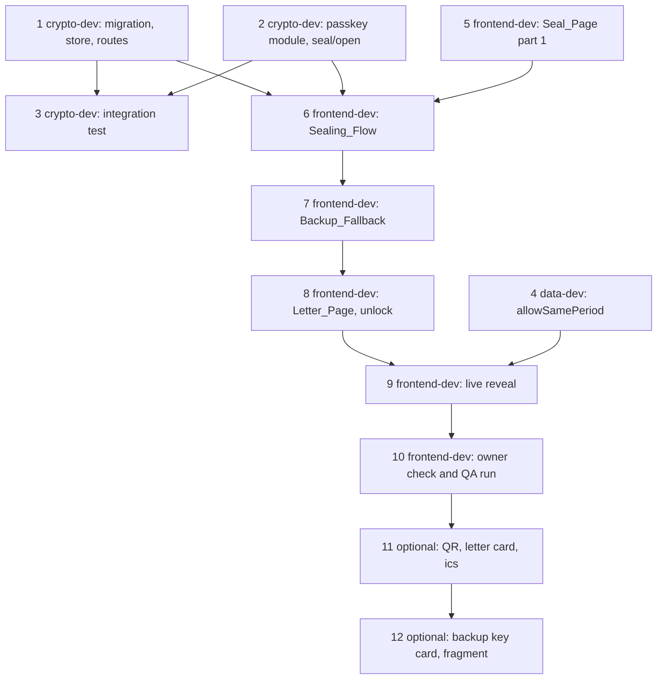

# Implementation Plan: 06 Lock and unlock (Demo 2)

## Overview

Demo 2 lets a judge seal a letter with their own passkey, wait 30 seconds and unlock it. Work is split by role: crypto-dev (tasks 1 to 3), data-dev (task 4), frontend-dev (tasks 5 to 12). Tasks 11 and 12 are optional.

Each task is one GitHub issue (template `.github/ISSUE_TEMPLATE/agent-task.md`) worked by one role agent, and leaves `main` passing the CI gate. Each PR aims for about 1,500 changed lines as `.github/agents.json` counts them (test files, `package-lock.json` and `drizzle/meta/**` excluded; the hard limit is 5,000) and stays inside its role's paths plus `shared` (`package.json`, `package-lock.json`, `.env.example`).

Follow `design.md` in this folder for every file name, constant, interface, table and algorithm, and `requirements.md` for the rules. The language is TypeScript (strict). Follow `tech.md`, `crypto.md`, `data-integrity.md`, `neutrality.md` and `tone.md` in `.kiro/steering/`.

"Before this task" lists work that must be on `main` first. "Depends on" lists tasks in this spec. The dependency graph is at the end.

## Rules for every task

- **Branch and PR.** The dispatcher creates the branch `agent/<role>/issue-N` and the PR "Closes #N". Do not push to `main`. Do not merge. Do not amend commits after a hook failure; make a new commit.
- **Stay inside Scope.** Change only the files listed under the task's Scope, plus new `*.test.ts(x)` files next to the code they test. Check your own diff before you finish. Paths that match your role's globs but are not listed in your Scope are not yours either.
- **Owner-only paths.** Never edit `.kiro/**`, `.github/**`, `tools/**`, `scripts/check.sh`, `scripts/check-js-budget.mjs`, `docs/**`, `src/app/layout.tsx`, `src/app/page.tsx`, `src/app/globals.css`, `next.config.ts`, `deploy/**` or `src/lib/security-headers.ts`. The three `src/app/` files match `frontend-dev`'s globs, so the PR check will not catch them. Do not touch them.
- **Run `bash scripts/check.sh`** before you finish. It must pass. Fix what it reports; do not skip a step.
- **No new runtime dependency** in `package.json` (R1.4). If you think you need one, stop and ask the owner. No browser test framework either (R22.9).
- **No logging of secrets.** No `console` call in any new file under `src/app/api/letters/demo/`, `src/lib/letter-store/`, `src/lib/crypto/`, `src/components/live/` or `src/components/reveal/`. Never write the PRF output, DEK, Server_Secret, backup key, challenge, credential ID or plaintext to a log, an error message, `localStorage`, `sessionStorage`, IndexedDB, a cookie or the URL (R7.7, R10.1).
- **Boundaries.** Server code (`src/app/api/**`, `src/lib/db/**`, `src/lib/letter-store/**`) must not import `src/lib/crypto`, directly or indirectly (R1.6). Components must not import `@/lib/crypto` statically; only `src/components/live/useCryptoModule.ts` and `src/components/reveal/useOpeningFlow.ts` may `import("@/lib/crypto")` dynamically. Use `import type` through `src/components/live/crypto-module.ts`.
- **Do not change** `src/lib/letter-store/clock.ts`, `src/lib/letter-store/queries.ts`, the three existing letter routes (`src/app/api/letters/[id]/route.ts`, `.../secret/route.ts`, `src/app/api/openings/route.ts`), `src/lib/security-headers.ts`, the Sealing_Script, the persona letters or the demo key (R1.7, R1.8, R6.5). Do not add a route, script or function that inserts into `letters` (R5.1).
- **Existing tests pass unchanged.** Additions to an existing test file are allowed. Changing an existing assertion is not. The PR description states which spec 02, 03 and 05 tests it touched and why, or "none" (R24.6).
- **Neutrality and tone.** Every user-facing string follows `tone.md` and `neutrality.md`: second person, short sentences (at most 25 words), no exclamation marks, no judgement words, no puns. Warnings about a lost passkey stay plain (R19.3). Copy lives in `src/components/live/copy.ts` (R19.1), never as a string literal in a component.
- **Data integrity.** Never invent, estimate or fill a figure. A missing "then" figure stops the seal (R13.5).
- **Concrete names.** Use the exact file names, constants and function signatures in `design.md`. If `design.md` and the code on `main` disagree, or a name has moved (spec 05 may rename files under `src/components/ceremony`), re-read the code, keep the design's behaviour, and say what you changed in the PR description. If something is unclear, stop and ask the owner in the issue. Do not guess.
- **Tests.** Property tests use fast-check (already in `devDependencies`), at least 100 runs, tagged `// Feature: 06-lock-and-unlock, Property N: <title>`. Unit and flow tests use Vitest. UI tests use `renderToStaticMarkup`, no DOM. No test may need the network.
- **The PR description states** the validation command output summary, which existing tests were touched, and for frontend tasks (R24.8) the three values printed by `node scripts/check-js-budget.mjs` after `npm run build`, plus screenshots taken with the QA steps listed in the task.
- **QA steps** are numbered as in `design.md`, "QA browser steps". The QA agent cannot use a real passkey. It installs the fake `navigator.credentials` and `window.fetch` stub from that section; crypto is covered by the unit and integration tests with the fake Authenticator_Port. Stages that later tasks build being missing is not a finding (R24.5).

## Tasks

- [x] 1. Migration, schema, letter store, Prepare_Route and Seal_Route
  - Agent: `crypto-dev` (owns `drizzle/**`, `src/lib/db/schema/letters*`, `src/lib/letter-store/**`, `src/app/api/letters/**`, `src/lib/seal-format/**`) · Depends on: none · Estimated size: ~850 changed lines plus ~1,500 test lines
  - Before this task: only `main`. This task can run now, in parallel with task 2 and task 5. Tasks 1 and 2 share no file.
  - Scope: `drizzle/0001_live_letters.sql`, `drizzle/meta/0001_snapshot.json`, `drizzle/meta/_journal.json`, `src/lib/db/schema/letters.ts`, `src/lib/seal-format/live-constants.ts`, `src/lib/seal-format/index.ts`, `src/lib/letter-store/live-constants.ts`, `src/lib/letter-store/live-rules.ts`, `src/lib/letter-store/config.ts`, `src/lib/letter-store/drafts.ts`, `src/lib/letter-store/store.ts`, `src/lib/letter-store/http.ts`, `src/app/api/letters/demo/prepare/route.ts`, `src/app/api/letters/demo/seal/route.ts`, `.env.example`, and the tests `src/lib/letter-store/live-rules.test.ts`, `live-rules.property.test.ts`, `drafts.test.ts`, `store-live.test.ts`, `src/app/api/letters/demo/prepare/route.test.ts`, `src/app/api/letters/demo/seal/route.test.ts`, `src/test/integration/live-letters.test.ts`
  - Acceptance:
    - Edit `src/lib/db/schema/letters.ts` as design.md "Migration" shows: widen `demo_letters_kind` to `('persona', 'live')`, add `demo_letters_live_lock`, add the `demoLetterDrafts` table with its two checks and the `created_at` index. Then run `npm run db:generate -- --name live_letters`. Compare the generated SQL with the SQL in design.md and fix it to match exactly, keeping the `--> statement-breakpoint` markers. Do not hand-edit the snapshot or journal. If drizzle-kit asks an interactive question, stop and ask the owner; do not use `--custom` (R2.2 to R2.5).
    - The migration adds no trigger and touches none. Persona rows stay unchanged (R2.3). Re-running the migrate command applies nothing and exits 0; a failing last statement rolls the whole file back and exits non-zero (R2.8). The drizzle pg migrator already runs all pending migrations in one transaction, so the SQL file holds no `BEGIN` or `COMMIT` (an inner `COMMIT` would end that transaction early).
    - `src/lib/seal-format/live-constants.ts` exports `LOCK_DURATION_MS` (30000), `DRAFT_LIFETIME_MS` (600000) and `LOCK_MAX_AHEAD_MS` (60000), exported from `src/lib/seal-format/index.ts`. `src/lib/letter-store/live-constants.ts` exports `DRAFT_CAP` (1000), `LIVE_SEAL_CAP` (500), `LIVE_SEAL_WINDOW_MS` (86400000), `SEAL_BODY_MAX_CHARS` (100000), `PREPARE_ID_ATTEMPTS` (3), `PREPARE_LOCK_KEY` (70601), `SEAL_LOCK_KEY` (70602) and `LIVE_KIND` ("live").
    - `live-rules.ts` exports `lockRuleHolds(sealedAt, opensAt, now)` and `draftIsFresh(createdAt, now)` exactly as design.md "Server clock and time rules" says (R4.2). It carries the same server-only guard as `clock.ts`.
    - `config.ts` exports `readRpId()` (trimmed `process.env.RP_ID`, `null` when empty). `drafts.ts` exports `createDraft(randomBytes?)` and the `Draft` type, in one transaction with `pg_advisory_xact_lock(PREPARE_LOCK_KEY)`, one `clock_timestamp()` read, expiry cleanup, the `DRAFT_CAP` check, up to `PREPARE_ID_ATTEMPTS` ID attempts against `demo_letter_drafts`, `demo_letters` and `letters`, and an insert with `created_at` set to the read time (R3.1, R3.5 to R3.7).
    - `store.ts` gains `storeLiveLetter` and the new `LetterStoreCheck` values (`draft_not_found`, `busy`, `lock_out_of_range`) with one fixed message each and no value in any message. It re-parses the envelope and re-checks the hash first, then follows design.md "Letter store additions" step by step: advisory lock on `SEAL_LOCK_KEY`, one `clock_timestamp()`, `SELECT ... FOR UPDATE` on the Draft, `draftIsFresh`, the 24-hour count (`count > LIVE_SEAL_CAP` rejects, so exactly 500 still accepts), `lockRuleHolds`, insert with `kind` `live`, delete of the Draft. An error rolls everything back and the Draft stays (R4.3, R4.9 to R4.12). `http.ts` gains the frozen bodies `BUSY`, `NOT_CONFIGURED`, `INVALID_ENVELOPE`, `HASH_MISMATCH`, `LOCK_OUT_OF_RANGE`.
    - `POST /api/letters/demo/prepare` answers per the table in design.md: 503 `not_configured` before any database call, 429 `busy`, 500 `internal`, 201 `{letterId, serverSecret, serverNow}`. It ignores the body, sends `Cache-Control: no-store` on every response, writes no log, and a forced database failure test shows the Server_Secret is in neither the response nor captured console output (R3.1 to R3.9).
    - `POST /api/letters/demo/seal` runs the ten steps of the R4.1 table in order and stops at the first failure, with the envelope `letterId` equal to the body `letterId` checked at step 4 and the header `rpId` compared with `RP_ID` at step 5. It contains no SQL, imports no `src/lib/crypto`, echoes no submitted value, and maps `LetterStoreError` checks to statuses as design.md "Seal_Route" lists (R4.1 to R4.12). A used or expired Draft and an unknown ID give the same 404 body (R4.6).
    - `.env.example` lists `RP_ID=` and `APP_ORIGIN=` (names only). The Helm chart already sets both, so it is not changed (R2.9, R3.10).
    - Tests: Property 1 (Lock rule), Property 2 (draft freshness), Property 3 (first failing step decides the answer), Property 4 (no echo, no console output), Property 5 (prepare output shape). Route tests cover every row of R4.1 with one request each and assert no `demo_letters` row after each failure (R22.4); prepare tests cover R22.5 (shape, 503, collision retry via the injected `randomBytes`, expiry cleanup, busy at 1,001 and not at 1,000, expired drafts not counted, leak check). The integration test `live-letters.test.ts` (use the existing `describeDb` harness) covers R22.6: migration idempotent, and migration rollback (on a fresh database run 0000, create an empty table named `demo_letter_drafts`, run the migrator, then assert it throws, `demo_letters_kind` still rejects kind `live`, and the journal table has no 0001 row), a 30 second live row accepted, 29.999 and 30.001 second rows rejected, a persona row with an old `opens_at` still accepted, update/delete/truncate of a live row raise, a `letters` row with a 30 second gap rejected (R5.3), a 31 second live row rejected (R5.5), no `letters` row after a seal (R5.4), caps at exactly 1,000 drafts and 500 live rows in 24 hours, rows older than 24 hours not counted, Draft gone after a seal and kept after a rejected seal.
  - Spec 03 tests changed: none. The server import-boundary scan must still pass with the two new routes.
  - QA steps: none (no UI). The QA agent reads the diff against R1 to R6 and runs the tests.
  - Validation: `bash scripts/check.sh`; `npx vitest run src/lib/letter-store src/app/api/letters src/test/integration/live-letters.test.ts`
  - _Requirements: R1, R2, R3, R4, R5, R6.1–R6.5, R22.4–R22.6, R24.3_

- [ ] 2. Authenticator_Port, Passkey_Module, fake, and passkey support in sealLetter and openLetter
  - Agent: `crypto-dev` (owns `src/lib/crypto/**` and `src/lib/seal-format/**`) · Depends on: none · Estimated size: ~1,000 changed lines plus ~1,300 test lines
  - Before this task: only `main`. Runs in parallel with task 1. This task does not touch `src/lib/seal-format/index.ts`, which task 1 edits; it reaches `isRpId` by deep import.
  - Scope: `src/lib/crypto/authenticator-port.ts`, `src/lib/crypto/passkey.ts`, `src/lib/crypto/testing/fake-authenticator.ts`, `src/lib/crypto/kdf.ts`, `src/lib/crypto/seal.ts`, `src/lib/crypto/open.ts`, `src/lib/crypto/errors.ts`, `src/lib/crypto/index.ts`, `src/lib/seal-format/v1/header.ts`, and the tests `src/lib/crypto/passkey.test.ts`, `authenticator-port.test.ts`, `seal-passkey.test.ts`, `open-passkey.test.ts`, `seal-open-passkey.property.test.ts`, `no-fake-import.test.ts`, `no-leak.test.ts`
  - Acceptance:
    - `authenticator-port.ts` exports `PortCreateOptions`, `PortGetOptions`, `PortResult`, `PortError`, `AuthenticatorPort` and `browserAuthenticatorPort` per design.md. Options use `Uint8Array` only. The browser port is duck-typed: it reads `rawId` and `getClientExtensionResults()` and never uses `instanceof PublicKeyCredential`. It looks up `navigator.credentials.create` and `.get` at call time, never at module load, because the crypto module is preloaded before the QA stub is installed. A unit test replaces `navigator.credentials` after import and asserts the replacement is called. `NotAllowedError` and `AbortError` map to `PortError("cancelled")`; any other throw or a null credential maps to `PortError("failed")` with a fixed message (R11.1).
    - `passkey.ts` exports the constants `PASSKEY_RP_NAME`, `PASSKEY_USER_NAME`, `PASSKEY_USER_DISPLAY_NAME`, `PASSKEY_TIMEOUT_MS`, `PASSKEY_PUBKEY_ALGS`, `PRF_SALT_BYTES`, `PRF_OUTPUT_BYTES`, `CHALLENGE_BYTES`, `USER_ID_BYTES`, `CREDENTIAL_ID_MAX_BYTES`, and the functions `createPasskey`, `confirmPasskey`, `assertPasskey` with the result types in design.md. In each function the port call is the first asynchronous operation: everything before it is synchronous, and a test calls the function without awaiting and asserts `fakePort.calls.length === 1` (R7.2, R9.7). None throws for an expected failure; none logs; none returns `prfOutput` on failure (R7.4, R7.6, R7.7).
    - `createPasskey` sends the options of R7.2 exactly (name and display name `Revenant demo`, `rp.name` `Revenant`, resident key and user verification `required`, `attestation` `none`, no `authenticatorAttachment`, 32-byte salt and challenge, 16-byte user ID, algorithms -7 and -257, timeout 120000). `confirmPasskey` checks in order: 32-byte PRF result (`no_prf`), same credential (`failed`), created PRF equal when present (`prf_mismatch`). `assertPasskey` returns `wrong_domain` without calling `get` when `pageHostname` differs from `rpId` (R9.5, R9.6).
    - `kdf.ts` gains `INFO_KEK_PASSKEY` (`"revenant-kek-passkey-v1"`) and `derivePasskeyKek(prfOutput, serverSecret, letterId)`; not exported from `index.ts`.
    - `seal.ts`: `backupKey` becomes optional and `passkey?: PasskeyFactor` is added. At least one factor is required (`invalid_input`, field `backupKey`); a bad passkey factor gives `invalid_input` with field `passkey`; all input checks run before any derivation. A passkey factor adds the wrap with AAD `letterId || "passkey"` and the header fields `rpId`, `credentialId`, `prfSalt`; no passkey factor adds none. Wraps stay sorted backup first. The wrap is unwrapped again and compared with the DEK; a difference gives `SealError.wrapFailed()` and no envelope (R8.1 to R8.8). The DEK and `passkey.prfOutput` are zeroed in `finally`. `SealErrorDetail`, `OpenError` fields `backupKey` and `passkey`, and `isRpId` (exported from `src/lib/seal-format/v1/header.ts` with the logic of the existing refine) are added as design.md says.
    - `open.ts`: `OpenInput` takes `backupKey?` or `passkey?: { prfOutput }`. Order stays: secret length, factor check, `parseEnvelope`, hash check (`verification_failed`), then unwrap. No passkey wrap gives `wrong_key`; failed unwrap gives `wrong_key`; failed payload decrypt gives `tampered`. `prfOutput` is zeroed in `finally` (R9.1 to R9.4, R9.8, R9.9).
    - `index.ts` exports `createPasskey`, `confirmPasskey`, `assertPasskey`, `browserAuthenticatorPort`, the result types and `PASSKEY_USER_NAME`. It never exports the fake.
    - The fake `createFakeAuthenticator(config)` derives its PRF as HMAC-SHA-256 over `prfSalt` with a fixed test key, records every call, offers `configure(patch)`, and supports the failure modes `createPrf: "none"`, `getPrf: "none" | "short" | "mismatch"`, `available: false` and the four `failure` values (R11.2, R11.3).
    - A backup-only seal produces the same structure as on `main`; the Sealing_Script and persona tests pass unchanged.
    - Tests: Property 6 (round trip, passkey alone and both factors, at least 100 runs, or at least 50 with the number stated), Property 7 (header fields), Property 8 (wrong keys and changes never open), Property 9 (PRF check mapping), Property 10 (`wrong_domain` never reaches the port), Property 11 (no secret or plaintext in bytes or console). Unit tests cover each `reason` in R7.4 (R11.3), the call order, the `create` options, `wrap_failed` by spying on `subtle.decrypt`, input rejection before derivation (spies on `deriveKey`, `deriveBits`, `encrypt` record zero calls), and `no-fake-import.test.ts` scanning all of `src/` so no non-test file outside `src/lib/crypto/testing/` imports the fake (R11.4).
  - Spec 03 tests changed: none expected. The spec 02 crypto tests and the Sealing_Script tests pass unchanged.
  - QA steps: none (no UI). The QA agent reads the diff against R7 to R11 and runs the tests.
  - Validation: `bash scripts/check.sh`; `npx vitest run src/lib/crypto src/lib/seal-format`
  - _Requirements: R1.5, R7, R8, R9, R10, R11, R22.2_

- [ ] 3. Integration test of the whole server and crypto path
  - Agent: `crypto-dev` · Depends on: 1, 2 · Estimated size: ~120 changed lines plus ~300 test lines
  - Before this task: tasks 1 and 2 are on `main`.
  - Scope: `src/test/integration/live-helpers.ts`, `src/test/integration/live-flow.test.ts`
  - Acceptance:
    - `live-helpers.ts` calls the route handlers with `Request` objects, sets `RP_ID` with `vi.stubEnv`, and polls `GET /api/letters/{id}` every 500 ms. Use the existing `describeDb` pattern.
    - `live-flow.test.ts` does, with the fake Authenticator_Port and real PostgreSQL: prepare, seal a payload with the passkey factor, post to the Seal_Route, assert 201 and one `demo_letters` row with `kind` `live` and `opens_at` equal to `sealed_at` plus 30 seconds (R22.3 steps 1 and 2).
    - Immediately after sealing it asserts `GET /api/letters/{id}` returns only `status`, `opensAt` and `demo`, the secret route returns 403, and `POST /api/openings` returns 403 and stores nothing (R6.1, R22.3 step 3).
    - It polls (at most 45 seconds) until the letter is openable, asserts the database clock moved at least 30 seconds, then asserts the secret is released, the envelope hash verifies, `openLetter` opens with the same fake passkey, the recall record is stored (201) and decrypts to the original answers, and the payload equals the original (R6.2, R6.6, R22.3 step 4). Timeout 60 seconds. It is the only test that waits.
  - Spec 03 tests changed: none.
  - QA steps: none (no UI).
  - Validation: `bash scripts/check.sh`; `npx vitest run src/test/integration/live-flow.test.ts`
  - _Requirements: R6.1, R6.2, R6.6, R22.3_

- [ ] 4. Same-figure change option in computeChange (prerequisite for task 9)
  - Agent: `data-dev` (owns `src/lib/figures/**`; confirmed in `.github/agents.json`) · Depends on: none · Estimated size: ~60 changed lines plus tests
  - Before this task: only `main`. This task is outside R24 and has its own issue. It can run any time before task 9.
  - Scope: `src/lib/figures/change.ts`, `src/lib/figures/change.test.ts`, `src/lib/figures/change.property.test.ts`
  - Acceptance:
    - `computeChange(then, now, options?: { allowSamePeriod?: boolean })`. Default behaviour is identical to today.
    - With `allowSamePeriod` true, the final check changes from `nowEnd <= thenEnd` to: `nowEnd < thenEnd` gives `no_newer_figure`; `nowEnd === thenEnd` is accepted only when `then.value === now.value` and `then.period === now.period`; any other equal-end case gives `no_newer_figure`. Every other check, the arithmetic and the formula identifier stay unchanged (R18.5).
    - No existing test changes.
    - Tests: Property 19: `computeChange(f, f, { allowSamePeriod: true })` is comparable with difference `"0"`; without the option it gives `no_newer_figure`; two figures with the same period and different values give `no_newer_figure` even with the option. Add unit examples for each branch.
  - Spec 03 tests changed: none.
  - QA steps: none (no UI).
  - Validation: `bash scripts/check.sh`; `npx vitest run src/lib/figures`
  - _Requirements: R18.5_

- [ ] 5. Seal_Page part 1: page, write step, figure picker, recall subjects, payload builder, Demo_Index entry
  - Agent: `frontend-dev` · Depends on: none in this spec (may run in parallel with 1 and 2) · Estimated size: ~1,150 changed lines plus ~900 test lines
  - Before this task: spec 05 task 9 is on `main`. Re-read the files under `src/components/ceremony` first, because their names may have moved. The owner has added the `/demo/live` and `/l/[id]` rows (175 kB each) to `scripts/check-js-budget.mjs` (see Owner follow-ups).
  - Scope: `src/app/demo/live/page.tsx`, `src/components/live/constants.ts`, `copy.ts`, `recall-subjects.ts`, `catalogue-list.ts`, `form.ts`, `build-payload.ts`, `crypto-module.ts`, `useCryptoModule.ts`, `SealPage.tsx`, `WriteForm.tsx`, `FigurePicker.tsx`, `live.module.css`, `src/components/demo/LiveEntry.tsx`, `src/app/demo/page.tsx`, `src/components/demo/copy.ts`, the scan tests in `src/components/reveal` and `src/components/demo` (add `src/components/live` to their file walks, additions only), and the `*.test.ts(x)` for every new file including `src/components/live/contrast.test.ts`
  - Acceptance:
    - `src/app/demo/live/page.tsx` is a server component with `export const dynamic = "force-dynamic"`, reads `RP_ID` and `APP_ORIGIN` at request time, and renders `Unavailable` (copy `LIVE_COPY.unavailable`, link to `/demo`, no seal control) when `RP_ID` is empty, else `SealPage` with `rpId` and `appOrigin` (R12.8). It imports no `letter-store` module.
    - `constants.ts` exports `MAX_LETTER_CODE_POINTS` (5000), `MIN_FIGURES` (1), `MAX_FIGURES` (6), `COUNTDOWN_TICK_MS` (250). `copy.ts` holds `LIVE_COPY` with every Seal_Page string from design.md "Copy" (including `notYet`), and `src/components/demo/copy.ts` gains `DEMO_COPY.liveEntryHeading`, `liveEntryBody`, `liveEntryLink`.
    - `catalogue-list.ts` exports `PickableSeries` and `listPickableSeries(figures)` in catalogue order, only series with at least one figure, with `isFixture` from `isFixtureFigure` on the latest figure; never ordered by movement (R13.1, R13.7). `FigurePicker` shows name, unit, region, "Latest period: {period}" and the "fixture data" label for fixture series, and no value.
    - `form.ts` exports `countCodePoints` and `validateWrite` returning the `WriteProblem` list in design.md (R12.3, R12.4, R13.2, R15.11). Messages show next to the field and keep the typed text; nothing starts.
    - `recall-subjects.ts` exports `RECALL_SUBJECTS` with the six entries in design.md; a test runs `checkRecallSubject` over every listable metric ID and fails on a missing or rejected entry (R14.2, R14.3).
    - `build-payload.ts` exports `buildLivePayload` per design.md: Then figure from `thenAndNow(id, sealedDate, figures).then` copied unchanged, six-key metric definitions, `generateRecallQuestions` with the subjects, no `written_as_of`, no self-reported figure, validated with `payloadV1Schema`; a missing "then" returns `{ ok: false, metricId }` for the first such series (R13.4 to R13.6, R14.1, R14.4).
    - `crypto-module.ts` exports only `type CryptoModule = typeof import("@/lib/crypto")`. `useCryptoModule` starts `import("@/lib/crypto")` in an effect after mount and returns the module or `null`.
    - `WriteForm` renders, in order: heading and note, letter field with live count, `FigurePicker`, the two-prompt explanation naming "Revenant demo", the cross-ecosystem note, the lost-passkey warning with its checkbox, and the "Create your passkey" button (at least 44 by 44 CSS pixels). In this task the button is disabled and shows `LIVE_COPY.notYet`; task 6 removes that (R12.2, R15.2, R15.11, R15.12). The Demo label comes first. The page makes no network request on load, typing or picking (R12.7).
    - The Demo_Index gets one `LiveEntry` link to `/demo/live`, outside the persona `<ul>`; the existing Demo_Index test passes unchanged (R12.1).
    - `contrast.test.ts` computes the ratio for every new text and surface token pair (R19.6). Copy passes the existing scan tests (R19.1, R19.2). Layout works at 320 px and 200 % text (R19.8).
    - Tests: Property 12 (payload builder) and Property 13 (write validation) with fast-check; static-markup tests for the form, picker, fixture labels, the warning gate and the unavailable screen.
  - Spec 03 tests changed: the scan tests above get `src/components/live` added to their file walks (additions only).
  - QA steps: 01, 02, 03 (validation only; the buttons are disabled so check the messages through the form checks and the disabled state), 22 (the write step at 360 px). Later steps are not findings.
  - Validation: `bash scripts/check.sh`; `npx vitest run src/components/live src/components/demo`
  - _Requirements: R12, R13, R14, R19, R24.4, R24.5_

- [ ] 6. Seal_Page part 2a: Sealing_Flow with the two presses, failure screens, sealed state and countdown
  - Agent: `frontend-dev` · Depends on: 1, 2, 5 · Estimated size: ~1,100 changed lines plus ~800 test lines
  - Before this task: tasks 1, 2 and 5 are on `main`, and so is spec 05 task 9.
  - Scope: `src/components/live/seal-machine.ts`, `seal-runner.ts`, `api.ts`, `clock.ts`, `format.ts`, `useSealFlow.ts`, `StepStatus.tsx`, `SealFailure.tsx`, `SealedView.tsx`, `SealPage.tsx`, `WriteForm.tsx`, `copy.ts`, `live.module.css`, and the `*.test.ts(x)` for each new file
  - Acceptance:
    - `seal-machine.ts` exports `SealFailureKind`, `SealState`, `SealEvent`, `sealReducer` and `INITIAL_SEAL_STATE` as the state diagram and type in design.md; each press event is accepted only in its source state; no transition leads from `preparing` or `sealing` back to `creating` or `confirming`; `sealed` is reachable only from `sealing`. The page root carries `data-live-step={state.tag}`. Fallback events exist in the type but the fallback transitions come in task 7.
    - `clock.ts` exports `computeSealTimes({serverNow, arrivedMs, nowMs})` and `remainingSeconds(opensAtMs, nowMs, offsetMs)` with the formulas in design.md (R15.5, R16.2). `format.ts` exports `formatLocalDateTime` and `formatRemaining`.
    - `api.ts` exports `PREPARE_PATH`, `SEAL_PATH`, `PrepareResult`, `SealPostResult`, `SealApi` and `realSealApi`, using `cache: "no-store"`, `credentials: "same-origin"`, `referrerPolicy: "no-referrer"`, the two fixed relative paths only, small Zod parsers, never throwing (R15.4). `realSealApi` calls the global `fetch` at call time, never captured at module load, because the QA stub replaces `window.fetch` after the page has loaded; a unit test replaces `globalThis.fetch` after import and asserts the replacement is called.
    - `seal-runner.ts` exports `SealDeps`, `Created`, `SealOutcome`, `pressCreate`, `pressConfirm`, `sealWithPasskey` (backup key parameter is optional and unused until task 12). `pressCreate` and `pressConfirm` are pass-throughs with no `await` of their own. `sealWithPasskey` follows R15.1 steps 3 to 8 in order; a missing "then" gives `missing_then` with the metric ID; `SealError` `wrap_failed` gives `cannot_lock` with `passkeyCreated: true`. No storage, no console.
    - `useSealFlow` returns `{ state, onCreatePress, onConfirmPress, onFallbackStart, onFallbackSealPress, onFallbackDecline, onRetry, backupKeyText }`; the fallback handlers are stubs that do nothing until task 7. It owns the refs for `created`, `confirmed` and the key, guards double presses with an `inFlight` ref, and dispatches reducer events. `SealPage` accepts the optional `deps` prop (`port`, `api`, `figures`, `nowMs`) as the one injection point (R11.5). The create control stays disabled until `useCryptoModule()` has loaded (R15.3). `WriteForm` drops `notYet`, shows "Confirm your passkey" after a successful create, and has a `role="status"` line with the current step (R15.10).
    - `SealFailure` renders `cannot_lock` (what happened, nothing sealed or stored, what to do, the passkey-deletion note when `passkeyCreated`, link to `/demo`, and the "Seal with a backup key instead" control shown disabled with no behaviour; task 7 wires it), `cancelled` (calm text, "Try again") and `failed` (one body each for `network`, `server`, `clock`, `busy`, `missing_then` naming the series; "Try again"). No failure says the letter was sealed (R15.6 to R15.8).
    - `SealedView` shows the sealed statement, the local opening time, the countdown, the link as text with a Copy control, "Go to your letter" enabled at zero (a `next/link` to the relative path `/l/<id>`, never built from `APP_ORIGIN`; no auto-navigation. Only the displayed and copied link text uses `APP_ORIGIN`), the keep-the-link note, and no letter text or figure (R15.13, R16.1 to R16.5). Under Calm_Mode it has no decorative motion and the countdown text still updates (R16.6).
    - Only the Create_Press and Confirm_Press start prompts; the first request is the Prepare_Route call, made only after PRF_Check steps 1 to 4 pass; each PRF_Check failure makes zero Seal_Route requests; one press sends at most one Seal_Route request (R12.7, R15.1, R15.10).
    - A source scan under `src/components/live` fails on `localStorage`, `sessionStorage`, `indexedDB`, `document.cookie`, `console.` and `serviceWorker` (R22.8).
    - Tests: Property 14 (seal times), Property 15 (reducer never prompts after prepare, seals once), Property 16 (countdown never rises, ends at zero); flow tests drive `seal-runner.ts` with the fake port and stub routes, asserting call order, zero Seal_Route calls on each PRF failure, 429 `busy`, 422 and network messages, `cancelled` offering "Try again", and the warning gate (R22.7). Static-markup tests cover each failure screen and the sealed view showing no typed text.
  - Spec 03 tests changed: none expected.
  - QA steps: 02, 03, 04, 05, 06, 07, 12, 13, 14, 20, 21, 22. Step 08 onward is not a finding (the Letter_Page comes in task 8). Steps 15 to 18 wait for task 7.
  - Validation: `bash scripts/check.sh`; `npx vitest run src/components/live`
  - _Requirements: R15.1–R15.8, R15.10–R15.14, R16, R19, R22.7, R22.8, R24.5, R24.8_

- [ ] 7. Seal_Page part 2b: Backup_Fallback
  - Agent: `frontend-dev` · Depends on: 6 · Estimated size: ~750 changed lines plus ~400 test lines
  - Before this task: task 6 is on `main`.
  - Scope: `src/components/live/BackupFallback.tsx`, `seal-runner.ts`, `seal-machine.ts`, `useSealFlow.ts`, `SealFailure.tsx`, `SealedView.tsx`, `SealPage.tsx`, `copy.ts`, `live.module.css`, and the `*.test.ts(x)` for each
  - Acceptance:
    - `seal-machine.ts` gains the transitions `cannot_lock → fallback_key` (`FALLBACK_START`), `fallback_key → preparing` (`FALLBACK_SEAL_PRESS`), `fallback_key → cannot_lock` (`FALLBACK_DECLINE`), exactly as the diagram in design.md. Property 15 still passes.
    - `seal-runner.ts` exports `sealWithBackupKey(d, {text, metricIds, backupKey})`: same steps as `sealWithPasskey` without a passkey factor and with `passkeyCreated: false`; `factors` is `"backup"` (R15.9 step 4). The header then has a Backup_Wrap only.
    - `BackupFallback` shows the key from `formatBackupKey` in groups of four with a Copy control, the loss warning (`fallbackWarning`), the "I have saved this key" checkbox, a seal button disabled until it is ticked, and "Not now". `generateBackupKey` is called from the loaded module on `FALLBACK_START`; the key lives in a ref only and is dropped when sealing ends or the judge declines (R10.3, R15.9). `SealFailure` enables "Seal with a backup key instead" on `cannot_lock`.
    - `SealedView` for `factors` `"backup"` shows the `keyReminder` text and never shows the key again (R16.5).
    - Tests: reducer tests for the three new transitions (add to Property 15's generated event sequences); flow tests for R22.7: key shown in groups of four, the seal control disabled until the box is ticked, declining seals nothing and sends nothing, and a backup-only header (no `rpId`, `credentialId`, `prfSalt`); the no-leak test from task 2 style: console capture shows no backup key.
  - Spec 03 tests changed: none.
  - QA steps: 13, 15, 16, 17, 18, 22. Step 16 needs the Letter_Page from task 8; if it is not on `main`, record "pending task 8", which is not a finding.
  - Validation: `bash scripts/check.sh`; `npx vitest run src/components/live`
  - _Requirements: R10.3, R15.6, R15.9, R16.5, R22.7_

- [ ] 8. Letter_Page: unlock with passkey or backup key, Opening_Flow additions
  - Agent: `frontend-dev` · Depends on: 7 · Estimated size: ~1,250 changed lines plus ~800 test lines
  - Before this task: tasks 6 and 7 are on `main`, and so is spec 05 task 9.
  - Scope: `src/app/l/[id]/page.tsx`, `src/app/l/[id]/not-found.tsx`, `src/components/live/LiveLetter.tsx`, `UnlockView.tsx`, `copy.ts`, `live.module.css`, `src/components/reveal/opening-machine.ts`, `useOpeningFlow.ts`, `api.ts`, `unlock.ts`, `OpeningFlow.tsx`, `StillSealed.tsx`, `copy.ts` (only if a string is needed), `src/components/ceremony/stages.ts`, `src/components/ceremony/envelope/EnvelopeView.tsx`, and the `*.test.ts(x)` for each
  - Acceptance:
    - `src/app/l/[id]/page.tsx` is a server component: awaits `params`, calls `notFound()` unless `isLetterId(id)`, renders `MotionProvider`, `DeskScene` and `LiveLetter`. `not-found.tsx` shows `LIVE_COPY.letterNotFound` and a link to `/demo`. The page imports no crypto and no database module (R17.1).
    - `opening-machine.ts` gains the tags `awaiting_key` and `unlocking`, the events `NEEDS_KEY`, `KEY_NOTICE`, `UNLOCK`, `KEY_REJECTED`, the types `UnlockInfo` and `KeyNotice`, and the `openable → open_failed` transition, exactly as the table in design.md. No existing transition changes; `opening-machine.test.ts` and `opening-machine.property.test.ts` pass unchanged (R17.14). `awaiting_key` and `unlocking` carry no opened letter.
    - `useOpeningFlow(letterId, options?: { keySource?: "demo" | "user"; port? })`: default `"demo"` behaves exactly as on `main`. With `"user"`: it parses the envelope after the secret is released, keeps the secret and header bytes in refs, dispatches `NEEDS_KEY` with `UnlockInfo`, preloads `@/lib/crypto` on `awaiting_key`, and in the `unlocking` effect calls `openLetter` with `passkey: { prfOutput }` or `backupKey` and dispatches `OPENED`, `VERIFICATION_FAILED`, `KEY_REJECTED` (for `wrong_key`) or `OPEN_FAILED`; the occurrence key includes a counter so a second unlock runs. It returns `live?: { demo, unlock }`. `api.ts` passes `demo: true` through only when the route sent it (existing `api.test.ts` stays equal).
    - `unlock.ts` exports `UnlockControls`, `startPasskeyAssertion` (calls `crypto.assertPasskey` synchronously, no `await` first), `noticeForAssertFailure` (`unsupported` maps to `no_prf`) and `readBackupKeyField` (`parseBackupKey` only, no request) (R17.2, R17.10).
    - `UnlockView` shows the passkey button, the key field, or both, from `state.unlock` (backup only: `backupOnly` text and no passkey control, R17.10); the notice in a `role="status"` region for each `KeyNotice`; the field has `type="text"`, `autocomplete="off"`, `autocorrect="off"`, `autocapitalize="off"`, `spellcheck={false}` and no `onPaste` handler. The passkey control stays disabled until the crypto module has loaded.
    - `OpeningFlow` gains `mode?: "persona" | "live"` and `port?`. In live mode it renders the Demo label first when `flow.live?.demo` is true (R17.11), renders `awaiting_key` as `EnvelopeView variant="unlock"` and `unlocking` as the `verifying` variant, renders `sealed` with `stillSealed={{ precise: true, onZero }}` where `onZero` calls `flow.retry()` once per page load (ref guard; R17.4). `StillSealed` gains the optional `precise` and `onZero` props with the behaviour in design.md; without them nothing changes. `EnvelopeView` gains `sealedOpensAt?`, `stillSealed?` and the `unlock` variant. `stages.ts` maps `awaiting_key` and `unlocking` to `"envelope"`; `stages.test.ts` Property 1 includes the two tags.
    - Error handling follows the table in design.md "Browser: Letter_Page": cancelled, `no_prf`, `wrong_domain` (names the header `rpId`, `get` not called), `wrong_passkey`, `mistyped_key` (no request), `wrong_backup`; existing screens for 404, network and 5xx (R17.5 to R17.10).
    - `LiveLetter` renders `<OpeningFlow mode="live" letterId personaName={LIVE_COPY.regionLabel} />`. Persona letters keep the demo key and show no passkey control (R17.13); a test renders the persona route and asserts the same states as before.
    - Tests: Property 17 (machine additions keep the gates), Property 18 (backup key accepted in any format, mistyped detected, no fetch); unit tests for `wrong_domain` calling `get` zero times, `get` as the first async step after the click, the passkey control appearing only after the secret is released, the single automatic re-check with "Try again" still shown, the countdown at zero, and a source scan that `useOpeningFlow.ts` and `useCryptoModule.ts` are the only files importing the crypto barrel dynamically.
    - The reveal itself is unchanged in this task; a Live_Letter reveal shows persona wording until task 9.
  - Spec 03 tests changed: `stages.test.ts` (add the two tags, additions only). All other spec 03 and spec 05 tests pass unchanged.
  - QA steps: 08, 09, 10, 12, 16, 17, 18, 19, 22, 23. Steps 11 and the live reveal wording come in task 9.
  - Validation: `bash scripts/check.sh`; `npx vitest run src/components/live src/components/reveal src/components/ceremony src/app/l`
  - _Requirements: R17, R19, R22.7, R24.5, R24.8_

- [ ] 9. Live_Letter reveal variant
  - Agent: `frontend-dev` · Depends on: 8, 4 · Estimated size: ~650 changed lines plus ~400 test lines
  - Before this task: tasks 8 and 4 are on `main`. The R18.5 acceptance below must not ship before task 4 is merged; if task 4 is not on `main`, stop and ask the owner.
  - Scope: `src/components/reveal/Reveal.tsx`, `SealedLetter.tsx`, `FiguresThenNow.tsx`, `OpeningFlow.tsx`, `src/components/live/LiveLockNote.tsx`, `copy.ts`, `live.module.css`, and the `*.test.ts(x)` for each
  - Acceptance:
    - `Reveal` gains `variant?: "persona" | "live"` (default `persona`) and `letterId?`; `SealedLetter` gains `variant` too. Defaults keep today's markup byte for byte. In live mode the seal pattern key is `letterId`, and no persona wording appears (R18.8).
    - Live stage 2 shows one line `LIVE_COPY.sealedOn` with `formatLocalDateTime(header.sealedAt)` and never "Written as of", "Prepared later as a demo" or "Sealed for the demo on" (R18.2). The letter text is the same plain-text element (R12.5).
    - `FiguresThenNow` gains an optional `allowSamePeriod` prop (default false) passed as `{ allowSamePeriod: true }` to `computeChange`. A Live_Letter's same figure shows both figures with their own periods, a change of 0, the formula line, and no extra words (R18.3 to R18.5). The Number_Line draws both pins at the centre. Fixture labels, the fixture note and the "historical record, retrieved" label come from the existing components (R18.7).
    - `LiveLockNote` shows `LIVE_COPY.lockNote` and a link to `/demo` (`lockNoteLink`) after stage 3 and says nothing about whether numbers changed (R18.6).
    - Neutrality tests from spec 03 and spec 05 pass unchanged (R18.9); `SealedLetter.test.tsx`, `FiguresThenNow.test.tsx`, `fixture-label.test.tsx`, `change-neutral.property.test.tsx` pass unchanged.
    - Tests: static-markup tests for the live labels, the zero change with the formula, the lock note and link, and an unchanged persona render.
  - Spec 03 tests changed: none expected; additions only.
  - QA steps: 11, 12, 22, 23.
  - Validation: `bash scripts/check.sh`; `npx vitest run src/components/reveal src/components/live`
  - _Requirements: R12.5, R18, R19, R24.5_

- [ ] 10. Owner check checklist and QA run
  - Agent: `frontend-dev` · Depends on: 9 · Estimated size: under 100 changed lines
  - Before this task: tasks 8 and 9 are on `main`.
  - Scope: none for source files. This task posts the section "Owner check on the live site" below as a checklist in its issue and runs the QA steps. Any fix needed is a small change inside the Scope paths of tasks 5 to 9; state each in the PR.
  - Acceptance:
    - The issue body contains the 10-item checklist below, copied as GitHub task-list items, plus a line to record the device, operating system, browser and passkey provider used in step 1 (R23.1, R23.3), and a final item "Delete the Revenant demo passkeys made during the check" (R23.4).
    - The QA agent runs steps 01 to 23 with the stubbed WebAuthn from design.md and records its verdict as "owner check pending" until the owner has ticked the list.
    - The PR description reports the three `check-js-budget.mjs` values for `/demo`, `/demo/live` and `/l/[id]`, and screenshots of steps 02, 07, 09, 10, 11 and 13 at 1280 and 360 pixels.
  - QA steps: all of 01 to 23. This is the full pass.
  - Validation: `bash scripts/check.sh`; `npm run build` then `node scripts/check-js-budget.mjs`
  - _Requirements: R22.9, R23_

- [ ] 11. Letter card with QR encoder, and .ics file (optional)
  - Agent: `frontend-dev` · Depends on: 10 · Estimated size: ~1,250 changed lines plus ~800 test lines
  - Before this task: task 10 is on `main`. This task is optional. The demo is complete without it.
  - Scope: `src/lib/cards/qr/tables.ts`, `gf256.ts`, `reed-solomon.ts`, `encode.ts`, `matrix.ts`, `mask.ts`, `src/lib/cards/qr/__fixtures__/vectors.json`, `src/lib/cards/qr-svg.ts`, `src/lib/cards/index.ts`, `src/lib/ics/build-ics.ts`, `src/lib/ics/index.ts`, `src/components/live/LetterCard.tsx`, `SealedKeepsakes.tsx`, `SealedView.tsx`, `copy.ts`, `live.module.css`, and the `*.test.ts(x)` for each
  - Acceptance:
    - The QR encoder follows design.md "Part D": byte mode only, versions 1 to 10, levels L and M (default M), penalty-based mask choice, no dependency. `encodeQr(text, level?)` returns a `QrMatrix` and throws `RangeError` when nothing fits. `qrToSvg(matrix, { quiet? })` returns one `<svg>` with a single `<path>`, `shape-rendering="crispEdges"`, a 4-module quiet zone (R20.2).
    - QR tests: the generator polynomial for 10 EC codewords has exponents `0, 251, 67, 46, 61, 118, 70, 64, 94, 32, 45`; `rsEncode` on the data codewords `32 91 11 120 209 114 220 77 67 64 236 17 236 17 236 17` gives EC codewords `196 35 39 119 235 215 231 226 93 23`; format bits are `101010000010010` (M, mask 0) and `111011111000100` (L, mask 0); version 7 information is `000111110010010100`. Property 21 checks size `17 + 4 * version`, patterns, zero syndromes per block, and a test-only `extractCodewords` plus a byte-mode parser returning the input. `__fixtures__/vectors.json` holds golden matrices for three strings made once with a reference encoder (`qrencode` or Python `segno`), with the tool name and version recorded. If no reference tool is available, stop and ask the owner.
    - `buildIcs(input)` per design.md: CRLF, `PRODID:-//Revenant//Live demo//EN`, one `VEVENT` with `UID`, `DTSTAMP`, `DTSTART`, `DTEND` (`opensAt` plus `ICS_EVENT_MINUTES`, 15) in UTC basic format, `SUMMARY`, `DESCRIPTION` with the link, `URL`, and a `VALARM` (`TRIGGER:PT0S`); escapes `\`, `;`, `,` and newline; folds at 75 octets without splitting a multi-byte character; holds no letter text, figure or key. Property 20 uses a test-only `parseIcs` for the round trip (R20.3, R20.4).
    - `LetterCard` is an in-page printable section (QR of `{origin}/l/{letterId}`, opening time, link as text) with a print button and a `.noPrint` class; `SealedKeepsakes` offers the card and a Blob `.ics` download made in the click handler. No request to the server, no service worker (a source scan fails on `serviceWorker` under `src/`) (R20.1, R20.5, R20.6). Copy adds the Part D keys listed in design.md.
  - Spec 03 tests changed: none.
  - QA steps: 07 (sealed state shows the card and calendar download, no letter text), 12, 22. The phone scan of the printed card is part of the Owner check step 9.
  - Validation: `bash scripts/check.sh`; `npx vitest run src/lib/cards src/lib/ics src/components/live`
  - _Requirements: R20, R19_

- [ ] 12. Backup key card, #k= fragment and optional backup key beside the passkey (optional)
  - Agent: `frontend-dev` · Depends on: 11 · Estimated size: ~700 changed lines plus ~400 test lines
  - Before this task: task 11 is on `main`. This task is optional.
  - Scope: `src/lib/cards/fragment.ts`, `src/lib/cards/index.ts`, `src/components/live/BackupKeyCard.tsx`, `WriteForm.tsx`, `seal-runner.ts`, `useSealFlow.ts`, `SealedView.tsx`, `LiveLetter.tsx`, `UnlockView.tsx`, `copy.ts`, `live.module.css`, and the `*.test.ts(x)` for each
  - Acceptance:
    - `WriteForm` gains the unticked checkbox `backupCardOption` with `backupCardOptionHint`. When ticked, the flow generates the key with `generateBackupKey` at the seal step and `sealWithPasskey` passes it as `backupKey`, so the header has both wraps (R21.1). When unticked, the R15.11 warning checkbox remains required (R21.2).
    - `BackupKeyCard` shows what it is, that it opens the letter on its own after the opening date, the keep-it-like-a-house-key line, the link as text, the key in groups of four, and a QR of `{origin}/l/{letterId}#k={key without hyphens}` from the task 11 encoder. `SealedView` offers it for letters with a Backup_Wrap (fallback or option); the key sits in a ref until the judge leaves the page, is never sent, logged, stored or cached (R21.3 to R21.5).
    - `fragment.ts` exports `readKeyFragment(hash)` (returns the key text or `null`) and `stripFragment(win)` (`history.replaceState(null, "", pathname + search)`). `LiveLetter` reads and strips the fragment in its own mount effect and renders `OpeningFlow` only afterwards, with `initialBackupKey`; `UnlockView` pre-fills the field and does not submit by itself (R21.6).
    - Tests: Property 22 (fragment round trip), double-wrap round trip (R21.7), static markup for the card and the option, a source scan that no request carries the key.
  - Spec 03 tests changed: none.
  - QA steps: 02, 07, 16, 22. The phone scan of the backup key card is Owner check step 9.
  - Validation: `bash scripts/check.sh`; `npx vitest run src/lib/cards src/components/live`
  - _Requirements: R21_

## Owner check on the live site

This is the content of task 10's issue (R23). The owner does it by hand on `https://revenant.devclef.se` with a device that supports PRF (see `tech.md`).

1. Open `/demo`, follow the Demo 2 link, write a short letter, pick two series, tick the lost-passkey warning and press "Create your passkey".
2. Approve the first prompt, press "Confirm your passkey", approve the second. Check a passkey named "Revenant demo" appears in the passkey manager.
3. Check the sealed state counts down from 30 seconds and shows no letter text.
4. Press the letter link before the countdown ends. Check it says "still sealed" and shows the time remaining.
5. After the countdown, press "Unlock with your passkey". Check the seal-is-intact statement comes before the recall questions.
6. Answer the questions and finish the reveal. Check the letter text matches what was typed, each figure shows its period, and the change is 0.
7. Open the Letter_Page on a device without the passkey, or in a browser without PRF, and check the message is clear. Then, in a browser without PRF, choose "Seal with a backup key instead", save the key, tick "I have saved this key", seal, and after the countdown paste the key and open the letter.
8. Open `/demo/personas/us-maya` and check Demo 1 opens as before.
9. If tasks 11 and 12 are built: print or save the letter card and the backup key card, scan both QR codes with a phone, and check each opens the right page.
10. Record device, operating system, browser and passkey provider, then delete the "Revenant demo" passkeys made during the check.


## Owner follow-ups (not agent tasks)

These paths are owner-only. No agent is assigned to them. The owner does them by hand.

- Before task 5 merges: add `{ route: "/demo/live", key: "/demo/live/page", maxKb: 175 }` and `{ route: "/l/[id]", key: "/l/[id]/page", maxKb: 175 }` to `scripts/check-js-budget.mjs`, or R24.8 is never checked.
- Update the QA prompt's start command (qa.md step 3): the app runs on a random port, so it must be started as `RP_ID=localhost APP_ORIGIN=http://localhost:<port> PORT=<port> npm start`.
- Update `.kiro/steering/structure.md` to list `src/components/live/`, `src/app/demo/live/`, `src/app/l/[id]/`, `src/lib/ics/` and `src/lib/letter-store/`.
- Create the GitHub issues from this file (one per task, including P1) with labels `agent:<role>` and `status:ready`, and set "Depends on" so the dispatcher holds each until its dependencies close.

## Notes

- **Order.** Tasks 1, 2, 5 and 4 can start now and can run in parallel; tasks 1 and 2 share no file. Task 5 needs spec 05 task 9 on `main`. The dispatcher runs one run per role at a time, so two crypto-dev tasks (1 and 2) run one after the other even though they do not conflict.
- **Shared files.** Tasks 5 to 9, 11 and 12 all edit `src/components/live/copy.ts` and `live.module.css`, so they form a chain and only one is open at a time. Task 5 may run beside tasks 1 and 2, because they share no file.
- **Task 4 and task 9.** Without task 4 on `main`, `computeChange` returns `no_newer_figure` for a Live_Letter's same figure and the reveal shows the honest "not comparable" branch. That does not meet R18.5, so task 9 waits for task 4.
- **Optional tasks.** Tasks 11 and 12 are optional (marked in their titles). Part C is complete without them. The Kiro `*` suffix is only for sub-tasks, and this plan has none, so top-level optional tasks carry "(optional)" in the title, as spec 05 task 10 does.
- **No real passkey in CI or QA.** Crypto is covered by the fake Authenticator_Port; only the Owner check proves a real device does PRF.

## Task Dependency Graph

Numbering note: `requirements.md` R24 and `design.md` call the tasks 1, 2, 3, 4a, 4b, 5, 6, 7, 8 and the prerequisite P1. This file needs whole-number task IDs, so they map as follows.

| This file | R24 / design.md | Role |
|---|---|---|
| 1 | 1 | crypto-dev |
| 2 | 2 | crypto-dev |
| 3 | 3 | crypto-dev |
| 4 | P1 | data-dev |
| 5 | 4a | frontend-dev |
| 6 | 4b-1 | frontend-dev |
| 7 | 4b-2 | frontend-dev |
| 8 | 5a | frontend-dev |
| 9 | 5b | frontend-dev |
| 10 | 6 | frontend-dev |
| 11 | 7 (optional) | frontend-dev |
| 12 | 8 (optional) | frontend-dev |

Dependencies: 1, 2, 4 and 5 can start now (5 needs spec 05 task 9); 3 after 1 and 2; 6 after 1, 2 and 5; 7 after 6; 8 after 7; 9 after 8 and 4; 10 after 9; 11 after 10; 12 after 11.



```json
{
  "waves": [
    { "id": 0, "tasks": ["1", "2", "4", "5"] },
    { "id": 1, "tasks": ["3", "6"] },
    { "id": 2, "tasks": ["7"] },
    { "id": 3, "tasks": ["8"] },
    { "id": 4, "tasks": ["9"] },
    { "id": 5, "tasks": ["10"] },
    { "id": 6, "tasks": ["11"] },
    { "id": 7, "tasks": ["12"] }
  ]
}
```
