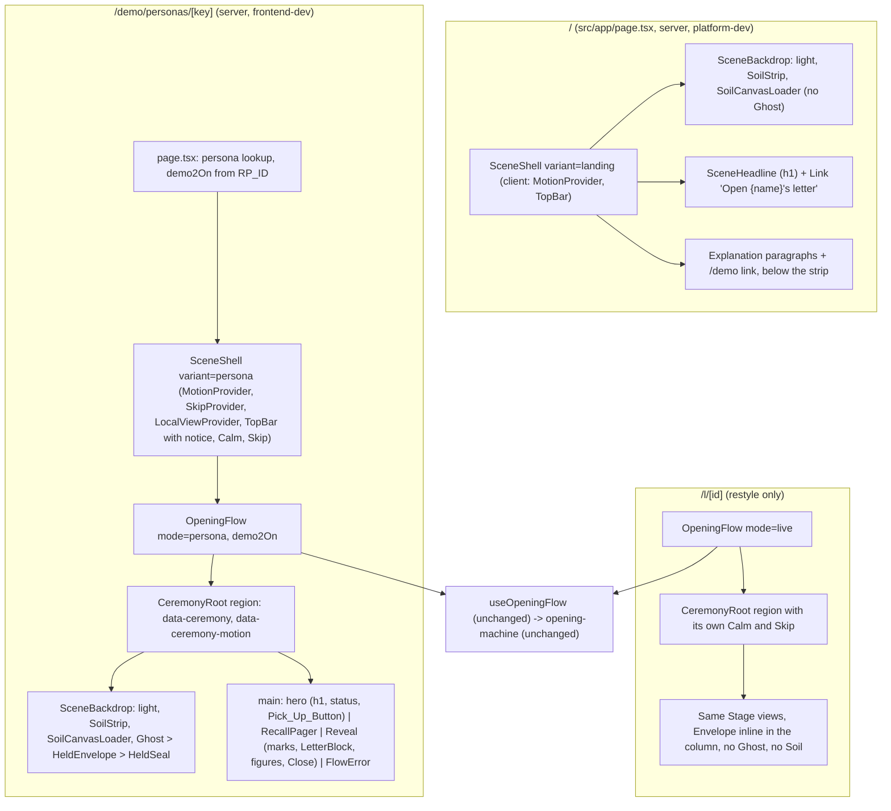

# Design Document

Spec: 07 Judge journey

## Overview

This design turns the spec 05 "One Desk" ceremony into the Scene of `requirements.md`: a near-black page, purple light on a strip of soil, a sheet ghost that rises holding the letter, one orange accent. It is a skin on the working flow. `opening-machine.ts`, `useOpeningFlow.ts` and `api.ts` do not change (R1.2). `OpeningFlow.tsx` stays the single seam between the hook and the views.

It is written against `main` at `a9cb8ff`, plus the owner's commit of `.kiro/steering/tone.md` and `.kiro/steering/product.md` (R25.1, R25.2, R25.10). This design references that committed text and does not draft it again. Spec 06 task 9 (Live_Letter reveal variant, issue #134) merged on `origin/main` as PR #159 after this design was started, so `Reveal.tsx` on `main` now has its live variant. Tasks 5, 6 and 10 still carry "Blocked by #134" (R28.8); the gate is already open, and those tasks read the current `Reveal.tsx` first.

The ground truth for look and pacing is the prototype `docs/design/07-judge-journey.html`, approved by the owner at 1280×800 and 360×640. Its values become this design's constants and geometry. Each place this design departs from the prototype is listed in "Deviations from the prototype", with the requirement that forces it.

### How sizes were measured

Every size in this design that depends on layout (bar heights, ghost boxes, ghost centre x, side margins, line breaks, fit, overlap, dust height, seal size, timings) was measured, not computed. The measurements were taken on 2 November 2026 in headless Chromium (Playwright driving `/usr/bin/chromium`) on the prototype `docs/design/07-judge-journey.html`, with Inter loaded (`document.fonts.check('900 16px Inter')` returned true). Boxes come from `getBoundingClientRect`; text line boxes come from `Range.getClientRects`. Values in SVG units (eye offsets, held-slot bounds) are exact geometry from the drawing and are stated as such.

### What exists on `main` and what happens to it

| Area on `main` | What this spec does with it |
|---|---|
| `opening-machine.ts`, `useOpeningFlow.ts`, `api.ts` | Unchanged (R1.2, R1.3). |
| `OpeningFlow.tsx` | Keeps `selectView`. In persona mode it renders the Scene backdrop (Ghost, Envelope, Soil) next to the content column. Gains two optional props, `demo2On` and `scene`. |
| `CeremonyRoot.tsx` | Keeps the region contract (`role="region"`, `aria-label`, `tabIndex={-1}`, focus effect, live region). Calm and Skip move to the Top_Bar on Scene pages (R8.5, R8.6). |
| `stages.ts`, `local-view.tsx` | New Stage names and new view-local fields (see "Stage resolution"). |
| `motion.ts` | Unchanged API. Its nested-provider pass-through is reused. |
| `skip.tsx` | Gains the same nested pass-through as `motion.ts` and `local-view.tsx`, so the page-level provider owns Skip. |
| `desk/**` (DeskScene, DeskDecor, dust, tilt, useLight, DeskEnvelopeLink, decor-loader) | Replaced by `scene/**`. Retired in tasks 8 and 9, when the last route that uses them moves to the Scene. |
| `envelope/**` | `Envelope` is redrawn (torn, dirty bottom edge, aspect 1.45). `WaxSeal` becomes one orange seal with a pressed ghost. `seal-pattern.ts` is retired (R10.10). |
| `seal/hold.ts`, `seal/cracks.ts` | Kept unchanged. Their spec 05 properties stay (R12.1). |
| `seal/SealBreak.tsx` | Split: the hold logic becomes `useSealBreak`, the seal hit target moves onto the held Envelope, the instruction and button stay in the content column. |
| `letter/**` (ink) | Retired in task 5 (R13.4, R26.6). |
| `figures/number-line.ts`, `NumberLine.tsx` | Kept. Restyled (white pins, orange Mark). |
| `figures/Stamp.tsx`, `Counter.tsx`, `Passage.tsx`, `ThenNowSequence.tsx` | Retired in task 6, replaced by one fade-up (R14.7). |
| `recall/scale-math.ts`, `RecallScale.tsx` | Kept. The scale sits under the typed number (R11.6). |
| `close/Close.tsx` | New items and the Demo_2_On link (R15). |
| `sound/**` | Kept unchanged (R22). |
| `reveal/FigureEntry.tsx` | Re-ordered to the R14.3 markup. |
| `reveal/FiguresThenNow.tsx`, `FigureLine.tsx`, `FixtureNote.tsx`, `ChangeLine.tsx` | Names and props kept (R14.9). |

### Measured starting point

The JS budgets are measured by task 1, with `npm run build` followed by `node scripts/check-js-budget.mjs`, on the task's head commit. The PR states the five numbers (R21.2). This design does not invent current values.

History only: spec 05's design measured `/` at 106.5 kB, `/demo` at 106.8 kB and `/demo/personas/[key]` at 145.3 kB before its tasks ran. Spec 05 and spec 06 have added code since. Commit `43de346` raised the persona, live and letter route budgets to 190 kB. The limits that apply now are in R21.1: `/` 130 kB, `/demo` 130 kB, the other three 190 kB.

## Architecture

### The Scene on each route



- Events go one way, as in spec 05. A view calls the handlers `selectView` hands out (`retry`, `begin`, `editDraft`, `toggleNoAnswer`, `submit`, `retryPost`, `advance`, `showAll`, plus the spec 06 unlock handlers). No new event exists (R1.4, R1.5).
- View-local state is animation state only: whether the Emergence is running, whether a Seal_Break is in progress, whether the figures fade-up has settled, the Recall_Pager index, and the Ghost's leaving flag. The first three are reported up through the local-view context so `data-ceremony` can name the Stage.
- "Final state first" from spec 05 stays. Every view renders its settled state on the server and on the first client render. Motion is applied after mount, or by CSS that the server markup already carries.

### Providers and the Top_Bar

The Top_Bar holds Calm and Skip on the persona page (R8.3, R8.5, R8.6), but sits outside the Opening_Flow tree. So the page-level `SceneShell` renders the providers, and the ones inside `OpeningFlow` and `CeremonyRoot` become pass-throughs when nested:

| Provider | Nested pass-through on `main` | Change |
|---|---|---|
| `MotionProvider` | Yes | None. |
| `LocalViewProvider` | Yes | None. `SceneShell` renders the outer one. |
| `SkipProvider` | No | Task 2 adds the same rule: a nested provider renders its children and defers to the parent. |
| `LiveRegionProvider` | Not needed | Stays inside `CeremonyRoot`. |

`CeremonyRoot` gains one prop, `controls: "topbar" | "region"`. With `"topbar"` (persona mode) it renders no Calm or Skip button, because the Top_Bar renders them. With `"region"` (live mode, `/l/[id]`) it renders them inside the region as today, restyled. The sound toggle moves out of `CeremonyRoot` (see "Sound toggle placement").

### Same Soil and light on `/` and the persona page

`/` and the persona page render the same `SceneBackdrop` with the same geometry constants. The landing button is a `next/link`, so the click is a client navigation. The new page mounts the same light at the same place, already up (R9.1), the same Soil_Fallback strip and, in full motion, the same Soil_Canvas drawn from the same seed (R6.5). The click therefore reads as continuous without a shared layout, a View Transition or any change to `src/app/layout.tsx`.

### The Emergence is CSS first

The Emergence is three CSS animations on server-rendered elements. They start when the browser first styles the page, before hydration (R9.7):

| Element | Animation | Delay | Duration | Gate |
|---|---|---|---|---|
| `.pit` and `.soilStrip` | `shake`: translate by at most 2 px, once | `SHAKE_AT_MS` 750 | `SHAKE_MS` 500 | `@media (prefers-reduced-motion: no-preference)` and `[data-ceremony-motion="full"]` |
| `.ghost` | `rise`: `translateY(105%)` to the risen pose | `RISE_AT_MS` 900 | `RISE_MS` 1500, `cubic-bezier(.16, .84, .3, 1)` | same |
| `.bob` | `bob`: `translateY(0)` to `translateY(-3px)` and back, infinite | starts when `rise` ends | `BOB_PERIOD_MS` 3600 | same |

- Outside the gate the ghost has no animation and rests at its end pose. Under `prefers-reduced-motion: reduce` the page paints the end pose from the first frame (R9.14).
- `data-ceremony-motion` is `full` in the server render (spec 05 "Motion modes"). When the judge turns Calm on, it becomes `calm`, the gate stops matching, and every animation above ends at once (R5.14, R6.11).
- The shake uses `animation-iteration-count: 1` on elements that mount once per page. A Flow state change or a re-render does not remount them, so it never repeats (R9.5). Hydration keeps the same elements, so it does not restart.
- `SHAKE_PX` 2 is the largest translate in the `shake` keyframes (R18.8).

### The Pick_Up_Button gate

The rule (R9.8 to R9.10):

```
showPickUp = state.tag === "verified" && localView.emergence === "done"
```

- `localView.emergence` is `"done"` in `DEFAULT_LOCAL_VIEW`, so a static render of `verified` shows the button (final state first).
- On mount, a layout effect in `SceneBackdrop` reads `ghostEl.getAnimations()`. If the `rise` animation exists and has not finished, it sets `emergence: "running"` and registers a Skip sequence. When `animation.finished` resolves, or Skip calls `finish()` on it, it sets `emergence: "done"` and unregisters.
- The server renders `loading`, so there is no button before hydration. The first client render is also `loading`. The layout effect runs before `useOpeningFlow`'s fetch and decrypt can reach `verified`, which needs at least one network round trip and a crypto call. So the order "verified, then the effect" cannot happen.
- If `verified` comes first, the button waits for `emergence: "done"` (R9.9). If the Emergence ended first, the button appears in the render that shows `verified` (R9.10).
- If hydration happens after the CSS animation ended, `getAnimations()` returns it finished (or not at all), and `emergence` stays `"done"`.
- In Calm_Mode, or under reduced motion, there is no running animation, so `emergence` is `"done"` from the start (R9.14).
- In an error state there is no button, because the tag is not `verified` (R9.12).

### Stage resolution

```ts
type Stage =
  | "scene" | "index"                       // set by / and /demo on their own roots
  | "emerging" | "sealed" | "intact" | "recall" | "marks" | "seal"
  | "letter" | "figures" | "close" | "error"
  | "envelope"                              // spec 06 unlock states on /l/[id] only (R2.5)
  | "desk";                                 // /demo until task 8, then removed

type LocalView = {
  emergence: "running" | "done";   // the CSS Emergence on the persona page
  sealing: boolean;                // a Seal_Break hold, or the button's short crack, is in progress
  figures: "running" | "settled";  // the figures fade-up
};

const DEFAULT_LOCAL_VIEW: LocalView = { emergence: "done", sealing: false, figures: "settled" };

function stageFor(state: FlowState, local: LocalView): Stage;
```

| Flow state | Local view | Stage |
|---|---|---|
| `loading`, `openable`, `verifying` | any | `emerging` |
| `sealed` | any | `sealed` |
| `awaiting_key`, `unlocking` (spec 06, `/l/[id]` only) | any | `envelope` (unchanged, R2.5) |
| `verified` | any | `intact` |
| `recall`, `submitting`, `submit_failed` | any | `recall` |
| `reveal`, stage 1 | `sealing: false` | `marks` |
| `reveal`, stage 1 | `sealing: true` | `seal` |
| `reveal`, stage 2 | any | `letter` |
| `reveal`, stage 3 | `figures: "running"` | `figures` |
| `reveal`, stage 3 | `figures: "settled"` | `close` |
| `not_placed`, `unreachable`, `verification_failed`, `open_failed` | any | `error` |

- `stageFor` is total and pure. It reads only the tag, the reveal stage and the local view (R2.1 to R2.3).
- `verified` maps to `intact` whatever `emergence` is, as R2.1's table says. The prototype kept `emerging` until the button showed. This design follows the table; the button gate above keeps R9.9.
- `ADVANCE` moves the Flow to reveal stage 2, so the Ghost's exit, the flap, the slide and the unfold play in the `letter` Stage. `seal` is the hold in progress, or the button's short crack before `ADVANCE`.
- `/` sets `data-ceremony="scene"` on its `SceneShell` root. `/demo` sets `index` once task 8 lands; until then it keeps `desk` (R28.10).
- Migration: task 2 adds `emergence` and the `emerging` and `sealed` names. Task 6 replaces spec 05's `step` with `figures` and removes `then`, `passage` and `now`. Task 8 removes `desk`.

### Motion modes

`motion.ts` is unchanged: `full`, `light` (low power: fewer than `LOW_POWER_CORES` 4 cores, `saveData`, or frames over `LOW_POWER_FRAME_MS` 24 ms across `LOW_POWER_PROBE_MS` 1000 ms) and `calm`.

| Mode | CSS Emergence and bob | Eye follow | Soil_Canvas | Ghost exit, flap, slide, unfold | Figures fade-up |
|---|---|---|---|---|---|
| `full` | yes | yes | loaded | yes | yes |
| `light` | yes (transform and opacity only) | yes | not requested; Soil_Fallback | yes | yes |
| `calm` | no; end pose | no | not requested; Soil_Fallback | no; cut or fade of `CALM_FADE_MS` 120 | no |

`data-ceremony-motion` is `calm` only in Calm_Mode and `full` otherwise (R2.6).

### No JavaScript on `/`

With scripts disabled, CSS animations still run, but R7.1 asks for the light already up and no fade. `SceneShell variant="landing"` therefore renders one `<noscript>` holding a constant `<style>` that turns off the light animation by attribute: `[data-scene-light]{animation:none}`. The CSP already allows inline styles (`style-src 'self' 'unsafe-inline'` in `src/lib/security-headers.ts`), so that file has no diff (R1.6). The string is a constant with no colour and no user data.

## Components and Interfaces

### File layout

```
src/components/ceremony/
├── constants.ts              # every timing, size and limit (see "Constants")
├── stages.ts                 # Stage, LocalView, stageFor
├── local-view.tsx            # unchanged API; DEFAULT_LOCAL_VIEW from stages.ts
├── motion.ts                 # unchanged
├── skip.tsx                  # nested pass-through added (task 2)
├── CeremonyRoot.tsx          # `controls` prop; Calm/Skip only in "region" mode
├── copy.ts                   # Ceremony strings (stage lines, seal, close)
├── ceremony.module.css       # shared rules; desk tokens until task 9 (R4.8)
├── ASSETS.md                 # Ghost, wax seal, Soil_Fallback, Envelope tear rows
├── scene/                    # NEW (task 1 tokens; task 2 shell, Ghost, Soil_Fallback, Emergence; task 3 Soil_Canvas)
│   ├── tokens.module.css      # every Scene colour token (R3.7, R3.8)
│   ├── scene.module.css       # layout: top bar, backdrop, pit, hero, column, breakpoint 900 px
│   ├── copy.ts                # SCENE_COPY: headline, landing button, top bar, notice, landing text
│   ├── SceneShell.tsx         # client: providers, TopBar, root data attributes
│   ├── TopBar.tsx             # wordmark, Demo chip, notice, Calm, Skip
│   ├── SceneBackdrop.tsx      # light, SoilStrip, SoilCanvasLoader, optional Ghost
│   ├── SceneHeadline.tsx      # the h1 with "receipts." in the Accent (server-safe)
│   ├── SoilStrip.tsx          # Soil_Fallback (CSS) with data-soil-strip
│   ├── SoilCanvasLoader.tsx   # client: dynamic import of soil-canvas.ts, fallback on failure
│   ├── soil-canvas.ts         # the Soil_Canvas (dynamic chunk only)
│   ├── soil-model.ts          # pure: seeded geometry for clumps, pebbles, dust, clods
│   ├── rng.ts                 # mulberry32
│   ├── Ghost.tsx              # the sheet ghost SVG, eyes, held slot
│   ├── eyes.ts                # pure: eye offset from pointer
│   ├── useEmergence.ts        # reads the rise animation, sets emergence, registers Skip
│   └── layout.ts              # pure: Scene_Frame x, narrow scene lift, column offset, dust ceiling
├── envelope/
│   ├── Envelope.tsx           # redrawn: front, back, flap, letter peek, tear, dirt
│   ├── EnvelopeFront.tsx      # the two or three date lines, `layout` prop
│   ├── WaxSeal.tsx            # one orange seal with the pressed ghost, two halves
│   └── EnvelopeView.tsx       # status, still-sealed, intact (statement + Pick_Up_Button)
├── seal/
│   ├── hold.ts, cracks.ts     # unchanged
│   ├── useSealBreak.ts        # NEW: hold state, ADVANCE once, short crack for the button
│   ├── HeldSeal.tsx           # NEW: the pointer target on the held Envelope
│   └── SealBreak.tsx          # instruction, "Break the seal", "Show everything" (content column)
├── recall/
│   ├── scale-math.ts, RecallScale.tsx   # kept
│   └── RecallPager.tsx        # NEW: one question at a time
├── letter/
│   └── LetterBlock.tsx        # NEW (task 5): purple block, paper, unfold plan; ink files retired
├── figures/
│   ├── number-line.ts, NumberLine.tsx   # kept, restyled
│   ├── FiguresFadeUp.tsx      # NEW (task 6): one fade-up, fixed total time
│   └── figures.module.css
├── close/Close.tsx            # R15 items
└── sound/**                   # unchanged
```

`scene/` is the only new folder. Its structure.md entry is drafted under "Drafts for the owner".

### Files outside `ceremony/` that tasks edit

| File | Change | Task |
|---|---|---|
| `src/app/demo/personas/[key]/page.tsx` | `SceneShell` replaces `DeskScene`; computes `demo2On`; `dynamic = "force-dynamic"` | 2, 6 |
| `src/app/demo/personas/[key]/page.test.tsx` | Scene markup, Ghost present, Demo_2_On cases | 2, 6 |
| `src/components/reveal/OpeningFlow.tsx` | Scene backdrop in persona mode; `controls`; RecallStep keyed and not wrapped in a fragment; `demo2On`, `personaKey` passed to Reveal | 2, 4, 5, 6 |
| `src/components/reveal/RecallStep.tsx` | Renders `RecallPager`; the submit-failed alert moves inside it | 4 |
| `src/components/reveal/copy.ts` | `pickUp`, `questionOf`, `questionOfAsOf`, `nextQuestion`, `previousQuestion` | 4 |
| `src/components/reveal/Reveal.tsx` | Marks column; `SealBreak` button view; `LetterBlock`; `FiguresFadeUp`; Close props | 5, 6 (Blocked by #134, spec 06 task 9) |
| `src/components/reveal/SealedLetter.tsx` | `data-ink-text` removed; labels kept | 5 |
| `src/components/reveal/FigureEntry.tsx`, `FiguresThenNow.tsx` | R14.3 order; layout classes; names and props unchanged | 6 |
| `src/components/reveal/change-neutral.property.test.tsx` | Extended mirror property | 6 |
| `src/components/reveal/reveal.module.css` | Scene tokens | 4, 5, 6 |
| `src/components/demo/copy.ts`, `PersonaCard.tsx`, `PersonaCard.test.tsx` | Link text "Open the letter" (task 4); Scene card (task 8) | 4, 8 |
| `src/app/demo/page.tsx`, `page.module.css`, `page.test.tsx` | Scene and Top_Bar | 8 |
| `src/app/demo/live/page.tsx`, `src/components/live/**` (styles only; no copy change, R17.3) | Restyle | 9 |
| `src/app/l/[id]/page.tsx` | `DeskScene` removed, Scene tokens without backdrop | 9 |
| `src/app/page.tsx`, `src/app/page.test.tsx` | Landing | 7 (platform-dev) |
| `src/app/globals.css` | Dark `html, body` background | 11, or 7 if 11 has not landed (platform-dev) |

Never edited: `opening-machine.ts`, `useOpeningFlow.ts`, `api.ts`, `src/app/layout.tsx`, `src/lib/security-headers.ts`, anything listed in R1.1, and the owner-only files of R1.10.

### `SceneShell`, `TopBar` and the landing page

```ts
type SceneShellProps =
  | { variant: "landing"; children: ReactNode }          // root: data-ceremony="scene"
  | { variant: "index"; children: ReactNode }            // root: data-ceremony="index" (task 8)
  | { variant: "persona"; personaName: string; children: ReactNode }; // root carries no data-ceremony
```

- `SceneShell` is a client component. It renders `MotionProvider`, `SkipProvider`, `LocalViewProvider`, the token class, `TopBar`, and its children. Children stay server components.
- On `landing` and `index` the root carries `data-ceremony` and `data-ceremony-motion`. On `persona` the `CeremonyRoot` region carries them, so there is exactly one `[data-ceremony]` per page.
- `TopBar` is `position: fixed` at the top (R8.1). Left: the wordmark "revenant" and the Demo chip (R8.2). On the persona page the right side follows R8.3: at or above 900 px the notice, then Calm, then Skip on one row, the notice right-aligned; below 900 px a first row with the wordmark and chip on the left and Calm and Skip on the right, and the notice on its own full-width second row, so it is never cut off (R8.4). On `/` and `/demo` the right side holds Calm only, because the Soil_Canvas dust is ambient motion that runs past five seconds (R6.11, WCAG 2.2.2). The landing light fade is a 1,100 ms CSS transition, not a registered sequence, so it shows no Skip.
- Narrow styling (below 900 px): bar padding `.35rem var(--pad)`, row gap 0.2 rem, column gap 0.5 rem; Calm and Skip at `min-height: 36px`, padding 0 0.7 rem, font 0.78 rem; notice 0.74 rem with line-height 1.25 on its own full-width row; wordmark 1 rem. At or above 900 px the controls keep `min-height: 44px`.
- Measured height (see "How sizes were measured"), R8.1 limit 96 px:

  | Viewport | Case | Top_Bar height |
  |---|---|---|
  | 360×640 | "Maya": notice on one line, with or without Skip | 65.2 px |
  | 360×640 | A long persona name that forces the notice onto two lines, Skip shown | 80.0 px |
  | 900 px and wider | Notice on the bar's row | 61.6 px |

- The 36 px Calm and Skip controls meet the 24 × 24 px target minimum of R19.6. They are not in R19.6's 44 × 44 px list, which names the Pick_Up_Button, the seal, "See the numbers" and the close links.

### The Scene_Frame (R5.16, R5.17, R6.17, R6.18, R8.14)

The Content_Column and the Ghost are one composition inside the Scene_Frame. The backdrop runs the full window width; only the placement of content and Ghost is bounded by the frame. The CSS, from the prototype:

```css
:root {
  --frame-w: min(100vw, 1440px);                       /* SCENE_FRAME_MAX_PX */
  --frame-l: calc((100vw - var(--frame-w)) / 2);       /* left edge of the frame */
  --pad: clamp(1rem, 3vw, 2.5rem);                     /* inner side padding */
}
.topbar, main { padding-inline: calc(var(--frame-l) + var(--pad)); }
@media (min-width: 900px) {
  .pit, .light { left: calc(var(--frame-l) + var(--frame-w) * 0.72); }   /* GHOST_X_IN_FRAME */
  .soilFallback { --lx: calc(var(--frame-l) + var(--frame-w) * 0.72); } /* lit ellipse x */
}
.pit { transform: translateX(-50%); }
```

- The Top_Bar and `main` share the same padding, so the wordmark's left edge and the headline's left edge line up, and the Top_Bar's last control ends the same distance from the right window edge as the wordmark starts from the left (R8.14).
- The Soil_Canvas uses the same x: `lx = frameL + 0.72 × frameW`, with `frameW = min(w, 1440)` and `frameL = (w − frameW) / 2`, at or above 900 px; `w / 2` below.
- The Soil, the light's glow, the dust and the clods are drawn across the whole window. On a window wider than 1440 px the area outside the frame is an even dark margin on each side with the Soil running through it (R6.18).
- The Ghost does not move sideways on pick up or later. Its `left` and `translateX` are the same in `intact`, `recall`, `marks` and `seal`. Only the upward lift (R10.7) changes and, below 900 px, the scene's move up and the pit's 0.8 scale about its own centre x (R10.15). So the light never moves sideways either (R5.17, R6.17).
- Measured (see "How sizes were measured"):

  | Viewport | Ghost_Box centre x | Side margin (window edge to wordmark, and last Top_Bar control to window edge) | Sideways move on pick up |
  |---|---|---|---|
  | 1280×800 | 922 px | 38 px | 0 px |
  | 1440×900 | 1037 px | 40 px | 0 px |
  | 1920×1080 | 1277 px | 280 px | 0 px |
  | 2560×1440 | 1597 px | 600 px | 0 px |

The landing page (task 7, platform-dev) is a server component:

```tsx
<SceneShell variant="landing">
  <SceneBackdrop ghost={false} />
  <section className="hero">
    <SceneHeadline />                                   {/* the only h1 */}
    {first ? <Link className="cta" href={`/demo/personas/${first.key}`}>{openLetter(first.display_name)}</Link> : null}
  </section>
  <section className="explain">{/* LANDING_COPY paragraphs and the /demo link */}</section>
</SceneShell>
```

- `first` is `PERSONAS[0]` from `@/lib/personas`, which reads no database (R7.3, R7.7). With an empty list there is no button (R7.5).
- The page imports nothing from `src/lib/crypto`, `useOpeningFlow` or any API module (R7.7). A source scan checks it.
- The explanation and the `/demo` link come after the Scene in document order and sit on the plain background below the Soil strip at every width (R7.6, R7.13). Their text moves verbatim from `page.tsx` into `SCENE_COPY.landing` in task 2, so task 7 imports it (R24.1). The paragraphs are existing copy and stay word for word.
- The `globals.css` change sets `html, body { background: #0b0912 }` (R7.11). It lands as task 11, its own platform-dev PR after task 1 (R28.7), or inside task 7 if task 11 has not landed by then.
- `SceneHeadline` renders "Your past self returns with" and then one `white-space: nowrap` span holding "the " and the Accent "receipts.", so "the receipts." always stays together on the last line (R3.18). The headline is weight 900, `clamp(2.35rem, 8.4vw, 7.6rem)`, `max-width: 11.5ch`. Measured at 360×640, 1024×768, 1280×720, 1280×800, 1440×900, 1920×1080 and 2560×1440, it breaks into the same three lines at every size: "Your past self" / "returns with" / "the receipts.".

### `SceneBackdrop` and the Soil

`SceneBackdrop` renders, inside one `aria-hidden="true"` container with `pointer-events: none` (R6.9, R19.5):

1. `.light`: a radial gradient disc, `130vmax` across, centred at the light's x and the soil top. Its x is `GHOST_X_IN_FRAME` (72 %) of the Scene_Frame width from the frame's left edge at or above 900 px, and 50 % of the window below. It never moves sideways (see "The Scene_Frame"). The disc itself is not clipped by the frame (R6.18).
2. `SoilStrip`: the Soil_Fallback, a CSS strip with `data-soil-strip`, always rendered.
3. `SoilCanvasLoader`: client island, renders the one `<canvas>` only after its module has loaded (R6.4).
4. In persona mode only: `.pit > Ghost` (R7.12, R17.10).

#### Geometry (from the prototype)

| Value | At or above 900 px | Below 900 px | At 1280×800 | At 360×640 |
|---|---|---|---|---|
| Soil top (`--soil-top`) | 74vh | 69vh | 592 px | 441.6 px |
| Soil strip height (`--soil-band`) | 14vh | 8vh | 112 px | 51.2 px |
| Soil strip bottom | 88vh | 77vh | 704 px | 492.8 px |
| Highest soil point above `--soil-top` | 14 px (`EDGE_BAND_PX`) | 14 px | | |
| Light and Ghost centre x | 72 % of the Scene_Frame (`GHOST_X_IN_FRAME`), every Stage | 50 % | 922 px | 180 px |
| Ghost_Box width | `min(50vh, 560px)` (`GHOST_WIDE`) | `min(31vh, 200px)` (`GHOST_NARROW`) | 400 px | 198 px |
| Ghost_Box height | 1.2 × width (`GHOST_HEIGHT_RATIO`) | same | 480 px | 238 px |
| Content_Column max width | `min(34rem, 46vw)` (`CONTENT_COLUMN_MAX`) | full width | 544 px | |

- The strip rules are R6.14's: 14vh tall from 74vh wide, 8vh tall from 69vh narrow. Below the strip the page is the plain `--bg` (R6.14).
- The Soil_Fallback's top edge is a `clip-path` polygon whose points sit between 2 % and 11 % of the strip height: at most 12.3 px of jag at 1280×800, inside the 14 px band (R6.3). Its fill is a lit ellipse at the light's x, two dot grids and a vertical gradient from `--soil-mid` to `--soil-deep`, with a mask that fades the bottom quarter into `--bg`.

#### Soil_Canvas (`scene/soil-canvas.ts`, `scene/soil-model.ts`)

`soil-model.ts` is pure. `soil-canvas.ts` draws its output. Both carry over the prototype's `drawBase` and `frame`.

Inputs: canvas CSS size `w × h`, `y0` (the soil top in canvas pixels), `band` (strip height), `lx` (light x), the colour tokens read once with `getComputedStyle` from the canvas element (`--soil-deep`, `--soil-mid`, `--soil-lit`, `--purple`, `--dust`, `--clod`), and the seed `SOIL_SEED = 0x07a11e`. No colour literal sits in the module (R3.8); lit colours are linear mixes of `--soil-mid` and `--soil-lit` by the light factor.

1. **Light falloff.** `lit(x) = exp(-((x - lx) / (0.28 w))^2)`, in [0, 1].
2. **Base.** A vertical gradient from `--soil-mid` at `y0` to `--soil-deep` at 60 % of the band to transparent at the band's bottom, filling `y0 + 6` to `y0 + band`.
3. **Pebbles.** `round(0.9 w)` ellipses. Each takes `x = R() w`, `y = y0 + 10 + R()^1.6 × 0.7 band`, radius 0.6 to 3.0 px. Brightness and alpha scale with `lit(x) × (1 - (y - y0) / band)`.
4. **Back row of clumps.** From `x = -12` to `w + 12` in steps of 9 to 25 px. Each ellipse has `rx` 10 to 28, `ry` 5 to 11 and centre `y0 + 8` to `y0 + 14`, in dark soil colours. Highest point at least `y0 - 3`.
5. **Front row of clumps.** Steps of 4 to 16 px. 18 % are big (`rx` 9 to 19, `ry` 5 to 10), the rest small (`rx` 2.5 to 9.5, `ry` 2 to 6). Centre `y0 + 2` to `y0 + EDGE_BAND_PX - 2`. Each is filled with a vertical gradient: lit purple on top (alpha 0.35 + 0.6 k, where `k = lit(x) × (0.55 + 0.45 R())`), dark soil at 45 %, `--soil-deep` at the bottom. Highest point at least `y0 - 8`, inside the 14 px band (R6.3).
6. **Dust.** `DUST_MAX_PARTICLES` 36 dots from a second stream seeded `SOIL_SEED ^ 0xd057`. They start at `lx ± DUST_SPREAD × w` (0.2 w) and at a height between the dust ceiling and the soil top. Each rises at 4 to 14 px/s and sways ±6 px/s with a sine, alpha 0.25 to 0.7, radius 0.7 to 2.4 px. A dot that passes the ceiling wraps to `y0 - 4`.
7. **Clods.** On the rise (`RISE_AT_MS`), `CLOD_COUNT` 16 clods from a third stream seeded `SOIL_SEED ^ 0xc10d`. They start along the pit's middle 70 %, with `vx` ±60 px/s and `vy` from -160 to -420 px/s, fall with gravity 620 px/s², and bounce once at `y0 + 8` with factors -0.2 and 0.5. Each lives 1.6 s. A clod that reaches the dust ceiling is set to the ceiling and pushed back down (its `vy` becomes 0.3 × its speed, downward).
8. **Dust ceiling (R6.16).** `ceiling = max(Top_Bar bottom, headline bottom while the headline shows) + DUST_CEILING_GAP_PX` (8 px), in canvas coordinates: the viewport value minus the scene layer's current `translateY`. The headline is the element marked `data-scene-ceiling`. `layout.ts` computes it; `soil-canvas.ts` recomputes it after the pick-up move (when the headline goes and the narrow scene lifts) and on every resize. No dust dot or clod is drawn above it. Measured highest dust or clod over 3 s (see "How sizes were measured"):

   | Viewport | Stage | Highest particle top | Top_Bar bottom |
   |---|---|---|---|
   | 360×640 | `recall` (scene lifted) | 73 to 74 px | 65 px |
   | 1024×768 to 2560×1440 | `recall` | 70 to 71 px | 62 px |
   | every size | `intact` | below the headline bottom | |

   Dust dots spawn only between the ceiling and the soil top, and a dot that rises past the ceiling wraps back to the soil.
9. **Frame loop.** `requestAnimationFrame`, drawing at most `DUST_MAX_FPS` 30 frames a second. Each frame blits the cached base, then dust, then clods. The loop pauses on `visibilitychange` to hidden and stops on unmount, on Calm, or when the mode becomes `light`.

- **Full width.** The canvas covers the whole window, not only the Scene_Frame, so clumps, dust and clods run through the side margins on windows wider than 1440 px (R6.18).
- **DPR cap.** `dpr = min(2, devicePixelRatio || 1)` (`SOIL_DPR_MAX`). The canvas backing store is `round(w × dpr) × round(h × dpr)`.
- **Resize.** A `resize` listener, debounced to `SOIL_RESIZE_DEBOUNCE_MS` 150, recomputes `w`, `h`, `y0`, `lx` and the ceiling and redraws the base from the seed, so the same size always gives the same clumps.
- **Light x.** `lx = frameL + GHOST_X_IN_FRAME × frameW`, with `frameW = min(w, SCENE_FRAME_MAX_PX)` and `frameL = (w − frameW) / 2`, at or above 900 px; `w / 2` below. It does not change between Stages, so the base is not redrawn on pick up. Only the dust ceiling is recomputed then.
- **Determinism.** All three streams are mulberry32 from fixed seeds. No `Math.random`, `Date.now` or clock affects the base; the frame loop uses the rAF timestamp for motion only and writes no markup (R6.5, R6.12).
- **Loading.** `SoilCanvasLoader` runs in an effect after mount. In `full` mode only, it calls `import("./soil-canvas")`. In `calm` or `light` mode it never calls it (R6.7, R21.9). Next splits the module into its own chunk, so it is not in any route's first-load JavaScript, including `/` (R6.4, R7.9, R21.8).
- **Fallbacks.** If the import rejects, or `canvas.getContext("2d")` returns null, the loader renders no canvas and the Soil_Fallback stays. No error reaches the judge (R6.8). With scripts disabled the loader never runs (R6.7).
- **Size estimate.** About 2.5 kB gzipped for `soil-canvas.ts`, `soil-model.ts` and `rng.ts` together. The loader adds about 0.4 kB to first-load JavaScript. Task 3 measures both and states them in its PR (R6.13). Until task 3 merges, the Soil_Fallback is the only Soil.

### The Ghost (`scene/Ghost.tsx`)

One inline SVG with `viewBox="0 0 200 240"`, written in this repo and recorded in `ASSETS.md` (R5.3). The `svg` has `aria-hidden="true"`, `focusable="false"` and no title (R5.9).

| Part | Geometry |
|---|---|
| Head | An arc of radius 66 centred at (100, 104), from (34, 104) over the top to (166, 104). Top of the head at y = 38. |
| Body | From (34, 104) down to (24, 228) on the left and from (166, 104) to (176, 228) on the right, each a gentle outward cubic curve. |
| Hem | A zigzag along the whole bottom edge: 176,228 → 163,212 → 150,230 → 137,212 → 124,230 → 111,212 → 100,230 → 89,212 → 76,230 → 63,212 → 50,230 → 37,212 → 24,228. Six inner points up at y = 212 and five down at y = 230, plus the two corners. Every point is a sharp corner. |
| Fill | A vertical gradient: `--ghost-top` (white) at 0, `--ghost-mid` at 0.45, `--ghost-hem` (lilac) at 1 (R5.1). |
| Folds | Two faint strokes in `--ghost-fold` at 35 % opacity, from (58, 150) to (56, 222) and from (142, 150) to (144, 222). |
| Eyes | Two ellipses, centres (78, 92) and (122, 92), `rx` 11, `ry` 16, fill `--bg`. Grouped in one `<g>` that moves for the eye follow. |
| Glow | Two CSS `drop-shadow` filters on the wrapper: 26 px and 4 px blur in `--ghost-glow`. |
| Not present | No hood, no hands, no arms, no mouth (R5.1). |

Sizes (R5.15): at or above 900 px the Ghost_Box is `GHOST_WIDE` = `min(50vh, 560px)` wide; below 900 px, `GHOST_NARROW` = `min(31vh, 200px)`. Its height is `GHOST_HEIGHT_RATIO` 1.2 × its width. The box is centred at `GHOST_X_IN_FRAME` (72 %) of the Scene_Frame width at or above 900 px and at 50 % of the window below, with its bottom at `--soil-top + 3vh`, and is clipped below that line so the hem rises out of the Soil. Measured Ghost_Box widths:

| Viewport | Ghost_Box width |
|---|---|
| 1024×768 | 384 px |
| 1280×720 | 360 px |
| 1280×800 | 400 px |
| 1440×900 | 450 px |
| 1920×1080 | 540 px |
| 2560×1440 | 560 px |
| 360×640 | 198 px |
| 360×640, `recall` and `marks` (scale 0.8) | 159 px |

#### Placement in the Scene_Frame (R5.16 to R5.18)

- At or above 900 px the Ghost_Box centre x is at 72 % of the Scene_Frame width from the frame's left edge, in every Stage that shows the Ghost (R5.16). The measured values are in "The Scene_Frame".
- The Ghost's horizontal placement (its classes, `left` and `translateX`) is identical in `intact`, `recall`, `marks` and `seal`. Pick up changes only the vertical lift and, below 900 px, the scene's move up and the 0.8 scale about the pit's own centre x (R5.17, R10.15). Measured sideways move on pick up: 0 px at 1280×800, 1440×900, 1920×1080 and 2560×1440.
- The Content_Column is at most `CONTENT_COLUMN_MAX` = `min(34rem, 46vw)` wide and sits inside the Scene_Frame (R5.18). That width keeps the column clear of the Ghost_Body_Box at every measured size (next section), so the Ghost has no reason to move.

#### Nothing sits on the Ghost's body (R5.19)

The Ghost_Body_Box is the Ghost_Box inset by 12 % of its width on each side, 12 % of its height at the bottom and 15.5 % at the top. The check takes every text line box (`Range.getClientRects` over the `h1`, the status line, the Pick_Up_Button, the Stage panel and the Top_Bar) and every control box (`getBoundingClientRect`), and tests each against the Ghost_Body_Box. Measured at 360×640, 1024×768, 1280×720, 1280×800, 1440×900, 1920×1080 and 2560×1440, in `intact` (including every headline line box), `recall` (both questions) and `marks`: no line box and no control box intersects the Ghost_Body_Box at any size or Stage.

Poses (`translateY` as a share of the ghost's own height):

| Pose | Wide | Narrow |
|---|---|---|
| Hidden (start of the rise) | 105 % | 105 % |
| Risen (end of the Emergence, holding) | -7 % | -3 % |
| Handed (after Pick up) | -12 % | -12 % |
| Leaving | `translateY(-55vh) scale(0.92)`, opacity 0 | same |

Handed is 5 % (wide) or 9 % (narrow) higher than risen, inside R10.7's quarter of the height.

#### Eye follow (`scene/eyes.ts`, pure)

```ts
function eyeOffset(pointer: { x: number; y: number }, centre: { x: number; y: number }, scale: number): { dx: number; dy: number }
// d = |pointer - centre| in CSS px; k = min(1, d / EYE_FOLLOW_RADIUS_PX)
// dx = (px - cx) / d * EYE_MAX_X * k ; dy = (py - cy) / d * EYE_MAX_Y * k   (SVG units)
// d = 0 gives (0, 0)
```

- `EYE_MAX_OFFSET` is 5 SVG units: `EYE_MAX_X` 5, `EYE_MAX_Y` 4, so the offset's length is at most 5 (R5.5).
- At the largest offset each eye stays inside the head. Left eye moved 5 left: its edge is at x = 62, and the head's edge at y = 92 is at x = 35.1. Eyes moved 4 up: their top is at y = 72, and the head's top above x = 78 is at y = 41.8.
- Only `pointermove` events with `pointerType` `mouse` or `pen` move the eyes, rAF-throttled. Touch and keyboard leave them idle (R5.7). `pointerleave` on the document returns them to (0, 0) (R5.8). In Calm_Mode the listener is not attached (R5.7).
- The offset is applied as a `transform` on the eyes group, with a 120 ms linear transition.

#### Idle_Bob

The `.bob` wrapper (Ghost, held Envelope and all) runs `translateY(0)` to `translateY(-3px)` and back, `BOB_PX` 3 over `BOB_PERIOD_MS` 3600, ease-in-out, from the end of the rise until the Seal_Break completes (R5.10, R5.11). It animates `transform` only (R5.12). It is pure CSS, so it delays no control (R5.13). Under Calm it stops at once: the gate in "The Emergence is CSS first" stops matching on the same render, well inside 200 ms (R5.14).

#### The dissolve on break

When `ADVANCE` is sent in full motion, the `.ghost` element gets the `leaving` class: `translateY(-55vh) scale(0.92)` over `GHOST_LEAVE_MS` 1100 with `cubic-bezier(.4, 0, .6, 1)`, and opacity to 0 over `GHOST_FADE_MS` 900, ease-in. The bob stops. When the transform transition ends (or after `GHOST_LEAVE_MS`, whichever is first), `SceneBackdrop` unmounts the Ghost (R12.6). In Calm the Ghost unmounts in the same render as `ADVANCE` (R12.10). With "Show everything" it unmounts at once with no exit (R12.8). After a Skip it is gone (R12.9).

While the reveal stages show, the light and the Soil dim to `REVEAL_DIM_OPACITY` 0.18 over `REVEAL_DIM_MS` 500.

### What makes the Ghost ours (R5.4)

The Ghost is drawn in this repository and recorded in `ASSETS.md`. These features make it Revenant's own:

- **The zigzag hem.** A sharp zigzag across the whole bottom edge, with six inner points up at y = 212 and five outer points down at y = 230 between the two corners. Every point is a hard corner. The Envelope never covers it (R5.2).
- **The held Envelope.** A torn, dirty envelope with an orange wax seal, held in front of the body in every Stage the Ghost shows, until the seal breaks.
- **The proportions.** A head arc of radius 66 in a 200 × 240 viewBox, a box 1.2 times as tall as it is wide, and a body that flares out from the head to the hem.
- **The eyes.** Two large dark vertical ovals (`rx` 11, `ry` 16), set close together high on the head, that follow a mouse or pen pointer.

The repository holds no file, image, path data or description of Kiro's logo or mascot. Any side-by-side comparison is made by the owner himself, outside the repository, and nothing from it is written into the repository.

### The wax seal (`envelope/WaxSeal.tsx`)

One SVG, `viewBox="0 0 100 100"`, the same for every persona (R10.10). It replaces `seal-pattern.ts`, its glyphs and the per-key rim styles.

- **Wax.** An irregular round blob, path from (50, 4) around through (96, 40), (95, 70), (72, 94), (44, 97), (14, 84), (4, 52), (11, 22) and back, filled `--wax` (the Accent). A ring of radius 33 stroked 3 units in `--wax-rim`. An inner disc of radius 27 in `--wax-inner`.
- **Pressed ghost.** The Ghost's silhouette at small scale, filled `--wax-press`: head arc of radius 12 centred at (50, 50), sides to y = 70, and a zigzag hem 63,70 → 59,66 → 55,71 → 51,66 → 47,71 → 43,66 → 39,71 → 37,66. Two eye ovals at (45.5, 51) and (54.5, 51), `rx` 2.2, `ry` 3.2, in `--wax-eye`. No cross, star, crescent, flag or other symbol (R10.11).
- **Halves.** The art is drawn twice, clipped by a left and a right polygon along a jagged line through x ≈ 44 to 56. Before the break they sit together (R10.12). On the break each half falls and turns (`translate(-30%, 90%) rotate(-28deg)` and `translate(30%, 95%) rotate(24deg)`) and fades over `SEAL_SPLIT_MS` 520.
- **Cracks.** The nine fixed paths of spec 05 `cracks.ts`, stroked in `--crack`, drawn by progress. Unchanged from spec 05 (R12.1). The prototype drew seven; this design keeps spec 05's nine so `cracks.ts` and its property stay.
- **Hold ring.** A circle of radius 49 in `--text`, its dash offset showing hold progress.
- The seal SVG is `aria-hidden` (spec 05 R6.3). The "Break the seal" button is the accessible control.

### The Envelope (`envelope/Envelope.tsx`)

- **Shape.** One rectangle, aspect `ENVELOPE_ASPECT_WIDE` 1.45 at or above 900 px and `ENVELOPE_ASPECT_NARROW` 1.3 below, top corners rounded 5 px, bottom edge torn: a `clip-path` polygon zigzagging between 89 % and 97 % of the height (R10.1). The same size, tear and dirt for every letter at a given viewport (R10.2).
- **Dirt.** Three soft brown ellipses and a gradient in the bottom 22 % of each face, in `--dirt`. Decoration only, `aria-hidden` (R4.6).
- **Front** (`EnvelopeFront`, paper `--env`, text `--env-ink`, about 10.5 : 1). It holds:
  - at or above 900 px: "Written as of {date}", "Opens {date}" and "Prepared later as a demo." (R8.7), at `clamp(12px, 5.6cqw, 14px)`, which measures 14 px at 1280×800;
  - below 900 px: only the two date items, each as two lines, the label ("Written as of", "Opens") on one line and the date on the next (R8.7). Font 12 px (`ENVELOPE_FRONT_MIN_PX`), line-height 1.15, 5 px gap between lines, padding 7 % 9 %. The Envelope stays at its held size and is not enlarged.
  - Dates use the spec 03 R6.3 format, for example "5 November 2024", and each date sits in an element with `white-space: nowrap` (R8.8).
  - No text on the front is smaller than 12 px at any width (R8.12).
  - **No persona name.** The prototype shows "Maya" in EB Garamond on the wide front and hides it on the narrow one. This design drops the name on every front: R3.4 keeps the serif for the letter text only, and the name pushed the lines toward the dirt band (R8.12). This is a deviation from the prototype. The name stays in the Top_Bar notice.
  - `EnvelopeFront` takes `layout: "narrow" | "wide" | "responsive"`. The page uses `"responsive"`, which renders the wide-only line inside an element with the `wideOnly` class, `display: none` below 900 px (removed from the accessibility tree too), and switches each date item to two lines below 900 px. `"narrow"` omits the wide-only line from the markup and renders each label and date as separate lines. R26.11's test renders `"narrow"`; a CSS test checks the `wideOnly` rule.
  - **Dirt and text.** `--env-ink` on the darkest dirt is about 2.4 : 1, which fails R4.3. So no text may lie on dirt, and every front text sits above the dirt band (R8.12, R4.7). Measured on the prototype at 1024×768, 1280×720, 1280×800, 1440×900, 1920×1080 and 360×640: each date renders on one line, and every Envelope_Front line box ends above the dirt band (the bottom `ENVELOPE_DIRT_BAND` 22 % of the face).
- **Back.** The pocket, the flap (a triangle, 62 % of the height), the letter peek, the dirt, and the seal at 36.5 % from the left, centred on the flap's tip.
  - Seal visual width: 27 % of the envelope width at or above 900 px, 32 % below. Measured in `marks`: 69 px at 1280×800 and 33 px at 360×640 (Ghost at scale 0.8). The hit area is larger (see "The seal is pressable where the Ghost holds it").
- **States.** `front`, `back` (turned), `open` (flap lifted, letter slid out). The turn is `rotateY(180deg)` over `ENVELOPE_TURN_MS` 520. The flap lift is `scaleY(-1)` over `FLAP_LIFT_MS` 450. The slide moves the letter peek `translateY(-72%)` over `LETTER_SLIDE_MS` 600.

#### Held in the Ghost's subtree (R5.2, R10.13, R26.10)

The Envelope is a child of the Ghost's `.bob` wrapper, in a `.heldSlot` at `left: 18%`, `width: 64%`, and `top: 48%` at or above 900 px or `top: 47%` below, as in the prototype.

- In SVG units (exact geometry) the envelope spans x 36 to 164 and, wide (aspect 1.45), y 115.2 to 203.5; narrow (aspect 1.3), y 112.8 to 211.3. The eyes' lowest point, at the largest downward offset, is y = 112, and the hem's highest point is y = 212. The envelope covers neither (R5.2).
- It stays in that slot through `emerging`, `sealed`, `intact`, `recall`, `marks` and `seal`, and leaves with the Ghost (R10.13, R10.14). It never moves to the content column on the persona page.
- The front shows until `BEGIN`. From `recall` on the back shows. In full motion the Ghost lifts to `handed` over `GHOST_LIFT_MS` 400, and the turn starts at `ENVELOPE_TURN_AT_MS` 400 and ends by 920 ms, inside R10.8's 1,200 ms. In Calm the back shows in the same render (R10.9).
- On `/l/[id]` the same `Envelope` renders inline at the top of the content column, at a fixed width of `min(84vw, 22rem)`, with the same seal, hit target and front (R17.9, R17.10).

### The seal is pressable where the Ghost holds it (R10.15, R10.16, R12.11)

The layers follow the prototype:

| Layer | z-index | `pointer-events` |
|---|---|---|
| `SceneBackdrop` container (fixed, inset 0) | 0 | `none` |
| `HeldSeal` (inside Ghost > `.heldSlot` > Envelope back) | in the backdrop | `auto` |
| `main` content | 4 | `none` |
| each direct child of `main` and each control | | `auto` |

- The seal is clickable wherever no content box lies over it. At or above 900 px the Content_Column is on the left, at most `CONTENT_COLUMN_MAX` wide, and the Ghost stays at 72 % of the Scene_Frame, clear of the column (R5.16 to R5.18). Below 900 px the content sits under the Soil strip and the Ghost above it. The R5.19 check confirms no control box lies on the Ghost's body. QA checks the seal's centre with `document.elementFromPoint` (step 07 | 08).
- **Hit target.** `HeldSeal` is the seal's wrapper. A `::before` box centred on it, `max(100%, SEAL_HIT_MIN_PX)` square (60 px), takes the pointer. 60 px before scale is at least 48 px at the narrow Ghost scale of 0.8, above R10.16's and R19.6's 44 px. `touch-action: none`, `user-select: none`, and `data-seal-target` for QA.
- **Hold.** `useSealBreak` (lifted from spec 05 `SealBreak.tsx`) owns the `HoldState` from `hold.ts` and calls `onPress`, `onTick` on rAF, and `onRelease`. `HeldSeal` binds `pointerdown`, `pointerup` and `pointercancel`, with `setPointerCapture` inside a `try`, as in spec 05. `isBreak` sends `ADVANCE` once (R12.2, R12.3). An early release settles the cracks back over `SEAL_SETTLE_MS` 300, sends nothing and announces "The seal holds." (R12.5).
- **Button.** `SealBreak` in the content column renders the instruction, "Break the seal" and "Show everything". The button calls `useSealBreak().breakNow()`. In full motion that plays the cracks over `SEAL_SHORT_MS` 450 with `sealing: true`, then sends `ADVANCE`. In Calm it sends `ADVANCE` at once.
- `OpeningFlow` calls `useSealBreak` once, in reveal stage 1, and passes the same controller to `SceneBackdrop` (for `HeldSeal`) and to `Reveal` (for `SealBreak`). The hold sets `sealing` in the local view, so the Stage reads `seal` while holding (R2.1).
- **Narrow layout during `recall` and `marks`.** `layout.ts` computes, from measured boxes, a scene lift `y` and the column offset. `ghostTopScaled = pitBottom - (pitBottom - ghostTop) × NARROW_GHOST_SCALE`, `y = topBarBottom + 4 - ghostTopScaled`, and the column starts at `soilBottom + y - topBarBottom + COLUMN_GAP_UNDER_SOIL_PX`. The layer gets `translateY(y)` over `PICKUP_MOVE_MS` 600, and the pit gets `scale(0.8)` with `transform-origin: 50% 100%` (R10.15, `NARROW_GHOST_SCALE` 0.8). Transform only (R21.4). The dust ceiling is recomputed after the lift (R6.16). Measured at 360×640, the lifted strip leaves room for the whole recall answer row and the marks heading, answers and button (see "Recall_Pager" and "Marks, seal and letter").

### Pick up and the status line (`envelope/EnvelopeView.tsx`)

- The hero holds the `SceneHeadline` h1 with `data-scene-ceiling`, then the status line, then the Pick_Up_Button. The status line is the next element after the headline in reading order, placed as R9.1 says: in the lower part of the Content_Column above the Soil at or above 900 px (`padding-bottom: calc(26vh + 2rem)`), and just under the Soil strip on the plain background below 900 px (the hero foot is positioned at the strip's bottom minus the measured Top_Bar height, plus 2 px).
- The status line is one `<p role="status">` in every state that shows it (R9.4): "Bringing the letter into the light." in `loading` (R9.2); "Checking the seal." in `openable` and `verifying` (R9.3); the `sealIntact` statement in `verified`, before the button (R10.3).
- `sealed`: the hero foot shows the existing `StillSealed` (opening date, time remaining, "Try again" at zero) and nothing else (R9.13).
- Pick_Up_Button: `<button class="cta">` with "Pick up the letter", `min-height: 56px`, Accent background, `--on-accent` text. Rendered only under the gate (R10.4, R10.5). It calls `flow.begin` once; `OpeningFlow` wraps `begin` in a once-per-`verified` guard so a double click sends one `BEGIN` (R10.6).
- On `BEGIN`, the hero hides and the column shows the Recall_Pager.
- Error states: the hero foot shows the existing `FlowError` with its own action. The Ghost stays risen at 45 % opacity, does not lift or turn the Envelope, and there is no button (R9.12).

### Recall_Pager (`recall/RecallPager.tsx`)

`RecallStep` keeps its props and renders `RecallPager`. The pager's only state is `index`, the shown question in payload order (R11.8).

Markup for the shown question (in order):

```
<p class="kicker">Question {n} of {total} · <span class="nowrap">as of {date}</span></p>   <!-- Live_Letter: "Question {n} of {total}" only -->
<form noValidate>
  <fieldset>
    <legend><h2 class="qTitle">{question.text}</h2></legend>
    <div class="qBody">                         <!-- flex column; order below -->
      <p class="introLine">{recallIntro}</p>     <!-- first question only -->
      <span class="unit" id="u-{id}">in {unit}</span>
      <div class="answerRow">
        <input class="answerInput" data-stage-focus inputMode="decimal" ... />
        <button type="submit" class="cta">{Next question | submit}</button>   <!-- white-space: nowrap -->
      </div>
      <span role="alert" class="fieldError">...</span>   <!-- only when invalid -->
      <div class="row"><button type="button">Previous question</button></div>  <!-- not on question 1 -->
      <RecallScale .../>                         <!-- kept, under the field -->
      <label class="noAnswer"><input type="checkbox"/> No answer</label>
    </div>
  </fieldset>
</form>
```

- **Counter line (R11.5).** On the persona page it reads "Question {n} of {total} · as of {date}", with "as of {date}" in a `white-space: nowrap` span and the date in the spec 03 R6.3 format. At 360 px the line may wrap at the "·", never inside the date. On a Live_Letter it reads "Question {n} of {total}" with no "as of" part.
- **Sizes.** The question heading is weight 750: `clamp(1.3rem, 2.4vw, 1.9rem)` at or above 900 px, 1.25 rem below (R11.16). The typed number is weight 900: `clamp(3rem, 7vw, 5.2rem)` wide and 2.4 rem below 900 px, so it is the largest text in the Stage (R11.16). The field is 4.2 ch wide. Below 900 px the answer row does not wrap, and the Next or submit button uses padding 0 1.1 rem and a 1 rem font with `white-space: nowrap`, so the number and the button share one row at both sizes.
- **Order.** At or above 900 px the intro line sits right after the heading, above the field. Below 900 px it moves after "No answer" (`order: 11`), below the field, so the field and the button stay above the fold. The scale, "No answer" and the intro may sit below the fold (R11.15).
- **Fit (R11.13, R11.14).** At 1280×800 the column starts 1 rem under the Top_Bar. At 360×640 it starts `COLUMN_GAP_UNDER_SOIL_PX` (4 px) under the lifted Soil strip. Measured at 360×640 and 1280×800, for both questions: the counter line, the question text, the number field and the Next or submit button are each fully inside the viewport and off the Soil. The inline error sits under the answer row, so it pushes only the scale down.
- **Keyboard and focus.**
  - On entering `recall`, after Next, after Previous, after Enter and after an invalid submit, focus moves to the shown question's field (R11.2, R19.4). If the field is disabled ("No answer" is checked), focus goes to the "No answer" checkbox.
  - `CeremonyRoot`'s focus effect runs after its children's effects. So it gains one rule: when the region contains `[data-stage-focus]`, it focuses that element instead of the newest heading. The Stage line is still announced once.
  - Enter submits the form. On a question that is not the last, the submit handler moves `index` forward and sends nothing (R11.3). On the last it calls the existing `onSubmit` (R11.4).
  - While `submitting` is true, the submit handler returns at once, the submit control is disabled and the retry control is disabled (R11.11).
- **Controls.** "Next question" on every question but the last; "Previous question" on every question but the first; the submit control on the last only. With one question there is only submit (R11.5).
- **Drafts.** Typing calls `onEdit` (`EDIT_DRAFT`); the scale calls the same `onEdit`; "No answer" calls `onToggleNoAnswer` for that question only (R11.6, R11.7). Returning to a question shows its draft from the reducer, so the text, the Mark and "No answer" are as entered (R11.8). The Mark's unplaced state comes from `draftNumber(text)`, as on `main`.
- **Invalid submit (R11.10).** When `invalid` becomes non-empty, the pager sets `index` to the first invalid question in payload order and focuses its field. The inline message is the existing `answerInvalid`. Drafts are untouched and nothing is posted, because the reducer already blocks the post.
- **Submit failed (R11.12).** `OpeningFlow` renders `RecallStep` with `key="recall"` in the same position for `recall`, `submitting` and `submit_failed`, and passes `failed`. The pager renders the existing alert and retry inside the form. This keeps the pager mounted, so `index` survives a failed post. On `main` the `submit_failed` case wraps `RecallStep` in a fragment, which would remount it.
- **Record.** The pager never builds a record. `buildRecallRecord` runs on the final drafts in the effect runner as before, so the record does not depend on the visit order (R11.9).

### Marks, seal and letter (`Reveal.tsx`, `letter/LetterBlock.tsx`)

- **`marks`.** The column shows the "What you remembered" `h2`, the answers list (question subject and the judge's value in the Accent, or "No answer"), the read-only scales (spec 05 R4.10), the instruction, "Break the seal" and "Show everything". The sound toggle and its note sit under these buttons. Below 900 px each answer row stacks the label above the value, the value is `white-space: nowrap`, and the rows use 0.92 rem. Measured at 360×640 and 1280×800: the heading, the answers, "Break the seal" and the seal are each inside the viewport and off the Soil (R12.12).
- **`letter`.** One `.letterBlock`: `--purple` background, radius `clamp(24px, 4vw, 48px)`, padding `clamp(0.9rem, 3vw, 2.4rem)`. Inside it, one `.paper` panel (`--paper`, `--ink`) with two crease lines at 33.3 % and 66.6 % as background gradients. The paper holds the stage `h2` "What was written then", the spec 03 R10 labels (or spec 06 R18.2 labels for a Live_Letter, R13.6), and `SealedLetter`'s paragraph with the text as one text node in EB Garamond, `white-space: pre-wrap` (R13.3).
- **No ink.** There is no mask, clip or fade on the text (R13.4). The only motion is the paper's unfold: `perspective(900px) rotateX(-70deg) scaleY(0.35)` and opacity 0 to none and 1, over `UNFOLD_MS` 520, after `UNFOLD_AT_MS` 1150 from `ADVANCE`. It is a Web Animation with `fill: "backwards"`, applied in a layout effect only in full motion, so the static render is the final state.
- **Creases.** The darkest crease colour is `--ink` at 8 % over `--paper`. `--ink` on that colour is about 13.5 : 1. The test composites it (R13.2, R4.2).
- **Focus ring.** White (`--on-purple`) inside the Letter_Block, the Accent everywhere else (R3.15). No control sits on the paper. "See the numbers" and "Show everything" sit below the block, on the dark (R13.8).
- `LetterBlock` renders nothing next to a line of the text: no annotation, highlight or link (R13.7).
- "See the numbers" calls `advance`; nothing else moves to stage 3 except "Show everything" (R13.9).
- **The break sequence**, in full motion, from `ADVANCE`:

| At (ms) | What |
|---|---|
| 0 | Seal halves fall (`SEAL_SPLIT_MS` 520). Ghost starts leaving (`GHOST_LEAVE_MS` 1100, `GHOST_FADE_MS` 900). Light and Soil start dimming (`REVEAL_DIM_MS` 500). |
| 250 (`FLAP_AT_MS`) | Flap lifts (`FLAP_LIFT_MS` 450). |
| 550 (`LETTER_SLIDE_AT_MS`) | Letter slides out (`LETTER_SLIDE_MS` 600). |
| 1100 | Ghost unmounted. |
| 1150 (`UNFOLD_AT_MS`) | Paper unfolds (`UNFOLD_MS` 520). |
| 1670 | Letter readable. |

  The steps are registered as one Skip sequence. Skip finishes every animation at once (R12.9).

### Figures (`FigureEntry.tsx`, `FiguresThenNow.tsx`, `figures/FiguresFadeUp.tsx`)

**Layout.** One breakpoint, 900 px, for the whole spec (R14.1). At or above 900 px the reveal is a grid of `minmax(0, 1.05fr) minmax(0, 1fr)`: the Letter_Block on the left, the figures column on the right. Below 900 px, one column with the figures under the Letter_Block. The figures always sit on `--bg`, never in the block.

The prototype used 1000 px for the figures grid and 900 px for the Scene. R5.15 to R5.18, R8.3, R8.7, R10.14, R10.15 and R14.1 all name "the R14.1 breakpoint", so one value must serve every rule. 900 px is chosen because the Scene's column-and-Ghost layout already needs it. The prototype's figures grid was not measured between 900 and 1000 px; task 6 measures that the then value fits its column at 900 px and states the result in its PR.

**Figure_Entry markup (R14.3)**, for a comparable pair, top to bottom:

```
<section class="fig" aria-label="{name}, {region}">
  1 <h3 class="figName">{name} · {region}</h3>                         small uppercase, --muted
  2 <p class="youLine">Your answer: {value} {unit} | No answer</p>     --accent (R3.9)
  3 <div class="thenLbl">Then</div><div class="big">{then value}</div> weight 900, clamp(3.4rem, 8.5vw, 7rem), --text
  4 <div class="meta">{unit} · {then period} · {region} · {label}</div>   label: "historical record, retrieved {date}" or "fixture data"
  5 <NumberLine then now mark/>                                         pins --text, axis --line, Mark ring --accent
  6 <p class="nowLine">Now: <strong>{now value} {unit}</strong> · {now period} · {region} · retrieved {date}</p>   weight 800 at 1rem
  7 <ChangeLine/>                                                       change with both periods, "{then period} to {now period}"
  8 formula: "({now} − {then}) ÷ {then} × 100" as text                  from ChangeLine's existing formula text
  9 <details class="src"><summary>Source</summary>source, series ID, source_url link</details>
</section>
```

- Items 7 and 8 come from `ChangeLine` unchanged, so the formula shown is the formula used (structure.md, `lib/figures`).
- Values use the same `formatValue` and display rescale as `FigureLine`. Every figure number shows its period next to it (R14.11).
- Not comparable or unavailable: the existing spec 03 rendering via `FigureLine`, with the then value and its period, and no Number_Line, Mark or change line (R14.5).
- Exactly one `FixtureNote` while any shown figure is a fixture (R14.6).
- The order is payload order (R14.2).
- **Type styles.** The then value is always `.big`, the now value always `strong` at body size, for a rise, a fall and a zero change (R14.12). Both are `--text`. No class or colour reads the sign (R3.16).
- The names `FiguresThenNow`, `FigureLine`, `FixtureNote` and their props stay (R14.9). A Live_Letter keeps the spec 06 R18.5 and R18.6 zero change and note (R14.10).

**Fade-up (`FiguresFadeUp`).** It wraps the figures column.

- On mount in full motion, a layout effect gives each `.fig` at index `i` one Web Animation: opacity 0 and `translateY(14px)` to none, over `FIG_FADE_MS` 450, with delay `FIG_START_DELAY_MS + FIG_STAGGER_MS × min(i, MAX_FIGURES - 1)`. The delay depends on the index only (R14.7).
- The sequence clock is one more Web Animation on the column (opacity 1 to 1) of `FIG_START_DELAY_MS + FIG_TOTAL_MS` = 30 + 750 = 780 ms, whatever the count. When it finishes, or Skip finishes it, the local view becomes `figures: "settled"` and the Close mounts (R14.8, R15.1, R15.2).
- `FIG_TOTAL_MS = FIG_FADE_MS + FIG_STAGGER_MS × (MAX_FIGURES - 1)` = 450 + 60 × 5 = 750. With 6 figures the last fade ends exactly at 780 ms; with fewer it ends earlier and the clock still runs to 780 ms.
- Using a Web Animation as the clock, not a timer, lets QA pause `document.getAnimations()` to hold the `figures` Stage for a screenshot.
- In Calm, and when stage 3 is reached by "Show everything", the local view is `settled` in the same render and no animation is created. `Reveal` wraps `onShowAll` to set `figures: "settled"` before dispatching `SHOW_ALL`.
- The static render is the final state at full opacity (R14.9).

### Close (`close/Close.tsx`)

```ts
type CloseProps =
  | { kind: "persona"; personaKey: string; demo2On: boolean }
  | { kind: "live" };
```

Persona close, in this order in the document and on screen (R15.1):

1. `<h2>` "The space between the two is yours to read." (weight 900, `clamp(2rem, 5vw, 3.4rem)`).
2. Only while `demo2On`: `<a class="cta" href="/demo/live">` "Seal your own. It opens 30 seconds after you seal it." (R15.7).
3. `<p class="small">` "That is the whole letter. Nothing has been added to what you remembered, what was written, or the record." at 0.92 rem.
4. `<a class="quietLink" href="/demo/personas/{personaKey}">` "Start over". It is a plain `<a>`, not `next/link`, so it does a full fresh load and the Emergence plays again from `emerging` (R15.11). A new opening appends its own record (R15.12).

- Nothing in the close reads a figure or an answer (R15.3). It sends no event (R15.5). The links are at least 44 px tall (R19.6).
- `kind: "live"` renders exactly what the Live_Letter close renders on `main` after spec 06 task 9, restyled, with no wording change (R15.6, R17.3, R17.11).

### Demo_2_On plumbing (R15.7 to R15.10)

```tsx
// src/app/demo/personas/[key]/page.tsx (server)
export const dynamic = "force-dynamic";
const demo2On = (process.env.RP_ID ?? "").trim() !== "";
<OpeningFlow ... demo2On={demo2On} />
```

- The same read and trim as `src/app/demo/live/page.tsx`, at request time (R15.8).
- `OpeningFlow` gets `demo2On?: boolean` (default `false`) and passes it, with `persona.key`, to `Reveal` as `close={{ kind: "persona", personaKey, demo2On }}`. In live mode it passes `{ kind: "live" }`. Only the boolean crosses to the client; `RP_ID` itself never does (R15.9).
- No file in R1.1, no middleware, no `security-headers.ts`, no `layout.tsx`, `page.tsx` or `globals.css` changes for it, and the seal cap is not checked (R15.10).

### Sound toggle placement

`CeremonyRoot` renders the `SoundToggle` and its note on `main`. All spec 05 cues fire on the Seal_Break (`cues.ts`: `onToggle`, and the break cue), so the toggle is needed only before the break. On the persona page it moves into the `marks` column, under "Break the seal" and "Show everything", with its note. On `/l/[id]` it stays in the region. Its state is still held in `CeremonyRoot` and passed through `SoundEnabledContext`, unchanged (R22.1, R22.3). The shake calls no sound or vibration code (R9.15, R22.5).

### Colour tokens (`scene/tokens.module.css`)

All Scene colours, in one module (R3.7, R3.8). Ratios are WCAG 2.2, computed the way `contrast.test.ts` does; the test is the source of truth.

| Token | Value | Use |
|---|---|---|
| `--bg` | `#0b0912` | Page background, Ghost eyes |
| `--text` | `#f5f3ff` | Text on `--bg` (about 18.6 : 1) |
| `--muted` | `#bdb4dc` | Secondary text on `--bg` (about 9.6 : 1) |
| `--line` | `#6d6488` | Axis, control borders (non-text, 3 : 1 on `--bg`) |
| `--purple` | `#8F46FF` | Light, Letter_Block |
| `--on-purple` | `#ffffff` | Only text and focus ring on purple (about 4.7 : 1) |
| `--accent` | `#ff7b1c` | "receipts.", main buttons, wax, focus ring off purple, "Your answer", the Mark (about 7.6 : 1 on `--bg`) |
| `--on-accent` | `#1a0c00` | Text on Accent buttons (about 7.4 : 1) |
| `--paper` | `#f6ead4` | Letter paper |
| `--ink` | `#1f1b16` | Letter text (about 14.6 : 1 on `--paper`) |
| `--ink-soft` | `#4a4036` | Paper labels (about 8.2 : 1) |
| `--env` | `#f1e4c8` | Envelope paper |
| `--env-ink` | `#3b3127` | Envelope_Front text (about 10.5 : 1) |
| `--error-surface` | `#241b33` | Inline error box (with `--text`) |
| `--ghost-top`, `--ghost-mid`, `--ghost-hem`, `--ghost-fold` | `#ffffff`, `#f3eeff`, `#cdb8ff`, `#b9a2f5` | Ghost fill (decoration) |
| `--ghost-glow` | `rgba(143, 70, 255, 0.75)` | Ghost glow (decoration) |
| `--wax`, `--wax-rim`, `--wax-inner`, `--wax-press`, `--wax-eye`, `--crack` | `#ff7b1c`, `#d4600c`, `#f26f12`, `#c4560a`, `#ff8d3a`, `#4a1a00` | Seal (decoration) |
| `--soil-deep`, `--soil-mid`, `--soil-lit`, `--clod`, `--dust` | `#0d0a10`, `#211829`, `#b080ff`, `#2a1f33`, `#d6beff` | Soil (decoration) |
| `--dirt` | `rgba(70, 48, 34, 0.55)` | Envelope dirt (decoration) |

- Text on purple is `--on-purple` only (R3.17, R4.5).
- The Accent never sits on a figure value, change, formula, period, source control or direction element (R3.10).
- The Accent is never text or a focus ring on purple (R3.11).
- Figure values, changes and formulas use `--text` or `--muted` on `--bg` (R3.12).

### Copy

New strings, with their modules (R24.1, R24.3). Existing strings in R24.5 stay character for character.

| Module | Key | Text |
|---|---|---|
| `scene/copy.ts` | `headlineLead`, `headlineAccent` | "Your past self returns with the" and "receipts." (rendered with one space between; only the second in the Accent; "the receipts." inside one nowrap span, R3.18) |
| `scene/copy.ts` | `openLetter` | "Open {name}'s letter" (proposed) |
| `scene/copy.ts` | `wordmark`, `demoChip` | "revenant", "Demo" (shown in capitals by CSS) |
| `scene/copy.ts` | `personaNotice` | "{name} is fictional. This letter was prepared later as a demo." |
| `scene/copy.ts` | `landing.paragraphs`, `landing.demoLink` | The three existing paragraphs of `src/app/page.tsx` and "Open the demo letters", verbatim |
| `reveal/copy.ts` | `pickUp` | "Pick up the letter" |
| `reveal/copy.ts` | `questionOfAsOf`, `questionOf` | "Question {n} of {total} · as of {date}" (persona letter), "Question {n} of {total}" (Live_Letter) (proposed, R11.5) |
| `reveal/copy.ts` | `nextQuestion`, `previousQuestion` | "Next question", "Previous question" (proposed) |
| `demo/copy.ts` | `openLetter` | "Open the letter" (proposed; was "Pick up the letter") |
| `ceremony/copy.ts` | `envelopeWrittenAsOf`, `envelopeOpens`, `envelopeDemoNote` | unchanged ("Written as of {date}", "Opens {date}", "Prepared later as a demo."); the narrow front renders the label and the date as separate lines from the same strings (R8.7, R24.3) |
| `ceremony/copy.ts` | `closeLine`, `closeLink`, `closeNote`, `startOver` | "The space between the two is yours to read.", "Seal your own. It opens 30 seconds after you seal it.", "That is the whole letter. Nothing has been added to what you remembered, what was written, or the record.", "Start over" |
| `ceremony/copy.ts` | `stageLive.<stage>` | One line per new Stage, for example `emerging` "The letter is being brought out.", `figures` "The figures from then and now are shown.", `error` "The letter could not be opened." (the prototype's "Something went wrong." would fail the Scoring_Words_Scene check, R24.6) |
| `ceremony/copy.ts` | `error` (changed existing string, R24.8) | "The letter could not be opened. You can try again." (was "Something went wrong. You can try again."). Changed in task 2, which owns the ceremony copy changes for the new Stages. |

Retired with their code: `inkSkip` (task 5), `closeTitle`, `closeBody`, `closeBack`, `passageLive`, `figuresLive` (task 6), `tiltEnable`, `stageLive.desk`, `stageLive.envelope` for the persona page (task 8 and task 9; `envelope` stays for the `/l/[id]` unlock states).

**Scoring words (R24.6, R24.7).** The Scoring_Words_Always ("accuracy", "score", "off by") are banned in every string of every copy module. The Scoring_Words_Scene ("close", "right", "wrong") are banned only in the Scene_Copy_Modules: the copy modules in `ceremony/`, `reveal/`, `ceremony/scene/` and `demo/`. `src/components/live/copy.ts` is not checked for the Scoring_Words_Scene and is not reworded; task 9 changes no spec 06 wording (R17.3). The checks read string values only, so the `close` Stage name and identifiers do not trigger them.

## Data Models

The spec adds no stored data, no schema, no request and no migration (R1.1). Its only data is in memory for one page visit:

| Value | Where | Lifetime |
|---|---|---|
| Motion mode, Calm on or off | `MotionProvider` in `SceneShell` | Page visit (R1.9) |
| Sound on or off | `CeremonyRoot` | Page visit (R22.3) |
| `emergence`, `sealing`, `figures` | Local-view context | Persona page visit |
| Recall_Pager `index` | `RecallPager` state | The `recall` Stage |
| Hold progress | `useSealBreak` | Reveal stage 1 |
| Ghost leaving flag | `SceneBackdrop` state | From `ADVANCE` until the Ghost unmounts |
| Soil geometry | `soil-canvas.ts` closure | Until unmount or resize |

Nothing is written to `localStorage`, `sessionStorage`, IndexedDB, cookies or the URL (R1.8). The drafts are the existing reducer `Draft`s; `buildRecallRecord`, the Recall_Record schema, its encryption and the `POST /api/openings` body are unchanged (R1.3, R11.9).

## Constants (`src/components/ceremony/constants.ts`)

The module keeps its rule: plain literals, no import, nothing computed from data (R18.1). The CSS modules repeat the CSS-side values (durations, delays, sizes), and `constants-css.test.ts` parses the CSS and checks each one equals its constant.

### New

```ts
// --- Layout (R5.15 to R5.18, R6.14, R8.1, R14.1) ---
export const SCENE_BREAKPOINT_PX = 900;        // the one R14.1 breakpoint
export const TOP_BAR_MAX_PX = 96;              // at 360 x 640 (measured 65.2, or 80.0 with a two-line notice)
export const SOIL_TOP_WIDE_VH = 74;
export const SOIL_TOP_NARROW_VH = 69;
export const SOIL_BAND_WIDE_VH = 14;           // 112 px at 1280 x 800
export const SOIL_BAND_NARROW_VH = 8;          // 51.2 px at 360 x 640
export const SCENE_FRAME_MAX_PX = 1440;        // Scene_Frame width is min(100vw, 1440px) (R8.14)
export const GHOST_X_IN_FRAME = 0.72;          // Ghost_Box centre and light x, share of the Scene_Frame, every Stage (R5.16, R6.17)
export const GHOST_X_NARROW = 0.5;             // share of the window below 900 px
export const GHOST_WIDE = "min(50vh, 560px)";  // Ghost_Box width at or above 900 px (R5.15)
export const GHOST_NARROW = "min(31vh, 200px)";
export const GHOST_HEIGHT_RATIO = 1.2;         // Ghost_Box height / width
export const CONTENT_COLUMN_MAX = "min(34rem, 46vw)"; // R5.18
export const GHOST_RISEN_WIDE = -0.07;         // translateY, share of ghost height
export const GHOST_RISEN_NARROW = -0.03;
export const GHOST_HANDED = -0.12;
export const NARROW_GHOST_SCALE = 0.8;         // R10.15
export const HELD_LEFT = 0.18;
export const HELD_WIDTH = 0.64;
export const HELD_TOP_WIDE = 0.48;
export const HELD_TOP_NARROW = 0.47;
export const ENVELOPE_ASPECT_WIDE = 1.45;
export const ENVELOPE_ASPECT_NARROW = 1.3;
export const ENVELOPE_FRONT_MIN_PX = 12;       // R8.12
export const ENVELOPE_DIRT_BAND = 0.22;        // share of face height
export const SEAL_WIDTH_WIDE = 0.27;           // share of envelope width
export const SEAL_WIDTH_NARROW = 0.32;
export const SEAL_HIT_MIN_PX = 60;             // before scale; at least 48 at 0.8 (R10.16)
export const COLUMN_GAP_UNDER_SOIL_PX = 4;
export const DUST_CEILING_GAP_PX = 8;          // R6.16

// --- Landing light (R7.1, R6.10) ---
export const LANDING_LIGHT_AT_MS = 250;
export const LIGHT_FADE_MS = 900;
export const LIGHT_MOVE_MS = 1100;
export const LIGHT_MAX_LUMINANCE_CHANGE_PER_S = 0.1;

// --- Emergence (R9.5, R9.6, R18.2, R18.8) ---
export const SHAKE_AT_MS = 750;
export const SHAKE_MS = 500;
export const SHAKE_PX = 2;
export const RISE_AT_MS = 900;
export const RISE_MS = 1500;
export const EASE_RISE = "cubic-bezier(0.16, 0.84, 0.3, 1)";

// --- Idle_Bob and eyes (R5.5, R5.10, R5.11, R18.10) ---
export const BOB_PX = 3;
export const BOB_PERIOD_MS = 3600;
export const EYE_MAX_OFFSET = 5;               // SVG units, length of the offset
export const EYE_MAX_X = 5;
export const EYE_MAX_Y = 4;
export const EYE_FOLLOW_RADIUS_PX = 320;
export const EYE_TRANSITION_MS = 120;

// --- Pick up (R10.7, R10.8) ---
export const GHOST_LIFT_MS = 400;
export const ENVELOPE_TURN_AT_MS = 400;
export const ENVELOPE_TURN_MS = 520;
export const PICKUP_MOVE_MS = 600;             // narrow scene lift
export const HEADLINE_FADE_MS = 400;
export const ERROR_GHOST_OPACITY = 0.45;

// --- Break and letter (R12.6, R12.7, R18.4) ---
export const GHOST_LEAVE_MS = 1100;
export const GHOST_FADE_MS = 900;
export const EASE_LEAVE = "cubic-bezier(0.4, 0, 0.6, 1)";
export const FLAP_AT_MS = 250;
export const LETTER_SLIDE_AT_MS = 550;
export const UNFOLD_AT_MS = 1150;
export const UNFOLD_MS = 520;
export const REVEAL_DIM_OPACITY = 0.18;
export const REVEAL_DIM_MS = 500;

// --- Figures (R14.7, R14.8, R18.5) ---
export const FIG_FADE_MS = 450;
export const FIG_STAGGER_MS = 60;              // at most 100 (R14.7)
export const FIG_START_DELAY_MS = 30;
export const MAX_FIGURES = 6;                  // equals spec 06 MAX_FIGURES; a test checks
export const FIG_TOTAL_MS = 750;               // FIG_FADE_MS + FIG_STAGGER_MS * (MAX_FIGURES - 1); a test checks

// --- Soil_Canvas (R6.3, R6.5) ---
export const SOIL_SEED = 0x07a11e;
export const CLOD_COUNT = 16;
export const CLOD_LIFE_MS = 1600;
export const CLOD_GRAVITY_PX_S2 = 620;
export const EDGE_BAND_PX = 14;
export const SOIL_DPR_MAX = 2;
export const SOIL_RESIZE_DEBOUNCE_MS = 150;
export const DUST_SPREAD = 0.2;                // share of width either side of the light
```

### Kept, changed and retired spec 05 constants

| Constant | Status | Value | Task |
|---|---|---|---|
| `SEAL_HOLD_MS` | Kept | 1500 (R18.7) | |
| `CALM_FADE_MS` | Kept | 120 (at most 150, R19.2) | |
| `STAGE_FADE_MS`, `EASE_STANDARD`, `EASE_LINEAR` | Kept | 400, standard, linear | |
| `DUST_MAX_PARTICLES`, `DUST_MAX_FPS` | Kept, now for the Soil_Canvas | 36, 30 (R6.5) | |
| `LOW_POWER_CORES`, `LOW_POWER_FRAME_MS`, `LOW_POWER_PROBE_MS` | Kept | 4, 24, 1000 | |
| `SCALE_*`, `ZOOM_*`, `MARKER_HIT_PX` | Kept | unchanged | |
| `LINE_PAD_*`, `POSITION_PROPERTIES` | Kept | unchanged | |
| `SEAL_SETTLE_MS` | Changed | 450 to 300 (prototype) | 5 |
| `SEAL_SHORT_MS` | Changed | 600 to 450 (prototype) | 5 |
| `SEAL_SPLIT_MS` | Changed | 900 to 520 (two halves) | 5 |
| `FLAP_LIFT_MS` | Changed | 700 to 450 | 5 |
| `LETTER_SLIDE_MS` | Changed | 800 to 600 | 5 |
| `FLAKE_COUNT` | Retired (the seal splits in two) | | 5 |
| `INK_LINE_DELAY_MS`, `INK_LINE_FADE_MS`, `INK_TOTAL_MAX_MS` | Retired (R13.4, R18.6) | | 5 |
| `STAMP_DROP_MS`, `COUNTER_ROLL_MS`, `STEP_HOLD_MS`, `PASSAGE_MS`, `CHANGE_FADE_MS`, `EASE_STAMP` | Retired (R14.7) | | 6 |
| `CAMERA_MOVE_MS`, `DESK_TO_ENVELOPE_MS`, `ENVELOPE_TARGET` | Retired (desk move) | | 8 |
| `CANDLE_FLICKER_AMPLITUDE`, `CANDLE_FLICKER_MIN_PERIOD_MS`, `PARALLAX_MAX_DEG`, `PARALLAX_MAX_PX` | Retired (candle, parallax, tilt) | | 9 |

### Timing bounds as sums (R18)

| Bound | Sum of constants | Value | Limit |
|---|---|---|---|
| Emergence ends (R18.2) | `RISE_AT_MS + RISE_MS` (the shake ends at `SHAKE_AT_MS + SHAKE_MS` = 1250, inside it) | 2400 ms | 5000 ms |
| Pick_Up_Button (R18.3) | `max(time of verified, 2400)` | | 5000 ms when verified by then |
| Envelope turn (R10.8) | `ENVELOPE_TURN_AT_MS + ENVELOPE_TURN_MS` | 920 ms | 1200 ms |
| Hold end to readable (R18.4) | `UNFOLD_AT_MS + UNFOLD_MS` (flap `250 + 450` = 700, slide `550 + 600` = 1150, Ghost 1100, all inside) | 1670 ms | 3000 ms |
| Button to readable (R18.4) | `SEAL_SHORT_MS + UNFOLD_AT_MS + UNFOLD_MS` | 2120 ms | 3000 ms |
| "See the numbers" to settled, 1 to 6 figures (R18.5, R14.8) | `FIG_START_DELAY_MS + FIG_TOTAL_MS` | 780 ms | 4000 ms |
| Landing light up (R7.1) | `LANDING_LIGHT_AT_MS + LIGHT_MOVE_MS` | 1350 ms | |
| Calm stops ambient motion (R5.14, R6.11) | next render | under 200 ms | 200 ms |

Re-measured on the updated prototype (see "How sizes were measured"), with the timings unchanged: the Pick_Up_Button at 2.42 s after navigation start with a 0.9 s mock check, the hold end to the readable letter at 1.67 to 1.68 s, and "See the numbers" to settled at 0.79 s. These match the sums. The Idle_Bob counts toward no bound (R18.10).

`MAX_FIGURES` is repeated here because `constants.ts` may not import. `constants.test.ts` checks it equals `MAX_FIGURES` in `src/components/live/constants.ts` (R14.8).

### Why these values

- **Prototype values.** The owner approved the prototype's timings at both sizes, so they are carried over as they are, except where listed in the deviations.
- **Emergence 2.4 s.** Long enough to read as rising out of the ground, short enough that with a normal check the button shows before 2.5 s. The rise overlaps the real check, so it hides most of the wait (R9.6).
- **Bob 3 px over 3.6 s.** Inside R5.11 (at most 4 px, at least 3,000 ms). It reads as breathing, not as movement that draws the eye.
- **Eyes 5 units.** The largest offset that keeps both eyes inside the head with margin (see "Eye follow").
- **Fade-up fixed at 780 ms.** One short beat for any figure count, so a rise or a fall, one figure or six, take the same time (R14.8, R20.5).
- **Luminance change at most 0.1 per second.** The light's brightest point composites to a relative luminance of about 0.070 over `--bg` (about 0.0035). The landing fade changes it once by about 0.067 over 900 ms, and the reveal dim by about 0.055 over 500 ms. Neither is a flash under WCAG 2.3.1, which needs paired changes of at least 0.1 (R6.10).

## Deviations from the prototype

| Prototype | This design | Forced by |
|---|---|---|
| Figures beside the letter at 1000 px, Scene at 900 px | One breakpoint, 900 px | R14.1 and the rules that cite it (R5.15 to R5.18, R8.3, R8.7, R10.14, R10.15) |
| The wide Envelope_Front shows the persona name "Maya" in EB Garamond (the narrow front hides it) | No name on the front at any width | R3.4 (serif for the letter text only) and R8.12 (all front text above the dirt band) |
| Skip before Calm in the Top_Bar markup | Calm before Skip | R8.3 (order) |
| Persona page brings the light up again at 250 ms | Light is up at first paint on the persona page; only `/` fades it in | R9.1 |
| `data-stage` stays `emerging` until the button shows | `verified` maps to `intact`; the button is gated separately | R2.1 table |
| Seven crack paths | Spec 05's nine paths in `cracks.ts` | R12.1 (spec 05 R6 unchanged) |
| Colours as literals in CSS and canvas code | All through tokens; the canvas reads them with `getComputedStyle` | R3.8 |
| Recall question as a `legend` styled as a title | `legend` holding an `h2` | R11.16 ("set as a heading") |

## Correctness Properties

*A property is a characteristic or behavior that should hold true across all valid executions of a system-essentially, a formal statement about what the system should do. Properties serve as the bridge between human-readable specifications and machine-verifiable correctness guarantees.*

Every test below runs in Vitest's `node` environment with `renderToStaticMarkup` or as a pure function test, with `fetch` stubbed and no `DATABASE_URL` (R26.1, R26.2). Fast-check tests set `numRuns: 100` or more and carry the tag `// Feature: 07-judge-journey, Property N: <title>`. Each property is one test.

### Property 1: The Pick_Up_Button is never rendered before `verified` (fast-check)

For any sequence of Flow states drawn from the reachable spec 03 and spec 06 paths (including every error state), any point in that sequence at which the Emergence ends, and any delay between the check completing and the Emergence ending, the `OpeningFlow` render with a mocked hook contains the Pick_Up_Button if and only if the tag is `verified` and `emergence` is `"done"`. In every other state it is absent, and in an error state the Envelope is not turned.

**Validates: Requirements 9.8, 9.9, 9.10, 9.12, 10.4, 18.3, 26.3.1**

### Property 2: Nothing depends on the distance between an answer and a figure (fast-check)

For any comparable figure pair held fixed and any two answers at arbitrary distances from it (inside, on the edge of and outside the Number_Line range, or "No answer"), the rendered markup of the Figure_Entry, the "Your answer" line, the Number_Line, the marks list, the `FiguresFadeUp` animation plan, the Recall_Pager and the Close are identical once the answer's own numeric text and the `--pos-mark` value are masked. No text, accessible name or attribute holds a difference, closeness or grade.

**Validates: Requirements 20.5, 20.6, 20.7, 15.3, 26.3.2**

### Property 3: Paging never changes the Recall_Record (fast-check)

For any payload with 1 to 8 number questions and any sequence of paging actions (Next, Previous, Enter, jumps to the first invalid question) interleaved with `EDIT_DRAFT` and `TOGGLE_NO_ANSWER` actions, the Recall_Record that `buildRecallRecord` builds from the reducer's final drafts is deep-equal to the one built from the same final drafts entered in payload order with no paging. The pager's actions dispatch no Flow event.

**Validates: Requirements 11.8, 11.9, 1.3, 26.3.3**

### Property 4: The figures sequence takes the same time for 1 to 6 figures (fast-check)

For any figure count from 1 to 6, any figure values and either motion setting, the `FiguresFadeUp` plan's total duration equals the plan's total for one figure under the same setting: 780 ms in full motion and 0 in Calm. Each entry's delay depends only on its index, and the stagger is at most 100 ms.

**Validates: Requirements 14.7, 14.8, 18.5, 26.3.4**

### Property 5: A rise and its mirror fall render the same markup (fast-check, extends spec 03 Property 20 and spec 05 Property 13)

For any then value `t`, change `d` and Mark `m` in `[0, 2t]` or "No answer", the render of the rise (now `t + d`, Mark `m`) and of the fall (now `t − d`, Mark `2t − m`) of every component R20.1 lists differ only in numeric text, the sign or direction word, and Position_Property values. Every Position_Property `p` in the rise is `1 − p` in the fall within 1e-9. Every other style property, class name and attribute matches. The generator covers rises, falls, a zero change, and Marks inside, on the edge of and outside the range. This is the existing `change-neutral.property.test.tsx`, extended.

**Validates: Requirements 20.1, 20.2, 20.3, 20.4, 3.16, 14.12, 26.3.5**

### Property 6: Every Flow state and local view maps to exactly one Stage (fast-check)

For any `FlowState` (all tags, all reveal stages, the spec 06 unlock states) and any `LocalView`, `stageFor` returns the Stage that the "Stage resolution" table names, calling it twice gives the same answer, and the `OpeningFlow` render carries that value in `data-ceremony` with `data-ceremony-motion` `full` or `calm`.

**Validates: Requirements 2.1, 2.2, 2.3, 2.5, 2.6, 26.4**

### Property 7: Timing bounds hold as sums of constants (example test)

The sums in "Timing bounds as sums" are computed from the imported constants and checked against their limits: emergence at most 5,000 ms, hold end to readable and button to readable at most 3,000 ms, figures settled at most 4,000 ms, envelope turn at most 1,200 ms. `SEAL_HOLD_MS` is 1,500, `SHAKE_PX` 2, `SHAKE_MS` 500, `BOB_PX` at most 4 and `BOB_PERIOD_MS` at least 3,000. No ink constant exists. The CSS durations equal the constants, and the CSS layout values equal theirs: `GHOST_WIDE`, `GHOST_NARROW`, `GHOST_HEIGHT_RATIO`, `GHOST_X_IN_FRAME`, `SCENE_FRAME_MAX_PX`, `CONTENT_COLUMN_MAX`, `DUST_CEILING_GAP_PX`, `NARROW_GHOST_SCALE`, both Envelope aspects, `ENVELOPE_FRONT_MIN_PX` and `SEAL_HIT_MIN_PX`. `MAX_FIGURES` equals the spec 06 value.

**Validates: Requirements 18.2, 18.4, 18.6, 18.7, 18.8, 18.10, 5.11, 5.15, 5.16, 5.18, 6.16, 8.12, 8.14, 10.8, 10.16, 14.8**

### Property 8: The Accent is never on a figure, change or direction element (fast-check)

For any opened payload with comparable, not comparable, unavailable and fixture figures, and any answers, no element in the rendered figures stage that holds a figure value, change, formula, period, source control, Number_Line pin or axis carries the Accent class, and the CSS rules for those classes reference no `--accent`, `--wax` or Accent-derived token. The only Accent elements are the "Your answer" value and the Mark.

**Validates: Requirements 3.9, 3.10, 3.12, 26.5**

### Property 9: Every token pair clears its contrast threshold (example test)

The contrast test reads `scene/tokens.module.css` and checks every pair of R4.1 with the WCAG 2.2 formula, compositing partly transparent tokens over the surface beneath (R4.2): normal text at 4.5 : 1, large text, control boundaries and focus rings at 3 : 1. Any text on `--purple` other than `--on-purple` fails by name. The Accent as a ring inside the Letter_Block fails by name. `--env-ink` on the darkest dirt is computed and shown to fail, so a geometry check confirms that no Envelope_Front text box reaches the dirt band at the smallest and largest Envelope sizes, in both layouts. The spec 05 pairs stay; the desk token pairs are retired in task 9 together with the desk tokens and code, and in no earlier task (R4.8).

**Validates: Requirements 4.1, 4.2, 4.3, 4.4, 4.5, 4.6, 4.7, 4.8, 4.9, 3.13, 3.14, 3.15, 3.17, 13.2, 17.8**

### Property 10: The Envelope is held by the Ghost and covers no eye or hem (example test)

For the `emerging`, `sealed`, `intact`, `recall`, `marks` and `seal` Stages, the static render of the persona page views has the Envelope element inside the Ghost's `.bob` subtree. From the constants, the held slot's box in SVG units (both layouts) does not intersect either eye's box at the largest eye offset, nor the hem band from y 212 to 240. On `/l/[id]` the same Envelope renders in the column and no Ghost exists. In the wide and the narrow layout, the Ghost's horizontal placement (its classes, and every `style` value that sets `left`, a horizontal translate or `--lx`) is identical in `intact`, `recall`, `marks` and `seal`; only vertical lift and scale values differ.

**Validates: Requirements 5.2, 5.17, 10.13, 10.14, 26.10, 26.12**

### Property 11: The Soil_Canvas draws the same thing from the seed (fast-check)

For any canvas size from 320 × 480 to 2560 × 1600 and any device pixel ratio from 1 to 4, running the soil model twice with a recording fake 2D context gives identical draw logs. No soil shape's top lies more than `EDGE_BAND_PX` above `y0`. The dust count is at most 36. The backing store uses a ratio of at most 2. For any Top_Bar bottom, any headline bottom (or none) and any scene-layer `translateY`, no dust dot or clod in any simulated frame is drawn above the ceiling `max(barBottom, headlineBottom) + DUST_CEILING_GAP_PX − translateY`. For any width at or above 900 px the light x is `frameL + 0.72 × frameW` with `frameW = min(w, 1440)`, and the base covers the full width `w`. The model never calls `Math.random` or `Date.now`.

**Validates: Requirements 6.3, 6.5, 6.12, 6.16, 6.17, 6.18**

### Property 12: Demo_2_On false means no `/demo/live` link (fast-check and example)

For any `RP_ID` value that is unset, empty or whitespace only, the persona page computes `demo2On` false and the close has no `/demo/live` link, with the other three items in order. For any non-blank `RP_ID`, the link is present. In neither case does the rendered markup contain the `RP_ID` value.

**Validates: Requirements 15.7, 15.8, 15.9, 26.8**

### Property 13: The eyes never pass their maximum offset (fast-check)

For any pointer position, any ghost centre and any scale, `eyeOffset` returns an offset of length at most `EYE_MAX_OFFSET` (5), and (0, 0) when the pointer is on the centre. For touch pointers and in Calm the listener sets no offset.

**Validates: Requirements 5.5, 5.6, 5.7**

### Property 14: The Recall_Pager shows one question with the right controls (fast-check)

For any payload with 1 to 20 questions and any index, the pager renders exactly one question (the one at that index in payload order), the counter "Question {index + 1} of {total} · as of {date}" for a persona letter with "as of {date}" inside one nowrap element, or "Question {index + 1} of {total}" with no "as of" for a Live_Letter, a Next control unless the index is last, a Previous control unless it is first, the submit control only on the last, and no figure value, period or source. For any set of invalid question IDs, an invalid submit moves the index to the first invalid one in payload order and leaves the drafts unchanged.

**Validates: Requirements 11.1, 11.3, 11.5, 11.10**

### Property 15: Figure_Entries keep payload order and the R14.3 item order (fast-check)

For any payload with 1 to 6 figures and any permutation of their values and answers, the entries appear in payload order. Each comparable entry's items appear in the R14.3 order, and every figure number in it (then value, now value and change) has its own period in the same item.

**Validates: Requirements 14.2, 14.3, 14.11**

### Property 16: The static render is the final state (fast-check, extends spec 05 Property 15)

For any opened payload, `renderToStaticMarkup` of `FiguresThenNow` (with and without `record`) and of `Reveal` at stage 3 contains every value, label, fixture note (exactly one when any figure is a fixture, none otherwise), change line and formula, with no start-state class or inline opacity.

**Validates: Requirements 14.6, 14.9**

### Property 17: The letter is shown verbatim with nothing against it (fast-check, extends spec 03 Property 18)

For any letter text of 1 to 5,000 code points, including line breaks and markup characters, the stage 2 render contains the text exactly once, as the only child text of one paragraph, with the labels before it and no element inside the paragraph. No style touches `mask`, `clip` or the text's opacity.

**Validates: Requirements 13.3, 13.4, 13.7**

### Property 18: The Envelope looks the same for every letter (fast-check, extends spec 05 Property 3)

For any payload with a letter of 1 to 5,000 code points and 0 to 6 figures, the rendered Envelope markup is identical once the persona's list fields are fixed. The wax seal markup is identical for every persona key.

**Validates: Requirements 10.1, 10.2, 10.10**

### Property 19: Server and client render the same markup (fast-check, extends spec 05 Property 21)

For any Flow state and local view, rendering the Scene and the views twice, with `Math.random` and `Date.now` stubbed to different values between the two, gives identical markup.

**Validates: Requirements 6.12, 2.3**

### Property 20: No Ghost on `/` and `/l/[id]`, a Ghost on the persona page (example test)

The landing page render contains no Ghost element and no `data-ghost` marker. The `/l/[id]` page and `OpeningFlow` in live mode contain no Ghost and no Soil markup. The persona page contains the Ghost and the Soil strip.

**Validates: Requirements 7.12, 17.10, 26.9**

### Property 21: The narrow Envelope_Front holds only the two date lines (example test)

`EnvelopeFront layout="narrow"` renders the written-as-of item and the opening-date item, each as two separate line elements ("Written as of" then the date, "Opens" then the date), no persona name and no "Prepared later as a demo.". Each date element carries the nowrap class. `layout="responsive"` wraps the third line in the `wideOnly` class, which the CSS hides below 900 px. Every front font size is at least `ENVELOPE_FRONT_MIN_PX` (12 px).

**Validates: Requirements 8.7, 8.8, 8.12, 26.11**

### Property 22: Calm starts no motion and requests no chunk (example test)

With motion `calm`, the Emergence gate does not match, `useEmergence` reports `"done"` at once, `SoilCanvasLoader` never calls `import()`, the break and fade-up plans are empty, the Ghost unmounts in the `ADVANCE` render, and the sound chunk is not requested. In `light` mode the soil chunk is not requested either.

**Validates: Requirements 19.2, 6.7, 6.11, 21.9, 9.14, 12.10**

### Property 23: Copy is exact and scoring words stay out of copy strings (example test)

Every string in the R24.3 table matches character for character, including the changed ceremony error line of R24.8. The R24.5 strings are unchanged. No string in any copy module contains a Scoring_Words_Always word ("accuracy", "score", "off by") as a whole word in any case. No string in the Scene_Copy_Modules (the copy modules in `ceremony/`, `reveal/`, `ceremony/scene/` and `demo/`) contains a Scoring_Words_Scene word ("close", "right", "wrong"); `src/components/live/copy.ts` is not checked for those three. Only string values are checked, never identifiers. No new string has "!", and no sentence in one has more than 25 words.

**Validates: Requirements 24.3, 24.4, 24.5, 24.6, 24.7, 24.8, 8.4, 8.11**

## Error Handling

- **Flow errors.** `not_placed`, `unreachable`, `verification_failed` and `open_failed` render the existing `FlowError` copy and action in the hero foot, with `data-ceremony="error"`. The Ghost stays risen at 45 % opacity with the Envelope's front showing. No Pick_Up_Button (R9.12).
- **Still sealed.** `sealed` shows `StillSealed`, with its "Try again" at zero, and nothing about the contents (R9.13).
- **Submit failed.** The pager stays on the same question with the existing alert and retry control. Drafts and the index stay (R11.12).
- **Soil_Canvas fails.** A rejected `import()` or a null 2D context leaves the Soil_Fallback, with nothing shown to the judge (R6.8).
- **Web Animations missing or throwing.** Each plan runner wraps `element.animate` in `try`. On failure it jumps to the final state: the letter visible, the figures settled, and, for the Seal_Break, `ADVANCE` sent once.
- **`getAnimations` missing.** `useEmergence` treats the Emergence as done, so the button follows `verified` at once.
- **Pointer capture throws.** The hold carries on with window listeners, as in spec 05.
- **Layout measurement fails.** If `layout.ts` cannot read a box on a narrow screen, the scene lift is 0 and the column starts under the unmoved strip; the page scrolls and nothing overlaps. On a wide screen nothing is measured for placement: the Ghost and the light sit at 72 % of the Scene_Frame by CSS alone. If the dust ceiling cannot be read, the Soil_Canvas uses the Top_Bar's height from CSS plus 8 px, and while the headline shows it draws no dust or clods at all.
- **Empty Persona_List.** `/` renders the Scene and headline with no button (R7.5). `/demo` renders the empty state (R16.9).

## Testing Strategy

- **Unit and property tests** run in `npm test`, Vitest `node` environment, fast-check, with `renderToStaticMarkup` (R26.2). Fetch is stubbed; no database (R26.1). Properties 1 to 23 above, one test each.
- **Scan tests** extended to `src/components/ceremony/scene`: `no-jsx-text`, `copy.test`, `source-scan` (no `Math.random` or `Date.now` in render code, `soil-canvas.ts` and `soil-model.ts` allowed seeded RNG only; no storage APIs; no `@/lib/crypto` import; no WebGL context; no animation library), `assets.test` (R23.3), and a CSS scan that every `@keyframes` and `transition` changes only `transform` and `opacity` (R21.4).
- **Spec 03 tests** pass in `npm test` (R26.7). Spec 03 R8.1 and R8.4 are replaced by the pager, so `RecallStep.test.tsx` changes in task 4 and names the replaced rules.
- **Spec 06 tests** pass with no test removed or loosened. A token value assertion changes only where the token's value changes (R17.4, R17.5).
- **Fixture data.** Tests load fixture figures with `loadFigureFile`, as spec 05's do.

### Spec 05 tests retired, by task

| Task | File | Reason |
|---|---|---|
| 4 | `envelope/seal-pattern.test.ts` | `seal-pattern.ts` removed; one seal for all (R10.10 replaces spec 05 R8.4) |
| 4 | `envelope/seal-glyphs.test.ts` | The glyph set is removed with the per-key pattern (R10.10) |
| 5 | `letter/InkLetter.test.tsx`, `letter/InkLetter.skip.test.ts`, `letter/inkMask.test.ts`, `letter/inkPlan.test.ts`, `letter/inkSession.test.ts` | Ink code removed (R13.4 retires spec 05 R7.2 and R7.3; R26.6) |
| 6 | `figures/Stamp.test.tsx`, `figures/Counter.test.tsx`, `figures/Passage.test.tsx`, `figures/ThenNowSequence.test.tsx`, `figures/ThenNowMounted.test.tsx` | Stamps, counter, passage and Steps removed (R14.7 replaces spec 05 R12.5 and R10.6) |
| 8 | `desk/DeskEnvelopeLink.test.tsx`, `envelope/envelope-width.test.ts` | The desk-to-envelope move and `ENVELOPE_TARGET` removed (the Scene replaces spec 05 R8.7 on `/demo`) |
| 8 | `desk/demo-label-contrast.test.ts` | The Demo label on the desk is replaced by the Top_Bar chip; its pair moves into the Scene contrast test |
| 9 | `desk/DeskScene.test.tsx`, `desk/DeskDecor.test.tsx`, `desk/decor-loader.test.ts`, `desk/dust.test.ts`, `desk/tilt.test.ts`, `desk/useLight.test.ts` | Desk, candle, dust on the desk, tilt and parallax removed when `/l/[id]` leaves the desk (spec 05 R8.1, R8.6, R8.9, R11.5 replaced) |

### Spec 05 tests changed (kept, with new values or names)

| Task | File | Change |
|---|---|---|
| 1 | `css-imported.test.ts` | New `NOT_IMPORTED_YET` list, with `scene/tokens.module.css` on it until SceneShell imports it (task 2) |
| 2 | `stages.test.ts`, `ceremony-gates.property.test.tsx`, `CeremonyRoot.test.tsx`, `skip.test.tsx` | New Stage names and local view; `controls` prop; nested Skip provider |
| 2 | `css-imported.test.ts` | `NOT_IMPORTED_YET` emptied; the list stays as an empty array |
| 2 | `assets.test.ts` | Rows outside `assets/` may name an existing component file (no byte budget); Ghost, Soil_Fallback and Envelope tear rows |
| 2 | `envelope/Envelope.test.tsx`, `envelope/EnvelopeView.test.tsx`, `copy.test.ts` (ceremony) | New front, status line, hero layout; the changed error line (R24.8) |
| 4 | `envelope/WaxSeal.test.tsx`, `reveal/RecallStep.test.tsx`, `demo/PersonaCard.test.tsx`, `demo/copy.test.ts` | One seal; pager; "Open the letter" |
| 5 | `seal/SealBreak.test.tsx`, `reveal/Reveal.marks.test.tsx`, `reveal/SealedLetter.test.tsx`, `constants.test.ts`, `timings.property.test.ts` | Hold moves to `useSealBreak`; no flakes; no `data-ink-text`; changed values (R18.9) |
| 5 | `ceremony-gates.property.test.tsx` | `planInkRun` clause removed with `letter/inkSession.ts` |
| 6 | `figures/skip-final-state.test.ts`, `close/Close.test.tsx`, `reveal/FigureEntry.test.tsx`, `reveal/change-neutral.property.test.tsx`, `figures/NumberLine.test.tsx` | Skip over the fade-up; new close; R14.3 order; mirror extended; restyled pins |
| 6 | `timings.property.test.ts`, `ceremony-gates.property.test.tsx` | Counter, Passage and ThenNowSequence plans removed with their files; the `ThenNowSequence.tsx` reference removed |
| 8 | `constants.test.ts` | `CAMERA_MOVE_MS` assertion removed with the constant |
| 9 | `contrast.test.ts` | Desk token pairs removed together with the desk tokens and desk code, in task 9 and no earlier (R4.8) |
| 9 | `ceremony-gates.property.test.tsx` | `desk/decor-loader` clause removed with the desk |
| 9 | `reveal/reveal-token-pairs.test.ts` | Its `--desk` pairs removed with the desk tokens (the test throws if `--desk` is missing) |
| 9 | `src/components/live/contrast.test.ts` (spec 06) | Its five `--desk` pairs removed with the desk tokens (R4.8); the warning pairs are the replacement |


### Spec 05 tests kept unchanged

`seal/hold.test.ts`, `seal/cracks.test.ts`, `recall/scale-math.test.ts`, `recall/RecallScale.test.tsx`, `figures/number-line.test.ts`, `sound/*.test.ts(x)`, `motion.test.tsx`, `LiveRegion.test.tsx`, `region-outline.test.ts`, `r11-accessibility.test.ts`, `source-scan.test.ts` (folder list extended), and every `opening-machine` test.

### Browser checks

No browser framework is added (R26.2). The QA agent runs the steps below. The manual Lighthouse run on `/` and the 320 px, 200 % text check (R19.7, R21.3) are recorded in task 10's PR.

## QA browser steps (R2.9, R27)

Setup is the QA prompt's steps 1 to 3, with Postgres, `npm run db:migrate` and `npm run seal-personas`, and `RP_ID=localhost` so Demo_2_On is true. The owner's new QA section (drafted below) finds these rows with the grep pattern `^\| 07 \|` and reads only those lines (R25.5); a ticket names the step numbers it needs.

Stubs: prefer `page.route`. Otherwise install the spec 05 in-page fetch wrapper on `/` with `browser_evaluate`, then click the landing button, which navigates client-side. Sealed stub body: `{"status":"sealed","opensAt":"2099-01-01T00:00:00.000Z"}`.

Box checks (R27.7), run with `browser_evaluate` before each shot on `/` and the persona page:

```js
// F2: nothing readable or clickable on the Soil strip.
(() => {
  const soil = document.querySelector("[data-soil-strip]")?.getBoundingClientRect();
  if (!soil) return { soil: null, hits: [] };
  const hits = [];
  for (const el of document.querySelectorAll("main h1, main h2, main h3, main p, main li, main a, main button, main input, main label, main summary, header p, header button")) {
    const r = el.getBoundingClientRect();
    if (r.width <= 1 || r.height <= 1) continue;
    if (r.bottom > soil.top && r.top < soil.bottom && r.right > soil.left && r.left < soil.right) hits.push(el.outerHTML.slice(0, 80));
  }
  return { soil: [soil.top, soil.bottom], hits };
})();
// F1: listed boxes fully in the viewport and off the soil. Pass the data-fit names for the Stage.
((names) => {
  const soil = document.querySelector("[data-soil-strip]").getBoundingClientRect();
  return names.map((n) => {
    const r = document.querySelector(`[data-fit="${n}"]`)?.getBoundingClientRect();
    if (!r) return { n, ok: false, why: "missing" };
    const inView = r.top >= 0 && r.left >= 0 && r.bottom <= innerHeight && r.right <= innerWidth;
    const onSoil = r.bottom > soil.top && r.top < soil.bottom;
    return { n, ok: inView && !onSoil, inView, onSoil };
  });
})(["question", "answer", "advance"]);
```

The views carry these `data-fit` names: recall `question`, `answer`, `advance`; marks `marks-heading`, `marks-answers`, `break`; and the seal `[data-seal-target]`. The Scene also carries `data-ghost-box` on the Ghost's `svg`, `data-wordmark` on the wordmark, `data-topbar-last` on the Top_Bar's last control, `data-soil-canvas` on the canvas, `data-scene-ceiling` on the headline and `data-date` on each Envelope_Front date.

Geometry checks (R27.8 to R27.10), run with `browser_evaluate`:

```js
// G1 (R5.19): no text line box and no control box on the Ghost_Body_Box.
(() => {
  const g = document.querySelector("[data-ghost-box]")?.getBoundingClientRect();
  if (!g) return { ghost: null, hits: [] };
  const body = { l: g.left + 0.12 * g.width, r: g.right - 0.12 * g.width, t: g.top + 0.155 * g.height, b: g.bottom - 0.12 * g.height };
  const hit = (r) => r.width > 0 && r.height > 0 && r.right > body.l && r.left < body.r && r.bottom > body.t && r.top < body.b;
  const hits = [];
  for (const root of [document.querySelector("main"), document.querySelector("header")]) {
    const w = document.createTreeWalker(root, NodeFilter.SHOW_TEXT);
    for (let n = w.nextNode(); n; n = w.nextNode()) {
      if (!n.textContent.trim()) continue;
      const range = document.createRange(); range.selectNodeContents(n);
      for (const r of range.getClientRects()) if (hit(r)) hits.push(n.textContent.trim().slice(0, 40));
    }
  }
  for (const el of document.querySelectorAll("main a, main button, main input, main label, header button, header a")) if (hit(el.getBoundingClientRect())) hits.push(el.outerHTML.slice(0, 60));
  return { body, hits };
})();
// G2 (R5.16, R5.17): Ghost_Box centre x and its expected value. Run in intact, then in recall, marks and seal.
(() => {
  const g = document.querySelector("[data-ghost-box]").getBoundingClientRect();
  const frameW = Math.min(innerWidth, 1440), frameL = (innerWidth - frameW) / 2;
  return { centreX: g.left + g.width / 2, expected: frameL + 0.72 * frameW };
})();
// G3 (R8.14, R6.18): wordmark and headline line up; even side margins; Soil full width.
(() => {
  const wm = document.querySelector("[data-wordmark]").getBoundingClientRect();
  const h1 = document.querySelector("h1")?.getBoundingClientRect();
  const last = document.querySelector("[data-topbar-last]").getBoundingClientRect();
  const soil = document.querySelector("[data-soil-strip]").getBoundingClientRect();
  return { leftMargin: wm.left, rightMargin: innerWidth - last.right, headlineLeft: h1 ? h1.left : null, soilLeft: soil.left, soilRight: soil.right, windowWidth: innerWidth };
})();
// D1 (R6.16): highest drawn canvas row over 3 s, against the ceiling.
(async () => {
  const c = document.querySelector("[data-soil-canvas]");
  if (!c) return { canvas: null };
  const ctx = c.getContext("2d"), k = c.width / c.getBoundingClientRect().width;
  const bar = document.querySelector("header").getBoundingClientRect().bottom;
  const h1 = document.querySelector("[data-scene-ceiling]")?.getBoundingClientRect().bottom ?? 0;
  const ceiling = Math.max(bar, h1) + 8 - c.getBoundingClientRect().top;
  let highest = Infinity;
  for (let i = 0; i < 30; i++) {
    const rows = Math.max(1, Math.floor(ceiling * k));
    const d = ctx.getImageData(0, 0, c.width, rows).data;
    for (let p = 3; p < d.length; p += 4) if (d[p] > 0) { highest = Math.min(highest, Math.floor((p >> 2) / c.width) / k); break; }
    await new Promise((r) => setTimeout(r, 100));
  }
  return { ceiling, drawnAboveCeiling: highest !== Infinity, highest: highest === Infinity ? null : highest };
})();
// E1 (R8.8): each Envelope_Front date on one line.
[...document.querySelectorAll("[data-date]")].map((el) => {
  const range = document.createRange(); range.selectNodeContents(el);
  const tops = new Set([...range.getClientRects()].map((r) => Math.round(r.top)));
  return { text: el.textContent, lines: tops.size };
});
// T0 (R8.1): Top_Bar height. For the two-line case, first set the notice to a long name:
// document.querySelector("header p").textContent = "Maximiliana-Josephine is fictional. This letter was prepared later as a demo.";
document.querySelector("header").getBoundingClientRect().height;
```

| Spec | # | Stage | Steps | Wait for | Checks |
|---|---|---|---|---|---|
| 07 | 01 | `scene` | Open `/` at 1280×800, then 360×640. | `[data-ceremony="scene"]` | One `h1` "Your past self returns with the receipts."; one Accent button "Open Maya's letter"; no Ghost element; explanation and `/demo` link below the strip; F2 no hits. |
| 07 | 02 | `index` | Open `/demo` at both sizes. | `[data-ceremony="index"]` (or `desk` before task 8) | Demo chip and intro note in view at 360×640; card link "Open the letter"; live entry present. |
| 07 | 03 | `emerging` | On `/`, stub `GET /api/letters/*` with a 4,000 ms delay. Click "Open Maya's letter". Shot within 2 s. | `[data-ceremony="emerging"]` | Status "Bringing the letter into the light." or "Checking the seal."; no "Pick up the letter"; F2 no hits. |
| 07 | 04 | `sealed` | On `/`, stub the sealed body. Click the button. | `[data-ceremony="sealed"]` | Opening date and time remaining; no contents; no Pick_Up_Button. |
| 07 | 05 | `intact` | Open `/demo/personas/us-maya` with no stub. Wait for the button. | `button` named "Pick up the letter" | Statement "The seal is intact. …" before the button; T0 at most 96 px at 360×640; notice in full; Envelope covers no eye; E1 every date on one line; G1 no hits; G2 centre x recorded. |
| 07 | 06 | `recall` | Click "Pick up the letter". | `[data-ceremony="recall"]` | Focus on the number field (`document.activeElement` is the input); counter "Question 1 of 2 · as of 12 May 2024" with the date on one line; F1 with `question`, `answer`, `advance`; F2 no hits; G1 no hits; G2 centre x equals the step 05 value within 1 px. |
| 07 | 07 | `recall` (second) | Type `3.20`, press Enter. | "Question 2 of 2" | Focus on the second field; "Previous question" shown; F1 again. Press "Previous question" and check the first field still reads `3.20`; press Enter. |
| 07 | 08 | `marks` | Type `3.90`, press Enter. | `[data-ceremony="marks"]` | F1 with `marks-heading`, `marks-answers`, `break`; seal centre in view and `document.elementFromPoint` at it returns the seal target or its child; G1 no hits; G2 centre x equals the step 05 value within 1 px. |
| 07 | 09 | `seal` | Dispatch `pointerdown` (`pointerId: 1`, `pointerType: "touch"`, `isPrimary: true`, `bubbles: true`) at the seal's centre. Wait 700 ms. Shot. | `[data-ceremony="seal"]` | Some cracks drawn; Ghost still holding; G2 centre x equals the step 05 value within 1 px. |
| 07 | 10 | `marks` (settled) | Dispatch `pointerup` with `pointerId: 1`. Wait 400 ms. | `[data-ceremony="marks"]` | No "What was written then" heading in the document. |
| 07 | 11 | `letter` | Click "Break the seal". Wait 2,300 ms. | `[data-ceremony="letter"]` | Letter text fully visible on paper inside the purple block; no Ghost element; "See the numbers" below the block on the dark. |
| 07 | 12 | `figures` | In one `browser_evaluate`: click "See the numbers", wait one animation frame, then `document.getAnimations().forEach((a) => a.pause())`. Shot. Then resume with `play()`. | `[data-ceremony="figures"]` | Entries mid fade-up. |
| 07 | 13 | `close` | Wait 1 s. | `[data-ceremony="close"]` | Each figure: value, unit, period, region, label, formula as text, Source control; close line, `/demo/live` link, note, "Start over" in that order. |
| 07 | 14 | `error` | On `/`, stub `GET /api/letters/*` with status 404, then 500. Click the button each time. | `[data-ceremony="error"]` | Existing error copy; "Try again" for 500; no Pick_Up_Button. |
| 07 | 15 | Skip | Reload the persona page. Click "Skip" in the Top_Bar during the rise. | Pick_Up_Button once verified | Ghost at end pose at once. |
| 07 | 16 | Calm path | Reload. Click "Turn off motion". Go through with buttons and the keyboard only (Tab, Enter, Space). | each Stage | `data-ceremony-motion="calm"`; no canvas element; in stage 3 the close shows at once; answers kept after toggling Calm during recall. |
| 07 | 17 | Show everything | Reload, reach `marks`, click "Show everything". | `[data-ceremony="close"]` | No Ghost; letter and figures at end state. |
| 07 | 18 | Start over | From `close`, click "Start over". | `[data-ceremony="emerging"]` | Full load of the same persona page. |
| 07 | 19 | Demo_2_On off | Restart the app with `RP_ID` unset. Reach `close`. | `[data-ceremony="close"]` | No `/demo/live` link; other three items in order. Skip this row if a restart is not possible (minor finding). |
| 07 | 20 | 360 width | Repeat 03 to 14 at 360×640 for the `-360x640` shots. | each Stage | F1 and F2 at every shot. |
| 07 | 21 | Ghost body (R5.19) | At 360×640, 1024×768, 1280×720, 1280×800, 1440×900, 1920×1080 and 2560×1440: open the persona page, reach `intact` (step 05), `recall` question 1 and question 2 (steps 06, 07) and `marks` (step 08). Run G1 in each. | each Stage | G1 returns no hits at every size and Stage, including the `h1` line boxes in `intact`. Record the result per size and Stage. |
| 07 | 22 | No sideways move (R5.16, R5.17) | At 1280×800, 1440×900, 1920×1080 and 2560×1440: run G2 in `intact`, then in `recall`, `marks` and `seal` (steps 05, 06, 08, 09). | each Stage | `intact` centre x within 1 px of `expected` (922, 1037, 1277, 1597); each later Stage within 1 px of the `intact` value. Record each value and the difference. |
| 07 | 23 | Frame alignment (R8.14, R6.18) | At 1280×800, 1440×900, 1920×1080 and 2560×1440, on the persona page in `intact`: run G3. | `[data-ceremony="intact"]` | `headlineLeft` within 1 px of `leftMargin`; `rightMargin` within 1 px of `leftMargin` (38, 40, 280, 600); `soilLeft` is 0 and `soilRight` equals `windowWidth`. Record each. |
| 07 | 24 | Dust ceiling (R6.16) | At 360×640 and 1280×800 in full motion: run D1 in `intact`, then again in `recall`. | each Stage | `drawnAboveCeiling` is false in both Stages at both sizes. Record `ceiling` and `highest`. |
| 07 | 25 | Top_Bar height (R8.1) | At 360×640 on the persona page during the rise (Skip shown): run T0. Then set the long notice text as in the T0 comment and run T0 again. | `[data-ceremony="emerging"]` | Both heights at most 96 px (measured on the prototype: 65.2 px and 80.0 px); the whole notice visible with no ellipsis. |

If a stub cannot be installed because a full page load happened, QA records a minor finding and skips rows 03, 04 and 14. If the canvas has not loaded (low-power mode on the QA machine), row 24 is skipped as a minor finding.

## Drafts for the owner (R25)

`tone.md` and `product.md` are already committed by the owner (R25.1, R25.2, R25.10). This design references them and drafts nothing for them.

### a. New section for `.kiro/agents/prompts/qa.md`

```markdown
## Spec 07 (judge journey) tickets

For a ticket from spec 07, these rules replace the "Demo pages" screenshot table, and checks S1a to S1d and S5a to S5b replace C1 and C5. C2, C3, C4, C6, C7, C8 and C9 still apply.

Find the ticket's QA steps in `.kiro/specs/07-judge-journey/design.md` with the grep pattern `^\| 07 \| (NN|MM) \|`, using the step numbers the ticket names.

### Stages

`scene` (/), `index` (/demo), and on `/demo/personas/us-maya`: `emerging`, `sealed`, `intact`, `recall`, `marks`, `seal`, `letter`, `figures`, `close`, `error`. The page root's `data-ceremony` must equal the shot's Stage when you take it.

### Shots

Take only the shots the ticket lists. Name each `<stage>-<width>x<height>.png`. A shot of a Stage from a later task in its old look is expected and is not a finding.

| Shot | State |
|---|---|
| `scene-1280x800`, `scene-360x640` | `/`, top of page, light up |
| `index-1280x800`, `index-360x640` | `/demo`, top of page |
| `emerging-1280x800`, `emerging-360x640` | Step 03: letter request delayed 4 s, within 2 s of the click |
| `sealed-1280x800`, `sealed-360x640` | Step 04: sealed stub |
| `intact-1280x800`, `intact-360x640` | Step 05: "Pick up the letter" shown |
| `recall-1280x800`, `recall-360x640` | Step 06: question 1 |
| `marks-1280x800`, `marks-360x640` | Step 08: both answers recorded |
| `seal-1280x800`, `seal-360x640` | Step 09: hold for 700 ms |
| `letter-1280x800`, `letter-360x640` | Step 11: 2.3 s after "Break the seal", first paragraph in view |
| `figures-1280x800`, `figures-360x640` | Step 12: animations paused |
| `close-1280x800`, `close-360x640` | Step 13: first figure in view, then scroll the close into view for a second look (no extra shot) |
| `error-1280x800`, `error-360x640` | Step 14: 404 stub |

### Checks for every spec 07 shot

| ID | Question | Pass |
|---|---|---|
| S1a | Is every text that sits straight on the near-black background white or light grey-lilac, with no dark or faded text on it? | Yes |
| S1b | Is every text that sits straight on the purple block pure white? | Yes |
| S1c | Is every text on the cream letter paper or the envelope dark ink? | Yes |
| S1d | Did the F2 box check return no hits (no text, button or field over the soil strip)? | Yes |
| S5a | Is orange used only for the word "receipts.", the main buttons, the wax seal, focus rings outside the purple block, the "Your answer" values and the Mark? | Yes |
| S5b | Is any figure value, change, formula, period, Source control, arrow or Number_Line pin shown in orange, red or green? | No |
| F1 | On `recall` and `marks` shots, did the F1 box check pass for every listed name at this size? | Yes |
| T1 | On 360×640 persona shots, is the Top_Bar at most 96 px tall with the whole notice visible (step 25 when the ticket names it)? | Yes |
| G1 | In `intact`, `recall` and `marks`, did the G1 check return no hits at every size the ticket names (step 21)? | Yes |
| G2 | Did the Ghost's centre x in `recall`, `marks` and `seal` differ from its `intact` value by more than 1 px at any size in step 22? | No |
| G3 | At every size in step 23, are the headline's left edge, the left margin and the right margin all within 1 px of each other, with the Soil running from the window's left edge to its right edge? | Yes |
| D1 | Did the D1 check report any drawing above the ceiling in step 24? | No |
| E1 | Does every Envelope_Front date render on exactly one line (E1 reports 1 for each)? | Yes |

Record the measured values from G1, G2, G3, D1 and T0 in the verdict notes for each size and Stage.

A failed S, F, T, G, D or E check is a blocker unless the causing file is outside the diff and the ticket's Scope, as for C checks. `readable` is false when S1a, S1b, S1c or C2 fails.

If a frontend-dev PR changes `src/app/page.tsx`, `src/app/layout.tsx` or `src/app/globals.css`, fail it and name the file (R1.13).
```

### b. `.kiro/steering/structure.md` change

Add under `src/components/` in the layout tree:

```
│   ├── components/
│   │   ├── ceremony/        # The reveal Ceremony: Stages, motion, seal, recall scale, figures, close
│   │   │   └── scene/       # The Scene: tokens, Top_Bar, light, Soil, Soil_Canvas, Ghost (browser-only canvas chunk)
```

Add to "Rules":

```markdown
- `src/components/ceremony/scene/` holds the Scene shared by `/`, `/demo` and `/demo/personas/[key]`. Its components render on the server and the client. `soil-canvas.ts` is browser-only and is loaded only by dynamic `import()`, never statically. The landing page (platform-dev) imports from this folder and does not edit it.
```

### c. Patterns for `tools/hooks/tone-check.mjs`

| # | Applies to | Regular expression | Matches | Does not match |
|---|---|---|---|---|
| T1 | every file the hook checks (Scoring_Words_Always) | `/\b(accuracy\|score\|off by)\b/i` | `youLine: "You were off by 0.40"` | `const underscore = "_";` |
| T2 | only `copy.ts` files in the Scene_Copy_Modules: `src/components/ceremony/copy.ts`, `src/components/reveal/copy.ts`, `src/components/ceremony/scene/copy.ts`, `src/components/demo/copy.ts`; inside string literals only (Scoring_Words_Scene). Never `src/components/live/copy.ts`. | `` /(["'`])(?:(?!\1).)*\b(close\|right\|wrong)\b(?:(?!\1).)*\1/i `` | `near: "That was close."` | `closeLine: "The space between the two is yours to read."` |
| T3 | `src/components/**/*.tsx` | `/className=[^>\n]*styles\.(big\|now\w*\|change\w*\|formula\w*\|meta\|period\w*\|src\|source\w*\|pin\w*\|axis\|direction\w*)\b[^>\n]*styles\.accent\w*\|className=[^>\n]*styles\.accent\w*[^>\n]*styles\.(big\|now\w*\|change\w*\|formula\w*\|meta\|period\w*\|src\|source\w*\|pin\w*\|axis\|direction\w*)\b/` | `` <div className={`${styles.big} ${styles.accent}`}> `` | `<p className={styles.youLine}>` |
| T4 | `src/components/**/*.module.css`, whole file with the `s` flag; report the selector's line | `/\.(big\|nowLine\|change\w*\|formula\w*\|meta\|src\|pin\w*\|axis\|direction\w*)\b[^{]*\{[^}]*var\(--(accent\|wax)\)/s` | `.big { color: var(--accent); }` | `.youLine { color: var(--accent); }` |

On `main`, `ceremony/copy.ts` has "Something went wrong. You can try again.". Task 2 changes it to "The letter could not be opened. You can try again." (R24.8), so T2 passes from then on. T1 and T2 match whole words in string values; the `close` Stage name and identifiers such as `closeLine` sit outside string literals or are not whole-word matches.

### d. IDE hook `.kiro/hooks/ceremony-truth-check.json`

```json
{
  "version": "v1",
  "hooks": [
    {
      "name": "Ceremony truth, tone and neutrality check",
      "trigger": "PostFileSave",
      "matcher": "^src/components/ceremony/",
      "action": {
        "type": "agent",
        "prompt": "A file under src/components/ceremony/ was saved. Read only that file and check it against .kiro/steering/tone.md, neutrality.md and data-integrity.md. Report each issue as one line: file:line, then the rule it breaks. Check for: (1) scoring or grading language in user-facing strings only, meaning copy strings, JSX text and accessible names, never identifiers, class names, Stage names such as close, or comments: the words accuracy, score and off by in any saved file, and the words close, right and wrong only when the saved file is a copy module named copy.ts; (2) a figure number rendered without its period next to it; (3) anything placed against a line of the letter text, such as an annotation, highlight, marker, underline or link; (4) any use of Kiro's logo or mascot, including its name in an asset or path data copied from it; (5) the orange accent (--accent, --wax or an accent class) on a figure value, change, formula, period, source control or anything that shows a direction. If there are no issues, reply that the file passed. Do not create, edit or delete any file."
      }
    }
  ]
}
```

## Task outline (R28)

Each task is one issue and one PR, with the Validation line `bash scripts/check.sh`. Estimates are changed lines as the PR policy counts them: `package-lock.json`, `drizzle/meta/**` and test files are excluded (`.github/agents.json`), deletions count. Each PR states the five budgets, the tests changed or retired with reasons, and the assets added with their sizes, or "none" (R28.13). Each task body says a shot of a Stage from a later task in its old look is not a finding (R27.6).

| # | Task | Role | Depends on | Estimate | QA shots and steps |
|---|---|---|---|---|---|
| 1 | `scene/tokens.module.css` and the contrast test (Property 9 for the Scene pairs). Measure the five budgets. | frontend-dev | none | 700 | none (changes no Stage) |
| 2 | Scene_Frame CSS, `SceneShell`, `TopBar`, `SceneBackdrop`, `SoilStrip` (Soil_Fallback), `Ghost`, eyes, Idle_Bob, CSS Emergence, `useEmergence`, the Pick_Up_Button gate, new Stage names, nested Skip provider, `CeremonyRoot` `controls`, redrawn Envelope front, status line, the changed ceremony error line, `scene/copy.ts` (with the landing text), persona page on the Scene. Properties 1, 6, 10, 13, 18 (front), 19, 20 (persona part), 21. | frontend-dev | 1 | 2,600 | `emerging`, `sealed`, `intact`, `error` at both sizes; steps 21 to 23 and 25 for `intact` |
| 3 | Soil_Canvas: `soil-canvas.ts`, `soil-model.ts`, `rng.ts`, `SoilCanvasLoader`, the dust ceiling (R6.16), the fallback to the Soil_Fallback, the canvas's budget effect measured and stated (R6.13). Property 11. | frontend-dev | 2 | 1,400 | `emerging`, `intact` at both sizes; step 24 for `intact` |
| 4 | Pick up with no sideways Ghost move (R5.17), Ghost lift and Envelope turn in the Ghost's hands, one wax seal with the pressed ghost, `RecallPager`, `RecallStep` keyed, `submit_failed` inside the pager, narrow scene lift, Demo_Index card link "Open the letter". Properties 3, 14, 18 (seal). | frontend-dev | 3 | 2,700 | `intact`, `recall`, `index` at both sizes; steps 21, 22 and 24 for `recall` |
| 5 | `useSealBreak`, `HeldSeal`, `SealBreak` button view, marks column, sound toggle move, Ghost leaving, flap, slide, `LetterBlock` and unfold, reveal dim, ink code and tests retired, changed constants. Properties 7, 17, 22 (break). | frontend-dev | 4 (Blocked by #134) | 3,200 | `marks`, `seal`, `letter` at both sizes; steps 21 and 22 for `marks` and `seal` |
| 6 | Figures layout at 900 px, `FigureEntry` in R14.3 order, `FiguresFadeUp`, Close with Demo_2_On and "Start over", persona page `demo2On`, stamps, counter, passage and Steps retired. Properties 2, 4, 5, 8, 12, 15, 16. | frontend-dev | 5 (Blocked by #134) | 3,400 | `figures`, `close` at both sizes |
| 7 | `/` landing with `SceneShell`, `SceneHeadline`, the button and the explanation; the `globals.css` dark background unless task 11 has landed it. Property 20 (landing part). | platform-dev | 6 | 500 | `scene` at both sizes |
| 8 | `/demo` on the Scene with the Top_Bar, the Scene card, `data-ceremony="index"`; desk link, `ENVELOPE_TARGET` and `desk` Stage retired. | frontend-dev | 7 | 1,600 | `index` at both sizes |
| 9 | `/demo/live` and `/l/[id]` restyle with Scene tokens, no Ghost and no Soil on `/l/[id]`, Envelope inline on `/l/[id]`, warnings checked (R17.6 to R17.8); `DeskScene`, `DeskDecor`, dust, tilt, `useLight`, the desk tokens and their contrast pairs retired (R4.8). No spec 06 copy wording changes (R17.3). Property 20 (`/l/[id]` part). | frontend-dev | 8 | 3,000 | none of the 12 Stages; the QA "other pages" shots of `/demo/live` and `/l/[id]` |
| 10 | Whole-journey review: Calm, Skip, keyboard, focus, contrast, budgets, 360 px and 320 px at 200 %, Properties 22 and 23 in full, Lighthouse note. | frontend-dev | 9 (Blocked by #134) | 1,200 | all 24, and steps 21 to 25 in full |
| 11 | `globals.css`: `html, body { background: #0b0912 }`, its own task (R28.7). | platform-dev | 1 | 20 | none (changes no Stage) |

Every estimate is under the 5,000-line `max_changed_lines`; the largest is task 6. Splitting the Soil_Canvas into task 3 keeps task 2 well under the limit, and the Soil_Fallback is the only Soil until task 3 merges. Tasks 2 to 10 edit shared files (`OpeningFlow.tsx`, `Reveal.tsx`, the copy modules, `scene/`), so the chain is straight and only one spec 07 PR is open at a time. Task 11 may run any time after task 1.

## Open items for the owner

The owner answered the design questions on 2 November 2026, and the answers are folded into the sections above. Only owner actions remain:

1. After `tasks.md` is written, the owner's assistant places the drafts in "Drafts for the owner" into their real files, uncommitted: the section in `.kiro/agents/prompts/qa.md` (a), the change to `.kiro/steering/structure.md` (b), the patterns in `tools/hooks/tone-check.mjs` (c) and the IDE hook `.kiro/hooks/ceremony-truth-check.json` (d).
2. The owner reviews and commits those four files. The `qa.md` section must be in place before the issue for task 1 is created (R25.5).
3. The owner changes `scripts/check-js-budget.mjs` only if `/` measures over 130 kB (R7.10).
