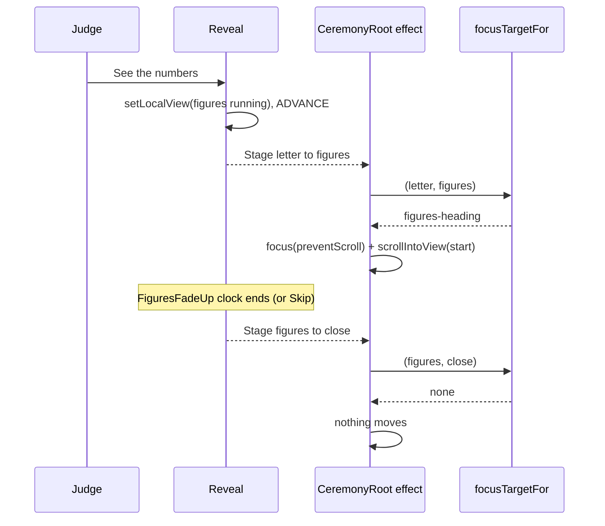
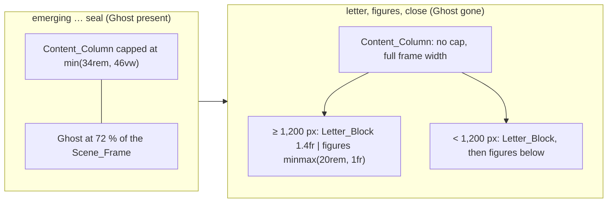
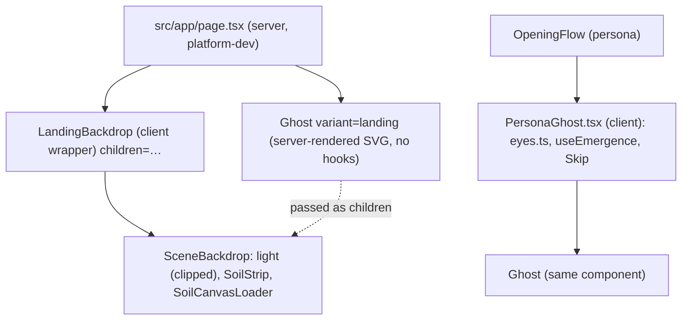
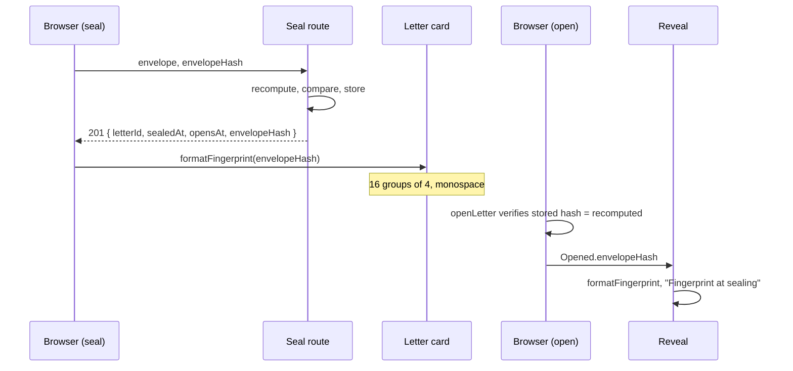
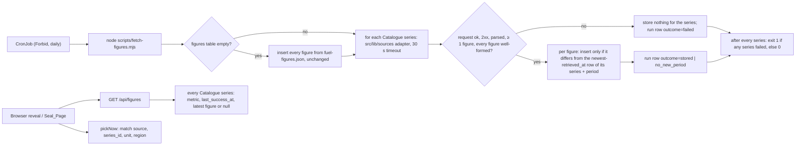
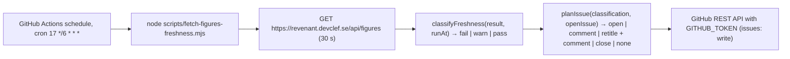

# Design Document

Spec: 08 Judge polish

## Overview

This design fixes the findings from the owner's judge walk and adds the product work listed in `requirements.md`, in the build order of R31. It is written against `main` at `6d464d1` (spec 07 complete, PR #187 merged). Every file, function and constant named here was read on that commit. Where this design proposes a value, it says so and lists it under "Open items for the owner".

### How sizes were worked out

The layout numbers in "Measured starting point" are computed from the CSS on `main`, rule by rule, not measured in a browser. Each task that changes layout measures the real boxes with `tools/qa/layout-check.mjs` (the R27 Owner_Patch a, which the owner commits to `main` before any task starts) and quotes the printed values in its PR (R27.8). Where a computed value and a measured value disagree, the measured value wins and the task states both.

### What exists on `main` and what happens to it

| Area on `main` | What this spec does with it |
|---|---|
| `CeremonyRoot.tsx` focus effect, `stageHeadingIndex` | The effect asks one new pure function, `focusTargetFor`, what to focus. The settle from `figures` to `close` moves nothing (R2). |
| `stages.ts` | Unchanged Stage names. Gains `focusTargetFor` and `afterFirstStep`. |
| `opening-machine.ts` | States, events and transitions unchanged. The `Opened` type gains `envelopeHash` (R14.5). |
| `useOpeningFlow.ts` | Copies the verified hash into `Opened` in its two `OPENED` dispatches. No other change. |
| `reveal/Reveal.tsx`, `reveal.module.css` | New letter-and-figures layout after the Ghost leaves, breakpoint 1,200 px (R3). |
| `reveal/FigureEntry.tsx`, `FigureLine.tsx`, `FiguresThenNow.tsx` | Then and now at equal weight, one "Your answer", label by letter kind, now figure from the Figures_API (R4, R13, R20). |
| `ceremony/figures/NumberLine.tsx`, `number-line.ts` | Visible "Then", "Now" and "Your answer" labels, placed by a new pure function (R5). The range rule is unchanged. |
| `ceremony/recall/RecallScale.tsx`, `scale-math.ts` | The range becomes a parameter. A new `unit-ranges.ts` holds the Unit_Range_Table and the Unit_Helper_Line lookup. The read-only scale becomes a separate static view (R6, R7). |
| `ceremony/recall/RecallPager.tsx`, `recall-pager.ts` | The number field reads its text through the new Recall_Number_Parser (`parse-number.ts`) and a pure field-state module (`recall-field.ts`). `draftNumber` is removed. The next control is disabled until the field is resolved (R32). |
| `src/lib/recall/record.ts`, `index.ts` | Unchanged. The pager hands `buildRecallRecord` the canonical string, which already matches the `numberAnswer` pattern (R7.7, R32.9). |
| `ceremony/scene/Ghost.tsx` | Split. `Ghost.tsx` keeps the `Ghost` drawing and becomes server-safe. The eye follow, Skip and Emergence hooks move to a new client `PersonaGhost.tsx` (R9.1, R9.8). |
| `ceremony/scene/scene.module.css` | Light clipped at the Soil (R9.13), Hero size after the First_Step (R8), narrow handed lift (R8.2), landing hero column. |
| `src/app/page.tsx`, `src/lib/landing-backdrop.ts` (platform-dev) | The landing renders the Landing_Ghost inside the backdrop (R9) and the new links (R10). |
| `ceremony/scene/TopBar.tsx`, `SceneShell.tsx` | Wordmark becomes a link to `/`. New `plain` variant for `/demo/live`, `/l/[id]`, the How_Page and the Real_Seal_Page (R11). |
| `src/app/layout.tsx` (platform-dev) | Title template, Open Graph, icons and the footer (R12). |
| `components/demo/dates.ts` | Moves to `components/ui/letter-date.ts`, the one letter-date module (R15.1, R15.5). |
| `lib/figures/format-change.ts` `formatPeriod`, `locale.ts` (data-dev) | Short month periods and per-region separators (R15.2 to R15.4). |
| `lib/figures/demo` `DEMO_FIGURES` as "now" | Replaced in the reveal and the Seal_Page by the Figures_API (R20.9). `DEMO_FIGURES` stays for persona sealing and tests. |
| `src/lib/sources/**`, `scripts/prefetch-figures*` | Reused by the Fetch_Job and the Fallback_Refresh. Adapters unchanged; `fetcher.ts` gains an optional `timeoutMs` so the Fetch_Job can use 30 s (R20.6). No Sweden work (R23). |
| `src/lib/figures/catalogue.ts`, `locale.ts` comments | The comments that say Sweden is "deferred" or "gains its own entry" are rewritten to name only the US and EU (R23.3). |
| `drizzle/0000`, `0001` | Unchanged. `0002_figures.sql` and `0003_letter_drafts.sql` are added. |
| `api/letters/demo/*` | The seal route also returns `envelopeHash` (R14.1). Otherwise unchanged (R24.7). |
| Helm chart `0.3.0` | Gains a CronJob, `FIGURES_SOURCE` and `REAL_SEALING` (R20.11, R25.3). |

### Measured starting point

**The 97 px letter.** At 1366×800 on the persona page, `letter` Stage, from the CSS on `main`:

| Box | Rule | Width |
|---|---|---|
| `main` content | `padding-inline: calc(var(--frame-l) + var(--pad))`, `--pad` = `clamp(1rem, 3vw, 2.5rem)` = 40 px | 1286 px |
| `.personaColumn` | `max-width: var(--content-column-max)` = `min(34rem, 46vw)` = 544 px | 544 px |
| `.flow.flowPersona` (the region) | same cap, `padding: 2rem 1.25rem` | 504 px content |
| `.letterFigures` grid | `minmax(0, 1.05fr) minmax(0, 1fr)`, gap 2.5rem | letter column 237.7 px, figures column 226.3 px |
| `.letterBlock` | `padding: clamp(0.9rem, 3vw, 2.4rem)` = 38.4 px | 160.9 px |
| `.paper` | `padding: clamp(1rem, 3vw, 2rem)` = 32 px | **96.9 px Letter_Text** |

The cause is the Ghost's column cap. `CONTENT_COLUMN_MAX` keeps the column clear of the Ghost at 72 % of the Scene_Frame, and it is still applied after the Ghost has left. The grid then halves that 504 px. In the 226 px figures column, `.big` is `clamp(3.4rem, 8.5vw, 7rem)` = 112 px, so "3.115" alone is about 340 px wide and overflows.

**The jump past the figures.** "See the numbers" sets `figures: "running"` and sends `ADVANCE`. The Stage becomes `figures`, and the `CeremonyRoot` effect focuses the newest `h1`/`h2`, which is the Figures_Heading. When `FiguresFadeUp`'s 780 ms clock ends, the local view becomes `settled`, the Stage becomes `close`, `Close` mounts its `h2`, and the effect runs again on `[state.tag, stage]`. The newest heading is now the close heading, so focus and the browser's focus scroll jump to it. "Show everything" reaches `close` in one render, so it never focuses the Figures_Heading at all. In Calm, `FiguresFadeUp` settles in a layout effect, so the two commits follow each other and the second one wins.

**The purple band.** The light is a 130 vmax circle centred on the Soil top (`.light`, opacity 0.55). The Soil_Fallback strip covers it for one band and fades its bottom quarter to `--bg` (`.soilStrip::after`). Below the strip the lower half of the light circle shows again, so the row under the strip jumps from `--bg` to lit purple. On `/`, the explanation section below the Scene has an opaque `--bg` background (`EXPLAIN_STYLE`), so the glow ends in a second hard edge at 100vh. That glow between the two edges is the band. The `LANDING_NOSCRIPT_STYLE` rule targets `[data-scene-light]`, which no element carries; the light has no animation, so the rule has no effect today.

**The overlapping ticks.** The Fallback_Range labels sit at `positionOf(decade)`. The last label is right-anchored (`translateX(-100%)`) and the one before it is centred. On a 260 px track, "10,000" spans about 205 to 241 px and "100,000" about 219 to 260 px.

**Budgets.** Task 1 runs `npm run build` and `node scripts/check-js-budget.mjs` and states the five numbers. This design does not invent current values. The limits stay: `/` 130 kB, `/demo` 130 kB, the persona page, `/demo/live` and `/l/[id]` 190 kB. This spec adds `/how-it-is-sealed` at 130 kB and `/seal` at 190 kB (R29.5).

## Architecture

### Focus after "See the numbers"



```ts
// src/components/ceremony/stages.ts (new export)
export type FocusTarget =
  | { kind: "none" }              // move nothing
  | { kind: "figures-heading" }   // the Figures_Heading, [data-figures-heading]
  | { kind: "default" };          // the spec 07 rule: [data-stage-focus], else the newest h1/h2, else the region

export function focusTargetFor(prev: Stage | null, next: Stage): FocusTarget;
```

| `prev` | `next` | Target | Why |
|---|---|---|---|
| any | same as `prev` | `default` | A tag change inside one Stage (for example `recall` to `submitting`) keeps the spec 07 rule. |
| `figures` | `close` | `none` | The settle, from the clock or Skip (R2.4). No judge action produces this pair. |
| `letter` | `figures` | `figures-heading` | "See the numbers" (R2.1). |
| `letter`, `marks` or `seal` | `close` | `figures-heading` | "Show everything", and "See the numbers" in Calm, where both commits happen before the effect reads the DOM (R2.3). |
| `null` | any | `default` | First mount. Unchanged. |
| any other pair | | `default` | R2.6. |

- The pair is enough to tell the cause apart, so the function takes no third argument. The only way into `close` from `figures` is the settle, and the only ways into `figures` or `close` from an earlier Stage are the two judge controls.
- `CeremonyRoot` keeps the previous Stage in a ref. The effect still runs on `[state.tag, stage]`.
- For `figures-heading`, the effect calls `heading.focus({ preventScroll: true })`, then `heading.scrollIntoView({ block: "start", behavior })`. `behavior` is `"smooth"` only in full motion with `prefers-reduced-motion: no-preference`, and `"auto"` in Calm and under reduced motion.
- `FOCUS_SCROLL_CHECK_MS` (900 ms) after the activation, a timer checks the heading's top. If it is above the Top_Bar's bottom or at or below the viewport's bottom, it calls `scrollIntoView({ block: "start", behavior: "auto" })` once. This keeps R2.2's 1,000 ms limit even when a long smooth scroll would overrun.
- The Figures_Heading gets `scroll-margin-top: calc(var(--topbar-clear) + 0.75rem)` with `--topbar-clear: 96px` (`TOP_BAR_MAX_PX`). The Top_Bar is never taller than 96 px, so the heading always lands below it.
- `none` leaves focus where it is. One exception: if the focused element was removed by the same commit (the Top_Bar Skip button disappears when its last sequence ends), `document.activeElement` is `body`. In that case only, the effect focuses the Figures_Heading with `preventScroll: true`. Nothing scrolls, so R2.4's 1 px rule holds.
- The close heading and its links follow the Figures_Heading in document order. No `tabindex` is positive. The Figures_Heading keeps `tabIndex={-1}` (R2.5).
- The Figures_Heading gets `data-figures-heading` so the effect and the layout check find it without reading copy.

### The reveal layout after the Ghost leaves



- `afterGhost(stage)` is `stage === "letter" || stage === "figures" || stage === "close"`. The Ghost is unmounted in all three (`ghost-presence.ts`), so lifting the cap cannot put text on the Ghost.
- CSS reads the Stage from the region's `data-ceremony`, the same way spec 07 does:
  - `scene.module.css`: `.personaColumn:has(> :is([data-ceremony="letter"], [data-ceremony="figures"], [data-ceremony="close"]))` sets `max-width: none` and `padding-bottom: 4rem`.
  - `reveal.module.css`: `.flowPersona:is([data-ceremony="letter"], [data-ceremony="figures"], [data-ceremony="close"])` sets `max-width: none`. Below 900 px it also sets `padding-inline: 0`.
- **Breakpoint: 1,200 px** (`REVEAL_SIDE_BY_SIDE_PX`). At or above it, `.letterFigures` is `grid-template-columns: minmax(0, 1.4fr) minmax(20rem, 1fr)`, `align-items: start`. Below it, one column, figures under the Letter_Block (R3.1). The spec 07 900 px breakpoint stays for the Scene, the Top_Bar and the Ghost. R3.1 asks for one breakpoint for this placement, and 900 px cannot give 28em of text beside a figures column.
- `.letter` (the Letter_Text) gets `max-width: 34em` (`LETTER_TEXT_MAX_EM`).
- Below 600 px, `.letterBlock` padding is `0.5rem` and `.paper` padding is `0.875rem`.
- Computed Letter_Text widths, at the 17 px body size:

  | Viewport | Layout | Letter_Text | In em | R3.2 / R3.3 |
  |---|---|---|---|---|
  | 1366×800 | side by side, letter column 703.5 px | 562.7 px | 33.1 | 28 to 40 em, pass |
  | 1280×800 | side by side, letter column 655.2 px | 514.4 px | 30.3 | pass |
  | 1200×800 | side by side, letter column 611.3 px | 475.3 px | 28.0 | edge, not a Check_Size |
  | 1000×800 | stacked | 578 px (capped by 34em) | 34.0 | not a Check_Size |
  | 360×640 | stacked | 284 px | | at least 280 px, pass |

- The figures column is 502.5 px at 1366 and 468 px at 1280. With the R4 value size (below), "1,585.7555123171894" is the longest value in the real file; at 2.25rem Inter 800 with tabular digits it is about 400 px, so it fits. Below 1,200 px the column is the full width.
- R3.6: each value is a `<span class="figValue">` with `white-space: nowrap`. Its unit and its period are separate inline spans with a normal space before each, so a break can only happen between value and unit or between unit and period.
- R3.4: nothing in these stages is wider than its column. The source `details` gets `overflow-wrap: anywhere` on the series ID line, because the Oil Bulletin series ID is a 150-character string with no spaces in its quoted file name.
- R3.7 holds: the marks section, the letter and the figures stay in document order, and the grid puts the figures column to the right of or below the letter, never above.

### The Hero after the First_Step

- `afterFirstStep(stage)` is true for `recall`, `marks`, `seal`, `letter`, `figures`, `close`.
- `.personaColumn:has(> :is([data-ceremony="recall"], … , [data-ceremony="close"])) .headline` sets the smaller size:
  - At or above 900 px: `font-size: clamp(1.75rem, 2.6vw, 2.25rem)`, `max-width: 20ch` (`HERO_AFTER_WIDE`).
  - Below 900 px: `font-size: clamp(1.375rem, 5vw, 1.75rem)`, `max-width: none` (`HERO_AFTER_NARROW`).
  - Both are strictly smaller than the `emerging`, `sealed` and `intact` sizes at every width (R8.1). For example at 1366 px: 35.5 px after, against 56 px in `intact` and 82 px in `emerging`. At 360 px: 22 px after, against 32 px.
- The size changes in one frame. In full motion only, the same rule sets `animation: heroSettle 240ms ease-out` (`HERO_SETTLE_MS`), where `heroSettle` goes from `opacity: 0.4` to `opacity: 1`. It animates opacity only (R8.3). Because the `animation-name` stays the same through every later Stage, it plays once, at the move from `intact` to `recall`.
- The `heroSettle` rule sits inside `@media (prefers-reduced-motion: no-preference)` and `[data-ceremony-motion="full"]`, so Calm and reduced motion show the final size in the first frame with no animation (R8.4).
- **Narrow handed lift (R8.2 at 360×640).** On `main`, the narrow recall card is pinned below the Soil at about y 497, leaving 143 px. The question, field and "Next question" need about 180 px. Below 900 px in `recall`, `marks` and `seal`, `.scene:has([data-ceremony="recall"], [data-ceremony="marks"], [data-ceremony="seal"]) .backdrop` gets `transform: translateY(-14vh)` (`NARROW_HANDED_LIFT_VH`), using the existing 600 ms `.backdrop` transform transition in full motion. The pinned region's `top` subtracts the same `14vh`. Both sides are in vh, so they stay aligned at every height with no JavaScript measurement (the cause of issue #166 was a measured lift). Computed at 360×640: Soil top at 352 px, Ghost top about 192 px, headline bottom about 178 px, card top 407 px, 233 px left for the card. The dust ceiling is re-read by the existing resize dispatch in `CeremonyRoot` after `PICKUP_MOVE_MS`.
- If the measured G1 check finds the headline on the Ghost body at 360×640, the task raises `NARROW_HANDED_LIFT_VH` in steps of 1 up to 18 and states the value.

### The Landing_Ghost



- `Ghost.tsx` loses `"use client"`. It exports `Ghost(props)` with no hooks: `pose` ("risen" | "handed"), `eyes` (an `{ dx, dy }` offset, default zero), `gradientId`, `leaving`, `riseRef` (optional), `leaveVars` and `children`. It renders the same layers and classes as today (`.pit`, `.ghostPlace`, `.ghost`, `.bob`, svg). It imports nothing from `eyes.ts`; the `EyeOffset` type moves to a new `ghost-geometry.ts`, with `BODY_PATH`, `FOLDS_PATH`, the eye positions and the viewBox, so the favicon and the Open Graph image draw the same shape (R12).
- `PersonaGhost.tsx` (`"use client"`) holds everything `Ghost.tsx` holds today that needs the client: `useMotion`, `useMaybeSequence`, `useStage`, `useEmergence(riseRef)`, the pointer listeners and `eyeOffset`. It renders `<Ghost …/>`. `OpeningFlow` imports `PersonaGhost` instead of `Ghost`. No persona behaviour changes.
- `page.tsx` renders `<LandingBackdrop><Ghost gradientId="ghost-body-landing" /></LandingBackdrop>`. `LandingBackdrop` passes `children` through to `SceneBackdrop`. The Ghost is a server component inside a client component's children, so its markup is in the server HTML (R9.1) and adds no client JavaScript.
- The rise and the Idle_Bob are the existing CSS animations. They match on `[data-ceremony-motion="full"] .ghost` and `.bob` inside `@media (prefers-reduced-motion: no-preference)`. The landing `SceneShell` root carries `data-ceremony-motion`, so the same rules apply with the same duration and easing (R9.4). Calm sets the attribute to `calm` and every animation ends in the next frame (R9.5, R9.6).
- No Envelope is passed, so the held slot is empty (R9.2). The Accent link stays in the hero section, outside the backdrop.
- The `.ghost` and `.bob` elements gain `data-ghost-rise` and `data-ghost-bob`. `LANDING_NOSCRIPT_STYLE` becomes `[data-ghost-rise],[data-ghost-bob]{animation:none}` (R9.7). The dead `[data-scene-light]` selector is dropped. The CSP already allows inline styles; `security-headers.ts` has no diff.
- No eye follow on `/` (R9.8): `page.tsx` imports `Ghost.tsx`, which imports neither `eyes.ts` nor `PersonaGhost.tsx`. A static import-graph test from `src/app/page.tsx` asserts it.
- CLS is 0 (R9.10): the Ghost sits in the fixed backdrop, which is `position: fixed` and takes no space in the flow. Its box is set by CSS in the server HTML. The rise and the bob are `transform` only.
- **Clear of the headline and the button (R9.11).**
  - At or above 900 px the landing hero gets the persona column rules through a new `.landingColumn` class in `scene.module.css`: `max-width: var(--content-column-max)` and the persona wide headline size `clamp(2.35rem, 6vw, 5.4rem)`. These are the rules spec 07 G1 already passed at seven sizes. On `main` the landing headline is `clamp(2.35rem, 8.4vw, 7.6rem)` on 11.5ch, about 816 px wide at 1366 px, and would reach the Ghost body (about x 851 to 1135).
  - Below 900 px the Ghost body sits in the middle of the viewport, so the Accent link moves below the Soil strip, as the persona `intact` stage does: `.landingColumn .landingCta { position: absolute; top: calc(var(--soil-top) + var(--soil-band) + 0.5rem - 6rem) }`. At 360×640 that is about y 501 to 557, inside the viewport.
- **Same x as the light (R9.3).** The Ghost's `.pit` uses `left: var(--ghost-x)`, the light's `left`. Both come from the same `.scene` variable, as on the persona page.
- **The band (R9.13).** `.light` gets `clip-path: inset(0 0 calc(50% - 12px) 0)`. It keeps only the part of the circle above `Soil top + 12 px` (12 px is the deepest notch of the strip's jag). Under the strip the backdrop is transparent and the `.scene` background is `--bg`. The strip's last row is already `--bg` (its `::after` fade), so every row below it is `--bg` and the row-to-row change is 0 (R9.13 allows 2). Because the clip ends the light 12 px below the Soil top, the glow no longer reaches 100vh on `/`, so `--bg` meets the explanation section's `--bg` and that edge's change (BAND1 `edgeChange`) also goes to 0. This applies on every Scene page. The persona reveal loses the faint glow under the Soil, which also means text below the strip always sits on plain `--bg`.

#### The second rise (R9.12)

Decided by the owner: **both rises stay.** The persona page plays its full Emergence after the landing link, after a reload and on a direct visit, as it does today. `/` gets no client JavaScript for the arrival: no click handler on the landing link, no module flag, no storage. The reasons the design gave, which the owner accepted:

- The persona rise carries the Envelope and runs while the seal is checked. `tone.md` names that as the Emergence moment. The landing rise is the concept, with empty hands. They mean different things.
- Skipping would need a client `onClick` on the landing link, which adds client JavaScript to `/` and a module-memory flag that two routes share. It would also make the persona page behave differently after a client navigation than after a reload, which QA would have to test both ways.
- The rise is 1.5 s and Skip ends it.

No arrival signal is written anywhere (R1.5, R9.12).

### Pages and the Top_Bar

| Route | Shell | Top_Bar left | Top_Bar right | Footer |
|---|---|---|---|---|
| `/` | `SceneShell variant="landing"` | wordmark link, Demo chip | Calm | yes |
| `/demo` | `index` | wordmark link, Demo chip | Calm | yes |
| `/demo/personas/[key]` | `persona` | wordmark link, Demo chip | notice, Calm, Skip | yes |
| `/demo/live` | `plain`, `demo: true` | wordmark link, Demo chip | nothing | yes |
| `/l/[id]` | `plain`, `demo: false` | wordmark link | nothing (the region keeps its own Calm, Skip and sound) | yes |
| `/how-it-is-sealed` | `plain`, `demo: false` | wordmark link | nothing | yes |
| `/seal` | `plain`, `demo: false` | wordmark link | nothing | yes |

- `SceneShellProps` gains `| { variant: "plain"; demo: boolean; children: ReactNode }`. It renders the token class, `MotionProvider` and the Top_Bar, and no backdrop. Its root carries no `data-ceremony`, so `/l/[id]` keeps exactly one (in its region).
- `TopBar` gains `demo?: boolean` (default `true`) and `controls?: "calm" | "none"`. The wordmark becomes `<Link href="/" data-wordmark>`. It is a `next/link`, so the click is a client navigation (R11.2).
- `/demo/live` drops `PageShell` and renders `SceneShell variant="plain" demo`. `SealPage` gets a `backLink` slot: one `<Link href="/demo">` "Back to the demo" (`LIVE_COPY.backToDemo`, existing string) rendered above every Sealing_Flow state, before and after sealing (R11.3). `SealedView`, `WriteForm`, `SealFailure` and `BackupFallback` are not edited for it.
- The footer is `src/components/ui/Footer.tsx`, a server component, rendered once by `layout.tsx` after `{children}`. It has a `--bg` background, `position: relative; z-index: 3`, and is at most 64 px tall (`FOOTER_MAX_PX`). The Soil strip is fixed in the viewport between 74 and 88vh (wide) or 69 and 77vh (narrow), so with the page scrolled to its end the footer sits in the last 64 px and does not meet the strip at any Check_Size (R12.6). It holds the How_Page link and the GitHub link (R12.4).

### Metadata, icons and the Open Graph image

- `src/lib/page-metadata.ts` (platform-dev, new): `pageMetadata(page: string | null, path: string): Metadata`. It returns `title` (`page` or the default), `openGraph: { title, description, url: path, images: ["/opengraph-image"], type: "website", siteName: "Revenant" }` and `twitter: { card: "summary_large_image" }`. Next.js replaces a parent's `openGraph` object instead of merging it, so every route calls the helper and gets the full set.
- `layout.tsx` replaces the `metadata` const with `generateMetadata()`. It reads `APP_ORIGIN` at request time (the layout is already dynamic because it awaits `headers()`), and returns `metadataBase: new URL(origin)`, `title: { default: "Revenant", template: "%s · Revenant" }`, the description and `icons: { icon: "/icon.svg", apple: "/apple-icon" }`. Relative `url` and `images` resolve against `metadataBase`, so `og:url` and `og:image` are absolute and start with `APP_ORIGIN` (R12.3). If `APP_ORIGIN` is unset (local tests), it falls back to `http://localhost:3000`.
- Page names (R12.2), each unique:

  | Route | `{page}` | `<title>` |
  |---|---|---|
  | `/` | none | Revenant |
  | `/demo` | Demo letters | Demo letters · Revenant |
  | `/demo/personas/[key]` | {name}'s letter | Maya's letter · Revenant |
  | `/demo/live` | Seal a demo letter | Seal a demo letter · Revenant |
  | `/l/[id]` | Your letter | Your letter · Revenant |
  | `/how-it-is-sealed` | How a letter is sealed | How a letter is sealed · Revenant |
  | `/seal` | Seal a letter | Seal a letter · Revenant |
  | not found pages | Not found | Not found · Revenant |

  The two not-found pages share one name. R12.2 asks for a name no other route uses; a not-found page is not a route, so this is listed as an open item.
- **Favicon:** `public/icon.svg`, written by hand from `ghost-geometry.ts`: the sheet ghost body in `#f3eeff` with the `--bg` eyes on a `#0b0912` rounded square, viewBox 0 0 64 64. About 700 bytes.
- **Apple touch icon:** `src/app/apple-icon.tsx`, a `next/og` `ImageResponse` of 180×180 px that draws the same SVG as an `` data URI. Static at build time.
- **Open Graph image:** `src/app/opengraph-image.tsx`, a `next/og` `ImageResponse` of exactly 1200×630 px. Near-black background, a purple radial glow, the ghost from `ghost-geometry.ts` on the right, and the headline "Your past self returns with the receipts." on the left in white, with "receipts." in `#ff7b1c` (the headline is large text on `#0b0912`, where the Accent clears 3:1). Satori, which `next/og` uses, cannot read woff2, so it uses the default font bundled with `next/og`. `next/og` ships with `next` 15.5.28, so no dependency is added (R1.6).
- All three get `ASSETS.md` rows in `src/components/ceremony/ASSETS.md`: path, "drawn by hand from the Ghost geometry in `ghost-geometry.ts`" or "generated at build time by `next/og` from the same geometry", licence "original", date added. None is AI-generated and none contains Kiro's logo or mascot (R12.5).

### Dates and numbers

- **Letter dates, one module:** `src/components/ui/letter-date.ts` (frontend-dev). It replaces `src/components/demo/dates.ts`, `StillSealed`'s `UTC_DATE`, and the date part of `live/format.ts`. Every caller switches in the same task, and the old module is deleted (R15.5).

  ```ts
  export type LetterZone = { kind: "utc" } | { kind: "fixed"; offsetMinutes: number } | { kind: "iana"; timeZone: string };
  export function formatLetterDate(instant: string, zone: LetterZone): string;      // "30 October 2026"
  export function formatCalendarDate(date: string): string;                          // "YYYY-MM-DD" → "12 May 2024"
  export function letterZoneFor(kind: "persona" | "live" | "real", opensAt: string, browserTimeZone: string): LetterZone;
  ```

  The output is built from parts (`day` numeric, `month` long, `year` numeric in `en-GB`), so the shape is exact whatever the runtime's ICU data.
- **Where the zone comes from (open item 4).** The v1 payload has no timezone, and this spec adds no `format_version` for it.
  - Persona letters: `utc`. Their `opens_at` is 00:00 UTC and their as-of date is a calendar date.
  - Live_Letters: `iana` with the browser's own zone. They open 30 seconds after sealing on the same device, so the browser zone is the zone at sealing.
  - Real_Letters: the opening is 00:00 in the sealing zone, so `opens_at` itself carries the sealing offset. `letterZoneFor` first checks whether `opens_at` is 00:00 in the browser's zone; if so it uses that zone. Otherwise it derives a fixed offset: with `t` the UTC time of day of `opens_at`, the offset is `-t` if that lies in −12:00 to 0, else `24h − t`. When both fit (t from 10:00 to 12:00 UTC: −10 to −12 or +12 to +14), it picks the west offset. The sealed date uses the same offset. A DST change between sealing and opening can move the sealed date by one day only for letters sealed in the last hour before local midnight; this is accepted for the MVP and stated on the How_Page as a known limitation.
- **Periods, one module:** `formatPeriod` in `src/lib/figures/format-change.ts` (data-dev). Weekly `YYYY-MM-DD` becomes "26 Oct 2026" (day numeric, short month, year, built from `en-GB` parts, `timeZone: "UTC"`). Monthly `YYYY-MM` becomes "Oct 2026" (R15.2, R15.3). Its `region` argument is kept for the signature and no longer changes the output.
- **Numbers per region (R15.4):** `localeForRegion` maps the exact region strings of the Catalogue:

  | Region string | Locale | Example |
  |---|---|---|
  | `U.S.` | `en-US` | 1,585.76 |
  | `EU27, weighted average` | `en-IE` | 1,585.76 |
  | anything else (self-reported) | `en-GB` | 1,585.76 |

  Only the number formatter uses this locale; no words come from it. `en-IE` keeps the English decimal point for the EU, since the EU has no single convention and the Oil Bulletin is published in English. The owner approved `en-IE` (R15.4). No row uses `sv-SE` (R23).
- **Comments (R23.3).** The same data-dev task rewrites the header comments of `catalogue.ts` ("Sweden fuel is deferred to the real-data spec") and `locale.ts` ("EU and Sweden gain their own entries in the real-data spec") so they describe the US and EU entries only. The R23.3 search test covers both files.

### The Fingerprint



- `src/lib/seal-format/fingerprint.ts` (crypto-dev):

  ```ts
  export function formatFingerprint(hash: string): string | null; // /^[0-9a-f]{64}$/ → "a1b2 c3d4 … (16 groups)", else null
  export function parseFingerprint(text: string): string | null;  // exact inverse; anything else → null
  ```

  `src/lib/seal-format` is already imported statically by browser code (`FiguresThenNow`, `/l/[id]/page.tsx`) and by server code, and its `no-cross-import.test.ts` forbids imports of `lib/crypto`. So the card code and the Reveal can import it with no crypto in their bundles.
- Both demo and real seal routes add `envelopeHash` (the stored value) to their 201 body. `live/api.ts` parses it with `z.string().regex(/^[0-9a-f]{64}$/)`. The `SEALED` event and the `sealed` SealState carry it.
- Letter card: `LetterCard` prints the Fingerprint under the link in two lines of 8 groups, in `ui-monospace, "SF Mono", Menlo, Consolas, monospace`. The same text goes into a new downloadable SVG card image (`src/lib/cards/letter-card-svg.ts`, "Save the card as an image"), which draws the QR path, the opening date, the link and the Fingerprint as SVG text. No raster library is needed (R14.2).
- Opening: `useOpeningFlow` sets `opened.envelopeHash` from the hash it passed to `openLetter`. `openLetter` returns `ok` only after the constant-time check passed, so the field is always the verified hash. The Reveal shows it in the `letter` Stage under the Letter_Block (R14.3, R14.8). A failed check never reaches the Reveal (R14.6).
- Persona letters get `envelopeHash` the same way, with the label "demo letter" and no card wording (R14.8).

### PRF_Hint

- `src/components/live/prf-hint.ts` (frontend-dev), pure plus one effect hook:

  ```ts
  export type PrfHint = "missing" | "none";
  export function prfHintFrom(result: { kind: "unsupported" } | { kind: "rejected" } | { kind: "timeout" } | { kind: "resolved"; caps: Record<string, unknown> }): PrfHint;
  // "missing" only when kind is "resolved" and caps["extension:prf"] === false. Every other case is "none".
  export function usePrfHint(): PrfHint; // one call on mount, Promise.race with a 2,000 ms timer (PRF_HINT_TIMEOUT_MS)
  ```

- The call is `PublicKeyCredential.getClientCapabilities()` from the WebAuthn Level 3 draft. It returns a record whose extension keys are written `extension:<id>`. If the function is missing, rejects, takes over 2 s, or the key is absent, the hint is `none` (R16.3).
- `WriteForm` shows `LIVE_COPY.prfHint` in a status paragraph on the Write step when the hint is `missing` (R16.2). It blocks nothing. The PRF_Check in `pressCreate`/`pressConfirm` is unchanged and decides alone (R16.5, R16.6).
- It makes no request and writes no storage (R16.7). The hook lives outside `lib/crypto`; it is not crypto and needs no crypto-dev task.

### Backup key path (R17)

Reading the code on `main` finds no branch in `SealedView` that depends on `factors`: `done` is `seconds <= 0`, `seconds` is `remainingSeconds(Date.parse(state.opensAt), now, state.offsetMs)`, and the `Link` renders when `done`. The backup path reaches `sealed` through `fallback_key → preparing → sealing → sealed`, the same `SEALED` event as the passkey path. So the defect is not visible from code alone. The task works in this order:

1. Write the R17.6 end-to-end test first (below) and run it on `main`. If it fails, the failing assertion names the cause.
2. Reproduce on `revenant.devclef.se` with the owner-check step 15 and 16 flow, in a browser with no PRF, and record what the control does (no `href`, `href` but no navigation, or navigation to the wrong page).
3. Check these candidates, in order, and fix the first that matches:
   - `Date.parse(state.opensAt)` returns `NaN`. Then `seconds` is `NaN` and `NaN <= 0` is false forever. Fix: `remainingSeconds` returns 0 for a non-finite input, and `SealedView` shows the `countdownDone` line.
   - The countdown interval is cleared before zero when the render that holds the backup card remounts `SealedView` (the `showBackupCard` branch). Fix: key `SealedView` by `letterId` in `SealPage`, and compute `done` from the clock on every tick, not from the last state.
   - The `BackupKeyCard` print layer (`.backupCard`) covers the control and takes the click. Fix: `pointer-events: none` on the print-only layer in screen media.
4. Whatever the cause, `done` is made a pure function `goToLetterReady(opensAtMs, nowMs, offsetMs)` in `clock.ts`, tested with a fast-check property over all finite and non-finite inputs.

The opening side already handles a backup-only letter: `UnlockView` shows only the key field when `unlock.passkey` is null, and `wrong_backup` and `mistyped_key` keep the field and its value (R17.5).

### The daily figure fetch



- **Adapters.** The job calls the same `fetchEiaSeries` and `fetchBulletin` functions `runPrefetch` uses today (`src/lib/sources/eia.ts`, `oil-bulletin.ts`, through `fetcher.ts` and its host allow-list). `fetcher.ts` keeps its 60 s default for `prefetch` and gains an optional `timeoutMs`; the job passes `FETCH_TIMEOUT_MS` (30,000). It fills no gap, converts no currency and substitutes nothing (R20.13).
- **The job core** is a pure module `src/lib/sources/fetch-job.ts`: `runFetchJob(deps: { store: FigureStore; adapters; runStartedAt; catalogue; seed; log }): Promise<{ exitCode: 0 | 1; series: SeriesOutcome[] }>`. `FigureStore` is an interface: `count()`, `latestPeriod(seriesKey)`, `insertIfChanged(rows)` (returns how many rows were inserted, and how many of those were Revision_Rows), `recordRun(rows)` and `seedFrom(rows)`. The script entry `scripts/fetch-figures.ts` wires the real Postgres store and sets `process.exitCode`; tests pass an in-memory store that records every call (R30.4).
- **Per series, in order:**
  1. Download through the adapter. A thrown `SourceError` (network error, abort after 30 s, non-2xx status) or a parse error is a failure.
  2. Validate the whole result before any write. The result fails if it holds zero figures, or if any figure is malformed: one of the eight R20.3 provenance fields missing or empty, `Number(value)` not finite, a period that does not match the Catalogue's `period_type` (`weekly` → `^\d{4}-\d{2}-\d{2}$` and a real date; `monthly` → `^\d{4}-\d{2}$`), or two figures with the same period. A failed series stores nothing from its result (R20.6).
  3. Write, in one transaction per series, holding `pg_advisory_xact_lock(hashtext(series key))`: each figure is inserted only if it differs from the newest-`retrieved_at` row stored for its series and period (the query is under "Data Models"). Equal → no row (R20.4). Different → a Revision_Row, with the earlier row untouched (R20.17). No stored row for the period → a new row.
  4. Classify: `stored` when at least one row was inserted (a new period or a Revision_Row), else `no_new_period` (R20.14; a result with no newer period whose points all equal the stored rows also lands here, which is R20.4). Both are successes. A failure in steps 1 to 3 is `failed` (R20.6, R20.19).
  5. Record one `figure_fetch_runs` row for the series with the run's UTC start time and the outcome. For a success that row is the series' Last_Success_Time (R20.18). For a failure it records the failure and leaves the Last_Success_Time where it was, because Last_Success_Time only reads success rows.
- **Exit status (R20.6, R20.15, R20.16, R20.19).** Every series is attempted. Exit 0 when no series failed, whatever the mix of `stored`, `unchanged` and `no_new_period`. Exit 1 when at least one series failed; the well-formed series of the other sources are already committed by then, because each series has its own transaction. With daily runs and weekly data, a healthy day is usually `no_new_period` for every series and exits 0.
- **Database failure (R20.19).** If the first query (`count()`) fails, every series counts as failed, no source is requested, one line `fetch-figures failed: database` is printed and the job exits 1. If a write fails mid-run, that series' transaction rolls back, the series counts as failed, and the job goes on with the next series and exits 1 at the end. If even `recordRun` fails, the outcome is printed and the exit is 1. Postgres errors are printed by their `code` only, never with the connection string.
- **Logging:** one line per series, `fetch-figures <metric_id> <stored|no_new_period|failed> added=<n> revisions=<n> reason=<reason>`. The reason is a fixed token: `no new period`, `request failed`, `timeout`, `http <status>`, `parse`, `empty`, `malformed <field>`, `database`. It names the series and never a key or URL query (R20.6). No API key exists today: both EIA files and the Bulletin are public downloads, so the Secret gains no key. The chart README says where one would go.
- **Seeding (R20.12):** if `figures` has zero rows, the job first inserts every figure in `fuel-figures.json` with its `value`, `period` and provenance unchanged, including its original `retrieved_at`, in one transaction. Seeding writes no `figure_fetch_runs` row, so no series has a Last_Success_Time until a real fetch succeeds. A seed error rolls back, prints `fetch-figures failed: seed` and exits 1 with no source requested.
- **Concurrency:** `concurrencyPolicy: Forbid` (R20.7). The per-series advisory lock makes the insert-if-different check safe even if two runs overlap.
- **No trigger endpoint:** nothing under `src/app/api` runs the job (R20.7).

#### The Figures_API

`GET /api/figures` (data-dev, `src/app/api/figures/route.ts`). No query parameters are read; any present are ignored (R20.8).

```ts
type FiguresResponseV1 = {
  format: "revenant-figures-v1";
  generated_at: string;              // server UTC, ISO
  source_mode: "db" | "file";        // which backend answered
  series: Array<{                    // exactly one entry per Catalogue series, in Catalogue order (R20.8)
    metric: MetricDefinitionV1;      // id, display_name, unit, region, source, series_id
    period_type: "weekly" | "monthly";
    last_success_at: string | null;  // Last_Success_Time, UTC ISO; null if no run has succeeded (R21.5)
    figure: FigureV1 | null;         // the stored row with the latest period, newest retrieved_at for that period; null if none
  }>;
};
```

- The response lists every Catalogue series, including one with no stored figure (`figure: null`) and one never fetched (`last_success_at: null`). Nothing is left out silently.
- For a period with a Revision_Row, `figure` is the row with the newest `retrieved_at` (R20.17). The earlier row stays in the table.
- `source_mode` comes from `FIGURES_SOURCE` (`db` or `file`, default `db`).
  - `db`: `figure` from the "latest figure" query and `last_success_at` from `figure_fetch_runs` (see "Data Models").
  - `file`: `figure` from the bundled `fuel-figures.json` through `DEMO_FIGURES`, and `last_success_at` from the bundled `src/lib/figures/real/fetch-status.json` (`{ "<metric_id>": "<run start, UTC>" }`), which `npm run prefetch` rewrites at the end of each run for every series that succeeded under the R20.6 and R20.14 rules. A series missing from that file, or a missing file, gives `null`. This is the Fallback_Refresh backend (R21.2, R21.5). The newest `retrieved_at` is never used as a stand-in for `last_success_at`.
- Headers: `Cache-Control: public, max-age=600, stale-while-revalidate=3600`. The body is the same for every visitor and names no letter.
- `src/lib/figures/now.ts` (data-dev, pure, browser-safe):

  ```ts
  export function parseFiguresResponse(body: unknown): { ok: true; value: FiguresResponseV1 } | { ok: false };
  export function pickNow(then: FigureV1, metric: MetricDefinitionV1, response: FiguresResponseV1):
    | { found: true; figure: FigureV1 }
    | { found: false; reason: "series_missing" | "no_figure" };
  // An official then figure matches the one entry whose metric source, series_id, unit and region all equal
  // the sealed metric's (R20.9). An entry that matches but has figure: null gives "no_figure".
  ```

  The sealed figure carries its own source and series ID through its metric (`payload.metrics`), so `pickNow` takes the metric definition too. A self-reported figure never matches.
- The browser downloads the response once per page (a `useFigures()` hook in `components/reveal/figures-api.ts`, with a 30 s abort) and picks locally (R20.9).
- **Unavailable reasons (R20.10).** `series_missing` and `no_figure` both show `nowUnavailableMissing`, which contains the phrase "no longer published by Revenant". A failed request, a non-2xx status or a body that `parseFiguresResponse` rejects shows `nowUnavailableFetch` on every Now_Figure, which contains the phrase "could not be loaded". In both cases the Then_Figure still shows with its period, and no change value and no Number_Line are drawn.
- The Seal_Page and the Real_Seal_Page read their "then" figures from the same response, so a Live_Letter's then and now come from the same source and match after 30 seconds, as `product.md` expects. If the request fails, the picker shows an error and sealing is blocked; it does not fall back to the bundled file.

#### Fallback_Refresh (R21.1, R21.2)

- The owner commits the workflow `.github/workflows/refresh-figures.yml` (Owner_Patch h) after task 14 merges, with `workflow_dispatch` only, and runs it once by hand before 16 November 2026. It is used only if R21.1 triggers on 16 November 2026: the owner then adds back the daily schedule (06:30 UTC) and sets `figures.source: file` in the GitOps values. Each run does `npm ci` and `npm run prefetch`, and commits `src/lib/figures/real/fuel-figures.json` and `fetch-status.json` to `main` as "[data] refresh figures" when either changed. After a push it dispatches `ci` on `main`, and the existing build workflow then publishes a new image (see Owner_Patch h for the assumption and the owner steps).
- `prefetch` uses the same adapters and the same per-series validation as the Fetch_Job (R20.3 to R20.6, R20.13, R20.14). It writes the real `retrieved_at` of each new figure, appends a changed value for a stored period as a Revision_Row and never changes an existing row (R20.17), and writes the run start time into `fetch-status.json` for each series that succeeded and leaves the entry of a failed series as it was (R20.18). The prefetch exits 1 under the same rules as the Fetch_Job, so the workflow run shows as failed.
- `fetch-status.json` changes on every successful run, so once the schedule is added the workflow commits daily. That is repository activity, which also keeps the scheduled workflows enabled (see the Freshness_Check below).

#### The Freshness_Check (R21.5 to R21.15)



- **Where it lives.** The workflow `.github/workflows/freshness-check.yml` is Owner_Patch i. The script it runs, `scripts/fetch-figures-freshness.mjs`, is data-dev code (it matches `scripts/fetch-figures*`). It is plain ESM JavaScript with no imports outside Node 22 built-ins, so the workflow needs only `actions/checkout` and `node`, with no `npm ci`. Its two pure functions are exported and tested by Vitest; `main()` runs only when the file is the entry point.
- **The request (R21.6, R21.7).** One `GET https://revenant.devclef.se/api/figures` with `AbortSignal.timeout(30_000)`. The origin is a constant in the script, not an input. The script sends no credential to it.
- **Classification, one pure function:**

  ```js
  /** @typedef {{ kind: "request_failed"; problem: "network" | "timeout" | "http" | "parse" | "no_series"; status?: number }} RequestProblem */
  /** @typedef {{ metric_id: string; result: "fail" | "warn"; detail: string }} SeriesFinding */
  /** @returns {{ status: "fail" | "warn" | "pass"; request?: RequestProblem; findings: SeriesFinding[] }} */
  export function classifyFreshness(result /* { ok: true, body } | RequestProblem */, runAtMs);
  ```

  - A request problem (network error, abort after 30 s, non-2xx, a body that is not JSON or not the `revenant-figures-v1` shape, or an empty `series` array) gives `fail` with that problem and no series findings.
  - Fetch_Failure_Check (R21.7): a series with `last_success_at` null, unparsable, or more than 48 hours (`FETCH_FAILURE_HOURS`, strictly greater than 172,800,000 ms) before `runAtMs` is a `fail` finding. The check reads `last_success_at` only and never a `retrieved_at`.
  - Period_Age_Warning (R21.8): the period date of the series' `figure` is the date it names for `YYYY-MM-DD`, and the last day of the month for `YYYY-MM` (`2026-02` → `2026-02-28`, `2028-02` → `2028-02-29`). If the run's UTC calendar date minus that date is more than 14 days (`PERIOD_AGE_WARN_DAYS`), it is a `warn` finding naming the series and its period. A series with `figure: null` is a `warn` finding "no stored figure". A series can carry a `fail` and a `warn` finding at once.
  - `status` is `fail` if there is a request problem or any `fail` finding, else `warn` if there is any `warn` finding, else `pass`.
- **Issue handling, one pure function:**

  ```js
  /** @returns {{ action: "none" } | { action: "open"; title; labels; body } | { action: "comment"; issue; body; title?; labels? } | { action: "close"; issue; body }} */
  export function planIssue(classification, openIssue /* { number, labels } | null */, runAtIso);
  ```

  | Result | No open Freshness_Issue | Open Freshness_Issue |
  |---|---|---|
  | `fail` | open, title "Freshness check: failure", label `freshness:failure`, assignee `devclef` | comment; if the label is `freshness:warning`, also set the title and replace the label with `freshness:failure` (R21.11, R21.12) |
  | `warn` | open, title "Freshness check: warning", label `freshness:warning`, assignee `devclef` | comment; if the label is `freshness:failure`, also set the title and replace the label with `freshness:warning` |
  | `pass` | none | comment "Both checks passed for every series. Run at {UTC}." and close it (R21.13) |

  - The body and every comment list the run time in UTC and one line per finding: `<metric_id>: <fail|warn> <detail>`, or the request problem. The wording is neutral and names no direction of change.
  - The open Freshness_Issue is found with `GET /repos/{GITHUB_REPOSITORY}/issues?state=open&labels=freshness:failure` and then `…labels=freshness:warning` (`devclef/Revenant` in practice), taking the lowest number. The script never opens a second issue while one is open (R21.11).
  - Before opening an issue, the script creates the two labels if they are missing (`POST /labels`, a 422 "already exists" is ignored). Owner_Patch j also adds them to `.github/labels.json`.
  - Assigning `devclef` sends the GitHub email and mobile notification the owner has on (R21.10).
- **Exit status.** The script exits 1 on `fail` and 0 on `warn` or `pass`, after the issue step, so the Actions tab also shows a failed run. A GitHub API error while managing the issue exits 1 and prints the HTTP status only.
- **Permissions (R21.9).** `permissions: { issues: write }` and nothing else. No repository secret is read. `GITHUB_TOKEN` is passed to the script as an environment variable and used only for `api.github.com`.
- **Schedule (R21.9).** `cron: "17 */6 * * *"`: four runs a day at 00:17, 06:17, 12:17 and 18:17 UTC, off the hour to avoid the top-of-hour queue delay. `workflow_dispatch` is also allowed for a manual run.
- **Staying enabled through 29 January 2027 (R21.14).** GitHub disables scheduled workflows in a public repository after 60 days with no repository activity ([GitHub docs](https://docs.github.com/en/actions/using-workflows/disabling-and-enabling-a-workflow)). The last planned commit is around 4 December 2026, so the limit would fall around 2 February 2027, four days after judging ends. That margin is too thin to rely on. Three layers:
  1. A second workflow, `.github/workflows/keepalive.yml` (also Owner_Patch i), runs weekly (`cron: "41 3 * * 1"`) with `permissions: { actions: write }` only. It calls `PUT /repos/devclef/Revenant/actions/workflows/freshness-check.yml/enable` and the same for `keepalive.yml` itself. Keepalive tools describe this call as resetting a workflow's inactivity counter ([Workflow Immortality](https://github.com/marketplace/actions/github-workflow-immortality)); GitHub's documentation does not state it, so it is a second layer, not the only one. Both workflows are subject to the same 60-day rule, which is why the keepalive also re-enables itself. It makes no commit. *Content from these sources was rephrased for compliance with licensing restrictions.*
  2. If the Fallback_Refresh is in use, its daily commit is repository activity.
  3. The owner adds a calendar reminder for 15 January 2027: open the Actions tab, confirm both workflows are enabled and ran in the last 24 hours, and if either is disabled, enable it and push one commit (for example a README status line).
- **Failed CronJob runs stay visible (R21.15).** `backoffLimit: 0` makes an exit 1 a failed Job at once, and `failedJobsHistoryLimit: 3` in `values.yaml` (at least 1) keeps the failed Job and its pod logs in the cluster. A chart test asserts the rendered value is at least 1.
- **Wording (R21.3, R21.4):** every Now_Figure shows "{period} · {region} · retrieved {date}" next to its value. The Reveal copy for a Now_Figure uses "Now" and never "today", "current", "latest" or "live". The two existing spec 03 strings `nowUnavailableUnknown` and `nowUnavailableEmpty` say "The current figure is unavailable"; they are replaced by `nowUnavailableMissing` and `nowUnavailableFetch` (see "Copy"), and a copy test bans the four words in every Reveal string about a Now_Figure.

### EU persona (R22)

One entry in `content/personas/personas.json`, written by frontend-dev. It is the only new persona; the Persona_List then holds exactly the US persona and this one (R23.2).

- `key` `eu-<name>`, `region` "European Union", a new random `letter_id`.
- **Opening date:** `opens_at` `2024-06-09T00:00:00.000Z`. 9 June 2024 is the last of the four European Parliament election days and the day most member states voted. The letter is about everyday life and names no member state, so no country-specific day applies; if the reviewed letter text ends up placing the persona in a member state that voted on 6, 7 or 8 June, the task uses that date instead and says so in the PR (R22.8).
- **As-of date:** `written_as_of` is a calendar date on or after `2023-06-05` (the earliest EU27 period in `fuel-figures.json`) and strictly before `2024-06-09` (R22.1). The task picks one, for example a date in the spring of 2024 so the letter reads as written before the election.
- **Sealed figures (R22.2):** exactly two, `eu-petrol-euro95` and `eu-diesel`, no self-reported and no fixture figure. For each, the sealed figure is the row of `fuel-figures.json` with the latest period on or before `written_as_of`, copied field for field (value, unit, region, period, source, series ID, `source_url`, `retrieved_at`). The persona entry names only metrics; `seal-personas` picks the figure with `thenAndNow(metricId, written_as_of)` from `src/lib/figures/then-now.ts`, unchanged. A frontend-dev test in `src/lib/personas/` asserts, for the EU entry, that this pick equals the row with the greatest period whose own date (`YYYY-MM-DD`) is on or before `written_as_of`. If the two rules ever differ for the chosen date (for example because `thenAndNow` compares the period's end), the task picks an as-of date where they agree and states it, rather than changing `then-now.ts`. Recall subjects: "1,000 litres of Euro-super 95 petrol" and "1,000 litres of automotive diesel".
- `opening_event`: a new optional strict object on the persona schema, `{ name: "European Parliament election", date: "2024-06-09", source: "European Parliament", source_url: <official https URL> }`. The task records the official page it used. `lib/personas/schema.ts` gains the field; `seal-personas-core.ts` ignores it.
- The letter text is 1 to 5,000 characters about everyday life only, and passes `checkLetterText` (banned terms) and the `neutrality.md` copy test, recorded in the PR with the reviewer's name and pass or fail (R22.3, R22.4).
- `scripts/seal-personas*` already seals every entry of `personas.json` into `demo_letters` with the published demo key and returns `skipped` for an entry already sealed with the same payload, so R22.5 needs no change. The integration test checks a second run adds no row and leaves the stored row unchanged.
- **FIXTURE guard (R22.7).** No code on `main` rejects a `FIXTURE` figure at persona sealing. A small crypto-dev change to `seal-personas-core.ts` (its paths include `scripts/seal-personas*`) checks every figure of every persona before the first write, and if any `source` or `series_id` starts with `FIXTURE`, exits with an error naming the persona key and the series ID and writes nothing. It ships in the EU persona task's crypto-dev companion (task 19 below).

### Sweden is out of scope (R23)

- No Sweden series, persona, unit, adapter key, `sv-SE` row or report script. The earlier "Sweden data report" and the Sweden adapter work are dropped from this design.
- **Guards (R23.1, R23.2):** a test over `CATALOGUE`, `fuel-figures.json`, `UNIT_RANGE_TABLE` and the Figures_API file-mode body fails if any region names Sweden or any unit contains `SEK`; a test fails unless the Persona_List keys are exactly the US key and the EU key.
- **Search test (R23.3):** `src/components/regions-scan.test.ts`, added by the R19 audit task (frontend-dev). It reads `README.md`, every `copy.ts` under `src/components/` (including `scene/copy.ts` for the landing and `how/copy.ts` for the How_Page), `src/app/how-it-is-sealed/page.tsx`, `src/lib/figures/catalogue.ts`, `locale.ts` and `format-change.ts`, and fails on a case-insensitive match of `Swed`, `SCB`, `sv-SE` or the whole word `SEK`. It never reads test files, `src/lib/sources/__recorded__/**` (recorded excerpts) or guard lists such as `src/lib/personas/banned-terms.ts` (R23.6). The `catalogue.ts` and `locale.ts` comments are fixed by task 6. The README needs nothing: its Sweden lines are already fixed on `main` before any task starts, and no R23.3 term remains in `README.md`.
- **README (R23.4)** and **steering (R23.5):** the README Sweden lines are already fixed on `main` before any task starts, so Owner_Patch f no longer carries them. Line 20 reads exactly `2. **Seal the figures.** Pick fuel prices from official sources for the US or the EU. Every figure keeps its source, period, unit and region.` and line 46 reads exactly `- **Persona letters.** A pre-sealed letter from a fictional person, written for a recent US election window. Break the seal, answer the recall questions, see the figures then and now. No passkey needed.` Owner_Patch l (task 18) widens line 46 to the US and EU personas, and Owner_Patch m (task 23, only if 23.1 merges) adds self-reported numbers to line 20. The steering list is Owner_Patch k.

### Real sealing

```mermaid
sequenceDiagram
  participant P as /seal (browser)
  participant R as /api/letters/prepare
  participant S as /api/letters/seal
  participant DB as Postgres
  P->>P: earliestOpeningDate(now, tz) → date picker min
  P->>R: POST (no body)
  R->>R: REAL_SEALING on?
  R->>DB: insert letter_drafts (id, server_secret)
  R-->>P: { letterId, serverSecret, serverNow }
  P->>P: opensAt = opensAtFor(date, tz); recheck ≥ earliest
  P->>P: sealLetter (passkey and/or backup)
  P->>S: { letterId, envelope, envelopeHash }
  S->>S: REAL_SEALING on? hash ok? header.opensAt ≥ serverNow + 3 calendar months?
  S->>DB: insert letters (trigger-protected), delete draft
  S-->>P: 201 { letterId, sealedAt, opensAt, envelopeHash }
```

- **Flag (R25.3, R25.4):** `src/lib/feature-flags.ts` (platform-dev, server-only): `realSealingOn(): boolean`, true only when `process.env.REAL_SEALING?.trim() === "on"`. Chart value `realSealing: false` renders `REAL_SEALING: "off"` in the ConfigMap; `true` renders `"on"`. `.env.example` lists `REAL_SEALING=`.
- **Routes (crypto-dev):** `src/app/api/letters/prepare/route.ts` and `src/app/api/letters/seal/route.ts`. Same body schema, size limit and error mapping as the demo routes. Both return 404 `NOT_FOUND`-shaped `{ error: "real_sealing_off" }` with status 404 while the flag is off, and store nothing (R25.5).
- **Drafts:** a new `letter_drafts` table (migration `0003_letter_drafts.sql`) with the same columns and checks as `demo_letter_drafts`. A draft is not a letter, but keeping real and demo drafts apart keeps every real-letter row out of demo tables (`data-integrity.md`). `createDraft` gains a `table` argument; the uniqueness check already looks at both letter tables.
- **The 3-calendar-month rule, one module:** `src/lib/seal-format/opening-date.ts` (crypto-dev, browser and server):

  ```ts
  export function addCalendarMonthsUtc(instantMs: number, months: number): number;              // same day, or the month's last day; UTC calendar
  export function addCalendarMonthsLocal(instantMs: number, months: number, timeZone: string): number; // same, in that zone's calendar
  export function opensAtFor(date: string, timeZone: string): string;   // 00:00 of YYYY-MM-DD in timeZone, as ISO UTC (ms Z)
  export function earliestOpeningDate(nowMs: number, timeZone: string): string; // first date D with opensAtFor(D) ≥ max(local rule, UTC rule) + SEAL_MARGIN_MS
  export function meetsRealLock(opensAtMs: number, serverNowMs: number): boolean; // opensAt ≥ addCalendarMonthsUtc(serverNow, 3)
  ```

  - The browser rule takes the later of the local-calendar and UTC-calendar results. Without that, a browser east of UTC near a month end can offer a date the server rejects (for example 31 January 01:00 at UTC+5 is 30 January 20:00 UTC; the local rule gives 1 May 00:00 local = 30 April 19:00 UTC, while the server needs 30 April 20:00 UTC).
  - `SEAL_MARGIN_MS` is 15 minutes, for the time between picking and storing. The Seal press recomputes `earliestOpeningDate` and refuses a date that has become too early with the too-early message, before any request (R24.5).
  - `opensAtFor` finds the zone offset with `Intl.DateTimeFormat(…, { timeZone, hourCycle: "h23" })` parts, checks again at the candidate instant for DST, and, if 00:00 does not exist that day (a DST gap at midnight), returns the first instant of that day.
  - `meetsRealLock` matches the `letters_opens_at_min_lock` check (`sealed_at + interval '3 months'`), so the route and the database agree. The database check stays the last line (R24.12).
- **The page (frontend-dev):** `src/app/seal/page.tsx`, a server component with `dynamic = "force-dynamic"`. While `realSealingOn()` is false it calls `notFound()` (R25.5). Otherwise it renders `SceneShell variant="plain"` and `SealPage mode="real"`.
  - `SealPage` gains `mode: "live" | "real"`. In `real` it uses `realSealApi` (the new routes), a `RealDatePicker` (`<input type="date" min={earliest}>` with its label and the chosen date in the R15.1 format), `REAL_COPY` strings where `LIVE_COPY` names the 30-second lock or the demo, and the test-letter notice before the passkey step (R24.8).
  - `computeSealTimes` is not used in `real`: `opensAt` is `opensAtFor(date, browserTz)` and is the only time sent (R24.14). The server sets `sealed_at` itself.
  - The passkey user name is `Revenant letter · opens {date}` (R24.13). `createPasskey` in `src/lib/crypto/passkey.ts` gains an optional `userName` argument, defaulting to `PASSKEY_USER_NAME`. That is the only `lib/crypto` change in this spec.
  - On a 422 `opens_at_too_early` or a 400, the page keeps the text and figures, shows the matching message and lets the user pick another date (R24.5). On a failed or unreachable seal, no card, key card or `.ics` is made (R24.6); this is already how `SealedKeepsakes` works, since it renders only in the `sealed` state.
- **Opening:** `/l/[id]` already serves both tables through `findLetter`, and `GET /api/letters/[id]` sends `demo: false` for a real letter. The Close gets `kind: "real"`, which renders the live close without the 30-second `LiveLockNote`. The Then_Figure label is "sealed with the letter, retrieved {date}" (R13.2).
- **Image tag on a go:** on a go on 20 November 2026, production runs a `v*` version tag, not `dev`, because `deploy.md` says `dev` must not serve an installation holding real letters. The owner cuts the `v*` tag and pins `image.tag` to that version in the GitOps values before setting `realSealing: true`.

### Self-reported numbers (if time allows)

- The v1 payload already has `kind: "self-reported"` with `source: "self-reported"`, a required `series_id` and `retrieved_at`, and no `source_url`. No new `format_version` is needed (R26.6).
- The Sealing_Flow adds a "Your own numbers" group on the Write step: 0 to 10 rows, each with name (1 to 60 characters, used as the metric's `display_name`), value, unit, region and period. The name is not in R26.1; it is open item 7.
- `build-payload.ts` writes each row as a metric `{ id: "self-<n>", display_name, unit, region, source: "self-reported", series_id: "self-reported" }` and a figure `{ kind: "self-reported", metric_id, value, unit, region, period, source: "self-reported", series_id: "self-reported", retrieved_at: sealedAt }`. The value string is exactly what was typed after trimming (R26.3).
- No recall question is written for a self-reported row.
- `FiguresThenNow` renders self-reported figures in their own group after the official ones, headed "Your own numbers", each with "self-reported" next to the value and no now value and no change (R26.4).

## Components and Interfaces

### File layout (new and changed)

```
src/components/ceremony/
├── stages.ts                     # + focusTargetFor, afterFirstStep, afterGhost
├── CeremonyRoot.tsx              # effect uses focusTargetFor; prev-stage ref; scroll check timer
├── constants.ts                  # + R2, R3, R5, R6, R8 constants (see "Constants")
├── figures/
│   ├── number-line.ts            # range unchanged
│   ├── line-labels.ts            # NEW pure: placeLineLabels
│   ├── NumberLine.tsx            # + visible labels, measured widths after fonts load
│   └── figures.module.css        # label rows
├── recall/
│   ├── unit-ranges.ts            # NEW: UNIT_RANGE_TABLE, scaleRangeFor, unitHelperFor
│   ├── scale-math.ts             # functions take a ScaleRange; Fallback_Range constants kept
│   ├── tick-layout.ts            # NEW pure: visibleTicks
│   ├── parse-number.ts           # NEW pure: the Recall_Number_Parser and its formatter (R32)
│   ├── recall-field.ts           # NEW pure: per-question field state (typed text, pick, Mark)
│   ├── recall-pager.ts           # submitAction gains `ready`; draftNumber removed
│   ├── RecallPager.tsx           # parsed value, reading choice, Unit_Helper_Line, disabled next control
│   ├── RecallScale.tsx           # editable scale only
│   └── RecordedScale.tsx         # NEW static read-only view for the marks card
├── scene/
│   ├── Ghost.tsx                 # server-safe drawing, no hooks
│   ├── PersonaGhost.tsx          # NEW client wrapper: eyes, Emergence, Skip, pose
│   ├── ghost-geometry.ts         # NEW: BODY_PATH, FOLDS_PATH, eyes, viewBox, EyeOffset type
│   ├── SceneShell.tsx            # + plain variant; landing column class
│   ├── TopBar.tsx                # wordmark link; demo and controls props
│   ├── copy.ts                   # landing copy (R10)
│   └── scene.module.css          # light clip, hero sizes, narrow handed lift, landingColumn
├── close/Close.tsx               # + kind "real"
└── ASSETS.md                     # + icon, apple icon, OG image rows
src/components/reveal/
├── FigureEntry.tsx               # equal weight, label by kind, answer label on the line
├── FigureLine.tsx                # label by kind
├── FiguresThenNow.tsx            # now from the Figures_API; not-comparable "Your answer"; self-reported group
├── figures-api.ts                # NEW: useFigures() (one fetch, parse, state)
├── Fingerprint.tsx               # NEW: the opening Fingerprint block
├── Reveal.tsx                    # RecordedScale; Fingerprint; letterKind
├── OpeningFlow.tsx               # PersonaGhost; letterKind; close kind
├── opening-machine.ts            # Opened + envelopeHash (type only)
├── useOpeningFlow.ts             # sets envelopeHash in OPENED
├── copy.ts                       # new labels and Fingerprint strings
└── reveal.module.css             # after-Ghost layout, figValue, Fingerprint
src/components/live/
├── prf-hint.ts                   # NEW
├── RealDatePicker.tsx            # NEW
├── SealPage.tsx                  # mode, backLink, figures from the API
├── SealedView.tsx                # Fingerprint on the card; goToLetterReady
├── LetterCard.tsx                # Fingerprint; save as image
├── clock.ts                      # + goToLetterReady
├── api.ts                        # envelopeHash in the seal response; realSealApi
├── copy.ts                       # + PRF hint, REAL_COPY, max figures placeholder
└── SelfReportedRows.tsx          # NEW (group 7)
src/components/ui/
├── letter-date.ts                # NEW, replaces components/demo/dates.ts
└── Footer.tsx                    # NEW
src/lib/cards/letter-card-svg.ts  # NEW
src/lib/seal-format/fingerprint.ts, opening-date.ts   # NEW (crypto-dev)
src/lib/figures/now.ts            # NEW (data-dev)
src/lib/figures/format-change.ts, locale.ts           # periods, locales (data-dev)
src/lib/sources/fetch-job.ts      # NEW (data-dev)
src/lib/db/schema/figures.ts      # NEW (data-dev)
src/lib/db/schema/letters.ts      # + letterDrafts (crypto-dev)
src/lib/letter-store/real.ts      # NEW: storeRealLetter (crypto-dev)
src/lib/page-metadata.ts, feature-flags.ts            # NEW (platform-dev)
src/app/api/figures/route.ts      # NEW (data-dev)
src/app/api/letters/prepare/route.ts, seal/route.ts   # NEW (crypto-dev)
src/app/how-it-is-sealed/page.tsx # NEW (frontend-dev)
src/app/seal/page.tsx             # NEW (frontend-dev)
src/app/apple-icon.tsx, opengraph-image.tsx           # NEW (frontend-dev)
public/icon.svg                   # NEW (platform-dev)
drizzle/0002_figures.sql, 0003_letter_drafts.sql      # NEW
scripts/fetch-figures.ts, fetch-figures.build.mjs, fetch-figures-freshness.mjs   # NEW (data-dev)
src/lib/figures/real/fetch-status.json                                         # NEW (data-dev), Fallback_Refresh Last_Success_Time
deploy/helm/revenant/templates/cronjob-fetch-figures.yaml                    # NEW (platform-dev)
```

### Number_Line labels (`line-labels.ts`)

```ts
export type LineLabelInput = { positions: readonly [number, number, number]; widths: readonly [number, number, number]; lineWidth: number };
export type LabelBox = { x: number; width: number; row: 0 | 1 | 2 };
export function placeLineLabels(input: LineLabelInput): readonly [LabelBox, LabelBox, LabelBox]; // order: Then, Now, Your answer
```

- Each label is centred on its point, then clamped into `[0, lineWidth − width]`.
- Labels are placed in the fixed order Then, Now, Your answer (R5.6). Each takes the lowest row where it overlaps no label already in that row, with a 6 px gap (`LINE_LABEL_GAP_PX`). Three labels never need more than three rows, so a free row always exists.
- Rows are below the axis, `LINE_LABEL_ROW_EM` (2.6em) apart, so a two-line answer label fits in one row. The Number_Line always reserves three rows, whatever the positions, so its height says nothing about the values.
- Domain (R5.5): positions in [0, 1], widths from 0 to `LINE_LABEL_MAX_PX` (200), line widths at or above `LINE_MIN_PX` (240). A label wider than the line is outside the domain. The answer label is two lines ("Your answer" over "{value} {unit}") with `max-width: 200px`, which keeps "1,700 EUR per 1,000 litres" in range at 0.8rem.
- The function reads no DOM, clock, random value or figure value (R5.4). `NumberLine` passes the drawing positions from `numberLineGeometry` and the label widths.
- Widths: the server render and the first client render use an estimate from character count (`LABEL_CHAR_PX` 8 px per character at 0.8rem, rounded up). After mount, a layout effect measures the label spans once `document.fonts.ready` resolves and on resize, and re-places them. Both passes go through the same function, so both are overlap-free.
- With no answer, no Mark is drawn, and the third label reads "No answer" at the right end of row 0 or the first free row (R5.9).
- Colours: "Then" and "Now" use `--muted`, the same token whatever the direction (R5.2). The answer label uses `--accent`. Pins stay `--text`.
- Text alternative (R5.8): the Number_Line gets `role="img"` and an `aria-label` from `CEREMONY_COPY.numberLineAlt`: "Then {then} {unit}, {thenPeriod}. Now {now} {unit}, {nowPeriod}. Your answer {answer} {unit}." or "… No answer." The visible labels are `aria-hidden` so they are not read twice.

### The Unit_Range_Table (`unit-ranges.ts`) and the scale

```ts
export type ScaleRange = { min: number; max: number; scale: "linear" | "log"; ticks: readonly number[] };
export const FALLBACK_RANGE: ScaleRange = { min: 0.01, max: 100000, scale: "log", ticks: [0.01, 0.1, 1, 10, 100, 1000, 10000, 100000] };
export const UNIT_RANGE_TABLE: Readonly<Record<string, ScaleRange>> = {
  "USD per gallon":       { min: 0, max: 10,   scale: "linear", ticks: [0, 2, 4, 6, 8, 10] },
  "EUR per 1,000 litres": { min: 0, max: 3000, scale: "linear", ticks: [0, 500, 1000, 1500, 2000, 2500, 3000] },
};
export function scaleRangeFor(unit: string): ScaleRange; // Object.hasOwn(UNIT_RANGE_TABLE, unit) ? entry : FALLBACK_RANGE

export const UNIT_HELPER_UNIT = "EUR per 1,000 litres";
export function unitHelperFor(unit: string): string | null; // unit === UNIT_HELPER_UNIT ? CEREMONY_COPY.unitHelperEurPer1000L : null
```

- **Approved values (R7.10).** `USD per gallon`: 0 to 10, linear, ticks 0, 2, 4, 6, 8, 10. `EUR per 1,000 litres`: 0 to 3,000, linear, ticks 0, 500, 1,000, 1,500, 2,000, 2,500, 3,000. Both tracks are linear: equal distances on the track are equal differences in value. They are literals, not computed from any figure (R7.2). The table holds exactly these two keys and no Sweden unit (R7.1, R23.1).
- **Coverage test (R7.1).** A test collects every unit string in `CATALOGUE` and in every persona entry sealed by `scripts/seal-personas*` (from `personas.json` and the figures it names) and fails if any has no own key in `UNIT_RANGE_TABLE`.
- Lookup is exact: `Object.hasOwn`, no trim, no case folding (R7.3, R7.4).
- **Typed values are never clamped (R7.6).** The number field and the Recall_Record keep the typed value whatever the range. Only the Mark is clamped: `positionOfIn` returns 0 below the minimum and 1 above the maximum. The edge Mark uses the same class, shape, size and colour at both ends. A typed "12" on a 0 to 10 track draws the Mark at 10, the field still reads "12", and "12" is stored.
- **The Unit_Helper_Line (R7.8, R7.9).** `unitHelperFor` compares the sealed unit string with one constant and reads nothing else: no sealed value, Now_Figure, Catalogue value or answer. The text "1,000 here means 1 euro per litre." is the one constant `CEREMONY_COPY.unitHelperEurPer1000L` in `ceremony/copy.ts`. It renders:
  - in `RecallPager`, inside the question's `fieldset`, directly under the unit label, as `<p id="recall-{id}-unit-help" class="unitHelp">`, and its id joins the field's `aria-describedby`;
  - in `RecordedScale` on the marks card, under the scale's label, with the same text.
  For any other unit string nothing renders, and no empty element is left in its place.
- `scale-math.ts` keeps its exports with the Fallback_Range as the default, and gains range-taking forms: `valueAtIn(x, range)`, `positionOfIn(value, range)`, `toPlainDecimalIn(value, range)`. A linear range rounds to `SCALE_SIG_FIGS` (3) significant figures, then snaps to the range's step (`LINEAR_STEP` 0.01 for a max of 10, 1 for a max of 3,000, from `step = 10^(floor(log10(max)) − 3)`), so "3.47" and "1,710" come out as before. Zoom stays: level 1 is a tenth of the linear range around the Mark, level 2 a hundredth.
- `toPlainDecimalIn` returns strings matching `^[0-9]+(\.[0-9]+)?$` and at most 40 characters, for every value in the range, including 0 (R7.7). The Recall_Record schema does not change.
- The track's `aria-valuemin`, `aria-valuemax` and `aria-valuenow` stay 0, 1000 and the position × 1000, so the slider contract does not change.

### Tick labels (`tick-layout.ts`)

```ts
export function visibleTicks(range: ScaleRange, trackPx: number, labelPx: (tick: number) => number):
  ReadonlyArray<{ value: number; position: number; anchor: "start" | "centre" | "end" }>;
```

- The first tick is anchored at its start, the last at its end, the rest centred. Working from both ends inward, a tick is dropped if its box would come within 4 px (`TICK_GAP_PX`) of a kept neighbour. The first and last are always kept.
- The server and the first client render use `TRACK_MIN_PX` (260) and the character estimate (`TICK_CHAR_PX` 7.5 px at 0.75rem), so the static markup already has no overlap. After mount the scale re-runs it with the measured track width and label widths.
- The `@media (max-width: 480px)` rule that hides every other decade is removed; `visibleTicks` replaces it.

### Recall number input (R32)

**Where the field works today.** `RecallPager.tsx` renders the number `input` with `value={draft.text}` and sends every keystroke as `onEdit(id, text)`, which `useOpeningFlow` dispatches as `EDIT_DRAFT`. The Mark reads `draftNumber(draft.text)` from `recall-pager.ts`, which accepts only `^[0-9]+(\.[0-9]+)?$`. On the last question, `useOpeningFlow` calls `buildRecallRecord(questions, drafts)` from `src/lib/recall/record.ts`, which trims each text and checks it against the `numberAnswer` pattern (1 to 40 characters, digits with an optional dot and digits). `RecallStep.tsx` passes drafts and callbacks through unchanged. The next control is never disabled for an empty or invalid text today.

**What changes.** The typed text stays in the pager. The draft only ever holds the canonical string or `""`. `src/lib/recall/**` is in frontend-dev's paths, but nothing in it changes: `Draft`, `numberAnswer`, `buildRecallRecord` and the Recall_Record schema stay as they are (R7.7, R32.9). `opening-machine.ts` and `useOpeningFlow.ts` are not touched for this.

#### The Recall_Number_Parser (`src/components/ceremony/recall/parse-number.ts`, frontend-dev)

```ts
export type UnambiguousFormat =
  | "digits"          // 1. "1585"
  | "point"           // 2. "1585.76"
  | "comma"           // 3. "1585,76", "0,585"
  | "comma_grouped"   // 4. "1,585.76", "1,585,760"
  | "dot_grouped"     // 5. "1.585,76", "1.585.760"
  | "space_grouped";  // 6. "1 585,76", "1 585"

export type RecallNumberParse =
  | { kind: "value"; value: string; format: UnambiguousFormat }          // value: canonical, matches ^[0-9]+(\.[0-9]+)?$, ≤ 40 chars
  | { kind: "ambiguous"; head: string; tail: string; decimal: string; grouping: string } // "1.585" → head "1", tail "585", decimal "1.585", grouping "1585"
  | { kind: "rejected"; reason: "empty" | "unreadable" | "too_long" };

export function parseRecallNumber(text: string): RecallNumberParse;
export function formatRecallNumber(value: string, format: UnambiguousFormat, space?: " " | "\u00A0" | "\u202F"): string | null;
export function formatParsedValue(value: string): string;   // canonical → "1,585.76" for display
```

- **Steps of `parseRecallNumber`.** Trim leading and trailing whitespace (`String.prototype.trim`). Empty → `rejected/empty`. Then, in this order:
  1. **Ambiguous_Input** `^[1-9][0-9]{0,2}[.,][0-9]{3}$` → `ambiguous`. `decimal` is head + "." + tail, `grouping` is head + tail. This test runs first, so "1.585" and "1,585" never reach the formats below (R32.4).
  2. The six Unambiguous_Formats, each a full-string regex. `G` below is `[1-9][0-9]{0,2}` (the first group) and `S` is `[ \u00A0\u202F]` (exactly one space character).

     | # | Format | Regex | Canonical |
     |---|---|---|---|
     | 1 | `digits` | `^[0-9]+$` | as typed |
     | 2 | `point` | `^[0-9]+\.[0-9]+$` | as typed |
     | 3 | `comma` | `^[0-9]+,[0-9]+$` | `,` → `.` |
     | 4 | `comma_grouped` | `^G(,[0-9]{3})+(\.[0-9]+)?$` | remove `,` |
     | 5 | `dot_grouped` | `^G(\.[0-9]{3})+(,[0-9]+)?$` | remove `.`, then `,` → `.` |
     | 6 | `space_grouped` | `^G(S[0-9]{3})+(,[0-9]+)?$` | remove `S`, then `,` → `.` |

     After step 1 the regexes do not overlap: a string that matches two of them (for example 3 and 4 for "1,585") is always an Ambiguous_Input. Each regex holds one kind of grouping separator, so mixing kinds ("1,585.760,5", "1.585 760") matches none. The space kind accepts any of the three space characters at each separator.
  3. Nothing matched (a sign, a letter, a currency symbol, a second decimal separator, a malformed group, an internal double space) → `rejected/unreadable`.
  4. The canonical value is longer than 40 characters → `rejected/too_long`. By construction it already matches `^[0-9]+(\.[0-9]+)?$`.
- Every digit is kept: no `Number()`, no rounding, no stripping of leading or trailing zeros. "1.585,70" → "1585.70"; "007" → "007"; "0,500" → "0.500" (R32.9).
- The module reads no DOM, clock, locale, region, sealed value, Now_Figure or Catalogue value, and has no state (R32.10). It is the only code that parses recall number text: `draftNumber` is deleted, and a source scan test fails if another file under `src/components/` matches the recall number regexes or calls `Number(`/`parseFloat(` on a draft's text.
- **`formatRecallNumber(value, format)`** writes a canonical value in one format, or returns `null` when that format cannot write it or the result would be an Ambiguous_Input:
  - `digits` needs no fractional part; `point` and `comma` need one.
  - The grouped formats need an integer part of at least 4 digits that does not start with 0. They group it from the right in threes, and write the fraction with the format's decimal separator (`.` for format 4, `,` for 5 and 6). `space_grouped` takes the space character as a parameter (default U+0020).
  - `comma` returns `null` for "1.585" (it would write "1,585"); `comma_grouped` returns `null` for "1585" (it would write "1,585").
  This formatter exists for the round-trip property (Property 7) and is not used by the UI.
- **`formatParsedValue(value)`** groups the integer part from the right with "," and keeps the "." and every fractional digit: "1585.70" → "1,585.70", "007" → "007", "0071585" → "0,071,585". This is the R15.4 form of both Catalogue regions (`en-US` and `en-IE` both use "," and "."). It is a string operation, not `Intl.NumberFormat`, so no digit is dropped. A test asserts `Intl.NumberFormat(localeForRegion(r)).formatToParts(1234.5)` gives "," and "." for every Catalogue region, so a future region with other separators fails the test instead of showing the wrong form.

#### Field state (`src/components/ceremony/recall/recall-field.ts`, frontend-dev)

```ts
export type Reading = "decimal" | "grouping";
export type FieldState = { typed: string; parse: RecallNumberParse; pick: Reading | null; mark: string | null };
export function initialField(draft: Draft): FieldState;              // typed = draft.text; mark = canonical value or null
export function typeText(prev: FieldState, text: string): FieldState; // R32.1, R32.12: re-parse, drop the pick
export function pickReading(prev: FieldState, reading: Reading): FieldState; // only when parse is ambiguous (R32.6)
export function setFromScale(prev: FieldState, canonical: string): FieldState; // a track move: typed = canonical
export function resolvedValue(s: FieldState): string | null;         // value, or the picked reading, else null
export function draftTextFor(s: FieldState): string;                 // resolvedValue(s) ?? ""
export function canAdvance(s: FieldState, noAnswer: boolean): boolean; // noAnswer || resolvedValue(s) !== null
```

- **Mark rules.**
  - `value` or a picked reading: `mark` is that canonical value, and the Mark moves to it under R7.6 (clamped to the nearer edge if outside the range).
  - `ambiguous` with no pick: `mark` stays what it was before (R32.5).
  - `rejected/unreadable` or `too_long`: `mark` stays (R32.7).
  - `rejected/empty`: `mark` is `null` and no Mark is drawn, as spec 05 does for an empty field.
- **What the draft gets.** After every change the pager calls `onEdit(id, draftTextFor(next))` when that string differs from the current draft text. So an ambiguous, unreadable or empty field leaves `""` in the draft, and `buildRecallRecord` can never store a guessed or stale value for it (R32.5). A resolved field leaves the canonical string, which `numberAnswer` accepts (R32.9).
- The pager holds `Record<questionId, FieldState>` in `useState`, so the typed text survives Previous and Next. If the pager remounts (for example after a failed submit), each field starts from `initialField(draft)` and shows the canonical text.
- `recall-pager.ts` `submitAction(index, total, submitting, ready)` gains `ready = canAdvance(...)` and returns `"ignore"` when it is false, so Enter cannot get round the disabled control.

#### The field in `RecallPager.tsx`

```
<div class="answerRow" data-fit="answer">
  <input id="recall-{id}" type="text" inputMode="decimal" value={typed}
         aria-describedby="recall-{id}-unit recall-{id}-unit-help recall-{id}-parsed …" aria-invalid={unreadable} />
  <button type="submit" data-fit="advance" disabled={submitting || !canAdvance}>Next question | Submit</button>
</div>
<p id="recall-{id}-parsed" class="parsed" aria-live="polite">Read as 1,585.76</p>     (value or picked reading)
<fieldset id="recall-{id}-readings" class="readings">                                  (ambiguous only)
  <legend>This could be read two ways. Which did you mean?</legend>
  <label><input type="radio" name="recall-{id}-reading" value="decimal" />1 point 585</label>
  <label><input type="radio" name="recall-{id}-reading" value="grouping" />1 thousand 585</label>
</fieldset>
<p id="recall-{id}-unreadable" class="fieldError" aria-live="polite">This number could not be read. Write it like 1585.76.</p>   (unreadable or too long)
```

- **Parsed value (R32.8).** Shown under the field whenever there is a value or a picked reading, as `fill(REVEAL_COPY.parsedValue, { value: formatParsedValue(v) })`. Its id is always in the field's `aria-describedby` when shown. It updates on every keystroke, before any submit. It holds the number only, with no unit and no comment on the value (R32.11).
- **Two readings (R32.4, R32.6).** A native radio group in its own `fieldset`, the decimal reading first, neither `checked` at first, each label in words: `REVEAL_COPY.readingDecimal` "{head} point {tail}" and `REVEAL_COPY.readingGrouping` "{head} thousand {rest}", where `rest` is the tail with leading zeros dropped and omitted when it is "000" ("12.050" → "12 point 050" and "12 thousand 50"; "3,000" → "3 point 000" and "3 thousand"). The group's id joins the field's `aria-describedby`. Choosing a radio calls `pickReading`, shows the parsed value, moves the Mark and enables the next control. Typing again removes the group's choice (R32.12). The radios are part of the tab order after the field, and focus stays where the judge is.
- **Unreadable (R32.7).** `REVEAL_COPY.numberUnreadable` with the fixed example, the same for every input and every figure. No parsed value, the typed text and the Mark unchanged, the next control disabled. The message is not shown for `rejected/empty` (R32.13).
- **Next control.** `disabled` unless `canAdvance` (R32.5, R32.7, R32.13). The "no answer" checkbox still disables the field and enables the next control, as in spec 03 R8.3. The R11.10 jump to the first invalid question stays as a safety net.
- **Layout.** The parsed value, the reading group and the message sit inside `[data-fit="answer"]`'s block under the row, so the R8.2 and R27.6 in-view check measures them with the field. At 360×640 the reading group is two stacked rows of about 44 px; the narrow handed lift (R8) leaves 233 px for the card, and the task measures the case with the group shown and states the value.

### The marks card (`RecordedScale.tsx`)

- A static component with no state and no handlers. It renders the rail, the tick labels from `visibleTicks`, the Mark as a 14 px ring in `--accent`, and a text label "{value} {unit}" at the Mark, or "No answer" and no Mark (R6.3).
- No `role="slider"`, no `tabindex`, no `onPointerDown` or `onKeyDown`. Its container has `cursor: default` on every part (R6.1, R6.2). Clicks and keys do nothing, because nothing listens (R6.4).
- It has `role="img"` and an `aria-label` "{question}: Your answer {value} {unit}" or "{question}: No answer".
- `Reveal` uses it in place of `<RecallScale readOnly …>`. `RecallScale` drops its `readOnly` prop, and its `readOnly` tests move to `RecordedScale.test.tsx`.

### Figure_Entry markup (R4)

For a comparable pair, top to bottom:

```
<section class="fig" aria-label="{name}, {region}">
  1 <h3 class="figName">{name} · {region}</h3>
  2 <p class="figRow" data-role="then"><span class="figTag">Then</span>
       <span class="figValue">{then value}</span> <span class="figUnit">{unit}</span>
       <span class="figMeta">{then period} · {region} · {then label}</span></p>
  3 <p class="figRow" data-role="now"><span class="figTag">Now</span>
       <span class="figValue">{now value}</span> <span class="figUnit">{unit}</span>
       <span class="figMeta">{now period} · {region} · retrieved {date}</span></p>
  4 <NumberLine … />          labels: Then, Now, Your answer {value} {unit} | No answer
  5 <ChangeLine/> change line
  6 formula, from ChangeLine
  7 <details class="src">…</details>
</section>
```

- `.figValue` is one class for both: `font-size: clamp(1.75rem, 3vw, 2.25rem)` (`FIG_VALUE_SIZE`), weight 800, `--text`, `white-space: nowrap`, tabular digits. `.figUnit` and `.figMeta` are body size in `--muted`. No class depends on the sign (R4.1).
- The `youLine` and the `big` class are removed. "Your answer" appears once, as the Number_Line label (R4.3, R4.4).
- The not-comparable and unavailable branches in `FiguresThenNow` add one `<p class="figAnswer">Your answer: {value} {unit}</p>` or `Your answer: No answer` after the now line (R4.5).
- Spec 07 R14.2, R14.5, R14.6 and R14.10 to R14.12 hold: payload order, the honest unavailable rendering, one `FixtureNote`, the Live_Letter zero change, periods everywhere, mirror markup (R4.6).

### Labels by letter kind (R13)

`FigureEntry` and `FigureLine` gain `letterKind: "persona" | "live" | "real"`, passed from `OpeningFlow` (`persona` mode → `persona`; live mode with `demo: true` → `live`; `demo: false` → `real`).

| Figure | persona | live, real |
|---|---|---|
| Official then | historical record, retrieved {date} | sealed with the letter, retrieved {date} |
| Fixture | fixture data | fixture data |
| Self-reported | (none in personas) | self-reported |
| Now | retrieved {date} | retrieved {date} |

`{date}` is `formatLetterDate(retrieved_at, { kind: "utc" })`. A `retrieved_at` is an instant of Revenant's fetch, not a letter-zone date, so UTC is used for it everywhere.

### The opening Fingerprint block (`Fingerprint.tsx`)

```
<section class="fingerprint" aria-labelledby="fp-title">
  <h3 id="fp-title">Fingerprint at sealing</h3>
  <p class="fpGroups" translate="no">a1b2 c3d4 … (16 groups, two lines of 8)</p>
  <p>The seal check passed. It matches the fingerprint printed on your letter card.</p>   (live, real)
  <p>The seal check passed. <span class="fixtureLabel">demo letter</span></p>             (persona)
</section>
```

It sits under the Letter_Block in the `letter` Stage, on `--bg`, before "See the numbers". It is an `h3`, so the focus rule's newest `h1`/`h2` is unchanged.

### How_Page (`src/app/how-it-is-sealed/page.tsx`)

A server component with no `"use client"` import of its own beyond `SceneShell` and `Footer`. It imports nothing from `lib/crypto`, `lib/cards` or `lib/ics` (R18.7). Its text is in `src/components/how/copy.ts` (new, frontend-dev), one `h1` and six short sections, each tied to code for the R19 audit:

| Section | Claim | Made true by |
|---|---|---|
| The browser seals | Encrypts before sending; server stores envelope, header and time-lock secret only | `lib/crypto/seal.ts` `sealLetter`; `api/letters/*/seal` stores `envelope`, `envelope_hash`, `server_secret` |
| The clock is the server's | Secret released only when the server clock is at or after `opens_at` | `api/letters/[id]/secret/route.ts`, `letter-store/clock.ts` `isOpenable` |
| Two ways in | Passkey or backup key, neither before the date; a lost passkey with no backup key loses the letter | `lib/crypto/open.ts`, `kdf.ts` (both wraps need the server secret) |
| It needs Revenant | Opening needs this server; if it or its database is gone, letters cannot open | `tech.md` known limitation |
| The Fingerprint | Printed on the card, shown at opening; 16 matching groups mean no change | `seal-format/fingerprint.ts`, `LetterCard.tsx`, `Fingerprint.tsx` |
| Test letters | Letters sealed on `revenant.devclef.se` count as test letters | `product.md` decision |

Plus the date limitation of "Dates and numbers" in one sentence. Budget: 130 kB first load (R18.7).

## Data Models

### `figures` and `figure_fetch_runs` (migration `0002_figures.sql`, data-dev)

```sql
CREATE TABLE "figures" (
  "id" bigint GENERATED ALWAYS AS IDENTITY PRIMARY KEY,
  "metric_id" text NOT NULL,
  "kind" text NOT NULL DEFAULT 'official',
  "value" numeric NOT NULL,
  "unit" text NOT NULL,
  "region" text NOT NULL,
  "period" text NOT NULL,
  "source" text NOT NULL,
  "series_id" text NOT NULL,
  "source_url" text NOT NULL,
  "retrieved_at" timestamp with time zone NOT NULL,
  CONSTRAINT "figures_kind" CHECK ("kind" = 'official'),
  CONSTRAINT "figures_period_format" CHECK ("period" ~ '^\d{4}-\d{2}(-\d{2})?$'),
  CONSTRAINT "figures_source_url_https" CHECK ("source_url" ~ '^https://'),
  -- A period may hold several rows (the first and its Revision_Rows), never two with the same retrieved_at.
  CONSTRAINT "figures_series_period_retrieved_unique" UNIQUE ("source", "series_id", "unit", "region", "period", "retrieved_at")
);
CREATE INDEX "figures_series_latest_idx" ON "figures" ("source", "series_id", "unit", "region", "period" DESC, "retrieved_at" DESC, "id" DESC);

-- One row per series per Fetch_Job run. Append-only. Last_Success_Time = newest run_started_at with a success outcome.
CREATE TABLE "figure_fetch_runs" (
  "id" bigint GENERATED ALWAYS AS IDENTITY PRIMARY KEY,
  "run_started_at" timestamp with time zone NOT NULL,
  "metric_id" text NOT NULL,
  "outcome" text NOT NULL,
  "added" integer NOT NULL CHECK ("added" >= 0),
  "revisions" integer NOT NULL CHECK ("revisions" >= 0 AND "revisions" <= "added"),
  "reason" text NOT NULL CHECK (char_length("reason") <= 200),
  CONSTRAINT "figure_fetch_runs_outcome" CHECK ("outcome" IN ('stored', 'no_new_period', 'failed')),
  CONSTRAINT "figure_fetch_runs_once" UNIQUE ("run_started_at", "metric_id")
);
CREATE INDEX "figure_fetch_runs_success_idx" ON "figure_fetch_runs" ("metric_id", "run_started_at" DESC) WHERE "outcome" <> 'failed';

CREATE TRIGGER "figures_forbid_change" BEFORE UPDATE OR DELETE ON "figures" FOR EACH ROW EXECUTE FUNCTION revenant_forbid_change();
CREATE TRIGGER "figures_forbid_truncate" BEFORE TRUNCATE ON "figures" FOR EACH STATEMENT EXECUTE FUNCTION revenant_forbid_change();
CREATE TRIGGER "figure_fetch_runs_forbid_change" BEFORE UPDATE OR DELETE ON "figure_fetch_runs" FOR EACH ROW EXECUTE FUNCTION revenant_forbid_change();
CREATE TRIGGER "figure_fetch_runs_forbid_truncate" BEFORE TRUNCATE ON "figure_fetch_runs" FOR EACH STATEMENT EXECUTE FUNCTION revenant_forbid_change();
```

- `revenant_forbid_change()` already exists from `0000`. The triggers are appended by hand after the generated DDL, as in `0000` (R20.5).
- `value` is `numeric` with no precision limit, so "1585.7555123171894" is stored and read back exactly. `postgres` returns `numeric` as a string, which is passed through unchanged (R20.3).
- Provenance: all eight R20.3 fields are columns. `metric_id` ties a row to the Catalogue, but matching for the reveal uses the four series fields.
- The Drizzle schema is `src/lib/db/schema/figures.ts`; `drizzle/meta` gets the generated snapshot.
- **Insert if different (R20.4, R20.17).** No unique index can say "equal to the newest row", so the check is in the insert itself, run inside the per-series transaction that holds the advisory lock:

  ```sql
  INSERT INTO figures (metric_id, value, unit, region, period, source, series_id, source_url, retrieved_at)
  SELECT $1, $2::numeric, $3, $4, $5, $6, $7, $8, $9
  WHERE NOT EXISTS (
    SELECT 1 FROM (
      SELECT value FROM figures
      WHERE source = $6 AND series_id = $7 AND unit = $3 AND region = $4 AND period = $5
      ORDER BY retrieved_at DESC, id DESC
      LIMIT 1
    ) newest
    WHERE newest.value = $2::numeric
  )
  RETURNING id;
  ```

  Before the insert, the same transaction reads whether any row exists for that series and period; an inserted row for a period that already had one is counted as a Revision_Row.

  Equality is numeric (`3.10 = 3.1`), so a source that only reformats a value adds no row. A value that differs adds one Revision_Row; running again with the same value then finds that row as the newest and adds nothing. All parameters are placeholders; nothing is interpolated.
- **Last_Success_Time:** `SELECT metric_id, max(run_started_at) FROM figure_fetch_runs WHERE outcome <> 'failed' GROUP BY metric_id`, served from the partial index. A series with no success row has none (R21.5). Seeding writes no run row (R20.12).
- **The latest figure per series:** `SELECT DISTINCT ON (source, series_id, unit, region) … ORDER BY source, series_id, unit, region, period DESC, retrieved_at DESC, id DESC`. For a period with a Revision_Row, the newest `retrieved_at` wins (R20.17). Weekly periods (`YYYY-MM-DD`) sort correctly as text; a series never mixes weekly and monthly.
- `run_started_at` is the job's own UTC start instant, taken once before the first series and passed in, not `now()` per row (R20.18).

### `letter_drafts` (migration `0003_letter_drafts.sql`, crypto-dev)

The same columns and checks as `demo_letter_drafts` (`id` with the letter ID format, `server_secret` 32 bytes, `created_at`), and an index on `created_at`. Drafts are deleted when the letter is stored, as demo drafts are, so the table gets no immutability trigger. `letters` is unchanged; its `letters_opens_at_min_lock` check and its triggers already enforce R24.12.

### The seal response

Both seal routes: `201 { letterId, sealedAt, opensAt, envelopeHash }`. The extra field is the value already stored.

### The real seal errors

| Case | Status | Body |
|---|---|---|
| Real sealing off | 404 | `{ "error": "real_sealing_off" }` |
| `opens_at` earlier than server UTC + 3 calendar months | 422 | `{ "error": "opens_at_too_early" }` |
| Body or envelope invalid | 400 | the existing `invalidBody` / `INVALID_ENVELOPE` |
| Hash mismatch | 400 | existing `HASH_MISMATCH` |
| Draft not found or expired | 404 | existing `NOT_FOUND` |
| Busy | 429 | existing `BUSY` |

### Environment

| Variable | Where | Values | Default |
|---|---|---|---|
| `FIGURES_SOURCE` | ConfigMap, `.env.example` | `db`, `file` | `db` |
| `REAL_SEALING` | ConfigMap, `.env.example` | `on`, anything else is off | off |

### Chart values (platform-dev)

```yaml
figures:
  # -- Where GET /api/figures reads from: db (the Fetch_Job's table) or file
  # (the figure file in the image, used by the Fallback_Refresh).
  source: db
fetchFigures:
  # -- Run the daily Fetch_Job CronJob.
  enabled: true
  # -- Cron schedule, in timeZone below. Once per 24 hours (R20.2).
  schedule: "17 6 * * *"
  timeZone: "Etc/UTC"
  # -- Never run two at once (R20.7).
  concurrencyPolicy: Forbid
  startingDeadlineSeconds: 3600
  # -- A non-zero exit is recorded once, not retried.
  backoffLimit: 0
  activeDeadlineSeconds: 600
  successfulJobsHistoryLimit: 3
  # -- Keep failed Jobs and their pod logs in the cluster (R21.15). Must be at least 1.
  failedJobsHistoryLimit: 3
  resources: {}
# -- Real sealing at /seal. false renders REAL_SEALING=off (R25.3).
realSealing: false
```

The CronJob runs `node scripts/fetch-figures.mjs` from the same image, with `DATABASE_URL` from `existingSecret`, the pod and container security contexts of the web pod, and `restartPolicy: Never`. Chart `version` goes from 0.3.0 to 0.4.0 with the CronJob and `FIGURES_SOURCE`, then to 0.5.0 with `REAL_SEALING`.

## Constants

New constants go in `src/components/ceremony/constants.ts` (plain literals, no imports, R18.1 of spec 07), except where a module owns them as noted. `constants-css.test.ts` checks every value the CSS repeats.

```ts
// --- R2 focus ---
export const FOCUS_SCROLL_CHECK_MS = 900;      // re-check the Figures_Heading's top, then jump with "auto"
export const TOPBAR_CLEAR_PX = 96;             // scroll-margin-top base; equals TOP_BAR_MAX_PX

// --- R3 reveal layout ---
export const REVEAL_SIDE_BY_SIDE_PX = 1200;    // the R3.1 breakpoint
export const LETTER_TEXT_MAX_EM = 34;          // Letter_Text max-width
export const LETTER_NARROW_PX = 600;           // below this, tighter Letter_Block and paper padding
export const FIG_VALUE_SIZE = "clamp(1.75rem, 3vw, 2.25rem)"; // Then_Value and Now_Value (R4.1)

// --- R5 Number_Line labels ---
export const LINE_LABEL_GAP_PX = 6;
export const LINE_LABEL_MAX_PX = 200;
export const LINE_MIN_PX = 240;
export const LINE_LABEL_ROW_EM = 2.6;
export const LINE_LABEL_ROWS = 3;
export const LABEL_CHAR_PX = 8;

// --- R6 ticks ---
export const TICK_GAP_PX = 4;
export const TRACK_MIN_PX = 260;
export const TICK_CHAR_PX = 7.5;

// --- R8 Hero ---
export const HERO_SETTLE_MS = 240;             // opacity only, at most 400 (R8.3)
export const HERO_AFTER_WIDE = "clamp(1.75rem, 2.6vw, 2.25rem)";
export const HERO_AFTER_NARROW = "clamp(1.375rem, 5vw, 1.75rem)";
export const NARROW_HANDED_LIFT_VH = 14;

// --- R12 footer ---
export const FOOTER_MAX_PX = 64;
```

Owned elsewhere: `PRF_HINT_TIMEOUT_MS = 2000` (`live/prf-hint.ts`), `SEAL_MARGIN_MS = 900000` and `REAL_LOCK_MONTHS = 3` (`seal-format/opening-date.ts`), `FETCH_TIMEOUT_MS = 30000` (`sources/fetch-job.ts`), `FRESHNESS_TIMEOUT_MS = 30000`, `FETCH_FAILURE_HOURS = 48` and `PERIOD_AGE_WARN_DAYS = 14` (`scripts/fetch-figures-freshness.mjs`), `UNIT_RANGE_TABLE`, `FALLBACK_RANGE` and `UNIT_HELPER_UNIT` (`recall/unit-ranges.ts`), `RECALL_NUMBER_MAX_CHARS = 40` (`recall/parse-number.ts`, equal to the `numberAnswer` limit).

`MAX_FIGURES` stays 6 in both `live/constants.ts` and `ceremony/constants.ts`. The picker states `min(MAX_FIGURES, offered series)`, which is 4 today (R10.7).

## Copy

New and changed strings, with their modules. Each passes the existing copy tests: no "!", no sentence over 25 words, no tone.md clichés, and the scoring-word checks of spec 07.

| Module | Key | Text |
|---|---|---|
| `scene/copy.ts` | `landing.paragraphs` (changed) | 1. "Revenant brings back the classroom time capsule: a sealed letter to your future self that your teacher mailed back years later." 2. "You write what is on your mind, and you choose figures to seal with it: weekly fuel prices for the United States and the European Union, each from an official source, kept with its date and where it came from." 3. "You pick a date to open it. Then you seal the letter. Once sealed, it cannot be changed, not even by you, and no one else can read it." 4. "When that date arrives, the letter opens. First it asks how you remember things. Then it shows what you wrote, and the numbers then beside the numbers now. The space between the two is yours to read." |
| `scene/copy.ts` | `landing.demoLinkOne`, `landing.demoLinkMany` | "Open the demo letter", "Open the demo letters" (R10.3) |
| `scene/copy.ts` | `landing.liveLink`, `landing.liveNote` | "Seal your own letter", "It opens 30 seconds after you seal it." (R10.5, real sealing off) |
| `scene/copy.ts` | `landing.realLink` | "Seal a letter to your future self" (R10.5, real sealing on) |
| `scene/copy.ts` | `landing.howLink`, `landing.sourceLink` | "How a letter is sealed", "Source code on GitHub" |
| `ui/copy.ts` (new) | `footer.how`, `footer.source` | "How a letter is sealed", "Source code on GitHub" |
| `reveal/copy.ts` | `labelSealedWithLetter` | "sealed with the letter, retrieved {date}" |
| `reveal/copy.ts` | `labelSelfReported` | "self-reported" |
| `reveal/copy.ts` | `fingerprintTitle`, `fingerprintPassed`, `fingerprintPassedCard`, `fingerprintDemo` | "Fingerprint at sealing", "The seal check passed.", "It matches the fingerprint printed on your letter card.", "demo letter" |
| `reveal/copy.ts` | `nowUnavailableFetch` | "Now: unavailable. The figures for now could not be loaded. Try again later." (R20.10 phrase "could not be loaded") |
| `reveal/copy.ts` | `nowUnavailableMissing` | "Now: unavailable. This series is no longer published by Revenant. The sealed figure is shown as it was." (R20.10 phrase "no longer published by Revenant") |
| `reveal/copy.ts` | `parsedValue` | "Read as {value}" (R32.8) |
| `reveal/copy.ts` | `readingLegend` | "This could be read two ways. Which did you mean?" (R32.4) |
| `reveal/copy.ts` | `readingDecimal`, `readingGrouping` | "{head} point {tail}", "{head} thousand {rest}" (R32.4) |
| `reveal/copy.ts` | `numberUnreadable` | "This number could not be read. Write it like 1585.76." (R32.7, one fixed example) |
| `ceremony/copy.ts` | `unitHelperEurPer1000L` | "1,000 here means 1 euro per litre." (R7.8, the one constant) |
| `reveal/copy.ts` | `selfReportedTitle` | "Your own numbers" |
| `ceremony/copy.ts` | `lineThen`, `lineNow`, `lineAnswer`, `lineNoAnswer` | "Then", "Now", "Your answer", "No answer" |
| `ceremony/copy.ts` | `numberLineAlt` | "Then {then} {unit}, {thenPeriod}. Now {now} {unit}, {nowPeriod}. Your answer {answer} {unit}." |
| `ceremony/copy.ts` | `numberLineAltNoAnswer` | "Then {then} {unit}, {thenPeriod}. Now {now} {unit}, {nowPeriod}. No answer." |
| `live/copy.ts` | `figuresHint` (changed) | "Choose between 1 and {max}. Each is sealed as published, with its period and source." |
| `live/copy.ts` | `figuresTooMany` (changed) | "Choose no more than {max} figures." |
| `live/copy.ts` | `prfHint` | "This device may not be able to lock the letter with a passkey. If so, you will need a backup key card." |
| `live/copy.ts` | `letterCardFingerprint`, `saveCardImage` | "Fingerprint", "Save the card as an image" |
| `live/copy.ts` | `figuresLoadFailed` | "The figures could not be loaded. Nothing was sealed. Try again later." |
| `live/copy.ts` | `REAL_COPY.heading` | "Seal a letter to your future self" |
| `live/copy.ts` | `REAL_COPY.intro` | "Write a letter, choose figures to seal with it, and pick the day it opens. It can't be changed after it is sealed." |
| `live/copy.ts` | `REAL_COPY.dateLabel`, `REAL_COPY.dateHint` | "The day it opens", "At least three months from today. It opens at midnight where you are now." |
| `live/copy.ts` | `REAL_COPY.testNotice` | "Letters sealed on this site count as test letters. Opening one needs the Revenant server." |
| `live/copy.ts` | `REAL_COPY.tooEarly` | "That date is too early. A letter opens at least three months after it is sealed. Pick a later date." |
| `live/copy.ts` | `REAL_COPY.passkeySteps` | 'Your device will ask for the passkey twice. The passkey will be named "Revenant letter · opens {date}".' |
| `live/copy.ts` | `REAL_COPY.sealedBody` | "Your letter is sealed. Nothing in it can change now. It opens on {date}." |
| `how/copy.ts` | sections | Drafted by the How_Page task from the table under "How_Page", reviewed against `tone.md`, `neutrality.md` and the R19 audit. |

The scene landing paragraphs above are drafts for the owner's review. The second names fuel, the US and the EU only, because those are the regions with Catalogue series (R10.2, R23.3).

`REVEAL_COPY` in `src/components/reveal/copy.ts` is the recall copy module: the pager already takes `unitLabel`, `answerInvalid` and the question strings from it, so the R32 strings join them. The existing copy tests (no "!", sentences of 25 words or fewer, no scoring words) cover them, and a test checks that no R32 string has a placeholder for the typed value except `parsedValue` and the two reading labels, which repeat the judge's own digits and add no comment (R32.11).

## Correctness Properties

*A property is a characteristic or behavior that should hold true across all valid executions of a system-essentially, a formal statement about what the system should do. Properties serve as the bridge between human-readable specifications and machine-verifiable correctness guarantees.*

Properties 1 to 9 are the nine R30.2 properties, in the R30.2 order, so the tag number in each test equals its R30.2 item. The others come from the prework and its reflection: criteria that test the same function were merged into one property.

### Property 1: Number_Line labels never overlap and stay on the line

*For any* three point positions in [0, 1], any three label widths from 0 to `LINE_LABEL_MAX_PX`, and any line width of at least `LINE_MIN_PX`, `placeLineLabels` returns three boxes such that any two boxes in the same row have zero intersection (with at least `LINE_LABEL_GAP_PX` between them), every box lies inside [0, line width], and, when two or three positions are equal, the rows are assigned in the fixed order Then, Now, Your answer, whatever the values or the direction of change.

**Validates: Requirements 5.4, 5.5, 5.6**

### Property 2: The Recall_Scale range depends only on the exact unit string

*For any* unit string and any two sets of figure values and answers, `scaleRangeFor(unit)` returns the same minimum, maximum and ticks for both; it returns the table entry when the string is exactly an own key of `UNIT_RANGE_TABLE` and `FALLBACK_RANGE` otherwise, including for every key with added whitespace or changed case.

**Validates: Requirements 7.3, 7.4, 7.5**

### Property 3: Every scale value is a valid Recall_Record number, and off-range answers sit at the nearer edge

*For any* range from `UNIT_RANGE_TABLE` or `FALLBACK_RANGE` and any track position x in [0, 1] at any zoom level, `toPlainDecimalIn(valueAtIn(x, range), range)` matches `^[0-9]+(\.[0-9]+)?$` with at most 40 characters and is accepted by the Recall_Record number validation; and *for any* typed value below the minimum or above the maximum, `positionOfIn` returns 0 or 1 respectively and the typed string is passed through unchanged.

**Validates: Requirements 7.6, 7.7**

### Property 4: Fingerprint round trip

*For any* string of exactly 64 lowercase hexadecimal characters, `parseFingerprint(formatFingerprint(hash))` returns `hash`, and the formatted text is 16 groups of 4 characters separated by single spaces; *for any* other string (wrong length, upper case, non-hex, whitespace), `formatFingerprint` returns `null`.

**Validates: Requirements 14.7**

### Property 5: Opening dates are local midnight and at least 3 calendar months away

*For any* IANA timezone from `Intl.supportedValuesOf("timeZone")`, any sealing instant from 2026 to 2040, and any picked date at or after `earliestOpeningDate(now, tz)`: `opensAtFor(date, tz)` is 00:00 of that date in that zone (or the first instant of that day when 00:00 does not exist), it is at or after both `addCalendarMonthsLocal(now, 3, tz)` and `addCalendarMonthsUtc(now, 3)`, `meetsRealLock(opensAt, now)` is true, and the date before `earliestOpeningDate` fails that bound.

**Validates: Requirements 24.2, 24.3**

### Property 6: Then and now carry the same weight, and a rise mirrors a fall

*For any* comparable then and now pair with any answer or none, the rendered Then_Value and Now_Value elements have the same class list, none of them an Accent class, the "Then" and "Now" Number_Line labels have the same class list, and the markup of the pair equals the markup of its mirror-image pair except for the values, the sign and direction word of the change line, and the position variables that spec 07 R20.2 allows.

**Validates: Requirements 4.1, 4.6, 5.2**

### Property 7: Recall number round trip

*For any* string v that the Recall_Record number pattern accepts (`^[0-9]+(\.[0-9]+)?$`, 1 to 40 characters, leading and trailing zeros included), and *for each* Unambiguous_Format f (and, for `space_grouped`, each of U+0020, U+00A0 and U+202F) where `formatRecallNumber(v, f)` is not `null`, `parseRecallNumber(formatRecallNumber(v, f))` returns `{ kind: "value", value: v }`; the same holds with leading and trailing whitespace added; removing "," from `formatParsedValue(v)` gives v; and `buildRecallRecord` accepts v unchanged for a one-question draft.

**Validates: Requirements 32.1, 32.2, 32.3, 32.8, 32.9**

### Property 8: An Ambiguous_Input never becomes a single value

*For any* head of 1 to 3 digits not starting with 0, any separator `.` or `,`, and any tail of exactly 3 digits, with any leading and trailing whitespace, `parseRecallNumber` returns `kind: "ambiguous"` with `decimal` equal to head + "." + tail and `grouping` equal to head + tail, and never `kind: "value"`; and *for any* string that matches none of the six formats (generated with signs, letters, currency symbols, mixed separators, bad group lengths or double spaces), it returns `kind: "rejected"`.

**Validates: Requirements 32.2, 32.4, 32.7**

### Property 9: The Unit_Helper_Line depends only on the unit string

*For any* two recall questions with the same sealed unit string and any sealed values, Now_Figures and answers, the rendered question blocks either both contain the Unit_Helper_Line with identical text or both contain none; the line appears exactly when the unit string is exactly `EUR per 1,000 litres`, and never for that string with changed case or added whitespace.

**Validates: Requirements 7.8, 7.9**

### Property 10: The focus rule

*For any* pair of Stages (previous, next), `focusTargetFor` returns `figures-heading` when next is `figures` and previous is `letter`, or next is `close` and previous is `letter`, `marks` or `seal`; returns `none` when previous is `figures` and next is `close`; and returns `default` for every other pair, including equal Stages and a `null` previous.

**Validates: Requirements 2.1, 2.3, 2.4, 2.6**

### Property 11: Figure_Entry order and one "Your answer"

*For any* sealed figure with a comparable, not comparable or unavailable now figure, and any recorded answer or none, the rendered entry shows the visible text "Your answer" exactly once (as the Number_Line label when a Number_Line is drawn, otherwise as its own line after the now line, followed by the value or "No answer"); and *for any* comparable entry the items appear in the R4.2 order, with the now row holding its period, region and retrieved date.

**Validates: Requirements 4.2, 4.3, 4.4, 4.5, 21.3**

### Property 12: The Number_Line text alternative names all three points

*For any* comparable pair and any answer or none, the Number_Line's accessible name contains the formatted then value with its unit and period, the formatted now value with its unit and period, and either the answer with its unit or "No answer"; with no answer the markup holds no Mark element and the third label reads "No answer".

**Validates: Requirements 5.8, 5.9**

### Property 13: The recorded scale is a record, not a control

*For any* question, unit and recorded answer (a valid number or none), the `RecordedScale` markup contains no `role="slider"`, no `tabindex`, no `input`, `button` or `a` element and no event handler attribute; it contains a Mark and the text "{answer} {unit}" when an answer is recorded, and no Mark and the text "No answer" otherwise.

**Validates: Requirements 6.2, 6.3, 6.4**

### Property 14: Tick labels never overlap

*For any* range from the table or the Fallback_Range, any track width of at least `TRACK_MIN_PX`, and any label width function bounded by the character estimate, the boxes of the ticks `visibleTicks` keeps have pairwise gaps of at least `TICK_GAP_PX`, lie inside [0, track width], and always include the first and last tick.

**Validates: Requirements 6.5**

### Property 15: Labels name what the figure is

*For any* letter kind and any sealed figure, the then label is "historical record, retrieved {date}" only for an official non-fixture figure in a persona letter, "sealed with the letter, retrieved {date}" for an official non-fixture figure in a Live_Letter or Real_Letter, "fixture data" for every fixture figure, and "self-reported" for every self-reported figure; no live or real label contains "historical record", and no self-reported label contains "retrieved".

**Validates: Requirements 13.1, 13.2, 13.3, 13.4**

### Property 16: The card and the Reveal show the same Fingerprint

*For any* valid envelope hash, the letter card markup, the letter card SVG image and the opening `Fingerprint` block all contain the identical string `formatFingerprint(hash)` with all 16 groups; and *for any* invalid hash, none of them renders a Fingerprint.

**Validates: Requirements 14.2, 14.4, 14.6**

### Property 17: Letter dates and periods are written one way

*For any* instant from 1990 to 2100 and any letter zone, `formatLetterDate` returns `^[1-9][0-9]? (January|February|March|April|May|June|July|August|September|October|November|December) [0-9]{4}$` naming that instant's calendar date in that zone; *for any* real weekly date `formatPeriod` returns `^[1-9][0-9]? (Jan|Feb|Mar|Apr|May|Jun|Jul|Aug|Sep|Oct|Nov|Dec) [0-9]{4}$` and *for any* real month it returns `^(Jan|Feb|Mar|Apr|May|Jun|Jul|Aug|Sep|Oct|Nov|Dec) [0-9]{4}$`, each naming the same calendar date or month as its input.

**Validates: Requirements 15.1, 15.2, 15.3**

### Property 18: The PRF_Hint shows only on a reported false

*For any* outcome of the capability call (function missing, rejected, timed out, or resolved with any record), `prfHintFrom` returns `missing` exactly when the call resolved and the record's `extension:prf` value is `false`, and `none` in every other case.

**Validates: Requirements 16.2, 16.3, 16.4**

### Property 19: "Go to your letter" opens exactly when the countdown ends

*For any* opening instant, clock reading and offset (finite or not), `goToLetterReady` is true exactly when the opening instant is finite and `remainingSeconds` is 0, and false otherwise, and it does not depend on which factors sealed the letter.

**Validates: Requirements 17.1, 17.2**

### Property 20: The Fetch_Job stores what the source published, with full provenance

*For any* generated set of source series for the Catalogue, every row the job stores has all eight R20.3 fields set, its `value` string equal to the source point's value string, its unit, region, source and series ID equal to the Catalogue metric's, and its `retrieved_at` equal to that series' download time; no stored row has a period the source did not return.

**Validates: Requirements 20.3, 20.13**

### Property 21: Re-running the Fetch_Job adds zero rows, and a changed value adds one Revision_Row

*For any* store contents (including a store left by a failed run) and any well-formed source results, running `runFetchJob` again with the same results adds zero figure rows and reports every series as `no_new_period`; and *for any* stored series and period whose source value changes, the next run adds exactly one Revision_Row for that period, leaves every earlier row byte-for-byte unchanged, and a further run with the same changed value adds zero rows.

**Validates: Requirements 20.4, 20.14, 20.17**

### Property 22: Exit status and isolation per series

*For any* assignment of an outcome to each Catalogue series (well-formed new data, no new period, a failed request, a 30 s timeout, a non-2xx status, a parse failure, zero figures, a malformed figure, a failed database write), the job attempts every series, issues no update or delete, stores nothing from a failed series' result and every well-formed figure of every other series, records the run start time as the Last_Success_Time of exactly the successful series and leaves the others' unchanged, and exits 1 exactly when at least one series failed, else 0.

**Validates: Requirements 20.5, 20.6, 20.15, 20.16, 20.18, 20.19**

### Property 23: The Figures_API lists every series with its latest figure and Last_Success_Time

*For any* stored figure rows (with Revision_Rows), any run rows and any query string, the response holds exactly one entry per Catalogue series in Catalogue order; each entry's `figure` is the row with the greatest period and, within that period, the newest `retrieved_at`, or `null` when the series has no row; its `last_success_at` is the latest `run_started_at` with a success outcome, or `null` when there is none (including right after seeding); and the response does not depend on the query string.

**Validates: Requirements 20.8, 20.12, 20.17, 21.5**

### Property 24: The browser picks the now figure by its series alone

*For any* sealed official figure with its metric definition and any Figures_API response, `pickNow` returns the figure of the one entry whose source, series ID, unit and region all equal the sealed metric's; `no_figure` when that entry has `figure: null`; and `series_missing` when no entry matches; a self-reported figure always gets `series_missing`.

**Validates: Requirements 20.9, 20.10**

### Property 25: Freshness classification is fail, warn or pass by the two rules

*For any* Figures_API result (a request problem, or a body with any series, `last_success_at` values and periods) and any run time, `classifyFreshness` returns `fail` exactly when there is a request problem or some series has no `last_success_at` or one more than 48 hours before the run time; otherwise `warn` exactly when some series' period date (the named date for a weekly period, the last day of the month for a monthly period) is more than 14 days before the run's UTC date or the series has no figure; otherwise `pass`; it never reads `retrieved_at`. *For any* classification and open issue (none, failure-labelled, warning-labelled), `planIssue` opens an issue only when none is open and the status is not `pass`, never plans a second open issue, sets the title and label to match the status, and closes the open issue exactly when the status is `pass`.

**Validates: Requirements 21.7, 21.8, 21.10, 21.11, 21.12, 21.13**

### Property 26: The server's real lock boundary

*For any* server time from 2026 to 2040, `meetsRealLock` is true for `addCalendarMonthsUtc(serverNow, 3)` and every later instant, and false for every earlier instant, including at month ends (30 November plus 3 months is 28 February, or 29 February in a leap year).

**Validates: Requirements 24.4, 24.5**

### Property 27: Real sealing is off unless the setting is exactly on

*For any* value of `REAL_SEALING`, including unset, `realSealingOn()` is true exactly when the trimmed value is `on`.

**Validates: Requirements 25.4**

### Property 28: Self-reported numbers are validated and sealed as typed

*For any* list of self-reported rows, sealing is allowed exactly when the list has 0 to 10 rows and every row's value, unit, region, name and period is inside the R26.1 bounds; every invalid field gets its message and every typed value is kept; and for a valid list, parsing the built v1 payload returns each row as a `self-reported` figure with the value string, unit, region and period exactly as typed.

**Validates: Requirements 26.1, 26.2, 26.3**

### Property 29: The figure picker never offers more than it says

*For any* number of offered series from 0 to 10 and any sequence of toggles, the selection never exceeds N = min(`MAX_FIGURES`, offered), and the hint and the "too many" message both state N.

**Validates: Requirements 10.7**

### Property 30: The recall field never stores an unresolved number

*For any* sequence of field events (typing any text, picking either reading, moving the scale, toggling "no answer"), after every event: `canAdvance` is true exactly when "no answer" is on or the field holds a single value or a picked reading; the draft text the pager sends is that canonical value or `""`, never the typed text of an ambiguous, unreadable or too-long entry; the Mark value is unchanged by an event that leaves the field ambiguous or unreadable; and typing after a pick clears the pick.

**Validates: Requirements 7.6, 32.5, 32.6, 32.7, 32.12, 32.13**

## Error Handling

- **Focus target missing.** If `[data-figures-heading]` is not in the region when the effect runs, the effect falls back to the spec 07 default rule. The scroll check timer is cleared on unmount and on the next Stage change.
- **`scrollIntoView` throws or is missing** (old browsers): the effect catches it and calls `window.scrollTo(0, top − 104)` from `getBoundingClientRect()`.
- **Label measurement fails.** If `document.fonts` is missing or a span measures 0, the Number_Line and the scale keep the character-estimate placement, which is already overlap-free.
- **Figures_API fails.** The Reveal shows every Now_Figure as unavailable with `nowUnavailableFetch`, shows each Then_Figure with its period, and no change and no Number_Line (R20.10). The Seal_Page shows `figuresLoadFailed` and blocks sealing. Nothing falls back to the bundled file in the browser.
- **Figures_API response invalid.** Treated as a failed request. The route returns 500 if its own read fails; it never returns a partial list without saying so (a series with no row is simply absent, and `pickNow` reports it missing).
- **Fetch_Job source failure.** A failed request, a 30 s timeout, a non-2xx status, a parse failure, zero figures or a malformed figure: the series stores nothing, gets a `failed` run row and a log line with its fixed reason; other series go on; exit 1 after all (R20.6, R20.16).
- **Fetch_Job "no new period".** Not an error: a success with its own log reason, a run row that counts as the Last_Success_Time, and exit 0 if nothing else failed (R20.14, R20.15).
- **Fetch_Job database failure.** If the first query fails, the job prints `fetch-figures failed: database`, requests no source and exits 1. A write that fails mid-run rolls back that series only, counts it as failed, and the job exits 1 at the end. Postgres errors are printed by code, never with the connection string (R20.19).
- **Seeding fails.** The seed runs in one transaction. On error it rolls back, prints `fetch-figures failed: seed` and exits 1, so a half-seeded table cannot happen.
- **Freshness_Check cannot reach the site.** That is a `fail` with the request problem, and the Freshness_Issue says so (R21.7). If the GitHub API itself fails, the run exits 1 and the failed run shows in the Actions tab.
- **Recall number text.** An ambiguous entry waits for a reading; an unreadable or too-long entry shows `numberUnreadable`; both keep the typed text and the Mark and disable the next control. Neither puts anything in the draft, so a submit can never store a guessed value (R32.4 to R32.7).
- **Real seal too early or invalid.** 422 or 400; the page keeps the draft and shows `REAL_COPY.tooEarly` or the existing invalid message (R24.5).
- **Real sealing off.** The routes return 404 `real_sealing_off`; the page is `notFound()` (R25.5). Existing Real_Letters still open (R25.6), because `/l/[id]` and the secret route do not read the flag.
- **PRF capability call misbehaves.** Missing, rejecting or slow calls give `none` and never block (R16.3).
- **Timezone unknown.** If `Intl.DateTimeFormat().resolvedOptions().timeZone` is empty or not supported, the Real_Seal_Page uses `UTC`, says "It opens at midnight UTC." in the date hint, and seals with `opensAtFor(date, "UTC")`.
- **Fingerprint invalid.** `formatFingerprint` returns `null` for anything but 64 lowercase hex, and the card and the Reveal render no Fingerprint block (R14.7). The seal response parse in `live/api.ts` already rejects such a hash, so the card shows a sealed letter only with a valid one.
- **Opening date DST gap.** `opensAtFor` returns the first instant of the day, and the How_Page sentence covers it.
- **Persona data missing at seal time.** `seal-personas` already fails the init container when a then figure is missing or is a `FIXTURE` figure, so the web pod does not start with a half-sealed demo (R22.7).

## Testing Strategy

- **Where tests run.** Every test runs in `npm test` (Vitest, `node` environment) with no network and `DATABASE_URL` unset. `fetch` is stubbed in every test that could reach it, and the shared setup fails a test on an unstubbed call (R30.1). Rendering uses `renderToStaticMarkup`; no browser framework is added.
- **Property tests.** Properties 1 to 30 above, one fast-check test each, `numRuns: 100` or more, tagged `// Feature: 08-judge-polish, Property N: <title>`. Generators:
  - Stages: `fc.constantFrom(...ALL_STAGES)` and `fc.option(...)` for the previous Stage.
  - Values: decimal strings from `fc.tuple(fc.nat(99999), fc.nat(9999))`, plus the edge values 0, the table edges and values just outside.
  - Hashes: `fc.stringMatching(/^[0-9a-f]{64}$/)`, and for the error half `fc.string()` filtered against that pattern.
  - Timezones: `fc.constantFrom(...Intl.supportedValuesOf("timeZone"))`, instants from `fc.date` between 2026 and 2040, including generated month-end instants.
  - Fetch: an in-memory `FigureStore` that records every call, so "no update or delete" is an assertion on the call log; per-series outcomes from `fc.constantFrom("ok", "no_new_period", "network", "timeout", "http", "parse", "empty", "malformed", "db_write")`, with stubbed adapters that throw or return accordingly.
  - Recall numbers: canonical values from `fc.stringMatching(/^[0-9]{1,20}(\.[0-9]{1,19})?$/)` filtered to 40 characters, the six formats with `fc.constantFrom`, the three space characters, and whitespace padding; ambiguous inputs from a head of `[1-9][0-9]{0,2}`, a separator and three digits; bad inputs built by inserting a sign, letter, currency symbol or second separator into a valid one.
  - Freshness: run times from `fc.date` in 2026 and 2027, `last_success_at` offsets around the 48-hour edge (± 1 ms), weekly and monthly periods around the 14-day edge, including February in leap and non-leap years.
- **Example tests**, one per behaviour:
  - Focus (R30.3): `focusTargetFor("letter", "figures")`, `("letter", "close")`, `("marks", "close")`, `("figures", "close")`, and the removed-focus fallback rule as a pure helper `shouldRescueFocus(activeIsBody, target)`.
  - CSS constant checks in `constants-css.test.ts`: `REVEAL_SIDE_BY_SIDE_PX`, `LETTER_TEXT_MAX_EM`, `HERO_SETTLE_MS` (and that it is at most 400), `NARROW_HANDED_LIFT_VH`, `FIG_VALUE_SIZE`, the light clip.
  - Hero sizes: evaluate both `clamp()`s at every 10 px from 320 to 2560 and check the after-size is strictly smaller (R8.1).
  - Animation scan extended: `heroSettle` changes only `opacity`; every new rule sits behind the motion gate (R8.3, R8.4).
  - Landing: server markup contains `data-ghost-pit`, no `data-envelope`, the Accent link outside `[data-ghost-pit]`, the noscript rule with `data-ghost-rise`; the import graph from `src/app/page.tsx` reaches neither `eyes.ts` nor `PersonaGhost.tsx` (R9.1, R9.2, R9.7, R9.8, R9.15).
  - Landing copy (R10.1 to R10.6): mentions "time capsule" and "future self"; no "groceries" or "rent"; names exactly the Catalogue regions; singular and plural link for 1 and 2 personas; the exact GitHub URL; both flag states.
  - `/demo/live`: no `PageShell` class, a Top_Bar with the Demo chip, `href="/"` on the wordmark, `href="/demo"` in every `SealState` tag (exhaustive over the tags) (R11).
  - Metadata: the route table's titles are unique; `generateMetadata` with `APP_ORIGIN=https://revenant.devclef.se` gives absolute `og:url` and `og:image`; `opengraph-image.tsx` exports `size = { width: 1200, height: 630 }` (R12.2, R12.3).
  - Assets: the three new rows in `ASSETS.md` pass `assets.test.ts` (R12.1, R12.5).
  - How_Page: each R18.1 to R18.5 statement present; the import scan finds no `lib/crypto`, `lib/cards` or `lib/ics` (R18).
  - Single date module (R15.5): a source scan finds no `Intl.DateTimeFormat`, `toLocaleDateString` or `toLocaleString` outside `ui/letter-date.ts` and `lib/figures/format-change.ts`, except `live/format.ts`'s time-of-day formatter, which is renamed `formatLocalTime` and formats times only.
  - Numbers per region: one value per locale row (R15.4).
  - Backup path end to end (R17.6, below).
  - Figures API: route returns the file-mode body with one entry per Catalogue series and `Cache-Control`; ignores `?metric=`; a series missing from `fetch-status.json` has `last_success_at: null` (R20.8, R21.5).
  - Seed: seeding the in-memory store from the real `fuel-figures.json` stores 712 rows equal field by field to the file and writes no run row (R20.12).
  - Fetch_Job, one example per R30.4 item: all eight provenance fields stored; two runs add zero rows the second time, also after a failed run; no update or delete in the call log; exit 1 for each of the six R20.6 failure kinds; exit 0 with one series at "no new period"; the other source's rows stored when one source fails; a Revision_Row for a changed value with the earlier row unchanged; Last_Success_Time set for successes only; exit 1 and no row changed when the database is unreachable or a write fails.
  - Freshness_Check script: the 48-hour edge (exactly 48 h passes, 48 h + 1 ms fails); `2026-02` is dated 28 February; `last_success_at: null` fails; an empty `series` array fails; the four `planIssue` rows of the table; the script with a stubbed `fetch` for both origins sends no token to `revenant.devclef.se`.
  - Recall field: "1.585" shows two radios, decimal first, neither checked, the next control disabled; picking "1 thousand 585" shows "Read as 1,585" and enables it; "1.585,70" shows "Read as 1,585.70" and the submit sends "1585.70"; "-3" shows the unreadable message and the Mark stays; an empty field shows no message and the control stays disabled until "no answer" is ticked; "12" on a 0 to 10 track draws the Mark at the edge and sends "12".
  - Unit_Helper_Line: present for an `EUR per 1,000 litres` question, absent for `USD per gallon`; its id is in the field's `aria-describedby`.
  - Unit_Range_Table: the literal values of R7.10; coverage of every Catalogue and persona unit; no key contains `SEK` (R7.1, R7.10, R23.1).
  - No Sweden: the R23 search test and the data guards under "Sweden is out of scope".
  - Helm (`helm template` in `check.sh`): one CronJob with `concurrencyPolicy: Forbid`, the schedule from values, `failedJobsHistoryLimit` at least 1, no Secret rendered, `REAL_SEALING` and `FIGURES_SOURCE` in the ConfigMap (R20.7, R20.11, R21.15, R25.3).
  - Real sealing routes (R30.5): rejects `opens_at` one millisecond before server UTC + 3 calendar months with 422; accepts it exactly at the boundary; unset and `"yes"` are off; every request while off is 404 and stores nothing.
  - Persona schema: the EU entry's as-of date is on or after `2023-06-05` and before its `opens_at` date; `opens_at` is 00:00 UTC on 6, 7, 8 or 9 June 2024; `opening_event` is present with an `https` URL; each sealed figure equals the latest-period-on-or-before-as-of row of the file; the Persona_List keys are exactly the US and EU keys (R22.1, R22.2, R22.8, R23.2).
- **Integration tests** (`src/test/integration`, run by CI with Postgres, skipped without `DATABASE_URL`): the `figures` and `figure_fetch_runs` triggers reject UPDATE, DELETE and TRUNCATE; the insert-if-different query adds no row for an equal value and one row for a different value, and the real Postgres store passes the same R30.4 cases as the in-memory one; `letter_drafts` round trip; a Real_Letter row with `opens_at` under 3 months is rejected by the database check; `seal-personas` seals the EU persona into `demo_letters` and adds no `letters` row (R20.5, R22.5, R24.12).

### The backup path test (R17.6)

`src/components/live/backup-path.e2e.test.ts`, one test, in order:

1. Build a `SealDeps` with the real crypto module from `@/lib/crypto` (dynamic import, as `useCryptoModule` does), the `fake-authenticator` reporting no PRF, and a stubbed `fetch` that serves `prepare` and `seal` and records bodies.
2. Drive the seal machine through `cannot_lock → FALLBACK_START → FALLBACK_SEAL_PRESS` with the pure `sealWithBackupKey`, and assert the outcome is `SEALED` with `factors: "backup"`.
3. Render `SealedView` with `nowMs` before `opensAt` and assert the disabled span; render with `nowMs` after and assert `<a href="/l/{letterId}">` (relative).
4. Feed the stored envelope and hash to the `useOpeningFlow` effect runner with the stubbed `GET /api/letters/{id}`, `/secret` and `POST /api/openings`, unlock with the same backup key text, submit one recall answer.
5. Assert the request log order: letter GET, secret GET, openings POST, and that the reveal state holds the sealed letter text only after the POST resolved.

### Earlier-spec tests changed or retired, by task

| Task | File | Change and reason |
|---|---|---|
| 1 | `ceremony/CeremonyRoot.test.tsx` | Adds the focus rule cases; `stageHeadingIndex` tests kept (it is still the default rule). |
| 2 | `reveal/FigureEntry.test.tsx`, `reveal/figure-entry.property.test.tsx` | The `youLine` and `.big` assertions are replaced by the R4.2 order (spec 07 R14.3 items 2, 3 and 6 are replaced by R4 and R5). |
| 2 | `reveal/change-neutral.property.test.tsx` | Extended to Property 6; the `.big` class name changes to `.figValue`. |
| 2 | `ceremony/figures/NumberLine.test.tsx` | Gains the labels and the accessible name; pin and Mark assertions kept. |
| 3 | `ceremony/recall/RecallScale.test.tsx` | The `readOnly` cases move to `RecordedScale.test.tsx`; the 480 px decade-hiding assertion is replaced by `visibleTicks` (spec 05 tick rule replaced by R7). |
| 3 | `ceremony/recall/scale-math.test.ts` | Kept for the Fallback_Range; the range-taking forms get their own tests. |
| 3 | `reveal/Reveal.marks.test.tsx` | Expects `RecordedScale` markup (no slider) on the marks card. |
| 3 | `ceremony/recall/recall-pager.test.ts` | `draftNumber` tests removed with the function; `submitAction` gains the `ready` argument (R32.5). |
| 3 | `ceremony/recall/RecallPager.property.test.tsx`, `RecallPager.fit.test.ts`, `reveal/RecallStep.test.tsx` | Cases that advance past an empty or invalid field now expect the next control disabled (R32.13 replaces the spec 05 "advance without checking" rule for the number field); the fit test includes the reading group at 360×640. |
| 4 | `ceremony/scene/ghost.test.tsx`, `ghost-placement.test.tsx`, `persona-scene.test.tsx` | Import `PersonaGhost` where they test eyes and Emergence; drawing assertions use `Ghost`. |
| 4 | `ceremony/scene/animation-scan.test.ts` | Covers the new `data-ghost-*` attributes and `heroSettle`. |
| 5 | `src/test/landing.test.tsx` | "renders no Ghost element" and the no-`ghost` import check are removed (spec 07 Property 20 landing part, replaced by R9). Three tests added (R9.15). |
| 8 | `demo/dates.test.ts` | Moves to `ui/letter-date.test.ts` with the module. |
| 8 | `reveal/FigureLine.test.tsx`, `reveal/fixture-label.test.tsx`, `reveal/SealedLetter.live.test.tsx`, `reveal/StillSealed.test.tsx` | Date formats and the new live label (R13, R15). |
| 8 | `lib/figures/format-change.test.ts`, `locale.test.ts` (task 6) | "October 26, 2026" becomes "26 Oct 2026"; `en` becomes the region table (R15.2 to R15.4). |
| 9 | `live/copy.test.ts`, `live/FigurePicker.test.tsx`, `live/form.test.ts` | "6" becomes `{max}` filled with 4 (R10.7). |
| 9 | `src/app/demo/live/page.test.tsx` | Top_Bar instead of `PageShell`; assertions on the Sealing_Flow unchanged (R11.4). |
| 8 | `live/api.test.ts`, `live/seal-machine.test.ts` | The seal response and `SEALED` event carry `envelopeHash`. |
| 15 | `reveal/Reveal.real-figures.test.tsx`, `reveal/FiguresThenNow.test.tsx`, `FiguresThenNow.live.test.tsx`, `live/SealPage` tests | The now figure comes from a stubbed Figures_API response built from `DEMO_FIGURES`, so the expected values do not change. |
| 2, 8 | `reveal/opening-machine.test.ts`, `opening-machine.property.test.ts` | Fixture `Opened` objects gain `envelopeHash` only (R1.4). |

Spec 05, 06 and 07 tests not listed stay unchanged.

### Browser checks

`tools/qa/layout-check.mjs` with the R27 Owner_Patch is the browser check. QA runs the steps below. Lighthouse (R9.10 CLS) is run by hand once on `/` in task 5 and recorded in its PR.

## QA browser steps (R27, R30.7)

Setup: the QA prompt's steps 1 to 3, with Postgres, `npm run db:migrate`, `npm run seal-personas`, and `RP_ID=localhost`. The layout checks come from `tools/qa/layout-check.mjs` (Owner_Patch a), which is on `main` before any task starts; QA runs `npm run layout-check -- --url <app>`. Sizes are always 1366×800, 1280×800 and 360×640. The grep pattern for these rows is `^\| 08 \|`. Shots are named `<stage-or-page>-<width>x<height>.png`.

| Spec | # | Page or Stage | Steps | Wait for | Checks |
|---|---|---|---|---|---|
| 08 | 01 | `recall` | Open `/demo/personas/us-maya`, press "Pick up the letter". Do not scroll. | `[data-ceremony="recall"]` | `layout-check` R1 (`recall-in-view`) PASS at all sizes; headline smaller than in `intact`. |
| 08 | 02 | `letter` | Answer, record, press "Break the seal". Wait 2.3 s. | `[data-ceremony="letter"]` | W1 (`letter-width`) PASS: 28 to 40em at desktop sizes, 280 px or more at 360×640; X1 (`scroll-width`) PASS; Fingerprint block "Fingerprint at sealing" with 16 groups and "demo letter". |
| 08 | 03 | `figures`, then `close` | Press "See the numbers". Wait 1.2 s. | `[data-ceremony="close"]` | N1 (`numbers-focus`) PASS: active element is the Figures_Heading and its top is at or below the Top_Bar and above the viewport bottom; it moved by at most 1 px between the `figures` and `close` reads. |
| 08 | 04 | `close` | Stay. | `[data-ceremony="close"]` | B1 (`figure-boxes`) and L1 (`line-labels`) PASS; each entry shows "Your answer" once; then and now values look the same size and weight; no orange on any figure value. |
| 08 | 05 | Show everything | Reload, reach `marks`, press "Show everything". | `[data-ceremony="close"]` | N1 PASS. |
| 08 | 06 | Calm path | Reload, turn off motion, repeat 03. | `[data-ceremony="close"]` | N1 PASS, no smooth scroll. |
| 08 | 07 | `marks` | Reload, answer, record. Hover and click the scales. | `[data-ceremony="marks"]` | No slider thumb; cursor default; Tab skips the scales; tick labels do not overlap (T2 `tick-labels` PASS). |
| 08 | 08 | `scene` | Open `/`. Wait 3 s. | `[data-ceremony="scene"]` | LG1 (`landing-ghost`) PASS; Ghost centre x within 1 px of the light; no Envelope; no purple band under the Soil (BAND1 `light-band` polish row prints the largest row-to-row change, at most 2). |
| 08 | 09 | `scene` reduced motion | Emulate `prefers-reduced-motion: reduce`, reload `/`. | `[data-ceremony="scene"]` | Ghost risen at once; LG1 PASS. |
| 08 | 10 | `scene` copy | On `/`. | | Resurrection sentence; "fuel prices" for the US and EU only; "Open the demo letter" (one persona); links to the How_Page, GitHub and `/demo/live` with the 30-second note. |
| 08 | 11 | `/demo/live` | Open it. | `[data-live-step="write"]` | Top_Bar with wordmark and Demo chip; "Back to the demo" link; picker says "between 1 and 4". |
| 08 | 12 | Live seal with backup key | Use the spec 06 stub with PRF reported missing. Seal with the backup key. Wait 31 s. Press "Go to your letter". | `[data-ceremony="intact"]` on `/l/<id>` | The control was disabled, then a link to `/l/<id>`; the page opened; the key field only; paste the key; the letter opens; the label reads "sealed with the letter, retrieved …"; the Fingerprint equals the one on the card. |
| 08 | 13 | PRF hint | With a stub where `getClientCapabilities` resolves `{ "extension:prf": false }`, open `/demo/live`. | `[data-live-step="write"]` | The hint is on the Write step; nothing is blocked. |
| 08 | 14 | Metadata | View source on `/`, `/demo`, the persona page, `/demo/live`, `/how-it-is-sealed`. | | Titles per the table; `og:image` and `og:url` absolute; a favicon shows. |
| 08 | 15 | Footer | On each page, scroll to the end. | | Footer last, with both links; it does not touch the Soil (FT1 `footer` PASS). |
| 08 | 16 | How_Page | Open `/how-it-is-sealed`. | `h1` | Six sections; no exclamation marks; wordmark goes to `/`. |
| 08 | 17 | Figures API | `curl -i <app>/api/figures`. | | One `series` entry per Catalogue series (four, US and EU only), each with its metric, `last_success_at` (or null) and a figure with all provenance fields (or null); `Cache-Control` set. |
| 08 | 18 | `/seal` off | With `REAL_SEALING` unset, open `/seal`. | | Not found page; no landing link to it. |
| 08 | 19 | `/seal` on | Restart with `REAL_SEALING=on`. Open `/seal`. | `[data-live-step="write"]` | Date picker's first date at least 3 calendar months away; the test-letter notice before the passkey step; landing links to `/seal`. Skip if a restart is not possible (minor finding). |
| 08 | 20 | EU persona | Open `/demo`, then the EU persona, go to `close`. | `[data-ceremony="close"]` | Two EU27 figures, "historical record, retrieved …", periods "D Mon YYYY", numbers in the `en-IE` format (1,585.76); written-as-of line and demo note; the recall questions show "1,000 here means 1 euro per litre."; the scale runs 0 to 3,000. |
| 08 | 21 | Decimal comma | On the EU persona `recall` Stage, type "1.585", then pick each reading; then type "1.585,70"; then "-3". | `[data-ceremony="recall"]` | Two readings, decimal first, none chosen, next disabled; after a pick "Read as …" shows and next is enabled; "Read as 1,585.70"; the unreadable message, Mark unchanged. R1 (`recall-in-view`) PASS with the reading group shown. |
| 08 | 22 | Freshness_Check | After the owner commits Owner_Patch i, run the workflow by hand (`workflow_dispatch`). | | The run passes or opens one issue assigned to `devclef` with the `freshness:*` label; a second run comments on it instead of opening another. Owner step, not a QA blocker. |

## Owner patches

Each patch goes on the issue or PR of the task named, as R29.6 requires. Role agents do not commit these files.

### a. `tools/qa/layout-check.mjs` (committed by the owner to `main` before any task starts, attached to no task, R27)

This patch is the one exception to the rule above. The owner commits it to `main` before any task starts, so every reveal task is QA'd with the spec 08 checks, and no task attaches it. The file already exists in the working tree; this section describes what it does.

- **Sizes.** `DEFAULT_SIZES = ["1366x800", "1280x800", "360x640"]`. `--all-sizes` is the seven spec 07 sizes (360x640, 1024x768, 1280x720, 1280x800, 1440x900, 1920x1080, 2560x1440) plus 1366x800.
- **Result lines.** One line per check, size and Stage: `<PASS|BLOCKER|polish|note> <id> <name> <WxH> <stage> <detail>`. The spec 08 checks put their measured values and `threshold=<…>` in `<detail>`, for example `BLOCKER W1 letter-width 1366x800 letter width=5.7em (96.9px at 17px, …) threshold=28em..40em`. The script exits 1 after printing everything if any line is a BLOCKER, else 0 (R27.8, R27.9).
- **Names.** The spec 07 neutrality checks are renamed NT1 and NT2, because N1 is now `numbers-focus`.
- **Note, not BLOCKER.** A check whose element is not on the build prints a note: N1 without `[data-figures-heading]`, B1 without `[data-figure-entry]` or without an element whose class contains `figValue`, L1 without `[data-line-label]` elements, and LG1 without `[data-ghost-pit]` on `/`. W1, X1 and R1 always measure and can print BLOCKER.
- **Page-side checks:**

  | ID | Name | Where | Reads and measures | BLOCKER when |
  |---|---|---|---|---|
  | N1 | `numbers-focus` | after "See the numbers": one read about 1,000 ms after the press, a second read 1,000 ms after the `close` Stage appears | whether `document.activeElement` matches `[data-figures-heading]`; the heading's `getBoundingClientRect().top`; the Top_Bar's bottom; `innerHeight`; the top difference between the two reads | not the active element, top < Top_Bar bottom, top ≥ `innerHeight`, or the two reads differ by more than 1 px (R27.2, R2.4) |
  | W1 | `letter-width` | `letter` Stage | `[data-letter-text]` if present, else the longest `<p>` in the sealed letter: its content box width (`clientWidth − padding`) divided by its computed `font-size` | at a Desktop_Size outside 28 to 40 em; at 360×640 under 280 px (R27.3) |
  | X1 | `scroll-width` | every Stage reached on the persona page, plus `/demo/live` and an unknown `/l/` id | `document.documentElement.scrollWidth`, `clientWidth`. The walk creates no Live_Letter, so the `/l/` visit measures that id's 404 page and prints a note saying so | scroll width > client width (R27.4) |
  | B1 | `figure-boxes` | `figures`, `close` | inside each `[data-figure-entry]`: `[data-role="then"] [class*=figValue]`, `[data-role="now"] [class*=figValue]`, `[data-line-label="answer"]` or `[class*=figAnswer]`, `[class*=change]` and `[class*=formula]`, each against the entry's box | any box outside its entry's box (R27.5) |
  | L1 | `line-labels` | `figures`, `close`, after `document.fonts.ready` | every `[data-line-label]`, grouped by its `[data-figure-entry]`: pairwise intersection area per group | any intersection > 0 (R27.5) |
  | R1 | `recall-in-view` | `recall`, scrolled to the top | boxes of `[data-fit="question"]`, `[data-fit="answer"] input`, `[data-fit="advance"]` | any part outside the viewport (R27.6) |
  | LG1 | `landing-ghost` | `/` once every finite animation has finished (at once under reduced motion) | `[data-ghost-pit]` with its `[data-ghost-box]`: box size, opacity, viewport intersection; the Ghost body, from the same body fractions as G1, against the `h1` line boxes (`Range.getClientRects`) and the "Open Maya" link | zero width, height or opacity, fully outside the viewport, or any overlap (R27.7) |
  | T2 | `tick-labels` | `recall`, `marks` | `[data-tick-label]` inside each `[data-tick-labels]`, else the children of each element whose class contains `labels`: pairwise intersection per scale | polish (R6.5 is not in R27) |
  | FT1 | `footer` | each page, scrolled to the end | the `<footer>` element's box against `[data-soil-strip]` | polish |
  | BAND1 | `light-band` | `/`, and the persona page's `intact` stage | one pixel column at the light's x (the `[data-ghost-pit]` centre, else 72 % of the Scene_Frame at or above 900 px, else the window centre), starting 2 px (`BAND_INTO_STRIP_PX`) inside the bottom of the Soil strip. On `/` it runs, in page coordinates with a full-page capture when it passes the viewport, to 6 px (`BAND_EDGE_PAST_PX`) past the top edge of the explanation section (the element after the Scene root), and also prints `edgeChange`, the largest change within 2 rows of that edge. On `intact` it runs to the viewport bottom. On both it stops 4 px (`BAND_TEXT_GAP_PX`) above the first text, control or opaque panel inside `<main>` that crosses the column; a wrapper painted in the page's own background colour does not count as a panel. Decoded through a canvas in a blank page, it prints the largest row-to-row change in any 8-bit channel and its row | polish when above 2; prints the value for R9.13 |

- **R1 timing.** Focus on the field can scroll the page by itself, so R1 first scrolls to the top, then waits until every box has stayed put for 400 ms, then reads. It prints the focus scroll it undid (`focusScroll=<px>`).
- **N1 walks.** The `figures` screenshot is taken inside the N1 check before its first read, as a plain viewport capture at the scroll position the press left (no scroll reset, no settle wait), so `figures.png` shows the `figures` stage and does not disturb the N1 reads. On `main` that is scrollY 749 at 1366×800, 730 at 1280×800 and 2390 at 360×640. The first N1 read still happens about 1,000 ms after the press. A second walk repeats N1 through "Show everything", and only when `[data-figures-heading]` exists on the build; otherwise it prints a note.
- **Landing link.** The walk on `/` finds the landing link by role `link`, not `button` (it is a `next/link`).
- **Results on `main` at `6d464d1`** (production build, Postgres, migrations, `seal-personas`):
  - BLOCKER W1 at 1366×800 and 1280×800 (5.7em, 97 px at 17 px) and at 360×640 (227 px).
  - BLOCKER R1 at all three sizes: 1366×800 question 549..659, field 811..880, next 824..868 px; 1280×800 field 792..861, next 804..848 px; 360×640 question 620..692, field 749..798, next 808..852 px.
  - Notes for N1, B1, L1 and LG1.
  - X1 PASS everywhere.
  - BAND1 polish at all six runs, each with maxRowChange above 2:
    - `/` 1366×800: rows 702..806 (full page), explanationTop 800, edgeChange 99, maxRowChange 114 at y 704.
    - `/` 1280×800: rows 702..806 (full page), explanationTop 800, edgeChange 97, maxRowChange 113 at y 704.
    - `/` 360×640: rows 490..646 (full page), explanationTop 640, edgeChange 68, maxRowChange 109 at y 493.
    - persona `intact` 1366×800: rows 702..800, maxRowChange 114 at y 704; 1280×800: rows 702..800, 113 at y 704; 360×640: rows 490..524 (stops above the intact card at 529), 109 at y 493.
    - The largest change is the jump from the strip's dark bottom to the lit purple below it; on `/` the explanation section's hard top edge is the second. The earlier BAND1 started below the strip and stopped at the viewport bottom on `/` only, so it missed both edges and printed maxRowChange 1.
  - T2 polish at the desktop sizes ("10,000" and "100,000").
  - Both blockers are in task 1's scope (R3.2, R3.3, R8.2).

### b. `.kiro/specs/07-judge-journey/` (task 5, R29.1)

- `requirements.md` R7.12: replace the "no Ghost" sentence with "`/` renders the Landing_Ghost, as spec 08 R9 sets out."
- `requirements.md` R2.1 table, `scene` row: replace "no Ghost" with "the Landing_Ghost, no Envelope (spec 08 R9)".
- `requirements.md` R26.9: the `/` half becomes "`/` renders the Landing_Ghost with no Envelope and no eye follow (spec 08 R9)"; the `/l/[id]` half is unchanged.
- `design.md` Property 20: retitle "A Landing_Ghost on `/`, no Ghost on `/l/[id]`, a Ghost on the persona page", and change its body to match, with "(spec 08 R9)".
- `design.md` QA step 07-01: "no Ghost element" becomes "the Landing_Ghost, no Envelope (spec 08 R9)".
- The "Architecture" diagram node `L2` text "(no Ghost)" becomes "(Landing_Ghost, spec 08 R9)".

### c. `.kiro/steering/tech.md` (task 6, R15.6, R29.2)

Replace the line "UI is English only. Dates and numbers are formatted for the figure's region." with:

```markdown
- UI is English only. Letter dates (sealed, written as of, opens, retrieved) read "30 October 2026": day without a leading zero, full month name, four-digit year, in every view, card and `.ics` description. Sealed and opens dates use the sealing timezone; a persona "written as of" date is its calendar date.
- Weekly periods read "26 Oct 2026" and monthly periods "Oct 2026".
- Numbers use the decimal and grouping separators of the figure's region: `en-US` for US figures and `en-IE` for EU figures, both with a decimal point and comma grouping (1,585.76). Stored values keep full published precision; rounding happens only in the display formatter.
```

### d. `.kiro/steering/structure.md` (task 11 for R29.3, task 22 for R29.4)

Under `src/app/`:

```
│   │   ├── how-it-is-sealed/  # How a letter is sealed: plain-language page, server component
│   │   ├── seal/              # Real_Seal_Page (only while REAL_SEALING is on)
│   │   ├── api/
│   │   │   ├── figures/       # Latest figures for the whole catalogue (Figures_API)
```

The `seal/` line is added only on a go decision (R29.4). `src/app/seal/` is already in the planned layout; the patch replaces its comment.

### e. `scripts/check-js-budget.mjs` (task 11 and task 22, R29.5)

```js
  { route: "/how-it-is-sealed", key: "/how-it-is-sealed/page", maxKb: 130 },   // task 11
  { route: "/seal", key: "/seal/page", maxKb: 190 },                           // task 22
```

### f. `README.md` (task 13, refreshed by task 24 in `later-tasks.md`, R19.3, R19.4)

The "Status" section lists as done every feature on `main` at the PR's commit, including the persona demo, the passkey demo, the backup key card, the letter card, the `.ics` file and the Scene; lists as later only unmerged work; and adds: "Opening a letter needs the Revenant server, which holds each letter's time-lock secret. If the service or its database is gone, sealed letters cannot be opened." `README.md` is not in any role's paths, so it is an Owner_Patch.

Sweden (R23.4) is not part of this patch. The README Sweden lines are already fixed on `main` before any task starts: line 20 reads `2. **Seal the figures.** Pick fuel prices from official sources for the US or the EU. Every figure keeps its source, period, unit and region.` and line 46 reads `- **Persona letters.** A pre-sealed letter from a fictional person, written for a recent US election window. Break the seal, answer the recall questions, see the figures then and now. No passkey needed.` No R23.3 term remains in `README.md`, so task 13's search test needs nothing from patch f. Patch f leaves lines 20 and 46 as they are; patches l and m change them.

### g. `docs/kiro-writeup.md` outline (task 13, refreshed by task 24 in `later-tasks.md`, R28)

Every number names its command; the owner runs each at the stated commit before committing. A number whose command cannot be rerun is left out (R28.4).

| Section | Content | Command or file |
|---|---|---|
| Header | The `main` commit every count was taken at | `git rev-parse origin/main` |
| How the repo was built | Commits on `main` | `git rev-list --count <sha>` |
| | Specs | `ls -d .kiro/specs/*/ \| wc -l` |
| | Tasks per spec, and ticked | `grep -cE '^- \[[ x]\] ' .kiro/specs/<spec>/tasks.md`, `grep -cE '^- \[x\] '` |
| | Merged PRs | `gh pr list --state merged --base main --limit 1000 --json number --jq length` |
| | Merged PRs per role | `gh pr list --state merged --label agent:<role> --limit 1000 --json number --jq length` for each of the four roles |
| | Commits per role (from the `[role]` subject prefix) | `git log <sha> --format=%s \| grep -c '^\[frontend-dev\]'` and likewise |
| The agent loop | Role agents, path ownership, QA verdict, dispatcher | `docs/agent-loop.md`, `.github/agents.json` |
| Steering | The eight steering files and what each governs | `ls .kiro/steering` |
| Specs as the source of truth | Requirements, design and tasks per spec | `.kiro/specs/*/` |
| What went wrong once | The reveal layout bug passed QA because the QA runs covered only 1280×800 and 360×640, never 1366×800, and the layout script had no Figures_Heading focus and in-viewport check, no Letter_Text width check and no document scroll width check (R28.5) | `git log --format=%H -1 -- tools/qa/layout-check.mjs` before the R27 patch, and this spec's R27 |

### h. `.github/workflows/refresh-figures.yml` (task 16, Fallback_Refresh, scheduled only if R21.1 triggers)

```yaml
name: refresh-figures
on:
  workflow_dispatch: {}
permissions:
  contents: write
  actions: write
jobs:
  refresh:
    runs-on: ubuntu-latest
    steps:
      - uses: actions/checkout@3d3c42e5aac5ba805825da76410c181273ba90b1 # v7.0.1
      - uses: actions/setup-node@949feb2413d6458794dcd2491c4babbbce0c15c1 # v7.1.0
        with: { node-version: 22 }
      - run: npm ci --no-audit --no-fund
      - name: Refresh (exit 1 if any series failed; successful series are still written)
        id: prefetch
        run: npm run prefetch
        continue-on-error: true
      - name: Commit if the figure file or the fetch status changed
        id: commit
        run: |
          FILES="src/lib/figures/real/fuel-figures.json src/lib/figures/real/fetch-status.json"
          if git diff --quiet -- $FILES; then echo "pushed=false" >> "$GITHUB_OUTPUT"; exit 0; fi
          git config user.name "revenant-figures"
          git config user.email "revenant-figures@users.noreply.github.com"
          git add $FILES
          git commit -m "[data] refresh figures"
          git push
          echo "pushed=true" >> "$GITHUB_OUTPUT"
      - name: Start ci on main (a push with GITHUB_TOKEN starts no workflow)
        if: steps.commit.outputs.pushed == 'true'
        env:
          GH_TOKEN: ${{ github.token }}
        run: gh workflow run ci.yml --ref main
      - name: Report a failed refresh
        if: steps.prefetch.outcome == 'failure'
        run: exit 1
```

- The workflow is committed with `workflow_dispatch` only, so it runs only by hand until the owner adds the schedule (owner step 3). The commit step runs even after a failed series, so the other sources' figures and their Last_Success_Time are kept, and the run still ends as failed (R20.16, R21.2).
- **Why `actions: write`.** A push made with `GITHUB_TOKEN` starts no workflow, so the push alone would not run `ci` or publish an image. After a push, and only when a commit was pushed, the workflow dispatches `ci` by hand with `gh workflow run ci.yml --ref main`, which needs `actions: write`.
- **Assumption.** `build.yml` starts on `workflow_run` (`workflows: [ci]`, `branches: [main]`, conclusion `success`). The design assumes that trigger fires for the dispatched `ci` run as it does for a pushed one. The owner's first manual run below confirms it.
- **Owner steps.**
  1. Commit patch h after task 14 merges. The commit step adds `src/lib/figures/real/fetch-status.json`, which task 14 creates, so before then `git add` fails.
  2. Run `refresh-figures` by hand once before 16 November 2026 and confirm a new image tag appears in GHCR.
  3. If the 16 November gate (R21.1) triggers, add back `schedule:` with `- cron: "30 6 * * *"` under `on:`, and set `figures.source: file` in the GitOps values.
  4. Roll out the new image on the cluster. The `dev` tag needs `image.pullPolicy: Always` and a pod restart, per `deploy.md`. That is done in the owner's GitOps repo; no Fleet config goes in this repo.

### i. `.github/workflows/freshness-check.yml` and `keepalive.yml` (task 16, R21.9 to R21.14)

```yaml
name: freshness-check
on:
  schedule:
    - cron: "17 */6 * * *"   # 00:17, 06:17, 12:17, 18:17 UTC
  workflow_dispatch: {}
permissions:
  issues: write
concurrency:
  group: freshness-check
  cancel-in-progress: false
jobs:
  check:
    runs-on: ubuntu-latest
    timeout-minutes: 5
    steps:
      - uses: actions/checkout@3d3c42e5aac5ba805825da76410c181273ba90b1 # v7.0.1
        with:
          sparse-checkout: scripts/fetch-figures-freshness.mjs
          sparse-checkout-cone-mode: false
      - uses: actions/setup-node@949feb2413d6458794dcd2491c4babbbce0c15c1 # v7.1.0
        with: { node-version: 22 }
      - run: node scripts/fetch-figures-freshness.mjs
        env:
          GITHUB_TOKEN: ${{ github.token }}
          GITHUB_REPOSITORY: ${{ github.repository }}
          FRESHNESS_ASSIGNEE: devclef
```

```yaml
name: keepalive
on:
  schedule:
    - cron: "41 3 * * 1"     # Mondays 03:41 UTC
  workflow_dispatch: {}
permissions:
  actions: write
jobs:
  keepalive:
    runs-on: ubuntu-latest
    timeout-minutes: 2
    steps:
      - name: Re-enable the scheduled workflows
        env:
          GH_TOKEN: ${{ github.token }}
        run: |
          for wf in freshness-check.yml keepalive.yml; do
            gh api --method PUT "repos/${{ github.repository }}/actions/workflows/$wf/enable"
          done
```

- The freshness workflow has `issues: write` and nothing else; it reads no secret. The keepalive has `actions: write` and nothing else, and makes no commit.
- Both workflows fall under the 60-day rule, so the keepalive re-enables itself as well as the check. The owner also sets a calendar reminder for **15 January 2027** to confirm in the Actions tab that both ran in the last week, and to enable them and push one commit if not (see "The Freshness_Check").
- The patch notes that the checks run until the owner removes them after 29 January 2027.

### j. `.github/labels.json` (task 16)

Adds `freshness:failure` and `freshness:warning`, each with a neutral description ("Freshness check: a series failed to fetch for more than 48 hours, or the figures request failed" and "Freshness check: a series' newest period is more than 14 days old"). The script also creates them if they are missing.

### k. `.kiro/steering/product.md`, `tech.md`, `structure.md` Sweden list (task 13, R23.5)

The task lists, by file and line on its base commit, every mention of Sweden data for the owner to keep, mark as post-MVP or remove. At least: in `product.md`, the "Regions" decision, the "Regions and currencies" decision and the Sweden demo window; in `tech.md`, the "Regions and currencies" line ("Sweden in SEK") and the Sweden row of the data sources table; in `structure.md`, `scb` in the `lib/sources` comment. The patch proposes a replacement for each and changes nothing itself.

### l. `README.md` line 46 (task 18, EU persona)

Line 46 becomes `- **Persona letters.** Pre-sealed letters from fictional people, written for recent election windows in the US and the EU. Break the seal, answer the recall questions, see the figures then and now. No passkey needed.`

### m. `README.md` line 20 (task 23 in `later-tasks.md`, applied only if 23.1 merges)

Line 20 becomes `2. **Seal the figures.** Pick fuel prices from official sources for the US or the EU, and optionally your own numbers, labelled as self-reported. Every figure keeps its source, period, unit and region.`

## Task outline (R31)

Each task is one issue and one PR for one role, with Validation `bash scripts/check.sh` and the R30.6 to R30.8 evidence. Estimates count changed lines as the PR policy does (test files, `package-lock.json` and `drizzle/meta/**` excluded). Every estimate is under 5,000.

| # | Group | Task | Role | Depends on | Estimate | Properties | QA steps |
|---|---|---|---|---|---|---|---|
| 1 | 1 | Focus rule (`focusTargetFor`, `CeremonyRoot` effect, `data-figures-heading`, scroll margin and check); reveal layout after the Ghost (R3); Hero after the First_Step and the narrow handed lift (R8). Measure the five budgets. | frontend-dev | none | 1,300 | 10 | 01, 02, 03, 05, 06 |
| 2 | 1 | Figure_Entry at equal weight and in R4.2 order, one "Your answer"; Number_Line labels (`line-labels.ts`), accessible name. | frontend-dev | 1 | 2,000 | 1, 6, 11, 12 | 03, 04 |
| 3 | 1 | Unit_Range_Table with the approved values, range-taking `scale-math`, `visibleTicks`, `RecordedScale` on the marks card, the Unit_Helper_Line; the Recall_Number_Parser (`parse-number.ts`), `recall-field.ts`, the parsed value, the two-reading choice and the disabled next control in `RecallPager` (R7, R32). Merged into one task because the pager, the scale and the field share `RecallPager.tsx` and the estimate stays under 5,000. | frontend-dev | 2 | 2,600 | 2, 3, 7, 8, 9, 13, 14, 30 | 01, 07, 21 |
| 4 | 2 | Ghost split (`Ghost.tsx` server-safe, `PersonaGhost.tsx`, `ghost-geometry.ts`), `data-ghost-*` attributes, light clip, `.landingColumn` and `.landingCta` classes. | frontend-dev | 3 | 900 | none | persona 01 to 04 unchanged |
| 5 | 2 | Landing_Ghost in `page.tsx`, `LandingBackdrop` children, noscript rule, landing tests (R9.15), Lighthouse CLS note. Owner_Patch b. | platform-dev | 4 | 300 | none | 08, 09 |
| 6 | 3 | `formatPeriod` short months, `localeForRegion` table (`en-US`, `en-IE`, `en-GB`); the `catalogue.ts` and `locale.ts` comments name only the US and EU (R23.3). Owner_Patch c. | data-dev | none | 300 | 17 (periods) | 20 later |
| 7 | 3 | `seal-format/fingerprint.ts`; demo seal route returns `envelopeHash`. | crypto-dev | none | 350 | 4 | none |
| 8 | 3 | `ui/letter-date.ts` and every caller; labels by letter kind; `Opened.envelopeHash`, `useOpeningFlow`, the opening Fingerprint block; Fingerprint on the letter card and the SVG card image; live seal response parse. | frontend-dev | 4, 6, 7 | 2,200 | 15, 16, 17 (dates) | 02, 12 |
| 9 | 3 | Top_Bar wordmark link and `plain` variant; `/demo/live` on the Top_Bar with "Back to the demo"; `/l/[id]` on the plain shell; PRF_Hint; backup path fix and e2e test; picker maximum copy. | frontend-dev | 8 | 1,800 | 18, 19, 29 | 11, 12, 13 |
| 10 | 3 | `src/lib/page-metadata.ts`, `layout.tsx` `generateMetadata`, icons, `public/icon.svg`. | platform-dev | 5, 9 | 250 | none | 14 |
| 11 | 3 | Landing copy keys, `ui/Footer.tsx`, How_Page and its copy, `apple-icon.tsx`, `opengraph-image.tsx`, `ASSETS.md` rows, per-page metadata on frontend pages. Owner_Patches d (How_Page line) and e (`/how-it-is-sealed`). | frontend-dev | 10 | 1,400 | none | 14, 16 |
| 12 | 3 | `layout.tsx` renders the footer; landing links and plural wording in `page.tsx`; landing copy from task 11. | platform-dev | 5, 11 | 200 | none | 10, 15 |
| 13 | 3 | Promise audit (R19.1, R19.2) with copy fixes in frontend copy modules; the R23.3 search test `regions-scan.test.ts`. Owner_Patches f (README "Status" section and the sentence on depending on the Revenant server), g and k (steering Sweden list). | frontend-dev | 12 | 400 | none | 10, 16 |
| 14 | 4 | `GET /api/figures` in file mode with one entry per Catalogue series, `fetch-status.json` and `prefetch` writing it; `lib/figures/now.ts` (`parseFiguresResponse`, `pickNow`). | data-dev | 6 | 900 | 23 (file), 24 | 17 |
| 15 | 4 | `useFigures`; the Reveal and the Seal_Page read the Figures_API; unavailable states with the two R20.10 phrases; Now_Figure wording. | frontend-dev | 13, 14 | 1,100 | none | 04, 12, 17 |
| 16 | 4 | Migration `0002_figures.sql` (`figures`, `figure_fetch_runs`), `schema/figures.ts`, `fetch-job.ts` with the R20 exit rules and insert-if-different, `fetcher.ts` `timeoutMs`, `scripts/fetch-figures.ts` and its build, seeding, DB mode for the Figures_API, `scripts/fetch-figures-freshness.mjs`. Owner_Patches h, i (Freshness_Check and keepalive workflows) and j (labels). | data-dev | 14 | 3,300 | 20, 21, 22, 23 (db), 25 | 17, 22 |
| 17 | 4 | Dockerfile copy, `package.json` build step, CronJob template with `backoffLimit: 0` and `failedJobsHistoryLimit` from values (at least 1), values, `FIGURES_SOURCE`, `.env.example`, chart README, chart 0.4.0. | platform-dev | 12, 16 | 350 | none | none |
| 18 | 5 | EU persona: `personas.json` entry, letter, `opening_event` schema field, the as-of figure test, neutrality review in the PR. Owner_Patch l (README line 46). | frontend-dev | 15 | 450 | none | 20, 21 |
| 19 | 5 | FIXTURE guard in `seal-personas-core.ts` (R22.7), the integration check that a second run adds no EU row (R22.5), and the Postgres tests of the figures tables. | crypto-dev | 16, 17, 18 | 100 | none | none |
| 20 | 6 | `src/lib/feature-flags.ts`, `REAL_SEALING` in ConfigMap, values and `.env.example`, chart 0.5.0, landing `/seal` link behind the flag. | platform-dev | 12, 17, 19 | 250 | 27 | 18 |
| 21 | 6 | `seal-format/opening-date.ts`, migration `0003_letter_drafts.sql`, `letterDrafts` schema, `storeRealLetter`, `/api/letters/prepare` and `/api/letters/seal`, `createPasskey` `userName`. | crypto-dev | 19, 20 | 1,600 | 5, 26 | none |
| 22 | 6 | `/seal` page, `SealPage mode="real"`, `RealDatePicker`, `REAL_COPY`, `realSealApi`, Close `kind: "real"`. Owner_Patches d (`seal/` line, on go) and e (`/seal`). | frontend-dev | 18, 21 | 1,800 | none | 18, 19 |
| 23 | 7 | Kept in `later-tasks.md`. Self-reported rows, payload building, the Reveal group. Owner_Patch m (README line 20, only if 23.1 merges). | frontend-dev | 22 (in `later-tasks.md`) | 1,500 | 28 | new rows in the task |
| 24 | 7 | Kept in `later-tasks.md`. Audit refresh after the R25 decision and the R26.7 drop or ship; Owner_Patches f and g refreshed. | frontend-dev | 22 (in `later-tasks.md`) | 150 | none | 10, 16 |

- **Numbering.** The numbers follow `tasks.md`, which allows whole task numbers only. The earlier design task 18b is task 19, and the earlier design tasks 19 to 23 are tasks 20 to 24.
- **Tasks 23 and 24** are kept in `later-tasks.md`, which spec-sync does not read, and each depends on task 22 there. The owner moves task 23 into `tasks.md` only if there is time before 27 November 2026, and task 24 after the 20 November 2026 decision and the feature freeze.
- Groups 1 to 5 (tasks 1 to 19) must merge by 27 November 2026 (R31.5). Tasks 1 to 3, then 4 and 5, are the judge-facing fixes and go first.
- The Sweden tasks of the earlier draft (data report, Sweden series and Sweden persona) are removed (R23). Group 5 is the EU persona only: task 18 and its crypto-dev companion, task 19, which merges after task 18 (R31.1).
- **The loop.** The dispatcher runs one task at a time and claims the lowest-numbered ready issue. An issue is ready when every task in its "Depends on" is closed, for any reason: a task closed unmerged counts the same as a merged one. Nothing in the loop reads dates or the optional `*` marker; the owner applies the gates. Every pair of tasks whose Scopes share a file has a dependency path between them.
- The fetch decision on 16 November 2026 (R21.1) falls in group 4. If task 16 is not running on `revenant.devclef.se` by then, the owner adds the schedule to patch h (already committed after task 14, dispatch only) and sets `figures.source: file`; task 15 already reads the Figures_API, so the reveal keeps its place. Patch i does not depend on the choice: the Freshness_Check reads the Figures_API in either mode.
- The go/no-go for group 6 is 20 November 2026 (R25.1). On a go, production runs a `v*` version tag, not `dev`, because `deploy.md` says `dev` must not serve an installation holding real letters: the owner cuts the tag and pins `image.tag` to it in the GitOps values before setting `realSealing: true`. On no-go, task 20 still merges with the flag off (it hides the link), any open PR of task 21 or 22 is closed unmerged (a merged one stays behind the off flag), and task 24 (in `later-tasks.md`) confirms no copy promises real sealing (R19.5).

## Open items for the owner

1. Confirm the 16 November 2026 fetch decision date (R21.1).
2. Confirm the label "sealed with the letter, retrieved {date}" (R13.2).
3. Decide the maximum sealing period for Real_Letters. The design sets none; the date picker has no `max`.
4. Timezone: the design adds no `format_version`. Persona dates are UTC, Live_Letter dates use the browser zone, and Real_Letter dates use the zone derived from `opens_at` being local midnight, with a one-day risk for letters sealed in the last hour before midnight across a DST change. Confirm, or ask for a new `format_version` that carries the IANA zone.
5. Confirm the 2-second `getClientCapabilities()` timeout (R16.3).
6. Confirm the R9.13 threshold of 2 per channel. With the light clipped at the Soil, the measured change under the strip is expected to be 0.
7. Confirm the Self_Reported_Figure bounds (R26.1), and the added name field (1 to 60 characters) used as the metric's display name.
8. Confirm "demo letter" next to the persona Fingerprint (R14.8).
9. Decide what `product.md`, `tech.md` and `structure.md` say about Sweden once Owner_Patch k arrives: keep as a post-MVP region, or remove.
10. Review and commit the Owner_Patches a to m (patch a is already committed; l goes with task 18, m with task 23 in `later-tasks.md`). Patch f (README) now holds only the "Status" section and the sentence on depending on the Revenant server, and goes with task 13; the README Sweden lines are already on `main`, so task 13's search test needs nothing from it.
11. Confirm the 30-second timeouts: per series source request in the Fetch_Job (R20.6) and the Figures_API request in the Freshness_Check (R21.7).
12. Confirm the two unavailable reason phrases (R20.10), used in `nowUnavailableMissing` and `nowUnavailableFetch`.
13. Confirm that a database outage or failed write counts each affected series as failed and makes the Fetch_Job exit 1 (R20.19).
14. Confirm the EU persona rules: each sealed figure is the row with the latest period on or before the as-of date (R22.2), and `opens_at` is 9 June 2024 because the letter names no member state (R22.8).
15. Not-found pages share the title "Not found · Revenant". Confirm that R12.2's "no other route" does not apply to them.

Closed by owner decision, and now part of the design:

- The Unit_Range_Table values (R7.10).
- `en-IE` number display for EU figures (R15.4).
- Both rises stay; no arrival code on `/` (R9.12).
- The Fetch_Failure_Check uses the Last_Success_Time, and "no new period" is a success with exit 0 (R20.14, R20.15, R21.7).
- Sweden is dropped (R23). The Sweden data report, Sweden adapter keys, Sweden persona and `sv-SE` row are removed from this design.
- The recall number field (R32.13): spec 05 R4.9, spec 07 R11.3 and spec 07 R11.10 are replaced by R32.5, R32.7 and R32.13. The next control stays disabled on an empty number field unless "no answer" is ticked. The reading labels "{head} point {tail}" and "{head} thousand {rest}" stay as proposed.
- The Freshness_Check account and approach: the Freshness_Issue is assigned to `devclef`, the weekly keepalive workflow (`actions: write`) re-enables the schedules, and the owner keeps the 15 January 2027 calendar reminder.
