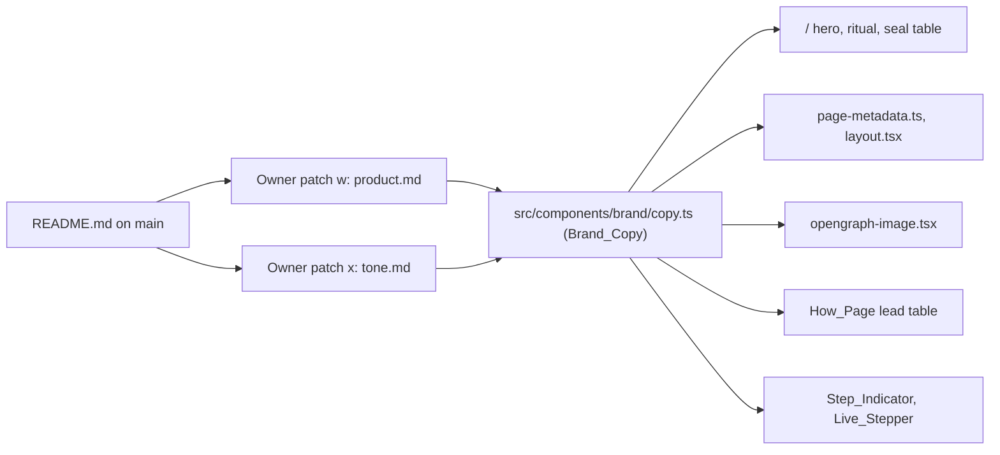
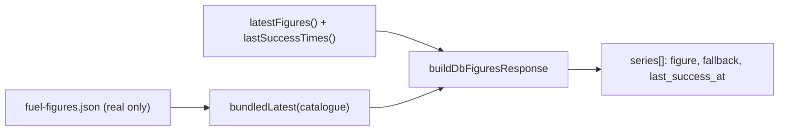
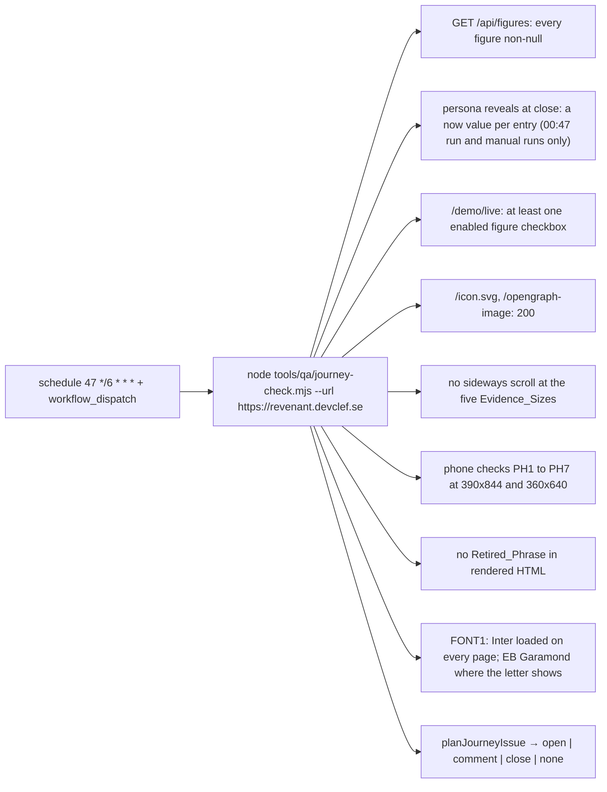
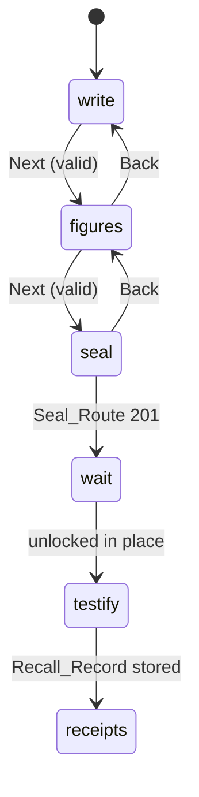

# Design Document

Spec: 09 Demo polish

## Overview

This design fixes production first (group A), then the first 30 seconds on `/` (group B), the persona payoff (group C), the live demo (group D) and the presentation files (group E). It is written against `origin/main` at `ea5232a` (spec 08 tasks all ticked, PR #247 merged). Every file, function and value named here was read on that commit. Where this design proposes a value, it says so; the owner can change it in the task's issue.

### Production findings and their causes on `main`

| Finding | Cause on `main` | Fix |
|---|---|---|
| F1 no now figure | `respond.ts` in db mode lists `figure: null` for a series with no stored row. The chart sets `figures.source: db`. The CronJob (`17 6 * * *`) has not stored a row: the Fetch_Job seeds `fuel-figures.json` into an empty table (spec 08 R20.12), so an empty table means no run got that far. Nothing runs on deploy. | Owner step O1 reads the failed Job's log. A1 serves a Fallback_Figure per series. A2 adds the Seed_Job. |
| F2 live picker | `FigurePicker` counts series with a figure from the same response, so the count is 0, and `figuresHint` fills `{max}` with 0. | A1 (data), A4 (copy and timing). |
| F3 "no longer published" | `FiguresThenNow.tsx` maps both `pickNow` reasons, `series_missing` and `no_figure`, to `nowUnavailableMissing`. | A3. |
| F4 favicon 404 | The Dockerfile runner stage copies `.next/standalone` and `.next/static` only; its comment says to add `public/` "when one is introduced". `public/icon.svg` now exists. | A5. |
| F5 no "Your answer" | `FigureEntry.tsx` renders only the comparable branch. The not-comparable and unavailable branches in `FiguresThenNow.tsx` render no answer line. | A7. |
| F6 no production check | `.github/workflows/` holds `build.yml`, `ci.yml`, `pr-policy.yml`, `spec-sync.yml` only. Spec 08 Owner patches i and j were never committed. | A6, Owner patches n and o. |
| F9 missing 2,500 | `tick-layout.ts` keeps ticks from both ends inward and drops any tick that comes within `TICK_GAP_PX` of a kept neighbour or the last tick, so the one before the last goes first. | A10, a stride rule. |
| F13 "3.9" | The live scale label formats the parsed number; the field shows the typed text. | A9.4, one `answerText` formatter. |
| F14 white 404 | No `src/app/not-found.tsx` or `src/app/error.tsx`. Only `/l/[id]` and the persona route have their own. | A14. |

### What else exists on `main` and what happens to it

| Area | This spec |
|---|---|
| `src/app/api/figures/db-response.ts`, `respond.ts`, `src/lib/figures/now.ts` (data-dev) | Fallback_Figure per series and the `fallback` field (A1). |
| `scripts/fetch-figures.ts`, `fetch-figures-store.ts` (data-dev) | `--wait-for-schema=<s>` and a Postgres advisory lock (A2.2, A2.5). |
| `scripts/fetch-figures-freshness.mjs` (data-dev) | Accepts `fallback` (A1.7). |
| `deploy/helm/revenant` 0.5.0, `Dockerfile` (platform-dev) | Seed_Job template, `public/` copy, chart 0.6.0 (A2, A5). |
| `src/components/reveal/FiguresThenNow.tsx`, `FigureEntry.tsx`, `copy.ts` | Three now messages, "Your answer" in every branch (A3, A7), then the Receipt_Card (C3). |
| `src/components/live/FigurePicker.tsx`, `copy.ts`, `SealPage.tsx`, `WriteForm.tsx` | Empty state and touched-only validation (A4), then the Live_Stepper (D2 to D7). |
| `src/components/ceremony/recall/*` | Stacking, accessible name, one answer format, even ticks (A8, A9, A10, A13), EU display unit (C8). |
| `src/components/ceremony/scene/*` | Ghost exit removal (A11), phone and wide hero (B1, B4). |
| `src/app/page.tsx` (platform-dev) | Composes the new landing sections (B). |
| `next.config.ts`, `.dockerignore`, `src/lib/kiro-stats.ts` (platform-dev) | Kiro_Stats at build time (B3.5). |
| `content/personas/personas.json`, `src/lib/personas/schema.ts` (frontend-dev) | Maya's Opening_Event, the `intro_line` field (C1). |
| `src/lib/figures/rescale.ts` (data-dev) | `displayRescaleForUnit` keyed on the sealed unit (C8). |

## Architecture

### F. Framing



- **Brand_Copy** (`src/components/brand/copy.ts`, frontend-dev, new folder; Owner patch s adds it to `structure.md`): a pure module with no React import, so `src/lib/page-metadata.ts` (platform-dev) and `opengraph-image.tsx` can import it.

  ```ts
  export const BRAND_COPY = {
    eyebrow: "The wax seal, resurrected.",
    tagline: "Memory rewrites itself. Revenant doesn't.",
    heroSentence: "...",                                    // OD18
    ritualSteps: [{ name: "Write", line: "..." }, /* 5 entries, README order */],
    sealMapping: [{ seal: "...", revenant: "..." }, /* 4 rows, README order */],
  } as const;
  ```

- **Consumers.** `LandingHero` (Eyebrow, Tagline, Hero_Sentence), `RitualSection` (`ritualSteps`), `ResurrectionSection` and the How_Page (`sealMapping`), `page-metadata.ts` (`HOME_DESCRIPTION = \`${eyebrow} ${tagline}\``), `layout.tsx` (the same constant), `opengraph-image.tsx`, `CEREMONY_COPY.steps` (Testify and See the receipts) and `LIVE_COPY.liveSteps` (Write, Seal the figures, Press the seal, Testify, See the receipts).
- **The headline.** `SCENE_COPY.headlineLead` and `headlineAccent` are removed. On `/` the `h1` is the Tagline with a non-breaking space in "Revenant doesn't." and no Accent span; the Eyebrow is a small uppercase `p` above it, in `--muted`. Under OD17 the persona page and `/demo` use `personaHeading` and `demoHeading`, and `/demo/live` uses `liveHeading`, in the same `SceneHeadline` component and position, so spec 07 R21.3 holds.
- **Open Graph image.** `opengraph-image.tsx` draws the Eyebrow (small, `--muted`), the Tagline (heavy, `--text`) and the original ghost, 1200×630. No text in the Accent. The `ASSETS.md` entry is updated to say so.
- **How_Page lead.** The page opens with "How the seal works" and the four `sealMapping` rows as a two-column table (part of the wax seal, Revenant), then its current sections in their current order.
- **Retired-phrase test** (`src/test/retired-phrases.test.ts`, platform-dev, task 9): reads every non-test `.ts`, `.tsx`, `.json`, `.txt` and `.md` file under `src/` and `content/personas/`, and fails on:
  - `/your past self returns with the receipts/i`;
  - `/rose[- ]tinted/i`;
  - `/\b(resurrect\w*|revive\w*|brings?\s+back|bring\w*\s+back)\b[^.!?]{0,60}\btime[- ]capsules?\b/i` and the same with the two parts swapped (`time capsule[^.!?]{0,40}\b(is|was)\s+(resurrected|revived|brought back)`).

  A sentence such as "A classroom time capsule works the same way." passes. Test data is excluded: `__fixtures__/` and `__recorded__/` folders (for example `src/lib/cards/qr/__fixtures__/vectors.json`, whose QR test vector encodes the retired tagline and must not change) and `ASSETS.md` history rows. On `ea5232a` the other matches are `src/components/ceremony/scene/copy.ts` and `SceneHeadline.tsx` (task 8 removes them) and `src/lib/page-metadata.ts` and `src/app/layout.tsx` (task 9 removes them), so the test passes once task 9 lands.
- **Tagline-source test** (`src/test/tagline-source.test.ts`, platform-dev, task 9): counts non-test source files under `src/` that contain `Memory rewrites itself. Revenant doesn't.` and fails unless the count is 1 and the file is `src/components/brand/copy.ts`.
- **Button lookup.** Task 14 adds `data-advance="figures"` to the button that moves to the figures. Owner patches n and q find it by that attribute, and by either label ("See the numbers" or "See the receipts") on builds without it, so the checks keep working across the rename.
- **Words the UI avoids (F1.3, F6.3).** Copy says "testify", "testimony", "the record" and "see the receipts". It never says "cross-examine", "caught", "wrong" or "you misremembered", even where the README does. The existing Scoring_Words tests already catch "wrong" in the Scene_Copy_Modules; task 9's retired-phrase test adds "cross-examine", "caught" and "misremember" for every copy module.


### L. Letters and type

#### Fonts (L1, task 7)

`next/font/local` names each family after its const and sets the CSS variable through a class on `<html>`. `globals.css` on `main` also sets `--font-serif` and `--font-sans` in `:root`; equal specificity and later order make the `:root` values win, and they name "EB Garamond" and "Inter", which no `@font-face` defines. The fix:

```ts
// src/app/layout.tsx (platform-dev)
const ebGaramond = localFont({
  src: [/* unchanged files */],
  variable: "--font-serif",
  display: "swap",
  fallback: ["Georgia", "Times New Roman", "serif"],
});
const inter = localFont({
  src: [/* unchanged files */],
  variable: "--font-sans",
  display: "swap",
  fallback: ["system-ui", "-apple-system", "Segoe UI", "Roboto", "sans-serif"],
});
// <html className={`${ebGaramond.variable} ${inter.variable}`}>
```

`globals.css` drops both `:root` lines and keeps `body { font-family: var(--font-sans); }`. The browser check reads the first family of the computed `--font-sans` and `--font-serif` on `<html>`, then requires the sans family's `FontFace` loaded and `getComputedStyle(body).fontFamily` starting with it on every page, and, only where the Letter_Text is shown, the serif family's `FontFace` loaded and the Letter_Text's `font-family` starting with it.

#### Type scale (L2)

| Use | Family | Weight | Size | Letter-spacing |
|---|---|---|---|---|
| `h1` (Scene headline) | Inter | 900 | the B4 and P3 clamps | −0.02em |
| `h2` (Stage headings, `/demo` heading) | Inter | 800 | `clamp(1.5rem, 3.2vw, 2.25rem)` | −0.015em |
| `h3`, question titles, persona names | Inter | 750 | `clamp(1.15rem, 2vw, 1.4rem)` | −0.01em |
| Buttons | Inter | 700 | 1rem | 0 |
| Body and UI | Inter | 400 and 500 | 1rem to 1.0625rem | 0 |
| Caption_Block, envelope text | Inter | 500 | 0.875rem minimum (14 px) | 0.01em |
| Letter_Text | EB Garamond | 400 | `clamp(1.05rem, 1.6vw, 1.25rem)`, `line-height: 1.6` | 0 |

The serif appears only in `src/components/ceremony/letter/LetterBlock.module.css` (the Letter_Text rule). The Open Graph image draws with Inter only.

#### Palette (L3)

The spec 07 Scene tokens stay: `--bg #0b0912`, `--text #f5f3ff`, `--muted #bdb4dc`, `--purple #8F46FF` (light only), `--on-purple #ffffff`, `--accent #ff7b1c`, `--on-accent #1a0c00`, `--paper #f6ead4`, `--ink #1f1b16`, `--ink-soft`. Retired_Tokens move as follows:

| Retired | Replaced by |
|---|---|
| `--desk-lit`, `--desk-lit-max` | `--bg` |
| `--desk-ink`, `--desk-ink-soft` | `--text`, `--muted` |
| `--seal` (dark red) | `--accent`, and only inside the WaxSeal |
| `--gold-leaf`, `--gold-text` | nothing: gold borders are removed; a hairline that must stay uses `--muted` at 30% opacity |
| `--ink-faded` | `--ink-soft` (text) or nothing (decoration) |
| `ParchmentSurface` | the Scene surface (on the dark) or the paper (letter only) |

The contrast test keeps every remaining pair, adds Caption_Block text (`--text` and `--muted` on `--bg`), envelope text on `--paper`, and drops the retired pairs.

#### One WaxSeal (L4, task 11)

`src/components/ui/WaxSeal.tsx` becomes the only seal drawing (it absorbs `ceremony/envelope/WaxSeal.tsx`): inline SVG, `--accent` wax with an irregular edge, the pressed ghost in a darker shade of the same orange, a fixed viewBox, and a `size` prop only. Users: the `/demo` envelopes (task 11), the persona Envelope's flap (task 11), the press-and-hold Stage and the Seal_Break, which draw their cracks over the same drawing (task 17). The Open Graph image shows no seal. The Envelope_Front loses its postmark circle; its dates stay (spec 07 R8.7).

#### The `/demo` envelopes (L5, task 11)

```
┌───────────────────────────┐   ┌───────────────────────────┐
│ ╲                       ╱ │   │ ╲                       ╱ │
│   ╲        (WaxSeal)  ╱   │   │   ╲        (WaxSeal)  ╱   │
│     ╲_______________╱     │   │     ╲_______________╱     │
│ Maya · United States      │   │ Tomás · European Union    │
│ Written as of 12 May 2024 │   │ Written as of 12 May 2024 │
│ Opens 5 November 2024 ·   │   │ Opens 9 June 2024 ·       │
│ U.S. election day         │   │ European Parliament       │
│                           │   │ election                  │
│ [ Open Maya's letter ]    │   │ [ Open Tomás's letter ]   │
└───────────────────────────┘   └───────────────────────────┘
```

- Text from the Persona_List only: display name, region, `written_as_of`, `opens_at`, and `opening_event.name` when present (`demoOpensEvent`: "Opens {date} · {event}"; `demoOpens`: "Opens {date}" otherwise). No sealed date (OD20). The event's source link is in the Persona_Intro, one tap away.
- One `<a href="/demo/personas/{key}">` per envelope wraps the drawing and the text; the orange "button" inside it is a styled `span`, not a nested interactive element. The link's accessible name is "Open {name}'s letter".
- Grid: `grid-template-columns: repeat(auto-fill, minmax(17rem, 22rem))`, `justify-content: start`, aligned to the heading's left edge; one column below 600 px.
- The envelope is the persona page's drawing at card size, flap side up, with the torn bottom edge and dirt as on the persona page (spec 07 R10.1) and the same size for every persona.

#### The paper and the Caption_Block (L6, task 18)

```
  Read                                     ← Step_Indicator
  What was written then                    ← h2 (Caption_Block)
  Maya is fictional. This letter was written as of 12 May 2024.
  Sealed for this demo on 6 November 2026.
  The seal is intact. This is exactly the text that was sealed. ▸ Show the fingerprint
░░░░░░░░░░ lit band (≤ 80 px on the phone) ░░░░░░░░░░
┌──────────────────────────────────────────┐
│ Dear me,                                  │  ← paper: the Letter_Text only
│ ─────────── crease at 1/3 ───────────     │
│ …                                         │
│ ─────────── crease at 2/3 ───────────     │
│ Maya                                      │
└──────────────────────────────────────────┘
```

- `LetterBlock` renders the Caption_Block (a `header` on the dark) and then the paper (`article`), whose only child is the Letter_Text `p` with `white-space: pre-wrap`. `SealedLetter` passes the disclosure and verdict into the caption slot instead of rendering them inside the paper.
- The paper is `--paper`, radius 6 px, no border, `box-shadow: 0 -2px 0 rgba(143, 70, 255, 0.55)` on its top edge only.

#### The Light_Shaft (L7, OD19, task 18)

- `SceneBackdrop` already draws the purple light centred on the Soil. In `letter`, `figures` and `close`, a second layer `.letterShaft` (a `linear-gradient(to bottom, transparent, rgba(143, 70, 255, 0.35) 70%, transparent)` clipped to a wedge by a static `clip-path`) sits behind the paper. At the unfold it moves from the Soil (`translateY` to the paper's top) and fades in, by `transform` and `opacity` only, in `LETTER_SHAFT_MS` (600). Under Calm or reduced motion it is static at its end position from the first frame.
- The shaft ends at the paper's top edge: the paper is above it in stacking order, so no gradient sits over the text. Above the paper the lit band is at most `LIT_BAND_PHONE_PX` (80) tall below 600 px.
- The receipts column has no shaft and no glow.

#### Creases (L8, task 18)

Two `aria-hidden` `span`s inside the paper at `top: 33.333%` and `top: 66.667%`, `left: 0; right: 0`, each a 1 px line of `rgba(31, 27, 22, 0.08)` with a 1 px `rgba(255, 255, 255, 0.35)` line under it. The contrast composite test checks `--ink` over the darker line (about 13:1, far above 4.5:1).

#### Guards (task 19)

- `src/test/retired-tokens.test.ts`: fails on `--desk-[a-z-]+`, `--gold-leaf`, `--gold-text`, `--seal(?![\w-])` (so the real tokens `--seal-hit-min`, `--seal-split-ms`, `--seal-settle-ms`, `--seal-wax` and `--seal-rim` in `HeldSeal.module.css` and `SealBreak.module.css` don't match), `--ink-faded` and any import of `ParchmentSurface`, in `.css`, `.ts` and `.tsx` files under `src/`, test files excluded.
- `src/test/serif-scope.test.ts`: fails on `var(--font-serif)`, or a `font-family` naming EB Garamond, Georgia or `serif`, in any `.css` file under `src/` except `src/components/ceremony/letter/LetterBlock.module.css`.

### A1. Fallback_Figure in the Figures_API



- `buildDbFiguresResponse(store, catalogue, generatedAt, bundled)` gains a fourth argument: a map from metric ID to that series' latest bundled figure, built once at module load from `src/lib/figures/real/fuel-figures.json` through `loadFigureFile(realFigures, CATALOGUE)`. It never reads `DEMO_FIGURES` or the US fuel fixture. A test asserts no Fallback_Figure has a `source` or `series_id` starting with `FIXTURE`.
- For each Catalogue series: a stored figure wins (`fallback: false`). Otherwise the bundled figure is used unchanged (`fallback: true`). Otherwise `figure: null, fallback: false`.
- `last_success_at` comes only from `figure_fetch_runs`, as today. A Fallback_Figure never sets it (A1.4).
- File mode sets `fallback: false` on every entry. File mode is the Fallback_Refresh backend, whose bundle is refreshed by its own runs; marking those as fallbacks would put the Fallback_Note on every figure.
- A failed database read still answers 500 with `{ "error": "figures_unavailable" }` (A1.5).
- Schema in `now.ts`:

  ```ts
  series: z.array(z.strictObject({
    metric: metricDefinitionV1Schema,
    period_type: z.enum(["weekly", "monthly"]),
    last_success_at: z.string().nullable(),
    figure: figureV1Schema.nullable(),
    fallback: z.boolean().optional(),   // absent = false (A1.6)
  }))
  ```

  `format` stays `revenant-figures-v1`, because the change only adds a field. `pickNow` gains a third success field, `fallback: boolean`, from the entry.
- `scripts/fetch-figures-freshness.mjs` checks the shape it reads. Its shape check accepts the optional boolean and ignores it in `classifyFreshness` (A1.7).

### A2. The Seed_Job

```yaml
# templates/job-fetch-figures-seed.yaml (platform-dev), rendered when
# fetchFigures.enabled and fetchFigures.seedOnDeploy are both true.
apiVersion: batch/v1
kind: Job
metadata:
  name: {{ fullname }}-fetch-seed-r{{ .Release.Revision }}
spec:
  backoffLimit: 0
  activeDeadlineSeconds: {{ .Values.fetchFigures.activeDeadlineSeconds }}
  template:
    spec:
      restartPolicy: Never
      containers:
        - name: fetch-figures-seed
          command: ["node", "scripts/fetch-figures.mjs", "--wait-for-schema={{ .Values.fetchFigures.seedWaitForSchemaSeconds }}"]
          # env, envFrom, securityContext and resources exactly as the CronJob
```

- **Why not a Helm hook (OD9).** `deploy.md` keeps migrations out of Helm hooks because hooks fit poorly with Fleet, and a failed `post-upgrade` hook marks the release failed. A plain Job is applied with the rest of the release, and nothing waits on it, so the web rollout is never blocked (A2.3).
- **One Job per revision.** Each upgrade changes the Job's name, so Helm creates the new Job and deletes the previous one, which is no longer in the manifest. A failed Job and its pod logs stay until the next upgrade (A2.4). There is no `ttlSecondsAfterFinished`, so Fleet never sees a resource vanish on its own.
- **If Fleet reports the bundle as Modified** because of the seed Job (usually from fields Kubernetes adds to a Job, such as its selector, labels and status), the owner adds a compare patch to the GitOps `fleet.yaml`. Fleet matches Jobs by a name regular expression ([Fleet docs](https://fleet.rancher.io/how-tos-for-users/bundle-diffs)), so one entry covers every revision:

  ```yaml
  diff:
    comparePatches:
      - apiVersion: batch/v1
        kind: Job
        namespace: <namespace>
        name: '<release>-fetch-seed-.*'
        operations:
          - {"op": "remove", "path": "/status"}
          - {"op": "remove", "path": "/spec/selector"}
          - {"op": "remove", "path": "/spec/template/metadata/labels"}
  ```

  `fleet bundlediff --fleet-yaml --bundle-deployment <name> -n <ns>` prints the exact operations. The chart has no name override: with a fixed Job name, the next upgrade that changes the pod template would fail, because Kubernetes doesn't allow changing an existing Job's template, and that error would block the whole rollout, which A2.3 forbids.
- **Waiting for migrations.** The web pod's `migrate` init container applies migrations. The Seed_Job must not run them too (`deploy.md`: migrations never run concurrently). `--wait-for-schema=<s>` makes the Fetch_Job poll `select to_regclass('public.figures') is not null and to_regclass('public.figure_fetch_runs') is not null` every 5 s for up to `s` seconds (default 600) before it starts. It also retries the first connection on the same schedule, because Postgres may still be starting on first install. On timeout it logs `fetch-figures failed: schema` and exits 1.
- **Overlap with the CronJob (A2.5).** The Fetch_Job takes `pg_try_advisory_lock(hashtext('revenant-fetch-figures'))` on its connection before any read. If it doesn't get the lock it logs `fetch-figures skipped: another run in progress` and exits 0. The lock is released when the connection ends. Without it, two runs could each insert the same new figure with different `retrieved_at` values, which breaks spec 08 R20.4.
- **Values (chart 0.6.0):**

  ```yaml
  fetchFigures:
    # -- Run the Fetch_Job once per Helm release revision, right after install or upgrade.
    seedOnDeploy: true
    # -- Seconds the seed run waits for the figures tables before it gives up.
    seedWaitForSchemaSeconds: 600
  ```

  `NOTES.txt` gains the command to read the seed log. No new environment variable, so `.env.example` is unchanged.

### A3. Now-figure messages

| `pickNow` result | Message | Number_Line | Change |
|---|---|---|---|
| `found`, `fallback: false` | none | yes if Comparable | yes if Comparable |
| `found`, `fallback: true` | Fallback_Note next to the now row | yes if Comparable | yes if Comparable |
| `series_missing` | Retired_Series_Message | no | no |
| `no_figure` | Not_Yet_Message | no | no |
| request failed or bad body | `nowUnavailableFetch` (unchanged) | no | no |

One pure function, `nowMessageFor(result)` in `src/components/reveal/now-message.ts`, returns the copy key; `FiguresThenNow.tsx` and the Seal_Page picker both use it.

### A4. Picker empty state and validation timing

- `src/components/live/figure-hint.ts` (pure): `pickerHint(max: number): { key: "none" } | { key: "one" } | { key: "many"; max }`, where `max = min(MAX_FIGURES, sealableCount)`. The picker renders `figuresNoneAvailable` with a `/demo` link for `none`, and no range line. The "too many" message uses `figuresTooManyOne` or `figuresTooMany`.
- `src/components/live/touched.ts` (pure): a field's message shows when `touched[field] || attempted`. `touched` is set on `change` and `blur`; `attempted` is set when the judge presses "Create your passkey", "Seal with a backup key instead" or the stepper's Next (D2). The same rule covers the letter field, the figure picker and the date field on `/seal`.

### A5. `public/` in the image

```dockerfile
COPY --from=builder --chown=1001:1001 /app/public ./public
```

The standalone server serves `public/` from `./public` next to `server.js`. The stale comment about `public/` is removed. `src/test/dockerfile-public.test.ts` reads the Dockerfile, takes the lines after `FROM base AS runner`, and fails unless one copies `/app/public` to `./public`. The CI smoke step change is Owner patch p.

### A6. The Journey_Check



- **Owner-only.** The workflow and the script are `.github/**` and `tools/**`, so they are Owner patch n, drafted in this design and committed by the owner now. No task attaches them.
- **Browser.** `playwright-core` 1.64.0-alpha-1790635538000 is already a pinned devDependency (spec 07 R26.2). The workflow runs `npm ci` and uses the runner's Chrome at `/usr/bin/google-chrome`.
- **The persona reveal step (J2).** For each of `us-maya` and `eu-tomas`: open the page, wait for `[data-ceremony="intact"]`, press "Pick up the letter", press each question's "No answer" control, submit, press "Break the seal", press the figures button, wait for `[data-ceremony="close"]`. Every `[data-figure-entry]` must contain `[data-role="now"]` and a retrieved date. Each run stores two encrypted Recall_Records of "no answer" in `openings`. OD8 limits J2 to the 00:47 UTC run and manual runs (about 170 rows by 29 January 2027).
- **Issue handling.** One open issue with label `journey:failure`, title "Journey check: failure", assigned to `devclef`. A failing run with an issue open adds a comment. A passing run with an issue open adds "All checks passed. Run at {UTC}." and closes it. Each comment lists `<check>: <size or page> <measured> threshold=<…>`.
- **Permissions.** `permissions: { contents: read, issues: write }`. No secret is read.
- **Exit.** 1 on any failed check, 0 otherwise, after the issue step.
- **First run.** The owner runs it by hand before tasks 1 to 3 deploy. It should fail on J1, J2, J3 and J4 (A6.8). That run is the proof the check sees F1, F2 and F4.

### A8. Controls that fit

- Button labels wrap: `.button { white-space: normal; min-width: 0; max-width: 100%; text-align: center; }` in the shared button styles of `src/components/ui/` and the Recall_Pager module. Fixed `width` and `white-space: nowrap` are removed from "Record my answers" and "Next question".
- Below `RECALL_STACK_BELOW_PX` (640) the recall field and its control stack in one column at full card width (`flex-direction: column; align-items: stretch`). At or above it they share a row with `flex-wrap: wrap`, so a long label drops under the field rather than overflow.
- The marks card and recall `fieldset` get `min-width: 0` (a `fieldset` defaults to `min-inline-size: min-content`, which is what let the label push past the border).

### A9. Marks card and one answer format

- `RecordedScale.tsx` gains a visible `<p class="scaleName">` with the metric's display name above each scale. Scales stack with `gap: MARKS_SCALE_GAP_PX` (32). The answer label sits above the track, inside the scale's own box, so it can't fall onto the next scale's ticks.
- `src/components/ceremony/recall/answer-text.ts` (pure): `answerText(value: string, region: string): string`. It takes the canonical Recall_Record string, groups the integer digits with commas (`en-US` and `en-IE` both group with commas and use a point), and copies the fraction digits as they are. "3.90" stays "3.90", "1585.70" becomes "1,585.70". It never goes through `Number`. The field's parsed-value line, the live scale label, the marks card, the Receipt_Card and the Number_Line label all call it. A source-scan test fails if any of those files formats an answer another way.

### A10. Even ticks

```ts
// tick-layout.ts
export function visibleTicks(range, trackPx, labelPx): VisibleTick[] {
  const n = range.ticks.length;
  for (const k of divisorsAscending(n - 1)) {          // 1, then each divisor of n-1, ending with n-1
    const kept = range.ticks.filter((_, i) => i % k === 0);
    if (fits(kept, trackPx, labelPx, TICK_GAP_PX)) return place(kept);
  }
  return place([range.ticks[0], range.ticks[n - 1]]);   // k = n-1 always keeps both ends
}
```

For seven EUR ticks (0 to 3,000 by 500), the divisors of 6 are 1, 2, 3 and 6, so a narrow track shows 0, 1,000, 2,000, 3,000 (k = 2). For six USD ticks (0 to 10 by 2), the divisors of 5 are 1 and 5. The anchors stay as today: first at its start, last at its end, the rest centred.

### A11. The Ghost leaves

The design picks "leaves with a defined exit". In a two-column reveal at or above 1,200 px, the right column holds the letter and the Receipt_Cards, so a Ghost that stays has no place.

- The exit uses the existing Ghost-leaving constants (spec 07 R12.6, R18.4): up and fade to opacity 0. During it the Ghost layer has `z-index: var(--z-ghost-exit)` (above `.stagePanel`, below the Top_Bar).
- On `animationend`, or at once under Calm_Mode, Skip or the Skip_Link, `PersonaGhost` sets `gone` and renders `null`. A fallback timer at exit duration + 100 ms sets `gone` too, so a missed `animationend` can't leave the Ghost behind.
- The Ghost layer is not rendered at all in `letter`, `figures` and `close` on a fresh render (for example after the Skip_Link).

### A12. Focus on headings

```css
/* ceremony.module.css and the shared heading class */
:where([tabindex="-1"]):focus:not(:focus-visible) { outline: none; }
:where([tabindex="-1"]):focus-visible { outline: 3px solid var(--accent); outline-offset: 4px; }
```

Inside the Letter_Block the ring stays Text_On_Purple (spec 07 R3.15). `focus({ preventScroll: true })` from script after a pointer press doesn't match `:focus-visible` in current browsers, so no ring shows; a keyboard press does match. The focus moves of spec 08 R2 are unchanged.

### A13. The recall field's name

The question heading gets `id="recall-q{n}-text"`; the field gets `aria-labelledby="recall-q{n}-text"` and keeps its `aria-describedby` (unit, parsed value, message).

### A14. Branded_Pages

- `src/components/ui/BrandedPage.tsx` (server): Top_Bar (no persona notice, `controls="none"`), the Soil_Fallback strip, one `h1`, one line, a link to `/demo`, and the footer from the root layout.
- `src/app/not-found.tsx` renders it with the not-found copy. Next.js answers 404 for unmatched routes with this page.
- `src/app/error.tsx` (`"use client"`, required by Next.js) renders the same parts with the error copy and a "Try again" button that calls `reset()`. It never renders `error.message` or `error.digest`.

### B. The landing page

```
┌ Top_Bar ───────────────────────────────────────────────────────────┐
│ revenant  DEMO                                                     │
├────────────────────────────────────────────────────────────────────┤
│ THE WAX SEAL, RESURRECTED.                       (Eyebrow)         │
│ Memory rewrites itself.                                   (Ghost) │
│ Revenant doesn't.                                                  │
│ Hero_Sentence (two sentences)                                      │
│ [ Open the demo letters ]  about two minutes ·                     │
│                            no sign-up, no passkey                  │
│ ( Seal your own. It opens 30 seconds after you seal it. )          │
├──────────────────────── Soil ──────────────────────────────────────┤
│ The ritual: 5 cards                                                │
│ What we resurrected: 4 sentences + the seal table                  │
│ A receipt from the record: one real figure (client)                │
│ Built by a coven of Kiro agents: Kiro_Stats + 2 links              │
│ footer                                                             │
└────────────────────────────────────────────────────────────────────┘
```

- **Ownership.** `src/app/page.tsx` stays platform-dev. The sections are frontend-dev components in a new folder `src/components/landing/` with their own `copy.ts` and `landing.module.css`. `structure.md` gains the folder (Owner patch s).
- **One Accent button, to `/demo`.** The primary call to action is the only Accent button. It links to `/demo` with `primaryCtaOne` or `primaryCtaMany` by Persona_List length (spec 08 R10.3) and names no persona, so neither region comes first (B2.1, OD4 closed). With an empty Persona_List it isn't rendered. The secondary call to action is an outlined button in `--text` on `--bg`. The old below-the-fold `/demo` link goes, because the button replaces it.
- **The second click.** The Demo_Index already lists each persona's name, region and dates (spec 07 R16.2). Task 8 checks that every card's open link is inside the first viewport at the Desktop_Sizes and the Wide_Size (B2.4), and tightens the `/demo` intro spacing if it isn't.
- **Phone (B1.5, P1 to P3, P11).** See "Group P. Phone first" below.
- **Wide (B4).** A `@media (min-width: 1920px)` rule scales the headline with `vw` up to a cap, and centres the Hero block in the first viewport (`min-height: calc(100svh - var(--topbar-clear))`, `align-content: center`). The task measures the headline size S at 1366×800 and sets the rule so the size at 2560×1440 is at least 1.5 S; it states both numbers in the PR.
- **Sample_Receipt (B3.4).** A small client component. After hydration it fetches `/api/figures` once (`cache: "default"`, 30 s abort), parses with `parseFiguresResponse`, and shows the first series in the response. It formats with the spec 08 period and number modules. The server HTML holds only its heading and a reserved box, so the headline stays the LCP element. No change, no arrow, no second figure.
- **Kiro_Stats (B3.5).** `src/lib/kiro-stats.ts` (platform-dev) exports `countKiroStats(root: string): KiroStats` (`{ specs, steering, agents, hooks }`, each `number | null`), counting directories in `.kiro/specs` that hold a `requirements.md`, `*.md` in `.kiro/steering`, `*.json` in `.kiro/agents`, and `*.json` in `.kiro/hooks`. `next.config.ts` calls it at build time and sets `env: { REVENANT_KIRO_STATS: JSON.stringify(stats) }`, which Next.js inlines. `page.tsx` parses it with `parseKiroStats` and passes the numbers to `CovenStrip`. The Docker build context excludes `.kiro/`, so `.dockerignore` re-includes `!.kiro/specs`, `!.kiro/steering`, `!.kiro/agents` and `!.kiro/hooks`; they reach the builder stage only, never the runner. A `src/test` test fails if any count is null in a CI build.
- **Historical claims (B3.3).** The README says "Around 18,000 have been deposited". The task links that number and "since 1735" to an Académie des sciences page that states them, or leaves them out. No number goes on the site without a source.

### C1 and C2. Persona_Intro and Step_Indicator

- Persona_List gains `intro_line` (string, 1 to 160 characters, no digit, checked against the spec 03 R1.10 term list) for each persona. `us-maya` gains `opening_event` in the `eu-tomas` shape. The task finds the official page for 5 November 2024 (for example a Federal Election Commission or USA.gov page), checks that it states the date, and quotes that text in the PR. It does not guess a URL.
- `src/components/ceremony/intro/PersonaIntro.tsx` (server-safe). Shown in `emerging`, `sealed` and `intact`, inside the Content_Column above the status line. Its question count is `persona.metrics.length` from the Persona_List, not the payload (spec 07 R2.8).
- `src/components/ui/StepIndicator.tsx`: `({ steps: string[]; current: number | null; label: string })`, an `<ol>` with `aria-current="step"`. The current step is bold `--text` with a 2 px underline in `--text`; the others are `--muted`. It doesn't use the Accent.
- `src/components/ceremony/steps.ts` (pure): `personaStepFor(stage): 0 | 1 | 2 | 3 | null` per C2.2. `CeremonyRoot` announces `Step {n} of 4: {label}` in its existing polite live region in place of the Stage name, once per change.
- Placement: top of the Content_Column while the Ghost is shown; top of the Reveal after it leaves. It is `position: sticky; top: var(--topbar-clear)` at the Desktop_Sizes and the Wide_Size. Below 600 px it is one 120 px row under the Compact_Top_Bar with the Compact_Ghost at its right end, sticky at `top: 56px` (see "Group P. Phone first"), and the Stage content starts directly under it so each Stage's primary control stays in the First_Viewport (P4.1).

### C3. The Receipt_Card

```
┌ US REGULAR GASOLINE · U.S. city average ───────────┐
│ Your answer   3.90 USD per gallon        (Accent)  │
│ Then          3.611 USD per gallon · 6 May 2024 ·  │
│               historical record, retrieved …       │
│ Now           3.105 USD per gallon · 2 Nov 2026 ·  │
│               retrieved …                          │
│ ───────●────────◆────────○───────  Number_Line     │
│ −14% · 6 May 2024 to 2 Nov 2026  (formula)         │
│ Source ▸                                           │
└────────────────────────────────────────────────────┘
```

- `src/components/reveal/ReceiptCard.tsx` is the card shell, used by every branch: Comparable (`FigureEntry`), not Comparable, and the three A3 messages. The non-comparable branches render the same rows with the now row replaced by its message and no Number_Line or change line.
- The Number_Line's answer label shows `answerText(...) unit` only. "Your answer" appears once per card, in the row.
- Marks card: in `figures` and `close`, `RememberedAnswers` renders as `<details>` with `<summary>` "Your testimony" and its scales inside, closed. Its content stays in the document.
- Layout: the spec 08 R3.1 breakpoint (1,200 px) still places the cards beside the letter. The cards' column gets `align-self: start` and the letter column `max-height` is not set, so the first card starts at the Figures_Heading.
- The rise-and-fall mirror property (spec 07 R20.2, spec 08 Property 6) is extended to `ReceiptCard`.

### C4. The climax controls

- `marks` with no running sequence: the instruction line ("Press and hold the seal."), the pressable seal, the "Break the seal" button and the Skip_Link. Nothing else in the Content_Column.
- The Skip_Link is `<button class="textLink">` (a button, because it sends an event), styled as underlined `--muted` text, below "Break the seal". It calls the existing `flow.showAll`.
- `SoundToggle` moves from `Reveal.tsx` into `TopBar.tsx` (`controls="calm"`), between Calm and Skip, using `styles.control`. The sound context provider moves up to `SceneShell` so the seal still reads it.

### C5. The seal at the Ghost

At the Desktop_Sizes and the Wide_Size in `marks` and `seal`, the instruction line is positioned beside the held Envelope (absolute, inside the Ghost layer's box, left of the Envelope, `max-width: 14rem`, `--text` on the dark background). The Content_Column holds "Break the seal" and the Skip_Link only. The Content_Column's own seal drawing, if any, is removed at these sizes.

### C6 and C7. Disclosure, verdict and close

- Envelope_Front: "Written as of {date}" and "Opens {date}" only (OD5).
- `SealedLetter.tsx`: the `letterDisclosure` line and the `sealedForThisDemo` line in place of `demoNote` and `sealedForDemoOn`, for Persona_Letters only. Task 17 makes the copy change; task 18 moves both lines into the Caption_Block. Live_Letters keep "Sealed on {date and time}" (spec 06 R18.2).
- `Fingerprint.tsx` for Persona_Letters: the `sealVerdict` sentence, then `<details>` with `<summary>` "Show the fingerprint", holding the 16 groups, "demo letter", and a link "How the seal is checked" to `/how-it-is-sealed`. Live_Letter and Real_Letter paths unchanged.
- Close line: `closeLine` changes (see "Copy").

### C8. EU display unit (option b)

- `src/lib/figures/rescale.ts` (data-dev) gains:

  ```ts
  export type UnitDisplay = { displayUnit: string; divisor: number; note: string };
  const UNIT_DISPLAY: Readonly<Record<string, UnitDisplay>> = {
    "EUR per 1,000 litres": { displayUnit: "EUR per litre", divisor: 1000, note: "Published per 1,000 litres, shown per litre." },
  };
  export function displayRescaleForUnit(unit: string): UnitDisplay | null; // exact, case- and whitespace-sensitive key
  ```

  It reads only the unit string, so it works whatever the Catalogue holds (C8.2). The values go through the existing `rescaleForDisplay`, which moves the decimal point exactly.
- Frontend: the recall field's unit, the Recall_Scale range lookup, the marks card, the Receipt_Card values, the Number_Line and the formula all use the display unit and rescaled values. The Recall_Scale looks up `EUR per litre` in the Unit_Range_Table (0 to 3, ticks 0, 0.5, … 3). The typed answer is stored as typed. The percentage change is computed by `src/lib/figures` from the published values, which gives the same percentage. The note sits under each displayed figure value.
- Existing `eu-tomas` openings stored per 1,000 litres are not read by any page, so nothing changes for them (OD3).

### D. The Live_Stepper



- `src/components/live/stepper/live-steps.ts` (pure): step order, `canGoBack(step, sealed)` (false from `wait` on), `next(step, validity)`. The drafts live in the existing `write-draft.ts` state, which the stepper keeps mounted across steps, so Back keeps them (D2.2).
- After the Seal_Route returns 201, the draft text is dropped from state and no step renders it (D2.3, spec 06 R16.3).
- `seal` step: passkey explanation, warning (OD6 a: one sentence and the checkbox), the Create_Press and Confirm_Press controls from `seal-machine.ts`, unchanged in order and in the "first asynchronous operation" rule. When the PRF_Hint reports `false`, "Seal with a backup key instead" is shown first (D6).
- `wait` step: the countdown from `clock.ts`. At zero it calls the letter route once (spec 06 R17.4). When `openable`, it mounts `OpeningFlow` for the sealed letter ID in place: the unlock control, or the key field on the backup path. The "Go to your letter" link stays below.
- `testify` and `receipts` are the Opening_Flow's recall and reveal views; the Step_Indicator maps the Opening_Flow Stages to steps 5 and 6.
- D1 (cuttable): the stepper renders inside `SceneShell`. On 201 the Ghost plays the existing rise in reverse (`ghostSink`, transform and opacity only), the Envelope with it. On unlock in place, the persona Emergence plays. Calm shows the settled pose.
- D3 (cuttable): three `promptStarters` buttons under the field. A press inserts the text at the field's selection with `setRangeText(text, start, end, "end")` and sends the same change event the field uses.

### Group P. Phone first

All values below apply while the viewport is narrower than `PHONE_BELOW_PX` (600), which covers both Phone_Sizes. Each task measures its pages at 390×844 and 360×640 with Owner patch q and quotes the PH lines; where a measured value disagrees with a value here, the measured value wins and the PR states both.

#### `/` on the phone (P1 to P3, P11)

```
360×640                                  px (approx.)
┌ Compact_Top_Bar: revenant DEMO  ◐ ♪ ┐   56
│ The wax seal, resurrected.          │  1 line × 20 = 20 (Eyebrow)
│ Memory rewrites                     │
│ itself. Revenant                    │  3 lines × 38 = 114
│ doesn't.                            │
│ Hero_Sentence                       │  4 lines × 22 = 88
│ [ Open the demo letters ]           │  48
│ About 2 minutes · no sign-up …      │  20
│ ( Seal your own. 30 seconds )       │  48
│          (Landing_Ghost)            │  ≤ 30% of 640 = 192 (OD12 c: about 160)
├──────────── Soil ───────────────────┤
gaps: 16 between blocks, 0 dead space
```

- Headline on `/`: `font-size: clamp(2rem, 9.4vw, 2.6rem)` below 600 px (about 34 px at 360, 37 px at 390), `line-height: 1.05`, `text-wrap: balance`, and a non-breaking space in "Revenant doesn't." (F3.3). The task confirms 3 lines at both sizes with PH3.
- The Landing_Ghost follows OD12 (c): below the calls to action, height `min(30svh, LANDING_GHOST_PHONE_MAX_PX)`, centred on the light, its box reserved in the server HTML (CLS 0, spec 08 R9.10). The light's centre moves with it. The Soil band sits directly under it.
- Every block in the hero column carries `data-block`, and the column uses `gap: 1rem` with no `min-height` filler, so PH2 can measure gaps.
- The below-the-fold sections start right after the Soil. The How_Page and GitHub links exist only in the footer (P11).

#### The Compact_Top_Bar (P5)

- Height 56 px: wordmark and Demo chip on the left; on the right, per OD13 (a), three 44×44 icon buttons in this order: motion (Calm), sound, Skip (only while a sequence runs). Each has `aria-label` and `title` from `CEREMONY_COPY` (`calmOn`/`calmOff`, `soundOn`/`soundOff`, `skip`), and `aria-pressed` for the two toggles.
- Icons are original inline SVG in `src/components/ceremony/scene/icons.tsx`, drawn in `currentColor` (`--text`), with `ASSETS.md` rows.
- The persona notice is not rendered in the Top_Bar below 600 px. `PersonaIntro` renders it as its first line instead (P5.3). At 600 px and wider, spec 07 R8.3 and R8.4 are unchanged.
- The Compact_Top_Bar applies on every page that uses the Top_Bar (`/`, `/demo`, persona pages, `/demo/live`, the How_Page, the Branded_Pages).

#### The persona page on the phone (P3, P4, P9, C9)

| Stage | First_Viewport (360×640) | Notes |
|---|---|---|
| `emerging`, `sealed`, `intact` | Compact_Top_Bar; headline on 2 lines; Persona_Intro (notice, intro line, dates, question count, time); Ghost with the Envelope beside the intro; status line; Pick_Up_Button | Headline `clamp(1.55rem, 7.2vw, 1.9rem)` below 600 px, `text-wrap: balance`. The Ghost here is at most 30% of the viewport height, to the right of the Persona_Intro, so P2 holds. |
| `recall` | Compact_Top_Bar; Step_Indicator row with the Compact_Ghost at its right; the question, the field, Next (stacked, A8.3) | Hero hidden. |
| `marks` | Step_Indicator row with the Compact_Ghost; the Answer_List; the instruction; "Break the seal"; the Skip_Link | The seal on the Compact_Ghost's Envelope is pressable through a 44×44 transparent target centred on it. |
| `letter` | Step_Indicator; Letter_Disclosure; start of the Letter_Text | "See the receipts" directly after the letter. |
| `figures`, `close` | Step_Indicator; Figures_Heading; first Receipt_Card | |

- **Hero collapse.** After the First_Step the `h1` stays in the document for the outline but is visually hidden (the standard visually-hidden class, not `display: none`). The change is an opacity fade in full motion and instant under Calm.
- **Compact_Ghost.** `transform: translate(...) scale(s)` with `s = COMPACT_GHOST_MAX_PX / ghostBoxHeight`, anchored to the right end of the Step_Indicator row (`position: sticky; top: 56px` row, height 120 px). The Soil strip fades out after the First_Step on the phone. All motion is `transform` and `opacity`; Calm shows the end state at once (P4.3).
- **Keyboard (P9).** `src/components/ui/use-keep-in-visual-viewport.ts`: given the field and its control, on `focus` and on `visualViewport` `resize` and `scroll`, it computes the union of their boxes and, if any part is outside `[vv.offsetTop + 56, vv.offsetTop + vv.height - 8]`, calls `window.scrollBy({ top: delta, behavior })` (`"auto"` under Calm). It does nothing when `visualViewport` is missing. `src/app/layout.tsx` (platform-dev, task 9) adds `export const viewport = { width: "device-width", initialScale: 1, interactiveWidget: "resizes-content" }`, which Chrome on Android honours; iOS Safari ignores it, which is why the hook exists.

#### Receipts and the reveal on the phone (P6, P7)

- Card rows below 600 px: `.valueLine` (value and unit, `white-space: nowrap`) then `.metaLine` (period · region · provenance label). If a value and unit can't fit on one line at 360 px, the value's font size steps down to the body-large size; the unit never wraps away from the value.
- The figures panel and every card use `display: flow-root`, no fixed `height` or `max-height`, and no negative margins on children, so their painted background contains their content (P6.3, PH5).
- The Number_Line is `NUMBER_LINE_PHONE_PX` (64) tall below 600 px; its labels keep the spec 08 placement function.
- The `marks` Stage below 600 px renders `AnswerList` (`<ul>`, one `<li>` per question: metric name, Answer_Text and unit, or "No answer") in place of `RecordedScale`. From `figures` on, nothing of the marks card renders on the phone (P6.4, OD15).
- Length budget at 390×844 (P7): letter Stage header about 120 px, two cards at about 330 px each, the Figures_Heading and gaps about 120 px, the close about 260 px: about 1,160 px plus the Letter_Text, against a limit of 2,532 px plus the Letter_Text. PH6 measures it.

#### Touch on the seal (P8)

```css
.sealTarget {
  touch-action: none;
  -webkit-touch-callout: none;
  -webkit-user-select: none;
  user-select: none;
}
```

- `pointerdown` calls `setPointerCapture`; `contextmenu` on the seal is prevented, so a long press shows no callout and the page doesn't scroll.
- Hold progress: 12 segments in a ring around the seal, in `--text`, each switching from opacity 0 to 1 at `k/12 × SEAL_HOLD_MS` (opacity only, spec 07 R21.4). Release before the end resets all segments and the cracks, and sends nothing.
- 44×44 targets: every `a`, `button`, `summary`, `input` and `[role=button]` on a touched page gets a clickable box of at least 44×44 below 600 px. Links inside running text get `padding-block` so their box is 44 px tall without moving the text. PH7 measures every one.

#### The live demo on the phone (P10)

- Each step is one screen: heading, fields, Back and Next. The letter textarea starts at `rows={5}` and grows with `field-sizing: content` where supported, else a small input handler sets its height from `scrollHeight`, up to `LETTER_FIELD_MAX_VH` (50) of the visual viewport. The keyboard hook applies to it.
- The Wait step shows its heading and the countdown first, then the keepsake links, so the countdown stays in the First_Viewport until the unlock control replaces it.
- `src/components/live/passkey-options.test.ts` (frontend-dev, next to the live code; G1.2 keeps frontend-dev out of `src/lib/crypto/`) reads the options `createPasskey`, `confirmPasskey` and `assertPasskey` pass to an Authenticator_Port fake and asserts no `authenticatorAttachment` and no `hints` (P10.4).

### Check hooks

The layout checks find elements by `data-*` attributes. Each attribute is added by the task that builds its element; until then the check prints a note.

| Attribute | Element | Check | Task |
|---|---|---|---|
| `data-card` | the recall card, the marks card, each `/demo/live` card | BC1 | 4 (21 for the stepper steps) |
| `data-stage-panel` | `StagePanel` | BC1 | 4 |
| `data-recorded-scale` | each `RecordedScale` root | RS1 | 5 |
| `data-ghost` | the Ghost's root | GZ1 | 6 |
| `data-block`, `data-soil`, `data-cta` | hero blocks, the Soil band, the calls to action | PH1, PH2, CTA1 | 8 (persona blocks: 13) |
| `data-compact` | the Top_Bar below 600 px | PH4, PH7 | 13 |
| `data-stage-content`, `data-primary-control` | the persona Stage wrapper; each Stage's primary control | PH1 | 13 (`intact`), 14 (`recall`), 16 (`letter`, `figures`), 17 (`marks`), 21 (live steps) |
| `data-step-indicator` | the Step_Indicator root | ST1 | 14 |
| `data-advance="figures"` | the button that moves to the figures | N1, FV1, RC1 | 14 |
| `data-figures-panel`, `data-letter-stage`, `data-close-line`, `data-letter-text` | the figures panel, the letter Stage root, the close's first line, the Letter_Text | PH5, PH6, FONT1 | 16 (until then FONT1 and W1 use W1's existing fallback for the Letter_Text) |

## Components and Interfaces

### File layout (new and changed)

| Path | Role | Task |
|---|---|---|
| `src/app/api/figures/db-response.ts`, `respond.ts` | data-dev | 1 |
| `src/lib/figures/now.ts`, `src/lib/figures/bundled-latest.ts` (new) | data-dev | 1 |
| `scripts/fetch-figures.ts`, `scripts/fetch-figures-store.ts`, `scripts/fetch-figures-freshness.mjs` | data-dev | 1 |
| `deploy/helm/revenant/templates/job-fetch-figures-seed.yaml` (new), `values.yaml`, `Chart.yaml`, `README.md`, `NOTES.txt`, `Dockerfile`, `src/test/seed-job.test.ts`, `src/test/dockerfile-public.test.ts` (new) | platform-dev | 2 |
| `src/components/reveal/now-message.ts` (new), `FiguresThenNow.tsx`, `copy.ts`; `src/components/live/figure-hint.ts`, `touched.ts` (new), `FigurePicker.tsx`, `WriteForm.tsx`, `SealPage.tsx`, `copy.ts` | frontend-dev | 3 |
| `src/components/ceremony/recall/RecallPager.tsx`, `RecallPager.module.css`, `src/components/ui/*` button styles, `ceremony.module.css` | frontend-dev | 4 |
| `src/components/ceremony/recall/RecordedScale.tsx`, `RecallScale.*`, `tick-layout.ts`, `answer-text.ts` (new) | frontend-dev | 5 |
| `src/components/ceremony/scene/PersonaGhost.tsx`, `scene.module.css`; `src/components/ui/BrandedPage.tsx` (new); `src/app/not-found.tsx`, `src/app/error.tsx` (new) | frontend-dev | 6 |
| `src/components/landing/*` (new), `src/components/ceremony/scene/scene.module.css`, `copy.ts` | frontend-dev | 8, 10 |
| `src/app/page.tsx`, `next.config.ts`, `.dockerignore`, `src/lib/kiro-stats.ts` (new) | platform-dev | 9, 11 |
| `content/personas/personas.json`, `src/lib/personas/schema.ts`, `src/components/ceremony/intro/*` (new), `src/components/ui/StepIndicator.tsx` (new), `src/components/ceremony/steps.ts` (new) | frontend-dev | 13, 14 |
| `src/lib/figures/rescale.ts` | data-dev | 15 |
| `src/components/ceremony/scene/icons.tsx` (new), `src/components/ui/use-keep-in-visual-viewport.ts` (new), `src/components/reveal/AnswerList.tsx` (new), `src/app/layout.tsx` (viewport export, platform-dev) | frontend-dev, platform-dev | 13, 14, 16; 9 |
| `src/components/reveal/ReceiptCard.tsx` (new), `FigureEntry.tsx`, `RememberedAnswers.tsx`, `ceremony/figures/NumberLine.tsx`, `ceremony/recall/unit-ranges.ts` | frontend-dev | 16 |
| `src/components/ceremony/scene/TopBar.tsx`, `SceneShell.tsx`, `src/components/reveal/Reveal.tsx`, `SealedLetter.tsx`, `Fingerprint.tsx`, `ceremony/envelope/*`, `ceremony/copy.ts` | frontend-dev | 13 (Compact_Top_Bar), 17 |
| `src/components/ceremony/seal/*`, `scene/PersonaGhost.tsx` | frontend-dev | 20 |
| `src/components/live/stepper/*` (new), `SealPage.tsx`, `FigurePicker.tsx`, `SealedView.tsx`, `copy.ts` | frontend-dev | 21, 22, 23 |
| `src/app/layout.tsx` (font consts), `src/app/globals.css` (font variables, heading family), `src/test/fonts.test.ts` (new) | platform-dev | 7 |
| `src/components/brand/copy.ts` (new), `src/app/opengraph-image.tsx`, `src/app/how-it-is-sealed/page.tsx`, `src/components/how/copy.ts` | frontend-dev | 8 |
| `src/lib/page-metadata.ts`, `src/test/retired-phrases.test.ts` (new), `src/test/tagline-source.test.ts` (new) | platform-dev | 9 |
| `src/components/ui/WaxSeal.tsx`, `src/components/ceremony/envelope/**`, `src/components/demo/**`, `src/app/demo/page.tsx`, the two persona and letter not-found pages | frontend-dev | 11 |
| `src/components/ceremony/letter/**`, `src/components/reveal/SealedLetter.tsx`, `StagePanel.tsx`, `FlowError.tsx`, `RecallStep.tsx`, `SealIntact.tsx`, `StillSealed.tsx`, `src/components/ui/ParchmentSurface.*` (deleted), `src/components/live/LetterCard.tsx`, `SealedKeepsakes.tsx` | frontend-dev | 18 |
| `src/app/globals.css` (retired token definitions), `src/test/retired-tokens.test.ts` (new), `src/test/serif-scope.test.ts` (new) | platform-dev | 19 |
| copy modules (audit) | frontend-dev | 24 |

## Data Models

### Figures_API entry (A1)

```ts
type FiguresSeriesEntry = {
  metric: MetricDefinitionV1;
  period_type: "weekly" | "monthly";
  last_success_at: string | null;  // unchanged: from figure_fetch_runs only
  figure: FigureV1 | null;         // stored latest, else Fallback_Figure, else null
  fallback: boolean;               // true only for a Fallback_Figure (db mode)
};
```

### Persona_List additions (C1)

```json
{
  "key": "us-maya",
  "intro_line": "<one everyday line, reviewed under neutrality.md>",
  "opening_event": {
    "name": "U.S. election day",
    "date": "2024-11-05",
    "source": "<official publisher>",
    "source_url": "https://<official page that states the date>"
  }
}
```

Neither field is sealed, so neither changes a letter ID (spec 03 R5.2). `intro_line` is required for every persona once task 13 lands.

### Kiro_Stats (B3.5)

```ts
type KiroStats = { specs: number | null; steering: number | null; agents: number | null; hooks: number | null };
```

On `ea5232a` the counts are specs 9 (10 with this spec), steering 8, agents 5, hooks 4. These are given only to sanity-check the code; the page shows what the build counts.

## Constants

In `src/components/ceremony/constants.ts` unless another module is named. `constants-css.test.ts` checks every value CSS repeats.

| Name | Value | Requirement |
|---|---|---|
| `RECALL_STACK_BELOW_PX` | 640 | A8.3 |
| `MARKS_SCALE_GAP_PX` | 32 | A9.3 |
| `GHOST_EXIT_FALLBACK_MS` | Ghost-leaving duration + 100 | A11.3 |
| `LANDING_WIDE_MIN_PX` | 1920 | B4 |
| `FLOW_MINUTES` | 2 (in `src/components/landing/constants.ts`, used by C1 too) | B1.7, C1.1 |
| `PERSONA_STEPS` | 4 | C2 |
| `LIVE_STEPS` | 6 (in `src/components/live/constants.ts`) | D2 |
| `PHONE_BELOW_PX` | 600 | Group P |
| `COMPACT_TOP_BAR_PX` | 56 | P5.1 |
| `COMPACT_GHOST_MAX_PX` | 120 | P4.2 |
| `LANDING_GHOST_PHONE_MAX_PX` | 190 (proposed; at most 30% of the viewport height) | P1.1, OD12 |
| `DEAD_SPACE_MAX_PX` | 64 | P2.1 |
| `TOUCH_TARGET_MIN_PX` | 44 | P8.4 |
| `NUMBER_LINE_PHONE_PX` | 64 | P7 |
| `HOLD_PROGRESS_SEGMENTS` | 12 | P8.2 |
| `LETTER_FIELD_ROWS` / `LETTER_FIELD_MAX_VH` | 5 / 50 (in `src/components/live/constants.ts`) | P10.3 |
| `LETTER_SHAFT_MS` | 600 | L7 |
| `LIT_BAND_PHONE_PX` | 80 | L7.3 |
| `SEED_WAIT_FOR_SCHEMA_S` | 600 (chart value `fetchFigures.seedWaitForSchemaSeconds`) | A2.2 |
| Unit_Range_Table `EUR per litre` | min 0, max 3, ticks 0, 0.5, 1, 1.5, 2, 2.5, 3 (in `unit-ranges.ts`) | C8.5 |

## Copy

Proposed strings. Each task asserts the strings it adds, exactly.

| Module | Key | String |
|---|---|---|
| `reveal/copy.ts` | `nowRetired` | "Revenant no longer publishes this series. The sealed figure is shown on its own." |
| | `nowNotYet` | "Revenant hasn't fetched a figure for this series yet. The sealed figure is shown on its own." |
| | `fallbackNote` | "Revenant hasn't fetched a newer figure yet. This one was retrieved {date}." |
| | `letterDisclosure` | "{name} is fictional. This letter was written as of {writtenAsOf}." |
| | `sealedForThisDemo` (replaces `sealedForDemoOn`) | "Sealed for this demo on {sealedAt}" |
| | `sealVerdict` | "The seal is intact. This is exactly the text that was sealed." |
| | `fingerprintShow` | "Show the fingerprint" |
| | `fingerprintHowLink` | "How the seal is checked" |
| | `stage1Title` | "Your testimony" (was "What you remembered") |
| | `stage2Next` | "See the receipts" (was "See the numbers") |
| | `stage3Title` | "The receipts" (was "The numbers, then and now"; the Figures_Heading) |
| | `recallIntro` | "This letter was written as of {date}. Before you read it, testify: say what you remember about that time." |
| | `recallIntroLive` | "Before you read it, testify: say what you remember." |
| | `skipToReceipts` | "Skip to the receipts" |
| | `marksSummary` | "Your testimony" |
| `ceremony/copy.ts` | `closeLine` (F5) | "Your testimony and the record, side by side. What the gap means is yours to decide." |
| | `recall` (replaces "Tell us how you remember it.") | "Testify. Say what you remember." |
| | `stepsLabel` | "Your progress" |
| | `steps` | "Testify", "Break the seal", "Read", "See the receipts" (the first and last names from Brand_Copy) |
| | `stepAnnounce` | "Step {n} of {total}: {label}" |
| | `introQuestions` / `introQuestionsOne` | "Before you read it, you'll answer {n} questions from memory." / "Before you read it, you'll answer one question from memory." |
| | `introTime` | "It takes about {minutes} minutes." |
| | `introOpensEvent` | "Opens {date} · {event}" |
| | `introEventSource` | "Date source: {source}" |
| `live/copy.ts` | `figuresNoneAvailable` | "No figure can be sealed right now. Try again later, or open a persona letter in the demo." |
| | `figuresHintOne` | "Choose 1. It is sealed as published, with its period and source." |
| | `figuresHint` (unchanged) | "Choose between 1 and {max}. Each is sealed as published, with its period and source." |
| | `figuresTooManyOne` | "Choose no more than 1 figure." |
| | `figuresLoading` | "Loading the figures you can seal." |
| | `liveSteps` | "Write", "Seal the figures", "Press the seal", "Wait", "Testify", "See the receipts" (ritual names from Brand_Copy) |
| | `pressSealPasskey` | "Press the seal with your passkey" (replaces "Create your passkey"; the Confirm_Press keeps "Confirm your passkey") |
| | `liveHeading` (F7) | "Seal your own letter" |
| | `back` / `next` | "Back" / "Next" |
| | `passkeyWarningShort` (OD6 a) | "A lost or deleted passkey means this letter can never be opened." |
| | `passkeyConfirmShort` (OD6 a) | "I understand that a lost or deleted passkey means this letter can never be opened." |
| | `promptStarters` | "These days I spend most of my time on", "Something I hope is different when I read this:", "A small thing I want to remember about this week:" |
| `brand/copy.ts` | `eyebrow` | "The wax seal, resurrected." |
| | `tagline` | "Memory rewrites itself. Revenant doesn't." |
| | `heroSentence` (OD18) | "Seal a letter to your future self with real fuel prices from the US or the EU. When it opens, you testify first, then see the receipts." |
| | `ritualSteps` | Write: "A letter to your future self, plain text, up to 5,000 characters." · Seal the figures: "Fuel prices from official sources, each with its source, period, unit and region." · Press the seal: "Choose an opening date at least three months away and lock it with your passkey." · Testify: "When it opens, say what you remember before a word is shown." · See the receipts: "Your testimony, then what you wrote, then the numbers then and now." |
| | `sealMapping` | Wax that shows whether it was broken → "A SHA-256 hash of the sealed envelope, plus the AES-GCM tag" · The folded paper that hides the page → "AES-GCM encryption in your browser; the server holds only ciphertext" · The signet ring that made it yours → "A passkey (WebAuthn PRF), with an optional backup key card" · The archivist who won't open it early → "A server time lock that releases its half of the key on the opening date" |
| `demo/copy.ts` | `demoWritten` / `demoOpens` / `demoOpensEvent` (L5.2) | "Written as of {date}" / "Opens {date}" / "Opens {date} · {event}" |
| `scene/copy.ts` | `personaHeading` (F7) | "{name}'s letter" |
| | `demoHeading` (F7) | "The demo letters" |
| `landing/copy.ts` | `noSealTitle` / `noSealBody` (F6.2) | "What no wax seal could do" / "A seal proves the letter wasn't changed. It can't stop your memory changing. So before you read, you testify, and Revenant never says what the gap means." |
| | `primaryCtaOne` / `primaryCtaMany` | "Open the demo letter" / "Open the demo letters" (same text as `SCENE_COPY.landing.demoLinkOne` and `demoLinkMany`, copied here in task 8; the originals are deleted in task 10) |
| | `primaryCost` | "About {minutes} minutes · no sign-up, no passkey" |
| | `secondaryCta` | "Seal your own. It opens 30 seconds after you seal it." |
| | `ritualTitle` | "The ritual" |
| | `resurrectedTitle` | "What we resurrected" |
| | `receiptTitle` | "A receipt from the record" |
| | `receiptNone` | "No figure is available to show right now." |
| | `covenTitle` | "Built by a coven of Kiro agents" |
| | `covenSpecs`, `covenSteering`, `covenAgents`, `covenHooks` | "{n} specs", "{n} steering docs", "{n} custom agents", "{n} hooks" (with singular forms) |
| `ui/copy.ts` | `notFoundTitle` / `notFoundLine` | "There is no letter here." / "Check the link, or open a demo letter." |
| | `errorTitle` / `errorLine` / `errorRetry` | "This page could not be shown." / "Try again, or open a demo letter." / "Try again" |
| | `toDemo` | "Open the demo" |
| `rescale.ts` (data-dev) | `note` | "Published per 1,000 litres, shown per litre." |

The ritual cards and the resurrection sentences are condensed from the README "The ritual" and "What we resurrected" in task 10 and listed in its PR for the owner. `src/components/landing/copy.ts` joins the Scene_Copy_Modules for the scoring-word scan.

## Correctness Properties

Each property is a fast-check test with `numRuns` of at least 100, tagged `// Feature: 09-demo-polish, Property N: <title>`.

### Property 1: Each series gets its stored figure, else its bundled figure, else null
For any set of stored rows and any bundled file, every Catalogue series gets exactly one entry; its figure is the stored latest if one exists (`fallback: false`), else the bundled latest copied field for field (`fallback: true`), else null (`fallback: false`); `last_success_at` equals what the store reports. **Validates: A1.1 to A1.4**

### Property 2: Responses parse with or without `fallback`
For any valid response, removing every `fallback` field still parses, and `pickNow` reports `fallback: false` for each found figure. **Validates: A1.6**

### Property 3: The now message matches the reason
For any `pickNow` result and request outcome, `nowMessageFor` returns `nowRetired` only for `series_missing`, `nowNotYet` only for `no_figure`, `nowUnavailableFetch` only for a failed request, `fallbackNote` only for a found Fallback_Figure, and nothing otherwise. **Validates: A3.1 to A3.4**

### Property 4: "Your answer" appears once in every card
For any figure pair, answer and branch (Comparable, not Comparable, retired, not yet, fetch failed, fallback), the rendered card holds the visible text "Your answer" exactly once. **Validates: A7.1, C3.3**

### Property 5: The picker never states a zero limit
For any Sealable_Count from 0 to 6, the picker's rendered text contains no "between 1 and 0", no "no more than 0", and uses the singular form exactly when the maximum is 1. **Validates: A4.1 to A4.3**

### Property 6: Ticks are evenly spaced and never collide
For any Unit_Range_Table entry, any track width at or above `TRACK_MIN_PX` and any label widths up to `TICK_CHAR_PX` times the longest label, the drawn ticks are every k-th tick with k dividing (n − 1), include both ends, and no two boxes come within `TICK_GAP_PX`. **Validates: A10.1, A10.2**

### Property 7: Answer_Text keeps every digit
For any value the Recall_Record pattern accepts, removing the grouping commas from `answerText(v, region)` returns v exactly. **Validates: A9.4**

### Property 8: The display rescale is exact and keyed on the unit
For any canonical decimal v, `rescaleForDisplay(v, 1000)` times 1,000 (done by moving the point back) returns v; `displayRescaleForUnit(u)` is non-null only for the exact key. **Validates: C8.1, C8.2**

### Property 9: The Receipt_Card keeps order, weight and the mirror
For any Comparable pair and answer, the card's rows come in the C3.1 order, then and now share one type style, and a rise and its mirror-image fall render the same markup except the spec 07 R20.2 parts. **Validates: C3.1, C3.2**

### Property 10: The Step_Indicator follows the Stage
For any sequence of Stages the persona page can pass through, `personaStepFor` gives the C2.2 step for each, never decreases, and is null only before `recall`. **Validates: C2.2**

### Property 11: Back keeps the draft, and nothing goes back after the seal
For any sequence of Next and Back presses before sealing, the letter text and chosen figures after the sequence equal those entered; after `wait` is reached, `canGoBack` is false for every step. **Validates: D2.2, D2.3**

### Property 12: Kiro_Stats counts what is there
For any generated directory tree, `countKiroStats` returns the number of matching entries for each count, and null for a missing folder. **Validates: B3.5, B3.6**

## Error Handling

| Case | Behaviour |
|---|---|
| Database down in db mode | Figures_API 500 as before. Reveal: `nowUnavailableFetch`. Picker: existing failure message, sealing blocked. |
| Bundled file lacks a series | That entry is `figure: null`; Reveal shows the Not_Yet_Message. |
| Seed_Job can't reach Postgres or the schema in time | Exits 1 with `schema` or `database`; the Job shows failed; the web pod is unaffected. |
| Two fetch runs overlap | The second logs `skipped: another run in progress` and exits 0. |
| Sample_Receipt request fails | `receiptNone`, no number. |
| Kiro_Stats folder missing at build | That count is null and not shown; the CI test fails. |
| Ghost `animationend` never fires | `GHOST_EXIT_FALLBACK_MS` timer removes the Ghost. |
| Render error on any page | `error.tsx`, no message or digest shown. |
| Inline unlock: server still says sealed at zero | The Wait step stays, shows the time remaining and "Try again" (spec 06 R17.4). |
| Journey_Check: GitHub API error | Prints the HTTP status only and exits 1. |

## Testing Strategy

- Unit and property tests as listed per task, with `renderToStaticMarkup`, no network and `DATABASE_URL` unset (G2.1).
- Chart: `src/test/seed-job.test.ts` runs no Helm; it reads the template and `values.yaml` and asserts `kind: Job`, no `helm.sh/hook` annotation, `backoffLimit: 0`, no `ttlSecondsAfterFinished`, the `--wait-for-schema` argument, the revision-based name with no override value, and the `if` guard on `fetchFigures.enabled` and `fetchFigures.seedOnDeploy`. `helm lint` and `helm template` run in `check.sh` on the default values only.
- The layout checks in Owner patch q run in QA at the Evidence_Sizes.
- Production: each Production_Check, and the Journey_Check.

### Earlier-spec tests expected to change

| Task | Test | Reason |
|---|---|---|
| 1 | `api/figures/db-response.test.ts`, `route.test.ts`, `lib/figures/now.test.ts`, `sources/fetch-figures-freshness.test.ts` | New `fallback` field and fallback rule (A1). |
| 3 | `reveal/now-copy.test.ts`, `reveal/FiguresThenNow.test.tsx`, `live/FigurePicker.test.tsx`, `live/copy.test.ts`, `live/WriteForm.test.tsx` | Split messages; picker copy; touched-only validation. |
| 5 | `recall/RecallScale.test.tsx`, `recall/tick-layout` tests, `reveal/Reveal.marks.test.tsx` | Stride rule; scale names; one answer format. |
| 6 | `scene/ghost-presence.test.ts` | Ghost removed after the exit. |
| 16 | `reveal/FigureEntry.test.tsx`, `figure-entry.property.test.tsx`, `figure-entry-equal-weight.property.test.tsx`, `ceremony/figures/NumberLine.test.tsx`, unit-range tests | Receipt_Card order; answer label text; EUR per litre. |
| 17 | `ceremony/copy.test.ts`, `copy-exact.property.test.ts`, `reveal/Fingerprint.test.tsx`, `reveal/SealedLetter.test.tsx`, `eu-persona-labels.test.tsx` | Close line, Letter_Disclosure, verdict, Skip_Link. |
| 21 | `live/SealPage.test.tsx`, `seal-flow.test.ts`, `backup-path.e2e.test.ts`, `SealedView*.test.tsx` | Stepper layout, inline unlock; assertions on requests and order stay. |

## QA browser steps

Setup as spec 08 (Postgres, `npm run db:migrate`, `npm run seal-personas`, `RP_ID=localhost`). Sizes are the Evidence_Sizes. The grep pattern is `^\| 09 \|`.

| Spec | # | Page or Stage | Steps | Wait for | Checks |
|---|---|---|---|---|---|
| 09 | 01 | Figures API, empty DB | With an empty `figures` table, `curl -s <app>/api/figures`. | | Four entries, each `figure` non-null with `fallback: true`, `last_success_at: null`; no `FIXTURE` source. |
| 09 | 02 | Persona `close`, empty DB | Walk Maya and Tomás to `close`. | `[data-ceremony="close"]` | Each card: a now value with "retrieved …" and the Fallback_Note; "Your answer" once. |
| 09 | 03 | Not-yet branch | Stub `/api/figures` with `figure: null` for one series. Walk to `close`. | `[data-ceremony="close"]` | That card shows the Not_Yet_Message, "Your answer", no Number_Line; no "no longer published". |
| 09 | 04 | `/demo/live` picker, zero | Stub `/api/figures` with every `figure: null`. Open `/demo/live`. | `[data-live-step]` | One empty-state message with a `/demo` link; no "between 1 and 0"; no validation message on load. |
| 09 | 05 | `/demo/live` picker, four | Normal data. Open, then press Next or Create with nothing chosen. | `[data-live-step]` | "between 1 and 4"; no message until the press; then the message. |
| 09 | 06 | `recall` | Both personas, every question. | `[data-ceremony="recall"]` | BO1 and BC1 PASS; field and button stacked below 640 px; the field's accessible name is the question. |
| 09 | 07 | Heading focus | Click the figures button ("See the numbers", or "See the receipts" after task 14) with the mouse; then repeat with Tab and Enter. | `[data-ceremony="close"]` | FV1: no outline after the click; outline after the keyboard press; N1 PASS. |
| 09 | 08 | `marks` | Answer "3.90" and "4.10" (Maya), "1.585" decimal reading (Tomás). | `[data-ceremony="marks"]` | Each scale shows its metric name; RS1 PASS; "3.90" shown, never "3.9"; EUR ticks evenly spaced. |
| 09 | 09 | After the seal | Break the seal; wait 3 s. | `[data-ceremony="letter"]` | GZ1 PASS: no Ghost element; nothing peeks behind cards. |
| 09 | 10 | 404 and error | Open `/does-not-exist`. | `h1` | HTTP 404; Top_Bar, Soil, link to `/demo`, footer. |
| 09 | 11 | `/` above the fold | Open `/` at every size. | `[data-ceremony="scene"]` | CTA1 PASS: headline, Hero_Sentence, primary and secondary calls to action inside the first viewport; one Accent button, "Open the demo letters", linking to `/demo`; no persona name above the fold; LG1 PASS. Then follow the button: every Demo_Index card's open link is inside the first viewport at the Desktop_Sizes and the Wide_Size (DX1). |
| 09 | 12 | `/` wide | At 2560×1440. | | HW1 PASS: headline at least 1.5 times its 1366×800 size, Hero centred. |
| 09 | 13 | `/` below the fold | Scroll. | | Ritual (5 cards), resurrected story and table, Sample_Receipt with full provenance, Coven_Strip with four counts and two links; no forbidden prop. |
| 09 | 14 | Persona intro | Open both persona pages. | `[data-ceremony="intact"]` | Intro line, dates, the event as a date with its source link, question count, time; Pick_Up_Button in the first viewport at the Phone_Sizes. |
| 09 | 15 | Step_Indicator | Walk to `close`. | each Stage | ST1 PASS; the current step matches C2.2; one announcement per change. |
| 09 | 16 | Receipts | Press "See the receipts". | `[data-ceremony="close"]` | RC1 PASS; card order per C3.1; marks card collapsed; no difference shown. |
| 09 | 17 | Climax | Reach `marks`. | `[data-ceremony="marks"]` | Only the seal, its instruction, "Break the seal" and "Skip to the receipts"; sound toggle in the Top_Bar beside Calm. |
| 09 | 18 | Disclosure | Reach `letter`. | `[data-ceremony="letter"]` | Disclosure in the Top_Bar and once at the letter; Envelope without "Prepared later"; verdict first, Fingerprint closed. |
| 09 | 19 | EU unit | Tomás `recall` to `close`. | | Unit "EUR per litre"; scale 0 to 3; the rescale note next to each figure; no Unit_Helper_Line. |
| 09 | 20 | Live stepper | Seal with the passkey stub, wait 31 s, unlock in place. | `[data-live-step="receipts"]` | Six steps; Back keeps text and figures before sealing; no Back after; Testify after unlock; values shown in the picker. |
| 09 | 21 | Live backup path | PRF hint `false`, seal with the backup key, unlock in place with the key. | `[data-live-step="receipts"]` | Backup option first; the letter opens; "Go to your letter" also offered. |
| 09 | 22 | Phone `/` | At 390×844 and 360×640, open `/`. Do not scroll. | `[data-ceremony="scene"]` | PH1 (headline, Hero_Sentence, both calls to action and the Ghost in the First_Viewport), PH2 (no gap over 64 px), PH3 (headline at most 3 lines, no lone word), PH4 (Top_Bar at most 56 px), PH7 (targets) PASS; How_Page and GitHub links once each. |
| 09 | 23 | Phone persona Stages | At both Phone_Sizes, walk Maya and Tomás from `intact` to `close` with buttons only; at each Stage start, scroll to the top of the Stage content and stop. | each Stage | PH1 (the P4.1 control in view), PH2 before the First_Step, PH3 (2 lines), PH4, PH7 PASS; Hero hidden and Compact_Ghost at most 120 px after the First_Step; notice in the Persona_Intro, not the Top_Bar. |
| 09 | 24 | Phone receipts | At both Phone_Sizes, reach `close`. | `[data-ceremony="close"]` | PH5 (card and panel containment) and PH6 (at 390×844, letter top to closing line at most 2,532 px plus the Letter_Text) PASS; value and unit on one line, period and region on the next; no marks card; the `marks` Stage showed the Answer_List. |
| 09 | 25 | Phone seal by touch | Emulate touch at 390×844. Touch and hold the seal 0.5 s and lift; then hold 1.6 s. | `[data-ceremony="letter"]` | First hold: progress shows, then resets, no Stage change, no text selected, no scroll. Second hold: the seal breaks. |
| 09 | 26 | Phone live demo | At both Phone_Sizes, walk `/demo/live` with the passkey stub. | each step | Each step's heading, fields and Next in the First_Viewport; textarea 5 lines at first; no message before touch; countdown in view for the whole wait; PH4, PH7 PASS. |
| 09 | 28 | Fonts | On `/`, `/demo`, `/demo/live` and both persona pages, and on each persona page again at `letter`, after `document.fonts.ready`. | | FONT1 PASS: Inter loaded on every page and `body` starts with the Inter family; at `letter`, EB Garamond loaded too and the Letter_Text starts with it. EB Garamond is not expected loaded on pages without the letter. From task 19, FONT2 PASS too: every `h1` to `h3` and button computes to the Inter family. |
| 09 | 29 | `/demo` envelopes | Open `/demo` at every size. | `[data-ceremony="index"]` | Sealed envelopes, flap side up, one WaxSeal each; side by side at desktop and wide sizes, stacked on the phones; each envelope one link named "Open {name}'s letter"; no gold border, no underlined open link; DX1 PASS. |
| 09 | 30 | Letter on lit paper | Break the seal on both personas and on a Live_Letter at `/l/<id>`. | `[data-ceremony="letter"]` | The paper holds only the letter; Caption_Block above it on the dark; no purple slab; the shaft lit band at most 80 px on the phones; two horizontal creases; W1 PASS. |
| 09 | 27 | Keyboard | Owner step on real devices only (Real_Device_Check). | | The recall field and Next, and the letter field and Next, stay above the keyboard on iPhone Safari and Android Chrome. Not a QA blocker. |

## Owner patches

Letters n to v continue spec 08's a to m. Role agents never commit these files.

### n. `.github/workflows/journey-check.yml` and `tools/qa/journey-check.mjs` (no task; commit now, A6)

- Workflow: `on: schedule: [{ cron: "47 */6 * * *" }]` and `workflow_dispatch`; `permissions: { contents: read, issues: write }`; steps: pinned `actions/checkout`, pinned `actions/setup-node` (22), `npm ci`, then `node tools/qa/journey-check.mjs --url https://revenant.devclef.se --chromium /usr/bin/google-chrome --require J1,J2,J3,J4,J5,J6,J7,J8`, with `GITHUB_TOKEN`, `GITHUB_REPOSITORY` and `GITHUB_EVENT_NAME` in `env`. The script runs J2 when `GITHUB_EVENT_NAME` is `workflow_dispatch` or the UTC hour at start is 0 (OD8).
- Script: plain ESM on Node 22 plus `playwright-core`. Checks J1 to J5 as in "A6. The Journey_Check", J7 (no Retired_Phrase in the rendered HTML of any page it opens, F8.4, with the same patterns as task 9's test), J8 (FONT1 on every page it opens: Inter everywhere, EB Garamond on the persona `letter` Stage it reaches in J2, L1.5), and J6: the phone checks PH1 to PH7 at both Phone_Sizes on `/`, both persona pages (Stage starts reached with buttons only, in the J2 runs) and `/demo/live`. It imports `runPhoneChecks(page, size, route)` from `tools/qa/layout-check.mjs` (Owner patch q exports it), so QA and production run the same code. A PH check whose element isn't on production yet prints a note, not a FAIL (A6.2 item 6). Prints one line per check: `<PASS|FAIL> <id> <page-or-size> <measured> threshold=<…>`. Issue handling as described, label `journey:failure` created if missing. Exit 1 on any FAIL.

### o. Spec 08 patches i and j (no task; commit now, A6.7)

Commit `freshness-check.yml`, `keepalive.yml` and the `labels.json` entries exactly as spec 08 design "Owner patches" i and j describe, with two additions: `keepalive.yml` also re-enables `journey-check.yml`, and `labels.json` gains `journey:failure`.

### p. `.github/workflows/ci.yml` smoke paths (task 2, A5.3)

In "Run image and probe", `paths="/ /api/health /icon.svg /opengraph-image"`. Add one step after it: `curl -fsS http://localhost:3000/icon.svg -o /dev/null -w '%{content_type}' | grep -q svg`.

### q. `tools/qa/layout-check.mjs` (no task; commit before task 4 is dispatched)

- `DEFAULT_SIZES` becomes the five Evidence_Sizes; `ALL_SIZES` adds 390x844.
- New checks, each printing measured values and `threshold=`:
  - BO1 `button-overflow`: every `button` and `a[class*=button]` has `scrollWidth <= clientWidth` (A8.1).
  - BC1 `control-in-card`: every control's box is inside its nearest `[data-card]`, `fieldset` or `[data-stage-panel]` (A8.2).
  - RS1 `scale-overlap`: on `marks`, no box inside one `[data-recorded-scale]` intersects a box in another (A9.2).
  - GZ1 `ghost-after-seal`: in `letter`, `figures` and `close`, no `[data-ghost]` element in the document; during `seal`, `elementFromPoint` at the Ghost_Body_Box centre is inside the Ghost or nothing (A11).
  - FV1 `heading-focus-ring`: after a mouse click on the figures button, the Figures_Heading's computed `outline-style` is `none`; after Tab and Enter it isn't (A12).
  - CTA1 `landing-ctas`: on `/`, `[data-cta="primary"]` and `[data-cta="secondary"]` are inside the viewport at the top, and `[data-cta="primary"]` has `href="/demo"` (B1.1, B1.3, B1.5).
  - DX1 `demo-cards-in-view`: on `/demo` at the Desktop_Sizes and the Wide_Size, every persona card's open link is inside the viewport at the top (B2.4).
  - HW1 `hero-wide`: at 2560x1440, the `h1` font size is at least 1.5 times its value at 1366x800 (B4.1).
  - ST1 `step-indicator`: `[data-step-indicator]` present from `intact` to `close`, one `aria-current="step"` from `recall` on, line count per C2.5.
  - RC1 `receipts-in-view`: after the figures button at the Desktop_Sizes and the Wide_Size, the first `[data-figure-entry]` is fully inside the viewport (C3.5).
- **Required checks.** Every check this patch adds (BO1, BC1, RS1, GZ1, FV1, CTA1, DX1, HW1, ST1, RC1, PH1 to PH7, FONT1, FONT2) prints BLOCKER only when its ID is passed with `--require <id,...>`; otherwise a failure prints `polish`. The spec 08 checks keep their current behaviour. QA passes the IDs the ticket's "QA check" lines name (patch r), so a check on a page a later task rebuilds can't block an earlier task.
- Phone checks, run at 390x844 and 360x640 on every page and Stage the run reaches, and exported as `runPhoneChecks(page, size, route)` for the Journey_Check:
  - PH1 `first-viewport`: on `/`, the headline, the Hero_Sentence, `[data-cta="primary"]`, `[data-cta="secondary"]` (while shown) and the Landing_Ghost are fully inside the viewport with no scroll (P1.1); on the persona page, at each Stage start after scrolling to the top of `[data-stage-content]`, the P4.1 control (`[data-primary-control]`) is fully inside it (P4.1); on `/demo/live`, each step's heading, fields and Next, and the countdown during the wait (P10.1, P10.5).
  - PH2 `dead-space`: on `/` and the persona page before the First_Step, sorted by top, no vertical gap between consecutive `[data-block]` boxes inside the viewport exceeds 64 px; the box of `[data-soil]` is excluded (P2.1).
  - PH3 `headline-lines`: the `h1`'s distinct line tops (from `Range.getClientRects()` over its text) number at most 3 on `/` and 2 elsewhere; no line except the last holds one word (P3.1, P3.2).
  - PH4 `topbar-height`: `[data-topbar]` is at most 56 px tall (P5.1).
  - PH5 `card-containment`: every descendant box of each `[data-figure-entry]` and of `[data-figures-panel]` lies inside that element's box, and the element's computed background is painted over its full box (P6.3).
  - PH6 `page-height`: at 390x844 in `close`, the bottom of `[data-close-line]` minus the top of `[data-letter-stage]` is at most 3 × 844 plus the height of `[data-letter-text]` (P7.1).
  - PH7 `touch-targets`: every visible `a`, `button`, `summary`, `input`, `textarea` and `[role=button]` has a clickable box of at least 44 × 44 px (P8.4). Inline text links (an `a` whose parent `p` or `li` holds other text) are exempt, as WCAG 2.5.8 allows; inside `[data-topbar]` the check applies only when the bar carries `data-compact` (task 13).
- FONT1 `fonts-loaded`, on every page the run reaches, after `document.fonts.ready`: the first family of the computed `--font-sans` on `<html>` has a `FontFace` with `status === "loaded"`, and `getComputedStyle(body).fontFamily` starts with it. Where the page shows the Letter_Text (`[data-letter-text]`, else W1's fallback), the first family of `--font-serif` also has a loaded `FontFace` and the Letter_Text's computed `font-family` starts with it. On a page with no Letter_Text, EB Garamond is not checked: browsers load a face only when rendered text uses it, and preloading doesn't mark it loaded (L1.4). Required from task 7. Exported for the Journey_Check.
- FONT2 `fonts-sans-ui`: every visible `h1` to `h3` and `button` computes to the sans family (L2.1). Required from task 19, after tasks 11, 14, 17 and 18 move the component modules off the serif.
- A check whose element isn't on the build prints a note, as spec 08 did.

### r. `.kiro/agents/prompts/qa.md` and `.kiro/agents/prompts/frontend-dev.md` (no task; commit at launch step 2, before any spec 09 issue is claimed)

`frontend-dev.md`, "Look at your work" step 2, gains one line: for a spec 09 ticket, run `npm run layout-check -- --url http://localhost:<port> --require <ids>` with the check IDs from the ticket's "QA check" lines, and fix every BLOCKER before opening the PR, so the agent sees the same blockers QA will.

`qa.md`:

- **Rows.** Change the QA steps grep from `^\| (05|07|08) \|` to the ticket's own spec: for a spec 09 ticket, `^\| 09 \| <NN> \|` for each step number it names. Today's pattern would match spec 05, 07 and 08 rows with the same numbers.
- **Empty-figures steps.** For a ticket that names 09-01 or 09-02, run those two steps after `npm run seal-personas` and before `npm run fetch-figures`, because they need an empty `figures` table to show Fallback_Figures; then seed and run the rest.
- **Required checks.** Run `npm run layout-check -- --url <app> --require <ids>` with the check IDs the ticket's "QA check" lines name; any other spec 09 check prints `polish` and is not a finding.
- **Screenshots.** Open at most 12 screenshots per run: first the First_Viewport captures at 360×640 and 1366×800 of the Stages the ticket's "QA shots" line names, then others while room remains. The agent attaches the rest; QA doesn't open them. Write `.qa/verdict.json` before running out of room.
- **Inputs.** Owner decisions, timings and cuts come only from the ticket body.
- **Checks.** Phone shots are First_Viewport captures; each group A and C PR must state its Production_Check and each on-screen PR its Real_Device_Check.

### s. `.kiro/steering/structure.md` (tasks 6, 8, 13 and 14)

Under `src/components/`: `brand/` "Brand_Copy: the one source of the eyebrow, tagline, ritual steps and seal mapping" (task 8); `landing/` "Landing sections below and above the fold; server components except the Sample_Receipt" (task 8). Under `src/app/`: `not-found.tsx`, `error.tsx` "Branded_Pages" (task 6). Under `src/components/ui/`: `StepIndicator` (task 14), `BrandedPage` (task 6), `use-keep-in-visual-viewport` (task 14). Under `src/components/ceremony/scene/`: `icons.tsx` (task 13).

### t. `README.md` judge box (task 24, E1.2)

At the top, after the title and tagline:

```markdown
> **Judge quick path**
> - [Open a sealed letter](https://revenant.devclef.se/demo/personas/us-maya) · about 2 minutes · no sign-up, no passkey
> - [Seal your own](https://revenant.devclef.se/demo/live) · about 2 minutes · opens 30 seconds after you seal it · needs a passkey with PRF, or use the backup key
> - [How it is sealed](https://revenant.devclef.se/how-it-is-sealed) · 3 minutes to read
>
> Passkeys with PRF work with iCloud Keychain on macOS and iOS 18+, Google Password Manager on Android, and Windows Hello on Windows 11 24H2/25H2 with the February 2026 update and Chrome/Edge 147+ or Firefox 148+. Some third-party passkey managers don't support it. Without PRF, seal with the backup key.
>
> <!-- VIDEO: embed link here --> <!-- GIF: docs/reveal.gif -->
```

The times are the ones the owner measured in task 8 (B1.7).

### u. `docs/kiro-writeup.md` (task 24, E1.3)

One section per Devpost prompt, each counted at the stated `main` SHA with the command that recomputes it:

1. Kiro surfaces used (Crew, CLI, IDE) and how they differed in this project.
2. The five custom agents (`.kiro/agents/*.json`): what each owns, from `.github/agents.json`.
3. Hooks: the IDE hooks in `.kiro/hooks/` and the agent stop hooks, with one real block (for example a judgemental word stopped by `copy-tone-check`).
4. Spec-driven development compared with vibe coding: specs 01 to 09, tasks, issues and PRs.
5. Steering strategies: always-loaded files and the `fileMatch` files (`crypto.md`, `deploy.md`).
6. MCP: the Playwright MCP server the QA agent uses for screenshots.
7. Property-based testing: concrete bugs a property caught that example tests missed, each with its PR or commit.
8. Kiro powers: used or not, and why.
9. How the F1 production failure got past QA (local file mode, no production check) and what the Journey_Check changed.

### v. `docs/video-script.md` (task 24, E1.4)

| Time | Beat | On screen |
|---|---|---|
| 0:00 | The pli cacheté hook | A sealed envelope; one line on the Académie's sealed letters; the headline. |
| 0:20 | Maya: testify, break the seal, receipts | The persona page from the Persona_Intro to the Receipt_Cards. |
| 1:30 | Seal your own | The Live_Stepper with a passkey, the 30-second wait, unlock in place. |
| 2:10 | The Kiro Crew loop | An agent PR, the QA verdict with screenshots, a hook blocking a judgemental word. |
| 2:45 | Close | The close line and the URL. Ends before 3:00. |

### w. `.kiro/steering/product.md` (no task; commit before any copy task, F1.2)

Replace only these lines; keep everything else:

- `**Tagline:** "Your past self returns with the receipts."` → `**Tagline:** "The wax seal, resurrected. Memory rewrites itself. Revenant doesn't."`
- `The technology being resurrected is the sealed letter to your future self: the classroom time capsule a teacher mails back years later.` → `The technology being resurrected is the wax seal: the plis cachetés the French Académie des sciences has kept since 1735, sealed envelopes that prove what someone knew, and when. A classroom time capsule, a letter to your future self that a teacher mails back years later, works the same way.`
- "The problem" section → `Memory rewrites itself. Every time you recall something, you edit it a little, and you can't cross-examine your own past: the only witness is a memory that has already been rewritten.` (Steering may use the README's words; the UI follows `tone.md`.)
- Add after it, a section "What's new": `The one thing no wax seal could do: Revenant makes you testify before you read. The gap between your testimony and the record is the product, and Revenant never says what it means.`
- Core loop: `2. **Choose figures.**` → `2. **Seal the figures.**`; steps 3 and 4 (`Choose an opening`, `Seal`) become one step `3. **Press the seal.** Choose an opening date at least 3 months away and lock the letter with a passkey…` keeping their existing text; `7. **Recall first.**` → `**Testify.**`; `8. **Reveal.**` → `**See the receipts.**`, with "What they remembered (just now)" → "Their testimony (just now)". Renumber the list.
- Demo 1: "open the letter, recall, break the seal, reveal" → "open the letter, testify, break the seal, see the receipts".
- Decisions: "**Recall step (MVP):**" → "**Testify step (MVP):**", text unchanged.

### x. `.kiro/steering/tone.md` (no task; commit before any copy task, F1.3)

- Opening paragraph → `Revenant is the wax seal, resurrected. A sealed letter comes back out of the dark, carried by the ghost of your past self, and before you read it you testify. The mood is a dark room and one shaft of purple light: something you buried comes back up, carrying your letter. It is spooky the way a quiet night is spooky, not the way a haunted house ride is.`
- "The feeling", second bullet: unchanged, word for word ("**Respectful.** Users are confronting their own memories, sometimes painful ones. Never mock them for misremembering.").
- "Copy", vocabulary bullet → `Light, consistent metaphor: *seal*, *sealed*, *open*, *unseal*, *letter*, *record*, *then* and *now*, *testify*, *testimony*, *the record*, *see the receipts*. Use these as product vocabulary everywhere.`
- "Copy", first "Good" example → `Good: "This letter was sealed on 30 October 2026. Before you read it, testify: say what you remember about that autumn."`
- "Copy", new bullet after "Avoid": `Testimony words stay calm and never accuse. Never use "cross-examine", "caught", "wrong", "you misremembered" or anything that grades the testimony in the UI.`
- "Moments that matter": `**Recall:**` → `**Testify:**`; `**Reveal:** memory first, then the letter, then the numbers.` → `**See the receipts:** testimony first, then the letter, then the numbers.` The rest of each bullet is unchanged.
- Everything else unchanged.

### y. `.kiro/hooks/copy-tone-check.json` (no task; commit with w and x, F8.3)

Append to the hook's prompt: `Also flag: the retired tagline "Your past self returns with the receipts."; "rose-tinted"; any sentence that names the classroom time capsule as what Revenant resurrects, revives or brings back (the time capsule may appear as an example); old ritual names used as step names ("Recall first", "Reveal", "Snapshot", "Rest", "Return"); and accusing testimony words ("cross-examine", "caught", "wrong", "you misremembered").` The matcher is unchanged.

## Task outline

| # | ID | Role | Requirements | Depends on |
|---|---|---|---|---|
| 1 | A1, A2.2, A2.5 | data-dev | A1, A2.2, A2.5 | none |
| 2 | A2, A5 | platform-dev | A2, A5 | 1 |
| 3 | A3, A4, A7 | frontend-dev | A3, A4, A7 | 1 |
| 4 | A8, A12, A13 | frontend-dev | A8, A12, A13 | 3 |
| 5 | A9, A10 | frontend-dev | A9, A10 | 4 |
| 6 | A11, A14 | frontend-dev | A11, A14 | 5 |
| 7 | L1, L2 (fonts, sans headings) | platform-dev | L1, L2.1 | 2 |
| 8 | B1, B2, B4, F2, F3 + P1 to P3, P8.4 | frontend-dev | B1, B2, B4, F2, F3, P1, P2, P3, P8.4 | 6, 7 |
| 9 | B1, B2, F2, F8 + P1, P9.3, P11 | platform-dev | B1, B2, F2.2, F2.4, F8.1, F8.2, P1, P9.3, P11 | 2, 7, 8 |
| 10 | B3, F6 + P8.4 | frontend-dev | B3.1 to B3.4, B3.7, F6, P8.4 | 8 |
| 11 | L4, L5 (WaxSeal, `/demo` envelopes) | frontend-dev | L2.1, L3.1, L4, L5 | 10 |
| 12 | B3 + P11 | platform-dev | B3, P11 | 9, 10, 11 |
| 13 | C1, F7 + P2, P3, P5 | frontend-dev | C1, C9.2, F7, P2, P3, P5, P8.4 | 11 |
| 14 | C2, F4 + P4, P9, L2.1 | frontend-dev | C2, C9.1, F4, L2.1, L3.1, P4, P8.4, P9 | 13 |
| 15 | C8 | data-dev | C8.1 to C8.3 | 1, 14 |
| 16 | C3, C8 + P4.1, P6, P7 | frontend-dev | C3, C8, P4.1, P6, P7, P8.4 | 14, 15 |
| 17 | C4, C6, C7, F5 + P4.1, P5.2, P8, L4 | frontend-dev | C4, C6, C7, F5, L3.1, L4, P4.1, P5.2, P8 | 16 |
| 18 | L6 to L9 (paper, light, creases, component token cleanup) | frontend-dev | L2.2, L3.1, L3.3, L6, L7, L8, L9 | 17 |
| 19 | L2, L3 (token deletion, guard tests) | platform-dev | L2.3, L3.1, L3.2 | 12, 18 |
| 20 | C5 | frontend-dev | C5, P8.4 | 19 |
| 21 | D2, D4 to D7, F4, F7 + P8 to P10 | frontend-dev | D2, D4, D5, D6, D7, F4.3, F7, P8.4, P9, P10 | 20 |
| 22 | D3 | frontend-dev | D3, P8.4 | 21 |
| 23 | D1 | frontend-dev | D1, P10.5 | 22 |
| 24 | E1 | frontend-dev | E1, F8.1, G2.9 | 23 |

A6 is Owner patches n and o; F1 is Owner patches w, x and y; all five are committed by the owner before the tasks that need them. Owner patches q and r are committed before task 4.
