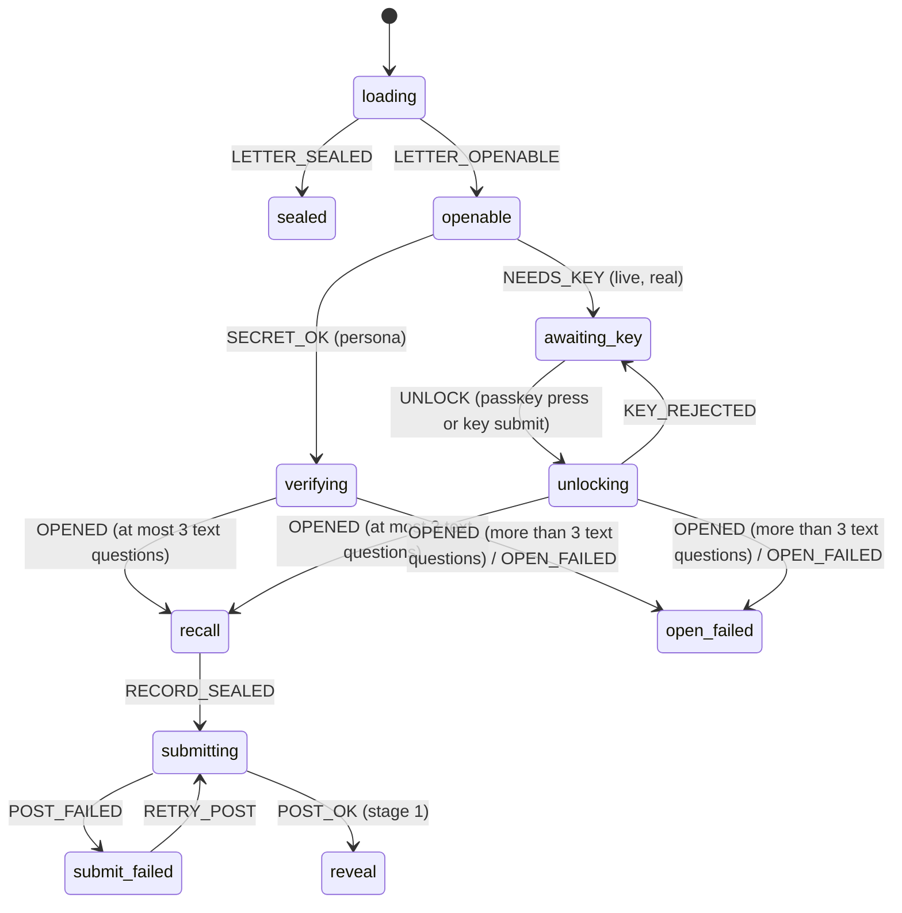
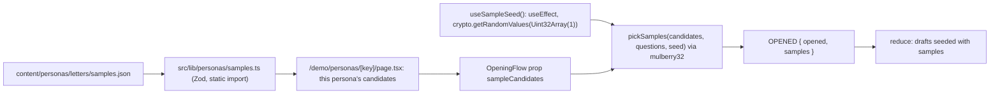

# Design Document

Spec: 10 Own questions

## Overview

This design adds Author_Questions to the Write step, a version 2 Recall_Record that holds text answers and the Sample_Flag, and a Testify step that opens straight on the first question. It also fixes the production bugs the owner found (group X), moves the seal controls to the Ghost, gives the persona letters their prices, and brings in self-reported numbers. It is written against `origin/main` at `3d48d51`. Every file, function and value named here was read on that commit. Where this design proposes a value, it says so; the owner can change it in the task's issue.

Nothing in `src/lib/seal-format/**`, `src/lib/crypto/**`, `src/app/api/**`, `scripts/seal-personas*`, the chart or the database changes. Author_Questions are v1 `"text"` recall questions. The Recall_Record v2 is encrypted by the unchanged `encryptOpeningRecord`.

### Production findings and their causes on `main`

| Finding | Cause on `main` | Fix |
|---|---|---|
| WaxSeal covers the Envelope text | `HeldEnvelope` in `OpeningFlow.tsx` always draws `<Envelope state="closed">`, the front face, whose date lines sit at `bottom: 46%` (`Envelope.module.css .lines`). `scene.module.css` puts `[data-envelope-seal]` at `top: 53%; left: 50%; width: 46%` of the same box, so the seal (about 67 % of the Envelope's height) covers both date lines. | In `marks` and `seal` the held Envelope turns to its back (`state="turned"`, flap down, no text). The pressable seal sits exactly on the flap tip (C6). |
| Seal_Hint clipped and right-aligned | `[data-envelope-instruction]` is `right: calc(100% + 1rem); text-align: right` of the Envelope box. The Envelope starts at 18 % of the Ghost_Box and the body at 12 %, so the hint's right part lies on the Ghost body (z-index above it, but under the glow), and its left part runs toward the Content_Column with no width rule. | One Seal_Group (hint, button, Skip_Link) placed outside the Ghost_Body_Box edge facing the Content_Column, left-aligned (C6). |
| "below" is false | `sealInstruction` says "or use the button below." The button is in the Content_Column, up and to the left. | New `sealHint` with no placement word (C6.4). |
| Empty cream card at `marks` | `Reveal.tsx` wraps stage 1 in `StagePanel` (the paper card). At 900 px and wider the seal and hint are portalled to the Envelope, so the card holds only the button and the Skip_Link. | No `StagePanel` in stage 1. The Answer_List sits on the dark; the controls move into the Seal_Group (C6.7). |
| Outline button style | `SealBreak.module.css .button` is the plain paper button (spec 05). The orange primary is `RecallPager.module.css .cta` ("Next question", "Record my answers"). "See the receipts" also uses the paper `reveal.module.css .button`. | One shared `.primary` class for the Seal_Button and "See the receipts" (C6.5). |
| No answers at 600 px and wider in `marks` | `Reveal.tsx` renders `<AnswerList>` in the marks card only when `isPhone`. | The Answer_List renders at every width (C6.10). |
| Then_Tick 60 to 90 px under the axis | `figures.module.css`: `.axis` is `top: 0` of the 7.5 rem `.numberLine` box and `.pinThen` is `bottom: 0` with `height: 1.5rem`. So the Then pin is drawn from 6 rem to 7.5 rem below the axis (96 to 120 px at 16 px root), under the label rows, and touches nothing. `.pinNow` is `top: 0` and does touch the axis. | Every tick hangs from the axis down to its own label row (X1). |
| Ghost covers the Persona_Intro at 390×844 | The Ghost layer is `.ghostLayer { position: fixed; z-index: 2 }`, above the Stage content. Below 600 px the `intact` Stage sets `scroll-margin-top: calc(71vh + 16px)` and focus moves to the Pick_Up_Button, so the page scrolls and the Persona_Intro (placed at `77vh + 4px` by `intro.module.css`) slides up under the fixed Ghost. | Below 600 px the Ghost layer scrolls with the page (`position: absolute`), `intact` is gone (C1), and focus on page load moves with `preventScroll` (C1.12). See X2. |
| Step_Indicator cut off on the phone | No stylesheet targets `[data-step-indicator]` or the row spec 09 described ("one 120 px row under the Compact_Top_Bar with the Compact_Ghost at its right end"). `StepIndicator.module.css` only sets a wrapping flex list, so the list runs full width under the fixed Compact_Ghost (right 16 px, about 96 px wide), which paints over the end of the first line. | A row rule that reserves the Compact_Ghost's box (X2). |
| Election names on the persona dates | `personas.json` carries `opening_event.name` for both personas; `PersonaIntro` renders `introOpensEvent` and the source link; `src/app/demo/page.tsx` passes `opening_event_name` to `PersonaCard`, which renders `demoOpensEvent`. | The field leaves the schema and the copy (X4). |
| README status | Line 61: "Specs 01 through 07 are complete; spec 08 (judge polish) is in progress." Line 56: "pre-sealed for a real US election window". | Owner patch ae (X3). |

### Other things found on `main` that the requirements did not name

| Finding | Effect | Handled in |
|---|---|---|
| `held-envelope.ts` `HELD_TAGS` does not include `recall`, `submitting` or `submit_failed`. | The Ghost holds no Envelope during Testify, which C1.5 requires. | Task 5 (C1). |
| The Journey_Check does not exist on `main`. `tools/qa/` holds only `layout-check.mjs`, and `.github/workflows/` has no `journey-check.yml`. Spec 09 Owner patch n was never committed. | S2.1 and S3.3 name the Journey_Check. | S2 lists it as "not on `main`"; owner patch ac says how S3.3 applies when patch n lands. This spec does not create it. |
| `tools/qa/layout-check.mjs` `NEUTRALITY` reads every visible text node and skips only `[class*="sealedLetter"]`. | It would flag a judge's Text_Answer or Author_Question that contains "better" or "!". It is the one check that reads User_Content. | Owner patch ad: skip `[data-user-content]`. |
| `localeForRegion("EU27, weighted average")` returns `en-IE`, not `en-GB` as the requirements' code-facts table says. | None for P1: both format 1.7913… as "1.79". | P1 uses `formatValue` as written. |
| A persona letter's "official average the persona saw (a station sign or the news)". | A station sign shows one station's price, not the EIA or Oil Bulletin average. Calling the average a station price would misstate the source (`data-integrity.md`). | The Letter_Price_Lines attribute the number to "the news" or "the radio" (P1). |
| `buildRecallRecord` treats every answer as a number, and the pager has no text field. | If the Write step sealed text questions before Testify could answer them, a Live_Letter with an Author_Question could not be submitted. | Order (G3.1): C3 (task 6) and C4 (task 7) ship before C2 (task 8). They are built and tested with fixture payloads that carry text questions, so no sealed letter has a text question until Testify can answer it, and no deploy hold is needed. |
| Spec 09 Owner patch o was never committed. `.github/workflows/` on `main` holds `build.yml`, `ci.yml`, `pr-policy.yml` and `spec-sync.yml` only; `freshness-check.yml` and `keepalive.yml` are not in git. | The figure freshness check and the keepalive that re-enables scheduled workflows don't run. | The owner commits patches o, t, u and v now, outside this spec (E1.3). Patch ah builds on the committed files. |
| Spec 09 Owner patch n's J2 waits for `[data-ceremony="intact"]` and presses "Pick up the letter" (spec 09 design "A6"). | After task 5 (C1) deploys, J2 would fail on every run. | Owner patch ac says how J2 changes with task 5. |
| `record.ts` keeps the number rule `numberAnswer` module-private. | `record-v2.ts` needs the same rule without copying it. | Task 6 adds one export line to `record.ts` (see C3). No line of the v1 schema changes. |

## Architecture

### Opening_Flow after this spec



- `verified`, `BEGIN`, `begin-guard.ts`, `showPickUp`, `REVEAL_COPY.pickUp`, `REVEAL_COPY.begin`, `SealIntact.tsx`, `EnvelopeView` variant `verified` and the `intact` Stage are removed (C1.3). None of them has a use other than the pick-up gate: `SealIntact.tsx` is imported only by `OpeningFlow.test.tsx`, and `REVEAL_COPY.begin` only by `SealIntact.tsx`. `stage-context.ts` defaults to `"emerging"` instead of `"intact"`.
- One code path (C1.2): both `OPENED` arms in `reduce` call the same helper, `enterRecall(opened, samples)`. The persona's `verifying` and the live letter's `unlocking` differ only in how they got the key.
- The text-question cap (C3.9) lives in that helper: more than `TEXT_ANSWERS_MAX` (3) text questions returns `{ tag: "open_failed", kind: "invalid_payload" }`, so the view is the existing `invalidPayload` FlowError and no payload field is rendered.
- The `recall`, `submitting`, `submit_failed` and `reveal` states carry `record: RecallRecordV2` and the recall states gain `samples: Readonly<Record<string, string>>` (question ID to Sample_Answer; empty for Live_Letters and Real_Letters).
- Unchanged: `START` only in the initial, `unreachable` and `sealed` states; single submission; the retry posts the same bytes; only `POST_OK` enters `reveal`, at stage 1.

### Gestures (C1.10)

- **Passkey.** `useOpeningFlow.passkeyUnlock` runs inside the "Unlock with your passkey" click. Everything before `startPasskeyAssertion` is synchronous and the port's `get()` is the first asynchronous call (spec 06 R17.2). `UNLOCK` → `unlocking` → `openLetter` → `OPENED` → `recall` needs no second press.
- **Backup key.** `backupUnlock` parses the field on submit. No WebAuthn call.
- **Audio.** Sound is off until "Turn sound on" (spec 05 R14, spec 09 C4.4). No Stage unlocks audio.
- **The persona page.** No gesture at all from page load to the first question.
- So the Pick_Up_Button was never needed as a user gesture, and no other step needs one.

### Focus: Load_Entry and Gesture_Entry (C1.12, C6.6)

`focusTargetFor(prev, next, shape)` gains a third argument, `shape: { authorQuestions: boolean; figures: boolean }`, read by a pure helper `letterShape(state)` from `state.opened.payload` (both false before `recall`). The two kinds of entry into `recall` are told apart by the previous Stage alone: the persona page reaches `recall` from `emerging` (Load_Entry), and a Live_Letter or Real_Letter reaches it from `envelope` (Gesture_Entry, the `awaiting_key` and `unlocking` Stages).

| `prev` | `next` | `shape` | Target |
|---|---|---|---|
| `emerging` | `recall` | any | `stage-heading`: the first question's `h2` (`[data-stage-heading]`), `focus({ preventScroll: true })`, no scroll |
| `envelope` | `recall` | any | `default` (the answer field, `[data-stage-focus]`), as today |
| `marks` or `seal` | `letter` | `authorQuestions` | `author-testimony-heading` |
| `marks` or `seal` | `letter` | no `authorQuestions` | `default` |
| `marks` or `seal` | `figures` or `close` | `authorQuestions` | `author-testimony-heading` |
| `marks` or `seal` | `figures` or `close` | no `authorQuestions`, `figures` | `figures-heading` |
| `marks` or `seal` | `close` | neither | `letter-heading` (`[data-letter-heading]`, the Caption_Block `h2`) |
| `letter` | `figures` | any | `figures-heading` |
| `letter` | `close` | `figures` | `figures-heading` |
| `figures` | `close` | any | `none` |
| anything else | | | `default` |

- `author-testimony-heading` and `letter-heading` use the same helper as `figures-heading` (`focusHeading(region, selector, mode)`): focus with `preventScroll`, `scrollIntoView` at the top, one re-check after `FOCUS_SCROLL_CHECK_MS`. If the element is missing, it falls back to `[data-figures-heading]`, then to `focusStageDefault`. So C6 can encode the Author_Testimony case before C8 builds the heading.
- `stage-heading` never scrolls, so the persona page stays where it loaded, and the phone keyboard does not open on load.

### Stages and steps

- `Stage` loses `intact`. `stageFor` for `reveal`: stage 1 is `seal` or `marks`; stage 2 is `letter` when `payload.figures.length > 0`, else `close`; stage 3 is `figures` or `close` when there are figures, else `close`.
- `personaStepFor` is unchanged (`recall` is Testify, step 0). The persona Step_Indicator renders only where a step is current, so from the first render of `recall` to `close` (C1.7, X2.3). It does not render in `emerging`, `sealed` or `error`.
- The Live_Stepper's own list is unchanged (six steps). `stepForFlowPhase` loses its `verified` case; the Wait step moves to Testify on the first `recall` phase (C1.9).

### Letters with no figures (C2.13, C8.9)

Only a Real_Letter on `/l/[id]` can have no figures: personas carry two, and `/demo/live` keeps 1 to 6. The rules in specs 05 to 09 that assume a figures Stage, and what changes:

| Rule | Assumes | With no figures |
|---|---|---|
| Spec 05 R3 / `stageFor` stage 3 | a `figures` Stage | stage 2 resolves to `close` (above). |
| Spec 05 R9.4, `Reveal.tsx` stage 2 controls | "See the receipts" and "Show everything" | not rendered. |
| Spec 05 R12.9, `closeShown` | Close after the figures settle | Close renders with the letter at stage 2. |
| Spec 08 R2 focus table | Figures_Heading exists | `letter-heading` or `author-testimony-heading` (table above). |
| Spec 09 C4.2, `skipToReceipts` | "Skip to the receipts" | `skipToLetter`, "Skip to the letter". It still sends `SHOW_ALL` once. |
| `useFigures()` in `Reveal.tsx` | a figures request | not called (no request). |
| Spec 08 RC1, PH5, PH6, spec 09 Step_Indicator | persona pages | not affected: personas always have figures, and `/l/[id]` shows no persona Step_Indicator (`controls="region"`). |
| `closeLine` | none | "Your testimony sits beside the record." stays true: the letter is the record. |

A Real_Letter whose only figures are self-reported keeps the `figures` Stage, showing only "Your own numbers" (R1.4).

### Data flow for sample answers (C5)



- **Seed.** `src/components/reveal/sample-seed.ts` exports `drawSampleSeed(): number` (`crypto.getRandomValues(new Uint32Array(1))[0]`). `useOpeningFlow` calls it once in a mount `useEffect` that is declared before the `loading` effect, and stores it in a ref. Effects run in declaration order, so the seed exists before `getLetter` starts. It is never drawn in render, and the module is outside `src/components/ceremony`, so `source-scan.test.ts` needs no allow-list entry (C5.6).
- **Pick.** `src/components/reveal/sample-pick.ts`: `pickSamples(candidates, questions, seed)` builds `rng = mulberry32(seed)` and walks the number questions in payload order. For each question whose `metric_id` has candidates it takes `candidates[Math.floor(rng() * candidates.length)]`. It is pure and takes the seed as an argument, so tests fix it (C5.6).
- **When.** The effect runner computes the samples just before it dispatches `OPENED`, from the seed ref. The `recall` state, and so the first question, never renders before the samples exist.
- **No empty-field flash (design point 5).** The `recall` Stage is reached only after the browser has fetched, verified and decrypted the letter, which happens after hydration. The server never renders a recall field. So the first render of every field already holds its Sample_Answer, and no placeholder, disabled state or hidden field is needed. C5.4's "until the pick has run, the field is empty and the Sample_Note does not show" holds because no field exists before then. If the ref is somehow still empty (a test that mounts mid-flow), the runner draws the seed in that effect callback, still outside render.
- **Reduced motion.** Nothing animates the fill. The answers-stored-first rule is unchanged: the sample is a draft, and the record is still built and stored before any letter text (C4.8).
- **Kept_Sample.** `buildRecallRecordV2` sets `sample: true` on a number answer exactly when the question has a Sample_Answer, `noAnswer` is false, and `draft.text === samples[question.id]`. The draft text is the canonical value the pager resolved (`draftTextFor`), which is the value submitted. So typing "3,59" over the sample "3.59" submits "3.59" and is a Kept_Sample, while "3.590" is not. This follows the Glossary: what counts is the submitted text, whatever the judge did in the field.
- Live_Letters and Real_Letters pass no candidates, so `samples` is `{}` and no field is prefilled (C5.10).

### Deploy order

Production follows the image tag in the owner's GitOps repo (`deploy.md`). Every task deploys as it merges. The task order removes the need for a hold between the Write step questions and Testify: Recall_Record_V2 (task 6) and the Testify text field (task 7) are on production before the Write step can seal a text question (task 8). Until task 8 merges, a Live_Letter or Real_Letter carries Figure_Questions only; from task 6 on, the record it posts is version 2 with number and no-answer entries only.

The one step that needs an order is the persona reseal (P2.2): see "P2. Reseal and deploy order".

### P2. Reseal and deploy order (P2.2)

The chart already seals the personas before the web container starts. `deployment.yaml` runs the `migrate` init container as `node scripts/migrate.mjs && node scripts/seal-personas.mjs` when `demo.sealPersonas` is true (the default in `values.yaml`), and a non-zero exit fails the init container, so the web container never starts. The Deployment has no `strategy`, so Kubernetes uses `RollingUpdate`, which for one replica starts the new pod before it stops the old one.

So the order the requirement asks for is the order the chart gives, as long as `demo.sealPersonas` stays true:

1. The P task merges. CI builds `ghcr.io/devclef/revenant:<sha>`.
2. The owner checks that the GitOps values keep `demo.sealPersonas: true`, then moves the image tag to `<sha>`.
3. The new pod's init container runs the migrations, then the Sealing_Script, which stores `demo_letters` rows for the two new IDs (`stored`) and reports the two old ones are no longer listed. The old pod keeps serving the old persona IDs, whose rows stay (P2.3). The web container of the new pod starts only after both new rows exist.
4. If sealing fails (for example `missing_then_figure`), the init container fails, the new pod never becomes ready, and the old pod keeps serving. Nothing serves a new ID without its row.
5. The owner records the init container log (`kubectl logs <pod> -c migrate`), which holds one `formatResultLine` per persona and no secret, and the order of steps in the task's issue. Then the Production_Check opens both personas through to `close`.

If the GitOps values set `demo.sealPersonas: false`, the owner first runs the new image once against production, before moving the tag: `kubectl run seal-personas-<sha> --rm -i --restart=Never --image=ghcr.io/devclef/revenant:<sha> --env-from=secret/<existingSecret> -- node scripts/seal-personas.mjs`, checks both `stored` lines, then moves the tag. During the rollout either pod can answer a request for either set of IDs, because both sets of rows exist.

### Content and scans: which checks read what (S2.1)

| Check | Inputs | Reads User_Content? |
|---|---|---|
| `tools/hooks/tone-check.mjs` | Changed files in `src/app/**/*.tsx`, `src/components/**`, `content/personas/**` from `git diff` against the merge-base, plus untracked files. Source text only. | No. |
| `.kiro/hooks/copy-tone-check.json` | The one saved file matching `^src/.*\.tsx$` or `content/.*\.(md|txt)$`. | No. |
| `.kiro/hooks/ceremony-truth-check.json` | The one saved file under `src/components/ceremony/`. | No. |
| `src/test/retired-phrases.test.ts` | Non-test `.ts`, `.tsx`, `.json`, `.txt`, `.md` files under `src/` and `content/personas/`; the rendered `/` (`renderToStaticMarkup`); `pageMetadata` output. | No. `/` has no User_Content. The helper `textOutsideUserContent(html)` is added for any later rendered page. |
| Copy tests under `src/` (`ceremony/copy.test.ts`, `copy-exact.property.test.ts`, `reveal/copy.test.ts`, `scene/copy.test.ts`, `landing/copy.test.ts`, `live/copy.test.ts`, `LetterBlock.test.tsx`, `RecallPager.property.test.tsx`) | The copy module objects. | No. |
| `tools/qa/layout-check.mjs` `NEUTRALITY` | Every visible text node of the rendered page, skipping `[class*="sealedLetter"]`. | Yes, today. Owner patch ad adds `[data-user-content]` to the skip. |
| Journey_Check (spec 09 patch n) | Not on `main`. When committed, its J7 must skip `[data-user-content]` too (owner patch ac). | n/a |

- **The marker (S2.2).** One attribute, `data-user-content=""`, on: the Letter_Text `p` of a Live_Letter or Real_Letter (`LetterBlock`, when `letterKind !== "persona"`), each Author_Question text on the Testify step, in the Answer_List and in the Author_Testimony, each Text_Answer, and each self-reported name, value, unit, region and period in the Write step preview and the Reveal. The Persona_Letter text is Our_Copy and carries no marker (S2.3).
- **Runtime (S2.4).** `validateWrite`, `buildRecallRecordV2` and the Author_Question rows check length and whitespace only. No module scans User_Content for words.

## Components and Interfaces

### C1. The Opening_Flow without the pick-up Stage

- `opening-machine.ts`:

  ```ts
  export type FlowEvent =
    | /* unchanged events, minus BEGIN */
    | { type: "OPENED"; opened: Opened; samples?: Readonly<Record<string, string>> };

  function enterRecall(opened: Opened, samples: Readonly<Record<string, string>>): FlowState {
    const questions = opened.payload.recall_questions;
    if (questions.filter((q) => q.answer_type === "text").length > TEXT_ANSWERS_MAX) {
      return { tag: "open_failed", kind: "invalid_payload" };
    }
    const drafts: Record<string, Draft> = {};
    const kept: Record<string, string> = {};
    for (const q of questions) {
      const sample = q.answer_type === "number" ? samples[q.id] : undefined;
      drafts[q.id] = { text: sample ?? "", noAnswer: false };
      if (sample !== undefined) kept[q.id] = sample;
    }
    return { tag: "recall", opened, drafts, invalid: [], samples: kept };
  }
  ```

  `TEXT_ANSWERS_MAX` comes from `src/lib/recall/limits.ts` (pure, no Zod), so the reducer keeps importing no runtime value from Zod modules. The helper is the end state. Task 5 writes it without the cap and with `samples` always `{}`; task 6 adds `limits.ts` and the cap (C3.9); task 9 passes real samples (C5.4). Until task 6, the drafts and record stay v1-shaped and posted as today.
- `OpeningFlow.tsx`: no begin guard; no `verified` case; `HeldEnvelope` `state` is `"turned"` in reveal stage 1 and `"closed"` otherwise. `RecallStep` gets `persona` (the compact intro fields) and `mode`.
- `held-envelope.ts`: `HELD_TAGS` adds `recall`, `submitting`, `submit_failed` (C1.5). Reveal stage 1 keeps the wide-only rule.
- `CeremonyRoot.tsx`: `showSteps = controls === "topbar" && stepNow !== null`; the focus effect calls `focusTargetFor(prev, stage, letterShape(state))`. The `PICKUP_MOVE_MS` resize kick stays (the handed pose still starts at `recall`).
- **Emergence and the first question (C1.6, C1.8).** `recall` can start while the Emergence is still running. The question renders at once in the Content_Column. At the Desktop_Sizes the Ghost is at 72 % of the frame and the column is capped left of it, so they never meet. Below 600 px the pit's compact transform applies at `recall` with no transition (`transition: none` for `.pit[data-compact="true"]` below 600 px), so the Ghost never travels across the question while it moves to its compact slot. Calm and reduced motion already show the end pose from the first render.

### C1. Testify_Context (C4.3, C4.10)

`src/components/ceremony/intro/TestifyContext.tsx` (server-safe):

```ts
type TestifyContextProps =
  | { kind: "persona"; personaName: string; writtenAsOf: string; opensAt: string }
  | { kind: "letter" };   // Live_Letter and Real_Letter
```

- Persona, on the dark above the recall card, `data-testify-context`: the notice (`personaNotice`), `contextFrom` ("A letter from {name}"), one line "Written as of {date} · Opens {date}", then `sealIntact`. C4 adds the Memory_Line under it.
- Letter: `sealIntact` only.
- The full `PersonaIntro` keeps its `emerging` and `sealed` role and is still hidden after the First_Step by the existing `scene.module.css` rule.
- Below 600 px the Testify_Context is three short lines in 0.9375 rem; it is not a card.

### C2. Author_Question rows on the Write step

`src/components/live/AuthorQuestions.tsx` (client), rendered by `WriteForm` after the letter field and its Prompt_Starters, in both modes.

```
Questions for your future self                                  ← legend
When the letter opens, you'll answer these from memory before you read it.
┌ Question 1 ─────────────────────────────────────────┐ [Remove question 1]
│ What's on your mind right now?                      │
└─────────────────────────────────────────────────────┘
[ Add a question ]
Start from one:  [What was on your mind most days?] [Who did you spend your evenings with?] …
Answer them in your letter too, in your own words.               ← Answer_In_Letter_Line
```

- A `fieldset` with `legend` `authorQuestionsLegend`. Each row is an `input type="text"` with a visible `label` ("Question {n}") and a "Remove question {n}" button. "Add a question" shows while fewer than 3 rows exist. The rows carry `data-user-content` once the text differs from the Live_Prefill.
- Question_Starters are buttons (C2.4): a press puts the text into the first row that is empty after trimming, else adds a row when there are fewer than 3, else does nothing. The press moves focus to that row.
- State lives in `write-draft.ts`:

  ```ts
  interface WriteDraft { /* existing */; questions: string[]; selfReported: SelfReportedRow[] }
  type WriteDraftEvent = /* existing */
    | { type: "QUESTION_ADDED" }
    | { type: "QUESTION_CHANGED"; index: number; text: string }
    | { type: "QUESTION_REMOVED"; index: number }
    | { type: "STARTER_USED"; text: string };
  export const initialWriteDraft = (mode: "demo" | "real"): WriteDraft => ({
    ...INITIAL_WRITE_DRAFT,
    questions: mode === "demo" ? [LIVE_COPY.livePrefill] : [],   // C2.12, C9.5
  });
  ```

  The draft is the one the Live_Stepper already keeps mounted, so the rows survive Back, Next, the cancelled, failed and cannot-lock screens and Try again (C2.10). After the Seal_Route returns 201 the draft, including `questions`, is dropped, as the letter text already is (C2.11).
- `src/components/live/author-questions.ts` (pure):

  ```ts
  export const AUTHOR_QUESTIONS_MAX = 3;
  export const AUTHOR_QUESTION_MAX_CODE_POINTS = 200;
  export type QuestionRowProblem = "question_too_long";
  export function questionRowProblem(text: string): QuestionRowProblem | null;   // > 200 code points after trim
  export function questionsForSeal(rows: readonly string[]): string[];            // trim, drop empty, keep order
  ```

  A row that is empty after trimming is dropped at sealing whether or not it was touched, and never blocks sealing. Only a row over 200 code points after trimming blocks, with `questionTooLong`, shown after the row was touched or a seal was attempted (C2.3). Trimming is `String.prototype.trim`; code points are `[...s].length`.
- `form.ts` `validateWrite` gains `questions: readonly string[]` and `mode: "demo" | "real"`. It reports `question_too_long` with the row indices, and `figures_none` when the official figure count is below `minFiguresFor(mode, questions)`, which is 0 for `real` with at least one non-empty question and `MIN_FIGURES` (1) otherwise (C2.13). Self-reported rows never count (R1.5).
- `build-payload.ts` `buildLivePayload` gains `authorQuestions: readonly string[]` (already trimmed by `questionsForSeal`):

  ```ts
  const authorItems = authorQuestions.map((text, i) => ({
    id: `a${i + 1}`, answer_type: "text" as const, text,
  }));
  recall_questions: [...authorItems, ...generateRecallQuestions(...)]   // C2.7, C2.8
  ```

  `a1` to `a3` can't collide with the generator's `q1` to `q20`. No `metric_id` (C2.7). At most 3 + 6 = 9 questions, under the v1 cap of 20. A Real_Letter with 0 figures and 1 to 3 questions passes `payloadV1Schema` (metrics and figures have no minimum) (C2.9).
- `seal-runner.ts` passes `questionsForSeal(draft.questions)` and the self-reported rows.

### C3. Recall_Record_V2

`src/lib/recall/record-v2.ts` (pure; `record.ts` gains one export line and nothing else, see below):

```ts
const textAnswerValue = z.string().refine(
  (s) => s === s.trim() && s.length > 0 && [...s].length <= TEXT_ANSWER_MAX_CODE_POINTS,
  { message: "text answer must be 1-1,000 code points, trimmed" },
);
const numberAnswerV2 = z.strictObject({
  question_id: z.string().min(1).max(200),
  kind: z.literal("number"),
  value: numberAnswerSchema,           // the v1 rule, imported from record.ts
  sample: z.literal(true).optional(),  // the Sample_Flag
});
const textAnswerV2 = z.strictObject({
  question_id: z.string().min(1).max(200),
  kind: z.literal("text"),
  value: textAnswerValue,
});
const noAnswerV2 = z.strictObject({ question_id: z.string().min(1).max(200), kind: z.literal("no_answer") });

export const recallRecordV2Schema = z.strictObject({
  version: z.literal(2),
  answers: z.array(z.discriminatedUnion("kind", [numberAnswerV2, textAnswerV2, noAnswerV2])).max(20),
}).refine((r) => r.answers.filter((a) => a.kind === "text").length <= TEXT_ANSWERS_MAX);
```

- The one edit to `record.ts` is a new line after the private `numberAnswer` constant: `export const numberAnswerSchema = numberAnswer;`. No existing line changes: `numberAnswer`, `answerSchema`, `recallRecordV1Schema`, `recallRecordSchemaFor` and `buildRecallRecord` stay byte-identical, so the v1 schema and its rules are untouched (G1.6). A test asserts that `numberAnswerSchema` accepts and rejects exactly what the v1 number answer does.
- The Sample_Flag is `sample: true`, accepted only on a number answer; the text and no-answer objects are strict, so `sample` there is an unknown key (C3.4).
- `recallRecordV2SchemaFor(questions)`: on top of the base schema, every question ID exactly once, no unknown ID, a text or no-answer answer for every `"text"` question, a number or no-answer answer for every `"number"` question (C3.5).
- `buildRecallRecordV2(questions, drafts, samples)` returns `{ ok: true, record } | { ok: false, invalid }`:
  - `noAnswer` → `no_answer`;
  - text question → trimmed text, invalid when empty or over 1,000 code points (C4.6);
  - number question → the v1 number rule; `sample: true` when it is a Kept_Sample.
- `src/lib/recall/parse-record.ts` exports the Record_Parser:

  ```ts
  export function parseRecallRecord(value: unknown):
    | { ok: true; record: RecallRecordV1 | RecallRecordV2 }
    | { ok: false };
  ```

  It reads `version`, then parses with `recallRecordV1Schema` or `recallRecordV2Schema`. For version 1 it returns exactly what the v1 schema returns (C3.7, C3.11). No production module calls it; an import-boundary test asserts that only tests import `parse-record.ts`.
- `index.ts` re-exports the new names. `src/lib/recall/limits.ts`: `TEXT_ANSWERS_MAX = 3`, `TEXT_ANSWER_MAX_CODE_POINTS = 1000`.
- `useOpeningFlow.submit` calls `buildRecallRecordV2` for every letter, including letters sealed before this spec (C3.8). Until task 9 (C5) passes samples, it passes `{}`. `encryptOpeningRecord`, `decryptOpeningRecord` and `POST /api/openings` are unchanged (C3.12).
- **Fixtures (G3.1).** Task 6 runs before the Write step can seal a text question (task 8). Its tests use `src/lib/recall/fixtures.test-data.ts` (new, imported by tests only): v1 payloads that pass `payloadV1Schema` with 0 to 3 `"text"` questions `a1`… before the generator's `q1`…, a payload with 4 text questions for the C3.9 cap, and a 0-figure payload with 2 text questions. Task 7 reuses the same fixtures for the pager and the Opening_Flow tests. The C3.9 cap lands in `enterRecall` in task 6.

#### The Max_Record size (C3.6)

`encryptOpeningRecord` encrypts `UTF-8(canonicalize(value))` with AES-256-GCM and returns the ciphertext as unpadded base64url. AES-GCM adds a 16-byte tag and no padding. `canonicalize` writes strings with `JSON.stringify`, which escapes control characters other than `\b\t\n\f\r` and lone surrogates as `\uXXXX`: 6 bytes for one UTF-16 code unit, the longest encoding any character gets. An astral character is one code point but 4 UTF-8 bytes, so the 6-byte escape is still the worst case per code point. The Max_Record therefore uses `U+0001` and lone surrogates (to keep the 20 question IDs distinct) in every question ID and Text_Answer, and 40-digit number values.

| Part | Bytes |
|---|---|
| One Text_Answer: `{"kind":"text","question_id":"…","value":"…"}` with a 200-unit ID (1,200 escaped bytes) and a 1,000-code-point value (6,000) | 7,243 |
| One number answer with the Sample_Flag: `{"kind":"number","question_id":"…","sample":true,"value":"…"}` with a 200-unit ID and 40 digits | 1,299 |
| 3 Text_Answers + 17 number answers | 21,729 + 22,083 = 43,812 |
| 19 commas between answers | 19 |
| `{"answers":[` and `],"version":2}` | 12 + 14 |
| Canonical JSON plaintext | **43,857** |
| AES-GCM ciphertext (plaintext + 16-byte tag) | **43,873** (limit 65,536; 21,663 to spare) |
| Base64url ciphertext, unpadded: ⌈43,873 × 4 / 3⌉ | 58,498 characters |
| Request body `{"letterId":"<22>","ciphertext":"<58,498>","nonce":"<16>"}` | **58,578** characters (limit 100,000) |

The test `src/lib/recall/record-v2-size.test.ts` builds this record, encrypts it with a real `encryptOpeningRecord` key, asserts both limits and prints the three bold figures (C3.6).

### C4. Testify

- `RecallPager.tsx` renders a `TextAnswerField` (`src/components/ceremony/recall/TextAnswerField.tsx`) for `"text"` questions:
  - a `textarea` with `rows={4}`, the question `h2` as its accessible name (`aria-labelledby`), `data-stage-focus`, `data-user-content` off (the answer is not rendered as page text until the reveal);
  - a live character count `textCount` ("{n} of 1,000 characters"), counted in code points, in `aria-describedby`;
  - the existing "No answer" control;
  - Enter inserts a line break; the form submits only from the button;
  - `isReady` for a text question: "No answer", or 1 to 1,000 code points after trimming. Over 1,000 or empty shows `textAnswerInvalid` after a submit attempt, keeps the text, and doesn't advance (C4.6).
- The question text renders exactly as sealed, inside an element with `data-user-content` (C4.9).
- Number questions keep the Recall_Number_Parser, the Recall_Scale and "No answer" unchanged (C4.7).
- One question per screen, "Next question" on every question but the last, "Record my answers" on the last (C4.1). Order is payload order, so Author_Questions first.
- The persona Testify_Context adds the Memory_Line, `memoryLine` filled with the written-as-of month in en-GB ("May 2024") (C4.2).
- The recall heading `h2` of each question carries `data-stage-heading` (the Load_Entry target).
- **Fixtures (G3.1).** Task 7 merges before task 8, so no sealed letter has a text question yet. Its unit and property tests render the pager and the Opening_Flow with the task 6 fixtures. Its screenshots cover what a browser can reach on that build: the persona and Live_Letter number questions, the Memory_Line and the moved "No answer" control. No route is added for fixtures. The text field's screenshots and the browser QA row for text answers (10-09) belong to task 8, once the Write step seals real text questions.
- **First viewport (C4.4).** Order in `recall`: Step_Indicator, Testify_Context, the recall card (counter, question, field, primary control). At 360×640 the budget is 56 (Top_Bar) + 118 (Step_Indicator row beside the Compact_Ghost) + about 96 (Testify_Context, three lines and the Memory_Line at 0.9375 rem) + about 150 (card padding, counter, a two-line question, a 48 px field) ≈ 420 px, under 640. The primary control is required in view at the other sizes only. The task measures and states each size.

### C5. Sample answers

- `content/personas/letters/samples.json` (new; next to the letters, outside the payload):

  ```json
  {
    "us-maya": {
      "us-gasoline-regular": ["3.64", "3.59", "3.75", "2.99", "4.25"],
      "us-diesel": ["3.89", "3.79", "3.95", "3.19", "4.59"]
    },
    "eu-tomas": {
      "eu-petrol-euro95": ["1.79", "1.75", "1.85", "1.49", "2.09"],
      "eu-diesel": ["1.65", "1.62", "1.69", "1.35", "1.95"]
    }
  }
  ```

  The first entry of each list is the Record_Candidate. The order in the file carries no meaning for the pick: `pickSamples` draws uniformly over the list, so each candidate, the Record_Candidate included, is picked on about one visit in five.
- `src/lib/personas/samples.ts`: a strict Zod schema (persona key → metric ID → 3 to 5 distinct strings, each matching the v1 number rule), a static import of the file, and `sampleCandidatesFor(key)`. A test fails if a persona metric has no entry, or an entry names a metric the persona doesn't track.
- `src/lib/personas/record-candidate.ts` (pure): `recordCandidate(figure)` returns the number part of `formatValue(shown, figure.region, 2)`, with `shown = rescaleForDisplay(figure.value, divisor)` when `displayRescaleForUnit(figure.unit)` gives a divisor, else `figure.value`. It is the same computation P1's `expectedPrices` makes, and `expectedPrices` calls it, so the Record_Candidate and the Letter_Price_Line can't drift apart. Both format with `formatValue` in the region's locale; for these four values (all under 1,000) the result has no grouping separator, and the test asserts it matches `^[0-9]+\.[0-9]{2}$`.
- `src/lib/personas/spread.ts` (pure): `classifyCandidate(candidate, thenShown): "near" | "below" | "above" | "between"` computed on scaled `BigInt`s, never floats. Near: |c − t| ≤ 5 % of t. Below: c ≤ 85 % of t. Above: c ≥ 115 % of t. `meetsSpreadRule(candidates, thenShown)` needs one of each. `thenShown` is the sealed value after `rescaleForDisplay` when the unit has a Display_Rescale.
- Decimal places: 2 for `USD per gallon` and for `EUR per litre`, the units the Testify field shows. Every candidate is inside the Unit_Range_Table range (0 to 10, 0 to 3), passes `parseRecallNumber` as a `point` value, and equals its own canonical value.
- The values against the sealed Then_Values (checked in "Persona Then_Values" below):

  | Question | Then (as the field's unit) | Record_Candidate (a Near_Candidate) | Other Near (≤ 5 %) | Below (≤ 85 %) | Above (≥ 115 %) |
  |---|---|---|---|---|---|
  | Maya, regular | 3.643 | 3.64 (99.9 %) | 3.59 (98.5 %), 3.75 (102.9 %) | 2.99 (82.1 %) | 4.25 (116.7 %) |
  | Maya, diesel | 3.894 | 3.89 (99.9 %) | 3.79 (97.3 %), 3.95 (101.4 %) | 3.19 (81.9 %) | 4.59 (117.9 %) |
  | Tomás, unleaded | 1.7913149889844324 | 1.79 (99.9 %) | 1.75 (97.7 %), 1.85 (103.3 %) | 1.49 (83.2 %) | 2.09 (116.7 %) |
  | Tomás, diesel | 1.645194212158339 | 1.65 (100.3 %) | 1.62 (98.5 %), 1.69 (102.7 %) | 1.35 (82.1 %) | 1.95 (118.5 %) |

  Each list has 5 candidates, the C5.1 maximum, and exactly one Record_Candidate. No other candidate equals the Record_Candidate. The Record_Candidate is also the number in that figure's Letter_Price_Line (P1.2), so a kept Record_Candidate is shown in the Reveal like any other answer, with its Sample_Label and no word about it matching (C5.9).
- `OpeningFlow` takes `sampleCandidates?: Readonly<Record<string, readonly string[]>>` (metric ID keyed). The persona page passes `sampleCandidatesFor(persona.key)`. `/l/[id]` and the Live_Stepper pass nothing.
- **Sample_Note (C5.5).** Under the field while `draft.text === samples[id]` and `noAnswer` is false: `sampleNote`. It is plain `--ink-soft` text inside the card. The control is enabled at once, because the field resolves to a value.
- **Sample_Label (C5.8).** Wherever a Kept_Sample is shown as the judge's answer: the Answer_List, the "Your testimony" disclosure rows, and the Receipt_Card's "Your answer" row. The value keeps the Accent fill; the label follows it as `· sample answer` in the row's text colour (G1.8). An answer without `sample: true` never gets it.

### C6. Break the seal

```
Desktop and wide (≥ 900 px)                      Phone (< 600 px)
┌ Content_Column ──────┐  ┌ Seal_Group ┐  ┌ Ghost ┐   ┌ Top_Bar ──────────────────────┐
│ Testify  [Break…]    │  │ Press and  │  │  ▲▲   │   │ Testify  Break the    ┌Ghost┐ │
│ Your testimony       │  │ hold the   │  │ ┌───┐ │   │ seal  Read  See the   │ ▒▒  │ │
│ ─ Answer_List ─      │  │ wax seal … │◀─┤ │(●)│ │   │ receipts              └─────┘ │
│ regular  3.59 · sample│  │ [Break the │20│ └───┘ │   │ (●) WaxSeal                   │
│ diesel   No answer   │  │   seal]    │px│       │   │ Press and hold the wax seal … │
│                      │  │ Skip to …  │  │       │   │ [ Break the seal ]            │
└──────────────────────┘  └────────────┘  └───────┘   │ Skip to the receipts          │
                                                      │ Your testimony · Answer_List  │
```

- **Envelope (C6.1, C6.2).** In `marks` and `seal`, `HeldEnvelope` draws `state="turned"`: the back face, flap down, no date lines. The back face's own drawn WaxSeal is at `SEAL_X..SEAL_X+64` by `SEAL_Y_TURNED..+64` in the 300×188 viewBox, so its centre is at 50 % × 55.3 %. `[data-envelope-seal]` moves to `left: 50%; top: 55.3%; width: 28%` of the Envelope box (it covers the drawn seal, 21.3 % wide, fully), so the pressable seal is on the flap. With no text on the back face, no Envelope_Text box exists in these Stages, and nothing drawn on the Envelope overlaps anything else. The turn uses the existing `ENVELOPE_TURN_*` timing and is off under Calm and reduced motion.
- **Seal_Group placement at 900 px and wider (C6.3, C6.8).** `SealBreak` portals one `[data-seal-group]` into the held Envelope's slot, next to `[data-envelope-seal]`:

  ```css
  .heldEnvelope [data-seal-group] {
    position: absolute;
    /* The Envelope starts 6 % of the Ghost_Box (9.375 % of its own width) right of
       the Ghost_Body_Box's left edge (body 12 %, Envelope 18 %). */
    right: calc(109.375% + var(--seal-group-gap));   /* SEAL_GROUP_GAP_PX = 20 */
    top: 55.3%;                                       /* the WaxSeal's centre */
    transform: translateY(-50%);
    width: 14rem;
    display: grid; justify-items: start; gap: 0.75rem;
    text-align: left;
    pointer-events: auto;
    z-index: 3;
  }
  ```

  The Content_Column is narrower in `marks` and `seal` at 900 px and wider, `--content-column-max: min(28rem, 40vw)`, so the group fits between the column and the Ghost at every Desktop_Size. Measured from the scene variables (proposed; the task confirms with the layout check):

  | Size | Column right edge | Group left to right | Ghost_Body_Box left | Gap to body |
  |---|---|---|---|---|
  | 1280×800 | 486 | 526 to 750 | 770 | 20 |
  | 1366×800 | 489 | 587 to 811 | 831 | 20 |
  | 2560×1440 | 1,048 | 1,140 to 1,364 | 1,384 | 20 |

  The group's vertical centre is the WaxSeal's centre, so the WaxSeal's centre is inside the group's extent. The group is 20 px outside the Ghost_Body_Box, so it overlaps neither the body nor the Envelope. The Ghost's glow is a 26 px blur around the body path, which sits about 12 px inside the box edge at the Envelope's height, so the glow's visible edge ends before the group. The light shaft does reach the group; the hint is `--on-purple` (#ffffff), and the contrast test checks it against the brightest light composite there (#8F46FF at 0.4 over `--bg`, about 11:1).
- **Phone (C6.1, C6.8).** Below 600 px the Envelope is not held in stage 1 (`holdsEnvelope` wide-only rule). `SealBreak` renders the Seal_Group in the Content_Column as the first block after the Step_Indicator row: the WaxSeal (`width: 6.5rem`, its hit square 104 px), then the hint, the Seal_Button and the Skip_Link. The Step_Indicator row's height equals the Compact_Ghost's box (X2), so the group's top is 12 px under the Ghost_Box's bottom. The Answer_List follows the group. At 360×640 the group ends near y 56 + 118 + 12 + 104 + 12 + 44 + 12 + 48 + 44 ≈ 450.
- **600 to 899 px.** Not an Evidence_Size. The same group as the phone, under the Answer_List, as today.
- **Hint and button (C6.4, C6.5).** `sealHint` replaces `sealInstruction`; it names no position. The Seal_Button uses a new shared primary class, `src/components/ui/buttons.module.css .primary`, lifted unchanged from `RecallPager.module.css .cta` (the orange "Next question" and "Record my answers"). It sits directly under the hint and calls the same `breakNow` as before. On `main` "See the receipts" uses `reveal.module.css .button`, the paper outline style, not the orange one; task 10 (C6) moves it to `.primary` too, because it is the Stage's main button (`tone.md`: orange marks the main buttons). "Show everything" keeps the outline style.
- **Skip_Link (C6.6).** Quiet underlined text under the Seal_Button, one `SHOW_ALL`. Its label is `skipToReceipts` when the letter has figures and `skipToLetter` when it has none. Focus follows the table in "Focus".
- **No control-only card (C6.7).** Stage 1 renders no `StagePanel`. The Content_Column holds the `stage1Title` heading and the Answer_List on the dark, in `.marksOnDesk` tokens.
- **Answer_List (C6.10).** `AnswerList` takes items of two kinds:

  ```ts
  type AnswerListItem =
    | { kind: "text"; question: string; answer: string | null }                 // null = No answer
    | { kind: "number"; name: string; markValue?: string; unit: string; sample: boolean };
  ```

  Author_Questions come first (payload order). A Text_Answer is clamped to three lines (`display: -webkit-box; -webkit-line-clamp: 3; overflow: hidden`), plain text, with a 3 px `--accent` left border to mark "you" without orange paragraph text. The question and the answer carry `data-user-content`.

### C7. The other Stages (findings from the code, to confirm with screenshots)

| Stage | Size | Finding on `main` | Change |
|---|---|---|---|
| `recall` | Phone | The Step_Indicator row and the Testify_Context's first lines sit under the fixed Compact_Ghost (no row rule, see X2). | X2 row rule; Ghost layer absolute below 600 px. |
| `recall` | All | The "No answer" checkbox is rendered after the parsed-value line, the reading choice, "Previous question" and the Recall_Scale, so it can be more than 48 px below the field it acts on. | Move "No answer" directly under the field group, before the scale (C7.2). |
| `recall` | Desktop | The Ghost holds no Envelope (`HELD_TAGS`). | C1. |
| `marks` | ≥ 900 px | `StagePanel` holding only controls; the outline Seal_Button; no answers. | C6. |
| `letter` | All | "See the receipts" and "Show everything" render after the whole letter, at the end of `.reveal`. On the phone, after a long letter, that is directly under it in the Content_Column, which C7.2 allows. | Keep. Hidden for letters with no figures. |
| `letter`, `figures`, `close` | ≥ 900 px | The Ghost is unmounted (spec 09 A11). | None. |
| `figures`, `close` | All | Receipt_Card's Then_Tick (X1). | X1. |

The task adds rows for anything else its screenshots show, with a before and after shot each (C7.4).

### C8. The Reveal

`src/components/reveal/AuthorTestimony.tsx` (server-safe), rendered in the `letter` column above `LetterBlock`, from stage 2 on, only when the payload has at least one `"text"` question (C8.6):

```html
<section data-author-testimony>
  <h2 tabindex="-1" data-author-testimony-heading>Questions you left for yourself</h2>
  <div data-author-entry>
    <p class="question" data-user-content>{question.text}</p>
    <p class="label">What you said just now</p>
    <p class="answer" data-user-content style="white-space: pre-wrap">{text}</p>   <!-- or "No answer" -->
  </div>
  …
</section>
```

- React text nodes only, never `dangerouslySetInnerHTML` (C8.5). Line breaks kept by `pre-wrap`.
- It sits outside the paper; the paper keeps the Letter_Text as its one text node (C8.3). Nothing links, quotes or highlights between the two (C8.4).
- The Caption_Block `h2` ("What was written then") gains `data-letter-heading` for the no-figures focus target.
- In `figures` and `close` the block stays in place above the letter. On the phone, where the letter collapses into the Letter_Disclosure at stage 3 (spec 09), the block stays open.
- Order stays testimony, letter, numbers (C8.7). For Live_Letters this is the C9.3 order too.

### C9. The live demo payoff

- `/demo/live` starts the Write step with the Live_Prefill row (C9.5); Question_Starters visible.
- The Live_Stepper's Testify step is the Opening_Flow's `recall`; Author_Questions come first (C9.2). Receipts: Answer_List at `marks`, then the Author_Testimony and the letter, then the figures (C9.3).
- `LIVE_COPY.lockNote` is unchanged: "This letter was locked for 30 seconds. For a longer comparison, open a persona letter." It already says the lock time without judgement and points to the persona letters (C9.4).

### P1. Persona letters

- `src/lib/personas/letter-checks.ts` `checkLetterText(key, text, prices)` gains `prices: readonly { symbol: "$" | "€"; value: string }[]`, the persona's expected Letter_Price_Line values. The rule:
  1. Find every match of `PRICE_RE = /\babout ([$€])([0-9]+\.[0-9]{2})(?![0-9])/g`.
  2. The multiset of `(symbol, value)` matches must equal `prices` exactly: each tracked figure once (P1.3).
  3. With the matches removed, the text must contain no digit, no `$`, `€` or `£`, and no currency word (P1.4).
  4. The R1.10 term check and the length checks are unchanged (P1.5).
- `src/lib/personas/price-lines.ts` (pure): `expectedPrices(payload)` returns, for each figure, `{ symbol, value: recordCandidate(figure) }` (C5: `formatValue(shown, figure.region, 2)` with `shown = rescaleForDisplay(value, divisor)` when `displayRescaleForUnit(unit)` is set, else `value`). Symbol: `$` for `USD per gallon`, `€` for `EUR per 1,000 litres`. `src/lib/personas/letter-prices.test.ts` takes each persona's Then_Figures with `thenAndNow(metric_id, written_as_of, DEMO_FIGURES)`, the same call `buildPersonaPayload` in `scripts/seal-personas-core.ts` makes, and runs the check on the letter file (P1.3). It does not import `scripts/`, because nothing under `src/` may.
- **Persona Then_Values (design point 2).** `buildPersonaPayload` takes each Then_Figure from `thenAndNow(metric_id, written_as_of, DEMO_FIGURES)`, the latest figure whose period end is on or before 12 May 2024. Read from `src/lib/figures/real/fuel-figures.json` on `3d48d51`, with the same rule (weekly period end = start + 6 days, so 2024-05-06 ends 2024-05-12):

  | Metric | Period | Sealed value | Unit | Region | Shown at two decimals |
  |---|---|---|---|---|---|
  | `us-gasoline-regular` | 2024-05-06 | 3.643 | USD per gallon | U.S. | $3.64 |
  | `us-diesel` | 2024-05-06 | 3.894 | USD per gallon | U.S. | $3.89 |
  | `eu-petrol-euro95` | 2024-05-06 | 1791.3149889844324 | EUR per 1,000 litres | EU27, weighted average | €1.79 (1.7913… per litre) |
  | `eu-diesel` | 2024-05-06 | 1645.194212158339 | EUR per 1,000 litres | EU27, weighted average | €1.65 (1.6451… per litre) |

  The bundled file never changes existing figures (its `note`), so the resealed payloads carry these values. The test above fails if they don't.
- **Maya's letter** (`content/personas/letters/us-maya.txt`) gains one sentence in each of two paragraphs (P1.7):
  - The second paragraph ("Work is steady…"), after "…the station by the bridge.":

    > On the radio this morning they said the national average for regular was about $3.64 a gallon this week.

  - The Saturday paragraph ("On Saturdays I ride along with Jess…"), after "…the broken scones on the way home.":

    > The radio put diesel at about $3.89 a gallon this week, which is what the van runs on.

  The diesel line names the radio, not a pump, so it reports the official average Maya heard and not a price anyone paid (P1.1). It sits next to the van it is about.

- **Tomás's letter** (`content/personas/letters/eu-tomas.txt`), the second paragraph gains two sentences after "…has become a monthly habit.":

  > The news said the EU average for unleaded was about €1.79 a litre this week. Diesel was about €1.65 a litre in the same report.

  Everything else in both letters is unchanged. None of the four sentences says the price is high, low, rising or falling (P1.6), names a party or an election, or claims the persona paid that price (P1.1). Each is under 25 words. The P1 checks above (`checkLetterText` with `expectedPrices`, and `letter-prices.test.ts`) apply to both letters as written here: each tracked figure's price once, no other digit or currency.
- The copy-test records get a new review entry with the reviewer's name before sealing (P1.5, X4.4).

### P2. New letter IDs

`personas.json`: each persona gets a fresh `letter_id`, 16 random bytes as base64url, generated by the task with `node -e "console.log(require('node:crypto').randomBytes(16).toString('base64url'))"` and checked against `retired_letter_ids`. `ydsos6hcjdEUOs3sK42RQg` and `8t6Bz4bWlaUky-byt1mzGg` join `retired_letter_ids`. The payloads stay version 1 with Figure_Questions only (P2.4). No `scripts/seal-personas*` change: the script reads the persona list and the letter files through `@/lib/personas` and the build plugin, both of which pick up the new files without edits (P2.5).

### X1. The Then_Tick on the axis

```
axis   ─────────┬──────────●──────────┬──────────   (●: answer ring, centred on the axis)
                │          │          │
              Then     3.59 USD       │
                       per gallon    Now
```

- `figures.module.css`: `.pinThen` and `.pinNow` become one rule `.tick { position: absolute; top: 0; width: 0; border-left: 2px solid var(--figure-pin); }` with an inline `height`. The answer Mark keeps its ring centred on the axis and gains a 2 px `--figure-mark` leader of the same kind under the ring.
- `src/components/ceremony/figures/tick-leader.ts` (pure): `tickLeaderPx(row, remPx, emPx) = LINE_LABEL_TOP_REM * remPx + row * LINE_LABEL_ROW_EM * emPx - TICK_LABEL_GAP_PX`. Each tick runs from the axis's top edge (gap 0) to `TICK_LABEL_GAP_PX` (4) above its own label's row, so the label is 4 px from its mark whatever row `placeLineLabels` gives it, and the label box contains the tick's x (the clamp in `placeLineLabels` keeps the centre inside the box). The ring's leader starts at the ring's bottom.
- `NumberLine.tsx` reads the root font size once in its existing layout effect (it already measures) and sets each tick's `height`; the static render uses 16 px.
- Then, Now and the Mark get the same treatment (X1.3). Layout check TK1 (owner patch ad).

### X2. The phone persona start

Below 600 px:

1. **Ghost layer scrolls with the page.** `.ghostLayer` becomes `position: absolute; inset: 0 0 auto 0; height: 100vh` on the persona page. Before the First_Step the Ghost stands above the Soil and the Persona_Intro starts under the Soil strip (`77vh + 4px`), so they don't meet in page coordinates, and scrolling no longer slides text under a fixed Ghost.
2. **No scroll on load.** `intact` and its `scroll-margin-top` rule go (C1); Load_Entry focus uses `preventScroll` (C1.12).
3. **Step_Indicator row.** In `recall` to `close`, `[data-step-indicator]` gets:

   ```css
   @media (max-width: 599.98px) {
     [data-ceremony] > [data-step-indicator] {
       box-sizing: border-box;
       min-height: calc(0.58 * 1.2 * min(26vh, 170px));       /* the Compact_Ghost's box */
       padding-right: calc(0.58 * min(26vh, 170px) + 24px);    /* its width, 16 px edge, 8 px gap */
       align-content: center;
     }
   }
   ```

   At 360×640 that leaves 360 − 32 − 120 = 208 px for the list; "Testify  Break the seal" (about 162 px) and "Read  See the receipts" (about 160 px) each fit one line, so the list takes two lines (X2.2). At 390×844 the reserved width is 123 px and the lines fit with more room.
4. **Compact Ghost move without a crossing.** `.pit[data-compact="true"]` has no transition below 600 px (C1.6).
5. Above 600 px nothing changes. Layout checks SI1 and GT1 (owner patch ad).

The task confirms the cause with `npm run layout-check -- --require SI1,GT1` at both Phone_Sizes on the pre-change build and quotes the failing lines in the PR.

### X4. Plain opening dates

- `schema.ts`: `opening_event` and `openingEventSchema` are removed; the persona object is strict, so a list with `opening_event` fails to parse (X4.2). `personas.json` drops both entries. `opens_at` is unchanged (X4.3).
- `PersonaIntro`: no `openingEvent` prop, `envelopeOpens` only, no source link. `PersonaCard` and `src/app/demo/page.tsx`: no `opening_event_name`, `demoOpens` only.
- Copy keys removed: `CEREMONY_COPY.introOpensEvent`, `introEventSource`, `DEMO_COPY.demoOpensEvent`.
- `opening-event.test.ts` is retired; a new schema test asserts the rejection.
- `src/lib/events/**` (data-dev) is not touched; nothing in the UI reads it.

### R1. Self-reported numbers

Spec 08 later-tasks task 23, as written, with these changes for the shared files:

- `src/components/live/SelfReportedRows.tsx` (new): the "Your own numbers" group, 0 to 10 rows, each with name, value, unit, region and period (spec 08 R26.1 bounds: value 0 to 999,999,999 with at most 4 decimal places; name, unit and region 1 to 60 characters; period a month or a date no later than the sealing day). It renders after `AuthorQuestions` in `WriteForm` (R1.2).
- `write-draft.ts`: `selfReported: SelfReportedRow[]` with `ROW_ADDED`, `ROW_CHANGED`, `ROW_REMOVED`, in the same mounted draft as the questions, so Back, Next and Try again keep them.
- `form.ts`: `selfReportedProblems(rows, sealingDay)`; messages after touch or attempt (spec 09 A4.4). Self-reported rows never count toward `minFiguresFor` (R1.5).
- `build-payload.ts`: each row becomes metric `{ id: "self-<n>", display_name, unit, region, source: "self-reported", series_id: "self-reported" }` and figure `{ kind: "self-reported", metric_id, value, unit, region, period, source: "self-reported", series_id: "self-reported", retrieved_at: sealedAt }`, value exactly as typed after trimming. No recall question (R1.3).
- `FiguresThenNow.tsx`: official figures first; then `selfReportedTitle` ("Your own numbers") with each row's name, value and unit, `labelSelfReported` next to the value, and the period; no now value, no change, no Number_Line (R1.4). The fields carry `data-user-content`.
- Self-reported figures are not passed to `useFigures` lookups (their series isn't in the Catalogue).
- Spec 08 Owner patch m (README line 20) is folded into owner patch ah, attached to task 16 and applied after task 15 (R1) merges.

## Data Models

### Author_Question in the payload (C2.7)

```json
{ "id": "a1", "answer_type": "text", "text": "What's on your mind right now?" }
```

`recall_questions` order: `a1`…`a3` in the author's order, then `q1`…`qN` from the Recall_Generator. Format version 1.

### Recall_Record_V2 (C3)

```json
{
  "version": 2,
  "answers": [
    { "question_id": "a1", "kind": "text", "value": "Mostly the move, and whether the van would last." },
    { "question_id": "q1", "kind": "number", "value": "3.59", "sample": true },
    { "question_id": "q2", "kind": "no_answer" }
  ]
}
```

| Field | Rule |
|---|---|
| `version` | literal `2` |
| `answers` | 0 to 20, at most 3 of kind `text`; one per question ID when bound to a letter |
| number `value` | v1 rule: trimmed, 1 to 40 characters, `^[0-9]+(\.[0-9]+)?$` |
| number `sample` | optional, literal `true`; only on number answers |
| text `value` | trimmed, 1 to 1,000 code points |
| unknown key anywhere | rejected |

### Sample_Candidates file (C5.1)

`content/personas/letters/samples.json`: `Record<personaKey, Record<metricId, string[3..5]>>`, strict. Not sealed, so changing it changes no letter ID.

### Persona_List after X4 and P2

```json
{
  "key": "us-maya",
  "display_name": "Maya",
  "intro_line": "…unchanged…",
  "region": "United States",
  "letter_id": "<new 22-character ID>",
  "written_as_of": "2024-05-12",
  "opens_at": "2024-11-05T00:00:00.000Z",
  "metrics": [ "…unchanged…" ],
  "letter_path": "letters/us-maya.txt"
}
```

`retired_letter_ids` gains `ydsos6hcjdEUOs3sK42RQg` and `8t6Bz4bWlaUky-byt1mzGg`.

### Write draft (C2, R1)

```ts
interface WriteDraft {
  text: string;
  metricIds: string[];
  warningTicked: boolean;
  backupCardTicked: boolean;
  questions: string[];            // 0 to 3, as typed
  selfReported: SelfReportedRow[]; // 0 to 10, as typed
}
type SelfReportedRow = { name: string; value: string; unit: string; region: string; period: string };
```

## Constants

| Name | Value | Module | Requirement |
|---|---|---|---|
| `AUTHOR_QUESTIONS_MAX` | 3 | `live/author-questions.ts` | C2.1 |
| `AUTHOR_QUESTION_MAX_CODE_POINTS` | 200 | `live/author-questions.ts` | C2.2 |
| `TEXT_ANSWERS_MAX` | 3 | `lib/recall/limits.ts` | C3.3, C3.9 |
| `TEXT_ANSWER_MAX_CODE_POINTS` | 1,000 | `lib/recall/limits.ts` | C3.2, C4.5 |
| `SAMPLE_CANDIDATES_MIN` / `MAX` | 3 / 5 | `lib/personas/samples.ts` | C5.1 |
| `SPREAD_NEAR_PCT` / `SPREAD_BELOW_MAX_PCT` / `SPREAD_ABOVE_MIN_PCT` | 5 / 85 / 115 | `lib/personas/spread.ts` | C5.2 |
| `SAMPLE_DECIMALS` | 2 for `USD per gallon` and `EUR per litre` | `lib/personas/samples.ts` | C5.3 |
| `SEAL_GROUP_GAP_PX` | 20 (at most 24) | `ceremony/constants.ts` and `--seal-group-gap` | C6.3 |
| `SEAL_GROUP_WIDTH` | 14rem | `scene.module.css` | C6.3 |
| `MARKS_COLUMN_MAX` | `min(28rem, 40vw)` | `ceremony/constants.ts` | C6.3 |
| `SEAL_ON_FLAP` | left 50 %, top 55.3 %, width 28 % of the Envelope | `scene.module.css` | C6.1 |
| `PHONE_SEAL_SIZE` | 6.5rem | `SealBreak.module.css` | C6.1 |
| `ANSWER_TEXT_CLAMP_LINES` | 3 | `reveal.module.css` | C6.10 |
| `TICK_LABEL_GAP_PX` | 4 (at most 8) | `ceremony/constants.ts` | X1.2 |
| `TEXT_ANSWER_ROWS` | 4 | `ceremony/recall/TextAnswerField.tsx` | C4.5 |

`constants-css.test.ts` gains the CSS-repeated values (`SEAL_GROUP_GAP_PX`, `MARKS_COLUMN_MAX`, the seal-on-flap numbers, `ANSWER_TEXT_CLAMP_LINES`).

## Copy

Every new or changed string, with its key. Each task asserts the strings it adds, exactly. None contains a Scoring_Words_Always word; none in a Scene_Copy_Module contains "close", "right" or "wrong"; none calls an answer right, close, near, wrong, off or accurate (C5.9).

| Module | Key | String | Requirement |
|---|---|---|---|
| `live/copy.ts` | `authorQuestionsLegend` | "Questions for your future self" | C2.1 |
| | `authorQuestionsHint` | "When the letter opens, you'll answer these from memory before you read it." | C2.1 |
| | `authorQuestionLabel` | "Question {n}" | C2.1 |
| | `authorQuestionRemove` | "Remove question {n}" | C2.1 |
| | `authorQuestionAdd` | "Add a question" | C2.1 |
| | `questionStartersLabel` | "Start from one:" | C2.4 |
| | `questionStarters` | "What was on your mind most days?", "Who did you spend your evenings with?", "What were you saving for?", "What did a normal Saturday look like?", "What were you looking forward to?" | C2.6 |
| | `answerInLetter` (Answer_In_Letter_Line) | "Answer them in your letter too, in your own words." | C2.5 |
| | `questionTooLong` | "Keep each question to 200 characters or fewer." | C2.3 |
| | `livePrefill` (Live_Prefill) | "What's on your mind right now?" | C9.5 |
| | `figuresHintReal` | "Choose up to {max}. If you've written a question, you can seal no figures." | C2.13 |
| | `selfReportedLegend`, row labels and messages | as spec 08 design "Copy" | R1 |
| `reveal/copy.ts` | `memoryLine` (Memory_Line) | "You lived through {month} too. Answer from your own memory of it." | C4.2 |
| | `contextFrom` | "A letter from {name}" | C4.3 |
| | `textCount` | "{n} of 1,000 characters" | C4.5 |
| | `textAnswerInvalid` | "Write an answer of up to 1,000 characters, or choose No answer." | C4.6 |
| | `sampleNote` (Sample_Note) | "A sample answer is filled in. Change it if you remember differently." | C5.5 |
| | `sampleLabel` (Sample_Label) | "sample answer" | C5.8 |
| | `authorTestimonyTitle` (Author_Testimony_Heading) | "Questions you left for yourself" | C8.2 |
| | `saidJustNow` | "What you said just now" | C8.2 |
| | `selfReportedTitle` | "Your own numbers" | R1.4 |
| | `pickUp`, `begin` | removed | C1.3 |
| `ceremony/copy.ts` | `sealHint` (replaces `sealInstruction`) | "Press and hold the wax seal to break it, or use the button." | C6.4 |
| | `skipToLetter` | "Skip to the letter" | C6.6, C8.9 |
| | `introOpensEvent`, `introEventSource` | removed | X4.1 |
| | `stageLive.intact` | removed | C1.3 |
| `demo/copy.ts` | `demoOpensEvent` | removed | X4.1 |

Checks on the new strings: second person or neutral; no sentence over 25 words; no exclamation mark; no digit in the Question_Starters or the Live_Prefill; no party, policy or election term and no R2.4 direction word (the Question_Starters and the Live_Prefill are run through `checkRecallSubject`'s word list and `firstPoliticalTerm` in `live/copy.test.ts`). "Saving" and "looking forward" carry no direction.

### Retired_Phrases (S3)

`src/test/retired-phrases.test.ts`, `tools/hooks/tone-check.mjs` `RETIRED_PHRASES`, the `copy-tone-check` hook and, once spec 09 patch n is on `main`, the Journey_Check's J7 gain, as exact case-insensitive phrases:

| Phrase | Removed by | Added to the test by | Added to the hooks and J7 by |
|---|---|---|---|
| "U.S. presidential election day" | task 4 (X4) | task 4 | ac-4, attached to task 4 |
| "European Parliament election" | task 4 (X4) | task 4 | ac-4, attached to task 4 |
| "Pick up the letter" | task 5 (C1) | task 5 | ac-5, attached to task 5 |
| "Press and hold the seal to break it, or use the button below." | task 10 (C6) | task 10 | ac-10, attached to task 10 |

Each phrase joins every check in the task that removes its last source occurrence, so `main` stays green after every merge (G3.5) and no hook asks an agent to remove a string a later task owns. The owner commits the hook part of the Owner_Patch when the task's PR merges. The test already scans `content/personas/`; it gains an exclusion for `content/personas/letters/*-copy-test.md`, which record the removal (S3.2).

## Correctness Properties

*A property is a characteristic or behavior that should hold true across all valid executions of a system-essentially, a formal statement about what the system should do. Properties serve as the bridge between human-readable specifications and machine-verifiable correctness guarantees.*

Each property is one fast-check test with `numRuns` of at least 100, tagged `// Feature: 10-own-questions, Property N: <title>`. Properties that overlapped in the prework were merged: the reducer's entry into `recall`, the text-question cap and the sample seeding are one property; the schema rules C3.1 to C3.5 are one property; the Author_Testimony content, order, plain text and marker rules are one property.

A property whose parts land in several tasks is written by the first task and extended by the later ones, so each merge keeps it green:

| Property | Written in task | Extended in task |
|---|---|---|
| 1 | 2 | none |
| 2, 3, 4 | 8 (C2) | none |
| 5 | 8 (C2: questions) | 15 (R1: self-reported rows) |
| 6 | 8 (C2) | 15 (R1.5) |
| 7 | 5 (C1: one path, no samples, no cap) | 6 (C3.9 cap), 9 (C5 samples) |
| 8 | 5 (C1: `recall` entries) | 10 (C6.6 Skip targets) |
| 9 | 5 (C1: no `intact`, steps) | 13 (C8.9 no figures) |
| 10 to 13 | 6 (C3) | none |
| 14, 15, 16 | 9 (C5) | none |
| 17 | 9 (C5: disclosure rows and Receipt_Cards) | 10 (C6: the Answer_List at every width) |
| 18 | 10 (C6) | none |
| 19 | 13 (C8) | none |
| 20 | 3 (X1) | none |
| 21 | 11 (P1) | none |
| 22 | 15 (R1) | none |
| 23 | 9 (C5: the stored candidates) | 11 (P1: `expectedPrices` gives the same number) |

### Property 1: Rendered checks see only Our_Copy
*For any* element tree of nested tags with random text, where some elements carry `data-user-content`, `textOutsideUserContent(html)` contains every text node outside a marked element and no text node inside one.

**Validates: Requirements S2.2**

### Property 2: Author_Question rows stay within 0 to 3
*For any* starting row list from `initialWriteDraft("demo")` or `initialWriteDraft("real")` and any sequence of `QUESTION_ADDED`, `QUESTION_CHANGED`, `QUESTION_REMOVED` and `STARTER_USED` events, the row count stays between 0 and 3; "Add a question" is offered exactly when fewer than 3 rows exist; and `STARTER_USED` fills the first row that is empty after trimming, else appends a row when fewer than 3 exist, else leaves the rows unchanged.

**Validates: Requirements C2.1, C2.4**

### Property 3: Empty rows are dropped and only long rows block
*For any* list of up to 3 row strings, including whitespace-only, astral and over-long strings and strings with scoring, election or exclamation words, `questionsForSeal` returns exactly the rows that are non-empty after trimming, trimmed and in order; and `validateWrite` reports `question_too_long` exactly for the rows longer than 200 code points after trimming, and nothing for any other row.

**Validates: Requirements C2.2, C2.3, S2.4**

### Property 4: Author_Questions are sealed as v1 text questions, first
*For any* 0 to 3 trimmed Author_Questions and any 1 to 6 sealable figures, and for a Real_Letter also 0 figures with 1 to 3 questions, `buildLivePayload` returns a payload that `payloadV1Schema` accepts with `format_version: 1`, whose first `recall_questions` are `a1`… in the author's order with `answer_type: "text"`, no `metric_id` and the exact text, followed by the generator's `q1`…, with every ID unique.

**Validates: Requirements C2.7, C2.8, C2.9**

### Property 5: The Write draft survives every way back
*For any* sequence of Next and Back presses, cancelled, failed and cannot-lock outcomes and Try again before sealing, the letter text, chosen figures, Author_Question rows and self-reported rows after the sequence equal those entered; after the Seal_Route returns 201, the draft holds no letter text and no rows.

**Validates: Requirements C2.10, C2.11, R1.2**

### Property 6: The figure minimum follows the mode and the questions
*For any* mode (`demo` or `real`), any rows and any counts of official and self-reported figures, `validateWrite` reports `figures_none` exactly when the official count is below 1 and the mode is `demo` or no row is non-empty after trimming; self-reported figures never change the result.

**Validates: Requirements C2.13, R1.5**

### Property 7: Opening goes straight to Testify on one path
*For any* opened payload and any sample map, `OPENED` from `verifying` and `OPENED` from `unlocking` give the same next state; that state is `open_failed` with `invalid_payload` when the payload has more than 3 text questions, and otherwise `recall` with one draft per question, where a number question with a sample has that sample as its text and every other draft is empty; and no event other than `POST_OK` from `submitting` reaches `reveal`.

**Validates: Requirements C1.1, C1.2, C3.9, C5.4, C5.10**

### Property 8: Focus follows the entry and the letter's shape
*For any* previous Stage, next Stage and shape (`authorQuestions`, `figures`), `focusTargetFor` returns the target the table in "Focus: Load_Entry and Gesture_Entry" gives: `stage-heading` only for `emerging` to `recall`, `default` for `envelope` to `recall`, `author-testimony-heading` for a Skip or break when the letter has Author_Questions, and `figures-heading` or `letter-heading` otherwise.

**Validates: Requirements C1.12, C6.6**

### Property 9: Stages and steps for every letter shape
*For any* Opening_Flow state and local view, `stageFor` never returns `intact`; for a reveal with no figures it returns `close` at stages 2 and 3; and on the persona page the Step_Indicator renders exactly when `personaStepFor(stage)` is not null, with exactly one current step, Testify from the first `recall` render.

**Validates: Requirements C1.7, X2.3, C8.9**

### Property 10: The Recall_Record_V2 schema accepts exactly the valid records
*For any* generated record, valid or mutated (an extra key, `sample` on a text or no-answer entry, a fourth Text_Answer, a Text_Answer that is empty, untrimmed or over 1,000 code points, a bad number value, a wrong version), `recallRecordV2Schema` accepts it exactly when it meets every rule in "Recall_Record_V2"; and for any question list, the bound schema accepts it exactly when there is one answer per question ID with a kind the question's `answer_type` allows.

**Validates: Requirements C3.1, C3.2, C3.3, C3.4, C3.5**

### Property 11: Building the record keeps what was submitted
*For any* question list, drafts and sample map, `buildRecallRecordV2` returns a version 2 record exactly when every question is answered or marked "No answer", with each Text_Answer equal to its draft after trimming, each number answer equal to its canonical draft text, and `sample: true` exactly on number answers whose draft text equals the question's sample character for character; otherwise it returns every invalid question ID in order and leaves the drafts unchanged.

**Validates: Requirements C3.4, C3.8, C4.6, C5.8, C5.11, S2.4**

### Property 12: The record round trip
*For any* valid Recall_Record_V2, encrypting with `encryptOpeningRecord`, decrypting with `decryptOpeningRecord` and parsing with `parseRecallRecord` returns a value deeply equal to the original.

**Validates: Requirements C3.10**

### Property 13: Version 1 records parse as before
*For any* value, `parseRecallRecord` succeeds on a version 1 record exactly when `recallRecordV1Schema` does, and returns the same value.

**Validates: Requirements C3.11, C3.7**

### Property 14: The Spread_Rule classifier is exact
*For any* positive decimal Then_Value and any non-negative decimal candidate with up to 6 decimal places, `classifyCandidate` returns `near`, `below`, `above` or `between` exactly as the same comparison computed with rational arithmetic (numerator and denominator as `BigInt`) would.

**Validates: Requirements C5.2**

### Property 15: Every stored Sample_Candidate is a valid answer
*For any* persona Figure_Question drawn from the Persona_List, its stored candidates number 3 to 5 and are distinct, meet the Spread_Rule against the sealed Then_Value in the field's unit (with the Record_Candidate counted as its Near_Candidate), are inside the unit's Unit_Range_Table range with 2 decimal places, parse with `parseRecallNumber` to themselves, and pass the Recall_Record number rule.

**Validates: Requirements C5.1, C5.2, C5.3, C5.11**

### Property 16: The Sample_Pick always picks a stored candidate
*For any* 32-bit seed and any candidate map and question list, `pickSamples` returns, for each number question whose metric has candidates, one of those candidates, and nothing for any other question; the same seed and inputs always give the same pick.

**Validates: Requirements C5.4, C5.6, C5.11**

### Property 17: The Sample_Label marks only Kept_Samples
*For any* payload and Recall_Record_V2, the rendered Answer_List, "Your testimony" rows and Receipt_Cards contain "sample answer" next to exactly the number answers that carry `sample: true`, and nowhere else; and a Kept_Sample equal to the Then_Value at two decimals renders with the same elements, classes and words as any other Kept_Sample, apart from its number.

**Validates: Requirements C5.8, C5.9, C5.11**

### Property 18: The Answer_List lists every answer, Author_Questions first
*For any* payload with 0 to 3 text questions and 0 to 6 number questions and any matching record, the Answer_List has one item per question, all text items before all number items, each in payload order, each showing its answer or "No answer".

**Validates: Requirements C6.10, C8.1**

### Property 19: The Author_Testimony shows the words as given
*For any* payload with 0 to 3 text questions and any Text_Answers or "No answer" (random Unicode, HTML-like text, line breaks), the rendered `letter` Stage has an Author_Testimony block exactly when there is a text question; the block lists, in payload order, each question text, then "What you said just now", then the answer text or "No answer", all as escaped text inside `data-user-content` elements; the block comes before the paper; and the paper's only text node is the sealed letter text.

**Validates: Requirements C4.9, C8.2, C8.3, C8.4, C8.5, C8.6, C8.7, C8.8**

### Property 20: Every tick touches the axis and reaches its label
*For any* then, now and answer positions, label widths and line width at or above `LINE_MIN_PX`, each tick starts at the axis's top edge, ends `TICK_LABEL_GAP_PX` above the top of its own label's row, and its x lies inside its label's box; and no two labels in one row overlap.

**Validates: Requirements X1.1, X1.2, X1.3**

### Property 21: A persona letter holds exactly its prices
*For any* letter body made of everyday words with no digit or currency, and any set of expected prices, inserting one "about {symbol}{value}" phrase per price makes `checkLetterText` pass; dropping or repeating one, changing a digit, or adding any other digit, currency symbol or currency word anywhere makes it fail.

**Validates: Requirements P1.2, P1.3, P1.4**

### Property 22: Self-reported numbers are validated and sealed as typed
*For any* list of self-reported rows, sealing is allowed exactly when the list has 0 to 10 rows and every field is inside the spec 08 R26.1 bounds; every invalid field gets its message and every typed value is kept; and for a valid list, the built v1 payload holds each row as a `self-reported` figure with the value, unit, region and period exactly as typed after trimming, and no recall question for it.

**Validates: Requirements R1.1, R1.3, R1.5**

### Property 23: Each question has exactly one Record_Candidate
*For any* Then_Figure with a positive decimal value of at least 0.1 in the field's unit, a unit of `USD per gallon` or `EUR per 1,000 litres` and its region, `recordCandidate(figure)` equals the number in `formatValue(rescaleForDisplay(value, divisor) or value, region, 2)`, has exactly two decimals, and classifies as `near` against the shown Then_Value; and for every persona Figure_Question in the Persona_List, exactly one of its stored Sample_Candidates equals `recordCandidate` of the sealed Then_Figure that `thenAndNow(metric_id, written_as_of, DEMO_FIGURES)` returns, and `expectedPrices` gives that same number for the figure's Letter_Price_Line.

**Validates: Requirements C5.2, C5.11, P1.2**

## Error Handling

| Case | Behaviour |
|---|---|
| Opened payload has more than 3 text questions | `open_failed`, `invalid_payload`: the existing `invalidPayload` FlowError. No question, no Testify_Context seal statement, no sample (C1.4, C3.9). |
| Loading, hash check or decryption fails | The existing FlowError for that kind; the views have no payload to render (C1.4). |
| `getRandomValues` is missing (very old browser) | `drawSampleSeed` throws inside the effect; the runner catches it and dispatches `OPENED` with no samples. The fields start empty and the judge types, as before. The seed is never replaced with `Math.random`. |
| Persona has no entry in `samples.json` | Fields start empty; the samples test fails in CI before that can ship. |
| A text answer over 1,000 code points, or empty without "No answer" | The text is kept, `textAnswerInvalid` shows, the pager stays on that question (C4.6). |
| Author_Question over 200 code points | The text is kept, `questionTooLong` shows after touch or attempt, sealing is blocked (C2.3). |
| `POST /api/openings` fails | Unchanged: `submit_failed`, the same bytes retried. A Max_Record is 43,873 ciphertext bytes, so the size limit can't be the cause. |
| Persona reseal fails in the init container | The new pod never becomes ready; the old pod keeps serving the old IDs (P2.2). |
| A letter with no figures | No figures request, no figures Stage; Close under the letter (C8.9). |

## Testing Strategy

- Unit, example and property tests run in `npm test` with `renderToStaticMarkup`, no network, `DATABASE_URL` unset and every `fetch` stubbed (G2.1). Properties use fast-check, `numRuns` at least 100, tagged as above (G2.2).
- Property-based testing fits the pure parts: the reducers, the record schema and builder, the Spread_Rule, the Sample_Pick, the focus and Stage tables, the tick geometry, the letter checker and the payload builder. Layout (Seal_Group, Ghost overlaps, first viewport, Step_Indicator fit) is browser behaviour and is checked by the layout checks, not by properties.
- Example tests: every copy string exactly; the persona letters against their sealed Then_Values (`letter-prices.test.ts`); the Max_Record size (`record-v2-size.test.ts`, prints the plaintext, ciphertext and body sizes); the schema rejecting `opening_event`; the retired phrases; `holdsEnvelope` for the recall tags; the stepper mapping without `verified`; the first-async-step passkey test; the seed drawn in a `useEffect` with a mocked `getRandomValues`; an import scan that only tests import `parse-record.ts`; an import scan that `src/components/ceremony` gains no `Math.random` or `Date.now` (the existing scan, unchanged).
- Layout checks (owner patch ad) at the Evidence_Sizes, with and without reduced motion, through `npm run layout-check -- --require <ids>`.
- Production_Check and Real_Device_Check per spec 09 G2.6 and G2.8, recorded by the owner in each group X, C and P issue.

### Earlier-spec tests expected to change

| Task | Test | Reason |
|---|---|---|
| 4 (X4) | `lib/personas/opening-event.test.ts` (retired), `schema.test.ts`, `ceremony/intro/PersonaIntro.test.tsx`, `demo/PersonaCard.test.tsx`, `app/demo/page.test.tsx`, `ceremony/copy.test.ts`, `copy-exact.property.test.ts` | Opening_Event removed. |
| 3 (X1, X2) | `ceremony/figures/NumberLine.test.tsx`, `number-line.test.ts`, `line-labels.test.ts`, `scene/phone-stage-clearance.test.ts`, `scene/compact-ghost.test.tsx`, `scene/intact-clearance.test.ts` | Ticks hang from the axis; the Ghost layer and the step row below 600 px. |
| 5 (C1) | `reveal/opening-machine` tests, `OpeningFlow.test.tsx`, `ceremony/pick-up-gate.property.test.tsx` (retired), `stages.test.ts`, `steps.test.ts`, `step-indicator.property.test.tsx`, `CeremonyRoot.test.tsx` ("CeremonyRoot focus rule"), `envelope/EnvelopeView.test.tsx`, `scene/pickup-lift.test.ts`, `reveal/copy.test.ts`, `live/stepper/unlock-in-place.test.ts`, `targets.test.ts`, `constants-css.test.ts` | No `verified`, `BEGIN`, `intact` or Pick_Up_Button; the new focus table; recall tags hold the Envelope. |
| 6 (C3) | `lib/recall/record.test.ts` (kept, v1 unchanged), `record-encryption.test.ts`, `reveal/useOpeningFlow` tests, `reveal/opening-machine` tests | The flow builds and posts v2; the C3.9 cap in `enterRecall`. |
| 7 (C4) | `ceremony/recall/RecallPager.*.test.tsx`, `recall-pager.test.ts` | Text questions; "No answer" moved under the field. |
| 8 (C2) | `live/WriteForm.test.tsx`, `live/form` tests, `build-payload.property.test.ts`, `write-validation.property.test.ts`, `live/copy.test.ts`, `stepper` Back tests | Author_Question rows; figure minimum on `/seal`. |
| 10 (C6) | `seal/SealBreak.test.tsx`, `seal/marks-controls.test.ts`, `seal/seal-placement.test.ts`, `seal/held-seal-placement.test.ts`, `reveal/Reveal.marks.test.tsx`, `scene/topbar-skip-marks.test.tsx` | Seal_Group, the turned Envelope, Answer_List at every width, no StagePanel at stage 1. |
| 13 (C8) | `reveal/Reveal` tests, `ceremony/letter/LetterBlock.test.tsx`, `close/Close.test.tsx` | Author_Testimony; no-figures path. |
| 15 (R1) | `live/build-payload.property.test.ts`, `write-validation.property.test.ts`, `reveal/FiguresThenNow.test.tsx` | Self-reported rows. |

Each PR names every test it changes or retires, with the reason (G2.5).

### Route budgets

Budgets in `scripts/check-js-budget.mjs` stay as they are: `/demo/personas/[key]` 260 kB, `/demo/live` 260 kB, `/l/[id]` 260 kB, `/` and `/demo` 160 kB. Expected growth (proposed, from the size of similar modules; each task measures after `npm run build`):

| Route | New client code | Expected |
|---|---|---|
| `/demo/personas/[key]` | `TestifyContext`, `TextAnswerField`, `AuthorTestimony`, `sample-pick`, `sample-seed`, `record-v2` (Zod is already in the bundle), the persona's candidates (under 200 bytes) | +3 to +6 kB |
| `/demo/live` | `AuthorQuestions`, `SelfReportedRows`, the above through the embedded Opening_Flow | +5 to +9 kB |
| `/l/[id]` | the Opening_Flow parts above | +3 to +6 kB |
| `/seal` | `AuthorQuestions`, `SelfReportedRows` | not budgeted in the script |

`samples.json` is imported only by the persona page's server component, which passes one persona's lists as a prop. A task that pushes a route over its budget stops and reports it; the budget file is owner-only (G1.3).

## QA browser steps

Setup as spec 09 (Postgres, `npm run db:migrate`, `npm run seal-personas`, `RP_ID=localhost`). Sizes are the Evidence_Sizes. The grep pattern is `^\| 10 \|`.

| Spec | # | Page or Stage | Steps | Wait for | Checks | Task |
|---|---|---|---|---|---|---|
| 10 | 01 | Receipts ticks | Walk both personas to `close`, keeping any prefilled sample and typing an answer where a field is empty. | `[data-ceremony="close"]` | TK1 PASS on every Receipt_Card: then, now and answer marks touch the axis; each label within 8 px of its mark. | 3 |
| 10 | 02 | Phone persona start | At 390×844 and 360×640 open both persona pages; do not scroll; then scroll to the bottom and back. | `[data-ceremony="recall"]` | GT1 PASS (no text outside the Ghost under it at any scroll position); SI1 PASS (four names in full, at most two lines). | 3 |
| 10 | 03 | Plain dates | Open `/demo` and both persona pages. | `[data-ceremony="index"]`, then `recall` | No "election", no event name, no "Date source" link; "Opens {date}" on every envelope and in the Testify_Context. | 4 |
| 10 | 04 | Straight to Testify | Open both persona pages with no input. | `[data-ceremony="recall"]` | No "Pick up the letter"; the first question, its field and the seal statement in the First_Viewport; FC1 PASS (focus on the question heading, `scrollY` unchanged); Step_Indicator shows Testify current. | 5 |
| 10 | 05 | Live unlock to Testify | `/demo/live` with the passkey stub: seal, wait 31 s, press "Unlock with your passkey" once. | `[data-live-step="testify"]` | One press only; the answer field is focused; the seal statement above the first question. | 5 |
| 10 | 06 | Author rows | `/demo/live` Write step: check the Live_Prefill row; add two Question_Starters; add a fourth (not offered); type 201 characters in one row; Next; Back. | `[data-live-step]` | 3 rows maximum; message only after touch; text kept after Back; Answer_In_Letter_Line present. | 8 |
| 10 | 07 | Empty row | `/demo/live`: clear the Live_Prefill row, leave an empty row, seal with the stub, wait, unlock. | `[data-live-step="testify"]` | No text question asked; the empty rows sealed nothing. | 8 |
| 10 | 08 | `/seal` with no figures | Restart with `REAL_SEALING=on`. Write one question, choose no figure, seal with the passkey stub. Sealing only: a Real_Letter opens at least 3 months after sealing, so one sealed on or after the 20 November 2026 go/no-go opens on 20 February 2027 at the earliest, after judging ends on 29 January 2027, and the immutability trigger forbids moving its `opens_at`. QA marks the opening half "not run (by design)". The `Reveal` render test with a 0-figure payload covers the opening (C8.9). | the sealed view | `/seal` starts with no rows; sealing allowed with 0 figures and a question, blocked with 0 figures and no question (`figures_none` after the attempt). | 8 |
| 10 | 09 | Text answers | `/demo/live`: write two Author_Questions, seal with the stub, wait, unlock; answer one with three lines, mark the other "No answer"; record. | `[data-ceremony="marks"]` | Author_Questions asked first, before the Figure_Questions; each a multi-line field named by its question; the count shows code points; a 1,001-code-point answer is kept and blocked with the message; `POST /api/openings` returns 201 once. | 8 |
| 10 | 10 | Samples | Open Maya twice and Tomás twice. | `[data-ceremony="recall"]` | Each field holds a candidate from `samples.json` and the Sample_Note at first render; no empty flash in a 60 fps trace; picks may differ between visits. | 9 |
| 10 | 11 | Sample label | Keep the first sample, change the second by one digit. | `[data-ceremony="close"]` | "sample answer" next to the first answer in the Answer_List, the disclosure and its Receipt_Card; none next to the second. | 9, 10 |
| 10 | 12 | Fastest_Path | At 1366×800 and 390×844, for each persona, press only the primary controls. | `[data-figures-heading]` | FP1 PASS: 4 activations. | 9 |
| 10 | 13 | Break the seal | Reach `marks` at every size, with and without reduced motion. | `[data-ceremony="marks"]` | ET1, SG1, AL1, CF1 PASS; the hint has no placement word; the Seal_Button is orange; the Skip_Link under it. | 10 |
| 10 | 14 | Skip focus | Live_Letter with an Author_Question: press "Skip to the receipts". Then a persona: the same. | `[data-ceremony="close"]` | Focus on the Author_Testimony_Heading for the Live_Letter, on the Figures_Heading for the persona; one `SHOW_ALL`. | 13 |
| 10 | 15 | Other Stages | Walk both personas and a Live_Letter from `recall` to `close` at every size. | each Stage | GT1, CF1 PASS in `recall`, `letter`, `figures`, `close`; "No answer" directly under its field. | 12 |
| 10 | 16 | Persona letters | Break the seal on both personas. | `[data-ceremony="letter"]` | Maya: "$3.64" and "$3.89" once each; Tomás: "€1.79" and "€1.65" once each; no other digit in the letter. | 11 |
| 10 | 17 | Live payoff | `/demo/live` with the Live_Prefill kept: seal, wait, unlock, answer. | `[data-live-step="receipts"]` | The question is asked first; receipts lead with the Answer_List, then the Author_Testimony and the letter, then the figures; lock note unchanged. | 14 |
| 10 | 18 | Own numbers | `/demo/live`: add two self-reported rows, one invalid; fix it; seal; unlock. | `[data-live-step="receipts"]` | Messages after touch; sealing blocked until fixed; "Your own numbers" after the official figures, each "self-reported", no now value, no change. | 15 |
| 10 | 19 | Neutral scan | Every page above with a Text_Answer containing "better!". | | NEUTRALITY reports no hit from the Text_Answer (skipped as User_Content). | 13 |
| 10 | 20 | Author_Testimony | As 10-09, then break the seal. | `[data-ceremony="letter"]` | The Author_Testimony above the paper shows each question, "What you said just now", the three lines with their breaks, and "No answer" for the other; the paper holds only the letter. | 13 |

## Owner patches

Letters continue spec 09's n to y. Role agents never commit these files. z, aa, ab, the task 1 part of ac, ad, af and ag are committed by the owner as task 1 (S1), before any role task is dispatched (S1.1, G3.3). The rest are attached to the task whose merge makes them true on `main`: ac-4 to task 4, ae to task 3, ac-5 to task 5, ac-10 to task 10, and ah and ai to task 16.

### z. `.kiro/steering/product.md` (S1.2)

Replace only these lines; keep everything else.

- Core loop step 1 → `1. **Write.** The user writes a letter to their future self, and may write up to three questions for their future self to answer when it opens.`
- Core loop step 2: unchanged; its second bullet already says personal numbers "are labelled as self-reported" (S1.2.2).
- Core loop step 6 → `6. **Testify.** After the opening date, the user scans the QR code and unlocks with their passkey or backup key. Revenant asks the sealed questions *before* showing anything: first the questions the user wrote, then the questions about the figures. Their answers are recorded.`
- Core loop step 7 bullets → `- Each of their own questions with the answer they just gave, and their testimony on the figures (just now).` / `- What they actually wrote (then), in full.` / `- The numbers then vs now, with the plain change between them.`
- Decisions, "Testify step (MVP)" → `- **Testify step (MVP):** the questions the author wrote for their future self (up to three, sealed as written), then fixed questions generated from the figures the user tracked ("What do you think a gallon of gas cost then?"). AI-generated questions based on the letter text are a post-MVP idea and must still follow `neutrality.md`.`
- Demo 1, lines 79 to 84 →

  ```markdown
  Pre-sealed letters from fictional people, each written as of a date in its window and set to open on a fixed date. Judges get the opening experience without a passkey: open the letter, testify, break the seal, see the receipts. The persona page opens straight on the first question.

  - One or two personas per region, chosen from these fixed windows (the 12 months up to and including the date):
    - **US:** up to 5 November 2024.
    - **EU:** up to 9 June 2024.
    - **Sweden:** up to 11 September 2022 (the window before the most recent one, which is too recent to show a meaningful gap).
  - Personas ask only the figure questions. Each question comes with a sample answer, labelled as a sample, that the judge can keep or change. The testimony is the judge's own memory of that month.
  - Opening dates are shown as plain dates, with no event name.
  ```

- Demo 2, add after the 30-second bullet → `- The judge can ask their own question. The Write step starts with one question already filled in, which they can change or remove. The payoff leads with that question and the answer they give 30 seconds later; the figures come after.`

### aa. `.kiro/steering/neutrality.md` (S1.3, S1.4)

- Under "Revenant does not", add three bullets at the end:
  - `Score, diff, highlight, summarise or interpret the gap between the testimony and the letter, or between a written answer and any line of the letter. No similarity measure, no keyword match and no AI on either.`
  - `Call a sample answer, or any answer, right, close, near, wrong, off or accurate, in the UI or in persona copy.`
  - `Show an event name next to a persona opening date.`
- Line 22 → `- In the MVP, election dates only set the demo persona windows, and they are shown as plain dates with no event name. Describing a date in plain terms ("2028 U.S. presidential election day") applies only to suggested opening dates after the MVP.`

### ab. `.kiro/steering/tone.md` (S1.5)

- "Moments that matter", Testify → `- **Testify:** one question at a time, gentle prompts, no hints about what's inside. One exception, for persona letters only: each figure question may come with one sample answer, labelled as a sample, because the judge never lived the persona's life.`

### ac. Copy checks (S2, S3.3)

Each check must match `main` at the moment it lands. A Retired_Phrase is still in the source until the task that removes it merges, so a check that flagged it earlier would tell an agent in an earlier task to remove a string a later task owns. So task 1 lands only the rules that are true on `main` at `3d48d51`, and each Retired_Phrase joins every check in the task that removes it, as an Owner_Patch attached to that task (ac-4, ac-5, ac-10 below), the same way it joins `src/test/retired-phrases.test.ts` (S3).

**Task 1 (with the S1 commit):**

- `.kiro/hooks/copy-tone-check.json`, append to the prompt: `Also flag any answer called right, close, near, wrong, off or accurate. Check only text written in source files. Text a reader types at runtime, such as a letter, a question or an answer, is never checked.` Neither rule hits `main` at `3d48d51`: no Scene copy module contains "near", and no scanned file contains "accurate".
- `.kiro/hooks/ceremony-truth-check.json`, add item `(6) any comparison, score, diff, highlight, quote or link between a reader's written answer and the letter text, or any similarity measure between them;` before "If there are no issues".
- `tools/hooks/tone-check.mjs`: `SCORING_ALWAYS_RE = /\b(accuracy|accurate|score|off by)\b/i`; `SCORING_SCENE_RE = /\b(close|right|wrong|near)\b/i`; a new `RETIRED_PHRASES = []` list (empty in task 1) and a check that reports `retired phrase "<phrase>" (spec 10 S3)` for any case-insensitive match in a scanned file, skipping `content/personas/letters/*-copy-test.md`, which record the removals.
- Journey_Check: not on `main` (spec 09 patch n was never committed; the owner is committing o, t, u and v, not n). Whenever patch n is committed, its J7 uses exactly the phrases `RETIRED_PHRASES` holds on `main` at that moment, and its J7 and any text scan skip `[data-user-content]`.

**ac-4 (attached to task 4, X4):**

- `RETIRED_PHRASES` gains "U.S. presidential election day" and "European Parliament election".
- `copy-tone-check.json` prompt gains: `Also flag "U.S. presidential election day", "European Parliament election", and any event name next to a persona opening date.`
- Journey_Check J7, if patch n is on `main`: the same two phrases.

**ac-5 (attached to task 5, C1):**

- `RETIRED_PHRASES` gains "Pick up the letter".
- `copy-tone-check.json` prompt gains: `Also flag "Pick up the letter".`
- Journey_Check, if patch n is on `main`: J7 gains "Pick up the letter", and J2 changes so that, for each persona, it opens the page, waits for `[data-ceremony="recall"]` and presses no pick-up button, then goes on as before (each question's "No answer", submit, "Break the seal", the figures button, `close`). The owner commits this J2 change when task 5's image goes live in production, since J2 runs against production and not against `main`. If patch n is committed after that, it is committed with this J2 already in it. J2 keeps pressing "No answer", which works with or without Sample_Answers, so task 9 needs no J2 change.

**ac-10 (attached to task 10, C6):**

- `RETIRED_PHRASES` gains "Press and hold the seal to break it, or use the button below.".
- `copy-tone-check.json` prompt gains: `Also flag "Press and hold the seal to break it, or use the button below."`
- Journey_Check J7, if patch n is on `main`: the same phrase.

### ad. `tools/qa/layout-check.mjs` (X1.4, X2.4, C6.11, C7.5)

- **Walk.** Committed in task 1, so it must work on `main` before and after tasks 5 and 9:
  - After load, wait up to 15 s for the first of `[data-ceremony="recall"]` or a "Pick up the letter" button (`PICK_UP` stays as a constant). If the button shows (builds before task 5), run the existing `intact` checks, press it, and wait for `recall`, as today. If `recall` comes first (task 5 and later), skip the `intact` step and its checks and go on.
  - On each question, read the field's value. If it is empty (builds before task 9, and Live_Letters), fill the walk's answer for that question, as today. If it holds a value (a Sample_Answer), keep it. Then press the question's primary control ("Next question" or "Record my answers") with the mouse, not Enter, since Enter adds a line break in a text field. A QA step that says to change or clear a sample overrides this.
  - The `showAll` walk does the same.
  - G2's reference Stage is `intact` when the walk reached it, else `recall`. ST1: present from the first Stage the walk records to `close`; on a build with `intact`, no current step there (spec 09 C2.2); from `recall` on, one `aria-current="step"`.
  - FC1 and FP1 read the persona page only when the walk reached `recall` with no pick-up press; otherwise they print a note. Both are BLOCKER only with `--require`, and tasks 5 and 9 are the first to require them.
- **NEUTRALITY.** Skip any text node inside `[data-user-content]`, as it skips `[class*="sealedLetter"]`.
- **New checks**, each printing measured values and `threshold=`, BLOCKER only with `--require`:
  - TK1 `tick-on-axis` (X1): for each `[data-line-axis]`, each `[data-line-tick]` box's top minus the axis box's top is 0 (±0.5 px for subpixel rounding), and the vertical gap between each tick's box and its `[data-line-label]` box is at most 8 px; no two labels intersect.
  - SI1 `step-indicator-fit` (X2.2, X2.4): every `[data-step-indicator] li` has `scrollWidth <= clientWidth`, its box is inside the viewport and does not intersect `[data-ghost]`; distinct line tops at most 2 below 600 px and 1 elsewhere; four items.
  - GT1 `ghost-over-text` (X2.1, C1.6, C7.1): at each Stage start and again after scrolling to the bottom, no box of a visible `p`, `h1` to `h3`, `li`, `label`, `button`, `a`, `input` or `textarea` outside `[data-ghost]` intersects the `[data-ghost]` box. Elements inside the Ghost are skipped: the Envelope's `<p data-date>` lines and, from task 10, the Seal_Group sit there by design, and ET1 and SG1 check them. The selection is `[...document.querySelectorAll(GT1_SELECTOR)].filter((el) => isVisible(el) && !el.closest("[data-ghost]"))`, and each remaining box is tested against the `[data-ghost]` box.
  - FC1 `load-focus` (C1.12): on the persona page, once `recall` starts, `document.activeElement` matches `[data-stage-heading]` and `scrollY` equals its value at load.
  - ET1 `seal-on-envelope` (C6.1, C6.2): at the Desktop_Sizes and the Wide_Size in `marks`, `[data-envelope-seal]` is inside the `[data-envelope-state]` box and intersects no `[data-date]` box; no two drawn elements inside the Envelope box intersect.
  - SG1 `seal-group` (C6.1, C6.3, C6.4, C6.8): at the Desktop_Sizes and the Wide_Size, `[data-seal-group]` intersects neither the Ghost_Body_Box (the box GZ1 already reads) nor the Envelope box; the horizontal distance from its nearest edge to the Ghost_Body_Box edge facing the Content_Column is at most 24 px; the `[data-envelope-seal]` centre's y lies within the group's top and bottom; the hint's `text-align` is `left` or `center` and its `scrollWidth <= clientWidth`; the group is inside the viewport. At the Phone_Sizes, the group (holding the WaxSeal, hint and button) has its top 0 to 24 px below the `[data-ghost]` box's bottom, intersects no `[data-ghost]` box, and is inside the First_Viewport.
  - AL1 `answer-list` (C6.10): in `marks` at every size, `[data-answer-list]` exists and intersects neither `[data-ghost]` nor `[data-seal-group]`.
  - CF1 `card-fit` (C6.7, C7.3): for every `[data-card]` and `[data-stage-panel]`, its height minus the union height of its children is at most 48 px, and it holds at least one element that is not a control.
  - FP1 `fastest-path` (C5.12): from load to `[data-figures-heading]` pressing only `[data-primary-control]` elements, the count of presses; at most `2 + questions` for a persona with no Author_Questions (4 for two Figure_Questions).
- Data attributes the checks find, each added by the task that builds its element:

  | Attribute | Element | Check | Task |
  |---|---|---|---|
  | `data-line-axis`, `data-line-tick="then|now|mark"` | Number_Line axis and ticks | TK1 | 3 |
  | `data-stage-heading` | each recall question `h2` | FC1 | 5 |
  | `data-testify-context` | Testify_Context | GT1 | 5 |
  | `data-seal-group` | Seal_Group | SG1, AL1 | 10 |
  | `data-author-testimony`, `data-author-testimony-heading`, `data-letter-heading` | Author_Testimony and its heading, the Caption_Block `h2` | focus, QA 10-14 | 10 (`data-letter-heading`), 13 |
  | `data-user-content` | User_Content elements | NEUTRALITY | 4 (Letter_Text), 7 (Testify question text), 8 (Write step rows), 10 (Answer_List), 13 (Author_Testimony), 15 (self-reported fields) |

### ae. `README.md` status and persona line (attached to task 3, X3)

- Line 61 → `Specs 01 through 09 are complete; spec 10 (own questions) is in progress, as of <date of the patch>. See `.kiro/specs/` for the task-level status.`
- Line 56 → ``- **The persona demo** at [`/demo/personas/us-maya`](https://revenant.devclef.se/demo/personas/us-maya) — a fictional author's letter, written as of 12 May 2024 and set to open on 5 November 2024, openable by a judge in two minutes with no passkey.``
- Line numbers are those at `3d48d51`. Spec 09 patch t, which the owner is committing now, adds the Judge quick path box at the top and shifts both lines down; the patch edits the same two lines in the README as committed. Nothing else changes, and the box is not touched (X3.3).

### af. `.kiro/agents/prompts/qa.md`

- The QA steps grep for a spec 10 ticket is `^\| 10 \| <NN> \|` for each step number it names.
- The persona walk, as patch ad's walk: if "Pick up the letter" shows, press it (builds before task 5); otherwise wait for `[data-ceremony="recall"]`. On each question, keep a prefilled Sample_Answer, and type an answer where the field is empty (builds before task 9, and Live_Letters), unless the step says otherwise.
- For a group C, X or P ticket, the reduced-motion screenshot set is required (G2.4).

### ag. `.kiro/steering/structure.md`

- Under `content/personas/`: `letters/samples.json` "Sample_Candidates for persona figure questions; shown on the Testify step, never sealed".
- Under `src/components/ui/`: `buttons.module.css` "the shared primary button".

### ah. Presentation (E1.3; attached to task 16, applied after task 15 merges)

The owner is committing spec 09 patches o, t, u and v now, outside this spec, so the README judge box, `docs/kiro-writeup.md` and `docs/video-script.md` exist on `main` before task 16. This patch edits those committed files in place and does not re-create or re-apply t, u or v (E1.3). Each edit below names the line it replaces in the committed text:

- `README.md`, judge box, "Seal your own" bullet → `- [Seal your own](https://revenant.devclef.se/demo/live) · about 2 minutes · ask your future self a question, then answer it again from memory 30 seconds later · needs a passkey with PRF, or use the backup key`
- `README.md`, "The ritual" step 1 → `1. **Write.** Write a letter to your future self, plain text, up to 5,000 characters, and up to three questions for your future self to answer when it opens.` Step 4 → `4. **Testify.** After the opening date you unlock the letter. Before a single word is shown, you answer your own questions from memory, then say what you remember the figures were. Your testimony is recorded first.` Step 5 → `5. **See the receipts.** Each of your questions with what you just said, then what you actually wrote, then the numbers then and now with the plain change between them. No commentary. No "soared", no "finally". Just the record.`
- `README.md`, persona demo line: add `Each figure question comes with a sample answer you can keep or change.`
- `README.md` line 20 at `3d48d51` (spec 08 patch m, folded in here; task 15 adds self-reported numbers): `2. **Seal the figures.** Pick fuel prices from official sources for the US or the EU, and add your own numbers if you like, labelled as self-reported. Every figure keeps its source, period, unit and region.`
- `docs/kiro-writeup.md`, section 4 (spec-driven development) gains spec 10, and section 7 (property-based testing) gains any bug a spec 10 property caught, with its PR.
- `docs/video-script.md`, the 1:30 beat (`| 1:30 | Seal your own | …`, from patch v) becomes: `| 1:30 | Seal your own, then testify | Write a question for your future self, seal with a passkey, wait 30 seconds, unlock, answer the question again from memory, then see it beside the letter. |`
- If a task closes unmerged (G3.7), task 16 drops every line above that describes it, before the patch is applied. That is the general G3.7 rule, not an option in the plan: every task is planned to merge (G3.6).

### ai. Remove the walk's before-and-after branches (attached to task 16)

Patches ad and af make the walk tolerate builds from before task 5 (a Pick_Up_Button) and before task 9 (empty persona fields). After task 15 merges no such build is deployed or tested, and a tolerant walk would hide a regression: a pick-up Stage that came back, or Sample_Answers that stopped loading, would pass. So task 16 attaches:

- `tools/qa/layout-check.mjs`: remove `PICK_UP` and the `intact` branch. A "Pick up the letter" button or `[data-ceremony="intact"]` on a persona page is a BLOCKER (`walk`, C1.3). On a persona page, a recall field that is empty when its question first shows is a BLOCKER (`walk`, C5.4). The type-when-empty branch stays for Live_Letters only, which never get samples (C5.10). G2's reference Stage is `recall`; ST1 reads `recall` to `close`; FC1 and FP1 no longer print a note for the pick-up case.
- `.kiro/agents/prompts/qa.md`: the persona walk waits for `[data-ceremony="recall"]` and keeps the samples unless the step says otherwise; a Pick_Up_Button or an empty persona field is a finding.

## File ownership

From `.github/agents.json`. Test files under `src/` are shared.

| Path | Owner | Tasks |
|---|---|---|
| `src/test/user-content.ts` (new), `src/test/retired-phrases.test.ts` | platform-dev (`src/test/**`; the test is also shared) | 2; phrase rows in 4, 5, 10 |
| `src/components/ceremony/figures/**`, `ceremony/constants.ts` | frontend-dev | 3 |
| `src/components/ceremony/scene/scene.module.css`, `ui/StepIndicator.module.css` | frontend-dev | 3, 5, 10 |
| `content/personas/personas.json`, `letters/*.txt`, `letters/*-copy-test.md`, `letters/samples.json` (new) | frontend-dev | 4, 9, 11 |
| `src/lib/personas/**` (`schema.ts`, `samples.ts`, `spread.ts`, `record-candidate.ts`, `price-lines.ts`, `letter-checks.ts`) | frontend-dev | 4, 9, 11 |
| `src/components/ceremony/intro/**`, `src/components/demo/**`, `src/app/demo/page.tsx`, `src/app/demo/personas/[key]/page.tsx` | frontend-dev | 4, 5, 9 |
| `src/components/reveal/**`, `src/components/ceremony/{stages,steps,CeremonyRoot,stage-context,copy}.ts(x)`, `ceremony/envelope/**` | frontend-dev | 5, 6, 7, 9, 10, 13 |
| `src/components/live/**` | frontend-dev | 5 (stepper mapping), 8, 14, 15 |
| `src/lib/recall/**` (including the one export line in `record.ts`) | frontend-dev | 6 |
| `src/components/ceremony/recall/**` | frontend-dev | 7, 9 |
| `src/components/ceremony/seal/**`, `src/components/ui/buttons.module.css` (new) | frontend-dev | 10 |
| `.kiro/**`, `tools/**`, `README.md`, `docs/**` | owner | 1; ae with 3; ac-4 with 4; ac-5 with 5; ac-10 with 10; ah and ai with 16 |

Nothing crosses owners in one task. The only platform-dev task is 2. No task touches crypto-dev or data-dev paths: `src/lib/figures/**`, `src/lib/seal-format/**`, `src/lib/crypto/**`, `src/app/api/**`, `scripts/seal-personas*` and `scripts/prefetch*` are read only (by tests). No chart, migration or environment variable changes, so the chart version stays 0.6.0.

## Task outline

| # | ID | Role | Requirements | Depends on | Estimate |
|---|---|---|---|---|---|
| 1 | S1 steering and check patches (z, aa, ab, the task 1 part of ac, ad, af, ag) | owner | S1, S2.5, S3.3, X1.4, X2.4, C6.11, C7.5 | none | n/a |
| 2 | S2, S3 scaffolding: `textOutsideUserContent`, its property, the copy-test exclusion | platform-dev | S2.2, S3.2 | 1 | 200 |
| 3 | X1 ticks, X2 phone start (Ghost layer, step row, no compact transition); patch ae attached | frontend-dev | X1, X2, X3 | 1 | 700 |
| 4 | X4 plain dates; election phrases in the retired test; Live_Letter Letter_Text marker; patch ac-4 attached | frontend-dev | X4, S3.1, S3.2, S3.3, S2.2 | 2, 3 | 500 |
| 5 | C1 no pick-up: machine, focus table, Stage list, held Envelope, Testify_Context with the seal statement; "Pick up the letter" retired; patch ac-5 attached (J2 change with the deploy) | frontend-dev | C1, C4.3, C4.10, S3.1, S3.3 | 4 | 1,800 |
| 6 | C3 Recall_Record_V2, builder, parser, size test, text cap; text-question fixtures | frontend-dev | C3 | 5 | 900 |
| 7 | C4 Testify text fields (tested with the task 6 fixtures), Memory_Line, "No answer" placement | frontend-dev | C4, C7.2 (recall) | 6 | 1,000 |
| 8 | C2 Author_Question rows, payload, `/seal` figure minimum; QA 10-06 to 10-09 | frontend-dev | C2, S2.4 | 7 | 1,200 |
| 9 | C5 Sample_Candidates, Spread_Rule, Sample_Pick, Sample_Note, Sample_Label | frontend-dev | C5 | 8 | 1,200 |
| 10 | C6 Break the seal: turned Envelope, Seal_Group, primary button, Answer_List everywhere, Skip focus; old `sealInstruction` retired; patch ac-10 attached | frontend-dev | C6, C8.1, S3.1, S3.3 | 9 | 1,600 |
| 11 | P1, P2 persona letters with prices (Maya's diesel line in the Saturday paragraph), new letter IDs | frontend-dev | P1, P2 | 9 | 600 |
| 12 | C7 other Stages sweep | frontend-dev | C7 | 10 | 600 |
| 13 | C8 Author_Testimony, no-figures Reveal | frontend-dev | C8 | 12 | 1,000 |
| 14 | C9 live payoff: Live_Prefill, receipts order | frontend-dev | C9 | 13 | 400 |
| 15 | R1 self-reported numbers (spec 08 later-tasks 23, adjusted) | frontend-dev | R1 | 14 | 1,500 |
| 16 | E1 promise audit (the retired-ID search covers only `ydsos6hcjdEUOs3sK42RQg` and `8t6Bz4bWlaUky-byt1mzGg`, letter IDs only, no Fingerprint search); patches ah and ai | frontend-dev | E1 | 15, 11 | 300 |

Estimates are changed lines as the PR policy counts them, all under 5,000. Task 11 may run alongside 10, 12, 13 and 14; it needs the owner's reseal and deploy order (P2.2). No other task has a deploy hold: tasks 6 and 7 put Recall_Record_V2 and the text field on production before task 8 lets the Write step seal a text question (G3.1).
