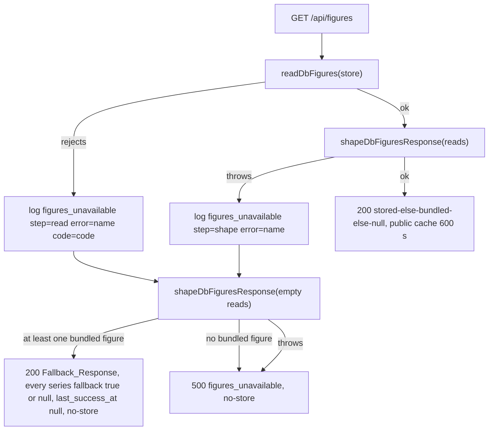
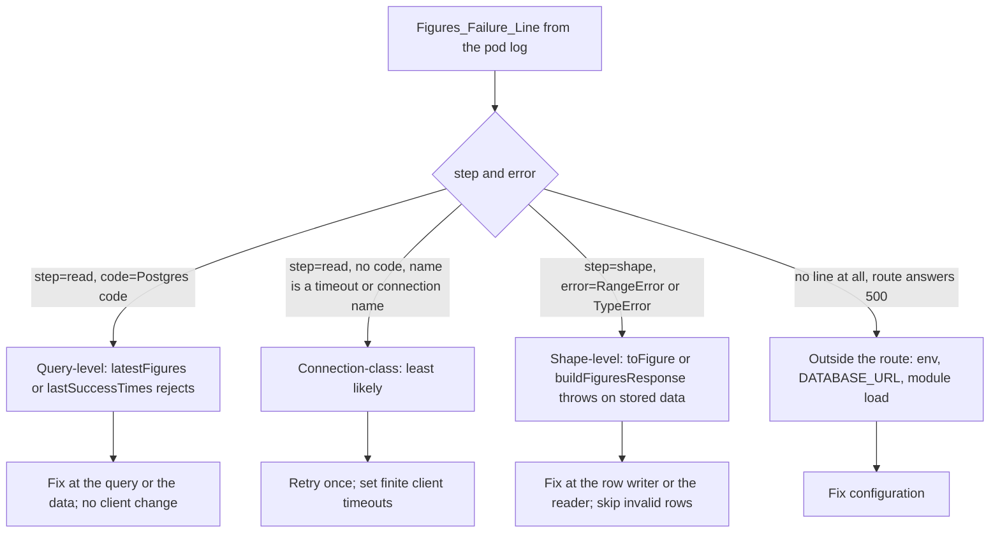
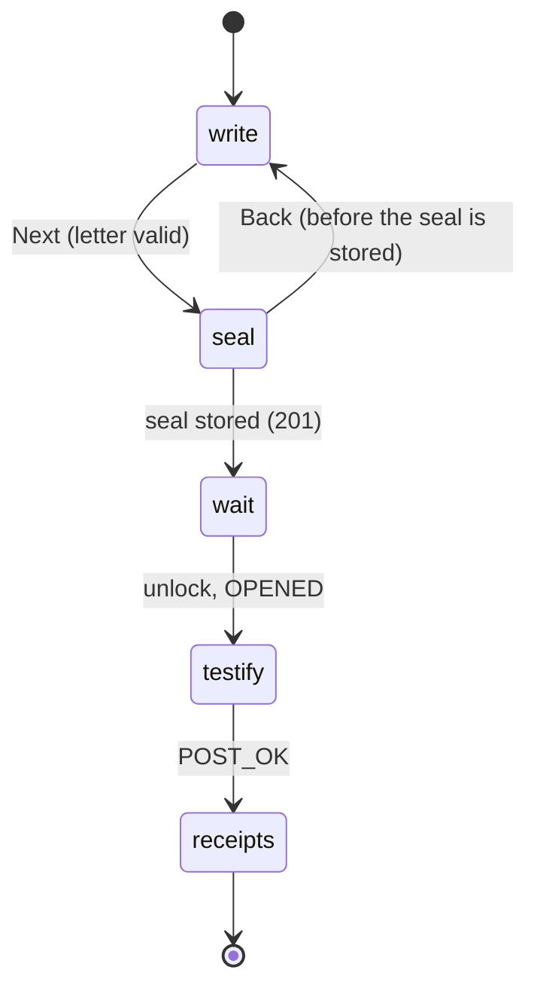
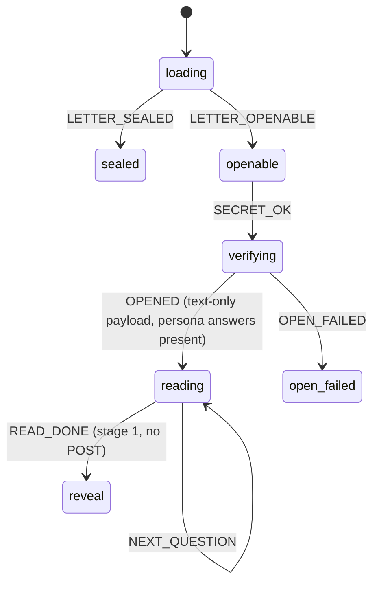

# Design Document

Spec: 11 Any letter

## Overview

This design makes the outage survivable, makes the monitor honest, and turns Revenant into a general "seal what you believe now, open it later" letter. Price figures stay as an optional receipt. It is written against `main` at `ec84037`, the commit the requirements were checked on. The files and functions named here were read at that commit: `src/app/api/figures/respond.ts` and `db-response.ts`, and the live, reveal, ceremony, landing and persona code named in the requirements' "Code facts" table. Values this design proposes are marked "proposed" and the owner can change them in the task's issue.

Nothing in `src/lib/seal-format/**`, `src/lib/crypto/**`, `src/app/api/letters/**`, `src/app/api/openings/**`, `src/lib/letter-store/**`, `drizzle/` (apart from a data fix X1 may name), the chart, the CSP or any `format_version` changes. A letter with no figures is a v1 payload with `metrics: []` and `figures: []`. The Occasion is never stored. Text questions are v1 `"text"` questions.

The work is in five groups, in priority order: S (steering, owner), X and W (production and the walk, P0), L (the general letter), P (personas), H (landing and presentation).

### Decisions this design takes

| Topic | Decision | Reason |
|---|---|---|
| Figures fallback | On the server only. When the read or shape step fails, `respondFigures` answers 200 with `shapeDbFiguresResponse({ rows: [], successTimes: new Map() }, CATALOGUE, generatedAt)`. | That call already runs `chooseFigure(null, bundledLatestFigure(cat))` for every series, so every figure is the bundled latest with `fallback: true`, or `null`. It needs no new fallback code, and no figure goes to the browser. |
| Readiness | `/api/health/ready` stays database-only through its own probe client. | One replica: a failing readiness removes the only pod. After X2 letters don't need figures. The Journey_Check is the figures monitor. |
| Live_Stepper | Five steps: Write, Press the seal, Wait, Testify, See the receipts. | The figures step goes (L1.6). |
| Text_Persona | Her answers live in `content/personas/letters/answers.json`. They are never sealed, stored on the server or posted. | P1.5. No Recall_Record exists for this walk. |
| Coven strip | Static, no props, one line and two links. | H1.2. No build-time data. |
| X1 | Observability first, then the fix the data names. The design lists candidates and what discriminates between them. | The cause isn't known from code. |
| Roles | Every component below has one owner role from `.github/agents.json`. Cross-role work is split into tasks (G1.8). | See "File ownership". |

### Production findings and their causes on `main`

| Finding | Cause on `main` | Fix |
|---|---|---|
| `/api/figures` answers 500 | `respondFigures` wraps both steps in one `try`; any throw is a 500. The cause of the throw is not known from code (see "X1 investigation plan"). | X1 finds it. X3 makes the route survive it. |
| Live demo stuck at step 2 | `WriteForm.tsx` sets `formReady` only when `figuresStatus === "ready"`; `SealPage.tsx` lines 164 to 167 build the seal flow only when `crypto !== null && figuresReady`; `minFiguresFor` returns 0 only for `real` with a question. | X2 removes the dependency. L1 replaces the minimum. |
| Reveal says "Check your connection" | `useFigures`/`loadFigures` map every failure to `{status:"failed"}`; `nowMessageFor` returns `REVEAL_COPY.nowUnavailableFetch`. | X3.6, X3.7. |
| `marks` hint and Skip_Link nearly invisible | `.hint` and `.textLink` in `SealBreak.module.css` use `var(--ink)` (#1f1b16) on the dark scene. At 900 px and wider the Seal_Group is portalled into `.heldSlot` inside `.bob` inside `.ghostLayer` (`aria-hidden="true"`). | X5. |
| Journey_Check always red | J5 waits for the `intact` Stage and J2 presses "Pick up the letter"; spec 10 removed both. J6 PH1 measures a Landing_Ghost box different from the one measured by hand. | X4. |
| Reads as a fuel tool | `heroSentence`, `ritualSteps[1]`, the live demo and both personas are about petrol. Five landing sections are built and not rendered. | L, P, H. |
| Write step 1,964 px long | Prompt_Starters, five Question_Starters, "Your own numbers" and the figure picker are all in one column. | L3. |
| Sample answer equals the record | `samples.json` lists `3.64`, `3.89`, `1.79`, `1.65` first, equal to the Then_Value at two decimals. | P2. |
| Fictional note three times on Testify | `TopBar`, `PersonaIntro` and `TestifyContext` all render it. | P3. |
| Receipts print "3.643" next to "3.64" | `ReceiptCard` calls `formatValue` with no `fractionDigits`. | P5. |

### What else exists on `main` and what happens to it

| Item | State | Handled in |
|---|---|---|
| `SampleReceipt`, `SampleReceiptView`, `sample-receipt.ts` | Built, unimported, call `/api/figures` | Deleted (H1.2). |
| `CovenStrip` with `KiroStats`, `countLabel`, `stats` prop | Built, unimported; `src/lib/kiro-stats.ts` and the `env` entry don't exist | Reduced to a static strip (H1.2). |
| `RitualSection`, `ResurrectionSection`, `NoSealSection` | Built, unimported | Rewritten and rendered (H1). |
| `minFiguresFor`, `MIN_FIGURES`, `figures_none` in `live/form.ts` | Used by `WriteForm`, `validateWrite` | Replaced by one rule (L1.3). |
| Prompt_Starters, Question_Starters, `livePrefill` | Used by `WriteForm` | Retired (L2.7, L4.2). |
| `REVEAL_COPY.nowUnavailableFetch` | Used by `nowMessageFor` | Removed (X3.7). |
| `Reveal.tsx` stage 2 to `close` for letters with no figures | Already handled by `stages.ts` and `closeShown` (spec 10 C8.9) | L5 lists the strings that still say "figures" or "numbers" for such a letter. |
| `personas.json` schema (`metrics` `min(1)`, no question field) | Fuel personas only | P1 relaxes it. |

## Architecture

### Figures request: before and after



- The route never returns a partial list. It returns either the database answer, the Fallback_Response, or 500.
- The Fallback_Response is `no-store`, so the first request after the database recovers reads it again.
- The browser is unchanged apart from the Reveal's "request failed" line. It reads `fallback: true` today (`pickNow` returns `fallback: entry.fallback ?? false`; `nowMessageFor` returns `REVEAL_COPY.fallbackNote`).
- The Journey_Check J1 fails on any `fallback: true` or null figure, so the outage stays visible.

### X1 investigation plan (evidence first)

The requirements' code facts rule out the shared client as the first suspect: on 10 November `GET /api/letters/<id>` answered 200 and `POST /api/openings` 201 on the same client in the page load in which `GET /api/figures` answered 500. `/api/figures` fails in one of its two steps, and the log line says which.



#### Candidates, in the order X1.1 gives

| # | Class | What would throw | Discriminator in the owner's data | Fix place |
|---|---|---|---|---|
| 1 | Query-level | A Postgres error with a `code` from `latestFigures()` (`SELECT DISTINCT ON … ORDER BY …, period DESC, retrieved_at DESC, id DESC` over `figures`) or from `lastSuccessTimes()` (`max(run_started_at)` per `metric_id` over `figure_fetch_runs`): statement timeout `57014`, lock or cancel, a missing relation `42P01`, too many connections `53300` | `code=` in the log line; run both queries by hand in `psql` with `\timing` and `EXPLAIN (ANALYZE, BUFFERS)` during a failure | The query or the index (`figures_series_latest_idx`, `figure_fetch_runs_success_idx`), or the data that makes it slow |
| 2 | Shape-level | `toFigure` calls `row.retrieved_at.toISOString()`, which throws a `RangeError` for an invalid date and a `TypeError` for null; `shapeDbFiguresResponse` maps every returned row, including rows for series outside the Catalogue, so one bad row fails the whole response. `buildFiguresResponse` or `chooseFigure` could also throw on a field. | `step=shape error=RangeError` or `TypeError`, no code; the rows from `latestFigures()` show a null or odd `retrieved_at`, `period` or `value` | The row writer (the Fetch_Job or the Fallback_Refresh) or the reader (`toFigure`) |
| 3 | Data that depends on the time of day | Rows that appear, change or lapse during the day: the Fetch_Job runs at 06:17 UTC; the Fallback_Refresh writes rows on demand; a later row can become the `DISTINCT ON` winner | Compare the `latestFigures()` output taken in a healthy morning with one taken in a failing evening; list `figures` rows with `retrieved_at` after 06:17 UTC; list `figure_fetch_runs` rows by `run_started_at` and `outcome` | Whatever writes the bad row |
| 4 | Outside the route | A missing `DATABASE_URL` is a 500 inside the error boundary but should still log a line; a pod restart or database restart mid-day | No `figures_unavailable` line in a failing hour; pod restart times from `kubectl get pod`; database restart times | Configuration or platform |
| 5 | Connection-class (`CONNECTION_CLOSED`, `CONNECTION_ENDED`, `CONNECT_TIMEOUT`, `ECONNRESET`) | An idle connection closed by the server or a network layer | `error=` names one of these, and letter routes failed in the same minutes | Retry once; client timeouts (X1.6) |

#### Morning-pass, evening-fail explanation

The evidence is four J1 samples: pass at 07:14 UTC on 9 November and 07:46 UTC on 10 November; fail at 22:43 UTC on 9 November and 20:02 UTC on 10 November. Nothing in `respond.ts`, `db-response.ts` or `build-response.ts` reads the clock except `generated_at`, so a time-of-day pattern must come from the data or from outside the route. The task proves which one by diffing two captures:

1. **Healthy capture** (morning, after 06:17 UTC): the Figures_Failure_Lines grep (none expected), the `latestFigures()` rows, the `lastSuccessTimes()` rows, `select count(*), max(retrieved_at) from figures`, and `select metric_id, outcome, run_started_at from figure_fetch_runs order by run_started_at desc limit 40`.
2. **Failing capture** (after 18:00 UTC): the same five.
3. **Diff.** The explanation names the row, run or event that is present only in the failing capture, with its timestamp. Likely shapes: a row written after the morning job with an invalid `retrieved_at` or `period`; a `figure_fetch_runs` outcome that changes what a join returns; a restart. A theory that fits the four J1 times but is not quoted from the data does not close the task (X1.3).
4. **Cache check.** A success is cached `public, max-age=600, stale-while-revalidate=3600` (`FIGURES_CACHE_CONTROL`). A failure is `no-store`. A cached success could make a failing pod look healthy for at most 70 minutes, never for hours, so caching cannot explain the pattern. It can make J1 read stale. The Journey_Check adds a cache-busting query string to its J1 request in the Owner_Patch (X4).

#### Reproduction harness (X1.4, X1.9)

`src/app/api/figures/fixtures.test-data.ts` (new, imported by tests only) holds the shapes the code can fail on: a row with `retrieved_at: new Date("invalid")`, a row with `retrieved_at: null as never`, a row for a series outside the Catalogue with a bad date, a store that rejects with `{ name: "PostgresError", code: "57014" }`, and one that rejects with `{ name: "Error", code: "CONNECTION_CLOSED" }`. The tests assert the status, the body, the `Cache-Control` header and the one log line. Once the owner's data names the cause, the task replaces or extends the fixture with the owner's rows (identifying values kept, nothing invented). The test fails before the fix and passes after. With no data, the harness is delivered and the task stays open (X1.9).

#### Fixes the data can name

| Cause | Fix | Role |
|---|---|---|
| Invalid row, written by the row writer | Fix the writer (`scripts/fetch-figures*`), add a `CHECK` or validation at insert if the data shows one is missing | data-dev |
| Invalid row, reader too strict | `toFigure` stays; `shapeDbFiguresResponse` validates each row first, skips a row that fails, logs `figures_row_skipped metric_id=<id>` once per metric (never the value), and lets `chooseFigure` pick stored, else bundled, else null for that series (X1.7) | data-dev |
| Slow or failing query | Fix the query or add an index in a migration | data-dev (`drizzle/` is shared with platform-dev and crypto-dev in `agents.json`; the task names which migration) |
| Connection-class error | `readWithRetry` retries the read once on a fresh connection for the five connection names only; `getSql()` gets finite `connect_timeout`, `idle_timeout` and `max_lifetime` (proposed 5 s, 30 s and 1,800 s) | data-dev (retry), platform-dev (client options) |
| Configuration | Fix the Secret or values; owner | owner |

The retry and the client options are conditional: if the lines name no connection-class error, neither changes (X1.6).

### Live_Stepper after this spec



- Names come from `BRAND_COPY.ritualSteps[0]`, `ritualSteps[1]`, `LIVE_COPY.waitStep`, and `ritualSteps[2..3]` after the Ritual drops to four entries (H2.2). `live-steps.ts` lists five keys: `write`, `seal`, `wait`, `testify`, `receipts`.
- The figures state never gates a step. The Write step and the seal step read it only to decide what the Receipts_Disclosure shows (X2).
- `stepForFlowPhase` is unchanged except that its numbering is five-based. The Step_Indicator shows five items; the Wait step is 3 of 5.

### Text_Persona flow



- A state `reading` replaces `recall`, `submitting` and `submit_failed` for the Text_Persona. It is entered by the same `enterRecall` helper, which returns `reading` when the page passed `personaAnswers` and the payload has text questions only.
- `reading` carries `index` (the question shown), and `testimony`, a display-only list built from the payload questions and the Persona_Answers. It carries no draft and no record.
- No effect in `reading` posts anything. `READ_DONE` goes to `reveal` at stage 1. `useOpeningFlow` has no `submit` call on this path. A fetch stub asserts no request to `/api/openings` (P1.5).
- The Reveal gets its Answer_List and testimony block from `testimony` and labels each entry with the Fictional_Label.
- The fuel personas and the live and real letters keep the existing `recall` → `submitting` → `reveal` path unchanged.

### Stages and steps for a letter with no figures

`stageFor` for `reveal`: stage 2 is `letter`; stage 3 is `close` when `payload.figures` has no official figure and no self-reported figure, else `figures`. A letter whose only figures are self-reported keeps the `figures` Stage showing only "Your own numbers" (spec 10 R1.4). The persona Step_Indicator for a text-only persona shows Testify, Break the seal, Read (three items).

### Where the pages say "numbers" or "figures" for a letter that has none

| Place | Today | With no figures |
|---|---|---|
| `Reveal.tsx` `skipToReceipts` | "Skip to the receipts" | `skipToLetter` ("Skip to the letter"), already in spec 10 |
| `Reveal.tsx` stage 2 controls | "See the receipts", "Show everything" | not rendered |
| `closeLine` / persona Close | mentions the record of prices | persona Close names the testimony and the letter only (`closeLineNoFigures`); live Close drops the "longer comparison" sentence (L4.4) |
| `steps.ts` persona list | four steps | three steps |
| `FiguresThenNow`, `ReceiptCard`, `NumberLine` | rendered | not rendered; the markup test asserts none of them (L5.5) |
| `useFigures()` in `Reveal.tsx` | always called | not called when the payload has no official figure (no request) |

## Components and Interfaces

### S1. Steering patches (owner, task 1)

The owner confirmed the four proposals under "Steering conflicts to confirm". The `product.md`, `tone.md` and `neutrality.md` patches add exactly this text, and the other items in S1.2 to S1.5 change only the lines named there.

- `product.md`, Demo 1, add: "One persona is the exception. Her letter carries her own questions and no figures. Her answers to them are pre-written content, labelled as fictional on every screen that shows them. The judge reads her answers, breaks the seal and reads her letter. No answer of the judge's is recorded for this persona." And: "The fuel personas and the live demo make the judge testify. The text persona shows what a testimony beside a letter looks like, in someone else's words."
- `tone.md`, Testify, add: "For the text persona the step shows one question and her answer at a time, with a plain control to go on. Her answers are labelled as fictional. The wording never grades them." Copy, add: a question is written for the reader on the opening day and names the sealing day. Add a "Rehearsal" line: the 30-second demo says plainly that it is a rehearsal.
- `neutrality.md`, Demo persona letters, add: "A persona's pre-written answers follow the same rules as her letter: everyday life only, no price, no party, policy or election term. They differ from her letter only in ordinary, neutral ways (a different detail, a different order, a different emphasis). The page does not point at, mark, count or explain any difference, and no wording calls an answer right, wrong, close, off or accurate." Add: Occasion starters and questions follow the persona-letter rules.
- `structure.md`: add `src/components/live/occasions.ts`, `src/components/reveal/short-names.ts`, `content/personas/letters/answers.json`, the landing sections that remain, the removal of `SampleReceipt`, and the static `CovenStrip`.

### X2. A live path that never waits on figures (frontend-dev)

Files: `src/components/live/**`, `src/components/seal/**` (the `/seal` page client parts), `src/app/**/*.tsx` only for the page wrappers.

- `src/components/live/figures-state.ts` (pure):

  ```ts
  export type FiguresState =
    | { status: "loading" }
    | { status: "ready"; response: FiguresResponseV1 }
    | { status: "failed" };
  export const FIGURES_TIMEOUT_MS = 30_000;
  export function figuresStateFrom(result: LoadResult | "timeout"): FiguresState;
  ```

  `loadFigures` already maps a rejected fetch, a non-200 and a body `parseFiguresResponse` rejects to `failed`. The live hook wraps it in an `AbortController` with `FIGURES_TIMEOUT_MS`; an abort is `failed`.
- `SealPage.tsx`: the seal flow is built when `crypto !== null`; `figuresReady` leaves the condition. `WriteForm.tsx`: `formReady` no longer reads `figuresStatus`. The seal control is live exactly when the crypto module has loaded, the letter and questions are valid and the flow state allows it (X2.9).
- `ReceiptsDisclosure.tsx` (new, client) renders the closed `details` of L1.4. Its body depends on the state: `loading` shows `receiptsLoading` only; `failed` shows `receiptsUnavailable` and no picker; `ready` shows the sentence, the picker and "Your own numbers".
- `figuresSnapshot` (X2.6): when the visitor presses the seal control, the runner copies the chosen metric IDs and the figures it needs from the response into the seal inputs. A later response is ignored for that seal. Late success before the press only makes the picker appear; it never changes text, questions, Occasion or an already chosen figure (X2.5).
- If the figures request failed, `metricIds` is empty, so `buildLivePayload` gets 0 official figures and the request sequence is the one for any 0-figure letter (X2.4). `/seal` uses the same code (X2.7).

### X3. Server fallback and the Reveal line

**Data-dev (`src/app/api/figures/**`, `src/lib/figures/**`):**

```ts
// respond.ts
export function fallbackResponse(generatedAt: string): FiguresResponseV1 {
  return shapeDbFiguresResponse(
    { rows: [], successTimes: new Map() },
    CATALOGUE,
    generatedAt,
  );
}
export function hasAnyBundled(body: FiguresResponseV1): boolean {
  return body.series.some((s) => s.figure !== null);
}
```

- In the `catch`, after `console.error(figuresFailureLine(step, err))`, the route builds `fallbackResponse(generatedAt)` inside its own `try`. If it throws, or `hasAnyBundled` is false, it answers 500 `{"error":"figures_unavailable"}` with `Cache-Control: no-store`. Otherwise it answers 200 with `Cache-Control: no-store`.
- `last_success_at` is `null` for every series because the success map is empty.
- `bundledLatestFigure` returns a copy of the latest non-fixture figure in `fuel-figures.json`, field for field. The test asserts no Fixture_Figure and no changed field.
- The header comment of `respond.ts` and the spec 08 design rule are rewritten (X3.10).
- `readStore` throwing (a missing `DATABASE_URL`) is inside the same boundary and falls back the same way. File mode is unchanged.
- The `displayed` JSON is unchanged: `fallback` is already an optional boolean in the response schema, so `parseFiguresResponse` accepts it.

**Frontend-dev (`src/components/reveal/**`):**

- `figures-api.ts`: `loadFigures` returns `{ status: "failed" }` as today. `nowMessageFor` returns the Neutral_Gap_Line (`nowRequestFailed`) for a failed request, `nowNotYet` or `nowRetired` for a null or missing series, the Bundled_Note for `fallback: true`, and nothing for a plain figure. `REVEAL_COPY.nowUnavailableFetch` is deleted.
- A Now_Figure with `fallback: true` shows its own period and retrieved date. The comparability checks in `lib/figures` decide whether a change is computed; the change is never computed from a mismatched series.
- The Then_Figure with its period always shows.

### X4. A quiet, working Journey_Check (owner patch plus frontend page fixes)

The Journey_Check is owner-only, so X4 is an Owner_Patch, with page fixes where the check is right.

| Check | Today | After the patch |
|---|---|---|
| J1 | figures non-null | Fails on non-200, a body that doesn't parse, any series with `fallback: true` or a null figure. The request carries `?cb=<run id>` so a cached success cannot hide a failing pod. |
| J2 | Waits for `intact`, presses "Pick up the letter" | Starts at `recall`, presses no pick-up control; for the Text_Persona walks Next to `close` without typing; fails when any `[data-figure-entry]` has neither a Now_Figure, the Neutral_Gap_Line nor the Bundled_Note. Runs at 00:47 UTC and on manual runs only (each fuel walk stores one Recall_Record). |
| J3 | Figure checkbox on `/demo/live` | Looks inside the Receipts_Disclosure. |
| J5 | Waits for `intact` | Waits for `recall`. |
| J6 PH1 | Fails on `/` and `/demo/live` at phone sizes | Each failure is fixed on the page (frontend task 9) or the threshold is corrected, with the measurement; `/demo/live` Write uses L3's thresholds. |
| J9 (new) | none | Opens `/demo/live`, writes one sentence and one question, reaches "Press the seal" with 0 figures, stops. No write request. Runs every time. |
| J10 (new, conditional) | none | Same for `/seal`, only if the owner records a go on 20 November (L6). |

- The first X4 task lists every check that fails on a healthy production today, reconciles the Landing_Ghost numbers (471 to 670 px in the check against 254 to 454 px measured after 3 s: the check probably reads `getBoundingClientRect` before the ghost's entry transform settles, so it waits for `animationend` or 3 s and the task confirms), and decides per check: fix the page or fix the check.
- A run on a healthy production build passes J1 to J9, and the output is attached to the issue (X4.5). The Journey_Issue lists only failed checks and closes on a pass (kept).
- `/api/health/ready` is unchanged: its own probe client (`max: 1`, `connect_timeout: 2`, `idle_timeout: 2`), no figures probe. The reasons go in the PR description (X4.7).

### X5. The `marks` controls (frontend-dev)

- **Colours.** `.hint` and `.textLink` in `SealBreak.module.css` use `var(--on-purple)` (#ffffff). `contrast.test.ts` gains a pair for every text colour used in the Seal_Group on `--bg` and on the lightest stop of the shaft (`#8F46FF` at 0.4 over `--bg`), read from the CSS tokens. It prints the ratios; the task also attaches measured ratios at 2560×1440, 1366×800 and 1280×800 (X5.7).
- **Out of the hidden subtree.** The Seal_Button, hint and Skip_Link render in `[data-seal-group]` in a new sibling layer, `.marksLayer` (`position: fixed`, `z-index` above `.ghostLayer`, not `aria-hidden`), placed in CSS from the same scene variables that place the Ghost_Body_Box edge, so the visual position at 900 px and wider is the one spec 10 C6 fixed (20 px outside the body edge facing the column, centred on the WaxSeal). The pressable `HeldSeal` stays in the Ghost and stays `aria-hidden` and non-focusable.
- **Still.** `.bob` has no animation while `data-stage` is `marks` or `seal` (`data-hold-still`), so the pressable seal and the controls don't move (X5.5).
- **Test.** `src/components/ceremony/focusable-under-hidden.ts` (pure) takes an HTML string and returns every focusable element (`button`, `a[href]`, `input`, `select`, `textarea`, `summary`, or `tabindex` of 0 or more) that has an `aria-hidden="true"` ancestor. It uses a small tag tokenizer with a stack (void elements handled), no new dependency. The ceremony test renders every Stage at a wide and a phone layout and fails on any result (X5.4).
- The C6 layout rules and the existing GZ1 and G1 to G3 layout checks still pass (X5.6).

### W1. The walk (platform-dev)

`src/test/integration/live-walk.test.ts` (shared path; platform-dev owns `src/test/**`) replays the Walk. It runs by hand with `WALK=1`, and in CI only if it can run without a browser; the PR says which. The Walk itself uses `npm run build`, `next start`, a local PostgreSQL with migrations, `RP_ID=localhost`, `APP_ORIGIN=http://localhost:3000`, and headless Chromium with a virtual authenticator that reports PRF. Variants: figures available; `/api/figures` forced to fail (expected blocked until X2); the backup-key path; a letter with one question and no figure (expected blocked until L1). The Walk_Findings go in the issue body with per-step pass or fail, observed result, screenshot names at 1366×800 and 390×844, and the suspected file for each defect. The task changes no product file. After X2 merges only the forced-failure variant is re-run (W1.7). The findings say which of the four unverified steps passed (W1.8).

### L1. A letter with no figures (frontend-dev)

- `src/components/live/form.ts`: `minFiguresFor`, `MIN_FIGURES` and `figures_none` are removed. New:

  ```ts
  export function hasSomethingToTestify(input: {
    questions: readonly string[];
    officialFigureCount: number;
  }): boolean;
  // true when at least one question is non-empty after trim, or officialFigureCount >= 1
  ```

  `validateWrite` reports `nothing_to_testify` when it is false. Self-reported rows never count. The rule is the same in `demo` and `real` mode.
- Every Occasion, including Blank, starts with the default question (L1.2), so a letter never starts blocked. The block appears only after the author removes every question, and the message shows after touch or a seal attempt.
- `ReceiptsDisclosure` holds the figure picker and "Your own numbers", after the question rows, closed by default, a native `details` with its content in the document (L1.4). It begins with `receiptsExplain` (L1.5).
- `live-steps.ts` has five steps; the Step_Indicator shows five items; Back keeps the draft before the seal is stored and is not offered after (spec 09 D2.2, D2.3).
- `build-payload.ts` already accepts empty `metricIds`. A test covers 0 official figures with 1 to 3 questions in both modes, and self-reported-only with a question (L1.7). The seal requests and their order are unchanged, and the first asynchronous call of the passkey press stays the WebAuthn call.

### L2. Occasions (frontend-dev)

`src/components/live/occasions.ts` (pure):

```ts
export type OccasionId = "year" | "work" | "family" | "decision" | "blank";
export interface Occasion { id: OccasionId; label: string; starter: string; questions: readonly string[] }
export const OCCASIONS: readonly Occasion[];            // the Occasion_Table
export const DEFAULT_QUESTION = "Before you read it, what do you remember writing?";
export function applyOccasion(draft: OccasionDraft, id: OccasionId): OccasionDraft;
```

`OccasionDraft` is `{ text; questions: string[]; occasion: OccasionId; appliedStarter: string; appliedQuestions: readonly string[] }`, kept in the mounted `WriteDraft`. It lives only in memory.

`applyOccasion` rules (L2.2):

1. The letter text becomes the new starter only if it is empty after trim or equals `appliedStarter`. Otherwise it is untouched.
2. For each row index `i` from 0 to 2: if the row is empty or equals `appliedQuestions[i]` (unedited), it becomes `occasion.questions[i]`, or is dropped when the Occasion has no question `i`. A row the visitor typed is kept.
3. Rows are compacted in order, at most 3. The first Occasion question is always the default, so an untouched draft always has at least one question. If the visitor typed over row 0 and removed the others, the rows are still non-empty.
4. `appliedStarter` and `appliedQuestions` are updated to the new Occasion's values.

The Occasion control is a row of buttons with `aria-pressed`, targets of at least 44×44 CSS px below 600 px, wrapping rather than scrolling (L2.9). No request carries it, the payload has no key for it, and nothing is written to storage, cookies or the URL (L2.5).

The Occasion_Table is the one in the requirements (L2.8). The prediction question ("When you wrote this, what did you think would have happened by the day you opened it?") is an ordinary Author_Question; nothing scores or resolves it (L2.11). Question checks (L2.3): 1 to 200 code points, a Sealing_Day_Anchor ("writing" or "when you wrote this" or "the day you sealed this"), no digit, no party, policy or election term, none of "right now", "today", "currently", "this year", no word that presumes an answer. Starters: one or two sentences, no digit. The design records the copy reviewer's name in the task before merge.

### L3. A Write step that fits (frontend-dev)

Above Next the step holds only: the Occasion control, the letter field with its count, up to three question rows with "Add a question", one hint line (`authorQuestionsHint`), and the closed disclosure. The Prompt_Starters, Question_Starters and `answerInLetter` line are gone. The Rehearsal_Line belongs to the page heading block, not to the content above Next.

Height budget at 1366×800 (proposed; the task measures): Top_Bar and Step_Indicator 112; heading and Rehearsal_Line 88; Occasion row 52; letter field label, 3 rows and count 150; legend and hint 56; three question rows at 48 each 144; disclosure summary 48; Next 56; gaps 40; total about 746, under 800 − 0 of the First_Viewport. If the measurement shows it doesn't fit, the fallbacks in order are: question rows at 44 px with an inline label; a two-column grid at 900 px and wider (letter and Occasion left, questions and disclosure right); then a "Questions (3)" summary that opens the rows. At 390×844 the same stack, with the Occasion buttons on two lines (60 px), about 800 of 844. At 360×640 the page may scroll but is at most 960 px tall with no horizontal scroll (L3.3).

The letter field keeps its three-row start and half-viewport cap (spec 09 P9). Validation messages show after touch or a seal attempt (spec 09 A4.4). The Owner_Patch sets the PH1 threshold for the Write step to L3.1 to L3.3 and names L3 in its message (L3.7).

### L4. The rehearsal (frontend-dev)

`LIVE_COPY.rehearsalLine` shows under the `/demo/live` Write heading and next to the Wait countdown. `/demo/live` starts with Blank chosen, so its first row holds the default question. The Live_Prefill and `livePrefill` key are removed. The live Close note says the letter was locked for 30 seconds and that a real letter stays sealed for months. "For a longer comparison, open a persona letter." shows only when the letter holds official figures; the link to the personas shows always. The Rehearsal_Line has no place on `/seal`, on `/l/[id]` for a Real_Letter or on any persona page, enforced by a `rehearsal` prop that only `/demo/live` passes.

### L5. A complete ending with no figures (frontend-dev)

The no-figures path is the one in "Stages and steps for a letter with no figures" and the table of places above. `closeLineNoFigures` is persona copy. The Skip_Link reads `skipToLetter`. A Real_Letter with no figures ends with no demo links (spec 08 R24.11 kept). A markup test per letter kind (persona text-only, live, real) asserts none of: a "then and now" heading, a `ReceiptCard`, a `NumberLine`, "figures" as a heading, a control named "See the receipts" or "See the numbers".

### L6. Real sealing decision (owner)

An owner issue records the go or no-go on 20 November. With no entry, the default is no-go: `REAL_SEALING` stays `off`, `/seal` is 404 and no page, README line, video script, write-up or metadata mentions it. With a go: the owner sets `realSealing: true` in the GitOps values (the chart default stays `false`); `/seal` shows `REAL_COPY.testNotice` and says the earliest opening is three months out; the live Close note links to `/seal`; the sealed view says a judge-sealed letter can't open before 29 January 2027; J10 is added.

### P1. The Text_Persona (frontend-dev, then crypto-dev)

**Content (frontend-dev, `content/personas/**`):**

- `personas.json` gains the entry with `metrics: []` and `author_questions: [...]` (1 to 3 strings, 1 to 200 code points), a new 22-character `letter_id`, a `written_as_of` in one of the three windows and a plain `opens_at`. The key is chosen with the letter (proposed `us-priya`; the persona is chosen after the owner reads the draft).
- `letters/<key>.txt` is the letter. `letters/<key>-copy-test.md` records the copy test for the letter and the answers, with the reviewer's name, before sealing (P1.4, P1.8).
- `letters/answers.json` (new): `Record<personaKey, string[]>`, one answer per question, 1 to 500 code points, in her voice, first person. Never sealed, never in a table, never sent by an API.
- Answers and letter differ in plain ways (a different detail, a different order, a different emphasis) that don't touch money, health, character, competence or politics. No answer refers to the letter, remembering, forgetting, changing her mind or a mistake.

**Schema (`src/lib/personas/schema.ts`, `answers.ts`):**

```ts
metrics: z.array(metricSchema).max(2)   // min(1) removed
author_questions: z.array(questionText).max(3).optional()
// refine: metrics.length > 0 || author_questions.length > 0
export function validatePersonaAnswers(list: PersonaList, answers: PersonaAnswers): void
// every persona with author_questions has an answers entry of the same length; every answer 1..500 code points; no entry for a persona without questions
```

The fuel personas are unchanged, so their sealed payloads stay byte-identical (P1.2).

**Letter checks (`letter-checks.ts`):** a persona with no metrics expects zero price lines, and `checkLetterText` for it rejects any digit, `$`, `€`, `£` or currency word. `checkAnswerText(text)` applies the same rules and rejects the verdict words (right, wrong, close, near, off, accurate, changed, mistaken, forgot, remember) so an answer can't refer to the letter or to memory.

**Page and Reveal (frontend-dev):**

- `src/app/demo/personas/[key]/page.tsx` passes `personaAnswers` (the entry for that key, or undefined) to `OpeningFlow`.
- `RecallReader.tsx` (new, `src/components/ceremony/recall/`) shows one question at a time with its answer and the Fictional_Label, a primary control "Next question" (on all but the last) and "Break the seal" (on the last). It has no field, no "No answer", no sample and no Memory_Line. The Fastest_Path is one activation per question plus "Break the seal"; the QA step records the count (P1.6).
- `testimony` in the `reading` and `reveal` states gives the `AnswerList` and `AuthorTestimony` their entries. Both take an `answerLabel` prop: `saidJustNow` for the judge's own answers and `personaAnswerLabel` for hers. Every Persona_Answer is labelled, on `recall`, the `letter` Stage and the Close if it repeats them (P1.7).
- The fictional-persona note stays visible in every Stage (see P3). Nothing highlights, pairs, aligns, counts or explains a difference, and the order is her testimony, then her letter (P1.9).
- `PersonaCard` and the Demo_Index show three envelopes side by side at the Desktop_Sizes and stacked at the Phone_Sizes, with every open link inside the First_Viewport at 1366×800 and 1280×800 (P1.10).

**Sealing (crypto-dev, `scripts/seal-personas*`):** `buildPersonaPayload` seals a persona with no metrics as a v1 payload with `metrics: []`, `figures: []` and `recall_questions` from `author_questions` as `{ id: "a1", answer_type: "text", text }`. For a persona with metrics it behaves as before. The script reports the two fuel personas as `skipped`. It runs after the frontend schema task (G1.8). The owner runs it against production and confirms the new row exists before the image carrying the new ID is deployed (P1.11), the same order spec 10 P2.2 gave: the chart's init container runs migrations and then `seal-personas` when `demo.sealPersonas` is true, and a failing seal keeps the old pod serving.

### P2. Sample answers that are only samples (frontend-dev)

- `samples.json` loses its first entry (the Record_Candidate) in every list. Proposed lists (each against the Then_Value in the field's unit):

  | Question | Then | Candidates | Near (≤ 5 %) | Below (≤ 85 %) | Above (≥ 115 %) |
  |---|---|---|---|---|---|
  | Maya, regular | 3.643 | 3.59, 3.71, 2.99, 4.25 | 3.59 (98.5 %), 3.71 (101.8 %) | 2.99 (82.1 %) | 4.25 (116.7 %) |
  | Maya, diesel | 3.894 | 3.79, 3.95, 3.19, 4.59 | 3.79 (97.3 %), 3.95 (101.4 %) | 3.19 (81.9 %) | 4.59 (117.9 %) |
  | Tomás, unleaded | 1.7913… | 1.75, 1.85, 1.49, 2.09 | 1.75 (97.7 %), 1.85 (103.3 %) | 1.49 (83.2 %) | 2.09 (116.7 %) |
  | Tomás, diesel | 1.6451… | 1.62, 1.69, 1.35, 1.95 | 1.62 (98.5 %), 1.69 (102.7 %) | 1.35 (82.1 %) | 1.95 (118.5 %) |

  None equals the Then_Value at two decimals (3.64, 3.89, 1.79, 1.65). Each list has 4 candidates (3 to 5).
- `src/lib/personas/record-candidate.ts` from spec 10 stays as the function that computes the display-precision Then_Value; the samples test uses it to fail if any candidate equals it. `meetsSpreadRule` no longer counts a Record_Candidate: it needs one Near, one Below and one Above, using the exact `BigInt` classifier from spec 10.
- The Text_Persona has no entry. A test fails for an entry naming a persona without metrics or a metric the persona doesn't track.
- If the judge types the Then_Value, the Reveal treats it as any other answer (P2.5). Sealed payloads are unchanged (P2.6).

### P3. Say each thing once (frontend-dev)

During `recall` on a persona page the four items live in one component and no other renders them:

| Item | Kept by | Dropped from during `recall` |
|---|---|---|
| Fictional-persona note | `TestifyContext` | `TopBar`, `PersonaIntro` |
| Written-as-of line | `TestifyContext` | `PersonaIntro` |
| Opens line | `TestifyContext` | `PersonaIntro` |
| Seal-intact statement | `TestifyContext` | everywhere else |

`TopBar` and `PersonaIntro` take a `stage` prop and render the note and the date lines only when `stage !== "recall"`. In the Stages after `recall` (where `TestifyContext` isn't shown) the note shows in the `TopBar` at 600 px and wider and in the Compact_Top_Bar below that, so the reader always knows the letter is a demo (P3.3). A markup test counts the four items per persona in `recall` and fails when any count is not 1 (P3.5). The first question's field stays in the First_Viewport at every Evidence_Size and its primary control at every size but 360×640 (spec 10 C4.4 kept).

### P4. The letter in view (frontend-dev)

- The `Seal_Verdict` and its fingerprint control sit on one line above the paper.
- The testimony block stays above the letter (spec 10 C8.7). Each displayed answer is clamped to two lines (`-webkit-line-clamp: 2`) with a control that shows the full text; the full text is always in the document (P4.2).
- On entering `letter`, `focusTargetFor` still focuses the testimony or letter heading with `preventScroll`. Then, at the Phone_Sizes only, the Stage positions the paper's top edge just below the Top_Bar (`scrollIntoView` with a `scroll-margin-top` equal to the bar height), without moving focus away from the heading (P4.4). If the layout check LT1 shows the first three lines are out of view at a Desktop_Size, the same positioning applies there.
- LT1 `letter-first-lines` (Owner_Patch): the first three line boxes of `[data-letter-text]` are inside the viewport at the start of `letter`, for each persona.

### P5. Receipts at one precision (frontend-dev)

- `displayPrecisionForUnit(unit): number | undefined` returns 2 for `USD per gallon` and for `EUR per 1,000 litres` (shown per litre after the Display_Rescale) and `undefined` for other units, which keep their published precision.
- `ReceiptCard` shows Then and Now with `formatValue(shown, region, displayPrecisionForUnit(unit))` where `shown` is the rescaled value. The source details add "As published: {value} {unit}" with the exact sealed value. The change is computed from the As_Published_Values and its formula shows them. One line says the card rounds for display and the published values are in the source details.
- The heading is the Short_Name from `src/components/reveal/short-names.ts`: a literal lookup keyed by `metric_id`, with the sealed `display_name` as fallback. It never reads the Catalogue at runtime. The author copies one entry per Catalogue metric ID at the time of this spec: proposed `us-gasoline-regular` "Regular gasoline", `us-diesel` "Diesel", `eu-petrol-euro95` "Unleaded petrol", `eu-diesel` "Diesel". Each is at most 40 characters and has no direction word. The Series_Name shows under Source with the series ID and the link.
- The rules hold on persona, live and real letters.

### H1 and H2. Landing and brand copy

**Frontend-dev (`src/components/landing/**`, `src/lib/brand-copy*`):**

- `RitualSection`, `ResurrectionSection` and `NoSealSection` are rewritten for the general letter and name no fuel price as what a letter holds.
- `CovenStrip` becomes the static strip: it takes no props, shows the existing `covenTitle` ("Built by a coven of Kiro agents") and two links from `COVEN_LINKS` (the `.kiro` folder and `docs/agent-loop.md`). `KiroStats`, `countLabel`, the `stats` prop and the `covenCounts` copy keys are deleted. No `kiro-stats.ts`, no `env` entry.
- `SampleReceipt.tsx`, `SampleReceiptView.tsx`, `sample-receipt.ts` and their tests and copy keys are deleted.
- `BRAND_COPY.heroSentence`: "Seal what you believe now, a goal, a worry, a decision. When it opens, you testify first, then read what you wrote." `BRAND_COPY.ritualSteps` has four entries: Write, Press the seal, Testify, See the receipts. The Write line mentions up to three questions and an optional receipt. The See the receipts line is "Your testimony, then what you wrote, then any numbers then and now." The metadata, `HOME_DESCRIPTION`, the Open Graph source and the How_Page lead read from Brand_Copy (H2.3).
- "Seal the figures" as a step name and "fuel prices from the US or the EU" as what a letter holds join the Retired_Phrases for `src/`, with the copy-test records exempt.

**Platform-dev (`src/app/page.tsx`):** renders the three sections and the Coven_Strip below `LandingHero`, in that order, as server components. This task runs after the frontend task. It adds the source-scan test (`src/components/landing/imports.test.ts`) that fails on an unimported landing component (H1.3); that test lands here, not earlier, so `main` stays green after each merge. The How_Page link and repository link appear once, in the footer; the two Coven_Strip links appear once, only in the strip. One column and 44×44 targets at the Phone_Sizes. `/` stays at or under 160 kB and the hero First_Viewport rules still pass.

### H3 and H4. Presentation (owner)

README and `docs/kiro-writeup.md` edits are Owner_Patches attached to the final audit task, as the requirements list (H3.1 to H3.5, H4.1 to H4.4). The merged-PR count is recomputed at the final SHA with `gh pr list --state merged --limit 1000 --json number -q length`.

## Data Models

### Sealed payload for a letter with no figures

```json
{
  "format_version": 1,
  "letter_text": "…",
  "metrics": [],
  "figures": [],
  "recall_questions": [
    { "id": "a1", "answer_type": "text", "text": "Before you read it, what do you remember writing?" }
  ]
}
```

`src/lib/seal-format/v1/payload.ts` is not edited. A payload with only self-reported figures has `metrics` and `figures` holding those entries and still passes.

### Write draft (L1, L2)

```ts
interface WriteDraft {
  text: string;
  metricIds: string[];
  warningTicked: boolean;
  backupCardTicked: boolean;
  questions: string[];                    // 0 to 3 as typed
  selfReported: SelfReportedRow[];        // unchanged from spec 10
  occasion: OccasionId;                   // memory only, never sent
  appliedStarter: string;
  appliedQuestions: readonly string[];
}
```

### Figures_API entry

Unchanged from spec 09 A1: `{ metric, figure | null, fallback?: boolean, last_success_at: string | null, … }`. The Fallback_Response sets `fallback: true` where a bundled figure exists, `figure: null` and `fallback: false` where none does, and `last_success_at: null` everywhere.

### Persona_List additions (P1)

```json
{
  "key": "us-priya",
  "display_name": "Priya",
  "region": "United States",
  "letter_id": "<new 22-character ID>",
  "written_as_of": "2024-05-12",
  "opens_at": "2024-11-05T00:00:00.000Z",
  "metrics": [],
  "author_questions": ["…", "…"],
  "letter_path": "letters/us-priya.txt"
}
```

`answers.json`: `{ "us-priya": ["…", "…"] }`. The persona key, name and window are proposed; the owner picks them when reading the letter.

### Flow state additions

```ts
type FlowState = /* existing */ | {
  tag: "reading";
  opened: Opened;
  index: number;
  testimony: readonly { question: string; answer: string }[];   // display only
};
```

## Constants

| Name | Value | Module | Requirement |
|---|---|---|---|
| `FIGURES_TIMEOUT_MS` | 30,000 | `live/figures-state.ts` | X2.1 |
| `DEFAULT_QUESTION` | "Before you read it, what do you remember writing?" | `live/occasions.ts` | L1.2 |
| `OCCASION_QUESTIONS_MAX` | 3 | `live/occasions.ts` | L2.8 |
| `PERSONA_ANSWER_MAX_CODE_POINTS` | 500 | `lib/personas/answers.ts` | P1.2 |
| `PERSONA_QUESTIONS_MAX` | 3 | `lib/personas/schema.ts` | P1.2 |
| `ANSWER_CLAMP_LINES_LETTER` | 2 | `reveal.module.css` | P4.2 |
| `DISPLAY_PRECISION_FUEL` | 2 | `reveal/short-names.ts` neighbour `display-precision.ts` | P5.1 |
| `WRITE_PAGE_MAX_PX_PHONE` | 960 | `tools/qa/layout-check.mjs` | L3.3 |
| `CONNECT_TIMEOUT_S` / `IDLE_TIMEOUT_S` / `MAX_LIFETIME_S` | 5 / 30 / 1,800 (proposed, only if X1 names a connection error) | `lib/db/client.ts` | X1.6 |
| `CONNECTION_ERROR_NAMES` | `CONNECTION_CLOSED`, `CONNECTION_ENDED`, `CONNECT_TIMEOUT`, `ECONNRESET` | `api/figures/retry.ts` | X1.6 |

## Copy

Each string is asserted exactly by the task that adds it. None contains a Scoring_Words_Always word; none in a Scene_Copy_Module contains "close", "right", "wrong" or "near"; none calls an answer right, close, near, wrong, off or accurate.

| Module | Key | String | Requirement |
|---|---|---|---|
| `live/copy.ts` | `occasionLabels` | "The year ahead", "Work", "Family", "A decision", "Blank" | L2.1 |
| | `occasionLegend` | "What is it about?" | L2.1 |
| | `receiptsSummary` | "Add a receipt" | L1.4 |
| | `receiptsExplain` | "A receipt is a number sealed with its source and date, so you can compare it when the letter opens." | L1.5 |
| | `receiptsLoading` | "Loading the receipts you can add." | X2.2 |
| | `receiptsUnavailable` | "Receipts can't be added right now. Your letter doesn't need one." | X2.3 |
| | `nothingToTestify` | "Add a question or a receipt, so there is something to answer when the letter opens." | L1.2 |
| | `rehearsalLine` | "This is a rehearsal. A real letter stays sealed for months. This one opens in 30 seconds." | L4.1 |
| | `lockNote` | "This letter was locked for 30 seconds. A real letter stays sealed for months." | L4.4 |
| | `lockNoteComparison` | "For a longer comparison, open a persona letter." (letters with official figures only) | L4.4 |
| | `livePrefill`, `questionStarters`, `promptStarters`, `answerInLetter` | removed | L2.7, L4.2 |
| `reveal/copy.ts` | `nowRequestFailed` (Neutral_Gap_Line) | "No newer figure could be reached for this series." | X3.6 |
| | `nowUnavailableFetch` | removed | X3.7 |
| | `personaAnswerLabel` (Fictional_Label) | "Her answer (fictional)" | P1.7 |
| | `personaTestimonyTitle` | "Her questions to herself" | P1.6 |
| | `closeLineNoFigures` | "Her testimony and her letter are side by side. What they say is yours to read." | L5.2 |
| | `asPublished` | "As published: {value} {unit}" | P5.2 |
| | `roundedNote` | "Values on this card are rounded for display. The published values are in the source details." | P5.3 |
| `landing/copy.ts` | `heroSentence`, `ritualSteps` (four) | as in H2 | H2.1, H2.2 |
| | `covenTitle` | "Built by a coven of Kiro agents" (kept) | H1.2 |

Retired phrases added to `src/test/retired-phrases.test.ts`, `tools/hooks/tone-check.mjs` and the `copy-tone-check` hook by the task that removes the last source occurrence: "Check your connection and reload the page" (task 7), "What's on your mind right now?" (task 13), "Seal the figures" and "fuel prices from the US or the EU" (task 23).

## Correctness Properties

*A property is a characteristic or behavior that should hold true across all valid executions of a system-essentially, a formal statement about what the system should do. Properties serve as the bridge between human-readable specifications and machine-verifiable correctness guarantees.*

Each property is one fast-check test with `numRuns` of at least 100, tagged `// Feature: 11-any-letter, Property N: <title>`. Layout, contrast at measured sizes, production behaviour and the Walk are not properties; they are checked by the layout checks, the Production_Check and the Walk. The prework merged overlapping criteria: the figures-state criteria X2.1, X2.4 and X2.9 are one property; the Occasion criteria L2.2 and L2.10 are one; the persona schema criteria P1.2 and P1.12 are one.

| Property | Written in task | Extended in task |
|---|---|---|
| 1, 2, 3 | 5 (X3) | 3 (X1: the skipped row in 3) |
| 4 | 7 (X3 Reveal) | none |
| 5 | 6 (X2) | none |
| 6 | 10 (L1) | none |
| 7 | 11 (L2) | none |
| 8 | 11 (L2) | none |
| 9 | 10 (L1) | none |
| 10 | 10 (L1) | none |
| 11 | 14 (L5) | 19 (P1) |
| 12 | 8 (X5) | none |
| 13 | 19 (P1) | none |
| 14 | 19 (P1) | none |
| 15 | 19 (P1) | none |
| 16 | 15 (P2) | none |
| 17 | 18 (P5) | none |
| 18 | 18 (P5) | none |
| 19 | 13 (L4) | none |

### Property 1: The Fallback_Response copies bundled figures and invents nothing
*For any* catalogue and any bundled file content (including series with no bundled figure and series with only fixture figures), `fallbackResponse` returns one entry per catalogue series; each entry holds the series' latest non-fixture bundled figure copied field for field with `fallback: true`, or `figure: null` with `fallback: false`; every `last_success_at` is `null`; and no entry holds a fixture figure.
**Validates: Requirements 3.1, 3.2, 3.4** (as X3.1, X3.2, X3.4)

### Property 2: A failing read or shape step still answers, and logs only the line
*For any* store that rejects with any error name, message and optional Postgres code, and any shape step that throws any error, `respondFigures` in database mode answers 200 with the Fallback_Response and `Cache-Control: no-store` when at least one series has a bundled figure, and 500 `{"error":"figures_unavailable"}` with `no-store` otherwise; it logs exactly one line, `figures_unavailable step=<read|shape> error=<name> [code=<code>]`, and that line never contains the error's message, stack or cause.
**Validates: Requirements 3.1, 3.3, 3.4, 1.8** (as X3.1, X3.3, X3.4, X1.8)

### Property 3: Invalid stored rows are skipped, not fatal
*For any* set of stored rows in which some rows have an invalid or null `retrieved_at` (including rows for series outside the catalogue), `shapeDbFiguresResponse` answers without throwing; every series with at least one valid stored row uses its newest valid row with `fallback: false`; every other series uses its bundled figure with `fallback: true` or null; and each skipped row's `metric_id` is reported once and its value is never reported.
**Validates: Requirements 1.7, 1.8** (as X1.7, X1.8)

### Property 4: The Reveal shows the sealed figure and exactly one now outcome
*For any* sealed figure with or without a bundled figure and any outcome of the figures request (database success, fallback, null figure, missing series, 500, timeout, body `parseFiguresResponse` rejects), the rendered entry shows the Then_Figure with its period and exactly one of: a Now_Figure with the Bundled_Note, a Now_Figure with no note, or one gap line; and the text "Check your connection and reload the page" never appears.
**Validates: Requirements 3.5, 3.6, 3.8, 3.12** (as X3.5, X3.6, X3.8, X3.12)

### Property 5: Sealing never depends on figures
*For any* figures state (loading, failed, ready, late-ready) and any valid letter, the seal control is live exactly when the crypto module has loaded, the letter and questions are valid and the flow state allows it; Next is never disabled by the figures state; a figures response that arrives after the seal press does not change the chosen figures; and with a failed or loading state the built payload has 0 official figures.
**Validates: Requirements 2.1, 2.4, 2.5, 2.6, 2.9** (as X2.1, X2.4, X2.5, X2.6, X2.9)

### Property 6: A letter needs a question or an official figure
*For any* list of question rows, any count of official figures and any count of self-reported rows, in either mode, `hasSomethingToTestify` is true exactly when at least one row is non-empty after trimming or at least one official figure exists; self-reported rows never change the result; and `validateWrite` reports `nothing_to_testify` exactly when it is false and everything else is valid.
**Validates: Requirements 1.1, 1.2, 1.3** (as L1.1, L1.2, L1.3)

### Property 7: Applying an Occasion never overwrites what was typed
*For any* Occasion, any prior Write draft (including typed text, typed question rows, previously applied Occasions and removed rows) and any sequence of Occasion choices, the result keeps the letter text unless it was empty or an unedited starter; keeps every typed question row; has between 1 and 3 question rows; has a first row that is the default question or a row the visitor typed; and is never in the `nothing_to_testify` state.
**Validates: Requirements 2.2, 2.10, 1.2** (as L2.2, L2.10, L1.2)

### Property 8: Occasion text follows the copy rules and is never stored
*For any* Occasion in the table, every question is 1 to 200 code points, carries a Sealing_Day_Anchor, and contains no digit, no party, policy or election term and none of "right now", "today", "currently" or "this year"; every starter has at most two sentences and no digit; and for any Occasion choice the seal request bodies and the payload equal those built from the resulting text and rows alone, with no Occasion identifier anywhere.
**Validates: Requirements 2.3, 2.4, 2.5, 2.11** (as L2.3, L2.4, L2.5, L2.11)

### Property 9: Letters with no official figures seal as v1
*For any* 1 to 3 trimmed questions and any 0 to 10 valid self-reported rows, in either mode, `buildLivePayload` with no chosen official figure returns a payload that `payloadV1Schema` accepts with `format_version: 1`, `recall_questions` holding exactly the questions as `"text"` items in order, and `metrics` and `figures` holding only the self-reported entries (empty when there are none).
**Validates: Requirements 1.7, 1.1** (as L1.7, L1.1)

### Property 10: The Live_Stepper has five steps and one current step
*For any* Live_Stepper state (every flow phase before and after the seal), the Step_Indicator has exactly five items in the order Write, Press the seal, Wait, Testify, See the receipts, exactly one of them current, Back is offered only from the seal step before the seal is stored, and the draft survives every Next and Back sequence before the seal.
**Validates: Requirements 1.6** (as L1.6)

### Property 11: A reveal with no figures ends on the letter
*For any* payload kind (persona text-only, live, real) with no official figure and any flow state, `stageFor` returns `close` at stages 2 and 3 only after `letter`, the rendered Reveal contains none of a "then and now" heading, a Receipt_Card, a Number_Line, "figures" as a heading or a control named "See the receipts" or "See the numbers", the Skip_Link reads "Skip to the letter", and no figures request is made.
**Validates: Requirements 5.1, 5.3, 5.4, 5.5** (as L5.1, L5.3, L5.4, L5.5)

### Property 12: Focusable elements are never under aria-hidden
*For any* generated element tree with random `aria-hidden` ancestors and focusable elements, `focusableUnderHidden` returns exactly the focusable elements that have an `aria-hidden="true"` ancestor; and for every Stage of the rendered ceremony at a wide and a phone layout it returns none.
**Validates: Requirements 5.3, 5.4** (as X5.3, X5.4)

### Property 13: The persona schema accepts exactly the valid personas
*For any* generated persona entry and answers map (valid or mutated: no metrics and no questions, more than 3 questions, a question outside 1 to 200 code points, an answers array of a different length, an answer outside 1 to 500 code points, an answers entry for a persona with no questions, an `opening_event` key), `parsePersonaList` plus `validatePersonaAnswers` accept it exactly when it meets every rule in "Persona_List additions"; and the two fuel personas always parse unchanged.
**Validates: Requirements 1.2, 1.12** (as P1.2, P1.12)

### Property 14: Persona text is everyday and carries no digit
*For any* letter or answer text assembled from everyday words, inserting a digit, a currency symbol, a currency word, an election or party term, or a verdict word (right, wrong, close, near, off, accurate, changed, mistaken) makes `checkLetterText` for a persona with no metrics, or `checkAnswerText`, fail; and text with none of them passes.
**Validates: Requirements 1.4, 1.8, 1.9** (as P1.4, P1.8, P1.9)

### Property 15: The Text_Persona walk reads and posts nothing
*For any* text-only persona payload with 1 to 3 questions and its answers, the opening machine enters `reading` (never `recall`); each `NEXT_QUESTION` shows the next question with its answer and the Fictional_Label; `READ_DONE` after the last question reaches `reveal` at stage 1; the number of activations from `reading` to the seal break equals the question count; no state in the walk has a draft, an input field or a "No answer" control; and no effect posts a Recall_Record.
**Validates: Requirements 1.5, 1.6, 1.7** (as P1.5, P1.6, P1.7)

### Property 16: No sample answer equals the record
*For any* persona Figure_Question, its stored candidates number 3 to 5, are distinct, none equals the sealed Then_Value at the display precision after the Display_Rescale, the set meets the Spread_Rule (one near, one below, one above, computed with `BigInt`), and every candidate passes the Recall_Record number rule and the unit range.
**Validates: Requirements 2.1, 2.2, 2.3, 2.6** (as P2.1, P2.2, P2.3, P2.6)

### Property 17: Receipt values use display precision and the source keeps the published value
*For any* Then and Now values with a fuel unit and region, the Receipt_Card shows each value as `formatValue` at two decimals after the Display_Rescale; the source details show the exact published value and unit; and the change is computed from the published values and its formula shows them. *For any* unit without a display precision, the card shows the published precision.
**Validates: Requirements 5.1, 5.2, 5.3** (as P5.1, P5.2, P5.3)

### Property 18: The Short_Name falls back to the sealed name
*For any* `metric_id` and sealed `display_name`, the Receipt_Card heading equals the lookup entry when `metric_id` has one, and equals `display_name` otherwise; the Series_Name shows under Source in both cases.
**Validates: Requirements 5.4, 5.7** (as P5.4, P5.7)

### Property 19: The Rehearsal_Line appears only on the live demo
*For any* page kind (`/demo/live` Write, Wait, Testify and receipts steps, `/seal`, `/l/[id]` for a Real_Letter, each persona page), the rendered markup contains the Rehearsal_Line exactly on the `/demo/live` Write and Wait steps; and the live Close note contains the "longer comparison" sentence exactly when the letter has official figures.
**Validates: Requirements 4.1, 4.3, 4.4, 4.5** (as L4.1, L4.3, L4.4, L4.5)

## Error Handling

| Case | Behaviour |
|---|---|
| Read or shape step fails | Log the one line; answer the Fallback_Response (200, `no-store`). If no series has a bundled figure or the fallback itself throws, answer 500 `{"error":"figures_unavailable"}` with `no-store`. |
| One stored row is invalid | Skip it, log `figures_row_skipped metric_id=<id>`, use the stored-else-bundled-else-null rule for that series. |
| `/api/figures` fails, times out after 30 s or returns a body that doesn't parse | The Write step shows `receiptsUnavailable`; the letter seals with 0 official figures; the Reveal shows the sealed figure with `nowRequestFailed`. |
| A series has `figure: null` | The Reveal shows the sealed figure with `nowNotYet` or `nowRetired`. |
| Author removes every question and has no official figure | Sealing is blocked with `nothingToTestify` after touch or a seal attempt. |
| Opened payload has more than 3 text questions | Unchanged from spec 10: `open_failed`, `invalid_payload`. |
| Text_Persona has no `answers.json` entry | The page fails to build in CI (`validatePersonaAnswers`); at runtime `reading` is not entered and the persona falls through to `open_failed`. |
| `POST /api/openings` for the fuel personas or a live letter | Unchanged. The Text_Persona walk never calls it. |
| Persona reseal fails in the init container | The new pod never becomes ready; the old pod keeps serving (spec 10 P2.2). |
| Readiness | Still database-only. A failing figures read never removes the pod from the Service. |

## Testing Strategy

- Property-based testing fits the pure parts: the figures fallback and row filtering, `hasSomethingToTestify`, `applyOccasion`, the payload builder, the stage and step tables, the persona schema and text checks, the opening machine's `reading` path, the Spread_Rule and the display formatting. It does not fit layout, contrast at measured sizes, the Walk, the Journey_Check or the production behaviour; those use the layout checks, the Production_Check and the Walk.
- Library: fast-check, already a dependency. Each property is one test with `numRuns` of at least 100 and the tag `// Feature: 11-any-letter, Property N: <title>` (G2.2). Nothing implements property testing from scratch.
- Tests run in `npm test` with no network, `DATABASE_URL` unset and every `fetch` stubbed, using `renderToStaticMarkup` and no browser (G2.1). The Walk is the one exception and runs by hand.
- Example tests: every copy string exactly; the X1 harness (invalid date, null date, a query rejection with a code, a connection-class rejection) asserting status, body, `Cache-Control` and the one log line; the Landing import scan (task 22); `CovenStrip` takes no props; no `kiro-stats.ts` and no `env` entry in `next.config.ts`; the route budgets; the Retired_Phrases scan; `/api/health/ready` still opens its own probe client and calls nothing in `/api/figures`.
- X3.9 and G1.4 are checked by `node scripts/check-js-budget.mjs` after `npm run build` and by an import scan that no browser file imports `fuel-figures.json` or `bundledLatestFigure`.
- `src/lib/seal-format/**` and `src/lib/crypto/**` are not edited; a diff check in the PR description states it (G1.5).
- Layout checks (Owner_Patch): TK-unchanged checks stay; new or changed are PH1 for `/demo/live` Write, LT1, a `rehearsal` check, a Receipts_Disclosure-closed check, `GT1` and `SI1` unchanged, and `ET1`, `SG1`, `AL1` unchanged from spec 10 with the Seal_Group now outside the hidden layer.
- Earlier-spec tests expected to change, with the task that changes each: `live/form` and `WriteForm` tests (10, 11, 12), `live/copy.test.ts` (10, 11, 13), `live-steps` and Live_Stepper tests (10), `reveal/now-message` and `figures-api` tests (7), `Reveal` and `Close` tests (14), `seal/SealBreak` and `contrast.test.ts` (8), `landing` tests (21, 22, 23), `samples.test.ts` and the spec 10 "exactly one Record_Candidate" property, inverted to "none" (15), `ReceiptCard` tests (18), `personas/schema.test.ts` (19). Each PR names every test it changes or retires and the reason (G2.5).

### QA browser steps

Setup as spec 10 (Postgres, `npm run db:migrate`, `npm run seal-personas`, `RP_ID=localhost`). Sizes are the Evidence_Sizes. The grep pattern is `^\| 11 \|`.

| Spec | # | Page or Stage | Steps | Wait for | Checks | Task |
|---|---|---|---|---|---|---|
| 11 | 01 | Figures failure, live | Start with `/api/figures` forced to 500. Open `/demo/live`, write one sentence and one question, Next. | `[data-live-step="seal"]` | Reaches "Press the seal"; the Receipts_Disclosure shows `receiptsUnavailable`; no "check your connection". | 6 |
| 11 | 02 | Figures slow | Delay `/api/figures` by 35 s. | `[data-live-step="seal"]` | The seal control is live before the response; the picker never blocks Next. | 6 |
| 11 | 03 | Fallback reveal | Seal a letter with one figure, force the database read to fail, open the letter. | the figures Stage | The Now_Figure shows with its own period, retrieved date and the Bundled_Note. | 7 |
| 11 | 04 | Request failure reveal | Force `/api/figures` to answer 500 at the Reveal. | the figures Stage | The Then_Figure with its period and `nowRequestFailed`; no reload instruction. | 7 |
| 11 | 05 | Marks controls | Reach `marks` on both fuel personas. | `[data-ceremony="marks"]` | Hint and Skip_Link read at 4.5:1 or better; keyboard Tab reaches the Seal_Button and the Skip_Link; the Ghost doesn't move. | 8 |
| 11 | 06 | Healthy Journey_Check | Run the patched check against a healthy build. | check output | J1 to J9 pass with no stale FAIL line. | 9 |
| 11 | 07 | No figures, live | `/demo/live`, no receipt, one question, seal, wait, unlock, answer. | `[data-live-step="receipts"]` | Sealing allowed; the Reveal goes letter to Close with no figures Stage. | 10, 14 |
| 11 | 08 | Nothing to testify | Remove every question, choose no receipt. | the Write step | `nothingToTestify` shows after touch; Next blocked. | 10 |
| 11 | 09 | Five steps | Walk `/demo/live`. | each step | Step_Indicator shows five items; Wait is 3 of 5. | 10 |
| 11 | 10 | Occasions | Choose each Occasion; type over the letter and a question; choose another. | the Write step | Typed text stays; every Occasion has the default question first; at most three rows. | 11 |
| 11 | 11 | Write fits | Measure Next at the five Evidence_Sizes. | the Write step | Inside the First_Viewport at 2560×1440, 1366×800, 1280×800, 390×844; page at most 960 px at 360×640; no horizontal scroll. | 12 |
| 11 | 12 | Rehearsal | `/demo/live` Write and Wait; `/seal`; a persona page. | each page | The Rehearsal_Line on the first two only. | 13 |
| 11 | 13 | Samples | Open Maya and Tomás twice. | `[data-ceremony="recall"]` | No prefilled value equals 3.64, 3.89, 1.79 or 1.65. | 15 |
| 11 | 14 | Testify once | Open each persona. | `[data-ceremony="recall"]` | One fictional note, one written-as-of line, one opens line, one seal statement. | 16 |
| 11 | 15 | Letter first lines | Break the seal on each persona. | `[data-ceremony="letter"]` | LT1 PASS: the first three lines are in view. | 17 |
| 11 | 16 | Receipts | Walk Maya to `close`. | `[data-figures-heading]` | Values at two decimals; "As published: 3.643 USD per gallon" in the source details; Short_Name heading. | 18 |
| 11 | 17 | Text_Persona | Open her page with no input; press Next through her questions; break the seal; read; reach the Close. | `[data-ceremony="close"]` | One activation per question plus "Break the seal"; "Her answer (fictional)" next to every answer; no field; no request to `/api/openings`; no figures Stage; Close line. | 19 |
| 11 | 18 | Demo_Index | Open `/demo`. | `[data-ceremony="index"]` | Three envelopes; open links inside the First_Viewport at 1366×800 and 1280×800; stacked at the phone sizes. | 19 |
| 11 | 19 | Landing | Open `/`. | the page | Hero sentence; ritual (four steps), resurrection, no-seal sections and the static Coven_Strip in that order; no sideways scroll; links 44×44. | 22 |

## Owner patches

The owner commits these. Role agents never edit these paths.

1. **S1 steering** (task 1): the `product.md`, `tone.md`, `neutrality.md` and `structure.md` patches under "S1".
2. **Journey_Check** (attached to task 9): the changes under "X4", J9, and the L3 threshold for the Write step (named in the message). J10 only on a recorded go.
3. **`layout-check.mjs`** (attached to tasks 12 and 17): L3 thresholds, LT1, and the focusable-under-hidden check for the marks Stage.
4. **Retired phrases** (attached to tasks 7, 13 and 23): hook and `tone-check.mjs` entries per the phrase table under "Copy".
5. **README and `docs/kiro-writeup.md`** (attached to task 24): the H3 and H4 patches. The README status says specs 01 to 10 are complete and spec 11 is in progress, with the date; it describes the personas by their dates and names no election; the merged-PR count is recomputed at the final SHA. The write-up keeps its seven OWNER notes and gains an Evidence list under each, and the stale text (spec 10 "in progress", "specs 01 to 09", the SHA `1b28a81` and the 168 count) is corrected. Every number sits in the same sentence as its command.
6. **L6 decision issue** (20 November): go or no-go.
7. **X1 data** (task 3): the three captures in "X1 investigation plan", taken by the owner.

## File ownership

From `.github/agents.json`. Test files under `src/` are shared.

| Path | Owner | Tasks |
|---|---|---|
| `src/test/integration/live-walk.test.ts` | platform-dev | 2 |
| `src/app/api/figures/**`, `src/lib/figures/**` | data-dev | 3, 5 |
| `scripts/fetch-figures*` (only if X1 names the writer) | data-dev | 3 |
| `src/lib/db/client.ts` | platform-dev | 4 |
| `src/app/api/health/**` | platform-dev | none (unchanged; X4.7) |
| `src/components/live/**`, `src/components/seal/**` | frontend-dev | 6, 10 to 14 |
| `src/components/reveal/**`, `src/components/ceremony/**` | frontend-dev | 7, 8, 14, 16 to 19 |
| `src/components/landing/**` | frontend-dev | 21, 23 |
| `src/lib/brand-copy*` (under `src/components/` or `src/lib/*.ts`) | frontend-dev for `components`, platform-dev for `src/lib/*.ts` | 23 (the task names the actual path before editing) |
| `src/app/page.tsx` | platform-dev | 22 |
| `src/app/demo/**/*.tsx` | frontend-dev | 19 |
| `src/lib/personas/**`, `content/personas/**` | frontend-dev | 15, 19 |
| `scripts/seal-personas*` | crypto-dev | 20 |
| `.kiro/**`, `tools/**`, `docs/**`, `README.md`, `.github/**` | owner | 1, 9, 12, 17, 24 and the phrase patches |

No task touches `src/lib/seal-format/**`, `src/lib/crypto/**`, `src/app/api/letters/**`, `src/app/api/openings/**`, `src/lib/letter-store/**`, the chart or any environment variable, so the chart version doesn't change.

## Task outline

| # | ID | Role | Requirements | Depends on | Estimate |
|---|---|---|---|---|---|
| 1 | S1 steering patches | owner | S1 | none | n/a |
| 2 | W1 the walk | platform-dev | W1 | 1 | 300 |
| 3 | X1 harness, evidence, data or reader fix, row skip | data-dev | X1 | 1 | 600 |
| 4 | X1.6 retry (in 3's route code) and client options, only if the lines name a connection error | platform-dev | X1.6 | 3 | 150 |
| 5 | X3 server fallback | data-dev | X3.1 to X3.4, X3.9 to X3.11, X3.13 | 3 | 500 |
| 6 | X2 sealing independent of figures | frontend-dev | X2 | 1 | 900 |
| 7 | X3 Reveal line and string removal | frontend-dev | X3.5 to X3.8 | 5 | 400 |
| 8 | X5 `marks` controls | frontend-dev | X5 | 1 | 800 |
| 9 | X4 page fixes where the check is right; Journey_Check patch attached | frontend-dev | X4 | 5, 6, 7 | 500 |
| 10 | L1 no-figures rule, disclosure, five steps | frontend-dev | L1 | 2, 6, 9 | 1,200 |
| 11 | L2 Occasions | frontend-dev | L2 | 10 | 900 |
| 12 | L3 Write step fits; layout-check patch attached | frontend-dev | L3 | 11 | 600 |
| 13 | L4 rehearsal | frontend-dev | L4 | 12 | 300 |
| 14 | L5 no-figures reveal | frontend-dev | L5 | 10 | 500 |
| 15 | P2 sample answers | frontend-dev | P2 | 2 | 300 |
| 16 | P3 each thing once | frontend-dev | P3 | 2 | 400 |
| 17 | P4 letter first lines; LT1 patch attached | frontend-dev | P4 | 16 | 400 |
| 18 | P5 receipt precision and Short_Name | frontend-dev | P5 | 2 | 500 |
| 19 | P1 Text_Persona: schema, content, `reading` path, Demo_Index | frontend-dev | P1.1 to P1.10, P1.12, P1.13 | 14, 16 | 1,800 |
| 20 | P1 sealing script for a persona with no metrics | crypto-dev | P1.3, P1.11 | 19 | 300 |
| 21 | H1 landing sections, static Coven_Strip, delete SampleReceipt | frontend-dev | H1.2, H1.4, H1.6 | 2, 23 | 700 |
| 22 | H1 render on `/`, import scan | platform-dev | H1.1, H1.3, H1.5, H1.7 | 21 | 200 |
| 23 | H2 Brand_Copy | frontend-dev | H2 | 2 | 400 |
| 24 | H3, H4 final audit and patches | owner | H3, H4 | 22 | n/a |
| 25 | L6 real-sealing decision issue (20 November) | owner | L6 | none | n/a |

Every group L, P and H task also lists any fix task W1 creates under "Depends on" (G3.7) and "steering updated (S1 Owner_Patch on `main`)" under "Before this task" (G3.2). Task 21 depends on task 23 so the sections read from the new Brand_Copy. W1 and tasks 3 to 9 run in parallel where files don't overlap; every L, P and H task has a higher number than all of them (G3.1). The X tasks merge by 14 November.

### Cut order (G3.6)

If the 27 November freeze arrives first, cut in this order. Nothing in S, X, W, G, L1, L3, L4, L5, P2, P3, H2, H3 or H4 is cut.

1. P5 (task 18): receipts keep published precision and the sealed `display_name`.
2. P4 (task 17): the letter stays below the testimony.
3. H1's "render" option (task 22 and the three sections in 21): delete the three unrendered sections instead; the Coven_Strip stays.
4. L2's extra Occasions (task 11): keep "The year ahead" and "Blank".
5. P1 (tasks 19 and 20): the Text_Persona and the S1 Demo 1 wording that describes her. The final audit (H3) removes every claim that depends on cut work.
