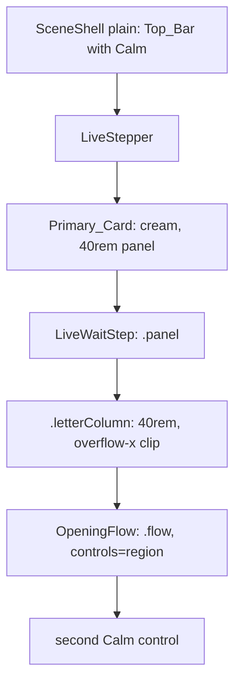
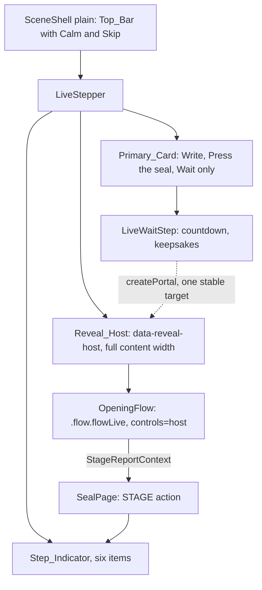
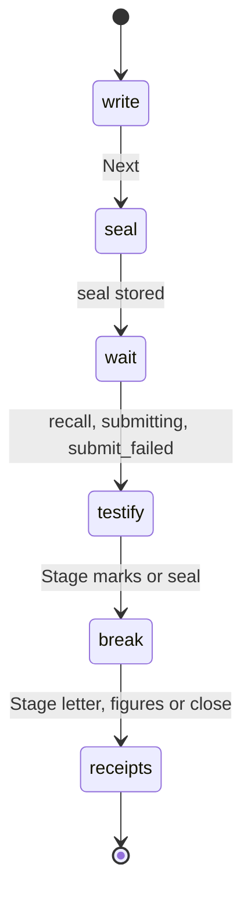
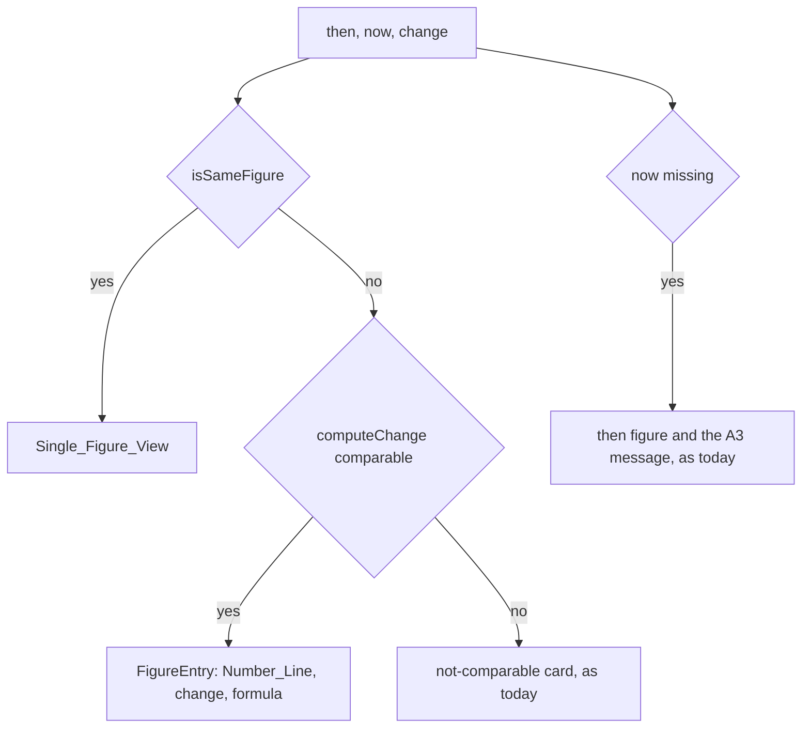

# Design Document
Spec: 12 Submission polish
## Overview
This design repairs what a judge sees in the first five minutes of `/demo/live` and finishes the paperwork for Kiroween 2026. It adds no feature. It is written against `main` at `dcea0e3` (#381, which patched `README.md`, `docs/kiro-writeup.md` and `docs/video-script.md`). The Write step and the code facts below were first read at `4b71564` (the H1 landing merge, #380); the visual and code facts are unchanged since, and the paperwork facts were re-read at `dcea0e3`. I read the files named below and measured the Write step in headless Chromium (`next dev`, 1440×900 and 390×844). Values this design proposes are marked "proposed". Values I measured are marked "measured".
I did not reproduce the broken reveal in a browser. The Write step was measured because W1.6 needs it. For the reveal, the code explains the owner's symptoms well enough to design the fix, and X1.1 still makes the first task reproduce them before changing anything.
Nothing in `src/lib/seal-format/**`, `src/lib/crypto/**`, `src/app/api/**`, `src/lib/letter-store/**`, `drizzle/`, the chart, the CSP header or any `format_version` changes. No file under `.kiro/steering/**` changes. The ownership change (G4) is a precondition that landed with the spec, not a task. The work is in seven groups, in priority order: X and Z (P0, target 18 November 2026), W, K, H and D (P1, freeze 27 November 2026), Q (the walk).
### Decisions this design takes
| Topic | Decision | Reason |
|---|---|---|
| Where the live reveal renders | The Opening_Flow keeps one place in the React tree for the whole of Wait, Testify, Break the seal and See the receipts: a `Reveal_Host` element that `LiveStepper` renders after the Primary_Card, outside it. `LiveWaitStep` mounts the flow into that element with `createPortal`. | Moving a React subtree to another parent unmounts it. The flow holds the decrypted payload, the posted record and the passkey result, so a remount would lose the letter. A portal into one stable element never remounts. |
| Primary_Card during Testify, Break the seal and See the receipts | The card is not rendered for those three steps. The flow's own Stage headings take focus. | The flow already owns its headings and focus (`CeremonyRoot`). A card that held only a heading would sit above a full-width dark reveal. |
| One motion control | `OpeningFlow` in embedded live mode passes `controls="host"` to `CeremonyRoot`. `"host"` renders no Calm or Skip in the region and does not switch the announcement to persona step lines. The Top_Bar that `SceneShell` already renders is the one Calm control. | Today live mode passes `"region"` (the default), so the region draws a second Calm control beside the Top_Bar's. Persona mode uses `"topbar"`, but `"topbar"` also announces persona steps, which would repeat the Live_Stepper's own status line. |
| Layout of the reveal | One new class, `flowLive`, applied to the flow root in embedded mode. It mirrors `flowPersona`: a centred column of at most 40rem until the `letter`, `figures` and `close` Stages, then full width. The persona classes are not edited. | X1.9 keeps the persona reveal as it is. A parallel class cannot change it. |
| Step order | `LIVE_STEPS` becomes `write, seal, wait, testify, break, receipts`. A reported Stage moves the step. | X4. The flow's tag alone cannot tell `marks` from `letter`, because both are `reveal`. |
| Where the Stage comes from | `SealPage` provides `StageReportContext` for the live page. `CeremonyRegion` already calls it in an effect. The provider dispatches one `STAGE` action, which sets the step and the stage in one reducer update. | `StageReportContext` exists for the persona Top_Bar. No new channel is needed. |
| Same_Figure | `isSameFigure(then, now)` in `src/lib/figures/same-figure.ts`. `FiguresThenNow` calls it before `computeChange`. `computeChange` and its `allowSamePeriod` option are not edited. | Z1.2: the rule lives beside the change calculation. Leaving `computeChange` alone keeps every earlier test and the persona path as they are. |
| Write layout | A letter field with a CSS minimum height by width band, a row of small Occasion chips, compact question rows, and one action row. The existing two-column fallback (900 px and wider, 900 px tall or less) stays. | See "W1.6: viewport arithmetic". |
| Next at 1440×900 | Next can fit above the fold only in the two-column fallback, by about 14 px. Nothing asserts it. In the single-column layout it does not fit and stays below. | See "W1.6: viewport arithmetic". |
| Own-number rows | A row left entirely empty is dropped when the draft is read. A partly filled row blocks Next after it is touched. | W6. |
| Receipts control | A separate "Add a receipt" button opens the native `details`. The `summary` stays and is renamed "Receipts". | W5.3 and W5.4 need both a button that opens it and a keyboard route in through the summary. |
| Picker regions | Two groups, fixed order. A region the picker does not recognise is not offered. | K4. Sweden never reaches the picker (`sweden-guard.test.ts`). |
| Walk tooling | The Live_Walk extends `src/test/integration/live-walk.test.ts` and runs as `npm run live-walk`. No new file under `tools/`. | The QA role's shell rules allow `npm *` but not an environment-prefixed `WALK=1 npx …`. A package script has no prefix. |
| Ownership | Already done when the spec landed (the "init spec 12" commit). platform-dev owns `README.md`, `docs/video-script.md`, `docs/writeup-gaps.md`, `tools/qa/**` and `scripts/check-js-budget.mjs`, and not `docs/**`. `docs/kiro-writeup.md` is owned by no role and a test checks it. | G4 is a precondition. No task changes ownership, and no task is reserved for a person. See "Ownership: the state this design starts from". |
### Findings that change the plan
| Finding | Evidence | Effect |
|---|---|---|
| The Opening_Flow sits inside the cream card, inside `.panel` (`max-width: 40rem`, padding up to 2.5rem), inside `.letterColumn` (`max-width: 40rem`, `--measure: 100%`, `overflow-x: clip`). The flow root is `.flow`, not `.flowPersona`. | `LiveWaitStep.tsx`, `live.module.css` lines 53 and 604, `reveal.module.css` lines 20 to 50, `OpeningFlow.tsx` line 328. | These are the candidates for the narrow dark box. The ones the code settles: the flow root has no `.flowPersona` rules for `letter`, `figures` and `close`, and `.letterColumn` clips it. X1.1 confirms them in a browser. |
| Live mode draws a second Calm control. | `OpeningFlow.tsx` passes `controls={mode === "persona" ? "topbar" : "region"}`. `TopBar.tsx` draws Calm for `SceneShell variant="plain"`. | X2 |
| The Live_Stepper marks "See the receipts" current as soon as the flow is in `reveal`. | `stepForFlowPhase` returns `receipts` for the tag `reveal`. `reveal` covers `marks`, `seal`, `letter`, `figures` and `close`. | X4 |
| The seal fingerprint is two lines of eight groups. | `reveal.module.css` `.fingerprintGroups` and `.fingerprintLine`. | In a 100 px column the groups wrap two to a line. X1 fixes the width. A grid fixes the wrap at 600 px and below. |
| `LiveLockNote` draws a paper box (`.lockNote`) and its link uses `.lockNoteLink`. Both live in `live.module.css`. `REVEAL_COPY.lockNote` and `lockNoteLink` are rendered nowhere. | `LiveLockNote.tsx`, `reveal/copy.ts` lines 469 and 473. | X3 |
| A zero change is a result today. `FiguresThenNow` calls `computeChange(then, now, { allowSamePeriod })`. With `allowSamePeriod` an equal period end and equal value is comparable, with a difference of 0. | `change.ts`, `FiguresThenNow.tsx` line 239. | Z |
| The Write step at 1440×900 is already the two-column fallback. | `live.module.css` line 1050: `@media (min-width: 900px) and (max-height: 900px)`. 900 px tall matches. | W1.6 |
| `LIVE_COPY.intro` says "It is locked for 30 seconds only because this is a demo." | `live/copy.ts` line 17. | W4.4 allows no second sentence about the demo being short. The clause goes. |
| The letter field growth rule can undo a minimum height. | `WriteForm.tsx` sets `field.style.height` to `min(scrollHeight, 50% of the visual viewport)`. | A CSS `min-height` beats an inline `height`, so the minimum holds. See W1. |
| The serif is scoped to one CSS module by a test. | `src/test/serif-scope.test.ts` allows `--font-serif` in `reveal.module.css` only. | W1.1 puts the serif on the Letter_Field. The test gains one allowed module. |
| `.landingColumn` caps its children at `min(34rem, 46vw)` from 900 px up, and the four landing sections are children of it. | `scene.module.css` line 1062, `app/page.tsx`. | This is why the sections sit in a left column. H1 |
| The pickers show `detail.value` raw and `item.latestPeriod` raw. The fallback note repeats per row. | `FigurePicker.tsx` lines 112 to 150. | K |
| QA's prompt says "Never pass `fullPage`" and "Open at most 12 screenshots". The QA browser tools have no virtual authenticator. | `.kiro/agents/prompts/qa.md` lines 34 and 84. | The Live_Walk is a script run, as spec 07's layout check is. See Q. |
| `.kiro/agents/prompts/common.md` line 26 now says `tools/agents/**`, `tools/dispatcher/**` and `tools/hooks/**` are owner-only, not all of `tools/**`. | `common.md`, as changed by the "init spec 12" commit. | Nothing to edit. Tasks may write `tools/qa/**` if their role owns it. |
| `README.md` at `dcea0e3`: the Video_Slot marker is on line 13, the status line on line 67 ("Specs 01 to 10 are complete and spec 11 (any letter) is in progress, as of 13 November 2026") and the merged count on line 117 (206, with the command and the date but no SHA). | `README.md`. | D1 edits these lines in place and recomputes every count at the final SHA. |
| `docs/kiro-writeup.md` at `dcea0e3`: seven OWNER comments at lines 5, 17, 47, 77, 96, 105 and 115. Its header names SHA `4b71564` and 206 merged pull requests on 13 November, so it is already behind `main`. | `docs/kiro-writeup.md`. | D3 reports these and changes none of them. |
| `docs/video-script.md` already lost "Seal the figures" in #381 and lists the four ritual steps. Its five beats start at 0:00, 0:20, 1:30, 2:10 and 2:45 and carry no spoken line or word count. | `docs/video-script.md`. | D2 rewrites it around the six steps. |
## Architecture
### The live reveal, before and after
Before: the Opening_Flow is a child of the Primary_Card.

After: the flow mounts into a Reveal_Host that is a sibling of the card.

- The Reveal_Host element is rendered by `LiveStepper` from the first render, empty. `LiveStepper` keeps it in state (a callback ref), and passes it down through `StepView.host`. `LiveWaitStep` portals the flow into it once `flowMounted(step, done)` is true. The target never changes, so the flow never remounts.
- On the server nothing is portaled. `done` is false until a sealed state exists, and a sealed state exists only after a client press.
- The Reveal_Host has no background of its own. It sits on the Scene's near-black `--bg`, as the persona column does. Text in it uses the Scene tokens `--text` and `--muted`. Paper panels inside the flow (the recall card, the letter) set their own `--ink` and `--paper`, as they already do on the persona page.
- Width: the Reveal_Host is as wide as the stepper. The flow root carries `flowLive`. Until the `letter`, `figures` and `close` Stages it is a centred column of at most 40rem. From those three Stages it is `max-width: none`, and the existing Letter_Block and figures grid size themselves, as they do for Maya.
### Why the reveal is full width on the persona page and was not on the live page
The persona Ceremony root is `.flow.flowPersona`. `reveal.module.css` has three rules for it that the live flow never matched: the 22rem cap below 900 px, `padding-inline: 0` for `letter`, `figures` and `close`, and `max-width: none` for the same three Stages. The live flow root was plain `.flow`, capped by `--measure`, which `.letterColumn` set to `100%` of a 40rem column inside a 40rem panel with up to 2.5rem padding. At 1440 px that leaves a column near 560 px, and then the Letter_Block's own padding and the clip leave less. I cannot name the 100 px figure from code. X1.1 does.
### Stage to step

`stepForStage(stage)` is a pure function: `marks` and `seal` give `break`; `letter`, `figures` and `close` give `receipts`; every earlier Stage gives `null` (no move). `stepForFlowPhase` keeps `recall`, `submitting` and `submit_failed` for `testify` and returns `null` for `reveal`; the Stage decides from there. `GOTO` stays forward only, so a Stage that reports out of order cannot move the indicator back.
The Skip_Link on `marks` moves the flow to stage 2. `stageFor` then resolves to `letter` (or `close` for a letter with no figures), `CeremonyRegion` reports it, and the reducer handles `STAGE` by setting the step to `receipts` and recording the Stage in the same update. The indicator and the Stage never disagree after that update. The report runs in an effect, so a paint can land between the flow's update and the report. X4.4 is met at that level, and a test on the pure function and the wiring checks it. I do not change `CeremonyRegion`'s effect to a layout effect: it also serves the persona page.
### Phone step names
The Step_Indicator keeps its rule at 480 px and below: all six numbers show, the current step shows its name, and the other names stay in the accessibility tree, visually hidden (`stepper.module.css`). Six full names do not fit in 358 px. X4.5 asks for "no truncation, no ellipsis, no item clipped". Nothing is cut: the numbers stay visible and every name stays in the document. I read X4.5 that way, and I say so in the task so QA does not fail a hidden name as truncation.
### Single_Figure_View

`receiptKindFor(then, now, change)` is a pure function in `src/components/reveal/receipt-kind.ts` that returns `"no_now"`, `"single"`, `"compared"` or `"not_comparable"`. `FiguresThenNow` switches on it. A revised figure (same period, different value) is not a Same_Figure. `computeChange` already returns `no_newer_figure` for it, so it takes the not-comparable branch exactly as on `main` (Z1.4).
### Ownership: the state this design starts from
There is no ownership task and no owner ticket. The ownership change was made when the spec was landed, in the "init spec 12" commit, the way "init spec 11" and spec 10's layout checks were. The role agent files do not bind the session that writes `.kiro/`, so that session could make the change that no role agent could. This is the resulting state:
| Where | State |
|---|---|
| `.github/agents.json` | platform-dev owns `README.md`, `docs/video-script.md`, `docs/writeup-gaps.md`, `tools/qa/**` and `scripts/check-js-budget.mjs`, and not `docs/**`. `docs/kiro-writeup.md` is owned by no role. `package.json` and `src/test/integration/**` are shared paths. The `_comment` lists `.kiro/**`, `.github/**`, `tools/agents/**`, `tools/dispatcher/**`, `tools/hooks/**`, `scripts/check.sh` and `docs/kiro-writeup.md` as owner-only or unowned. |
| `tools/agents/generate_agents.py` and `tools/dispatcher/pr_policy.py` | Both `OWNER_ONLY` lists deny `.kiro/**`, `.github/**`, `tools/agents/**`, `tools/dispatcher/**`, `tools/hooks/**` and `scripts/check.sh` (the policy also denies `.qa/**`), in place of all of `tools/**`. |
| `tools/hooks/scope-check.py` | Imports `check_files`, so it inherits the PR policy. |
| `.kiro/agents/*.json` | Regenerated from the generator. platform-dev's allow list holds the five paths above. |
| `.kiro/agents/prompts/common.md` and `docs/agent-loop.md` | Describe the same owner-only list. |
| `tools/dispatcher/tests/` | Cover the matrix in the Testing Strategy, including that no role can write `docs/kiro-writeup.md`. |
The `policy` workflow runs the copy of `pr_policy.py` from `main`, so a PR cannot relax the rule that judges it. G4.4 holds: `src/lib/seal-format/**`, `src/lib/crypto/**`, `.kiro/steering/**` and `.kiro/specs/**` belong to no additional role, and the agent deny list still covers `.kiro/**`. After the commit, the host that runs the loop runs `python3 tools/agents/generate_agents.py --install-global` once (the runbook step 4), because Crew's Task Runner plans outside the repo from `~/.kiro/agents/`. That is a command on the host, not a repo change.
Every task in this spec is an ordinary role task under G1.1. If a task finds that a path is refused by `pr_policy`, it reports the refusal and changes none of the ownership files (G4.7).
## Components and Interfaces
### X1. The Reveal_Host (frontend-dev, task 1)
Files: `LiveStepper.tsx`, `live-steps.ts`, `LiveWaitStep.tsx`, `live.module.css`, `stepper.module.css`, `OpeningFlow.tsx`, `reveal.module.css`, `CeremonyRoot.tsx`.
1. Reproduce first (X1.1). Before the first commit the task runs the app, opens `/demo/live`, seals a letter with a virtual authenticator, and saves `marks`, `letter`, `figures` and `close` at 1440×900 and 390×844 from `main`. The PR description names the wrapper that boxes the reveal and the component behind each of the four symptoms: the narrow dark box, the dark-on-dark heading, the wrapping fingerprint, and the cream-on-cream link. The code points at `.panel`, `.letterColumn` and the missing `flowLive` rules, at the Fingerprint's block lines, and at `.lockNoteLink` inside `LiveLockNote`. The task confirms or corrects each.
2. `LiveStepper` renders `<div ref={setHost} data-reveal-host className={styles.host} />` after the card and passes `host` to the step view. The card is rendered for `write`, `seal` and `wait` only.
3. `LiveWaitStep` returns its panel as before, and when `flowMounted(step, done)` it returns `createPortal(<OpeningFlow … />, host)` as a sibling. Its `.letterColumn` wrapper goes.
4. `OpeningFlow` gets the class `flowLive` when `embedded` is set, and `controls="host"` in that case. `/l/[id]` (not embedded) is unchanged.
5. `CeremonyRoot` accepts `controls: "topbar" | "region" | "host"`. For `"host"` it renders neither Calm nor Skip in the region, and `stepNow` stays `null`, so the announcement stays the Stage line. Skip still appears, because the Top_Bar draws it while a sequence runs (`TopBar controls="calm"`).
6. `reveal.module.css` gains the `flowLive` rules, written beside the `flowPersona` ones: `max-width: min(40rem, 100%)` and `margin-inline: auto` by default, `max-width: none` for `letter`, `figures` and `close`, and `padding-inline: 0` below 900 px for those three, as `flowPersona` does.
7. The fingerprint. Inside the host the two `.fingerprintLine` spans become grids: `repeat(4, max-content)` at 600 px and wider, `repeat(2, max-content)` below. Each group is `white-space: nowrap`. The selectors are `:global([data-reveal-host]) .fingerprintLine`, so the persona Fingerprint keeps its look (X1.9). That gives four rows of four groups at 1440 and eight rows of two at 390, and no group splits (X1.6).
8. Colours (X1.5, X1.7). The host sits on `--bg`, and every reveal text class already sets `--text`, `--muted` or its own paper ink. The cream-on-cream and dark-on-dark pairs came from the cream card, which the flow no longer sits in. A new `live-reveal-contrast.test.ts` renders the live reveal for each Stage and checks the pairs (see Testing Strategy).
The Seal_Group at `marks` renders inline in the host. The held-slot portal needs a persona Ghost and a `heldSlot`, which live mode does not have, and `SealBreak` already falls back to inline when `heldSlot` is null. The live reveal has no Ghost at `marks`. That is a difference from Maya's page that I accept: X1.2 asks for the same layout, background and components, and the Ghost is part of the persona Scene's backdrop, not of the reveal components.
### X2. One motion control (frontend-dev, task 1)
`controls="host"` removes the region's control. The Live_Stepper adds none. `LiveGhost` wraps its own `MotionProvider`, `SkipProvider` and `LocalViewProvider`; its file comment says each defers to its parent. It draws no control. The test counts toggles in the markup of each step and each persona Stage and expects exactly one for each (X2.7). The test is a table over steps and Stages, not a generated property.
### X3. The Close (frontend-dev, task 3)
`LiveLockNote` stops using the paper box. It renders in `close.module.css` classes `liveNote` and `liveNoteLink`: `--text` on `--bg`, the link underlined, a 3 px focus ring in `--accent` offset 3 px, `min-height: 44px` below 600 px. The `.lockNote` and `.lockNote p` rules leave `live.module.css`; `.lockNoteLink` stays because `FigurePicker` uses it on paper. `REVEAL_COPY.lockNote` and `REVEAL_COPY.lockNoteLink` are deleted, together with the tests that read them. A test asserts "This letter was locked for 30 seconds." appears once in the live Close markup (X3.1). The `hasOfficialFigures` rule of X3.2 is unchanged.
### X4. Six steps (frontend-dev, task 4)
- `LIVE_STEPS` gets `break` between `testify` and `receipts`. `LIVE_STEP_NAMES` takes "Break the seal" from `CEREMONY_COPY.steps[1]`, so the word lives in one place.
- `stepForStage` and the `STAGE` action are added to `live-steps.ts`. `canGoBack` is unchanged: Back is offered before `wait` only.
- `StageReportContext.Provider` in `SealPage` wraps the stepper and dispatches `STAGE`.
- `LIVE_COPY.stepAnnounce` already reads "Step {n} of {total}: {label}". Nothing changes there.
- The existing five-step tests (`five-steps.property.test.ts`, `live-steps.test.ts`, `LiveStepper*.test.tsx`) are updated to six. Wait is 3 of 6.
### Z1. `isSameFigure` (data-dev, task 2)
`src/lib/figures/same-figure.ts`, exported from `src/lib/figures/index.ts`. It returns true when `kind` is `official` for both, `source`, `series_id`, `unit`, `region` and `period` are equal strings, and `parseDecimal(a.value)` equals `parseDecimal(b.value)` by exact decimal comparison. `decimal.ts` has `parseDecimal`, `sub` and `isZero`, so the comparison is `isZero(sub(a, b))` with no tolerance and no `Number`. The no-number source scan (`no-number.test.ts`) covers the new file.
### Z2. The Single_Figure_View (frontend-dev, task 5)
- `receipt-kind.ts` as above.
- `ReceiptCard` gains a `single` prop. With it, the card draws the heading, "Your answer" once, the one figure row (value at Display_Precision, unit, period, region and the provenance label that `receiptFigureOf` already makes), the Nothing_To_Compare_Line, and the source control. It draws no "Then:" or "Now:" role labels, no Number_Line and no change element. The As_Published_Value stays in the source details (Z2.4).
- "Your answer" stays because it is the testimony, and it is on every other card. Z2.1 lists what the figure row holds and does not remove the answer row.
- The Reveal decides per figure (Z2.7). The Close and the Step_Indicator are untouched (Z2.9).
### W1. The Letter_Field (frontend-dev, task 7)
- A new CSS module `src/components/live/letter-field.module.css` holds the Letter_Field styles: `font-family: var(--font-serif)`, `line-height: 1.6` (1.5 or more per W1.1), `padding: 1rem`, paper background, `--ink` text, and a custom property `--letter-lines`.
- `--letter-lines` is 6 below 600 px, 8 from 600 to 1023 px (the second item cut under G3.4) and 10 from 1024 px up. `min-height: calc(var(--letter-lines) * 1lh + 2rem + 2px)`. Where `lh` is unsupported the fallback line is `calc(var(--letter-lines) * 1.6em + 2rem + 2px)`.
- The textarea's `rows` attribute becomes 6, the smallest band. `LETTER_FIELD_ROWS` changes from 3 to 6 and the doc comment says why.
- The growth effect in `WriteForm` is unchanged. It sets an inline `height` of `min(scrollHeight, 50% of the visual viewport)`. A CSS `min-height` wins over an inline `height`, so the field never drops below its minimum. Where the cap is below the minimum (a 1024×600 landscape window: cap 300, minimum 322) the minimum wins and the page scrolls. The cap still applies once the text is longer than the minimum.
- `src/test/serif-scope.test.ts` allows two modules, `reveal.module.css` and `live/letter-field.module.css`. It is a shared test file, so the frontend role updates it.
- The label (`letterLabel`), the character count and the validation line stay. The placeholder is the chosen Occasion's starter, as today, and it is not stored.
### W2. Occasion chips (frontend-dev, task 7)
`OccasionPicker` keeps its `fieldset`, `legend` and `aria-pressed` buttons. The legend becomes visually hidden (still read by assistive technology). The buttons use a new `.chip` class: 32 px tall at 600 px and wider, 44 px tall below, `padding: 0 0.75rem`, `font-size: 0.8125rem`, wrapping in one `flex-wrap` row. The pressed chip gets `border-width: 2px`, `font-weight: 700` and a leading check mark (`✓`, `aria-hidden`) so it is never colour alone. It may use the Accent for its border, because the choice is the author's own (W2.5). Nothing in spec 11 L2.2 to L2.6 changes.
### W3. Question rows (frontend-dev, task 8)
Each row is one line: a number label, an auto-sizing `textarea` (`rows=1`, grows with its text, `resize: none`), and the Remove_Icon. The label text is "Question {n}", kept visible but small, and the field is `aria-labelledby` it. A row is never cut off: a 200-code-point question wraps to three or four lines at 480 px and to six at 304 px, and the field grows (W3.2).
- The Remove_Icon is a `button type="button"` with an `aria-hidden` "×" and `aria-label` from `LIVE_COPY.authorQuestionRemove`. Target 44×44 px below 600 px, 32×32 px above. Its border is `--ink-soft` on paper, 4.5:1 or better (W3.4).
- `focusAfterRemove(count, removedIndex)` is a pure function in `author-questions.ts`. After the row at `removedIndex` goes, with `count` rows before the removal, it returns `{ kind: "row", index }` for the nearest remaining row (the row now at `removedIndex`, else the one before it), or `{ kind: "add" }` when none remain. `AuthorQuestions` uses it to move focus, and sets a polite live region to `LIVE_COPY.authorQuestionRemoved` ("Question {n} removed.").
- "Add a question" becomes a quiet text control (`.textAction`): underlined, no border, 44 px tall hit area. The rules of spec 10 C2 and spec 11 L1.2 are untouched.
### W4. One sentence (frontend-dev, task 7)
`LIVE_COPY.rehearsalLine` becomes "This is a rehearsal: a real letter stays sealed for months, and this one opens in 30 seconds." It is 19 words, with one sentence terminator. `LIVE_COPY.intro` loses its second sentence and becomes "This letter is sealed in your browser with your own passkey." No other string on the Write step says the demo is short. The line stays on the Write step and the Wait step, and on no other page.
### W5. The action row (frontend-dev, task 9)
The row is `display: flex; justify-content: flex-end; gap: 0.75rem`. In the DOM the Receipts_Action comes first and Next second, so Next sits at the bottom right and the tab order follows the reading order. Below 600 px the row stacks in DOM order: the Receipts_Action on top, Next under it, both 44 px tall and full width. W5.5 says the stacked row may put Next first. I do not reorder, because a CSS `order` swap would put the tab order out of step with what the reader sees. Next is last on the phone too.
- The Receipts_Action is `.textAction`-style outline: a secondary button with a `--ink-soft` border, not the orange primary class. Next stays `.primary`, the only one on the step.
- `ReceiptsDisclosure` accepts an `openRequest` counter. When the counter changes it sets `details.open = true` and calls `focus({ preventScroll: true })` on the first focusable control inside it: the first figure checkbox when the status is ready, else the first own-number control. Focus without scroll keeps the Letter_Field where it is.
- The `summary` is renamed "Receipts" (`LIVE_COPY.receiptsSummary`) so the page does not show "Add a receipt" twice. The tab order is chips, Letter_Field, question rows, Add a question, the Receipts summary, Receipts_Action, Next. The summary is a control W5.6 does not list. I place it before the Receipts_Action, because the `details` sits above the action row.
- When the figures request is loading or failed, the Receipts_Action still opens the disclosure, which shows its loading or unavailable line. Next is not disabled (W5.7).
### W6. Blank own number (frontend-dev, task 9)
`SelfReportedRows` starts with no row. A new `isEmptySelfReportedRow(row)` is true when name, value, unit, region and period are all empty strings after trimming. `selfReportedRowsOk` ignores empty rows, so a blank row never blocks. `buildPayload` and the seal draft drop empty rows before they are read, so a blank row seals nothing. A partly filled row keeps today's per-field problems, shown after the row is touched or a seal is attempted (spec 09 A4.4). A self-reported row still counts for nothing toward spec 11 L1.2.
`form.ts` holds the one rule. `validateWrite` calls `selfReportedRowsOk(rows.filter(notEmpty), day)`.
### K1 to K3. The picker's numbers, dates and note (frontend-dev, task 10)
- `displayFigureValue(value, unit, region)` in `src/components/reveal/display-figure.ts` returns `{ text, unit }`. It applies `rescaleForDisplay` where `displayRescaleForUnit(unit)` exists, then `formatValue(…, region, displayPrecisionForUnit(shownUnit))`. `ReceiptCard`'s caller (`receiptFigureOf`) and `FigurePicker` both call it, so the two cannot drift (K1.5). The picker's source control already holds the raw published value in `detail`, and it gains the "As published: {value} {unit}" line the Receipt_Card shows.
- `formatShortDate(instant)` in `src/components/ui/letter-date.ts` returns "26 Oct 2026" for a full instant in UTC. A month period "2026-10" shows "Oct 2026", and a year "2026" shows "2026", through `formatPeriod` from `lib/figures` for period strings. The Receipt_Card's "retrieved" label and the picker both use it. Each date in the picker is labelled "Period" or "Retrieved" so the reader can tell them apart.
- The Picker_Note renders once above the list when any item has `fallbackRetrievedAt`. Rows show "Retrieved {Short_Date}" and nothing else about the fallback. The Reveal's per-figure `fallbackNote` is untouched.
### K4. Regions (frontend-dev, task 11; first to be cut)
`regionGroupFor(region)` in `catalogue-list.ts` returns `"us"` for `"U.S."`, `"eu"` for a region that starts with `"EU"`, and `null` otherwise. `groupPickable(series)` returns the groups in the fixed order `us`, `eu`, each with its items in catalogue order, and leaves out a group with no item and any item whose group is `null`. A `null` group cannot occur today (the Catalogue has two regions, and `sweden-guard.test.ts` keeps Sweden out), and a test pins that an unknown region is left out rather than shown under a made-up heading. Each group is a `fieldset` with a `legend` ("United States", "European Union"). The limit and the hint count across groups. Two columns at 1024 px and wider, one column below.
### H1 and H2. Landing (frontend-dev, tasks 12 and 13)
- H1: `SceneShell variant="landing"` takes an optional `below` prop and renders it as a sibling of `.landingColumn` inside `main`, in a new `.landingBelowFrame` that is `max-width: 1200px` and aligned to the hero's left edge. `app/page.tsx` passes the four sections as `below`. The hero stays in the capped column. No client JavaScript is added.
- The container is left-aligned to the hero content (H1.2) and is `min(1200px, content width)` wide. At 1440 px the content box is 1360 px, so the container is 1200 px and ends 160 px short of the right padding. H1.1 says "centred" and H1.2 says the left edge matches the hero's. They cannot both hold at 1440, so H1.2 wins, because it is the one a layout check can measure. At widths where the content box is 1200 px or narrower the two agree.
- H2 (cut third): `.ritualList` becomes a grid. Four equal columns at 1024 px and wider, two from 600 to 1023 px, one below. `align-items: stretch` gives equal heights. It is already an `ol`.
### D1 to D3. Paperwork (platform-dev, tasks 15, 16 and 17)
- D2 `docs/video-script.md`: a table of time, beat, on-screen content, spoken line and word count.

| Time | Length | Beat | Source | Words (budget) |
|---|---|---|---|---|
| 0:00 | 25 s | The problem and the pli cacheté hook | Landing hero, an envelope | 60 |
| 0:25 | 40 s | Live seal: Write, Press the seal, then the wait is cut, then Testify, Break the seal, See the receipts | Live seal, 30-second letter | 85 |
| 1:05 | 60 s | Maya: Testify, Break the seal, See the receipts (never under 45 s) | Persona, pre-sealed | 130 |
| 2:05 | 40 s | The Kiro Crew loop | One real PR, one QA verdict, one hook that stopped an agent | 85 |
| 2:45 | 7 s | Close | Close line and URL | 15 |

  The beats sum to 172 s (25 + 40 + 60 + 40 + 7), so the last beat ends at 2:52, before the 2:55 limit and under 3:00. The budgets sum to 375 words, under 400. Where the arithmetic and a minimum disagree, the 172 s total and the minimums win, and Maya's beat absorbs the difference. The wait is cut and the cut is marked in the script. The live beat says plainly that a 30-second letter has nothing to compare yet and shows the Single_Figure_View when the judge's letter holds a figure. Maya's receipts are the payoff. The script has no exclamation mark. The task reports the beat total and the word total.
- D3 `docs/writeup-gaps.md`: the commands in D3.3 run at the final SHA with their output. `gh` is authenticated on this machine (`devclef`), so the PR and run lookups work. A failing command is reported with the command to run (D3.7). The seven OWNER notes sit at `dcea0e3` at lines 5, 17, 47, 77, 96, 105 and 115 (they were at 5, 15, 40, 64, 78, 82 and 88 at `4b71564`). The write-up header names the stale SHA `4b71564` and 206 merged pull requests on 13 November, and the report lists that as a stale fact (D3.5). The report uses what `grep -n "OWNER" docs/kiro-writeup.md` finds at the final SHA. `git diff --exit-code -- docs/kiro-writeup.md` must pass.
- D1 `README.md`: edit in place; #381 already wrote the file, so the task does not re-create it (D1.5). The Video_Slot marker on line 13 stays, with the GIF marker beside it. The status line (line 67 at `dcea0e3`) is derived from every `tasks.md` at generation time; it names 13 specs, two of which share the number 02, only when no box is open. The count line (line 117, already 206, without a SHA) is recomputed. The merged-PR count comes from `gh pr list --state merged --limit 1000 --json number -q length` at the final SHA, with the command, date and SHA beside it. The live demo is described with the six steps and as a rehearsal.
- D1.7 says the README depends on every other spec 12 task. G3.1 says the final Q walk is last, after the README. Both cannot hold if the walk is one of "every other task". The README (task 17) depends on tasks 1 to 16. The final walk (task 18) depends on the README.
### Q1 and Q2. The Live_Walk (platform-dev, tasks 6 and 18)
- It extends `src/test/integration/live-walk.test.ts`. It is run with a new package script, `"live-walk": "WALK=1 vitest run src/test/integration/live-walk.test.ts"`. The QA role's shell allows `npm *`, and a `WALK=1 npx …` command does not match. The server is started by the QA agent as today (`npm run build`, `PORT=3000 … npm start`, a Postgres container, `npm run db:migrate`).
- The Walk covers the steps of Q1.2 at 1440×900 and 390×844, in two variants (no figure, one figure), and once more under `prefers-reduced-motion: reduce` at each width. Each step records pass or fail, the observation, the Step_Shot names, and for a defect the expected result, the observed result and the suspected file.
- Step_Shots go to `qa-shots/live-walk/` (already ignored by git), named `live-<nn>-<step>-<w>x<h>[-reduced].png`. The Walk waits for the Stage to settle (the Top_Bar's Skip control is gone and the region's `data-ceremony` value has not changed for 300 ms) before each capture, and takes a full-page capture for `letter`, `figures` and `close`.
- The Walk fails on the conditions in Q1.6. The Motion_Control count is the number of elements matching `button[aria-label*="motion" i]`. Horizontal scroll is `scrollWidth > clientWidth` on the document. Clipped text is a descendant whose `scrollWidth > clientWidth` inside a container with `overflow` not visible. Contrast is computed from the real computed colours of every text node over its nearest opaque background.
- The Walk lists every expected Step_Shot by name and fails if a file is missing (Q2.6). That check is in the script, so the QA verdict needs no browser tool for it. QA's prompt limits browser screenshots it opens to 12 and forbids `fullPage`. Those limits apply to the QA agent's own MCP browser, not to a script's output. The ticket text for the walk tasks says "run `npm run live-walk` and quote its result lines". I cannot edit the QA prompt (it is under `.kiro/**`), so the ticket text carries the instruction, as it does for spec 07's layout check.
- Q1.8: a new J-check in `tools/qa/journey-check.mjs` (platform-dev, task 14) opens `/demo/live` on production at both widths, checks the Write step and the Press the seal screen without pressing the seal, and fails on horizontal scroll, a Motion_Control count other than 1, or a console error.
### W1.6: viewport arithmetic
These are the numbers behind the W1.6 decision. "Measured" is from Chromium at the viewport named, on `main` (`next dev`; the font stack resolved to Inter). "Proposed" is arithmetic on the layout in W1 to W5.
**Fixed chrome above the card at 1440 wide (measured, not changed by this spec).**
| Item | Top (px) | Bottom (px) | Height |
|---|---|---|---|
| Top_Bar (fixed, overlays the page) | 0 | 68 | 68 |
| "Back to demo" link | 80 | 124 | 44 |
| Page heading | 132 | 176 | 44 |
| Step_Indicator (one row of six) | 188 | 214 | 26 |
| Card top | 234 | | |
| Step heading ("Write") | 259 | 296 | 37 |

**Measured Write step on `main`.** At 1440×900 the two-column fallback applies, because the viewport is 900 px tall and the rule is `max-height: 900px`. The letter field is 440 px wide and 96 px tall (3 rows at 24 px plus padding). Next is 795–847 and the card ends at 911. At 1440×1000 the single column applies: the field is 560×96 at 686–782, the question fieldset is 835–1137, and Next is 1229–1281.

**Proposed Write step, two-column fallback, 1440×900.** The container is `max-width: 62rem` (992 px), two columns of 480 px with a 32 px gap.
| Row | Top | Bottom | Height | Basis |
|---|---|---|---|---|
| Step heading | 259 | 296 | 37 | measured |
| Rehearsal line, one line | 312 | 341 | 29 | proposed: one sentence, 93 characters, about 750 px, fits the 1318 px card width |
| Intro, one line | 349 | 378 | 29 | proposed: "This letter is sealed in your browser with your own passkey." |
| **Left column** starts | 394 | | | 16 px gap |
| Occasion chips, one row | 394 | 430 | 36 | five chips, about 405 px, fit 480 px |
| Letter label | 442 | 468 | 26 | measured height |
| Letter_Field, 10 lines | 468 | 790 | 322 | 10 × 28.8 (18 px at 1.6) + 32 padding + 2 border |
| Character count | 796 | 818 | 22 | measured height |
| **Right column** starts | 394 | | | |
| Questions: legend | 394 | 420 | 26 | |
| Three question rows | 428 | 584 | 156 | 3 × (46 + 6) |
| Hint, two lines | 590 | 622 | 32 | |
| Receipts summary | 630 | 674 | 44 | |
| **Action row** | 834 | 886 | 52 | 16 px below the taller (left) column |
| Card padding | 886 | 911 | 25 | |

Next's bottom is 886 px in a 900 px viewport. It fits with **14 px to spare**. The tallest thing in the step is the left column, so the field decides it. One extra line anywhere (a wrapped intro, a longer rehearsal line, a fallback font that is a little taller) takes the 14 px away. So the layout does not promise it, and no check asserts it. The Walk and the layout check print the measured Next bottom as a note at 1440×900.

**Other sizes.**
| Viewport | Layout | Letter_Field bottom | Next bottom | Next in view |
|---|---|---|---|---|
| 1440×900 | two-column | 790 | 886 | yes, by 14 px; not asserted |
| 1366×800, 1280×800 | two-column | 790 (inside 800) | 886 | no. The 10 lines are in view; Next is below |
| 1440×1000 | single column | 790 | 1182 | no. Next is below |
| 2560×1440 | single column | 790 | 1182 | yes |

In the single column the questions start at 834 (818 + 16) and run 228 px (legend 26, rows 156, hint 46) to 1062. The Receipts summary is 1070–1114, the action row 1130–1182.

**Decision.** Next can sit inside the First_Viewport at 1440×900 only in the two-column fallback, and only by about 14 px. It does not fit in the single column, and it does not fit at 1366×800 or 1280×800. W1.2's 10 lines make a 10-line field plus the chrome above it (about 394 px) plus the chips and label (about 74 px) reach 790 px. There is no room for Next under 800 px. Spec 11 L3.1 asked for Next inside the First_Viewport at 1366×800 and 1280×800. W1.2 and L3.1 cannot both hold at those sizes, and W1.6 says it replaces the Next part of L3.1. So the design lets W1 win: the field and chips are in view, Next stays below. The layout checks for the Write step (the spec 11 L3 thresholds) change in task 14. The two-column fallback is kept, because it brings the whole field into the 800 px window and lets Next into the 900 px window.

**Phone, 390×844 (measured, then proposed).** Measured on `main`: card top 189, heading 198–223, rehearsal 227–259, Occasion fieldset 313–429 (116), field 457–523 (66, 3 rows), count 523–544, questions 544–744, Receipts summary 744–788, Next 792–836.
| Row | Top | Bottom | Height | Basis |
|---|---|---|---|---|
| Rehearsal, two lines | 227 | 259 | 32 | measured for the old three sentences, same wrap |
| Intro, one line | 263 | 280 | 17 | proposed |
| Occasion chips, two lines | 288 | 382 | 94 | 2 × 44 + 6 |
| Letter label | 386 | 410 | 24 | measured |
| Letter_Field, 6 lines | 410 | 580 | 170 | 6 × 24 + 24 + 2 |
| Count | 580 | 601 | 21 | measured |
| Questions, three rows | 605 | 785 | 180 | legend 24 + 3 × 52 |
| Hint, Receipts summary, Receipts_Action | 785 | 873 | 88 | |
| Next | 881 | 925 | 44 | |

The top of the field and all six lines are inside the 844 px window (410–580), even with three question rows. Next ends about 81 px below the fold, so it takes one short scroll (W1.7). At 360×640 the field would start near 460 and end near 630, inside 640 with a few pixels to spare, and the page needs no sideways scroll.
## Data Models
### Live_Stepper state
```ts
export const LIVE_STEPS = ["write", "seal", "wait", "testify", "break", "receipts"] as const;
export type LiveStep = (typeof LIVE_STEPS)[number];

export interface StepperState {
  step: LiveStep;
  draft: WriteDraft;
  sealed: boolean;
  /** The last Stage the flow reported, or null before the reveal. */
  stage: Stage | null;
}

export type StepperAction =
  | { type: "NEXT" } | { type: "BACK" }
  | { type: "DRAFT"; event: WriteDraftEvent }
  | { type: "SEALED" }
  | { type: "GOTO"; step: LiveStep }
  | { type: "STAGE"; stage: Stage };

/** The step a Stage belongs to, or null for a Stage before the reveal. */
export function stepForStage(stage: Stage): LiveStep | null;
```
`STAGE` stores the Stage and applies `GOTO` to `stepForStage(stage)` in one update. `GOTO` still moves forward only.
### Reveal host
```ts
export interface StepView {
  // existing fields …
  /** The element the Opening_Flow mounts into, or null before it exists. */
  host: HTMLElement | null;
}
export type CeremonyControls = "topbar" | "region" | "host";
```
### Receipt kind
```ts
export type ReceiptKind = "no_now" | "single" | "compared" | "not_comparable";
export function receiptKindFor(
  then: Readonly<FigureV1>,
  now: Readonly<FigureV1> | undefined,
  change: ChangeResult | undefined,
): ReceiptKind;
```
### Write draft
No field changes. `selfReported` starts as `[]` for the demo too. The helpers:
```ts
export function isEmptySelfReportedRow(row: SelfReportedRow): boolean;
export type FocusAfterRemove = { kind: "row"; index: number } | { kind: "add" };
export function focusAfterRemove(countBefore: number, removedIndex: number): FocusAfterRemove;
```
### Picker groups
```ts
export type RegionGroupId = "us" | "eu";
export interface PickerGroup { id: RegionGroupId; heading: string; items: PickableSeries[] }
export function regionGroupFor(region: string): RegionGroupId | null;
export function groupPickable(series: readonly PickableSeries[]): PickerGroup[];
```
## Constants
| Name | Value | Where | Used by |
|---|---|---|---|
| `LETTER_FIELD_ROWS` | 6 (was 3) | `live/constants.ts` | W1.2 |
| `--letter-lines` | 6, 8, 10 by band | `letter-field.module.css` | W1.2, W1.9 |
| Letter_Field bands | below 600, 600 to 1023, 1024 and up | CSS | W1.2 |
| Chip height | 44 px below 600, 32 px above | CSS | W2.4 |
| Remove_Icon target | 44 px below 600, 32 px above | CSS | W3.4 |
| `LETTER_FIELD_MAX_VH` | 50 (unchanged) | `live/constants.ts` | W1.3 |
| Fingerprint columns | 4 at 600 px and up, 2 below | `reveal.module.css` | X1.6 |
| Landing container | 1200 px | `scene.module.css` | H1.1 |
| Ritual columns | 4, 2, 1 at 1024 and up, 600 to 1023, below 600 | `landing.module.css` | H2 |
| Video length | 172 s, last beat ends 2:52 | `docs/video-script.md` | D2.3 |
| Spoken-word budget | 370, limit 400 | `docs/video-script.md` | D2.7 |
## Copy
All strings follow `tone.md` and `neutrality.md`: second person, at most 25 words a sentence, no exclamation mark, none of the Scoring_Words. Each lives in its feature folder's copy module.
| Key | Text | Module |
|---|---|---|
| `LIVE_COPY.rehearsalLine` | This is a rehearsal: a real letter stays sealed for months, and this one opens in 30 seconds. | `live/copy.ts` |
| `LIVE_COPY.intro` | This letter is sealed in your browser with your own passkey. | `live/copy.ts` |
| `LIVE_COPY.receiptsSummary` | Receipts | `live/copy.ts` |
| `LIVE_COPY.receiptsAction` | Add a receipt | `live/copy.ts` |
| `LIVE_COPY.authorQuestionRemoved` | Question {n} removed. | `live/copy.ts` |
| `LIVE_COPY.authorQuestionRemove` | Remove question {n} (now the accessible name only) | `live/copy.ts` |
| `LIVE_COPY.pickerNote` | Revenant hasn't fetched newer figures yet. Each figure below shows the date it was retrieved. | `live/copy.ts` |
| `LIVE_COPY.pickerRetrieved` | Retrieved {date} | `live/copy.ts` |
| `LIVE_COPY.pickerPeriod` | Period: {period} | `live/copy.ts` |
| `LIVE_COPY.regionUs`, `regionEu` | United States, European Union | `live/copy.ts` |
| `REVEAL_COPY.nothingToCompare` | This is the same record as the one you sealed, so there is nothing to compare yet. | `reveal/copy.ts` |
| Step 5 name | Break the seal (read from `CEREMONY_COPY.steps[1]`) | `ceremony/copy.ts` |
Deleted: `REVEAL_COPY.lockNote`, `REVEAL_COPY.lockNoteLink`. The old Rehearsal_Line and intro are replaced. `LIVE_COPY.receiptsSummary` changes from "Add a receipt" to "Receipts". The Retired_Phrases scan covers all of it.
## Correctness Properties
*A property is a characteristic or behavior that should hold true across all valid executions of a system-essentially, a formal statement about what the system should do. Properties serve as the bridge between human-readable specifications and machine-verifiable correctness guarantees.*
Each property is one fast-check test with `numRuns` of at least 100, tagged `// Feature: 12-submission-polish, Property N: <title>`. Layout, contrast at measured sizes, the ownership matrix, the paperwork and the Walk are not properties. They are checked by example tests, the layout checks, the Journey_Check and the Live_Walk.
The prework merged overlapping criteria. X4.2, X4.3 and X4.8 are one property about the indicator. X4.3, X4.4 and X4.6 are one property about the step never going back. Z1.1, Z1.5 and Z1.6 are one property about `isSameFigure`. Z1.3, Z1.4 and Z2.7 are one property about which card a figure gets. Z2.1 to Z2.6 and Z2.10 are one property about the Single_Figure_View markup. W6.1, W6.2 and W6.5 are one property. K3.1 to K3.3 and K3.6 are one property. K4.1, K4.3 to K4.6 and K4.8 are one property.
| Property | Written in task | Extended in task |
|---|---|---|
| 1, 2 | 4 (X4) | none |
| 3 | 2 (Z1) | none |
| 4, 5 | 5 (Z2) | none |
| 6 | 9 (W6) | none |
| 7 | 8 (W3) | none |
| 8, 9, 10 | 10 (K1 to K3) | none |
| 11 | 11 (K4) | none |
### Property 1: The indicator has exactly one current item, and Break the seal holds until the seal is broken
*For any* Live_Stepper step and any Stage the flow can report, the Step_Indicator has six items in the order Write, Press the seal, Wait, Testify, Break the seal, See the receipts; exactly one carries `aria-current="step"`; the items before it are `done` and the items after it are `todo`; and when the Stage is `marks` or `seal` the current item is Break the seal and See the receipts is `todo`.
**Validates: Requirements 4.1, 4.2, 4.3, 4.8**
### Property 2: Reported Stages never move the step back
*For any* sequence of `STAGE`, `GOTO`, `NEXT`, `BACK` and `SEALED` actions applied to the stepper reducer, after any `STAGE` action the step index is at least the index before it, a Stage of `letter`, `figures` or `close` leaves the step at See the receipts, and after `SEALED` no `BACK` changes the step.
**Validates: Requirements 4.3, 4.4, 4.6**
### Property 3: Same_Figure is exact, symmetric and reflexive
*For any* pair of official figures, `isSameFigure(a, b)` equals `isSameFigure(b, a)`; `isSameFigure(a, a)` and `isSameFigure(a, {…a})` are true; it is true exactly when `source`, `series_id`, `unit`, `region` and `period` are equal and the two values are equal as exact decimals (so `"3.40"` and `"3.4"` match and a difference in the last digit does not); and it is false when either figure is not `official`.
**Validates: Requirements 1.1, 1.5, 1.6** (as Z1.1, Z1.5, Z1.6)
### Property 4: A figure gets the Single_Figure_View if and only if it is a Same_Figure
*For any* sealed figure and any now figure or none, `receiptKindFor` returns `"no_now"` when there is no now figure; `"single"` exactly when `isSameFigure` is true; and otherwise the same kind as `computeChange` gives today (`"compared"` when comparable, including a zero change across two different periods, and `"not_comparable"` otherwise, including a revised figure in the same period).
**Validates: Requirements 1.3, 1.4, 2.7** (as Z1.3, Z1.4, Z2.7)
### Property 5: The Single_Figure_View shows the figure once and prints no change
*For any* Same_Figure and any letter kind, the rendered card contains the Nothing_To_Compare_Line once and the figure's value once at Display_Precision with its period, region, unit and source control; and it contains none of `0.000`, `0.0%`, `unchanged`, `rose`, `fell`, the formula element, a Number_Line, or a Then and Now label pair.
**Validates: Requirements 2.1, 2.2, 2.3, 2.4, 2.5, 2.10** (as Z2.1 to Z2.5, Z2.10)
### Property 6: A blank own-number row changes nothing, and a partly filled one blocks
*For any* write draft and any number of own-number rows whose fields are all empty or whitespace, `validateWrite` returns the same problems as for the draft without those rows; and *for any* row with a name and no value, or a value and no name, `validateWrite` includes `self_reported_invalid`.
**Validates: Requirements 6.1, 6.2, 6.5** (as W6.1, W6.2, W6.5)
### Property 7: Removing a question leaves focus on the nearest remaining row, or on Add
*For any* row count from 1 to 3 and any removed index below it, `focusAfterRemove` returns a row index inside the remaining rows that is the nearest to the removed index (the row that took its place, else the one before), and returns `add` exactly when no row remains.
**Validates: Requirements 3.6** (as W3.6)
### Property 8: The picker shows the Receipt_Card's number and changes no stored value
*For any* decimal-string value, Catalogue unit and region, the picker's displayed value and unit equal the Receipt_Card's displayed value and unit for the same figure; a rescaled unit shows its rescaled value; and the input value, the figure object and the value passed to sealing are unchanged.
**Validates: Requirements 1.1, 1.2, 1.3, 1.5** (as K1.1, K1.2, K1.3, K1.5)
### Property 9: A Short_Date does not depend on the viewer's timezone
*For any* UTC instant, `formatShortDate` returns day, abbreviated month and four-digit year read from the instant's UTC fields; *for any* month period it returns the month and year with no day, and *for any* year period it returns the year alone; and the result is the same under every timezone setting.
**Validates: Requirements 2.1, 2.2, 2.3, 2.6** (as K2.1, K2.2, K2.3, K2.6)
### Property 10: The Picker_Note appears once, or not at all
*For any* list of pickable series with `n` Fallback_Figures at any positions, the rendered picker contains the Picker_Note exactly once when `n` is at least 1 and not at all when `n` is 0, and no row repeats the fallback sentence; each Fallback_Figure row shows its own Short_Date.
**Validates: Requirements 3.1, 3.2, 3.3, 3.6** (as K3.1, K3.2, K3.3, K3.6)
### Property 11: Every pickable figure is in exactly one region group, in a fixed order
*For any* Catalogue response whose figures are in the United States or the European Union, in any order, `groupPickable` puts every figure in exactly one group; orders the groups United States then European Union whatever the values or changes are; keeps each group's figures in Catalogue order; returns no empty group and no group for Sweden; and the figure limit and its hint count figures across all groups.
**Validates: Requirements 4.1, 4.3, 4.4, 4.5, 4.6, 4.8** (as K4.1, K4.3 to K4.6, K4.8)
## Error Handling
| Case | Behaviour |
|---|---|
| The Reveal_Host element does not exist yet when the flow should mount | `LiveWaitStep` renders nothing for the flow and tries again on the next render. The countdown and Go to your letter stay. |
| The visitor reloads during Break the seal | Unchanged from today: `/l/[id]` is the route that reopens a letter. The host does not persist anything. |
| A Stage arrives out of order (for example `letter` before `marks` was reported) | The reducer applies `GOTO`, which only moves forward. Nothing moves back. |
| A Stage report arrives after the seal is stored but before the flow mounts | Ignored (`stage` has no step for it). |
| `isSameFigure` input has an unparseable value | `parseDecimal` throws for a malformed value, so the check returns false and the existing `computeChange` path decides, as today. |
| A figure has the same series and period but a different value (a revision) | Not a Same_Figure. It takes the `not_comparable` card, as on `main`. |
| A series has no Short_Name | The sealed display name is the heading, as today (spec 11 P5.4). |
| A picker item has a region the picker does not recognise | It is left out of every group. A test pins this. |
| The figures request is loading or failed | The Receipts_Action and the summary open the disclosure to its loading or unavailable line. Next stays enabled. |
| An own-number row is partly filled | Next is blocked after the row is touched or a seal is attempted, and the message names what is missing. |
| The letter field's growth cap is below its minimum height | The minimum wins and the page scrolls. |
| `1lh` is not supported | The `em` fallback line sets the same minimum. |
| `gh` is not authenticated when the README task runs | The task writes the exact command in its PR description, uses the git-log lower bound labelled as such, and does not block (D1.3). |
| A command in the Gaps_Report fails | The report says which one and gives the command to run (D3.7). |
| `pr_policy` refuses a path a task needs | The task reports the refusal in its PR description and changes none of `.github/agents.json`, the generator or the policy (G4.7). |
| A Step_Shot is missing at the end of the Walk | The script prints FAIL for it, and the QA verdict fails (Q2.6). |
## Testing Strategy
- Property-based testing fits the pure parts: the stepper reducer and indicator, `isSameFigure`, `receiptKindFor`, the Single_Figure_View markup, `validateWrite` with own-number rows, `focusAfterRemove`, the picker's display value, `formatShortDate`, the picker note and `groupPickable`. It does not fit layout, contrast at measured sizes, the ownership matrix, the paperwork, the Journey_Check or the Walk. Those use example tests, the layout check and the Live_Walk.
- Library: fast-check, already a dependency. Each property is one test with `numRuns` of at least 100 and the tag `// Feature: 12-submission-polish, Property N: <title>` (G2.2). Nothing implements property testing from scratch.
- Tests run in `npm test` with no network, `DATABASE_URL` unset and every `fetch` stubbed, using `renderToStaticMarkup` and no browser (G2.1). The Live_Walk is the one exception.
- Python tests in `tools/dispatcher/tests/` already landed with the ownership commit and run with `python3 -m unittest`. This spec adds none. They are example tests over a finite role and path matrix, and the Testing Strategy relies on them for G4:
  - platform-dev may change `README.md`, `docs/video-script.md`, `docs/writeup-gaps.md`, `scripts/check-js-budget.mjs`, `tools/qa/journey-check.mjs` and `tools/qa/layout-check.mjs`, and no other file under `docs/`.
  - No role may change `docs/kiro-writeup.md` (owned by no role; `test_scope_check.py` checks it), `tools/dispatcher/pr_policy.py`, `tools/agents/generate_agents.py`, `tools/hooks/scope-check.py`, `.github/agents.json`, `.github/workflows/ci.yml`, `.kiro/steering/product.md` or `.kiro/specs/12-submission-polish/design.md`.
  - No role other than platform-dev may change `tools/qa/layout-check.mjs`.
  - platform-dev, frontend-dev and data-dev may not change `src/lib/crypto/x.ts`, `src/lib/seal-format/x.ts` or `.kiro/steering/tech.md`. Only crypto-dev owns the first two, and nobody owns the steering file (G4.4).
  - The committed `.kiro/agents/*.json` match the generator output (the existing `test_committed_files_match`).
- Example tests: every new copy string exactly; the Retired_Phrases scan over every page the spec changes; the Motion_Control count for each step and each persona Stage (X2.7); the live Close prints the lock sentence once (X3.1); the persona link target and size (X3.3); the six step names (X4.1); the Receipts_Action opens the disclosure and moves focus to its first control; the tab order; the Remove_Icon names for rows 1 to 3 and no visible "Remove question" text (W3.9); the Rehearsal_Line is one sentence of at most 25 words and appears once on each of Write and Wait and on no other page (W4.5); the `--letter-lines` value at each band (W1.9); the landing sections are the four list items in step order (H2.7); `FigurePicker` shows a region heading only for a region that has a figure; `REVEAL_COPY.lockNote` and `lockNoteLink` no longer exist.
- A new `live-reveal-contrast.test.ts` renders the live reveal for `marks`, `letter`, `figures` and `close`, reads the colour each text class resolves to in the CSS modules and tokens, and checks it against the surface behind it at 4.5:1 for body text and 3:1 for large text and controls. It prints the ratios (X1.7). It is built on the same token reader as `reveal-token-pairs.test.ts` and `ceremony/contrast.test.ts`.
- G1.4 is checked by `node scripts/check-js-budget.mjs` after `npm run build`, by the CSP header test, and by an import scan that no browser file imports anything outside the page's own origin.
- `src/lib/seal-format/**` and `src/lib/crypto/**` are not edited. Each PR states it with a diff check (G1.5).
- Earlier-spec tests expected to change, with the task that changes each: `live/stepper/five-steps.property.test.ts`, `live-steps.test.ts`, `LiveStepper*.test.tsx`, `LiveWaitStep.test.tsx` (1, 4); `ceremony/CeremonyRoot.test.tsx` and `reveal/OpeningFlow*.test.tsx` (1); `live/LiveLockNote.test.tsx` and `reveal/copy.test.ts` (3); `reveal/FiguresThenNow*.test.tsx` and `ReceiptCard*.test.tsx` (5); `live/constants.test.ts`, `copy.test.ts`, `rehearsal-line.property.test.ts`, `write-fit.test.ts`, `OccasionPicker.test.tsx` and `src/test/serif-scope.test.ts` (7); `AuthorQuestions.test.tsx`, `WriteForm.questions.test.tsx` and `WriteStep.questions.test.tsx` (8); `ReceiptsDisclosure.test.tsx`, `WriteForm*.test.tsx`, `self-reported.property.test.ts` and `SelfReportedRows.test.tsx` (9); `FigurePicker.test.tsx` (10, 11); `landing-sections.test.tsx` and `landing-general.test.tsx` (12, 13). Each PR names every test it changes or retires and why (G2.5).
- Layout checks (platform-dev, task 14): the spec 11 L3 thresholds for the Write step change as W1.6 describes. New: a landing check that fails when a section's content box is narrower than 60% of the viewport at 1440×900 (H1.6), a ritual check for one row at 1440×900 (H2), and the Q1.8 J-check.
### QA browser steps
Setup: a Postgres container, `npm run db:migrate`, `npm run seal-personas`, `npm run build`, `RP_ID=localhost APP_ORIGIN=http://localhost:3000 npm start`. Sizes are 1440×900 and 390×844 unless the row says otherwise. The grep pattern is `^\| 12 \|`. Rows that need a passkey are run by `npm run live-walk`, because the QA browser tools have no virtual authenticator.
| Spec | # | Page or Stage | Steps | Wait for | Checks | Task |
|---|---|---|---|---|---|---|
| 12 | 01 | Live reveal width | `npm run live-walk`, letter with one figure, to `letter` | `[data-ceremony="letter"]` | Letter_Block 560 to 760 px at 1440, at least 300 px at 390, wraps at words, no sideways scroll; the reveal is outside the cream card. | 3 |
| 12 | 02 | One motion control | Walk every step; open Maya and Tomás. | each step | Exactly one Calm control on every step and Stage. Reduced motion starts it off. | 3 |
| 12 | 03 | Reveal colours | Walk to `marks`, `letter`, `figures`, `close`. | each Stage | The live-reveal contrast test prints every ratio at or above its floor; no dark-on-dark or light-on-light text. | 3 |
| 12 | 04 | Fingerprint | `letter` | `[data-ceremony="letter"]` | At most four groups per line at 1440, at most two at 390, no group split. | 3 |
| 12 | 05 | Persona unchanged | Open Maya and Tomás to `close`. | `[data-ceremony="close"]` | The layout check passes for both at both widths. | 3 |
| 12 | 06 | Close | Walk to `close` with and without a figure. | `[data-ceremony="close"]` | The lock sentence once; comparison line only with a figure; persona link readable, underlined, 44 px tall below 600. | 4 |
| 12 | 07 | Six steps | Walk the live flow. | each step | Six items; Break the seal is current at `marks` and `seal`; See the receipts from `letter`; Skip on `marks` moves the indicator; Wait is 3 of 6. | 5 |
| 12 | 08 | Single figure | Seal a letter with one figure, wait 30 seconds, open. | `[data-figures-heading]` | One figure, one period, the Nothing_To_Compare_Line; none of `0.000`, `0.0%`, `unchanged`, a formula or a Number_Line. | 7 |
| 12 | 09 | Write at 1440×900 | Open `/demo/live`. | `[data-card="live-step-write"]` | Letter_Field at least 10 lines, serif, 1.5 line height or more; chips and the top of the field in view; Next bottom printed as a note. | 8 |
| 12 | 10 | Write at 390×844 | Open `/demo/live`. | `[data-card="live-step-write"]` | Field top and 6 lines in view; Next one short scroll away; no sideways scroll at 360×640. | 8 |
| 12 | 11 | Chips | Press each chip, type, press another. | the Write step | One row at 1024 and up; at most two lines on a phone; 44 px tall on a phone; typed text stays. | 8 |
| 12 | 12 | Rehearsal | `/demo/live` Write and Wait; `/seal`; a persona page. | each page | One sentence on the first two; none on the others. | 8 |
| 12 | 13 | Question rows | Add to three rows; type 200 characters; remove one with the icon. | the Write step | Nothing cut off; icon is "×" with the accessible name; focus moves to the nearest row; removal announced. | 9 |
| 12 | 14 | Action row | Press Add a receipt; tab through the step. | the Write step | The disclosure opens and focus moves into it without scrolling the field away; tab order chips, field, rows, Add a question, summary, Add a receipt, Next; one primary button. | 10 |
| 12 | 15 | Blank own number | Open Receipts, add an own-number row, leave it empty, press Next. | `[data-live-step="write"]` | Next goes on; a half-filled row blocks after touch. | 10 |
| 12 | 16 | Picker numbers | Open Receipts with figures loaded. | the disclosure | Two-decimal values in the shown unit; "As published" in the source details; Short_Dates; one note; fixture and fallback rows labelled. | 11 |
| 12 | 17 | Picker groups | Open Receipts. | the disclosure | United States then European Union, no Sweden; every checkbox 44 px on a phone. | 12 |
| 12 | 18 | Landing width | Open `/`. | the page | The four sections span the content width, aligned to the hero's left edge; no sideways scroll; links 44 px on a phone. | 13 |
| 12 | 19 | Ritual row | Open `/` at 1440, 800 and 390. | the ritual section | Four in one row, two per row, one per row. | 14 |
| 12 | 20 | Full Walk | `npm run live-walk` at the end. | the script | Every Step_Shot exists; no check fails. | 19 |
## File ownership
From `.github/agents.json` as it stands after the "init spec 12" commit (see "Ownership: the state this design starts from"). Test files under `src/` are shared.
| Path | Owner | Tasks |
|---|---|---|
| `src/test/integration/live-walk.test.ts`, `package.json` (one script) | shared (not owned by one role) | 6, 18 |
| `src/components/live/**`, `src/components/ceremony/**`, `src/components/reveal/**`, `src/components/landing/**`, `src/components/ui/**` | frontend-dev | 1, 3, 4, 5, 7 to 13 |
| `src/app/page.tsx` | frontend-dev (matches `src/app/**/*.tsx`) and platform-dev | 12 |
| `src/lib/figures/**` | data-dev | 2 |
| `src/test/serif-scope.test.ts` | shared | 7 |
| `tools/qa/layout-check.mjs`, `tools/qa/journey-check.mjs`, `scripts/check-js-budget.mjs` | platform-dev | 14 |
| `docs/video-script.md` | platform-dev | 15 |
| `docs/writeup-gaps.md` | platform-dev | 16 |
| `docs/kiro-writeup.md` | no role (read only; a dispatcher test checks it) | none |
| `README.md` | platform-dev | 17 |
No task touches `src/lib/seal-format/**`, `src/lib/crypto/**`, `src/app/api/**`, `src/lib/letter-store/**`, the chart or any environment variable, so the chart version does not change.
## Task outline
| # | ID | Role | Requirements | Depends on | Estimate |
|---|---|---|---|---|---|
| 1 | X1 and X2: reproduce, Reveal_Host, portal, `flowLive`, `controls="host"`, fingerprint grid | frontend-dev | X1, X2 | none | 1,400 |
| 2 | Z1: `isSameFigure` | data-dev | Z1 | none | 250 |
| 3 | X3: the Close, delete dead strings | frontend-dev | X3 | 1 | 400 |
| 4 | X4: six-step indicator and `STAGE` | frontend-dev | X4 | 1 | 700 |
| 5 | Z2: `receiptKindFor`, Single_Figure_View | frontend-dev | Z2 | 2 | 700 |
| 6 | Q1 and Q2 Live_Walk: extend the walk, `npm run live-walk`, Step_Shot names, checks | platform-dev | Q1.1 to Q1.7, Q2 | none | 800 |
| 7 | W1, W2, W4: Letter_Field, chips, one-sentence rehearsal | frontend-dev | W1, W2, W4 | 5 | 1,100 |
| 8 | W3: question rows and the Remove_Icon | frontend-dev | W3 | 7 | 600 |
| 9 | W5 and W6: action row, Add a receipt, blank own number | frontend-dev | W5, W6 | 8 | 700 |
| 10 | K1 to K3: picker precision, Short_Dates, one note | frontend-dev | K1, K2, K3 | 9 | 700 |
| 11 | K4: region groups | frontend-dev | K4 | 10 | 400 |
| 12 | H1: full-width landing sections | frontend-dev | H1 | 11 | 500 |
| 13 | H2: four ritual cards in a row | frontend-dev | H2 | 12 | 250 |
| 14 | Layout-check thresholds, landing and ritual checks, Q1.8 J-check | platform-dev | H1.6, Q1.8, W1.6 | 7, 12, 13 | 500 |
| 15 | D2: video script | platform-dev | D2 | 5, 9 | 300 |
| 16 | D3: Gaps_Report | platform-dev | D3 | none | 300 |
| 17 | D1: README | platform-dev | D1 | 1 to 16 | 200 |
| 18 | Q1.7: final Live_Walk on merged `main`, run record | platform-dev | Q1, Q2 | 6, 17 | 150 |
The queue order is task 1 (X1 and X2, the reveal host) first, with nothing ahead of it, not even the walk setup. Then task 2 (Z1, `isSameFigure`), then tasks 3 and 4 (X3, X4), then task 5 (Z2). Groups X and Z (tasks 1 to 5) target 18 November 2026, and everything merges by the 27 November 2026 freeze. Every X and Z task has a lower number than every W, K, H and D task (7 to 17), and the Live_Walk setup (task 6) comes after them. The Live_Walk setup is not a dependency of any X or Z task (G3.6), so X and Z merge by 18 November even if the setup runs late; the walk then runs on them afterwards. The README is task 17, the last task before the final walk, which is task 18 (G3.1). Tasks run in this order because the dispatcher runs one at a time. Each task's estimate is at or under 5,000 changed lines (G3.2). No task changes ownership (G4.6), and each is an ordinary task for the role in its Role column.
### Cut order (G3.4)
If the 27 November freeze arrives first, cut in this order. Nothing in G, X, Z, Q1, Q2, W1 (apart from the band named in step 2), W3, W5, K1 to K3, H1, D1 or D2 is cut.
1. K4 (task 11): the picker shows one list with the single Picker_Note and no region headings.
2. The 600 to 1023 px band of W1.2 (inside task 7): the field uses the 6-line minimum from 600 to 1023 px, as it does below 600 px.
3. H2 (task 13): the ritual cards stay as they are on `main`, stacked or wrapping.
W5 (task 9) and D2 (task 15) are never cut.
## Open decisions
1. **There is no owner ticket for ownership.** The ownership change was made when landing the spec (the "init spec 12" commit), the way "init spec 11" and spec 10's layout checks were. The role agent files do not bind the session that writes `.kiro/`, so that session could make the change. Every task in this spec is an ordinary role task. platform-dev owns only `README.md`, `docs/video-script.md`, `docs/writeup-gaps.md`, `tools/qa/**` and `scripts/check-js-budget.mjs`, not `docs/**`. `docs/kiro-writeup.md` is owned by no role, and a dispatcher test checks it.
2. **A host step after the commit.** `python3 tools/agents/generate_agents.py --install-global` has to run once on the machine that runs the loop. It changes `~/.kiro/agents/`, not the repo.
3. **X4.5 and the phone indicator.** I read "no truncation" as "no name cut off by ellipsis or clip", and keep the existing rule that hides non-current names visually at 480 px and below while keeping them in the accessibility tree.
4. **H1.1 and H1.2 disagree at 1440 px.** "Centred" and "same left edge as the hero" cannot both hold. I follow H1.2.
5. **D1.7 and G3.1 disagree.** The README cannot depend on a walk that depends on the README. I make the README depend on tasks 1 to 16.
6. **W1.2 and spec 11 L3.1 disagree at 1366×800 and 1280×800.** A 10-line field leaves no room for Next in 800 px. I let W1 win and change the layout-check threshold in task 14.
7. **The QA prompt still limits browser screenshots to 12 and forbids `fullPage`.** I cannot edit it from this spec. The walk tickets tell QA to run `npm run live-walk` and quote its lines, as spec 07's tickets do for the layout check.
