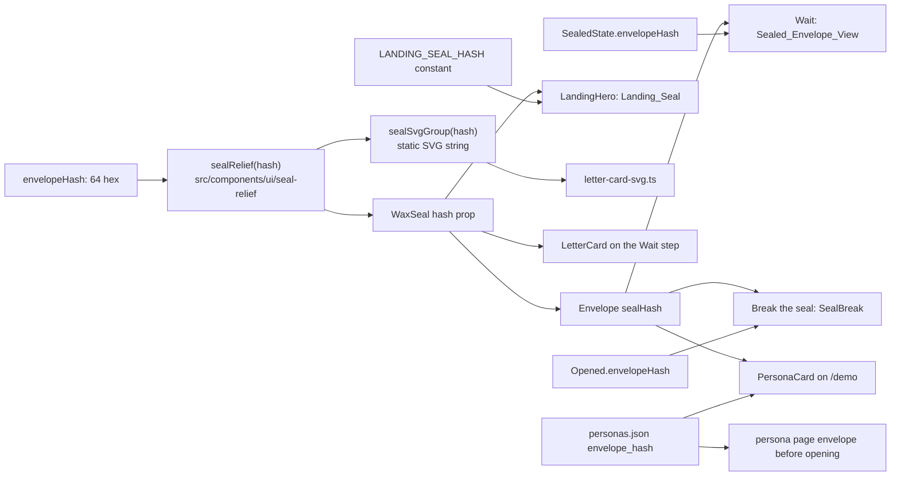
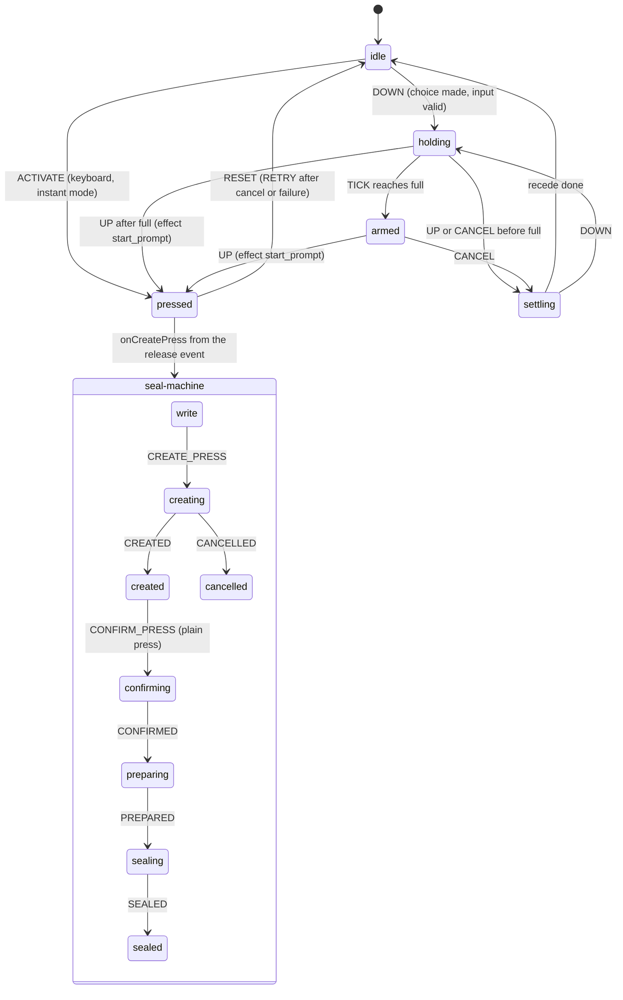

# Design Document

Spec: 13 The seal

## Overview

This design makes the wax seal the hero of Revenant. It covers Part 1 (groups P, U, A, L, T, W, F) and Part 2 (group D, documents only). It plans no change under `src/lib/crypto/` or `src/lib/seal-format/`, no new dependency, no new route and no change to the CSP.

The main decisions, each owner-fixed or derived from the code:

1. **One pure function draws every seal.** `sealRelief(hash)` in a new folder `src/components/ui/seal-relief/` turns the 64-hex envelope hash into two layers. The Coarse_Layer (hex digits 0 to 7) draws 3 to 7 large notches on the rim and 1 or 2 rings, so two seals differ at a glance. The Fine_Layer (hex digits 8 to 63) draws 32 radial ticks and 32 dots. Each of the 64 hex digits changes at least one feature by at least 1 unit (U2): digits 0 to 7 through the coarse rotation, digits 8 to 63 through their own fine mark. `WaxSeal` takes one prop, `hash`. Without a valid hash it draws today's markup (the Blank_Signet).
2. **Press and hold, release starts the prompt.** A new pure model `press-hold.ts` (hold.ts stays untouched) tracks the hold. A pointer release after a full hold, or one keyboard activation, starts the first passkey prompt synchronously from that event. Two prompts remain: the second one starts from a plain press in the Setting_State.
3. **`seal-machine.ts` does not change.** `CREATE_PRESS` and `CONFIRM_PRESS` keep their source states. The new envelope control only decides when `onCreatePress` and `onConfirmPress` (from `useSealFlow.ts`) are called.
4. **The tamper control runs the real `openLetter`.** It sits in `Fingerprint.tsx`'s persona section on the Read step. It copies the envelope the opening flow already fetched, flips one bit of one ciphertext byte, and maps the real `OpenResult` to the screen. It makes no request and writes nothing.
5. **The wait gets an envelope.** The Wait step becomes a Sealed_Envelope_View with a ghost held behind it (in the flow of the page, not in the fixed Ghost layer), and a Keep_Section below it.
6. **The Write step becomes one column of paper**, with text-only Occasion choices, a single "Add a receipt", compact receipt rows, and a heading offset under the Top_Bar.

Numbers measured while writing this design (nothing else in this document is a measurement; the relief numbers come from a node prototype of the derivation in "Seal_Relief", run in `/tmp` and not committed):

| What | Result | How |
|---|---|---|
| Coarse difference of the three persona pairs (notches + rings that differ) | Maya–Tomás 8, Maya–Priya 11, Tomás–Priya 7 | Prototype on the three production envelope hashes |
| Coarse pixel difference at 96 px, same pairs | 5.78 %, 33.23 %, 31.15 % | 4×4 supersampling rasteriser, seal pixels only |
| Full-seal pixel difference at 96 px, same pairs | 10.57 %, 30.45 %, 28.82 % (fine layer alone 6.61 %, 5.73 %, 6.53 %) | Same prototype |
| 150 random hash pairs | Coarse difference min 2, median 9, max 15 (2 pairs below 4). Coarse pixels min 2.48 %, median 18.91 %. Full-seal pixels min 6.33 %, median 17.74 % | Same prototype |
| One-digit changes, 38,400 (40 random hashes × 64 positions × 15 digits) | Digits 0 to 7: notch 0 corner moves at least 9.068 units, fine layer unchanged. Digits 8 to 63: a fine mark moves at least 0.9999999999999 units, coarse layer unchanged | Same prototype. The test asserts at least `1 - 1e-9` for the fine layer |
| Largest distance of any fine vertex from the seal centre | 43.19 units over 300 random hashes | Same prototype |
| Largest distance of any coarse vertex | 34.74 (notch corners), 44.8 (outer ring edge, by construction) | Same prototype |
| Smallest distance from the centre to the wax edge (`WAX_PATH`) | 45.80 units (largest 50.40) | 14,000 samples along the seven Bézier segments |
| Persona seal widths on `/demo` today | about 64 px at 1440 (three columns of about 301 px), about 76 px at 390 (358 px column) | `64/300` of the envelope width, from `page.module.css` and `Envelope.tsx`; the first U task measures them |
| JS budget headroom, indicative | `/` 10.6 kB, `/demo` 11.4 kB, `/demo/personas/[key]` 34.4 kB, `/demo/live` 14.7 kB, `/l/[id]` 32.0 kB | `node scripts/check-js-budget.mjs` on the `.next` folder that was in the workspace. Its commit is unknown, so the first task re-measures after `npm run build` |

The three real persona hashes pass the floors N = 4 and P = 3.0 % (U9.5) with the derivation as written, but Maya–Tomás is the weakest pair (same outer ring, notches only). The automated floors are the check (U9.3). Both the 96 px size and the floors are fixed; if a floor fails, the agent changes the relief derivation and continues.

### Corrections to the requirements, found in the code

These change the plan.

| Finding | Where | Consequence |
|---|---|---|
| The persona envelopes on `/demo` and `/demo/personas/[key]` are prerendered from `content/personas/personas.json` and never read the database (`src/app/demo/page.tsx`, `PersonaCard.tsx` "R6.6"). | `src/components/demo/PersonaCard.tsx` | Their seals need the hash without a database read. The hash goes into `personas.json` as `envelope_hash` (frontend-dev owns `content/personas/**`). A Journey_Check step compares it with the API. |
| `src/app/page.tsx` and `src/lib/landing-backdrop` (the landing Ghost) belong to platform-dev in `.github/agents.json`. `LandingHero.tsx` belongs to frontend-dev. | `.github/agents.json` | L1 sits entirely in `LandingHero.tsx`. L2 moves the ghost, so it is split into a frontend-dev task and a small platform-dev task (G1.10). |
| The live Wait ghost is `position: fixed` in `.ghostLayer` (`z-index: 2`, above every card), so no bounding-box rule can hold while the Keep_Section scrolls under it. | `scene.module.css` lines 378 to 384; `LiveGhost.tsx` | T2 puts the ghost in the page flow, behind the envelope. |
| The live Testify step has no ghost because `LiveWaitStep` draws `LiveGhost` only when `waiting` (`step === "wait"`). | `LiveWaitStep.tsx` | F4 draws it for `testify` too. |
| At 900 px and wider, `.section` gets a `padding-inline-end` that stops text at the fixed Ghost's left edge (`--text-right`). The right 40 % is empty on purpose, because a fixed ghost sits there. | `landing.module.css` lines 343 to 359 | F1 and F2 let the landing Ghost stop being fixed below the hero at 900 px and wider. Accepted by the owner. |
| `createPasskey` returns `createdPrf` from `prf.results.first` of the create result. The port reads it when a browser gives it, and `confirmPasskey` still demands a 32-byte result from `get`. | `passkey.ts`, `authenticator-port.ts` | Owner decision 2 stands: two prompts. Nothing here skips the `get` check. |
| The Write step at 1440×900 is a two-column grid up to 62 rem (`.liveWrite:has(> .occasions)`, `@media (min-width: 900px) and (max-height: 900px)`), inside a paper `.panel`. | `live.module.css` line 1233 | W1 replaces it with one column. |
| `LiveStepper` focuses the heading with `headingRef.current?.focus()`. `.heading` has no `scroll-margin-top`. | `LiveStepper.tsx`, `stepper.module.css` | This is the likely cause of the half-hidden headings. The first W task confirms it (W8.1). |

### Out of scope: the seal on the still-sealed page (formerly U7)

`GET /api/letters/[id]` returns `envelopeHash` only when the letter is openable. A sealed letter returns `status`, `opensAt` and `demo` only (`src/app/api/letters/[id]/route.ts`). Drawing the seal on the still-sealed `/l/[id]` page would need an API change, which the owner does not want, so U7 is cut and the page keeps the countdown only. No API change is planned anywhere in this spec.

## Architecture



Source layout (new folders in bold; `structure.md` is owner-edited and needs these lines):

```
src/components/ui/
  WaxSeal.tsx                 hash prop; art constants move to seal-relief/seal-art.ts
  seal-relief/                (pure, no React, no crypto, no db)
    relief.ts                 sealRelief, BLANK_RELIEF, reliefDistance, movedMarks, coarseDifference (both layers)
    slot-vectors.ts           literal direction tables for 32 tick, 32 dot and 24 notch slots (no trig at run time)
    seal-art.ts               WAX_PATH, GHOST_PATH, colours: one source for WaxSeal and the card
    svg.ts                    sealSvgGroup(hash, x, y, size): static SVG string for the card, both layers
    raster.testing.ts         test-only rasteriser: coarse, fine and full coverage (imported by tests only)
src/components/live/
  press/                      press-hold.ts, press-pose.ts, usePressEnvelope.ts, PressEnvelope.tsx, press.module.css
  BackupChoice.tsx            the fieldset
  stepper/SealedEnvelopeView.tsx, HeldGhost.tsx
src/components/reveal/tamper/ tamper-run.ts, TamperControl.tsx, tamper-copy.ts, tamper.module.css
src/components/landing/HeroEnvelope.tsx
```

Ownership: everything above is under `src/components/**` (frontend-dev). `src/lib/cards/**` (frontend-dev) imports `@/components/ui/seal-relief/svg` for the card. `lib/cards` is browser-only and server code must not import it, so the relief cannot live there. `src/app/page.tsx` and `src/lib/landing-backdrop*` are platform-dev (L2 slice only). `src/test/integration/live-walk*` and `tools/qa/**` are platform-dev; the integration tests are also on the `shared` list.

## Components and Interfaces

### 1. Seal_Relief (U1 to U5, U8 to U10)

**File:** `src/components/ui/seal-relief/relief.ts`. Imports nothing (G1.5). No `Math.random`, no `Date`, no `Math.sin` or `Math.cos` at run time.

Why no trig: `Math.sin` and `Math.cos` may differ in the last bit between V8 (server) and JavaScriptCore or SpiderMonkey (browser). A one-bit difference can flip a `toFixed(2)` digit and break U1.2 and hydration. `slot-vectors.ts` holds literal tables `DIR[k] = [sin, -cos]` and `TAN[k] = [cos, sin]` to 6 decimals for three slot sets: 32 tick slots (11.25° apart), 32 dot slots (offset 5.625°) and 24 notch slots (15° apart). Everything else is `+`, `-` and `*` on doubles, which IEEE 754 rounds identically everywhere. A test checks the tables against `Math.sin` and `Math.cos` to 1e-6.

The relief has two layers, drawn from disjoint hex digits (U10): the **Coarse_Layer** reads hex digits 0 to 7 (bytes 0 to 3), the **Fine_Layer** reads hex digits 8 to 63 (bytes 4 to 31). No digit drives both.

**Interface**

```ts
export const TICK_COUNT = 32;
export const DOT_COUNT = 32;
export const NOTCH_MIN = 3, NOTCH_MAX = 7;          // recorded range (U10.4)
export const RING_MIN = 1, RING_MAX = 2;            // recorded range: 3 rings do not fit, see "Rings"
export const COARSE_FEATURE_MAX = 12;               // measured maximum is 9 (7 notches + 2 rings)
export const RELIEF_MAX_RADIUS = 43.5;              // fine layer bound; measured maximum 43.19
export const COARSE_MAX_RADIUS = 44.8;              // coarse layer bound (outer ring edge); wax edge is at least 45.80
export type Pt = readonly [number, number];
export type TickMark = { kind: "tick"; slot: number; nibble: number; lengthLevel: number; shiftLevel: number;
                         corners: readonly [Pt, Pt, Pt, Pt] };           // 100-unit space
export type DotMark  = { kind: "dot"; slot: number; nibble: number; radialLevel: number; shiftLevel: number;
                         cx: number; cy: number; r: number };
export type ReliefMark = TickMark | DotMark;                              // exactly 64, fixed order
export type CoarseNotch = { kind: "notch"; index: number; slot: number;   // slot 0..23
                            corners: readonly [Pt, Pt, Pt, Pt] };
export type CoarseRing  = { kind: "ring"; band: "inner" | "outer"; radius: number; width: number };
export type CoarseLayer = {
  sum: number;                       // 0..23, the rotation
  notchCount: number;                // 3..7
  ringState: 0 | 1 | 2;              // 0 inner only, 1 outer only, 2 both
  mirror: 0 | 1;
  notches: readonly CoarseNotch[];   // notchCount items
  rings: readonly CoarseRing[];      // 1 or 2 items
  notchPath: string;                 // one path, closed quads
  signature: string;                 // "n7;s20;m1;r=outer", the value of data-coarse
};
export type SealRelief =
  | { kind: "relief"; hash: string; coarse: CoarseLayer; marks: readonly ReliefMark[]; tickPath: string; dotPath: string }
  | { kind: "blank"; coarse: null; marks: readonly []; tickPath: ""; dotPath: "" };
export const BLANK_RELIEF: SealRelief;
export function isFingerprintHex(s: unknown): s is string;      // /^[0-9a-f]{64}$/
export function sealRelief(hash: unknown): SealRelief;          // never throws
/** Largest displacement of any index-matched feature (fine marks, notches by index, rings by band).
 *  Infinity when either relief is blank, or the notch count or ring state differs (a count change). */
export function reliefDistance(a: SealRelief, b: SealRelief): number;
export function movedMarks(a: SealRelief, b: SealRelief, minUnits: number): number;   // fine layer, index-wise
/** U9.5 coarse difference: |occupied notch slots of A xor of B| + |ring bands of A xor of B|. Infinity if either is blank. */
export function coarseDifference(a: SealRelief, b: SealRelief): number;
```

**Fine_Layer derivation** (drawing space 100 × 100, centre C = (50, 50)). Let `nib[p]` be hex digit `p` read as 0 to 15. Let `d` be the outward unit vector of a slot and `t` the tangent (`TAN`).

| Feature | Digit | Rule |
|---|---|---|
| Tick `k`, `k` = 4 to 31 | high nibble of byte `k`, hex position `2k` (8 to 62, even) | `a = nib >> 2`, `b = nib & 3`. Length `L = 3.4 + 1.6·a` (3.4 to 8.2). Lateral shift `s = (b − 1.5)·1.2`. Start radius `r0 = 34.9`, half width `w = 1.0`. Base `C + d·r0 + t·s`; corners `base ± t·w` and `base ± t·w + d·L`. |
| Dot `k`, `k` = 4 to 31 | low nibble of byte `k`, hex position `2k + 1` (9 to 63, odd) | `c = nib >> 2`, `e = nib & 3`. Radius `r = 27.75 + 1.0·c` (27.75 to 30.75). Shift `s = (e − 1.5)·1.0`. Centre `C + d·r + t·s`. Dot radius 0.7. |
| Ticks 0 to 3, dots 0 to 3 | none (fixed) | Drawn at the fixed nibble `FIXED_NIBBLE = 5` (`a = 1`, `b = 1`) for every hash (U10.3). |

This is the one-to-one mapping of U10.3: 28 ticks plus 28 dots use the 56 digits 8 to 63 exactly once each. The geometry of the fine marks is unchanged from the earlier draft of this design; only their digits and their tone change (see "Tone and draw order").

**Coarse_Layer derivation.** Let `d0 … d7` be hex digits 0 to 7 as numbers 0 to 15.

| Quantity | Rule | Why |
|---|---|---|
| Rotation `S` | `S = (d0 + d1 + … + d7) mod 24` | A change of one digit by `Δ` (1 to 15 in absolute value) changes the sum by `Δ`, and `24 > 15`, so `S` always changes. This is what makes every digit of 0 to 7 move a feature. |
| Notch count `n` | `n = 3 + ((d0 + d1) mod 5)`, 3 to 7 | `(d0 + d1) mod 5` equals `byte0 mod 5` because 16 ≡ 1 (mod 5). |
| Ring state `ρ` | `ρ = (d2 + d3) mod 3`: 0 inner ring, 1 outer ring, 2 both | Equals `byte1 mod 3` because 16 ≡ 1 (mod 3). |
| Mirror `m` | `m = (d4 + d5 + d6 + d7) mod 2` | Flips the notch pattern, so two hashes with equal `n` and `S` still differ. |
| Notch offsets | literal table `PAT[n]` in 15° slots: `3: 0,8,16`; `4: 0,6,12,18`; `5: 0,5,10,14,19`; `6: 0,4,8,12,16,20`; `7: 0,3,7,10,14,17,21` | Every row starts at 0, and every gap between neighbours (including the wrap-around) is at least 3 slots (45°). So no two notches can overlap. |
| Notch `i` slot | `slot_i = (S + (m ? −PAT[n][i] : PAT[n][i])) mod 24` | Notch 0 is always at slot `S`, whatever `n` and `m` are. |

**Notch shape** (fixed for every hash, U10.6). A rectangle in the slot's local frame: radial extent 28.4 to 34.3, half width 5.5, so 5.9 units radial by 11.0 units tangential. Corners `C + d·r ± t·5.5` for `r` = 28.4 and 34.3. The notch sits on the existing rim ring (radius 31.5 to 34.5) and reads as a bold block on it.

**Rings** (fixed for every hash). A ring is a full circle of stroke width 4.2: the inner ring occupies radius 35.6 to 39.8 (centre 37.7), the outer ring 40.6 to 44.8 (centre 42.7). The two ring slots are a fixed 4.2 wide each with a 0.8 gap. A hash picks one slot or both.

*Why 1 to 2 rings, not 1 to 3.* Each ring must be at least 4.2 units thick (see "Unit maths"). Between the rim ring's outer edge (34.5) and the nearest wax edge (45.80) there are 11.3 units. The notches take up to radius 34.74 (their outer corners), the rings must stay clear of the notches, of each other and of the wax edge, and need at least about 0.8 units of clearance each. Two rings (4.2 + 0.8 + 4.2) plus the clearances fill the band. A third ring needs another 5.0 units that do not exist. U10.4 lets the design record other ranges, so the recorded range is 1 to 2 rings. This differs from the 1 to 3 in the original brief. The owner approved rings 1 to 2 as decided (U10.4), so it is not an open question.

**Unit maths** (U10.7, U9). The seal is drawn in a 100-unit space and scaled to its size, so at 96 px one unit is 0.96 px. Four CSS px are `4 / 0.96 = 4.1667` units, rounded up to 4.2. Smallest sides at 96 px: ring 4.2 units = 4.03 px, notch 5.9 units = 5.66 px. Both pass. The notch's long side is 11.0 units = 10.6 px.

**Features drawn:** `n` notches (3 to 7) plus 1 or 2 rings: at least 4 and at most 9, so the "at most 12" of U10.4 holds with margin.

**Tone and draw order** (U1.4: no new colour). The wax already has the tokens `--wax` (#ff7b1c), `--wax-rim` (#d4600c), `--wax-inner`, `--wax-press` (#c4560a) and `--wax-eye` (#ff8d3a), each with a literal fallback. Draw order, back to front: wax, **coarse rings** in `--wax-press`, the existing rim ring, **coarse notches** in `--wax-eye`, the inner disc, the **fine ticks and dots** in `--wax-rim`, the ghost. Reason for the tones: the notches sit on the mid-tone rim ring, where a dark notch would merge with it, so they are drawn light; the fine marks are drawn in the mid tone so they stay visible both on the dark rings and on the bare wax (ticks drawn in `--wax-press` would disappear where they cross a ring). I did not compare these tones by eye in a browser, so the first U task renders them and attaches the 96 px screenshots as non-blocking evidence (U9.3). If a floor fails, the agent changes the derivation or the tone, not the thresholds.

**Why one digit always moves something (U2.1, U2.2, U10.2).**

| Digits | Mechanism | Measured |
|---|---|---|
| 0 to 7 (Coarse_Layer) | The digit is in the sum, so `S` changes, so notch 0 moves to another 15° slot. Notch 0 exists for every `n` and `m` (offset 0). Moving by one slot moves the outer corner by `2·34.74·sin 7.5° = 9.07` units, and more for larger changes. A change may also alter `n`, `ρ` or `m`, which are further coarse changes. | Largest corner move of notch 0 was at least 9.068 units over 38,400 changes. The Fine_Layer was unchanged in all of them. |
| 8 to 63 (Fine_Layer) | One digit drives one mark, and the 16 values of a digit fill a 4 × 4 grid. Steps are 1.6 (tick length), 1.2 (tick shift), 1.0 (dot radius) and 1.0 (dot shift), so any two different digits differ on one axis by at least 1.0. | Largest mark move at least 0.9999999999999 units. The test asserts at least `1 − 1e-9`. The Coarse_Layer was unchanged in all of them. |

**The earlier claim "every digit moves a mark by at least 1 unit".** It still holds for all 64 digits, but by two routes. Digits 8 to 63 move a fine mark by at least 1.0 unit. Digits 0 to 7 move the coarse notch 0 by at least 9.07 units. The four fixed ticks and four fixed dots no longer carry a digit: the 8 digits that the earlier draft gave to the first 4 ticks and 4 dots (hex 0 to 7) now feed the Coarse_Layer. Nothing is left unused: 8 coarse digits plus 56 fine digits is 64.

**Bounds** (U1.4, U8.2 "clip no part", U10.7). All parts lie between the inner disc (radius 27) and the wax edge (at least 45.80 from the centre, measured by sampling `WAX_PATH`):

| Part | Radial range | Clearance |
|---|---|---|
| Inner disc | 0 to 27 | notch inner edge 28.4 is 1.4 away |
| Dots | 27.05 to 31.49 | overlay the notches' inner part |
| Rim ring (existing) | 31.5 to 34.5 | notches sit on it |
| Notch | 28.4 to 34.74 (outer corners) | inner ring starts 35.6, gap 0.86 |
| Inner ring | 35.6 to 39.8 | 0.8 to the outer ring |
| Fine ticks | 34.9 to 43.19 (measured maximum) | overlay the rings |
| Outer ring | 40.6 to 44.8 | wax edge at least 45.80, gap 1.0 |

The test asserts: every fine vertex and dot edge within 43.5, every coarse vertex and ring edge within `COARSE_MAX_RADIUS` 44.8, and 44.8 below the wax-edge minimum computed from `WAX_PATH` in the test (45.80). Fine marks overlay coarse features by design (they are different layers in different tones). The coarse rule "no part touches another" applies inside the Coarse_Layer: neighbouring notches (at least 45° apart; measured 11.57 units between the nearest corners of notches 3 slots apart), notch to inner ring (0.86), ring to ring (0.80), ring to wax edge (1.0).

**Legibility:** the structure is fixed. Every hash draws at least 3 notches, at least 1 ring, 64 fine marks and the ghost, so no hash draws an empty or broken seal (U10.6). Rings and notches are the marks that read at 96 px; the fine layer reads as grain (a tick is 2 units, 1.9 px at 96 px).

SVG output: `tickPath`, `dotPath` and `notchPath` are single paths of closed quads or circles written with `toFixed(2)`. Rings are `<circle>` elements with a stroke, built from constants. `WaxSeal` draws in the order above, inside the two clipped halves, so the break and `cracks.ts` keep working. The relief never covers the Signet centre.

**`WaxSeal` (U1, U5):**

```ts
export type WaxSealProps = {
  hash?: string;          // 64 lowercase hex; anything else draws the Blank_Signet (no coarse layer, no fine layer)
  size?: number;
  className?: string;
  patternKey?: string;    // still accepted and ignored until the last caller is gone
};
```

The root `<svg>` gets `data-seal-hash={hash}` and `data-coarse={relief.coarse.signature}` only when the hash is valid, so the Live_Walk and tests can compare seals and read the coarse features without parsing paths. With no valid hash the markup is today's markup. `SealArt` draws the layers inside the existing two clipped halves, so the break and `cracks.ts` keep working (they only read the 100-unit space). The header comment of `WaxSeal.tsx` ("Every letter gets the same seal", "takes no props") is replaced. The neutrality intent of spec 07 R10.11 moves into U3 and into `relief.test.ts` (fixed kinds and ranges, no text node, no `<text>`, no `<image>`). The `data-coarse` string holds only counts and slots (for example `n7;s20;m1;r=outer`), nothing about the letter.


**Fixed hashes**

- `LANDING_SEAL_HASH` in `src/components/landing/constants.ts` is `f7023f7534d9709bba90be98d8df835c724e7013d40202a0cb02db103a46b2a8`, which is SHA-256 of the ASCII text `revenant:landing-seal:v1` (computed in this session). A comment says it belongs to no letter (L1.4).
- The three persona hashes are read from `GET https://revenant.devclef.se/api/letters/<letter_id>` (a read-only call to the public API). They change if a persona is resealed (`retired_letter_ids` shows this has happened).

| Persona | letter_id | envelopeHash |
|---|---|---|
| us-maya | `NvKu8C4wTJsMYe8uv1AkAQ` | `5925def5dd62f6719db9f9bbc05fbbf210eac1fdd3d4c3018b3b97cb84a4728f` |
| eu-tomas | `zGQh3PULIzdSxkyu9elzUA` | `a0d025aef084492157f823e72b809b7c802a690bb2fbd75a07b467c0f02a54c6` |
| us-priya | `CFtrFrKUnj-R-71e819chQ` | `6524723dfb1ddefb0a4702bc4958fe74f60a9db3564148ec95986bc95e63e64c` |

**Where the hash comes from, per surface (U4)**

| Surface | Hash source | Draws |
|---|---|---|
| Seal step before the seal is stored | none | Blank_Signet (U5.1) |
| Wait, `SealedEnvelopeView` | `SealedState.envelopeHash` from the `SEALED` event of `seal-machine.ts` (the hash the server verified) | relief |
| Letter card, in the page (`LetterCard.tsx`) and the saved SVG (`letter-card-svg.ts`) | `SealedState.envelopeHash` | relief, static |
| Break the seal | `Opened.envelopeHash` (the value `openLetter` checked) for the persona, live and real flows | relief |
| Persona envelopes (`PersonaCard` on `/demo`, the held Envelope on `/demo/personas/[key]` before opening) | `envelope_hash` in `personas.json` | relief |
| Landing hero | `LANDING_SEAL_HASH` | relief, in server HTML |

`personas.json` gains `envelope_hash` per persona, validated in `src/lib/personas` as 64 lowercase hex. `Envelope.tsx` gains two props: `sealHash?: string` and `seal?: "seal" | "none"` (default `"seal"`). `none` omits the flap wax, so the Press_Envelope can draw its own wax. Once opened, Break the seal uses `Opened.envelopeHash`. If a persona is resealed and `envelope_hash` is stale, the seal changes between the closed envelope and Break the seal. The Journey_Check (`tools/qa/journey-check.mjs`) gets one step: for each persona, `GET /api/letters/<letter_id>` must return the hash that `personas.json` holds. A failed step opens the existing issue.

**Letter card (U4.3).** `svg.ts` exports `sealSvgGroup(hash, x, y, size): string`, a `<g transform=…>` of literal-colour shapes built from `seal-art.ts` and `sealRelief` (wax, coarse rings, rim ring, coarse notches, inner disc, fine marks, ghost, in the same order and tones as `WaxSeal`, with the token fallbacks as literal colours), with no CSS variables, no `<clipPath>`, no animation and no raster. `letterCardSvg` gets an optional `seal?: { hash: string }` input. The seal is 72 units across at the top right of the title row. The QR moves down: `qrTop = PADDING + 84` and `CARD_HEIGHT` grows from 560 to 608. The Fingerprint text stays. `LetterCard.tsx` shows the same seal beside its title through `WaxSeal`. The card keeps its contents otherwise (T1.5).

**Size contract (U8).** At Break the seal on 900 px and wider, the seal sits on the held Envelope (`sealPlacement` in `seal-placement.ts`, `.envelopeSeal` in `SealBreak.module.css`). Today its size is `64/300` of the Envelope's width. Below 900 px it is `PHONE_SEAL_SIZE = 6.5rem` (104 px). The plan:

- Add `--break-seal-d` to the Scene tokens: `clamp(160px, …, …)` at 900 px and wider, and `120px` at 599 px and below, with the 600 to 899 px band at `clamp(120px, 20vw, 160px)`. The exact `clamp` bounds are set by the first task from the measured Envelope width at 1440×900 (the current 75 px implies an Envelope about 351 px wide).
- `.envelopeSeal` and `.sealTarget` take `width` and `height` from `--break-seal-d`, centre on the same point (53 % of the Envelope height, 50 % of its width) and may overflow the Envelope box (`overflow: visible`). `min-width: 44px` stays.
- The Envelope's own `WaxSeal` (drawn at 64 units) is under the overlay. The overlay is larger and opaque, so it covers it. Both receive the same hash.
- **Measurement.** The Live_Walk and `tools/qa/layout-check.mjs` read `[data-seal-target] svg`'s `getBoundingClientRect().width` at both Evidence_Sizes, fail below 160 (1440) and 120 (390), and check that the rect, the "Break the seal" button and the Skip_Link lie inside the viewport (U8.2, U8.3). The first U task records today's width at both sizes.

**`/demo` seals at 96 px (U9).** The `/demo` seals are drawn at 96 CSS px at 1440 and at 390 now, not as a fallback, and no threshold is lowered afterwards.

*Layout facts, read from the code.* The `/demo` list is a grid: one column below 40 rem, two from 40 rem, three from 64 rem (`src/app/demo/page.module.css`), with page padding `clamp(1rem, 4vw, 2rem)` and a column gap of up to 1.75 rem. The persona envelope is drawn at the width of its column, and `Envelope` draws its seal at 64 of 300 viewBox units, so the seal is `64/300` of the envelope width:

| Viewport | Envelope width | Seal today | Envelope width needed for 96 px |
|---|---|---|---|
| 1440, three columns | about 301 px (960 px content, two gaps of 28 px) | about 64 px | 450 px |
| 390, one column | 358 px (390 minus 2 × 16 px) | about 76 px | 450 px |

Neither width reaches 450 px, so the envelope width cannot be raised to fit (three columns at 450 px would need 1,350 px of content). The first U task confirms the two widths by measurement.

*Solution: the seal size is independent of the envelope width.* `Envelope` gets the `seal?: "seal" | "none"` prop described under "Where the hash comes from" (default `"seal"`). `PersonaCard` renders `<Envelope seal="none" … />` and, inside `.art` (made `position: relative`), one `<span data-persona-seal>` that holds `<WaxSeal hash={persona.envelope_hash} size={DEMO_SEAL_PX} />` with `DEMO_SEAL_PX = 96`. The span is `position: absolute; left: 50%; top: 54%; width: 96px; height: 96px; transform: translate(-50%, -50%); pointer-events: none`. The 54 % is the flap tip: the viewBox is 300 × 188 letterboxed in a 1.3:1 box, so the flap tip at y = 104 sits at `(104 + (300/1.3 − 188)/2) / (300/1.3) = 54.3 %` of the box height (the first U task measures it). The seal is decoration, so the span is `aria-hidden`, and the whole card stays one anchor.

*How it fits.*
- At 1440: three columns of about 301 px, a 96 px seal in each (32 % of the envelope width), no horizontal scroll. The three seals sit side by side.
- At 390: one column of 358 px. The three cards stack, so the three seals are stacked, one per card, each 96 px (27 % of the width). Three seals in a row would also fit in 358 px (3 × 96 = 288 px plus two gaps), but the cards are a single column by design, and the design does not change that layout. The non-blocking evidence screenshot at 390 is therefore one `fullPage` screenshot of `/demo` that shows the three stacked seals at real size.
- Between 640 and 1023 px: two columns of about 280 px or more, the same overlay, no scroll.
- The persona page's own closed Envelope (`/demo/personas/[key]`) keeps its in-SVG seal, which scales with the envelope. U9 is about `/demo`.
- `layout-check.mjs` reads `[data-persona-seal]` width (must be 96, at least 96) and horizontal scroll at both sizes.

*The pair floors (U9.5), chosen from what a person can tell apart.* The Coarse_Layer is what a person sees at a glance, so the floor counts coarse features. A notch is 11.0 × 5.9 units = 64.9 square units, which is 0.83 % of the seal's area (π·50² = 7,854 square units). Two seals that show the same notch in different places differ in two notches (one vacated, one occupied), which is `N = 2`. The requirements' minimum of `N = 2` is one moved notch. A person comparing two small seals should see at least two notches in different places, so this design sets:

- **N = 4**: `coarseDifference(A, B) ≥ 4` (for example two notches moved, or one ring state changed plus two notches).
- **P = 3.0 %**: the share of seal pixels (the pixels whose centre is within 50 units of the centre) whose coverage differs between A and B, **counting the Coarse_Layer only**, rasterised at 96 px with 4 × 4 supersampling. Four differing notches are 3.3 % of the area, so 3.0 % is the pixel counterpart of `N = 4`. The fine layer is left out of the floor on purpose: it differs by about 6 % for any two hashes and would hide whether the coarse layer differs at all.

N and P come from that reasoning, not from the measurements below, and they are recorded in the PR description and never lowered afterwards (U9.5). The full-seal pixel difference is measured and printed but is not a floor.

*Rasteriser (`raster.testing.ts`, test only).* For a seal drawn at diameter D, sample 4 × 4 points per pixel at sub-pixel centres mapped to the 100-unit space. A sample is on when it lies inside any notch quad (convex test), inside any ring annulus, and, for the full seal, inside a fine tick quad or dot circle. `cov(p)` is the share of on-samples (0 to 1). `P(A, B, D) = 100 · Σ |cov_A − cov_B| / N(D)` over pixels inside the seal, where `N(D)` is their count. No browser, canvas or dependency.

*Measured in this session* (node prototype of exactly this derivation, in `/tmp`, not committed), from the three production hashes:

| Pair | `coarseDifference` (notches + rings) | Coarse pixel difference at 96 px | Full-seal pixel difference at 96 px | Fine layer only |
|---|---|---|---|---|
| Maya – Tomás | 8 (8 + 0) | 5.78 % | 10.57 % | 6.61 % |
| Maya – Priya | 11 (9 + 2) | 33.23 % | 30.45 % | 5.73 % |
| Tomás – Priya | 7 (5 + 2) | 31.15 % | 28.82 % | 6.53 % |

| Persona | Rotation S | Notches | Ring state | Mirror |
|---|---|---|---|---|
| Maya | 20 | 7 at slots 20, 17, 13, 10, 6, 3, 23 | outer | 1 |
| Tomás | 6 | 3 at slots 6, 22, 14 | outer | 1 |
| Priya | 18 | 4 at slots 18, 12, 6, 0 | inner | 1 |

Over 150 random hash pairs: `coarseDifference` min 2, 5th percentile 6, median 9, max 15; coarse pixel difference min 2.48 %, 5th percentile 4.96 %, median 18.91 %, max 34.88 %; full-seal pixel difference min 6.33 %, median 17.74 %. In 2 of the 150 pairs `coarseDifference` was below 4, so the floors are a check on the three persona hashes and are not a promise for every pair of hashes. Two different hashes can in principle draw the same silhouette (for example 3 notches with `S` differing by 8 and equal `ρ`), so U6 still holds.

*Reading the numbers honestly.* All three real pairs pass N = 4 and P = 3.0 % with the derivation as written, so the derivation did not have to change to meet the floors. Maya – Tomás is the weakest pair: both have the outer ring, so they differ only in the notches (7 against 3), which is 5.78 % of the pixels. Priya differs from both by a ring and by notches. The floors do not decide whether a person can tell Maya from Tomás at 96 px. The contact sheet I rendered for my own check (not committed) was not conclusive on that pair by eye, so I make no claim. The automated floors are the check. If a floor fails, the agent changes the coarse derivation (for example by letting the ring state depend on the first notch slot, or by making notches larger), re-runs the floors, and N and P stay.

*Automated floors and PR evidence (U9.2 to U9.5).*
1. The first U task renders the relief on `/demo` and attaches `demo-seals-1440x900.png` (three seals side by side at real size) and `demo-seals-390x844.png` (full page, three seals stacked), taken from the real persona hashes in `personas.json`. They are non-blocking PR evidence. No one has to look at them before work continues.
2. The check is the persona floor test: N coarse features and pixel floor P on the three real pairs, at 96 px.
3. If a floor fails, the agent changes the relief derivation (Coarse_Layer mapping, ranges, sizes or tone), re-runs the floors and continues. The size (96 px), N and P are not changed.
4. No task waits for a look or an approval. Tasks that draw the relief depend on task 2 in code only.

**Copy near a seal (U6).** One sentence, once per page, in `SCENE_COPY` or the feature's copy file: "This seal is drawn from the letter's fingerprint." It appears on the Wait step (in the Keep_Section caption) and in the Tamper_Control's result. It never says the seal verifies or proves anything. "The seal is intact" still comes from `REVEAL_COPY.sealVerdict`, which `Fingerprint.tsx` renders only after `openLetter` passed (U6.3).

### 2. Press interaction (P1 to P8)

**Files:** `src/components/live/press/`.

**Constants** (in `src/components/live/constants.ts`):

```ts
export const SEAL_PRESS_HOLD_MS = 900;      // P2.1: at least 600, at most 1500
export const SEAL_PRESS_SETTLE_MS = 300;    // the pool recedes
export const POOL_STAGE_SPREAD_AT = 0.4;    // P3: bead below, spread from here, full at 1
```

**`press-hold.ts`: a new pure model.** `hold.ts` is not reused or changed. Reason: in `hold.ts`, `onTick` moves a hold to the terminal phase `broken` as soon as the clock reaches `SEAL_HOLD_MS` (1500 ms), and `onRelease` from `broken` returns the state unchanged. The Break the seal flow sends `ADVANCE` on that transition, which is what we must not do here: a completed hold must wait for the release. The PR for this task must change neither `hold.ts` nor `hold.test.ts` (checked by a diff gate in the task's validation).

```ts
export type PressPhase = "idle" | "holding" | "armed" | "settling" | "pressed";
export type PressState = { phase: PressPhase; progress: number; since?: number; from?: number };
export type PressEvent =
  | { type: "DOWN"; now: number } | { type: "TICK"; now: number }
  | { type: "UP"; now: number }   | { type: "CANCEL"; now: number }
  | { type: "ACTIVATE" }          // keyboard, assistive-technology click, or instant mode
  | { type: "RESET" };
export type PressEffect = "start_prompt" | null;
export const PRESS_IDLE: PressState;
export function pressStep(s: PressState, e: PressEvent): { state: PressState; effect: PressEffect };
export function poolStage(s: PressState): 0 | 1 | 2 | 3;   // 0 none, 1 bead, 2 spread, 3 full
```

Rules (time is passed in; no `Date`, no timers, no `Math.random`):

| State | Event | Result |
|---|---|---|
| `idle`, `settling` | `DOWN` | `holding`, `progress 0`, `since = now` |
| `holding` | `TICK` | `progress = clamp((now − since) / SEAL_PRESS_HOLD_MS)`. At 1 the phase is `armed`. No effect. |
| `holding` | `UP` | Recompute progress at `now`. If it is 1 or more: `pressed` and effect `start_prompt`. Otherwise `settling` from that progress, no effect. |
| `armed` | `UP` | `pressed` and effect `start_prompt` (exactly once). |
| `holding`, `armed` | `CANCEL` | `settling`, no effect. A cancelled or blurred press never starts a prompt. |
| `settling` | `TICK` | Progress recedes linearly over `SEAL_PRESS_SETTLE_MS`, then `idle`. |
| `idle`, `holding`, `armed`, `settling` | `ACTIVATE` | `pressed`, effect `start_prompt`. |
| `pressed` | any except `RESET` | unchanged, no effect (double press ignored, P2.8) |
| any | `RESET` | `idle` |

`poolStage`: `holding` below `POOL_STAGE_SPREAD_AT` is 1 (bead), above it 2 (spread), `armed` and `pressed` are 3 (full). `settling` reports the stage its progress is in. With P3 cut, `poolStage` returns 3 for `armed`/`pressed` and 0 otherwise (the full pool appears at completion, P3.2).

**Release event rule (decision 1, P2.3, P4.1, P5.2).** One behaviour on mouse, touch and pen:

- Holding pools the wax. A `pointerup` (or `pointercancel`) listener on `window`, registered on `pointerdown` as `useSealBreak.ts` does, sends `UP` or `CANCEL`. The handler calls `onCreatePress()` **synchronously in that same event handler** when the effect is `start_prompt`. `passkey.ts` already requires this ("the first asynchronous operation ... starts the WebAuthn prompt in the same tick"). The rAF loop only sends `TICK` and writes `--press-progress` to the element (`style.setProperty`, no React render per frame). It never calls the passkey code.
- `pointerup` is an activation-triggering event for touch and pen on all current engines, and a mouse press keeps transient activation for several seconds. The Live_Walk proves the code path with a virtual authenticator; it cannot prove a phone's passkey provider (known limitation, spec 11).
- **Keyboard and assistive technology.** The control is a native `<button>`. Space and Enter fire `click` with `event.detail === 0`. `onClick` sends `ACTIVATE` only when `detail === 0`. A pointer-generated click (`detail > 0`) is ignored, so a release never starts the prompt twice. One activation runs the sequence with no hold.
- **Instant mode** (`prefers-reduced-motion: reduce` or Calm_Mode, from `useCalmInForce()`): pointer down starts no hold. `onClick` of any kind sends `ACTIVATE`. The wax and Signet render in their final pose (P2.7).
- Pointer handling copies `HeldSeal.tsx`: `touch-action: none`, `contextmenu` prevented, pointer captured inside `try`.

**Skip (P2.6).** `usePressEnvelope` registers one skip callback with `useSequence().register` while the Signet or Setting animation runs. The existing Top_Bar Skip button then appears, so the page keeps one Skip control and no second Motion_Control (Q1.2). The callback moves the pose to its final frame. It never calls, awaits or answers a passkey prompt, and a source scan covers it.

**Pose, a pure function (`press-pose.ts`):**

```ts
export type SealPose = "unpressed" | "pooling" | "armed" | "signet_down" | "setting" | "set" | "lifted";
export function sealPose(seal: SealState, press: PressState): SealPose;
```

| `SealState.tag` | Pose |
|---|---|
| `write` | by `press.phase`: `idle` → `unpressed`; `holding` → `pooling`; `armed` → `armed`; `settling` → `pooling` (receding) |
| `creating` | `signet_down` (the first prompt is open) |
| `created` | `setting` (the Setting_State) |
| `confirming`, `preparing`, `sealing` | `setting` |
| `sealed` | `set` |
| `cancelled`, `failed`, `cannot_lock`, `fallback_key` | `lifted` |

**Mapping onto `seal-machine.ts` (no change to the reducer, P5.7).**

| `SealState.tag` | Control accepts | Calls | Reducer event |
|---|---|---|---|
| `write` | hold then release, or one activation, when the Backup_Choice is made and the write input is valid | `onCreatePress()` | `CREATE_PRESS` (`write` only) |
| `creating` | nothing (press ignored) | none | none |
| `created` (Setting_State) | one plain press (pointer release on the control, or activation). No hold. | `onConfirmPress()` | `CONFIRM_PRESS` (`created` only) |
| `confirming`, `preparing`, `sealing` | nothing | none | none |
| `cancelled`, `failed`, `cannot_lock`, `fallback_key`, `sealed` | not rendered as a press (see below) | none | none |

`useSealFlow.ts` already guards with `inFlight.current` and `phase.current.tag`, so a double press changes nothing. At most two prompts occur: `creating` once and `confirming` once.

The existing cancel and failure screens stay: `renderDemoStep` in `SealPage.tsx` returns `SealFailure` or `BackupFallback` for those states. P4.3 is met by rendering `<PressEnvelope inert pose="lifted" />` above `SealFailure` for `cancelled` and `failed` (Signet lifted, no pool), so the lift is visible next to the unchanged failure line. `RETRY` returns to `write` and a `RESET` event clears the press state.

**State diagram:**



**The Setting_State (decision 2, P5.4 to P5.6).** After `CREATED` the Signet stays down. The wax is drawn setting: a slow lightening of the rim by `opacity` on an overlay layer (no new colour; static under reduced motion). The Press_Envelope is the only control. One plain line says: "Your device will ask once more to set the seal. Press the wax." There is no "Confirm your passkey" text and no second orange button. A second press (pointer release or keyboard) starts the second prompt from that event. `LIVE_COPY.confirmButton`, `createButton` and `passkeySteps` are retired for the stepper's Seal step (they remain for `/seal`). The passkey count sentence moves into the single "passkeyTwice" line: "Your device will ask for the passkey twice. Press and hold the wax, then let go."

**Wax pool and Signet (P2.2, P2.3, P3).** `PressWax.tsx` draws inside the Envelope's flap area, positioned like `.envelopeSeal` (53 % height, 50 % width) with `--break-seal-d`-style sizing from `press.module.css`:

- Pool: `WAX_PATH` from `seal-art.ts` scaled by `scale(calc(0.15 + 0.85 * var(--press-progress)))`, `transform` only. Stage changes (P3) swap the path: stage 1 a small ellipse (bead), stage 2 a lobed blob (spread), stage 3 `WAX_PATH`. The stage is a `data-pool-stage` attribute set by React only when the stage changes (three renders per hold).
- Signet: the Blank_Signet face (rim ring, inner disc, ghost, without wax blob and relief) drops from `translateY(-14%) scale(1.12)` to rest over 280 ms with `transform` and `opacity` only. After `SEALED` it stays down (P5.8).
- Under instant mode the wax and Signet render in the pose directly (`data-seal-pose` set at mount).
- With P3 cut: only stage 3 exists, drawn when the phase becomes `armed`.

`aria-hidden` on the drawing. The `<button>` carries the accessible name "Press the seal" and `aria-describedby` points to the instruction and status lines.

**Press_Envelope as the one orange control (P1.3, decision 5).** The Envelope paper stays cream. The wax is the only orange (`--wax`), and the focus ring uses `--accent`. `LIVE_COPY.backButton` renders with the outlined `.secondary` class, as today. The orange `pressButton` and the `backupButton`'s accent styling are removed from the `seal` section of `WriteForm.tsx`. The Live_Walk check lists every `button` and `a` in `[data-step="seal"]` and fails if any other element's computed `background-color` equals the `--accent` value.

**Layout (P1.1, P1.4, P6).** The Seal step is a grid:

- At 900 px and wider: two columns. The left column holds the Warning_Text, the Backup_Choice, the press instruction, the status line and Back. The right column holds the Press_Envelope at `min(46vw, 30rem)` (the largest element). Both sit inside the first viewport at 1440×900.
- Below 900 px: one column in this order: Warning_Text, Backup_Choice, Press_Envelope (`min(88vw, 26rem)`), instruction, status, Back. The first task measures the envelope's top at 390×844. The rule is at most 400 px of scroll.
- The Warning_Text is an ordinary `<p>` in the flow, not in a disclosure, not animated and not positioned. The press changes only the envelope's contents and the text of a status line whose box has `min-height: 2lh` and sits below the envelope, so no sibling moves (P6.3). The existing "Opening on another device" disclosure stays, under the status line.

**Backup_Choice (P7).** `BackupChoice.tsx`: a `<fieldset>` with `<legend>The backup key</legend>` and two native radios, "Download a backup key card" and "Skip it. A lost passkey means a lost letter.". Both radios start unchecked (P7.2). `WriteDraft` gets `backupChoice: null | "card" | "skip"` and an event `BACKUP_CHOICE_CHANGED`. The reducer keeps the existing fields consistent so `validateWrite` and `useSealFlow.ts` do not change: `warningTicked = backupChoice !== null` and `backupCardTicked = backupChoice === "card"`. "Skip it" is the explicit confirmation of `product.md` (Unlocking): the legend text is the confirmation, nothing else is recorded. The retired events (`WARNING_CHANGED`, `BACKUP_CARD_CHANGED`) stay for the `all` mode that `/seal` uses. The press is enabled only when a choice is set and `validateWrite` has no write problem (`canPress(draft)` pure predicate). Until then the control has `aria-disabled="true"`, starts nothing, and the line under it reads "Choose what to do about the backup key first." Activating a disabled press calls `onAttempt()`, as the existing `inputBlocked` path does, so field messages appear.

Required-backup flow (P7.5): `cannot_lock` still renders `SealFailure` with its `FALLBACK_START` path and `BackupFallback`. The PRF hint note and `fallbackButton` ("backup first") stay as they are; the `backupButton` keeps the outlined style.

**Failure and cancel (P4.3, P4.4).** `CANCELLED` and `FAILED` in `creating` or `confirming` land in `cancelled` or `failed`. The pose becomes `lifted`, the press model gets `RESET`, and the unchanged `SealFailure` shows. A timed-out prompt maps to `FAILED` or `CANCELLED` in `seal-runner.ts` as today.

**What is not changed:** `seal-machine.ts`, `useSealFlow.ts` (except that `draft.backupCard` stays derived), `seal-runner.ts`, anything in `src/lib/crypto/`.

### 3. Tamper_Control (A1 to A4)

**Files:** `src/components/reveal/tamper/` (browser-only; server code never imports it, G1.6). Edits in `Fingerprint.tsx` (a `tamper?: ReactNode` slot), `Reveal.tsx` (passes it for personas), `useOpeningFlow.ts` (hands over the source) and `OpeningFlow.tsx`.

**Getting the stored envelope without a request (A2.7).** The flow already fetched the envelope and the server secret for the persona (`getLetter`, then `getSecret` in the `verifying` effect). `useOpeningFlow.ts` keeps, in a memory-only ref beside `secretRef`, a `TamperSource` for `keySource === "demo"` only:

```ts
export type TamperSource = {
  readonly envelope: unknown;            // a deep-frozen structuredClone of the fetched envelope
  readonly envelopeHash: string;         // the stored hash
  readSecret(): Uint8Array;              // a fresh copy of the 32 released secret bytes
};
```

The ref is filled after `openLetter` succeeds, from the same values passed to it. It is never put in the reducer state, never serialised and never logged. `OpeningFlow` exposes `tamperSource: () => TamperSource | null`. The persona secret is public in the same sense as the published demo key, and the flow already held it in memory.

**`tamper-run.ts`** (the only code with logic):

```ts
export const TAMPER_BIT_MASK = 0x01;
export type TamperOutcome =
  | { kind: "refused"; layer: "hash" | "authentication"; byteIndex: number; total: number; before: number; after: number;
      storedHash: string; copyHash: string }
  | { kind: "untampered_failed"; error: string }       // the untouched copy did not open
  | { kind: "not_refused" };                           // the changed copy opened
export function tamperByteIndex(total: number): number;               // Math.floor(total / 2)
export async function runTamper(src: TamperSource, opts?: { fixHash?: boolean }): Promise<TamperOutcome>;
```

Steps, in order:

1. `const crypto = await import("@/lib/crypto")` and `const { decodeBase64url, encodeBase64url, envelopeHash } = await import("@/lib/seal-format")`. The crypto chunk is the one the flow already loads, so it is not new first-load JS.
2. **Untouched run.** `copyA = structuredClone(src.envelope)`. `await crypto.openLetter({ envelope: copyA, envelopeHash: src.envelopeHash, serverSecret: src.readSecret(), backupKey: <parseBackupKey(PUBLIC_DEMO_BACKUP_KEY)> })`. If it is not `ok`, return `untampered_failed` (the test setup is broken, so no verdict is shown).
3. **Tamper_Copy.** `copyB = structuredClone(src.envelope)`. Decode `copyB.payloadCiphertext` with `decodeBase64url`. Let `total = bytes.length` and `i = Math.floor(total / 2)`. Set `bytes[i] ^= 0x01`. Write it back with `encodeBase64url`. No randomness is used, so the same persona always gets the same byte and the same change, and a judge or a test can reproduce it. The AES-GCM tag is the last 16 bytes, so the middle byte is in the body whenever `total ≥ 32`. `tamperByteIndex(total)` returns `0` when `total < 32`, so the changed byte is never in the tag by choice. A one-bit change is the smallest possible edit, and either layer refuses it (the hash layer first).
4. **Same call, same inputs.** `await crypto.openLetter({ envelope: copyB, envelopeHash: src.envelopeHash, serverSecret: src.readSecret(), backupKey: <freshly parsed key> })`. The changed byte is the only difference from step 2.
5. **Map the real result.** `result.ok` → `not_refused` (A2.5). `result.error.kind === "verification_failed"` → `refused`, layer `hash` (A2.4). `result.error.kind === "tampered"` → layer `authentication`. Any other error kind → `not_refused`, so nothing is shown as a pass that the real function did not report.
6. **Fingerprint of the copy (A2.6).** `copyHash = await envelopeHash(copyB)` (`seal-format`, the same function the seal and `openLetter` use).
7. **Second layer (A3, cuttable).** With `fixHash: true`, `await openLetter({ envelope: copyB, envelopeHash: copyHash, … })`. The hash now matches, so the real function proceeds to the AES-GCM payload check and returns `tampered`, which maps to layer `authentication`.

The stored envelope is never passed to a mutating step: `src.envelope` is a deep-frozen clone, so an accidental write throws in strict mode, and the tests also compare it deep-equal before and after (Property 9). `openLetter` on the original is run again after the tamper in the property to show the original still opens.

**What is forbidden, by source scan (`tamper-source-scan.test.ts`, Q2.5).** In `tamper-run.ts` and `TamperControl.tsx`: no `fetch`, `XMLHttpRequest`, `sendBeacon`, `localStorage`, `sessionStorage`, `indexedDB`, `document.cookie`, `history.`, `location.` and no `setTimeout`, `setInterval`, `Math.random`. No object literal that contains `ok: false` or `ok: true`, and no string literal `"verification_failed"` outside a comparison `error.kind ===`. The scan requires the text `openLetter(` at least twice and `import("@/lib/crypto")` once. The component may not render a verdict string except through the `TamperOutcome` returned by `runTamper`.

**UI (`TamperControl.tsx`).** It renders inside `section[data-fingerprint-persona]`, after the "Show the fingerprint" disclosure and before the `/how-it-is-sealed` link area, on every persona letter, and nowhere else (A1.1, A1.2; `/l/[id]`, `/demo/live` and the Testify step never mount it). It takes no layout space on the Testify step and does not move the Opening_Flow's controls (A1.3).

- Closed: a native `<button>` "Try to tamper with it" and one line: "This runs on a copy in your browser. The stored letter is not changed." (A1.4).
- Pressed: `aria-busy`, then a result region (`role="status"`) with two seals side by side. Left: the stored seal drawn from `storedHash`, intact, labelled "The stored letter". Right: a `WaxSeal` drawn from `copyHash`, with the existing crack overlay (`cracks.ts`, progress 1) only when `outcome.kind === "refused"`. The text comes from the outcome: "The seal is cracked. Revenant refuses to open this copy." and "Byte {byteIndex} of {total} changed from {before} to {after}." (hex). Below: both Fingerprints, each labelled, and the A4.1 line "This runs on a copy in your browser. The stored letter is not changed." again (A1.4).
- A3 (if built): a second button "Also fix the fingerprint". The text says which layer refused each copy: "The first check compares the fingerprint, and it refused the copy." / "With the fingerprint recomputed, the copy still does not open. The second check, on the sealed text itself, refused it." No "attack", "win", "hacked", "caught", "wrong" or "failed to break" (A4.2).
- `untampered_failed` and `not_refused`: "The test did not run as expected. Nothing here changed the stored letter." and no cracked seal (A2.5).
- Reset: a "Close" button clears the outcome and returns focus to "Try to tamper with it". The Opening_Flow keeps its state (A2.8), because the control holds no flow state.
- Copy is in `tamper-copy.ts` and passes `tone-check` (G1.7). The U6 sentence appears once, in the result.
- `prefers-reduced-motion` and Calm_Mode: the crack shows at once with no draw (the `cracks.ts` overlay already supports a static progress).

### 4. Wait step (T1 to T3)

**Files:** `LiveWaitStep.tsx`, new `stepper/SealedEnvelopeView.tsx` and `stepper/HeldGhost.tsx`, `stepper.module.css`, `live.module.css`.

Layout, top to bottom, inside the Wait step:

1. `h2` "Wait" (focus target; W8 offsets apply).
2. **Sealed_Envelope_View:** a stack with `position: relative`. Back layer: `HeldGhost`. Front layer: `<Envelope state="turned" animate={false} sealHash={state.envelopeHash} />` at `min(88vw, 30rem)`. Directly under it: the opening time, the countdown (`role="status"`, unchanged) and the rehearsal line (once). "Go to your letter" and the key reminder follow. The envelope and countdown are inside the first viewport at both sizes.
3. **Keep_Section:** a separate block below, with its own paper panel: the Fingerprint (`<Fingerprint>`-style block, once), `SealedKeepsakes` (letter card, QR, calendar), the backup key card offer. Its top edge is below the view's bottom edge by construction (normal flow). The existing `LiveWaitStep` order puts the card, QR and calendar last already; the change is that nothing sits between the envelope and the countdown.

`hasPrimaryCard("wait")` stays true so the heading and `data-primary-control` group keep working. The wait card drops its paper background through `[data-step="wait"]` in `stepper.module.css` (transparent, no border, heading colour `--text`), so the envelope rests on the desk in the Scene light. The Keep_Section is a paper panel, so printing keeps working (`noPrint` classes stay). Contrast tests of `live-reveal-contrast.test.ts` style cover the heading on `--bg`.

The sealed state shows no crack, no motion beyond the ghost's sink and a still glow (T3.1). The Wait step's keyboard order is the heading, "Go to your letter" (when ready), the backup offer, the calendar button; no control sits above the envelope (T3.3).

**The ghost covers the card (T2).** The cause the first T task must confirm with measurements: `LiveGhost` renders in `.ghostLayer`, which is `position: fixed; inset: 0; z-index: 2`, above every card, anchored to the Soil and `--ghost-x` (72 % of the frame at 900 px and wider, 50 % below). At zero the ghost rises there, over whatever column content is at that viewport position. Measurement: `getBoundingClientRect()` of `[data-live-ghost-layer] svg` and of `[data-live-keepsakes]`, and `document.elementsFromPoint` at the ghost's centre, at 1440×900 and 390×844 at zero, with and without scroll. The task names the covered element and the CSS rule.

Planned fix, independent of the finding: replace the fixed layer on the Wait step with `HeldGhost`, an absolutely positioned child of the Sealed_Envelope_View (`inset` relative to the view, `z-index` below the envelope, `overflow: clip` on the view). The ghost rises from behind the envelope inside the view's box, so it cannot reach the Keep_Section below. It reuses `Ghost.tsx` and `ghost-geometry.ts` with the same `sink` values (`sinking`, `sunk`, `idle`). If `Ghost` sizes itself from viewport units, one optional prop `size?: string` (a CSS length, default unchanged) is added and a test shows that default markup is byte-identical. The first T task reads `Ghost.tsx` and `PersonaGhost.tsx` to decide; it does not change the persona or landing ghost. Under Calm or reduced motion the ghost appears in its settled pose (`sunk` then settled `idle`), and T2.2 and T2.3 still hold because the box is inside the view. The embedded Opening_Flow's unlock control portals into the Reveal_Host below the card, so the ghost never overlaps it either.

Fallback if the first task shows `Ghost` cannot be sized to the view without edits to the Scene: keep the fixed layer, lift the Keep_Section with `position: relative; z-index: 3`, and at 900 px and wider confine the Wait column to the left of `--ghost-x` the way `landing.module.css` does with `--text-right`. This passes T2.2 only at 1440 where the box lies to the right; at 390 the in-flow ghost is the only rule that can pass, so at 390 the fallback is not used and the agent sizes the ghost to the view instead.

**Live Testify ghost (F4).** `LiveWaitStep` draws `LiveGhost` (the existing fixed layer, `sink="idle"`) when `step === "testify"` too, so the live Testify step looks like the persona's (Ghost in the Scene, inside the first viewport). "The seal is intact" is `TestifyContext`'s `.testifySeal`. The first F task measures its top against the Top_Bar bottom and gives the bare section a top padding of `var(--topbar-clear, 96px) + 1rem` if it is short of 16 px. The ghost must not cover the question, answer or verdict: the persona page already guarantees this with `phone-stage-clearance` and `intact-clearance` rules, which the live page shares through `SceneShell`; the Live_Walk checks it.

### 5. Write step (W1 to W8)

**Files:** `WriteForm.tsx`, `OccasionPicker.tsx`, `AuthorQuestions.tsx`, `ReceiptsDisclosure.tsx`, `FigurePicker.tsx`, `SelfReportedRows.tsx`, `live.module.css`, `letter-field.module.css`, `stepper.module.css`, `copy.ts`. The first W task measures the current sizes first (G2.6): panel width, the two-column grid, chip heights, question row heights, receipt row heights, Top_Bar height and the heading's top after a step change, at both Evidence_Sizes.

- **One column (W1).** The `.liveWrite` two-column grid (`live.module.css` line 1233) is removed for the stepper's `write` section. The Writing_Column is `max-width: 44rem`, centred. The surrounding paper surface is `max-width: calc(44rem + 80px)` so no cream band wider than 40 px sits beside the column at 1440. The Letter_Field is the first interactive element after the Occasion control and keeps its serif face, label, count, validation and minimum height. `/seal` (mode `real`) keeps its panel class and is out of scope.
- **Placeholder (W2).** `OCCASIONS` in `occasions.ts` gets a `placeholder` per Occasion (at most 12 words, neutral, no leading wording). It is used only as the textarea `placeholder` attribute, so it is never in `value`, never counted by `countCodePoints` and never sealed. Choosing another Occasion while the field is empty changes the placeholder because `chosenOccasion` is already React state in `WriteForm`.
- **Occasion choices (W3).** `OccasionPicker` renders a `radiogroup` of text options (native radio inputs visually hidden, label as the visible text). The chosen option has `font-weight: 700` and a 2 px underline in `--ink`, not the Accent. The `✓` mark and `LIVE_COPY.occasionMark` are removed. Each label has `min-height: 44px` below 600 px and `32px` from 600 px.
- **Questions (W4).** Each row is one line: the field, and a text button "Remove" with `aria-label="Remove question {n}"` and `min-height: 44px` below 600 px. The `×` icon and the `Remove_Icon` class are removed. Focus after removal stays with `focusAfterRemove` in `author-questions.ts`.
- **Above the field (W5).** `LIVE_COPY.intro` ("This letter is sealed in your browser with your own passkey.") moves to the Seal step, once. The rehearsal sentence (`LIVE_COPY.rehearsalLine`) moves from `renderDemoStep` in `SealPage.tsx` to a single line under the action row. The `DemoLabel` moves to the page header (it is already hidden in section mode by `all && realDate === undefined`). Only the Step_Heading, the Occasion control and the Letter_Field remain above the field.
- **One place for receipts (W6).** `LIVE_COPY.receiptsAction` ("Add a receipt") is the only entry, a text button beside Next. The "Receipts" heading, link or tab inside `ReceiptsDisclosure` is removed. The disclosure stays a native `details`, closed by default. With no figure chosen, nothing else about receipts shows.
- **Receipt_Row (W7).** `FigurePicker` and `SelfReportedRows` render each chosen figure as one row: Short_Name, value and unit, period, region, in a CSS grid with no card border, no repeated label and no repeated note. At most two lines at 1440 and three at 390. The period stays next to the value (`data-integrity.md`). The Picker_Note appears once per list. Own-number rows keep the "self-reported" label and a blank row does not block Next (spec 12 W6).
- **Headings (W8).** `.heading` in `stepper.module.css` gets `scroll-margin-top: calc(var(--topbar-clear, 96px) + 16px)`. The reveal CSS already uses `--topbar-clear: 96px` ("the Top_Bar is fixed and at most 96 px tall", `reveal.module.css` line 211), and the Top_Bar wraps at narrow widths. The first W task measures the real Top_Bar height at both sizes. If the bar can exceed 96 px, `TopBar.tsx` sets `--topbar-clear` on the Scene root from a `ResizeObserver` (the only JS added). The focus call becomes `headingRef.current?.focus({ preventScroll: true })` followed by `scrollIntoView({ block: "start", behavior: reduced ? "auto" : "smooth" })`, so the margin applies and reduced motion scrolls instantly. A Live_Walk check asserts the heading's whole box is at least 16 px below the Top_Bar's bottom edge after every step change.

### 6. Landing hero (L1 to L3) and landing layout (F1, F2)

**L1.** `LandingHero.tsx` stays a server component and no-JS safe. The empty `div[data-block="ghost"]` is replaced by `HeroEnvelope.tsx`, a server component that draws `<Envelope state="turned" animate={false} sealHash={LANDING_SEAL_HASH} />` with the seal enlarged through the same `--break-seal-d`-style variable: at least 160 px across at 1440×900 and 120 px at 390×844 (`[data-landing-seal]` is the measured element). It shows no Fingerprint text and says nothing about a letter. The ghost box reservation (`.ghost`, height `min(30svh, 190px)`) is replaced by the envelope's own box so the page does not shift (CLS 0 stays). The headline, sentence and the two calls to action keep their order and `data-cta` hooks. The `h1` is still `BRAND_COPY.tagline`. The hero SVG, the envelope and the seal are in the server HTML (L1.5): no canvas, no image request. `WaxSeal` and `Envelope` are pure and use `useId`, which works in server components.

Size at the Hero_Viewport: the envelope must be the largest element in the first viewport while the `h1` and the primary call to action stay inside it. At 1440×900 the `h1` (up to 4.5 rem) and the actions already fill the left column; the envelope goes in the right column of a two-column hero grid (`≥ 900px`), centred on the Soil's light (`--ghost-x`). Below 900 px the order is eyebrow, headline, sentence, actions, envelope (the phone order kept by spec 09 OD12). The first L task measures the `h1`, action and envelope boxes at both sizes and adjusts the grid until all three lie inside the first viewport.

**L2 (cuttable).** The ghost behind the envelope, holding it, needs the landing ghost to move from the Scene backdrop into the hero. This is two tasks in dependency order (G1.10):

1. frontend-dev: `HeroEnvelope.tsx` draws `Ghost` from `scene/Ghost.tsx` behind the envelope with arms or hem reaching around it, using the existing sheet ghost only. The Ghost does not cover the seal, the `h1` or a control (a layout check reads the boxes).
2. platform-dev: `src/app/page.tsx` stops passing `<Ghost gradientId="ghost-body-landing" />` into `LandingBackdrop` (`src/lib/landing-backdrop`), so the page has one ghost.

With L2 cut, `page.tsx` keeps its ghost behind the Soil strip and L1 still holds (L2.3). L3: the only motion is the wax glow and the ghost's settle, `transform` and `opacity` only, off under `prefers-reduced-motion` and Calm_Mode, and the same composition at rest with JavaScript off.

**F1 and F2 (cuttable).** The first F task names the rules, expected to be `.section`'s `--text-right` padding (`landing.module.css` lines 343 to 359), which stops text at the fixed Ghost's left edge, together with `.ghostLayer`'s `position: fixed` (`scene.module.css` line 378). Plan (the owner accepted that the landing Ghost may stop being fixed below the hero at 900 px and wider):

- At 900 px and wider the landing Ghost layer stops being fixed below the hero: `.scene:has([data-landing-hero]) .ghostLayer` becomes `position: absolute; inset: 0 0 auto 0; height: 100svh`, as the persona page does below 600 px. The ghost scrolls away with the hero and the sections can use the whole frame (`.landingBelowFrame`, `max-width: 1200px`).
- The `--section-right` and `--text-right` padding rule is removed. Each section becomes a two-column grid at 900 px and wider: text on the left, a figure or drawing on the right. The ritual section shows the four cards as a 2 × 2 grid (F2.1: 24 px padding, 200 px or more of text width, 24 px gaps, 16 px text at line-height 1.5), and the resurrection and no-seal sections place their existing content (receipt, seal table) in the right column. No new copy, figure or prop is needed; the right column reuses content the sections already render.
- Below 900 px the sections stay one column and the cards stack with at least 20 px padding (F2.2). `tools/qa/layout-check.mjs` gains a check: at 1440×900, every `section` in `.landingBelowFrame` has content boxes in both halves of its container, and no horizontal scroll at 390 (F1.4).
- If F1 and F2 are cut, the sections keep today's layout.

**F3 (persona Testify at 1440×900).** The first F task reproduces the collision between the Step_Indicator labels and "Maya is fictional" and names the components. The candidates in the code are the Top_Bar's persona notice (`TopBar.tsx`, shown at 600 px and wider except during `recall`), `TestifyContext`'s `.testifyNotice` (`intro.module.css`) and the `StepIndicator`. The rule stays "the notice once" (spec 11 P3): the fix moves one of them, not both, and does not change wording or order. The check reads the boxes of the labels and the notice for Maya and Tomás at 1440×900, and the question, answer control and Continue control must lie inside the viewport (F3.2). The 390 width rules of spec 10 P5 and spec 12 are untouched and re-run.

### 7. JS budget (G1.4, L1.6)

Current indicative headroom is in the Overview. The first task of the spec runs `npm run build` and `node scripts/check-js-budget.mjs` at the spec's base commit and records the five numbers in its PR. Each later task repeats it (G2.5).

| Piece | Where it runs | JS cost |
|---|---|---|
| `sealRelief`, `seal-art`, `slot-vectors` | Server components (landing hero, `/demo` cards, persona page) and client bundles that already import `WaxSeal` (SealBreak, Envelope on the persona and live pages) | Server use costs 0 kB. In client bundles it is one small module shared through `WaxSeal`. The task records the change per route. |
| `HeroEnvelope`, `Envelope`, `WaxSeal` on `/` | Server only | 0 kB |
| `PressEnvelope`, `press-hold`, `press-pose`, `usePressEnvelope`, `BackupChoice` | `/demo/live` only | New JS on the route with the least headroom (indicatively 14.7 kB). |
| `SealedEnvelopeView`, `HeldGhost` | `/demo/live` Wait step | Reuses `Envelope`, `Ghost`. |
| `TamperControl` and `tamper-run.ts` | Persona page, Read step | The button is in the persona bundle. `tamper-run.ts` is loaded by `import()` on the first press and reuses the crypto chunk the flow already loads, so it is not first-load JS. |
| `sealSvgGroup` | Seal and card code | In the live bundle through `lib/cards`. |
| Wax pool, Signet, setting, crack | CSS and SVG, driven by `--press-progress` and `data-seal-pose` | The per-frame work writes one CSS custom property. |

Rules for staying inside the budgets: all wax motion is CSS `transform` and `opacity`; no per-frame React render; no animation library; the `Skip` registration reuses `SkipProvider`. If a route is over after a task: (a) move the failure and Setting visuals (`lifted`, `setting`) behind `next/dynamic`; (b) load `TamperControl` itself with `next/dynamic`; (c) drop P3 (the stages become one pool) which removes the three path variants; (d) note the overage in the PR. The budgets in `scripts/check-js-budget.mjs` are not raised; if a route is over, follow the ladder (dynamic import, server render, CSS-only) and note it in the PR.

### 8. Cross-cutting rules

- **Reduced motion and Calm_Mode.** `useCalmInForce()` and the `prefers-reduced-motion` media query switch the press to instant mode, set the Signet and wax at their final pose, remove the ghost's rise and the crack draw, and make the heading scroll instant. Every sequence has the Top_Bar Skip. No second Motion_Control is added.
- **No-JS first render.** The Landing_Seal, the `/demo` persona seals and the persona page's closed Envelope are in the server HTML. The Seal step, the Wait step and the Tamper_Control need JavaScript (a passkey cannot be made without it), as today. Q1.4 loads `/`, `/demo` and a persona page with JavaScript off and checks `[data-seal-hash]` exists in the response.
- **CSP and dependencies.** The CSP header is unchanged. All SVG is inline in the server or client markup, styled with the same inline `style` props and CSS modules the app uses now. `style.setProperty` on a CSSOM object is not blocked by the CSP. No new dependency, no font, no sound, no vibration, no `localStorage`, `sessionStorage`, IndexedDB, cookie, URL or fragment write from new code (G1.4). `fast-check` is already a dev dependency.
- **Accessibility.** The Press_Envelope is one `<button>` named "Press the seal", with `aria-describedby` for the instruction and status, `aria-disabled` before the Backup_Choice is made, a visible `:focus-visible` ring in `--accent`, a hit area of at least 44 × 44 px, and a `role="status"` line for the prompt and Setting_State text. The fieldset has a visible legend and native radios. The Occasion control is a native radio group. The Tamper_Control result is a `role="status"` region and the seals are `aria-hidden`. Text on purple is white and body text keeps AA on its surface; the existing contrast tests (`live-reveal-contrast.test.ts`, `contrast.test.ts`) get the new surfaces (Wait desk heading, Tamper result).
- **Widths.** 1440×900 and 390×844, each also with `prefers-reduced-motion: reduce` (Evidence_Sizes). The 600 to 899 px band follows the 390 layout except where noted.
- **Copy.** Strings live in the feature copy files: `LIVE_COPY` (press, Setting_State, Backup_Choice, Wait), `tamper-copy.ts`, `LANDING_COPY`. Examples in the tone of `tone.md`:
  - "Press and hold the wax until the seal is set. Then let go."
  - "Press the wax to set the seal." (keyboard and reduced motion)
  - "Your device is asking for the passkey."
  - "Your device will ask once more to set the seal. Press the wax."
  - "Choose what to do about the backup key first."
  - "The seal is cracked. Revenant refuses to open this copy."
  - "Byte 214 of 903 changed from 0x5a to 0x5b."
  No exclamation mark, no scoring word, no "caught", "wrong" or "hacked".

### 9. Group D: submission documents

D never edits product code and is never cut. All of it is platform-dev work under `README.md`, `docs/video-script.md` and `tools/qa/**`. The owner applies the one patch. The Kiro write-up (`docs/kiro-writeup.md`, `docs/writeup-gaps.md`, the OWNER notes, the MCP statement) is not part of this spec and nothing here reads or edits it.

**Recount (D1).** `tools/qa/recount.mjs` reads the provenance comments of `README.md` (the form `<!-- N: command, date, commit -->`) and, where `docs/video-script.md` carries numbers, those too. For each it runs the command through `execFile` with an allow-list of read-only programs (`gh`, `git`, `grep`, `ls`, `wc`, `find`, `node scripts/check-js-budget.mjs`) and no shell, so `;`, `&&` and redirects cannot run. It prints one line per number: the id, the old value, the new value, the command, the date and the commit, or `NOT RECOUNTED: <reason>` when a command exits non-zero (D1.4). The Final_Commit is `git rev-parse HEAD` at the start of the run, printed in full. The script needs `gh` to be authenticated; without it the `gh` lines print `NOT RECOUNTED` and the old number is not kept. It recounts the task counts per spec folder (`grep -cE '^\s*- \[[x ]\]' .kiro/specs/*/tasks.md`), the merged pull request count, the property test file count, the hook count, the agent file count and the route budgets (`node scripts/check-js-budget.mjs`). A repeat run at a newer Final_Commit (D1.5) is the same command. The D1 task edits only the numbers in `README.md` and `docs/video-script.md`.

**Patch (D3.3).** `tools/qa/make-patch.sh <target> <edited-copy> <out>` writes the unified diff with `diff -u --label a/<target> --label b/<target>`, checks it with `git apply --check`, and prints `git hash-object <target>` so the owner can see the patch's base. The agent edits a copy under `tools/qa/work/` (git-ignored, deleted after) because it may not edit `.kiro/specs/**` directly. Output: `tools/qa/patches/spec-12-tasks.patch` and the evidence list `tools/qa/patches/spec-12-tasks.evidence.md` (one line per ticked box with the file path and the merged PR number). The PR description carries the same text.

**Spec 12 ticks (D3).** `tools/qa/spec12-ticks.mjs` parses `.kiro/specs/12-submission-polish/tasks.md`. For each of the twenty open lines (2.1, 2.2, 4.1 to 4.3, 5.1 to 5.3, 8.1, 8.2, 9.1, 9.2, 10.1 to 10.6, 11.1, 11.2) it reads the parent task's `Scope:` line and finds the named file. The rule:

- Implementation line (no `*`): tick only if the file named in the task's `Scope` exists on `main`, and `git log -1 --format=%s -- <file>` gives a subject ending `(#N)` so a merged PR number exists.
- Property-test line (`*`): tick only if a test file contains `// Feature: 12-submission-polish, Property N: <title>` with the property number and title text from the task, and `npx vitest run <file>` passes.
- Otherwise the line stays open and is listed with the missing artefact (D3.2).

It prints the evidence (file, PR number, test result) and builds the patch with `make-patch.sh`, changing only those `- [ ]` markers. When Part 1 is done the same script runs on `.kiro/specs/13-the-seal/tasks.md` (D3.4), and the owner applies that result the same way.

**README (D4).** The paragraph to remove is the one that begins "Three spec folders still have open tasks, so the build is not complete" and the `<!-- Status, checked ... -->` comment after it, found by their text, not by line number (they are lines 67 and 68 at `7546a6f`). The rule, accepted by the owner: the README task counts every spec box except the README task's own box and the final Live_Walk's box (`grep -cE '^\s*- \[ \]'` over every `tasks.md`, minus those two). If the count is 0, it deletes both lines; otherwise it replaces them with one true sentence that names each folder with open boxes and the date and commit of the count. Those two boxes are still open when the README PR merges, so the final recount (D1.5) re-checks after the tick commit and the README is corrected then if the count changed. Each Part 1 feature gets at most one clause (the seal drawn from the fingerprint, the press on the envelope, the tamper control), added only after its PR merged and a test or the Live_Walk shows it (D4.4).

**Video script (D5).** After the freeze, one platform-dev task on `docs/video-script.md`. It reads the merged state (`git log` for the Part 1 PRs, the cut list in the task ledger) and describes each shown moment only if its PR merged and a test or the Live_Walk shows it. It names no date other than 1 to 2 December 2026 and claims nothing that G3.4 cut.


## Data Models

```ts
// src/components/ui/seal-relief/relief.ts   (shown above)
type SealRelief = { kind: "relief"; hash: string; coarse: CoarseLayer; marks: readonly ReliefMark[]; tickPath: string; dotPath: string }
                | { kind: "blank"; coarse: null; marks: readonly []; tickPath: ""; dotPath: "" };

// src/components/live/write-draft.ts  (one new field and one new event)
type WriteDraft = { /* existing fields */ backupChoice: null | "card" | "skip" };
type WriteDraftEvent = /* existing */ | { type: "BACKUP_CHOICE_CHANGED"; choice: "card" | "skip" };
// reducer keeps: warningTicked = backupChoice !== null; backupCardTicked = backupChoice === "card"

// src/components/live/press/press-hold.ts   (shown above)
type PressState = { phase: "idle" | "holding" | "armed" | "settling" | "pressed"; progress: number; since?: number; from?: number };

// src/components/reveal/tamper/tamper-run.ts   (shown above)
type TamperOutcome = { kind: "refused"; layer: "hash" | "authentication"; byteIndex: number; total: number;
                       before: number; after: number; storedHash: string; copyHash: string }
                   | { kind: "untampered_failed"; error: string } | { kind: "not_refused" };

// content/personas/personas.json, each persona (frontend-dev, validated in src/lib/personas)
{ "envelope_hash": "<64 lowercase hex>" }   // new, used for seals only; never for verification

// src/lib/cards/letter-card-svg.ts
interface LetterCardSvgInput { /* existing */ seal?: { hash: string } }   // CARD_HEIGHT 560 -> 608
```

No database, API, migration, header field or `format_version` changes. The `envelope_hash` in `personas.json` draws a seal only. The opening flow still verifies with the hash from `GET /api/letters/[id]` (U6).

## Correctness Properties

*A property is a characteristic or behavior that should hold true across all valid executions of a system, a formal statement about what the system should do. Properties serve as the bridge between human-readable specifications and machine-verifiable correctness guarantees.*

Testing by property applies to the pure parts: `sealRelief`, `press-hold`, the seal-machine fold, the Backup_Choice predicate, `runTamper` and the card-seal builder. Layout, copy and document work use example tests, layout checks, the Live_Walk and command checks (see Testing Strategy). A relief cannot prove a letter: two different envelopes can in principle draw the same seal, and only the SHA-256 comparison in `openLetter` proves anything (U6). The relief rules below are therefore stated over single-digit changes at the geometry level, not over all pairs of hashes.

### Property 1: Relief is deterministic and total

For any 64-character lowercase hex string `h`, calling `sealRelief(h)` twice returns deeply equal results with identical `tickPath`, `dotPath`, `notchPath` and `coarse.signature` strings. For any value that is not exactly 64 lowercase hex characters (any string, a 63 or 65 character hex string, uppercase hex, a non-hex character, `undefined`, a number), `sealRelief` returns `BLANK_RELIEF` (no coarse layer, no marks) and does not throw.

**Validates: Requirements U1.2, U1.3, U10.8, Q2.1**

### Property 2: A one-digit change moves a feature, on all 64 digits

For any 64-hex string `h`, any position `p` in 0 to 63 and any hex digit `c` different from `h[p]`, `reliefDistance(sealRelief(h), sealRelief(h with h[p] replaced by c))` is at least `1 − 1e-9` (it is `Infinity` when a count changes), and at least one of `tickPath`, `dotPath`, `notchPath` or `coarse.signature` differs. For `p` in 0 to 7 the largest corner displacement of notch 0 is at least 3 units (measured at least 9.07). For `p` in 8 to 63 the largest mark displacement is at least `1 − 1e-9`.

**Validates: Requirements U2.1, U2.2, U10.2, Q2.2**

### Property 3: Relief stays inside the wax and keeps its fixed kind

For any 64-hex string `h`, the relief has exactly 32 tick marks and 32 dot marks, every fine vertex and dot edge lies within `RELIEF_MAX_RADIUS` (43.5) of the centre, neighbouring ticks have a positive gap, and the SVG output contains no `<text>`, `<image>` or `<use>` element.

**Validates: Requirements U1.4, U3.1, U3.2, U8.2**

### Property 4: The seal is the same on every surface

For any 64-hex string `h`, the relief paths (fine, notch and ring) drawn by `WaxSeal` (markup passed through `normaliseWaxSealIds`) equal the relief paths in `sealSvgGroup(h, …)` used by the letter card, and the `data-coarse` value equals `coarse.signature`. The drawing of the Wait step, the letter card and Break the seal for the same hash have equal relief paths.

**Validates: Requirements U4.1, U4.2, U4.3**


### Property 5: Press hold never starts a prompt before release and starts it at most once

For any sequence of `DOWN`, `TICK`, `UP`, `CANCEL`, `ACTIVATE` and `RESET` events with non-decreasing timestamps, `pressStep` emits `start_prompt` only on an event of type `UP` or `ACTIVATE`, never on `TICK` or `CANCEL`; it emits it at most once between two `RESET` events; a `CANCEL` is never followed by `start_prompt` unless a new `DOWN` and a full hold and `UP` (or an `ACTIVATE`) come after it; and `progress` stays within 0 to 1 and does not decrease while the phase is `holding`.

**Validates: Requirements P2.3, P2.4, P2.8, P4.1, P5.2**

### Property 6: Release after a full hold starts the prompt, a short hold does not

For any hold length `T` in milliseconds from 0 to 5,000, a `DOWN` at time 0 followed by `UP` at time `T` (with `TICK`s in between at any non-decreasing times) emits `start_prompt` if and only if `T ≥ SEAL_PRESS_HOLD_MS`. `SEAL_PRESS_HOLD_MS` is between 600 and 1,500.

**Validates: Requirements P2.1, P2.3, P2.4**

### Property 7: The seal machine accepts each press only in its source state and allows at most two prompts

For any sequence of `SealEvent` values, folded with `sealReducer` from `INITIAL_SEAL_STATE`, `CREATE_PRESS` changes the state only from `write`, `CONFIRM_PRESS` only from `created`, and the number of transitions into `creating` plus transitions into `confirming` between two returns to `write` is at most two.

**Validates: Requirements P5.7, P2.8, Q2.4**

### Property 8: The press is enabled only when the backup choice is made and the input is valid

For any write draft, `canPress(draft)` is true if and only if `backupChoice` is not null and `validateWrite` reports no write problem. For any draft where `backupChoice` is `"skip"` or `"card"`, `warningTicked` is true and `backupCardTicked` equals `backupChoice === "card"`.

**Validates: Requirements P1.5, P7.2, P7.3, P7.4**

### Property 9: A tampered copy is always refused and the stored envelope never changes

For any byte index within the payload ciphertext of a sealed fixture envelope and any non-zero XOR mask, the Tamper_Copy opened with `openLetter` and the stored hash returns `{ ok: false, error: { kind: "verification_failed" } }`; the stored envelope object is deeply equal before and after (and `Object.isFrozen`); and `openLetter` on the original afterwards returns `ok: true`.

**Validates: Requirements A2.1, A2.2, A2.4, Q2.3**

### Property 10: The Tamper_Control result is what `openLetter` returned

For any byte index and mask, the layer that `runTamper` reports equals the layer implied by calling `openLetter` directly on an equal copy (`verification_failed` gives `hash`, `tampered` gives `authentication`), and `runTamper` reports `not_refused` exactly when `openLetter` returns `ok: true` or an error kind outside those two.

**Validates: Requirements A2.3, A2.4, A2.5**

### Property 11: A recomputed fingerprint is still refused at the authentication layer

For any byte index and non-zero mask in the payload ciphertext, opening the Tamper_Copy with `envelopeHash` recomputed from it returns `{ ok: false, error: { kind: "tampered" } }`.

**Validates: Requirements A3.1**

### Property 12: The Coarse_Layer keeps its fixed structure and ranges

For any 64-hex string `h`, the Coarse_Layer has a notch count in 3 to 7, a ring count in 1 to 2, at most 12 features (at most 9), every notch is the same 5.9 by 11.0 rectangle, no two notches overlap (the nearest corners of any two notches are at least 10 units apart), no ring touches a notch or the other ring (clearances at least 0.8), every vertex and ring edge lies within `COARSE_MAX_RADIUS` (44.8), which is below the smallest centre-to-wax-edge distance (45.80, computed from `WAX_PATH` in the test), and the smallest side of every feature is at least 4.2 units (4 CSS px at 96 px).

**Validates: Requirements U10.4, U10.5, U10.6, U10.7**

### Property 13: The two layers read disjoint digits

For any 64-hex string `h`, any position `p` in 0 to 7 and any other digit `c`, the fine layer (`marks`, `tickPath`, `dotPath`) is unchanged. For any `p` in 8 to 63, the Coarse_Layer (`coarse`, `notchPath`) is unchanged. Ticks 0 to 3 and dots 0 to 3 are identical for every `h`.

**Validates: Requirements U10.2, U10.3, Q2.8**

### Property 14: Coarse and fine mapping is one-to-one on the fine digits

For any 64-hex string `h` and any two different fine positions `p` and `q` in 8 to 63, changing `p` alone and changing `q` alone alter different marks (the set of marks that moved differs), so every fine digit has its own mark.

**Validates: Requirements U10.3**


## Error Handling

| Case | Behaviour |
|---|---|
| Invalid or missing hash for a seal | Blank_Signet, never an error, never a placeholder relief (U1.3, U5.1) |
| `personas.json` hash stale after a reseal | Seal differs between closed envelope and Break the seal. Journey_Check step fails and opens the issue. Verification is unaffected. |
| Pointer cancelled, blurred or released early | Wax recedes over `SEAL_PRESS_SETTLE_MS`, nothing is sent (P2.4) |
| Press before the Backup_Choice or with invalid input | `aria-disabled`, nothing starts, `onAttempt()` shows the field messages, one plain line says what to choose first (P1.5) |
| Passkey prompt cancelled or times out in `creating` or `confirming` | `CANCELLED` or `FAILED`, pose `lifted`, `RESET`, the unchanged `SealFailure` line, `RETRY` to start again (P4.3) |
| Browser cannot make a PRF key | `CANNOT_LOCK`, existing `BackupFallback` flow unchanged (P7.5) |
| Double press, press during a prompt | Ignored by `pressed` in the model, the `inFlight` guard and the reducer's source states (P2.8, P5.7) |
| Setting_State pressed twice | Second press ignored by the same guards |
| Tamper source unavailable (flow not yet opened, or not a persona) | The control is not rendered |
| Untouched copy fails to open | `untampered_failed`: "The test did not run as expected. Nothing here changed the stored letter." No cracked seal (A2.5) |
| Tamper copy opens, or an unexpected error kind | `not_refused`, same plain failure message, no cracked seal (A2.5) |
| `structuredClone` or `import()` throws | The control shows the same plain failure message and leaves the flow as it was |
| Ghost cannot be sized in flow (T2) | Agent sizes the ghost to the view; the fixed-layer fallback in "Wait step" is used at 1440 only |
| A route over its JS budget | Ladder in "JS budget", never raise the budget alone |
| `gh` unavailable during the recount | `NOT RECOUNTED: <reason>`, the old number is removed (D1.4) |

## Testing Strategy

PBT library: `fast-check`, already in `devDependencies`. Each property is one test with `numRuns` of at least 100 and the comment `// Feature: 13-the-seal, Property N: <title>`. No property test is written from scratch without the library. The Tamper properties seal one fixture envelope once per file with the real `sealLetter` and `PUBLIC_DEMO_BACKUP_KEY` in Node WebCrypto (no browser), then vary the byte and mask. `numRuns` of 100 is kept for them.

**Unit and example tests (`npm test`, no network, `DATABASE_URL` unset, `fetch` stubbed, `renderToStaticMarkup` where React is needed):**

- `relief.test.ts`: slot tables (32, 32 and 24 slots) match `Math.sin` and `Math.cos` within 1e-6; the landing hash and the three persona hashes produce 64 fine marks and a coarse layer in range; blank for bad input; no `Math.random`, `Date`, trig call or import from `crypto`, `letter-store` or `db` (source scan, G1.5); no `<text>` element; `data-coarse` equals the signature.
- `persona-seals.test.ts` (U9, Q2.6): reads the three `envelope_hash` values from `personas.json`, and for each pair asserts `coarseDifference ≥ 4` and the coarse pixel difference at 96 px (`raster.testing.ts`, 4×4 supersampling) `≥ 3.0 %`, and prints the measured values, the full-seal pixel difference and a 150-random-pair distribution (no assertion on the random pairs) for the PR description. Measured in this design: 8, 11, 7 and 5.78 %, 33.23 %, 31.15 %. A second assertion reads `PersonaCard` markup and requires `[data-persona-seal]` with `width: 96px`.
- `press-source-scan.test.ts` (Q2.7): in `PressEnvelope.tsx`, `usePressEnvelope.ts` and `press-hold.ts`, `createPasskey` and `onCreatePress` appear only in the release and activation handlers, no `setTimeout` or `setInterval` callback references them, and the skip callback never references a passkey function.
- `tamper-source-scan.test.ts` (Q2.5), described in the Tamper section.
- Markup examples: Seal step has the fieldset with two radios unchecked, one orange control, the Warning_Text outside any `details`; Wait step shows the rehearsal line once, the opening time once, the Fingerprint once; the Write step has "Add a receipt" once and no "Receipts" link; `LandingHero` HTML contains the relief paths for `LANDING_SEAL_HASH` and no `<script>`, `<canvas>` or ``; `Envelope` with `seal="none"` has no wax.
- Existing tests that this spec changes or retires (each task lists its own, G2.5): the `WaxSeal` "no props" assertions; `write-draft` and `WriteForm` tests for the two checkboxes; `LiveWaitStep.test.tsx` and `live-scene.test.tsx` for the fixed Wait ghost; `letter-card-svg.test.ts` geometry; `live-walk-helpers.test.ts` and `live-walk-matrix.test.ts` for step names and numbering; `landing-sections.test.tsx`, `RitualSection.test.tsx` and `LandingHero.layout.test.tsx` if F1 and F2 land; `occasion` tests for the `✓` mark; `AuthorQuestions` tests for the `×` icon. `hold.ts`, `hold.test.ts`, `seal-machine.ts` and its tests are not changed.

**Layout and browser checks (`tools/qa/layout-check.mjs`, platform-dev, headless Chromium):** new checks named after the requirements.

| Check | Reads | Fails when |
|---|---|---|
| U8 | `[data-seal-target] svg` width at Break the seal at 1440 and 390; the rects of the seal, the hold button and the Skip_Link | width below 160 (1440) or 120 (390), or any rect outside the viewport |
| U9 | `[data-persona-seal]` width at `/demo` at 1440 and 390; its rect inside its card; horizontal scroll | width below 96, rect outside the viewport at 1440, or scroll at 390 or 1440 |
| L1 | `[data-landing-seal]` width; `h1` and primary call to action boxes | seal below 160 or 120, or `h1` or CTA outside the first viewport |
| P1 | Seal step: largest element, `button`/`a` accent backgrounds, Press_Envelope hit area, Warning_Text rect before and during a hold | another accent control, Warning_Text moved or covered |
| T1, T2 | Wait step: envelope and countdown rects in the first viewport; Keep_Section top below the view's bottom; ghost box vs Keep_Section | any intersection |
| W | Write step: Letter_Field top, paper width vs column, question rows, receipt rows, chip heights | a number outside its requirement |
| W8 | Every step change: heading's box vs Top_Bar's bottom | less than 16 px |
| F1, F2 | Landing sections at 1440: boxes in each half; ritual cards padding and widths; no sideways scroll at 390 | empty right half, narrow cards |
| F3, F4 | Persona and live Testify at 1440 and 390: notice vs labels, answer controls in viewport; ghost presence; verdict line spacing | intersection or short spacing |

Each first task of a group (G2.6) attaches `main` screenshots and names the component and CSS rule behind each symptom, using these same reads.

**Live_Walk (`src/test/integration/live-walk.test.ts`, `live-walk-helpers.ts`, `live-walk-matrix.ts`; `npm run live-walk`).** Additions, at both sizes with and without reduced motion (the existing eight-run `WALK_MATRIX` stays):

- The `seal` stage is rewritten. It no longer finds a checkbox or `LIVE_COPY.createButton`. It selects the "Skip it" radio, then at 1440 holds `[data-press-envelope]` with `page.mouse.down()`, waits `SEAL_PRESS_HOLD_MS + 200`, and `mouse.up()`. At 390 it uses CDP `Input.dispatchTouchEvent` (`touchStart`, wait, `touchEnd`) so pointer events have `pointerType: "touch"`. Under reduced motion it uses a click. The keyboard run focuses the control and presses Space.
- New Step_Shot names, inserted into `WALK_STEP_NAMES` (and the numbering in `stepShotName` shifts, so `live-walk-helpers.test.ts` and the matrix tests change): `press-held` (hold at full, Signet hovering), `setting` (Setting_State), and `tamper` (a separate persona run: Read step, result open). The persona tamper run needs no passkey.
- An init script wraps `navigator.credentials.create` and `get` to count calls into `window.__passkeyCalls`. Checks: an early release leaves `__passkeyCalls.create === 0` and the credential list empty (nothing sent); a release after the hold gives exactly one `create` from that release; the keyboard activation gives one; the Setting_State press gives one `get`; the total never exceeds two; a second quick press during a prompt adds none.
- Fail rules (Q1.2): a Step_Heading box under the Top_Bar after a step change; a ghost box intersecting the Keep_Section at zero; more than two passkey calls; an accent-coloured button other than `[data-press-envelope]` on the Seal step; horizontal scroll; clipped text (`scrollWidth > clientWidth` on text blocks); a second Motion_Control (the existing `MOTION_CONTROL_SELECTOR` count); a console error.
- Q1.3: the walk reads `data-seal-hash` and the normalised relief path of the seal on the Wait step and the seal at Break the seal and requires them equal. It also reads `data-coarse` on both and requires them equal.
- Q1.4: `/`, `/demo`, a persona page and `/l/[id]` are fetched with JavaScript disabled (a browser context with `javaScriptEnabled: false`) and checked for `[data-seal-hash]` where the page draws a seal, and for `[data-landing-seal]` on `/`.
- The final run on merged `main` attaches the Step_Shots named in Q1.1 (Q1.5), and QA quotes its result lines.
- The persona-seal row (U9: width 96 at both sizes, three different `data-coarse` values) and the Break the seal size row (U8) run in the same walk.

**Journey_Check (`tools/qa/journey-check.mjs`):** one added step compares each persona's `envelope_hash` with `GET /api/letters/<letter_id>` on production. One added step loads `/` and checks `[data-landing-seal]` is in the server HTML.

**Document checks (group D, SMOKE):** `git apply --check` for the spec 12 patch against a clean checkout; the recount script prints no `NOT RECOUNTED` line, or each one is explained in the document; the README grep shows the removed paragraph is gone.

## Order, slices and cuts

Order: P, U, A, L1, T, W, then L2 and F, then D, then the final Live_Walk. Tasks are one role each, at or under `max_changed_lines` (5,000).

| Slice | Role | Notes |
|---|---|---|
| U1 relief module (both layers), `WaxSeal` prop, `Envelope` props, persona `envelope_hash`, `PersonaCard` 96 px overlay | frontend-dev | First, because P, A, L1 and T all draw seals. Includes the first U measurements (current seal sizes, JS budget baseline) and the non-blocking evidence screenshots. |
| P: press model, pose, `PressEnvelope`, Backup_Choice, Seal step layout, seal-machine mapping | frontend-dev | Two tasks. The model needs no relief. The UI hand-over (P5.8) needs task 2 in code. |
| U: card seal, Break the seal size (U8) | frontend-dev | After task 2 merges (code dependency). |
| A: `useOpeningFlow` hand-over, `tamper-run`, `TamperControl`, scans, A3 last | frontend-dev | A3 is its own small task so it can be dropped. |
| L1: `HeroEnvelope` | frontend-dev | After task 2 merges (code dependency). |
| T: `SealedEnvelopeView`, `HeldGhost`, Keep_Section | frontend-dev | First task measures what the ghost covers. After task 2 merges (code dependency). |
| W: Write step rebuild, W8 offset | frontend-dev | First task reproduces the headings. |
| L2: hero ghost | frontend-dev, then platform-dev (`page.tsx`) | Cuttable. |
| F1, F2, F3, F4 | frontend-dev | F1 and F2 cuttable. |
| Q: Live_Walk, layout checks, Journey_Check steps | platform-dev | Grown alongside each slice; the final run is the last task. |
| D1, D3, D4, D5 | platform-dev | No D2: the write-up is outside this spec. |

Cut order (G3.4): A3, L2, F1 and F2 (the landing Ghost may stop being fixed below the hero at 900 px and wider), P3. U7 does not exist, so it is not in the order.

## Risks

| Risk | Mitigation |
|---|---|
| Maya and Tomás look alike at 96 px: they share the outer ring and differ only in notches (7 against 3). | The automated floors are the check. If one fails, the agent changes the Coarse_Layer (U9.4), not the size or N and P. |
| The notch tone (`--wax-eye`) and fine tone (`--wax-rim`) were not compared in a browser. | The first U task renders them and attaches the screenshots as non-blocking evidence. |
| 3 rings do not fit (see "Rings"). | Recorded range 1 to 2, approved by the owner. |
| A reseal makes `personas.json` stale. | Journey_Check step. The seal then differs from Break the seal until `envelope_hash` is updated. A stale hash can also make the persona floor test fail, which is a prompt to revisit the derivation. |
| `pointerup` is not accepted as a gesture by some provider. | One behaviour everywhere is the owner's decision. The Live_Walk proves the code path only (known limitation). |
| The in-flow ghost needs a `Ghost` size prop. | One optional prop with a byte-identical default and a test. |
| `/demo/live` JS headroom is the smallest (indicatively 14.7 kB). | Budget ladder in "JS budget". |
| Removing `--text-right` for F1 changes the landing ghost behaviour. | Accepted by the owner. F1 and F2 are still cuttable. |
| D4's own box is open when its PR merges. | The counting rule in D4. |
| New Step_Shot names renumber the existing walk files. | Helpers and matrix tests change in the same task. |

## Open design questions

None that block. Rings 1 to 2 are decided (U10.4). The numbers N and the pixel floor P are set by this design, and a failed floor is handled by the agent changing the derivation.

## Task shape

This feeds `tasks.md`. Sizes are changed-line estimates: S under 500, M 500 to 1,500, L 1,500 to 5,000 (the `max_changed_lines` limit). No task depends on a look or an approval. "Depends on" lists code dependencies only. Numbers are the proposed task numbers.

| # | Task | Role | Depends on | Size | Cuttable |
|---|---|---|---|---|---|
| 1 | P-first: reproduce the Seal_Step on `main` at the Evidence_Sizes, name the components and CSS rules, record the JS budget baseline (G2.6) | frontend-dev | none | S | no |
| 2 | U1: relief module (both layers), slot tables, `WaxSeal` hash prop, `Envelope` `sealHash` and `seal` props, `envelope_hash` in `personas.json`, `PersonaCard` 96 px overlay, raster test, property tests 1 to 3, 12 to 14, the two `demo-seals-*.png` screenshots, the persona floor test. The two screenshots are non-blocking PR evidence. | frontend-dev | none | L | no |
| 3 | U: letter-card seal (`svg.ts`, `letter-card-svg.ts`, `LetterCard.tsx`), Break the seal size (U8, `--break-seal-d`), property 4 | frontend-dev | 2 | M | no |
| 4 | P: press model (`press-hold.ts`, `press-pose.ts`, constants, properties 5 and 6, source scan) | frontend-dev | 1 | M | P3 stages inside it are cuttable |
| 5 | P: press UI (`PressEnvelope`, Backup_Choice, Seal step layout, `useSealFlow` mapping, Setting_State, failure lift, property 7 and 8), P5.8 hand-over | frontend-dev | 4, 2 | L | P3 only |
| 6 | A: tamper control (`useOpeningFlow` hand-over, `tamper-run`, `TamperControl`, scans, properties 9 and 10) | frontend-dev | 2 | L | no |
| 7 | A3: "Also fix the fingerprint" (property 11) | frontend-dev | 6 | S | yes (first cut) |
| 8 | L1: landing seal (`HeroEnvelope`, `LANDING_SEAL_HASH`, `[data-landing-seal]`) | frontend-dev | 2 | M | no |
| 9 | T: wait step (first task measures what the ghost covers), `SealedEnvelopeView`, `HeldGhost`, Keep_Section | frontend-dev | 2 | L | no |
| 10 | W (a): reproduce the Write step and headings, one column, placeholder, Occasion choices | frontend-dev | none | M | no |
| 11 | W (b): question rows, one place for receipts, Receipt_Rows, W8 heading offset | frontend-dev | 10 | M | no |
| 12 | L2 (a): ghost holding the envelope in the hero | frontend-dev | 8 | S | yes |
| 13 | L2 (b): `page.tsx` stops passing the backdrop ghost | platform-dev | 12 | S | yes |
| 14 | F1 and F2: landing layout and ritual cards (first reproduces; the landing Ghost may stop being fixed at 900 px and wider) | frontend-dev | 8 | M | yes |
| 15 | F3: persona Testify at 1440×900 | frontend-dev | none | S | no |
| 16 | F4: live Testify ghost and verdict spacing | frontend-dev | 9 | S | no |
| 17 | Q: layout-check rows, Journey_Check steps (persona hash, landing seal), Live_Walk rewrite for the press and the new steps | platform-dev | 3, 5, 6, 8, 9, 11, 15, 16 | L | no |
| 18 | D3: spec 12 ticks patch and evidence list | platform-dev | none (can start at any time) | S | no |
| 19 | D5: video script, after the 27 November freeze | platform-dev | all Part 1 tasks merged or cut | S | no |
| 20 | D4: README paragraph and one clause per merged feature (counts every box except its own and the final Live_Walk) | platform-dev | 19 | S | no |
| 21 | D1: recount at the Final_Commit (README and video script numbers) | platform-dev | 20 | S | no |
| 22 | Final Live_Walk on merged `main`, Step_Shots for every step in Q1.1, D3.4 check on spec 13's `tasks.md` | platform-dev | 21 | M | no |

Tasks 3, 5 (the hand-over part), 6, 8 and 9 depend on task 2 in code only. If a floor fails in task 2, the agent changes the derivation inside task 2 and continues.
