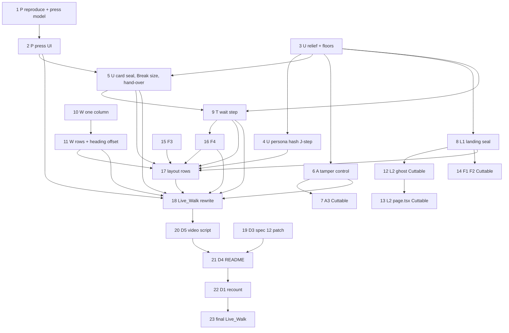

# Implementation Plan: 13 The seal

## Overview

Spec 13 makes the wax seal the hero of Revenant for Kiroween 2026 (Resurrection). Part 1 is the seal: pressing it (P), a relief unique to each letter (U), the tamper control (A), the landing seal (L1), the wait (T), the Write step (W), the ghost holding the envelope (L2) and smaller fixes (F). Part 2 is documents only (D). It plans no change under `src/lib/crypto/` or `src/lib/seal-format/`, so there is no crypto-dev task. Every task is one an agent picks up. The only change an agent does not make is the spec 12 patch (task 19): `.kiro/**` is owner-only, so the owner applies it with `git apply` whenever they like, and nothing waits for it.

Order (G3.1): P, U, A, L1, T, W, then L2 and F, then D, then the final Live_Walk. Most judges open a persona letter and never see the press, the wait or the Write step, so the tamper control and the landing seal come before the wait and the Write step.

| Group | Tasks | What | Roles |
|---|---|---|---|
| P, pressing the seal | 1, 2 | Reproduce, budget baseline and press model (1); press UI, Backup_Choice, Setting_State (2) | frontend-dev |
| U, a seal unique to each letter | 3, 4, 5 | Relief, `WaxSeal` hash prop, persona seals at 96 px and the automated seal floors (3); persona hash Journey_Check step and U9 layout row (4); letter-card seal, Break the seal size, hand-over (5) | frontend-dev, platform-dev |
| A, try to tamper | 6, 7 | Tamper control (6); A3 "Also fix the fingerprint" (7, Cuttable) | frontend-dev |
| L1, the landing seal | 8 | `HeroEnvelope` and `LANDING_SEAL_HASH` | frontend-dev |
| T, the wait | 9 | Sealed_Envelope_View, in-flow ghost, Keep_Section | frontend-dev |
| W, the Write step | 10, 11 | One column, placeholder, Occasion choices (10); question rows, one receipt place, Receipt_Rows, heading offset (11) | frontend-dev |
| L2, the ghost holding the seal (Cuttable) | 12, 13 | Hero ghost (12); `page.tsx` stops passing the backdrop ghost (13) | frontend-dev, platform-dev |
| F, smaller fixes | 14, 15, 16 | Landing layout and ritual cards (14, Cuttable); persona Testify (15); live Testify (16) | frontend-dev |
| Checks | 17, 18 | Layout-check rows and Journey_Check landing step (17); Live_Walk rewrite (18) | platform-dev |
| D, submission documents | 19, 20, 21, 22 | Spec 12 ticks patch (19); video script (20); README (21); recount (22) | platform-dev |
| Final | 23 | Final Live_Walk on merged `main` | platform-dev |

Each task is one GitHub issue and one PR for one role. Each PR stays under `max_changed_lines` (5,000) as `.github/agents.json` counts it (test files and `package-lock.json` excluded), and inside its role's paths plus `shared` (G1.1, G3.1). Sub-tasks listed under a task (the property tests, marked `*`) belong to the same issue and PR.

Splits made for size and ownership (G1.10): the first P task is reproduce-plus-model and the press UI is a second task; the persona-hash Journey_Check step is a platform-dev task apart from the frontend relief task (`tools/qa/**` is platform-dev); the checks are two platform-dev tasks (layout rows, Live_Walk rewrite); L2 is a frontend-dev half and a platform-dev half (`src/app/page.tsx`). No task needs a crypto-dev half. Estimated sizes (design "Task shape"): no task is expected to reach 5,000 lines; the largest are tasks 2, 3, 6, 9 and 18 at about 1,500 to 2,500. A task that measures above 5,000 splits before the PR opens.

Follow `design.md` in this folder for file names, constants, copy, values and algorithms, and `requirements.md` for the rules. Every rule of `.kiro/steering/` and of specs 02 to 12 still holds unless requirements.md "Rules this spec replaces" names it. "Depends on" lists only spec 13 task numbers (G3.2).

Owner-approved facts: **U7 does not exist** (no seal on the still-sealed `/l/[id]`, no API change) and its number is not reused; **D2 does not exist** (the Kiro write-up is not part of this spec and nothing here reads or edits `docs/kiro-writeup.md` or `docs/writeup-gaps.md`); the **ring range is 1 to 2** (not 1 to 3); the persona seals are drawn at **96 px** and no threshold is lowered to fit a measurement.

## Queue order and dates

| Date | Gate |
|---|---|
| 22 November 2026 | Groups P, U, A and L1 (tasks 1 to 8) merged. |
| 25 November 2026 | Groups T and W (tasks 9 to 11) merged. |
| 27 November 2026 | Feature freeze. Groups L2 and F (tasks 12 to 18) merged. A task worked but not merged by the end of the day is closed unmerged with the reason, in the cut order below. |
| 30 November 2026 | Group D recount (task 22) done at the Final_Commit. |
| 1 to 2 December 2026 | Video recorded. |
| 3 December 2026 | Owner submits. 4 December 2026, 2:00 PM PT is only the platform deadline. |

The dispatcher claims the lowest-numbered ready issue whose dependencies are closed, one run per role at a time. Task 2 does not depend on task 3, but it has the lower number, so it runs first. Tasks 5, 6, 8 and 9 need task 3's code, so they start once task 3 has merged. Frontend-dev therefore works 1, 2, 3, 5, 6 and so on in number order, with no renumbering.

## Rules for every task

- **Branch and PR.** The dispatcher creates `agent/<role>/issue-N` and the PR "Closes #N". Do not push to `main` or merge. After a hook failure, make a new commit; do not amend.
- **Scope (G1.1).** Change only files that match your role's paths in `.github/agents.json` (or `shared`) and are listed in your task's Scope, plus new `*.test.ts(x)` files next to the code they test. Check your diff before you finish.
- **Hard boundaries (G1.2, G1.3, G1.5, G1.6).** frontend-dev tasks change nothing under `src/app/api/`, `src/lib/crypto/`, `src/lib/seal-format/`, `src/lib/letter-store/`, `src/lib/db/` or `drizzle/`. No task changes a crypto primitive, key step, header field or `format_version`, the Helm chart or an environment variable. The Seal_Relief code imports nothing from `src/lib/crypto/`, `src/lib/letter-store/` or `src/lib/db/`. The Tamper_Control is browser-only and no server code imports it. Each PR states this with a diff check.
- **Paths by role (G1.1).** platform-dev owns `README.md`, `docs/video-script.md`, `tools/qa/**`, `scripts/check-js-budget.mjs`, `src/app/page.tsx`, `src/lib/*.ts` and `src/test/**`. frontend-dev owns `src/components/**`, `src/app/**/*.tsx` (apart from the platform-dev files above), `src/lib/cards/**`, `src/lib/personas/**` and `content/personas/**`. Nobody edits `.kiro/**`, `.github/**`, `tools/agents/**`, `tools/dispatcher/**`, `tools/hooks/**` or `scripts/check.sh`. If `pr_policy` refuses a path a task needs, the task reports the refusal in its PR description and changes none of the ownership files. `structure.md` is owner-edited; the PR lists the new folders for the owner.
- **Privacy and size (G1.4).** CSP header byte-identical. No request to another origin. New code writes nothing to `localStorage`, `sessionStorage`, IndexedDB, cookies, the URL path, the query string or the fragment. No new `dependencies` entry, animation library, WebGL, font, sound or vibration cue. Every route stays inside `scripts/check-js-budget.mjs`; a task that would push a route over follows the design's budget ladder, and the budgets are not raised.
- **Copy (G1.7).** Every string in its feature folder's copy module. Second person, at most 25 words per sentence, no exclamation mark, no pun, no Scoring_Words_Always; no Scoring_Words_Scene in the Scene copy modules. Nothing grades the testimony or a figure. The seal never reads as the verification (U6). Each copy task attaches the `node tools/hooks/tone-check.mjs` result for every copy file it changed and a search of the rendered Our_Copy of every page it changed showing no Retired_Phrase remains (G2.7).
- **Accent and contrast (G1.8, G1.9).** The Accent marks only the reader's own answer, the main buttons, the wax and the focus ring. Every text and number meets WCAG 2.2 AA (4.5:1 body, 3:1 large text and controls) on its surface. Text on purple is pure white.
- **Neutrality.** Nothing scores, diffs, highlights, summarises or explains a gap between testimony and letter. Up and down get the same visual treatment. The relief carries no symbol and no meaning (U3).
- **Data integrity.** Every figure shown carries value, unit, region, period, source and `retrieved_at`, with its period next to it. Nothing invented, estimated, converted or filled.
- **Motion.** Every motion has its Skip and Calm_Mode path, runs only under `prefers-reduced-motion: no-preference`, and changes only `transform` and `opacity`. No second Motion_Control.
- **Reproduce first (G2.6).** The first task of each of groups P, T, W, L and F (tasks 1, 9, 10, 8 and 14) starts with a step named "Reproduce": PNG screenshots from `main` at the Evidence_Sizes, and a PR-description note naming the component and the CSS rule behind each symptom. Nothing is changed before that step is committed to the PR description. Tasks 14, 15 and 16 name this step for F; task 14 is the first F task and Cuttable, so if it is cut, task 15 carries the Reproduce step for F.
- **Tests (G2.1, G2.2).** Vitest, `renderToStaticMarkup`, every `fetch` stubbed, no network, `DATABASE_URL` unset, no browser (the Live_Walk and layout checks excepted). Property tests use fast-check with `numRuns` at least 100 and the tag `// Feature: 13-the-seal, Property N: <title>`, using the title in design.md "Correctness Properties".
- **Evidence (G2.3, G2.5).** The PR description states the final commit SHA, the exit status of `bash scripts/check.sh` and PASS or FAIL (G2.3); every route budget from `node scripts/check-js-budget.mjs` after `npm run build`, and every earlier-spec test changed or retired with the reason (G2.5). Write "none" for an empty list. Task 1 re-measures the five route budgets at the spec's base commit (`/`, `/demo`, `/demo/personas/[key]`, `/demo/live`, `/l/[id]`); the design's indicative headroom (10.6, 11.4, 34.4, 14.7 and 32.0 kB) is not a measurement.
- **Screenshots (G2.4).** For a page change, PNG shots of every Stage or page the task changes at 1440×900 and 390×844, named `<stage-or-page>-<width>x<height>.png`, and the same set with `prefers-reduced-motion: reduce`, named `<stage-or-page>-<width>x<height>-reduced.png`. Phone shots are First_Viewport captures, plus one full-page capture per page.
- **QA (G2.8).** QA runs the layout rows and Live_Walk lines the task lists, and quotes the result lines of `npm run live-walk` (from task 18 on).
- **After the merge (G3.3).** `bash scripts/check.sh` passes on `main`, and `/`, `/demo`, `/demo/live`, `/l/[id]` and every persona page load without error.
- If `design.md` and the code on `main` disagree, re-read the code, keep the design's behaviour, and say what you changed. If something is unclear, ask in the issue. Do not guess.

## Cut order (G3.4)

If the 27 November freeze arrives with Part 1 work open, cut in this order and stop when the work fits:

1. **A3** (task 7): the tamper control keeps the one-byte test; the second layer is not shown.
2. **L2** (tasks 12 and 13, both halves): the hero keeps the ghost behind the envelope without the holding pose, and L1 still holds.
3. **F1 and F2** (task 14): the landing sections and ritual cards stay as on `main`; the landing Ghost may stop being fixed below the hero at 900 px and wider only if task 14 merges.
4. **P3** (sub-tasks 1.3 and 2.2): the wax shows its finished pool at once and the Signet still comes down.

Never cut: P1, P2 (apart from P3), P4 to P7, U1 to U6, U8 to U10, T1 and T2, W1 to W8, A1 and A2, L1, F3 and F4, group D and Q1 (tasks 1 to 6, 8 to 11, 15 to 23, and the P3-free parts of 1 and 2). When a requirement is cut, the README (task 21) and the video script (task 20) must not claim it (G3.6).

## Tasks

### Group P: pressing the seal, target 17 to 20 November 2026

- [x] 1. P1 to P4, P5.2 · Reproduce, JS budget baseline and the press model
  - Agent: `frontend-dev` · Depends on: none · Estimated size: ~700 changed lines · Target: 17 November 2026
  - Never cut (apart from sub-task 1.3, which is Cuttable, cut order 4).
  - Scope: `src/components/live/press/press-hold.ts`, `press-pose.ts`, `constants.ts` (all new), and the `*.test.ts(x)` for each file. No existing file is edited. `hold.ts` and `seal-machine.ts` stay untouched.
  - Design sections: "2. Press interaction", "7. JS budget", Correctness Properties 5 and 6.
  - Steps:
    1. **Reproduce (G2.6).** Before any code, run `npm run build`, then `node scripts/check-js-budget.mjs`, and record the five route numbers (`/`, `/demo`, `/demo/personas/[key]`, `/demo/live`, `/l/[id]`) in the PR (G2.5). Attach screenshots from `main` of the Seal_Step of `/demo/live` at the Evidence_Sizes (`seal-1440x900.png`, `seal-390x844.png`, and the `-reduced` pair), and name in the PR the component (`WriteForm.tsx`, about lines 548 to 600) and the controls behind the symptom: warning box, two checkboxes `live-warning` and `live-backup-card`, and two orange buttons.
    2. Also record, from the same `main` build, the Top_Bar height and the persona seal widths at 1440 and 390, so task 3 starts from numbers.
    3. Implement the sub-tasks below.
  - Acceptance:
    - [ ] 1.1 Implement `press-hold.ts` and `constants.ts`
      - `SEAL_PRESS_HOLD_MS` is a named constant between 600 and 1,500 ms. `pressStep` is a pure reducer over `DOWN`, `TICK`, `UP`, `CANCEL`, `ACTIVATE` and `RESET`, with `progress` from 0 to 1.
      - It emits `start_prompt` only on `UP` after a full hold or on `ACTIVATE`, at most once between two `RESET`s, never on `TICK` or `CANCEL`. A release before full progress emits nothing (P2.1, P2.3, P2.4, P2.5, P2.8, P4.1, P5.2).
      - _Requirements: P2.1, P2.3, P2.4, P2.5, P2.8, P4.1, P5.2_
    - [ ]* 1.2 Write property tests for the press model
      - `// Feature: 13-the-seal, Property 5: Press hold never starts a prompt before release and starts it at most once`
      - `// Feature: 13-the-seal, Property 6: Release after a full hold starts the prompt, a short hold does not`
      - **Validates: Requirements P2.1, P2.3, P2.4, P2.8, P4.1, P5.2**
    - [ ] 1.3 Implement `press-pose.ts`: the pose of the wax and Signet from the phase and progress (Cuttable, cut order 4)
      - Three wax stages (bead, spread pool, full pool) before the Signet comes down (P3.1). If cut, the pose maps full progress to the full pool and P2 still holds (P3.2). Reduced motion and Calm_Mode map to the final pose at once (P2.7).
      - _Requirements: P2.2, P2.7, P3.1, P3.2_
  - Tests: the two properties; example tests for the reduced-motion pose and the constant's range.
  - Earlier-spec tests changed or retired: none (no existing file is edited).
  - Copy evidence (G2.7): none, no copy changes.
  - QA shots: the four `seal-*` shots of `main` from step 1 (evidence only). QA steps: none.
  - Validation: `bash scripts/check.sh` (SHA, exit status, PASS or FAIL in the PR); route budgets after `npm run build`.
  - _Requirements: G2.5, G2.6, P2.1–P2.8, P3.1, P3.2, P4.1, P5.2_

- [x] 2. P1, P4 to P7 · Press UI: PressEnvelope, Backup_Choice, Seal step layout, Setting_State
  - Agent: `frontend-dev` · Depends on: 1 · Estimated size: ~2,000 changed lines · Target: 20 November 2026
  - Never cut (apart from sub-task 2.2, Cuttable, cut order 4). This task draws the `WaxSeal` as it is today (the Blank_Signet) and draws no relief, so it does not depend on task 3. The hand-over that draws the relief on the Wait step is in task 5.
  - Scope: `src/components/live/press/PressEnvelope.tsx`, `usePressEnvelope.ts`, `press.module.css` (new); `src/components/live/BackupChoice.tsx` (new); `src/components/live/WriteForm.tsx`, `write-draft.ts`, `useSealFlow.ts` (mapping only), `copy.ts`, `live.module.css`; `src/components/ui/Envelope.tsx` (the `seal?: "seal" | "none"` prop only, default `"seal"`); and the `*.test.ts(x)` for each file. `seal-machine.ts`, `hold.ts` and everything under `src/lib/crypto/` are not edited.
  - Design sections: "2. Press interaction", "8. Cross-cutting rules", Correctness Properties 7 and 8.
  - Steps:
    1. Build `PressEnvelope` as one focusable control with an accessible name that says it presses the seal, a hit area of at least 44×44 CSS px, `aria-disabled="true"` until the Backup_Choice is made, and one plain line saying what to choose first (P1.2, P1.5).
    2. `usePressEnvelope` maps the `press-hold` model to `onCreatePress` and `onConfirmPress`. The passkey call starts only from the pointer release after a full hold (touch included) or from one keyboard activation, never from a timer (P5.2). A further press during an open prompt does nothing (P2.8).
    3. Add the Skip control (it does not skip or answer a prompt, P2.6), the Setting_State (Signet down, one plain line that the device will ask once more, no "Confirm your passkey", no second orange button; P5.4 to P5.6), and the failure path (Signet lifts, pool recedes, existing failure line, nothing sealed; P4.3, P4.4).
    4. Replace the two checkboxes with the Backup_Choice `fieldset` and two radios, none selected (P7). "Skip it" is the explicit confirmation of `product.md`. The Warning_Text stays body text outside any disclosure, in view of the press at both sizes, and does not move during the hold (P6). Move "sealed in the browser with your own passkey" from the Write step to this step once (W5.3). The PRF-fallback paths of spec 11 stay as they are (P7.5).
    5. The Press_Envelope is the only orange control on the step; Back stays outlined (P1.3). It is the largest element on the step and the Warning_Text, Backup_Choice and instruction are in the First_Viewport at 1440×900 (P1.1, P1.4).
    6. Attach a screenshot of every step state: `seal-1440x900.png`, `seal-390x844.png` (and `-reduced`), plus `press-held-*`, `setting-*` and `failure-*` shots at the Evidence_Sizes.
  - Acceptance:
    - [ ] 2.1 Implement `PressEnvelope`, `usePressEnvelope`, `BackupChoice` and the Seal step layout
      - _Requirements: P1.1–P1.5, P2.5, P2.6, P2.8, P4.2–P4.4, P5.2, P5.4–P5.7, P6.1–P6.4, P7.1–P7.6_
    - [ ] 2.2 Draw the wax pool in three stages with the Signet coming down (Cuttable, cut order 4)
      - Uses `press-pose.ts` from sub-task 1.3. If sub-task 1.3 was cut, this sub-task is cut with it and the full pool shows at once.
      - _Requirements: P2.2, P2.3, P3.1, P3.2_
    - [ ]* 2.3 Write property tests
      - `// Feature: 13-the-seal, Property 7: The seal machine accepts each press only in its source state and allows at most two prompts`
      - `// Feature: 13-the-seal, Property 8: The press is enabled only when the backup choice is made and the input is valid`
      - **Validates: Requirements P1.5, P2.8, P5.7, P7.2, P7.3, P7.4, Q2.4**
    - [ ] 2.4 Write the source scan
      - `press-source-scan.test.ts`: `createPasskey` and `onCreatePress` appear only in the release and activation handlers, no `setTimeout` or `setInterval` callback references them, and the skip callback never references a passkey function (Q2.7).
      - _Requirements: P5.2, Q2.7_
  - Tests: markup examples (the fieldset has two unchecked radios, one orange control, the Warning_Text outside any `details`, no "Confirm your passkey" in the Setting_State).
  - Earlier-spec tests changed or retired: `write-draft` and `WriteForm*` tests for the two checkboxes; `live/copy.test.ts` where `passkeySteps`, `createButton` or `confirmButton` are read; `Envelope` tests for the new default prop; name each with the reason.
  - Copy evidence (G2.7): tone-check for `live/copy.ts`; Retired_Phrase search of the rendered Seal step.
  - QA shots: the Seal step in its states at both sizes, with and without reduced motion. QA steps: P1 layout row (task 17), Live_Walk `seal` stage (task 18).
  - Validation: `bash scripts/check.sh`; route budgets after `npm run build` (`/demo/live` has the smallest headroom; follow the design's ladder if it is short).
  - _Requirements: P1–P7, W5.3, Q2.4, Q2.7_

### Group U: a seal unique to each letter, target 18 to 21 November 2026

- [x] 3. U1 to U6, U9, U10 · Seal_Relief, `WaxSeal` hash prop, persona seals at 96 px and the automated floors
  - Agent: `frontend-dev` · Depends on: none · Estimated size: ~1,800 changed lines · Target: 18 November 2026
  - Never cut. This is the first relief-drawing task. Tasks 5, 6, 8 and 9 draw the relief with its code, so they depend on this task merging. The automated floors (N = 4, P = 3.0 % at 96 px, step 5) are the check. If a floor fails, change the relief derivation (the Coarse_Layer mapping or ranges), not the threshold, and continue.
  - Scope: `src/components/ui/seal-relief/relief.ts`, `slot-vectors.ts`, `seal-art.ts`, `raster.testing.ts` (new; `svg.ts` is task 5); `src/components/ui/WaxSeal.tsx`; `src/components/ui/Envelope.tsx` (`sealHash` prop; `seal` prop if task 2 has not added it); `src/components/demo/PersonaCard.tsx` and its CSS; `src/lib/personas/**` (validation of `envelope_hash`: 64 lowercase hex); `content/personas/personas.json` (`envelope_hash` per persona, read from `GET https://revenant.devclef.se/api/letters/<letter_id>`); `src/components/ceremony/scene/**` or the persona page file that draws the closed envelope before opening (pass the hash only; no layout change); and the `*.test.ts(x)` for each file.
  - Design sections: "1. Seal_Relief", "Where the hash comes from, per surface", "`/demo` seals at 96 px", Correctness Properties 1, 2, 3, 12, 13, 14.
  - Steps:
    1. Implement `sealRelief` with the Coarse_Layer (hex digits 0 to 7: 3 to 7 notches, 1 to 2 rings, rotation, mirror) and the Fine_Layer (digits 8 to 63: 28 ticks and 28 dots, four fixed ticks and four fixed dots). No `Math.random`, `Date`, `Math.sin` or `Math.cos` at run time; the literal slot tables are checked against `Math.sin` and `Math.cos` to 1e-6. The module imports nothing from `src/lib/crypto/`, `src/lib/letter-store/` or `src/lib/db/` (G1.5).
    2. `WaxSeal` takes one prop, `hash`. Without a valid hash it draws today's markup (the Blank_Signet). With one it draws the layers in the design's order inside the existing two clipped halves, and sets `data-seal-hash` and `data-coarse`. Replace the "Every letter gets the same seal" header comment.
    3. **96 px independent of envelope width (U9).** `PersonaCard` renders `<Envelope seal="none" … />` and, inside `.art` (made `position: relative`), one `aria-hidden` `span[data-persona-seal]` that holds `<WaxSeal hash={persona.envelope_hash} size={96} />`, absolutely positioned at `left: 50%; top: 54%` with `width: 96px; height: 96px; transform: translate(-50%, -50%); pointer-events: none`. The 54 % is measured from the flap tip first. The card stays one anchor. No horizontal scroll at 390 or 1440 (U9.7).
    4. Persona envelopes before opening draw their seal from `envelope_hash`.
    5. Persona floor test (`persona-seals.test.ts`, Q2.6): for each of the three real hashes, every pair has `coarseDifference` at least N = 4 and the coarse pixel difference at 96 px at least P = 3.0 %. Print the measured values, the full-seal pixel difference and a 150-random-pair distribution for the PR description. A second assertion requires `[data-persona-seal]` with `width: 96px` in `PersonaCard` markup.
    6. **Screenshots (U9.2), plain non-blocking PR evidence.** Attach ONE screenshot per width of the three persona seals side by side at real size (96 px) on `/demo`, using the real persona hashes: `demo-seals-1440x900.png` and `demo-seals-390x844.png`. At 390 the three cards stack, so the capture shows the three seals in one full-page or stitched capture, each at 96 px. Also attach the measured seal widths on `main` and the fixed values.
    7. If a floor fails, change the relief derivation (not the threshold) and continue. Nothing waits for a look at the screenshots.
  - Acceptance:
    - [ ] 3.1 Implement `relief.ts`, `slot-vectors.ts`, `seal-art.ts` and `raster.testing.ts`
      - Recorded ranges: notches 3 to 7, rings 1 to 2, at most 9 coarse features. Tones: rings in `--wax-press`, notches in `--wax-eye`, fine marks in `--wax-rim`, no new colour (U1.4, U10.5).
      - _Requirements: U1.1–U1.4, U2.1, U2.2, U3.1, U3.2, U10.1–U10.8_
    - [ ] 3.2 Implement the `WaxSeal` hash prop, `Envelope` props and persona `envelope_hash`
      - _Requirements: U1.3, U4.4, U4.5, U5.1_
    - [ ] 3.3 Implement the 96 px persona seal overlay and the persona floor test
      - _Requirements: U2.3, U9.1, U9.5, U9.7, Q2.6_
    - [ ]* 3.4 Write property tests
      - `// Feature: 13-the-seal, Property 1: Relief is deterministic and total`
      - `// Feature: 13-the-seal, Property 2: A one-digit change moves a feature, on all 64 digits`
      - `// Feature: 13-the-seal, Property 3: Relief stays inside the wax and keeps its fixed kind`
      - `// Feature: 13-the-seal, Property 12: The Coarse_Layer keeps its fixed structure and ranges`
      - `// Feature: 13-the-seal, Property 13: The two layers read disjoint digits`
      - `// Feature: 13-the-seal, Property 14: Coarse and fine mapping is one-to-one on the fine digits`
      - **Validates: Requirements U1.2, U1.3, U1.4, U2.1, U2.2, U3.1, U3.2, U8.2, U10.2–U10.8, Q2.1, Q2.2, Q2.8**
  - Tests: `relief.test.ts` (slot tables, the landing hash and three persona hashes, blank for bad input, no `<text>`, source scan for trig, random and forbidden imports, `data-coarse` equals the signature); `persona-seals.test.ts`.
  - Earlier-spec tests changed or retired: the `WaxSeal` "no props" assertions (spec 07 R10.10 to R10.12); `PersonaCard` and `Envelope` markup tests; `personas` schema tests; name each with the reason.
  - Copy evidence (G2.7): none, no copy changes (the one U6 sentence is added in tasks 5 and 6).
  - QA shots: `demo-seals-1440x900.png` and `demo-seals-390x844.png` (plain PR evidence), and `/demo` at both sizes with and without reduced motion.
  - Validation: `bash scripts/check.sh`; route budgets after `npm run build`.
  - _Requirements: U1–U6 (U7 does not exist), U9, U10, Q2.1, Q2.2, Q2.6, Q2.8_

- [x] 4. U9 · Persona hash Journey_Check step and the `/demo` seal-size layout row
  - Agent: `platform-dev` · Depends on: 3 · Estimated size: ~350 changed lines · Target: 21 November 2026
  - Never cut. This task reads the seals' size and hash and draws no relief, so it needs task 3's `data-persona-seal` and `personas.json` `envelope_hash`.
  - Scope: `tools/qa/journey-check.mjs`, `tools/qa/layout-check.mjs`, and the tests that cover them.
  - Design sections: "Testing Strategy" (layout and browser checks, Journey_Check).
  - Steps:
    1. Add a Journey_Check step: for each persona, `GET /api/letters/<letter_id>` on production must return the `envelopeHash` that `personas.json` holds. A failed step opens the existing issue.
    2. Add the U9 layout row: `[data-persona-seal]` width at `/demo` at 1440 and 390 fails below 96, the rect must lie inside its card, no sideways scroll at either width.
  - Tests: unit tests for the new check functions where the files already have them.
  - Earlier-spec tests changed or retired: layout-check tests whose asserted rows change; name each with the reason.
  - QA shots: none. QA steps: the U9 row, run against a local build.
  - Validation: `bash scripts/check.sh`; `npm run layout-check` against a local build.
  - _Requirements: U4.5, U9.1, U9.7, Q2.6_

- [ ] 5. U4, U5, U8, T1.5 · Letter-card seal, Break the seal size and the Seal-step hand-over
  - Agent: `frontend-dev` · Depends on: 2, 3 · Estimated size: ~900 changed lines · Target: 21 November 2026
  - Never cut. This task draws the relief, so it needs task 3's code merged.
  - Scope: `src/components/ui/seal-relief/svg.ts` (new); `src/lib/cards/letter-card-svg.ts`; `src/components/live/LetterCard.tsx` (or the path that holds it on `main`); `src/components/ceremony/seal/seal-placement.ts`, `SealBreak.module.css`, the Scene tokens file (`--break-seal-d`); the `SealBreak` and `Opened` hash plumbing in `src/components/reveal/`; `src/components/live/seal-flow` files that pass `SealedState.envelopeHash` forward; `src/components/live/copy.ts` (the one U6 sentence); and the `*.test.ts(x)` for each file.
  - Design sections: "Letter card (U4.3)", "Size contract (U8)", "Where the hash comes from, per surface", Correctness Property 4.
  - Steps:
    1. `sealSvgGroup(hash, x, y, size)` draws the same layers in the same order and tones with literal colours, no CSS variables, no `<clipPath>`, no animation, no raster. `letterCardSvg` gains an optional `seal` input: the seal is 72 units across at the top right of the title row, the QR moves down, `CARD_HEIGHT` grows from 560 to 608, and the Fingerprint text stays. The seal never moves the card's contents otherwise (T1.5). The page `LetterCard` shows the same seal through `WaxSeal`.
    2. Break the seal draws the seal at `--break-seal-d`: at least 160 CSS px at 1440 and at least 120 CSS px at 390, inside the First_Viewport with the hold control and the Skip_Link, clipping no part of the relief (U8). Record today's width at both sizes, then the new one.
    3. Hand-over (P5.8, U5.2, U5.3): the sealing result passes `SealedState.envelopeHash` (the value the server verified) forward, and `Opened.envelopeHash` reaches Break the seal. Before the hash exists the Seal step draws the Blank_Signet and no relief (U5.1). Where the Fingerprint is shown next to a seal it shows the hash the seal was drawn from (U5.4).
    4. Add the U6 sentence once per page: "This seal is drawn from the letter's fingerprint." It never says the seal verifies or proves anything.
  - Acceptance:
    - [ ] 5.1 Implement `svg.ts`, the card seal and the hand-over
      - _Requirements: U4.1, U4.3, U5.1–U5.4, U6.1, U6.2, P5.8_
    - [ ] 5.2 Implement the Break the seal size contract
      - _Requirements: U8.1, U8.2_
    - [ ]* 5.3 Write property test for the seal on every surface
      - `// Feature: 13-the-seal, Property 4: The seal is the same on every surface`
      - Passes `WaxSeal` markup through `normaliseWaxSealIds` and compares relief paths with `sealSvgGroup` and with the `data-coarse` value.
      - **Validates: Requirements U4.1, U4.2, U4.3**
  - Tests: example tests for the card geometry, the sentence once per page, and the `data-seal-hash` on each surface.
  - Earlier-spec tests changed or retired: `letter-card-svg.test.ts` geometry (560 to 608); `LetterCard` tests; the Break the seal placement tests; name each with the reason.
  - Copy evidence (G2.7): tone-check for the changed copy file; Retired_Phrase search of the rendered Wait step and Break the seal.
  - QA shots: Break the seal and the letter card of a Live_Letter at both sizes, with and without reduced motion. QA steps: U8 layout row (task 17), Q1.3 equality check (task 18).
  - Validation: `bash scripts/check.sh`; route budgets after `npm run build`.
  - _Requirements: U4, U5, U6, U8, P5.8, T1.5, Q2.6_

### Group A: try to tamper with it, target 21 to 22 November 2026

- [ ] 6. A1, A2, A4 · Tamper control on the Read step
  - Agent: `frontend-dev` · Depends on: 3 · Estimated size: ~1,500 changed lines · Target: 21 November 2026
  - Never cut. The control draws two relief seals, so it needs task 3's code merged.
  - Scope: `src/components/reveal/tamper/tamper-run.ts`, `tamper-copy.ts`, `TamperControl.tsx`, `tamper.module.css` (new); `src/components/reveal/Fingerprint.tsx` (a `tamper?: ReactNode` slot), `Reveal.tsx`, `useOpeningFlow.ts` (hands over the stored envelope and the published demo key), `OpeningFlow.tsx`; the reveal copy module; and the `*.test.ts(x)` for each file. No file under `src/lib/crypto/` is edited; the control imports the existing exported `openLetter`.
  - Design sections: "3. Tamper_Control", Correctness Properties 9 and 10.
  - Steps:
    1. The button "Try to tamper with it" sits in the persona section of `Fingerprint.tsx` (`data-fingerprint-persona`) on the Read step, next to `REVEAL_COPY.sealVerdict` and the "Show the fingerprint" disclosure, for every Persona_Letter. It is absent on the Testify step, on `/l/[id]`, on `/demo/live` and on every real letter (A1.1, A1.2). It is reachable by keyboard and leaves the Opening_Flow's position and answer controls unchanged (A1.3).
    2. The page says, beside the control and again with the result, that the test runs on a local copy in the browser and the stored letter is not changed (A1.4).
    3. `runTamper` makes the Tamper_Copy: a deep copy with exactly one payload ciphertext byte changed; the stored envelope is frozen and deep-equal before and after. It runs `openLetter` on the untouched copy first, then on the Tamper_Copy, with the same demo key and stored hash, so the changed byte is the only difference (A2.1, A2.2). It contains no second hash or decryption implementation, no hard-coded result and no timer standing in for the check (A2.3).
    4. On `verification_failed` it shows the seal cracked and "The seal is cracked. Revenant refuses to open this copy.", with the byte index and the value before and after. On `ok: true` it shows a plain failure that the test did not run as expected and does not show the seal as cracked (A2.4, A2.5). It shows the stored Fingerprint and the copy's Fingerprint, each with its relief (A2.6). It makes no request, does not call `POST /api/openings` and writes nothing to storage, cookies or the URL (A2.7). Closing the result continues the Opening_Flow with the real letter (A2.8).
    5. Copy uses the vocabulary of `tone.md`, no "caught", "wrong", "hacked", "attack" or "failed to break", no congratulation, no score, and touches no testimony, sample answer or letter text (A4). The U6 sentence appears once in the result.
    6. Reduced motion and Calm_Mode show the crack at once.
  - Acceptance:
    - [ ] 6.1 Implement `tamper-run.ts`, `tamper-copy.ts` and `TamperControl`
      - _Requirements: A1.1–A1.4, A2.1–A2.8, A4.1–A4.3_
    - [ ]* 6.2 Write property tests
      - Seal one fixture envelope once per file with the real `sealLetter` and `PUBLIC_DEMO_BACKUP_KEY` in Node WebCrypto, then vary the byte and mask.
      - `// Feature: 13-the-seal, Property 9: A tampered copy is always refused and the stored envelope never changes`
      - `// Feature: 13-the-seal, Property 10: The Tamper_Control result is what openLetter returned`
      - **Validates: Requirements A2.1, A2.2, A2.3, A2.4, A2.5, Q2.3**
    - [ ] 6.3 Write the source scan
      - `tamper-source-scan.test.ts`: the module imports `openLetter` from `src/lib/crypto`, contains no `verification_failed` literal used as a result, no `setTimeout` standing in for the check and no `fetch` (Q2.5). A second scan: no server module imports `reveal/tamper/`.
      - _Requirements: A2.3, A2.7, Q2.5, G1.6_
  - Tests: markup examples (button present on persona Read step, absent on `/l/[id]`, `/demo/live` and the Testify step).
  - Earlier-spec tests changed or retired: `Fingerprint*`, `Reveal*` and `OpeningFlow*` tests for the new slot; name each with the reason.
  - Copy evidence (G2.7): tone-check for the reveal copy file; Retired_Phrase search of the rendered Read step; a search for the words forbidden in A4.2.
  - QA shots: `tamper-*` Read step before, with the result open, at both sizes, with and without reduced motion. QA steps: the `tamper` Step_Shot in the Live_Walk persona run (task 18).
  - Validation: `bash scripts/check.sh`; route budgets after `npm run build` (the design's ladder moves `TamperControl` behind `next/dynamic` if `/demo/personas/[key]` is short).
  - _Requirements: A1, A2, A4, Q2.3, Q2.5_

- [ ] 7. A3 · "Also fix the fingerprint" (Cuttable, first cut)
  - Agent: `frontend-dev` · Depends on: 6 · Estimated size: ~250 changed lines · Target: 22 November 2026
  - **Cuttable, cut order 1.** If cut, the tamper control keeps the one-byte test and the README and video script do not claim a second layer.
  - Scope: `src/components/reveal/tamper/tamper-run.ts`, `TamperControl.tsx`, the reveal copy module, and the `*.test.ts(x)` for each file.
  - Design sections: "3. Tamper_Control", Correctness Property 11.
  - Acceptance:
    - [ ] 7.1 Implement the second layer
      - "Also fix the fingerprint" recomputes `envelopeHash` of the Tamper_Copy, runs `openLetter` with that hash and shows the refusal from the failed AES-GCM tag check. The text names which layer refused each copy in plain words and calls neither attempt an attack or a win (A3.1, A3.2).
      - _Requirements: A3.1, A3.2_
    - [ ]* 7.2 Write property test
      - `// Feature: 13-the-seal, Property 11: A recomputed fingerprint is still refused at the authentication layer`
      - **Validates: Requirements A3.1**
  - Earlier-spec tests changed or retired: none.
  - Copy evidence (G2.7): tone-check for the changed copy file; Retired_Phrase search of the rendered result.
  - QA shots: `tamper-fixed-*` at both sizes, with and without reduced motion.
  - Validation: `bash scripts/check.sh`; route budgets after `npm run build`.
  - _Requirements: A3.1, A3.2_

### Group L1: the landing seal, target 22 November 2026

- [ ] 8. L1, L3 · Landing seal on the envelope
  - Agent: `frontend-dev` · Depends on: 3 · Estimated size: ~600 changed lines · Target: 22 November 2026
  - Never cut. Draws the relief, so it needs task 3's code merged. `src/app/page.tsx` is not edited (platform-dev).
  - Scope: `src/components/landing/HeroEnvelope.tsx` (new), `LandingHero.tsx`, `landing.module.css` (hero rules only), `constants.ts` (`LANDING_SEAL_HASH`), and the `*.test.ts(x)` for each file.
  - Design sections: "6. Landing hero (L1 to L3) and landing layout".
  - Steps:
    1. **Reproduce (G2.6).** Screenshots of `/` from `main` at the Evidence_Sizes (First_Viewport and full page, with and without reduced motion) and a PR note naming the empty `div[data-block="ghost"]` and its `.ghost` rule (height `min(30svh, 190px)`).
    2. `HeroEnvelope` (server component) draws `<Envelope state="turned" animate={false} sealHash={LANDING_SEAL_HASH} />` with the seal at least 160 CSS px at 1440×900 and 120 at 390×844 (`[data-landing-seal]`). `LANDING_SEAL_HASH` is `f7023f7534d9709bba90be98d8df835c724e7013d40202a0cb02db103a46b2a8`, with a comment that it belongs to no letter. The seal shows no Fingerprint text and claims nothing about a letter (L1.4).
    3. The envelope's own box replaces the ghost box reservation, so the page does not shift. The `h1` (`BRAND_COPY.tagline`) and the primary call to action stay in the Hero_Viewport, with their order and `data-cta` hooks (L1.3, L3.3). The envelope and seal are in the server HTML with no canvas, no image request and no script (L1.5). `/` stays inside 160 kB (L1.6).
    4. Motion: at most the wax glow and the ghost's settle, `transform` and `opacity` only; the same composition at rest under reduced motion or no JavaScript (L3.1, L3.2).
  - Tests: `LandingHero` HTML contains the relief paths for `LANDING_SEAL_HASH` and no `<script>`, `<canvas>` or ``.
  - Earlier-spec tests changed or retired: `LandingHero*.test.tsx`, `landing-general.test.tsx`; name each with the reason.
  - Copy evidence (G2.7): none, no copy changes (the tagline is unchanged).
  - QA shots: `index-1440x900.png`, `index-390x844.png` and the `-reduced` pair. QA steps: L1 layout row (task 17); no-JS first render (task 18).
  - Validation: `bash scripts/check.sh`; route budgets after `npm run build` (`/` at most 160 kB).
  - _Requirements: L1.1–L1.6, L3.1–L3.3, U4.4_

### Group T: the wait, target 24 to 25 November 2026

- [ ] 9. T1 to T3 · Sealed_Envelope_View, in-flow ghost and Keep_Section
  - Agent: `frontend-dev` · Depends on: 3, 5 · Estimated size: ~1,800 changed lines · Target: 25 November 2026
  - Never cut. Draws the relief, so it needs task 3's code merged.
  - Scope: `src/components/live/stepper/LiveWaitStep.tsx`, `SealedEnvelopeView.tsx`, `HeldGhost.tsx` (new), `stepper.module.css`, `src/components/live/live.module.css`, `LiveGhost.tsx`, `src/components/ceremony/scene/Ghost*.tsx` (one optional size prop with a byte-identical default), `scene.module.css`, `src/components/live/copy.ts`, and the `*.test.ts(x)` for each file.
  - Design sections: "4. Wait step".
  - Steps:
    1. **Reproduce (G2.6, T2.1).** From `main`, screenshots of the Wait step at the Evidence_Sizes before and after the countdown reaches zero, and a PR note naming the element the risen ghost covers at 1440×900 and 390×844 and the CSS rule that places it (the fixed `.ghostLayer`, `z-index: 2`, in `scene.module.css`).
    2. `SealedEnvelopeView` draws the Envelope with its relief seal (from `SealedState.envelopeHash`, via the task 5 hand-over), in the Scene's light, with the `role="status"` countdown directly beneath or beside it. It is the largest element and sits inside the First_Viewport with the countdown at both sizes. No control appears above it (T1.1, T1.2, T3.2, T3.3).
    3. The Keep_Section (letter card, QR code, calendar button, backup key card offer, and the `Fingerprint` once) sits below it, with its top edge below the view's bottom edge at both sizes. The rehearsal line and the opening time show once each, and no letter content, figure or question shows (T1.3, T1.4, T1.6). The card, QR and `.ics` keep their sealing-time contents (T1.5).
    4. `HeldGhost` puts the ghost in the page flow behind the envelope. At zero it rises from behind the view, and its bounding box does not intersect the Keep_Section; the view, the unlock control and the Keep_Section stay in view and readable (T2.2, T2.3). The seal stays intact with no crack and no motion beyond the ghost's sink and a still glow while the countdown runs (T3.1). Reduced motion and Calm_Mode show the ghost settled (T2.4).
    5. U6 sentence once, in the Keep_Section caption.
  - Acceptance:
    - [ ] 9.1 Implement `SealedEnvelopeView`, the Keep_Section and the Wait layout
      - _Requirements: T1.1–T1.6, T3.1–T3.3, U4.1, U5.2, U6.1_
    - [ ] 9.2 Implement `HeldGhost` and the optional Ghost size prop
      - _Requirements: T2.1–T2.4_
  - Tests: markup examples (rehearsal line once, opening time once, Fingerprint once, no letter content); a test that the Ghost default is byte-identical.
  - Earlier-spec tests changed or retired: `LiveWaitStep.test.tsx` and `live-scene.test.tsx` for the fixed Wait ghost; name each with the reason.
  - Copy evidence (G2.7): tone-check for `live/copy.ts`; Retired_Phrase search of the rendered Wait step.
  - QA shots: `wait-*` before and at zero, at both sizes, with and without reduced motion. QA steps: T1 and T2 layout rows (task 17), Live_Walk wait and zero-of-countdown stages (task 18).
  - Validation: `bash scripts/check.sh`; route budgets after `npm run build`.
  - _Requirements: T1, T2, T3, U4.1, U5.2_

### Group W: the Write step, target 25 November 2026

- [ ] 10. W1 to W3, W5 · One column on paper, short prompt, Occasion choices
  - Agent: `frontend-dev` · Depends on: none · Estimated size: ~1,100 changed lines · Target: 25 November 2026
  - Never cut. It draws no relief and depends on nothing.
  - Scope: `src/components/live/WriteForm.tsx`, `OccasionPicker.tsx`, `letter-field.module.css`, `live.module.css`, `stepper.module.css` (Write rules only), `occasions.ts` (placeholder lines), `copy.ts`, and the `*.test.ts(x)` for each file.
  - Design sections: "5. Write step".
  - Steps:
    1. **Reproduce (G2.6).** Screenshots of the Write step from `main` at the Evidence_Sizes and a PR note with measured panel width, the two-column grid rule (`.liveWrite:has(> .occasions)`), chip heights, question row heights and receipt row heights, naming the component and CSS rule behind each symptom.
    2. One Writing_Column on warm paper, at most 44 rem; the paper no wider than the column plus 80 px at 1440×900; the Letter_Field first, its top inside the First_Viewport at 390×844 and at most 360 px from the top at 1440×900, serif, with label, count against 5,000, validation rule and minimum height kept (W1).
    3. One placeholder line of at most 12 words that follows the Occasion, changes while the field is empty, and is never stored, counted or sealed (W2).
    4. Occasions as one row of text options with no box, tick or check mark, the chosen one underlined and heavier, `aria-pressed` or a radio group, 44 px high at 390×844 and 32 px at 1440×900 (W3).
    5. Above the field before typing: the Step_Heading and the Occasion control only. The rehearsal statement stays once, below the action row, with its meaning unchanged. The sealed-in-the-browser sentence is already on the Seal step (task 2). No `DemoLabel` or badge above the field (W5).
  - Acceptance:
    - [ ] 10.1 Implement the one-column layout, the placeholder and the Occasion choices
      - _Requirements: W1.1–W1.4, W2.1–W2.4, W3.1–W3.3, W5.1, W5.2, W5.4_
  - Tests: example tests for the placeholder per Occasion, no check mark in the Occasion markup, the rehearsal line once.
  - Earlier-spec tests changed or retired: `occasion` tests for the `✓` mark (spec 12 W2); `live/constants.test.ts`, `copy.test.ts`, `write-fit.test.ts`, `OccasionPicker.test.tsx`; name each with the reason.
  - Copy evidence (G2.7): tone-check for `live/copy.ts` and `occasions.ts`; Retired_Phrase search of the rendered Write step.
  - QA shots: `write-*` at both sizes, with and without reduced motion. QA steps: W layout row (task 17).
  - Validation: `bash scripts/check.sh`; route budgets after `npm run build`.
  - _Requirements: W1, W2, W3, W5_

- [ ] 11. W4, W6 to W8 · Question rows, one place to add a receipt, Receipt_Rows, heading offset
  - Agent: `frontend-dev` · Depends on: 10 · Estimated size: ~1,000 changed lines · Target: 25 November 2026
  - Never cut.
  - Scope: `src/components/live/AuthorQuestions.tsx`, `ReceiptsDisclosure.tsx`, `FigurePicker.tsx`, `SelfReportedRows.tsx`, `WriteForm.tsx` (action row), `src/components/live/stepper/LiveStepper.tsx`, `stepper.module.css` (`.heading`), `src/components/ceremony/scene/TopBar.tsx` (only if the bar can exceed 96 px), `live.module.css`, `copy.ts`, and the `*.test.ts(x)` for each file.
  - Design sections: "5. Write step" (headings W8).
  - Steps:
    1. **Reproduce the headings (W8.1).** After a step change, screenshots of "Press the seal" and "Wait" half hidden under the Top_Bar from `main`, with the measured Top_Bar height at both sizes and the scroll offset behind them. Name `LiveStepper.tsx` (`headingRef.current?.focus()`) and `.heading` without `scroll-margin-top`.
    2. Each Author_Question is one row with a text control "Remove", accessible name "Remove question {n}", at least 44×44 px at 390×844, and at most two lines at 1440×900. After removal focus moves to the next row or to the add-a-question control (W4).
    3. "Add a receipt" shows in exactly one place, beside Next, with no "Receipts" link; the disclosure stays a native `details`, closed by default; with no receipt chosen the step shows nothing about receipts (W6).
    4. Each chosen figure is one Receipt_Row with Short_Name, value and unit, period and region; at most two lines at 1440×900 and three at 390×844; no card border of its own; period next to its value, source one tap away. Own numbers are Receipt_Rows labelled "self-reported" and a blank row does not block Next. The Picker_Note stays once per list (W7).
    5. `.heading` gets `scroll-margin-top: calc(var(--topbar-clear, 96px) + 16px)`; focus uses `{ preventScroll: true }` then `scrollIntoView` (instant under reduced motion). If the Top_Bar can exceed 96 px, `TopBar.tsx` sets `--topbar-clear` from a `ResizeObserver` (W8.2 to W8.4).
  - Acceptance:
    - [ ] 11.1 Implement the question rows, the one receipt place and the Receipt_Rows
      - _Requirements: W4.1–W4.4, W6.1–W6.3, W7.1–W7.5_
    - [ ] 11.2 Implement the heading offset
      - _Requirements: W8.1–W8.4_
  - Tests: example tests (the "Remove question 2" name, "Add a receipt" once and no "Receipts" link, row line counts where markup allows).
  - Earlier-spec tests changed or retired: `AuthorQuestions.test.tsx` for the `×` icon (spec 12 W3); `ReceiptsDisclosure.test.tsx`, `WriteForm*.test.tsx`, `SelfReportedRows.test.tsx`; `LiveStepper*.test.tsx`; name each with the reason.
  - Copy evidence (G2.7): tone-check for `live/copy.ts`; Retired_Phrase search of the rendered Write step.
  - QA shots: `write-*` with three question rows and with figures chosen, and each step's heading after a change, at both sizes, with and without reduced motion. QA steps: W and W8 layout rows (task 17).
  - Validation: `bash scripts/check.sh`; route budgets after `npm run build`.
  - _Requirements: W4, W6, W7, W8_

### Group L2: the ghost holding the seal (Cuttable), target 27 November 2026

- [ ] 12. L2 · The ghost behind the envelope, holding it (frontend half)
  - Agent: `frontend-dev` · Depends on: 8 · Estimated size: ~350 changed lines · Target: 26 November 2026
  - **Cuttable, cut order 2 (both halves, tasks 12 and 13).** If cut, the hero keeps the ghost behind the envelope without the holding pose, and L1 still holds. It draws the relief, so it also needs task 8, which needs task 3.
  - Scope: `src/components/landing/HeroEnvelope.tsx`, `LandingHero.tsx`, `landing.module.css` (hero rules), and the `*.test.ts(x)` for each file. `src/app/page.tsx` is task 13.
  - Design sections: "6. Landing hero".
  - Acceptance:
    - [ ] 12.1 Draw the holding pose
      - The plain sheet Ghost sits behind the envelope with arms or hem reaching around it and the Landing_Seal in front. It does not cover the seal, the `h1` or any control. It is the existing sheet ghost, not Kiro's logo or mascot, and the hero adds no other Halloween prop (L2.1, L2.2, L2.4).
      - _Requirements: L2.1–L2.4_
  - Earlier-spec tests changed or retired: `LandingHero*.test.tsx`; name each with the reason.
  - Copy evidence (G2.7): none, no copy changes.
  - QA shots: `index-*` at both sizes, with and without reduced motion. QA steps: L1 layout row (task 17).
  - Validation: `bash scripts/check.sh`; route budgets after `npm run build` (`/` at most 160 kB).
  - _Requirements: L2.1–L2.4_

- [ ] 13. L2 · `page.tsx` stops passing the backdrop ghost (platform half)
  - Agent: `platform-dev` · Depends on: 12 · Estimated size: ~150 changed lines · Target: 26 November 2026
  - **Cuttable, cut order 2.** Cut with task 12.
  - Scope: `src/app/page.tsx`, `src/lib/landing-backdrop*` (only the ghost the page passes), and the `*.test.ts(x)` for each file.
  - Acceptance:
    - [ ] 13.1 Stop the fixed backdrop ghost under the hero
      - Remove the duplicate ghost from the page so the hero draws one ghost, the one in `HeroEnvelope`. Nothing else in `page.tsx` changes.
      - _Requirements: L2.1, L2.2_
  - Earlier-spec tests changed or retired: `app/page.test.tsx`; name the cases changed.
  - QA shots: `index-*` at both sizes. QA steps: none.
  - Validation: `bash scripts/check.sh`; route budgets after `npm run build`.
  - _Requirements: L2.1, L2.2_

### Group F: smaller fixes, target 26 to 27 November 2026

- [ ] 14. F1 and F2 · Landing sections use both halves; the ritual cards have room (Cuttable)
  - Agent: `frontend-dev` · Depends on: 8 · Estimated size: ~700 changed lines · Target: 26 November 2026
  - **Cuttable, cut order 3.** If cut, the sections and cards stay as on `main` and the landing Ghost keeps its fixed place below the hero.
  - Scope: `src/components/landing/landing.module.css`, `RitualSection.tsx`, `ResurrectionSection.tsx`, `NoSealSection.tsx`, `CovenStrip.tsx`, and the `*.test.ts(x)` for each file.
  - Design sections: "6. Landing hero (L1 to L3) and landing layout (F1, F2)".
  - Steps:
    1. **Reproduce (G2.6).** Screenshots of `/` from `main` at the Evidence_Sizes, and a PR note naming the container and grid rules in `landing.module.css` that leave the right side empty (the `padding-inline-end` at 900 px and wider that stops text at the fixed Ghost's left edge, `--text-right`) and the ritual card padding and widths.
    2. At 1440×900 each section has rendered content in both halves, with no empty right 40 %; at 390×844 the sections stack with no horizontal scroll (F1). The landing Ghost may stop being fixed below the hero at 900 px and wider (owner-accepted).
    3. At 1440×900 each ritual card has at least 24 px padding, at least 200 px text width, at least 24 px between cards, body text at least 16 px with line height at least 1.5; at 390×844 they stack with at least 20 px padding; no text clipped (F2).
  - Acceptance:
    - [ ] 14.1 Implement the F1 landing layout
      - _Requirements: F1.1–F1.3_
    - [ ] 14.2 Implement the F2 ritual cards
      - _Requirements: F2.1–F2.3_
  - Earlier-spec tests changed or retired: `landing-sections.test.tsx`, `RitualSection.test.tsx`, `LandingHero.layout.test.tsx`; name each with the reason.
  - Copy evidence (G2.7): none, no copy changes.
  - QA shots: `index-*` First_Viewport and full page at both sizes, with and without reduced motion. QA steps: F1 and F2 layout rows (task 17, added only if this task merged).
  - Validation: `bash scripts/check.sh`; route budgets after `npm run build` (`/` at most 160 kB).
  - _Requirements: F1.1–F1.3, F2.1–F2.3_

- [ ] 15. F3 · Persona Testify fits at 1440×900
  - Agent: `frontend-dev` · Depends on: none · Estimated size: ~300 changed lines · Target: 26 November 2026
  - Never cut. This is the first F task if task 14 is cut, so it carries the Reproduce step for group F in that case; it carries it anyway.
  - Scope: `src/components/ceremony/scene/TopBar.tsx`, `src/components/ceremony/intro/*` (`PersonaIntro`, `TestifyContext`, `intro.module.css`), `src/components/ceremony/steps.ts` (only if the labels move), and the `*.test.ts(x)` for each file.
  - Design sections: "6. Landing hero … F3 (persona Testify at 1440×900)".
  - Steps:
    1. **Reproduce (G2.6).** Screenshots of the persona Testify step from `main` for Maya and Tomás at 1440×900 and 390×844 (and `-reduced`), with the measured boxes of the Step_Indicator labels and the "Maya is fictional" notice, naming the component and CSS rule behind the collision (candidates: `TopBar.tsx`'s notice, `TestifyContext`'s `.testifyNotice`, `StepIndicator`).
    2. Move one of them, not both. The labels and the notice do not intersect at 1440×900, and the question, its answer control and the control to go on lie inside the First_Viewport for each persona with answer controls (F3.1, F3.2). The 390 rules of spec 10 P5 and spec 12 are untouched; the order and wording stay and the notice shows once (F3.3, F3.4).
  - Tests: example tests that the notice renders once and the order of content is unchanged.
  - Earlier-spec tests changed or retired: `TopBar*`, `TestifyContext*` tests if a class moves; name each with the reason.
  - Copy evidence (G2.7): none, no copy changes.
  - QA shots: `recall-*` for Maya and Tomás at both sizes, with and without reduced motion. QA steps: F3 layout row (task 17).
  - Validation: `bash scripts/check.sh`; route budgets after `npm run build`.
  - _Requirements: F3.1–F3.4_

- [ ] 16. F4 · Live Testify has its ghost and room
  - Agent: `frontend-dev` · Depends on: 9 · Estimated size: ~300 changed lines · Target: 27 November 2026
  - Never cut.
  - Scope: `src/components/live/stepper/LiveWaitStep.tsx` (draw `LiveGhost` for `testify` too), `src/components/ceremony/intro/intro.module.css` (the bare section's top padding only), and the `*.test.ts(x)` for each file.
  - Design sections: "4. Wait step" (Live Testify ghost).
  - Steps:
    1. Measure "The seal is intact" (`TestifyContext`'s `.testifySeal`) against the Top_Bar's bottom edge on the live Testify step at both sizes, with screenshots from `main`.
    2. Draw the Ghost for the `testify` step as the persona Testify step does, inside the First_Viewport; the verdict line has at least 16 px of space below the Top_Bar (if short, the bare section gets a top padding of `var(--topbar-clear, 96px) + 1rem`). The Ghost covers neither the question, the answer control nor the verdict line; under reduced motion or Calm_Mode it shows its settled pose (F4.1 to F4.4).
  - Earlier-spec tests changed or retired: `LiveWaitStep.test.tsx` for the testify step; name the cases changed.
  - Copy evidence (G2.7): none, no copy changes.
  - QA shots: `testify-*` of a Live_Letter at both sizes, with and without reduced motion. QA steps: F4 layout row (task 17).
  - Validation: `bash scripts/check.sh`; route budgets after `npm run build`.
  - _Requirements: F4.1–F4.4_

### Checks, target 27 November 2026

- [ ] 17. Layout-check rows and the landing-seal Journey_Check step
  - Agent: `platform-dev` · Depends on: 4, 5, 8, 9, 11, 15, 16 · Estimated size: ~700 changed lines · Target: 27 November 2026
  - Never cut. The F1 and F2 rows are added only if task 14 merged, and the P1, T, W and L1 rows read the same selectors regardless of whether tasks 12, 13 and 14 were cut.
  - Scope: `tools/qa/layout-check.mjs`, `tools/qa/journey-check.mjs`, and the tests that cover them.
  - Design sections: "Testing Strategy" (layout table, Journey_Check).
  - Acceptance:
    - New rows: **U8** (`[data-seal-target] svg` width at Break the seal at least 160 at 1440 and 120 at 390, and the seal, hold button and Skip_Link inside the viewport); **L1** (`[data-landing-seal]` width, `h1` and primary call to action inside the First_Viewport); **P1** (largest element, one accent control, Press_Envelope hit area, Warning_Text rect unchanged before and during a hold); **T1, T2** (envelope and countdown in the First_Viewport, Keep_Section top below the view's bottom, ghost box does not intersect the Keep_Section); **W** (Letter_Field top, paper width against column, question and receipt row heights, Occasion heights); **W8** (heading box at least 16 px below the Top_Bar after every step change); **F3, F4** (notice against labels, answer controls in the viewport, ghost presence, verdict spacing); **F1, F2** if task 14 merged (boxes in each half at 1440, ritual card padding and widths).
    - Journey_Check: one step loads `/` on production and checks `[data-landing-seal]` is in the server HTML.
    - Each failure message names the requirement.
  - Tests: unit tests for the new check functions where the files already have them.
  - Earlier-spec tests changed or retired: layout-check tests whose asserted thresholds change (the spec 11 and 12 Write-step rows); name each with the reason.
  - QA shots: none. QA steps: every row above, run against a local build.
  - Validation: `bash scripts/check.sh`; `npm run layout-check` against a local build.
  - _Requirements: U8.3, L1.3, F1.4, F2, F3.1, F3.2, F4.2, P1.1–P1.4, T1.2, T1.3, T2.2, W1, W8.2, Q1.2_

- [ ] 18. Q1 · Live_Walk rewrite for the press and the new steps
  - Agent: `platform-dev` · Depends on: 2, 5, 6, 9, 11, 16, 17 · Estimated size: ~1,200 changed lines · Target: 27 November 2026
  - Never cut. Test files (`*.test.ts`) are excluded from the size count; the helpers file counts.
  - Scope: `src/test/integration/live-walk.test.ts`, `live-walk-helpers.ts`, `live-walk-matrix.ts`, their `*.test.ts`, and `package.json` only if a script name changes.
  - Design sections: "Testing Strategy" (Live_Walk).
  - Steps:
    1. The `seal` stage no longer finds a checkbox or `LIVE_COPY.createButton`. It selects the "Skip it" radio, then at 1440 holds `[data-press-envelope]` with `mouse.down()`, waits `SEAL_PRESS_HOLD_MS + 200` and `mouse.up()`. At 390 it uses CDP `Input.dispatchTouchEvent`. Under reduced motion it uses a click. The keyboard run presses Space.
    2. New Step_Shot names `press-held`, `setting` and `tamper` are inserted into `WALK_STEP_NAMES`; `live-walk-helpers.test.ts` and the matrix tests change in the same task for the renumbering.
    3. An init script counts `navigator.credentials.create` and `get` calls in `window.__passkeyCalls`: an early release leaves `create === 0` and no credential; a release after the hold gives exactly one `create`; the keyboard activation gives one; the Setting_State press gives one `get`; the total never exceeds two; a second quick press during a prompt adds none.
    4. Fail rules (Q1.2): a Step_Heading box under the Top_Bar after a step change; the risen ghost intersecting the Keep_Section; more than two passkey prompts; an orange button other than the Press_Envelope on the Seal step; horizontal scroll; clipped text; a second Motion_Control; a console error.
    5. Q1.3: the walk requires equal `data-seal-hash`, normalised relief path and `data-coarse` on the Wait step and at Break the seal. Q1.4: `/`, `/demo`, a persona page and `/l/[id]` load with JavaScript disabled and show `[data-landing-seal]` or `[data-seal-hash]` where the page draws a seal. The U8 and U9 rows run in the same walk, and a persona run opens the Tamper_Control on the Read step (no passkey).
  - Tests: helpers and matrix tests; the walk itself is skipped unless `WALK=1`.
  - Earlier-spec tests changed or retired: `live-walk-helpers.test.ts`, `live-walk-matrix.test.ts` (step names and numbering); name each with the reason.
  - QA shots: none (the final run in task 23 attaches the Step_Shots). QA steps: the walk's result lines.
  - Validation: `bash scripts/check.sh`; one `npm run live-walk` run on the merged state of the tasks it depends on, with its result lines in the PR.
  - _Requirements: Q1.1–Q1.4, P2.3, P2.5, P2.8, P5.7_

### Group D: submission documents, target 27 to 30 November 2026

Group D changes documents only. It adds no feature and is never cut. D2 does not exist; its number is not reused.

- [ ] 19. D3 · Spec 12 ticks as one patch and an evidence list
  - Agent: `platform-dev` · Depends on: none · Estimated size: ~200 changed lines · Target: any time, planned 21 November 2026
  - Never cut. `.kiro/**` is owner-only, so the owner applies the patch with `git apply` whenever they like. An agent does not edit `.kiro/**`, and nothing waits for the patch.
  - Scope: `tools/qa/patches/spec-12-tasks.patch` and `tools/qa/patches/spec-12-tasks.evidence.md` (new). `.kiro/specs/12-submission-polish/tasks.md` is not edited by the task.
  - Design sections: "9. Group D: submission documents".
  - Steps:
    1. Decide the twenty open lines one by one (2.1, 2.2, 4.1 to 4.3, 5.1 to 5.3, 8.1, 8.2, 9.1, 9.2, 10.1 to 10.6, 11.1, 11.2). Tick a line only when the artefact it names exists on `main`: the implementation file its task names, or the test file that carries the tag `// Feature: 12-submission-polish, Property N: <title>` and passes `npx vitest run <file>`. Tick only with merged evidence.
    2. A line whose artefact is missing or whose test fails stays open and the report names the line and the missing artefact (D3.2).
    3. Produce ONE patch for `.kiro/specs/12-submission-polish/tasks.md`, checked with `git apply --check` on a clean checkout, and an evidence list that gives, per ticked line, the file path and the merged PR number. The PR description carries the same text. The PR says which lines stayed open.
  - Tests: none (command check: `git apply --check`).
  - Earlier-spec tests changed or retired: none.
  - QA shots: none. QA steps: QA re-runs the check for the ticked lines.
  - Validation: `bash scripts/check.sh`; `git apply --check tools/qa/patches/spec-12-tasks.patch`.
  - _Requirements: D3.1–D3.3_

- [ ] 20. D5 · Video script matches what merged (after the 27 November freeze)
  - Agent: `platform-dev` · Depends on: 1, 2, 3, 4, 5, 6, 7, 8, 9, 10, 11, 12, 13, 14, 15, 16, 17, 18 (each merged or cut) · Estimated size: ~300 changed lines · Target: 28 November 2026
  - Never cut. Starts after the freeze.
  - Scope: `docs/video-script.md` only.
  - Acceptance:
    - The script describes each shown moment only if its PR has merged and the Live_Walk or a test shows it, and claims no requirement that was cut under G3.4 (D5.1, D5.2, G3.6).
    - It names no date for the video other than 1 to 2 December 2026 (D5.2).
    - Every number it carries has a provenance comment (command, date, commit), refreshed by task 22.
  - Tests: none.
  - Earlier-spec tests changed or retired: none.
  - Copy evidence (G2.7): the Retired_Phrase search of the file.
  - QA shots: none. QA steps: read-through against the list of merged and cut tasks.
  - Validation: `bash scripts/check.sh`.
  - _Requirements: D5.1–D5.3, G3.6_

- [ ] 21. D4 · README paragraph and one clause per merged feature
  - Agent: `platform-dev` · Depends on: 19, 20 · Estimated size: ~150 changed lines · Target: 29 November 2026
  - Never cut. Its own box and the final Live_Walk box (task 23) are the only boxes it does not count.
  - Scope: `README.md` only. Edit the lines in place.
  - Acceptance:
    - The paragraph "Three spec folders still have open tasks, so the build is not complete" and its status comment (lines 67 and 68 at `7546a6f`) are removed only when `grep -cE '^\s*- \[ \]' .kiro/specs/*/tasks.md` is 0 for every box apart from the README task's own box and the final Live_Walk box. The count covers every spec box, spec 13's included, and task 22 re-checks it at the final recount (D4.1).
    - If any other spec folder still has an open box, the paragraph is replaced with one true sentence naming each folder with open boxes and the date and commit of the count (D4.2).
    - No sentence says or implies the build is incomplete once D4.1 holds (D4.3).
    - Each merged Part 1 feature gets one clause at most (the seal drawn from the fingerprint, the press on the envelope, the tamper control), only after its PR merged and the Live_Walk shows it. A cut feature is not claimed (D4.4, G3.6).
  - Tests: none.
  - Earlier-spec tests changed or retired: any test that reads README text (Brand_Copy agreement); name each.
  - Copy evidence (G2.7): tone-check where it applies; Retired_Phrase search of the file.
  - QA shots: none. QA steps: read-through, and the grep output in the PR.
  - Validation: `bash scripts/check.sh`.
  - _Requirements: D4.1–D4.5_

- [ ] 22. D1 · Recount of README and video script numbers at the Final_Commit
  - Agent: `platform-dev` · Depends on: 21 · Estimated size: ~150 changed lines · Target: 30 November 2026
  - Never cut. Repeated at the new Final_Commit if any Part 1 PR merges after it (D1.5).
  - Scope: `README.md`, `docs/video-script.md`.
  - Acceptance:
    - The Final_Commit is the last commit on `main` after the last Part 1 PR merged and before this commit, and every document names it by full SHA (D1.1).
    - Each command named in the provenance comments of `README.md` and, where it carries numbers, `docs/video-script.md` is re-run on the day: task counts per spec folder, the merged pull request count, the property test file count, the hook count, the agent file count and the route budgets (D1.2).
    - Every number carries a provenance comment of the form already used: command, date and commit (D1.3).
    - A number whose command fails is replaced by `NOT RECOUNTED: <reason>`, never kept (D1.4).
    - The D4 grep is re-run and the README matches its result (D4.1).
  - Tests: none.
  - Earlier-spec tests changed or retired: none.
  - Copy evidence (G2.7): Retired_Phrase search of both files.
  - QA shots: none. QA steps: QA re-runs three of the commands and quotes the output.
  - Validation: `bash scripts/check.sh`.
  - _Requirements: D1.1–D1.5, D4.1_

### Final

- [ ] 23. Q1.5 · Final Live_Walk on merged `main`
  - Agent: `platform-dev` · Depends on: 22 · Estimated size: ~150 changed lines · Target: 30 November 2026
  - Never cut. Highest number (G3.1). Its own box is not counted by D4.
  - Scope: `src/test/integration/live-walk*` (only if the run exposes a defect in the script), and the run record in the PR description. No product file.
  - Acceptance:
    - `npm run live-walk` runs on merged `main` at 1440×900 and 390×844, with and without reduced motion, covering the new steps (Q1.1): the press-and-hold, an early release (nothing sent), a release after full progress (the first prompt starts from the release), the keyboard activation, the Skip control, the Setting_State, the Wait step with the Sealed_Envelope_View, the zero of the countdown, the unlock, the Testify step, Break the seal at its minimum size, the `/demo` persona seals at 96 px, and the persona Tamper_Control.
    - The run record states the commit SHA, every result line the script prints, pass or fail per step, and for each defect the step, expected result, observed result and suspected file. A step with no Step_Shot is not claimed as passed. A defect opens a new fix task for the right role; this task does not fix product files.
    - A Step_Shot of each step in Q1.1 is attached (Q1.5). If tasks were cut, the record lists the steps those cuts removed.
    - The D3.4 check runs on `.kiro/specs/13-the-seal/tasks.md`: the open boxes are listed, with this box and the README box as the only expected ones.
    - The Journey_Check from tasks 4 and 17 passes against production.
  - Tests: the replay test only, skipped unless `WALK=1`.
  - Earlier-spec tests changed or retired: none.
  - QA shots: all Step_Shots from the run. QA steps: the walk's result lines, quoted.
  - Validation: `bash scripts/check.sh`; route budgets after `npm run build`.
  - _Requirements: Q1.1–Q1.5, D3.4, G2.8_

## Notes

- **Order.** Tasks 1 and 2 (P) do not draw relief. Task 3 is the first relief task. Tasks 5, 6, 8 and 9 depend on task 3 merging because they need its code; tasks 12, 13 and 14 depend on 8 and so on 3 indirectly. Tasks 4, 10, 15 and 19 do not depend on task 3's merge order beyond what is listed. If a floor in task 3 fails, its relief derivation changes (never a size or threshold) and the work continues.
- **One run per role.** The dispatcher runs one frontend-dev task and one platform-dev task at a time. In practice frontend-dev works 1, 2, 3, 5, 6, 7, 8, 9, 10, 11, 12, 14, 15, 16 in number order, and platform-dev works 4, 13, 17, 18, 19, 20, 21, 22, 23 as they become ready; task 19 has no dependency and takes the first free platform-dev slot.
- **Cuttable.** 7 (A3, first), 12 and 13 (L2), 14 (F1 and F2), and sub-tasks 1.3 and 2.2 (P3). Everything else is never cut. `*` sub-tasks are property tests; they ship in the same PR when it has room and may be skipped for a faster path, but the persona floor test (3.3), the source scans (2.4, 6.3) and the layout rows are required.
- **Property coverage.** Properties 1, 2, 3, 12, 13 and 14 (task 3); Property 4 (task 5); Properties 5 and 6 (task 1); Properties 7 and 8 (task 2); Properties 9 and 10 (task 6); Property 11 (task 7).
- **Owner-approved facts.** U7 does not exist. D2 does not exist and the write-up is outside this spec. The ring range is 1 to 2. The persona seals are 96 px. The landing Ghost may stop being fixed below the hero at 900 px and wider (task 14). The README task counts every box except its own and the final Live_Walk box (task 21).
- **Host step.** No new environment variable, port, secret or job is added, so the Helm chart and `.env.example` do not change and no chart version bump is needed.

## Task Dependency Graph



Dependencies: 1 none; 2 after 1; 3 none; 4 after 3; 5 after 2 and 3; 6 after 3; 7 after 6; 8 after 3; 9 after 3 and 5; 10 none; 11 after 10; 12 after 8; 13 after 12; 14 after 8; 15 none; 16 after 9; 17 after 4, 5, 8, 9, 11, 15 and 16; 18 after 2, 5, 6, 9, 11, 16 and 17; 19 none; 20 after 1 to 18 (each merged or cut); 21 after 19 and 20; 22 after 21; 23 after 22. Tasks 1, 3, 10, 15 and 19 have no dependency. Tasks 12, 13 and 14 are the cut-order tail: if they are cut, 17 and 18 do not wait on them (they do not list them). Task 7 is the first cut and nothing depends on it except task 20's merged-or-cut rule.

```json
{
  "waves": [
    { "id": 0, "tasks": ["1.1", "3.1", "10.1", "15", "19"] },
    { "id": 1, "tasks": ["1.2", "1.3", "3.2", "11.1"] },
    { "id": 2, "tasks": ["2.1", "3.3", "11.2", "4"] },
    { "id": 3, "tasks": ["2.2", "2.3", "2.4", "3.4", "6.1"] },
    { "id": 4, "tasks": ["5.1", "6.2", "6.3", "8"] },
    { "id": 5, "tasks": ["5.2", "5.3", "7.1", "9.1", "12.1", "14.1"] },
    { "id": 6, "tasks": ["7.2", "9.2", "13.1", "14.2", "16"] },
    { "id": 7, "tasks": ["17"] },
    { "id": 8, "tasks": ["18"] },
    { "id": 9, "tasks": ["20"] },
    { "id": 10, "tasks": ["21"] },
    { "id": 11, "tasks": ["22"] },
    { "id": 12, "tasks": ["23"] }
  ]
}
```
