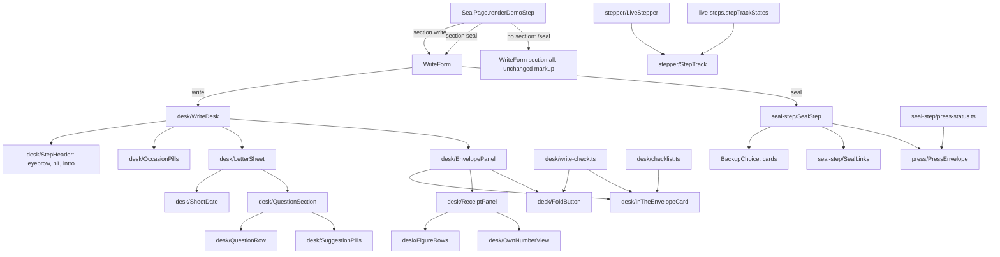

# Design Document

Spec: 14 The write desk

## Overview

This design turns the Write and Seal steps of `/demo/live` into a letter on a desk beside its envelope, makes Testify show the author's questions the way they were written, and fixes the smaller defects of groups R, B, X and D. It plans no change under `src/lib/crypto/`, `src/lib/seal-format/`, `src/app/api/`, `src/lib/letter-store/`, `src/lib/db/` or `drizzle/`, no new dependency, no new font file, no new route and no change to the CSP. `/seal` (WriteForm section `all`) keeps its markup; only the copy values that X1 names change there.

The main decisions, each owner-fixed or derived from the code:

1. **A new Write desk, beside the old form.** `WriteForm` section `write` renders a new `WriteDesk` component from a new folder `src/components/live/desk/`. Section `all` (`/seal`) keeps `OccasionPicker`, `AuthorQuestions`, `ReceiptsDisclosure`, `FigurePicker` and `SelfReportedRows` exactly as they are. The desk has its own components for the same jobs, so no `/seal` markup changes.
2. **A new Seal step layout, same press.** WriteForm section `seal` renders a new `SealStep` component from `src/components/live/seal-step/`. It reuses `PressEnvelope`, `usePressEnvelope`, `press-hold.ts`, `seal-machine.ts` and `useSealFlow.ts` unchanged in behaviour. The blank status line is replaced by one pure function, `pressStatusLine`, that always returns a line.
3. **The Write_Check becomes one pure function.** Today the checks behind the Write step's Next are spread through `WriteForm.tsx` (`letterValid`, `questionsValid`, `selfReportedValid`, `figuresValid`). A new `desk/write-check.ts` holds them, and the Fold_Button, the small envelope's seal and the failed-fold focus all read it.
4. **Occasions never write into the letter on `/demo/live`.** A new `applyOccasionQuestions` in `occasions.ts` changes only question rows. `applyOccasion` stays for `/seal`, so `/seal` behaviour is unchanged.
5. **The Live_Stepper stops drawing its step-name `h2` on Write and Seal.** Those steps draw their own `h1`. `SealPage` stops drawing its `h1` on those two steps. The stepper scrolls the Step_Track, not the heading, under the Top_Bar after a step change.
6. **Two literal tables and two pure formatters** live in the desk folder: short units, short publisher names, the figure-row period text and the sheet date. They follow G1.5's exceptions.
7. **The receipt card changes in three places.** The formula moves under the Source control (R4), the difference uses the displayed precision (R5, one new option on `formatChange` in `src/lib/figures`, data-dev) and a Same_Figure on a live or real letter gets the Same_Period_Line (R7, a new receipt kind).
8. **The Top_Bar gets fixed slots.** Skip is always rendered, disabled while no sequence runs. The persona notice moves into the Top_Bar on every Stage.

Facts read or measured while writing this design (nothing else in this document is a measurement):

| What | Result | How |
|---|---|---|
| EB Garamond axes | `wght` only, no `ital` axis | `fontTools` read of `src/app/fonts/EBGaramond-Variable.woff2` (the `fvar` table). So every `font-style: italic` on EB Garamond is the browser's synthesised oblique, as the Decisions allow. `font-synthesis` must stay at its default (`weight style`); a CSS source test pins that no desk or recall module sets `font-synthesis: none`. |
| Contrast of the owner's text colours | #8f86ad on #0b0912 5.82:1; #6b5f51 on #f6ead4 5.22:1; #bdb4dc on #15111f 9.48:1; #bdb4dc on #0b0912 10.1:1; #4a4036 on #f6ead4 8.49:1; #4a4036 on #f1e4c8 8.02:1; #ff9a4d on #0b0912 9.4:1; #0b0912 on #ff7b1c 7.63:1; #0b0912 on #ff8f3d 8.71:1; #1f1b16 on #f6ead4 14.38:1; #bdb4dc on the selected Backup_Card tint 8.3:1; #bdb4dc on the selected Figure_Row tint 9.05:1 | WCAG 2.x relative luminance, computed in this session (tints composited over their surface). All pass 4.5:1. |
| Contrast of the owner's control boundaries | question input border rgba(31,27,22,.35) on #f6ead4 2.12:1; Suggestion_Pill border rgba(74,64,54,.35) on #f6ead4 1.83:1; Occasion pill border #4a4266 on #0b0912 2.13:1; Figure_Row border #2a2340 on #0b0912 1.33:1; Own_Number input border #3a3350 on #15111f 1.56:1; the dashed marker ring #6d6488 on #15111f 3.38:1; the Accent focus ring #ff7b1c on #f6ead4 2.18:1 | Same computation. See "Control boundaries" below for how each meets G1.7. |
| Where Write and Seal are drawn | `WriteForm.tsx` renders both in section mode; `SealPage.renderDemoStep` picks `write` or `seal` from `view.step`. `/seal` is `mode === "real"` and calls `writeForm()` with no section (`all`). | Read `SealPage.tsx` lines 270 to 420. |
| `BackupChoice` on `/seal` | Not rendered. Section `all` renders the two checkboxes (`live-warning`, `live-backup-card`). | Read `WriteForm.tsx`. See "Corrections to the requirements". |
| The blank press line | `pressLine` is `""` once a Backup_Choice is made and the state is not `created`, so `PressEnvelope` renders an empty `role="status"` line. | `WriteForm.tsx`, the `pressLine` constant. |
| Sealing day for the self-reported rule | `WriteForm` uses `new Date().toISOString().slice(0, 10)`, the UTC day. Nothing else passes `sealingDay`. | `grep sealingDay` over `src/components/live`. |
| Self-reported rows and recall | A self-reported row gets no recall question (`buildLivePayload`, "with no recall question"). So no Testify number question ever has a self-reported unit. | `build-payload.ts`. |
| Catalogue and bundled units | Catalogue: "USD per gallon" (2 series) and "EUR per 1,000 litres" (2 series, `display_rescale` to "EUR per litre"). Bundled data: `real/fuel-figures.json` (356 of each), `demo/us-fuel.fixture.json` ("USD per gallon"). Both displayed units already have a `UNIT_RANGE_TABLE` entry. | `grep` of `src/lib/figures`. So the T3.1 cause is not visible from the source; the Q2.10 test finds any missing unit (T3.2). |
| Number line labels | `NumberLine` always places three labels; with no answer the third reads "No answer" (`CEREMONY_COPY.lineAnswer` row). | `NumberLine.tsx` lines 100 to 200. |
| Persona notice today | Rendered by `TopBar` (`topBarShowsNotice`), `TestifyContext` (`.testifyNotice`) and `PersonaIntro` (`.notice`, not during `recall`). | `grep personaNotice`. |
| Read step buttons | `Reveal.tsx` renders `stage2Next` and `showAll` both with `styles.button`. | `Reveal.tsx` lines 615 to 636. |
| Creases | `.crease` in `LetterBlock.module.css` is `left: 0; right: 0`, a full-width hairline. | Read the file. |
| JS budget headroom | Not measured. The `.next` folder in the workspace has an unknown commit. | The first task runs `npm run build` and `node scripts/check-js-budget.mjs` and records all five routes. |

### Corrections to the requirements, found in the code

These change the plan. None changes what a requirement asks for.

| Finding | Where | Consequence |
|---|---|---|
| X1.3 says the `backupChoiceLegend` change shows on `/seal` "because `BackupChoice` renders there". It does not: `/seal` renders two checkboxes in section `all`. | `WriteForm.tsx` | The key's value changes as X1.3 says. `/seal` shows no difference, which is consistent with "the `/seal` markup is unchanged". The X1 example test checks the key's value only. |
| The sheet date is the visitor's local date (W4.2), but the self-reported period rule uses the UTC day. Between UTC midnight and local midnight, "Dated {date}" (W12.2) and the sealed period (W12.3) would name different days, and a local day ahead of UTC would fail `selfReportedPeriodOk`. | `WriteForm.tsx` `today` | New decision: on `/demo/live` (sections `write` and `seal`), the sealing day used by the Write_Check, the Own_Number period and the sheet date is one value, the visitor's local calendar day, from `useLocalDay()`. Until mount it falls back to the UTC day, which is only used for validation messages that are not shown before a field is touched. `/seal` keeps the UTC day. This is the "Known limitations" item made consistent; it changes no requirement. |
| R6.1 names "no answer (two labels)". The code always draws three labels; the third reads "No answer". | `NumberLine.tsx` | The property covers the no-answer case as a third label whose width is the "No answer" text width. No change to `placeLineLabels`' signature. |
| T3.1 assumes a displayed unit with no entry. Both catalogue units and the bundled units have entries, and self-reported units are never asked. | See the table above | No browser run is needed. Task 8's Q2.10 test builds every displayed unit from the catalogue and the persona letters, and task 8 adds a literal `UNIT_RANGE_TABLE` entry for every displayed unit that test finds missing (T3.2). Lookup stays exact. |

### Control boundaries (G1.7)

G1.7 asks 3:1 for the boundary of a control only when the control has no other visible sign of being one. The owner's border values are below 3:1 in five places. Each control has another visible sign, recorded here so the checks test the sign and not only the border:

| Control | Other visible sign | Check |
|---|---|---|
| Question input (2.12:1 border) | The visible "Edit" with its pencil, the placeholder when empty, and a solid #1f1b16 border on hover and focus (14.38:1). Owner decision. | CSS source test for the hover and focus border; markup test for "Edit". |
| Suggestion_Pill (1.83:1) and Occasion pill (2.13:1) | A text label in a fully rounded pill, the "+ " lead on suggestions, and the selected Occasion pill is solid white. | Markup test for the text. |
| Figure_Row (1.33:1) | The 18 px checkbox square, drawn with a 1.5 px #6d6488 border when unselected (3.6:1 on #0b0912; a new value inside the owner's palette, not the Accent), and the value on the right. | CSS source test for the square border colour. |
| Own_Number input (1.56:1) | The visible label directly above each input ("What is it?", "Amount", "Unit", "Where?"), the #0b0912 fill set into the #15111f card, and the Accent focus ring. | Markup test for the labels. |
| Letter_Field focus (Accent 2.18:1 on paper) | W5.1's 1 px #1f1b16 line beside the ring (14.38:1). | CSS source test. |

## Architecture



Source layout (new files in bold in the text; `structure.md` already lists `src/components/live/desk/` and `seal-step/`):

```
src/components/live/
  desk/                        (frontend-dev; /demo/live Write step only)
    WriteDesk.tsx              the Write step: Step_Container, header, row of sheet and panel
    StepHeader.tsx             eyebrow, h1, intro (Write); h1 only (Seal) via props
    OccasionPills.tsx          "Start from" fieldset with five aria-pressed pills
    LetterSheet.tsx            paper, salutation, SheetDate, Letter_Field, bottom row, Perforation
    SheetDate.tsx              the client-only date slot
    use-local-day.ts           useLocalDay(): the visitor's local day after mount
    sheet-date.ts              formatSheetDate, formatDatedDay, localCalendarDay (pure)
    QuestionSection.tsx        P.S. fieldset, rows, Ask another, limit line, nothing-to-testify
    QuestionRow.tsx            Wax_Disc, input, Edit, Lock_Line, Remove
    WaxDisc.tsx                the 30 px numbered disc (also used by recall)
    SuggestionPills.tsx        up to two suggestions and "+ Write my own"
    suggestions.ts             suggestionsFor (pure)
    EnvelopePanel.tsx          sticky column: card, receipt panel, Fold_Button, Rehearsal_Line
    InTheEnvelopeCard.tsx      small envelope, three Checklist_Lines or the phone line
    checklist.ts               envelopeChecklist (pure)
    ReceiptPanel.tsx           "Tuck in a receipt" card, toggle, the two views; details on phone
    ReceiptToggle.tsx          two aria-pressed buttons
    FigureRows.tsx             hint, Picker_Note, Figure_Rows, limit line, Sources line, Details
    figure-row-text.ts         figureRowPeriod, figureRowUnit, sourcesLine (pure)
    short-units.ts             SHORT_UNITS literal table
    short-publishers.ts        SHORT_PUBLISHERS literal table
    OwnNumberView.tsx          four inputs, Dated line, self-reported line
    FoldButton.tsx             the button and the failed-fold summary line
    write-check.ts             writeCheck, firstFailingField (pure)
    copy.ts                    DESK_COPY
    desk.module.css            Step_Container, header, Occasion row, the flex row
    sheet.module.css           Letter_Sheet, Letter_Field rules, Perforation, Question_Section
    panel.module.css           Envelope_Panel, cards, toggle, Figure_Rows, Own_Number_View, Fold_Button
  seal-step/                   (frontend-dev; /demo/live Seal step only)
    SealStep.tsx               two columns: text column and press column
    SealLinks.tsx              "Opening on another device?" and "← Back to the letter"
    press-status.ts            pressStatusLine, envelopeCaption (pure)
    seal-step.module.css
  BackupChoice.tsx             restyled as two Backup_Cards (it renders only on /demo/live)
  backup-choice.module.css     the Backup_Card styles (moved out of live.module.css)
  press/PressEnvelope.tsx      new props: caption, ready, tone; size and halo in press.module.css
  stepper/StepTrack.tsx        replaces StepIndicator's markup and look; keeps data-step-indicator
  stepper/step-track.module.css
src/components/ceremony/recall/
  NavRow.tsx                   Previous on the left, main button on the right
  written-on.ts                formatWrittenOn (pure)
src/components/reveal/
  FormulaLine.tsx              the formula and its source links, under the Source control
  same-period.ts               samePeriodLine (pure)
src/lib/figures/format-change.ts   formatChange gets an optional differenceDigits (data-dev)
```

Ownership (`.github/agents.json`): everything under `src/components/**` and `src/app/**/*.tsx|css` is frontend-dev. `src/lib/figures/**` is data-dev (only `format-change.ts` and its tests). `tools/qa/**` and `src/test/**` are platform-dev. Test files under `src/` are shared, so each frontend task writes its own `*.test.ts(x)`. Nothing in this design touches `src/app/page.tsx` (platform-dev), `src/lib/landing-backdrop*` or any path in G1.3.

## Components and Interfaces

### 1. Group S: the Step_Track, the step change and the Seal step

#### 1.1 Step_Track (S1)

**Pure state, in `stepper/live-steps.ts`:**

```ts
export type TrackState = "done" | "current" | "todo";
export type TrackStep = { step: LiveStep; label: string; state: TrackState; index: number };
/** One entry per LIVE_STEPS item, in order. Exactly one is current. */
export function stepTrackStates(current: LiveStep): readonly TrackStep[];
```

`LIVE_STEP_NAMES[5]` changes from `RITUAL[3].name` ("See the receipts") to the new `LIVE_COPY.receiptsStep` ("Receipts"). `BRAND_COPY.ritualSteps` is unchanged (S1.1). `stepName` keeps reading `LIVE_STEP_NAMES`, so the announcement uses "Receipts" (S1.5).

**`stepper/StepTrack.tsx`** replaces `StepIndicator`'s markup. `LiveStepper` imports `StepTrack` instead. The old `StepIndicator.tsx` file is deleted in the same task with its test retired (the reason is S1). The root keeps `data-step-indicator` and gains `data-step-track`, so the existing `[data-live-stepper] [data-step-indicator] [aria-current='step']` hook keeps working (Q1.2).

```tsx
<div className={s.track} data-step-indicator data-step-track>
  <ol className={s.steps} aria-label={LIVE_COPY.stepsLabel}>
    {states.map(t => (
      <li data-state={t.state} aria-current={t.state === "current" ? "step" : undefined}>
        <span className={s.dot} aria-hidden="true" />
        <span className={s.label}>{t.label}</span>
      </li>))}
  </ol>
  <p className={s.phoneText} aria-hidden="true">{fill(LIVE_COPY.stepTrackPhone, …)}</p>
  <p className={s.announce} role="status" aria-live="polite">{announce}</p>
</div>
```

`step-track.module.css`:

- `.steps`: `display: flex; align-items: center; gap: 0; list-style: none`. Each `li` after the first has a `::before` hairline: `width: 36px; height: 1px; background: #3a3350; margin-inline: 10px`.
- `.dot`: 8 px circle; `[data-state="done"] .dot { background: #bdb4dc }`, `[data-state="todo"] .dot { background: #3a3350 }`, `[data-state="current"] .dot { width: 12px; height: 12px; background: #ff7b1c; box-shadow: 0 0 0 4px rgba(255,123,28,.22) }`. Orange on the reader's current step is one of the "you" uses `tone.md` lists.
- `.label`: Inter (`var(--font-sans)`) 13 px, margin-left 8 px; done `#bdb4dc`, todo `#8f86ad`, current `#ffffff` weight 700.
- Below 600 px (`@media (max-width: 599.98px)`): `.label` takes the visually-hidden clip pattern (so the `ol` still reads each label to assistive technology), and `.phoneText` shows in 13 px #bdb4dc. The phone text has `aria-hidden="true"` and is not a live region (S1.4). The `role="status"` paragraph stays the one announcement of a step change (S1.5).

New copy (`src/components/live/copy.ts`): `receiptsStep: "Receipts"`, `stepTrackPhone: "Step {n} of {total} · {label}"`.

#### 1.2 The step change (S2)

**Cause to confirm.** The first S task measures, at both Evidence_Sizes, the Top_Bar bottom, `--topbar-clear`, the heading top 1,000 ms after Next, and the scroll offset over time. Candidates in the code: (a) `heading.scrollIntoView({ behavior: "smooth" })` in `LiveStepper` runs in a `useEffect` before the new step's content has its final height (the Write and Seal steps differ in height by hundreds of px), so a smooth scroll targets a stale offset; (b) `useKeepInVisualViewport(primaryRef, calm)` scrolls again when focus lands; (c) `--topbar-clear` is unset on `/demo/live`, so `scroll-margin-top` uses the 96 px fallback. The task names which, with numbers.

**Plan, independent of the finding:**

- `LiveStepper` holds a `trackRef` on the `StepTrack` root. On a step change it runs, in a `useLayoutEffect` followed by one `requestAnimationFrame` (so the new step has laid out): `heading.focus({ preventScroll: true })`, then `track.scrollIntoView({ block: "start", behavior: calm ? "instant" : "smooth" })`. `.track` has `scroll-margin-top: calc(var(--topbar-clear, 96px) + 24px)`, which lands the track 24 px below the bar (inside 16 to 48, S2.2).
- The heading is found by `[data-step-heading]` inside the step section, so it is the Write or Seal `h1`, or the stepper's own `h2` on Wait (S2.3). `LiveStepper` renders its `h2` only for steps where `stepperDrawsHeading(step)` is true: new pure function, true for `wait` only. `hasPrimaryCard` stays as it is for the card.
- While the step change scroll runs, `useKeepInVisualViewport` is told to skip one cycle through a new optional `suspendUntil` ref; this stops the second scroll (S2.3 "no further scroll"). If the first task shows (b) is not a cause, this part is dropped.
- If the first task shows `--topbar-clear` is unset on `/demo/live`, `TopBar` sets it on the Scene root from its own `ResizeObserver` (spec 13 W8 put this in place for the persona page; the task extends it to every page that renders `TopBar`).

`SealPage` renders its `h1` `LIVE_COPY.liveHeading` only while `view.step` is not `write` or `seal`. On those two steps the desk and the Seal step render their own `h1` with `data-step-heading` and `tabIndex={-1}`.

#### 1.3 The Seal step (S3, S5, S6)

**`seal-step/SealStep.tsx`**, rendered by `WriteForm` for section `seal`:

```ts
export type SealStepProps = {
  state: SealState;
  cryptoLoaded: boolean;
  prfHint: PrfHint;
  backupChoice: BackupChoiceValue | null;
  onBackupChoice: (choice: BackupChoiceValue) => void;
  questionCount: number;                 // non-empty rows, for the envelope caption
  showChooseProblem: boolean;            // spec 13 P7: after a press attempt with no choice
  onBack?: () => void;                   // present only in `write` (spec 09 D2.2)
  onBackupStart?: () => void;            // the PRF-missing fallback
  onCreatePress: () => void;
  onConfirmPress: () => void;
  onAttempt: () => void;
};
```

Markup, in DOM order: `<div data-seal-step className={s.step}>` holding `<div data-seal-text className={s.text}>` (the `h1`, the paragraph, the Warning_Text, the `BackupChoice`, the fallback button when `prfHint === "missing"`, `SealLinks`, and the cross-device text when open) and `<div data-press-column className={s.press}>` (the `PressEnvelope`).

`seal-step.module.css`:

- `.step`: `max-width: 1240px; margin-inline: auto; padding-inline: 32px` (the Step_Container, shared with the desk through a `.container` class in `desk.module.css` composed here). At 900 px and wider: `display: grid; grid-template-columns: minmax(0, 520px) minmax(0, 1fr); column-gap: 64px; align-items: center` (S3.1: the two vertical centres align because both items centre in one grid row). Below 900 px: one column, text first.
- `.text`: `max-width: 520px`. `h1`: Inter 48 px, weight 900, `letter-spacing: -0.03em`, #ffffff, `line-height: 1.05`. The paragraph and the Warning_Text: 17 px #bdb4dc, line-height 1.5.
- `.press`: `container-type: inline-size; display: grid; justify-items: center`. The press column never overlaps the text column, because it is a separate grid track with `minmax(0, 1fr)` and the envelope width is capped by its own container (S6.8).

**Copy.** The paragraph is one string, `LIVE_COPY.sealParagraph` (new): "This letter is sealed in your browser with your own passkey. Your device will ask for the passkey twice. The passkey will be named "Revenant demo" in your passkey manager." It holds the one in-browser sentence of S3.5, so `LIVE_COPY.intro` is not rendered on the Seal step. `LIVE_COPY.passkeySteps` is not rendered by section `seal` (X1.5) and stays unchanged for `/seal`. `LIVE_COPY.warning` renders as a plain `<p data-warning-text>` (S3.4).

**`SealLinks.tsx`:**

```tsx
<p className={s.links} data-seal-links>
  <button type="button" className={s.textLink} aria-expanded={open} aria-controls={crossId}
          data-cross-device onClick={() => setOpen(o => !o)}>{LIVE_COPY.crossDeviceQuestion}</button>
  <button type="button" className={s.textLink} data-back-to-letter
          disabled={onBack === undefined} onClick={onBack}>
    <span aria-hidden="true">← </span>{LIVE_COPY.backToLetter}
  </button>
</p>
{open ? <p id={crossId} className={s.crossDevice}>{LIVE_COPY.crossDevice}</p> : null}
```

New keys: `crossDeviceQuestion: "Opening on another device?"`, `backToLetter: "Back to the letter"`. `.links` is 13 px; `.textLink` is a text control in #bdb4dc with an underline, transparent background, no border, `min-height: 24px`, and `:disabled { opacity: .4; cursor: not-allowed }`. The Back button is rendered disabled, at the same position, whenever `onBack` is undefined, which `SealPage` already does while the seal state is not `write` (S5.6). The `details` with `crossDeviceSummary` is not rendered by section `seal`.

#### 1.4 The Backup_Choice as two cards (S4)

`BackupChoice.tsx` renders only on `/demo/live` (see Corrections), so it is restyled in place. Its props gain `disabled?: boolean` (S4.7). Markup per option:

```tsx
<label className={b.card} data-backup-card={option.value} htmlFor={option.id}>
  <input id={option.id} type="radio" name="live-backup-choice" className={b.radio}
         aria-describedby={`${option.id}-help`} disabled={disabled} … />
  <span className={b.circle} aria-hidden="true" />
  <span className={b.title}>{option.label}</span>
  <span id={`${option.id}-help`} className={b.help}>{option.help}</span>
</label>
```

The native radio is visually hidden with the clip pattern (still focusable and in the tree); the label text is its accessible name and the help line its description (S4.2). Arrow keys work natively in a radio group with one `name` (S4.6).

`backup-choice.module.css` (the old `.backupChoice*` rules in `live.module.css` move here):

- `legend`: 15 px weight 700 #ffffff. Cards in a flex column with `gap: 10px`.
- `.card`: `display: grid; grid-template-columns: 18px 1fr; column-gap: 12px; padding: 16px 18px; border-radius: 10px; background: #15111f; border: 1px solid #2a2340`.
- `.circle`: 18 px, `border: 1.5px solid #6d6488; border-radius: 50%`.
- `.title`: 15 px weight 600 #ffffff. `.help`: 13 px #bdb4dc, grid column 2.
- `.card:has(.radio:checked)`: `border-color: #ff7b1c; background: rgba(255,123,28,.10)`; `.circle` filled #ff7b1c with an inner #0b0912 dot (S4.4).
- `.card:has(.radio:focus-visible)`: `outline: 2px solid #ff7b1c; outline-offset: 2px` (S4.6).
- `.card:has(.radio:disabled)`: `cursor: not-allowed`; the checked look stays (S4.7).

Copy (X1.3 and S4.3), in `LIVE_COPY`: `backupChoiceLegend: "If you lose this passkey"` (changed), `backupChoiceCard: "Download a backup key card"` (check the current value; set it if it differs), `backupChoiceCardHelp: "A small image with a QR code. It opens the letter if the passkey is gone."` (new), `backupChoiceSkip: "Skip it. A lost passkey means a lost letter."`, `backupChoiceSkipHelp: "Fine for a 30-second rehearsal."` (new). `backupChoiceUnchosen` keeps showing under the cards after a press attempt with no choice (S4.5).

The radios are disabled while the seal state is `creating`, `created`, `confirming`, `preparing` or `sealing` (S4.7), passed from `SealStep` as `disabled={state.tag !== "write"}`.

#### 1.5 The Press_Envelope and its status line (S6)

**`seal-step/press-status.ts`** (pure, no React):

```ts
export type MotionSetting = "full" | "reduced" | "calm";
export type PressStatus = { text: string; tone: "muted" | "accent" };
/** The Press_Status_Line for every seal state before the letter is stored. Never "". */
export function pressStatusLine(input: {
  tag: SealState["tag"];          // write, creating, created, confirming, preparing, sealing
  backupChoice: BackupChoiceValue | null;
  motion: MotionSetting;
}): PressStatus;
/** "To me, on opening day · {n} questions on top", singular for 1, the bare phrase for 0. */
export function envelopeCaption(questionCount: number): string;
```

| `tag` | `backupChoice` | `motion` | text | tone |
|---|---|---|---|---|
| `write` | null | any | `PRESS_COPY.chooseFirst` ("Choose a backup option first.") | muted |
| `write` | card or skip | full | `PRESS_COPY.holdToSeal` ("Press and hold the wax to seal it.") | accent |
| `write` | card or skip | reduced or calm | `PRESS_COPY.pressToSeal` ("Press the wax to seal it.") | accent |
| `creating` | any | any | `LIVE_COPY.stepCreating` | muted |
| `created` | any | any | `PRESS_COPY.setting` | muted |
| `confirming` | any | any | `LIVE_COPY.stepConfirming` | muted |
| `preparing` | any | any | `LIVE_COPY.stepPreparing` | muted |
| `sealing` | any | any | `LIVE_COPY.stepSealing` | muted |

New decision (not in the requirements): while the crypto module has not loaded and a choice is made, the line still reads the `write` line for the motion setting. The seal is at 40 % opacity and `aria-disabled`, so the line tells the reader what the seal is for. This keeps S6.7 and Q2.6 a function of the three inputs only.

`motion` comes from `useCalmInForce()` and a `prefers-reduced-motion` media query read once in `SealStep` (`"calm"` when the Calm control is on, `"reduced"` when only the media query matches, `"full"` otherwise). `instant` is passed to `PressEnvelope` when `motion !== "full"` (S6.9).

**`PressEnvelope` changes** (behaviour unchanged, spec 13 P1, P2, P4, P5):

```ts
export type PressEnvelopeProps = {
  /* existing props */
  /** The display-only line at the bottom left of the envelope (S6.2). Not part of the accessible name. */
  caption?: string;
  /** True when a choice is made, crypto is loaded and no prompt is open: full opacity with the halo (S6.5). */
  ready?: boolean;
  /** The colour of the status line (S6.7). */
  tone?: "muted" | "accent";
};
```

`line` is always passed by `SealStep` from `pressStatusLine`, so the line is never empty (S6.6). The inert failure and cancel views keep no line; the failure screen's message is the status there. `SealStep` passes `StepStatus` nothing: section `seal` no longer renders `StepStatus`, so each state line is announced once (S6.6).

`press.module.css` changes:

- `.wrap`: `width: min(440px, 100cqi)`, centred in `.press`.
- `.envelope`: `aspect-ratio: 1.55; background: #f1e4c8; border-radius: 6px; box-shadow: 0 40px 90px rgba(0,0,0,.6)`.
- `.flap`: a `clip-path: polygon(0 0, 100% 0, 50% 58%)` triangle in #e6d5b2, so its point lies on the vertical centre line (S6.1).
- `.wax`: `width: calc(min(440px, 100cqi) * 112 / 440)` (112 px at 440, in proportion below), centred on the flap point (`left: 50%; top: 58%; translate: -50% -50%`).
- `.caption` (new, `aria-hidden="true"`): bottom 16 px, left 20 px, `font-family: var(--font-serif); font-style: italic; font-size: 17px; color: #4a4036`.
- `[aria-disabled="true"] .wax { opacity: .4 }` and `cursor: not-allowed` on the button while `disabled`; during a prompt (`data-press-mode` with a running state) the seal is opaque with no halo (S6.4).
- `[data-ready] .wax { box-shadow: 0 0 0 10px rgba(255,123,28,.18), 0 0 0 22px rgba(255,123,28,.08) }`, removed under `@media (prefers-reduced-motion: reduce)` and `:root[data-calm] &` (S6.5).
- `.line`: 15 px weight 600, centred; `[data-tone="muted"] { color: #bdb4dc }`, `[data-tone="accent"] { color: #ff9a4d }`. The accent line sits on #0b0912 (9.4:1), never on purple.

At 1440×900 the text column is 520 px and the press column is 1240 − 64 − 520 − 64 = 592 px wide, so the envelope is 440 px and the seal 112 px. At 390 the column is 326 px, the envelope 326 px and the seal 83 px. The first S task measures both.

S3.4 at 390×844: the Warning_Text is near the top of the text column and the seal is about 300 px below the end of the Backup_Choice. The layout check scrolls the Warning_Text to the top of the window and checks the seal's box bottom is within 844 px of it. If it is not, the task reduces the gaps (cards 10 px apart, links line 12 px) before it moves anything else.

### 2. Group W: the Write desk

#### 2.1 `WriteDesk` and the Step_Container (W1, W2)

`WriteForm` section `write` returns `<WriteDesk …/>` with the props it already receives (draft values, figure series and details, figures status, touched, and the handlers) plus two new draft handlers (see Data Models). `WriteDesk` owns three pieces of memory-only state: the Occasion memory (`OccasionQuestionsDraft`), the Receipt_Toggle view (`"public" | "own"`) and the failed-fold flag.

```
<div className={d.container} data-write-desk>        max-width 1240, padding-inline 32, margin-inline auto
  <StepHeader eyebrow h1 intro />                       Step_Track sits above, in LiveStepper
  <OccasionPills />
  <div className={d.row}>                              margin-top 28, display flex, flex-wrap wrap, gap 32
    <LetterSheet className={d.sheet} />                 flex: 999 1 620px
    <EnvelopePanel className={d.panel} />               flex: 1 1 340px
  </div>
</div>
```

With `flex-wrap: wrap` and the flex bases 620 + 340 + a 32 px gap, the two items share a line exactly when the content box is at least 992 px, and the panel drops below the sheet at full width otherwise (W1.4). At 1055 px the content box is 1055 − 64 = 991 px, and at 1056 px it is 992 px, which are the two widths W1.5 tests.

Sticky panel (W1.3, W1.6): `.panel` has `position: sticky; top: calc(var(--topbar-clear, 96px) + 16px); align-self: flex-start`, applied only through a `data-sticky` attribute. `EnvelopePanel` sets `data-sticky` from a `ResizeObserver` on itself and on the window size: sticky when the panel's height ≤ `innerHeight − topBarBottom − 32`, and the sheet and the panel share a line (their `offsetTop` values are equal). Otherwise it scrolls with the page, so the Fold_Button can always be scrolled into view.

The light glow (S2.1) is the existing Scene light. The first W task checks its centre lies in the top-right quarter and that it does not cross a text box; if it does, the glow element in `SceneBackdrop` is moved for `/demo/live` with one CSS variable, `--light-x`, already used by `light-x.ts`.

`StepHeader.tsx`:

```ts
export type StepHeaderProps = { eyebrow?: string; heading: string; intro?: string; headingId: string };
```

The eyebrow is a `<p className={d.eyebrow}>` with the text `LIVE_COPY.liveHeading` ("Seal your own letter"), shown in capitals by `text-transform: uppercase` (W2.2: 12 px weight 600, letter-spacing .16em, #bdb4dc). The `h1` has `data-step-heading`, `tabIndex={-1}`, Inter 56 px weight 900, letter-spacing −0.03em, line-height 1.02, #ffffff; 36 px below 600 px (W2.3). The intro is 17 px #bdb4dc, `max-width: 620px` (W2.4). The Seal step uses the same component with only `heading`.

New copy in `desk/copy.ts` (`DESK_COPY`): `heading: "Write to the you who opens this."`, `intro: "Say where things stand today. Then leave a few questions. When it opens, you answer them from memory first, then read what you wrote."`. The Seal step's heading goes in `LIVE_COPY.sealHeading: "Press the seal."`.

#### 2.2 Occasion pills (W3)

`occasions.ts` changes (frontend-dev, a G1.5 exception file):

- `OCCASIONS[*].placeholder` take the Decisions' strings ("This is where my year stands as I write this…", and so on). `/seal` reads the same `occasionPlaceholder`, so its placeholder attribute changes too; its markup does not.
- Each `Occasion` gains `suggestions: readonly string[]`, at least two each, and the module gains `SHARED_SUGGESTIONS` starting with "What were you worried about when you wrote this?" and "What were you looking forward to when you wrote this?". Every suggestion matches the spec 10 `SEALING_DAY_ANCHOR` pattern and none equals any Occasion's `questions` entry (so a suggestion row always counts as edited, W8.3).
- New:

```ts
/** The question part of an Occasion pick, for /demo/live. Never reads or writes letter text (W3.4). */
export type OccasionQuestionsDraft = { questions: string[]; occasion: OccasionId; appliedQuestions: readonly string[] };
export function applyOccasionQuestions(draft: OccasionQuestionsDraft, id: OccasionId): OccasionQuestionsDraft;
```

It uses the same row rule as `applyOccasion` step 2 and 3 (an empty, missing or still-applied row takes the new Occasion's question at that index; a typed row stays). `applyOccasion` is unchanged for `/seal`. The desk dispatches the existing `OCCASION_APPLIED` event with the current `text` unchanged, so the reducer is unchanged too.

`LIVE_COPY.occasionLabels.blank` becomes "A blank page" (X1.4), shared with `/seal`.

`OccasionPills.tsx`:

```tsx
<fieldset className={d.occasions} data-occasions>
  <legend className={d.occasionLegend}>{DESK_COPY.startFrom}</legend>
  {OCCASIONS.map(o => (
    <button type="button" className={d.pill} aria-pressed={o.id === chosen}
            data-occasion-pill={o.id} onClick={() => onChoose(o.id)}>{LIVE_COPY.occasionLabels[o.id]}</button>))}
</fieldset>
```

`DESK_COPY.startFrom: "Start from"`. The pill order follows `OCCASIONS` (year, work, family, decision, blank), which is the W3.1 order. CSS: `.pill { min-height: 44px; border-radius: 999px; padding-inline: 16px; font: 500 14px var(--font-sans); background: transparent; border: 1px solid #4a4266; color: #fff }`, `.pill[aria-pressed="true"] { background: #fff; color: #0b0912; border-color: #fff }`. Below 600 px, `.occasions` is `display: flex; flex-wrap: nowrap; overflow-x: auto; overscroll-behavior-x: contain` with the legend on its own line above, so only the row scrolls (W3.5). The legend uses the `fieldset` `legend` with `float: left; width: 100%` so it sits above the pills.

#### 2.3 Letter_Sheet and Letter_Field (W4, W5)

`LetterSheet.tsx` renders, in order: the top row (`DESK_COPY.salutation` "Dear future me," and `<SheetDate />`), the `textarea#live-letter` with a visually hidden `<label>` `LIVE_COPY.letterLabel` ("Your letter"), the bottom row (`DESK_COPY.signOff` "— me, today" and the count), the letter problem line, the Perforation and `QuestionSection`.

`sheet-date.ts` (pure):

```ts
/** "Tuesday, 17 November 2026" for the given instant in the given IANA zone (en-GB parts, assembled). */
export function formatSheetDate(instant: Date, timeZone: string): string;
/** "17 November 2026" for a YYYY-MM-DD day. */
export function formatDatedDay(day: string): string;
/** The calendar day as YYYY-MM-DD for the instant in the zone. */
export function localCalendarDay(instant: Date, timeZone: string): string;
```

`formatSheetDate` builds the string from `Intl.DateTimeFormat("en-GB", { weekday: "long", day: "numeric", month: "long", year: "numeric", timeZone }).formatToParts`, so the comma after the weekday is ours, not the locale's.

`use-local-day.ts`: `useLocalDay(): { day: string; sheetDate: string } | null`, `null` on the server and on the first client render, set in a `useEffect` from `new Date()` and `browserTimeZone()` (`ui/letter-date.ts`). `SheetDate` renders `<span className={s.date} data-sheet-date>{value?.sheetDate ?? ""}</span>` with a fixed `min-height` equal to the row's line height, so the server HTML holds an empty slot of the same height and hydration sees the same markup (W4.3). `WriteDesk` passes `value?.day ?? utcDay` as the `sealingDay` to `writeCheck` and to `OwnNumberView`.

CSS in `sheet.module.css`:

- `.sheet { background: #f6ead4; border-radius: 6px; padding: 48px 56px 40px; box-shadow: 0 30px 80px rgba(0,0,0,.55) }`, `padding: 24px 20px` below 600 px (W4.1).
- `.topRow`, `.bottomRow`: `display: flex; justify-content: space-between; align-items: baseline; gap: 12px; flex-wrap: wrap`. Below 600 px `.topRow` is `flex-direction: column; align-items: flex-start` (W4.2).
- `.salutation { font: italic 400 26px var(--font-serif); color: #1f1b16 }`; `.date { font: 13px var(--font-sans); color: #4a4036 }`; `.signOff { font: italic 400 20px var(--font-serif); color: #4a4036 }`; `.count { font: 12px var(--font-sans); color: #4a4036 }`.
- `.letter` (the textarea): `border: 0; background-color: transparent; font: 400 21px/32px var(--font-serif); color: #1f1b16; padding: 0; min-height: 296px; resize: none; background-image: repeating-linear-gradient(to bottom, transparent 0 31px, rgba(74,64,54,.16) 31px 32px); background-attachment: local; background-position: 0 var(--rule-offset, 7px)`. `background-attachment: local` moves the rules with the text when the field scrolls inside itself (W5.2). `--rule-offset` puts each rule just under a baseline: for EB Garamond at 21 px in a 32 px line the baseline sits about 24 to 25 px down the line box, so the rule at 31 px is about 6 to 7 px below it. The first W task measures the baseline with a `Range` on the first, a middle and the last visible line, and sets `--rule-offset` so the baseline-to-rule gap is at most 2 px (W5.2 counts the gap to the nearest rule). The layout row re-measures after an internal scroll.
- `.letter::placeholder { font-style: italic; color: #6b5f51; opacity: 1 }` (W5.4).
- `.letter:focus-visible { outline: 2px solid #ff7b1c; outline-offset: 4px; box-shadow: 0 1px 0 0 #1f1b16 }` (W5.1).

Height (W5.3): a new pure `deskLetterHeightPx(contentPx, visualViewportPx)` in `phone.ts` returns `max(296, min(contentPx, max(296, letterFieldMaxPx(visualViewportPx))))`. The existing grow effect in `WriteForm` moves into `LetterSheet` and calls it.

Count (W4.4): `LIVE_COPY.letterCount` with `{count}` filled by `new Intl.NumberFormat("en-US").format(countCodePoints(text))`, so 1234 reads "1,234" and 5012 reads "5,012 of 5,000 characters". The textarea has no `maxlength`. Problems (W5.5): `LIVE_COPY.letterEmpty` or `letterTooLong` in `<p id="live-letter-problem">` directly under the bottom row, linked from the textarea's `aria-describedby` together with the count.

#### 2.4 Perforation and Question_Section (W6, W7, W8)

Perforation: `<hr className={s.perforation} aria-hidden="true" data-perforation />`, `margin: 36px calc(-1 * var(--sheet-pad-x)) 32px; border: 0; border-top: 2px dashed rgba(74,64,54,.28)`. The negative inline margins equal the sheet's padding (`--sheet-pad-x` is 56 px, 20 px on a phone), so the line reaches both paper edges (W6.1).

`QuestionSection.tsx`:

```tsx
<fieldset className={s.questions} data-question-section>
  <legend className={s.psLegend}>{DESK_COPY.psLegend}</legend>
  <p className={s.psIntro}>{DESK_COPY.psIntro}</p>
  <ol className={s.rows}>{questions.map((q, i) => <QuestionRow index={i} … />)}</ol>
  {nothingToTestify ? <p id="live-figures-problem" className={s.problem}>{LIVE_COPY.nothingToTestify}</p> : null}
  {questions.length < 3
    ? <SuggestionPills suggestions={suggestionsFor(occasion, questions)} … />
    : <p className={s.limit}>{DESK_COPY.questionsFull}</p>}
</fieldset>
```

Copy: `psLegend: "P.S. Questions for opening day"`, `psIntro: "These stay on top of the envelope. When it opens, you answer each one from memory, before a word of the letter is shown. You don't answer them now."`, `questionsFull: "Three is the most a letter holds."`. CSS: legend EB Garamond 26 px weight 500 #1f1b16; intro 14 px #4a4036 `max-width: 560px`; `.rows { display: grid; row-gap: 22px }` (W6.4). The nothing-to-testify line shows only here (W6.5). With no rows the legend, intro and pills still render (W6.6).

`QuestionRow.tsx`:

```tsx
<li className={s.row} data-question-row>
  <WaxDisc n={index + 1} />
  <div className={s.qBody}>
    <label className="visually-hidden" htmlFor={id}>{fill(LIVE_COPY.authorQuestionLabel, { n })}</label>
    <div className={s.qLine}>
      <textarea id={id} rows={1} className={s.qInput} value={text}
        placeholder={DESK_COPY.questionPlaceholder}
        aria-describedby={`${lockId}${problem ? ` ${problemId}` : ""}`}
        aria-invalid={problem ? "true" : undefined} … />
      <span className={s.edit} aria-hidden="true" onClick={focusEnd}><PencilIcon />{DESK_COPY.edit}</span>
    </div>
    <p id={lockId} className={s.lock}><LockIcon aria-hidden="true" />{DESK_COPY.lockLine}</p>
    {problem ? <p id={problemId} className={s.problem}>{LIVE_COPY.questionTooLong}</p> : null}
  </div>
  <button type="button" className={s.remove} aria-label={fill(LIVE_COPY.authorQuestionRemove, { n })}>{LIVE_COPY.authorQuestionRemoveText}</button>
</li>
```

- The input is a one-row `textarea` that grows to its `scrollHeight` on every change (`overflow: hidden`), so the whole question shows with no inner scroll bar (W7.3). It is labelled "Question {n}" (the existing `authorQuestionLabel`; the task checks its value reads "Question {n}" and changes it only if it does not).
- `.qInput { font: italic 400 21px var(--font-serif); color: #1f1b16; background: transparent; border: 0; border-bottom: 1px solid rgba(31,27,22,.35); padding-right: 64px }`, `:hover, :focus { border-bottom-color: #1f1b16 }`. The right padding keeps typed text clear of "Edit" (W7.4).
- `.edit`: absolutely placed at the right end of `.qLine`, 12 px #4a4036, `min-width: 24px; min-height: 24px`, no `tabIndex`. Its click focuses the textarea and sets the caret at the end (`setSelectionRange(len, len)`).
- `.lock`: `margin-top: 10px`, 13 px #4a4036, no border, no background, no hover rule, not focusable (W7.5). Icons are inline SVG in `scene/icons.tsx` style, added to a new `desk/icons.tsx`.
- `WaxDisc.tsx`: `<span className={w.disc} aria-hidden="true" data-wax-disc>{n}</span>` with `width: 30px; height: 30px; border-radius: 50%; background: #ff7b1c; color: #0b0912; font: 800 13px var(--font-sans); box-shadow: inset 0 -2px 0 rgba(0,0,0,.18); display: grid; place-items: center; flex: none` (W7.2, T1.3). It lives in `desk/` and is imported by `RecallPager` and `RecallReader` (both frontend-dev).
- Remove keeps `focusAfterRemove` from `author-questions.ts` (W7.6). Row rules stay (W7.7): `questionRowProblem`, no `maxlength`.

New copy: `questionPlaceholder: "Write a question for opening day…"`, `edit: "Edit"`, `lockLine: "Answered on opening day, before the letter is shown."`.

**Suggestions (W8).** `desk/suggestions.ts`:

```ts
/** Up to `limit` suggestions not already a row (trimmed equality), Occasion list first, then the shared list. */
export function suggestionsFor(occasion: OccasionId, rows: readonly string[], limit?: number /* 2 */): string[];
```

`SuggestionPills.tsx` renders "Ask another:" (`DESK_COPY.askAnother`, 13 px #4a4036), then one `button` per suggestion and "+ Write my own":

```tsx
<button type="button" className={s.suggestion} data-suggestion-pill
        aria-label={fill(DESK_COPY.addQuestionName, { text })} onClick={() => onAdd(text)}>
  <span aria-hidden="true">+ </span>{text}
</button>
<button type="button" className={`${s.suggestion} ${s.writeOwn}`} data-write-own
        aria-label={DESK_COPY.writeOwnName} onClick={() => onAdd("")}>
  <span aria-hidden="true">+ </span>{DESK_COPY.writeOwn}
</button>
```

Copy: `askAnother: "Ask another:"`, `addQuestionName: "Add the question: {text}"`, `writeOwn: "Write my own"`, `writeOwnName: "Write my own"`. The visible "+ Write my own" is the hidden "+ " plus `writeOwn` (W8.7). CSS: `min-height: 40px; border-radius: 999px; border: 1px solid rgba(74,64,54,.35); background: transparent; font: italic 400 17px var(--font-serif); color: #1f1b16; padding: 8px 16px; white-space: normal; text-align: left; max-width: 100%`, and `.writeOwn { font: 600 14px var(--font-sans); font-style: normal }` (W8.2).

`onAdd(text)` dispatches the new `QUESTION_ADDED` with `text` (see Data Models) and then focuses the new row's input in a layout effect keyed on the row count (W8.3, W8.4).

#### 2.5 Envelope_Panel and the "In the envelope" card (W9)

`EnvelopePanel.tsx` renders a column with `gap: 20px`: `InTheEnvelopeCard`, `ReceiptPanel`, `FoldButton` and the Rehearsal_Line (`LIVE_COPY.rehearsalLine`, 13 px #bdb4dc, centred, `data-live-rehearsal`; `SealPage` stops passing it as `footer` for section `write`, so it shows once, W13.4).

`panel.module.css` `.card { background: #15111f; border: 1px solid #2a2340; border-radius: 10px; padding: 24px }`.

`desk/checklist.ts`:

```ts
export type ChecklistInput = {
  text: string;
  questions: readonly string[];
  metricIds: readonly string[];
  ownNumber: SelfReportedRow | null;     // the one Own_Number_View row, or null
};
export type Checklist = {
  letter: string;       // "{n} words" | "1 word" | "not written yet"
  questions: string;    // "{n} of 3"
  receipt: string;      // "none yet" | "1 price" | "{n} prices" | "1 own number" | joined with " · "
  present: { letter: boolean; questions: boolean; receipt: boolean };
  phoneLine: string;    // "Letter · 3 questions · no receipt"
};
export function envelopeChecklist(input: ChecklistInput): Checklist;
export function wordCount(text: string): number;   // runs of non-space characters: text.split(/\s+/u).filter(Boolean).length
```

Rules (Decisions and W9.5): a question counts when its trim is non-empty; a figure counts when its id is in `metricIds`; the own number counts only when name, value, unit and region are all non-empty after trim. Both views count whatever the toggle shows (W9.5). `present` is true when the value is not "not written yet", "0 of 3" or "none yet" (W9.6). The phone line parts: "Letter" or "No letter yet"; "1 question", "{n} questions" or "no questions"; "no receipt" or the receipt summary (W9.8).

`InTheEnvelopeCard.tsx`:

```tsx
<section className={p.card} data-in-envelope aria-labelledby={eyebrowId}>
  <p id={eyebrowId} className={p.eyebrow}>{DESK_COPY.inEnvelope}</p>
  <div className={p.smallEnvelope} aria-hidden="true">
    <span className={p.smallFlap} />
    <span className={p.smallSeal} data-small-seal data-ready={ready ? "" : undefined}><WaxSeal size={52} /></span>
  </div>
  <ul className={p.checklist}>
    <li data-checklist="letter"><Marker on={c.present.letter} /><span>{DESK_COPY.checkLetter}</span><span className={p.value}>{c.letter}</span></li>
    … questions, receipt …
  </ul>
  <p className={p.phoneLine}>{c.phoneLine}</p>
</section>
```

- `WaxSeal` with no `hash` draws the Blank_Signet (spec 13 U5.1).
- `.smallEnvelope { height: 150px; background: #f1e4c8; border-radius: 6px; position: relative }`, `.smallFlap` a `clip-path` triangle in #e6d5b2 from the top corners to the middle, `.smallSeal` centred on the flap point, `opacity: .35`, and `[data-ready] { opacity: 1 }` (W9.3, W9.4).
- `ready = writeCheck(…).ok` recomputed on every render. It reads no touched state and moves no focus (W9.4).
- Checklist lines: 14 px, `row-gap: 12px`, a 20 px marker, the label in #ffffff and the value right-aligned in #bdb4dc. `Marker` is `aria-hidden`: filled #ff7b1c with a #0b0912 ✓ when on, an empty `1.5px dashed #6d6488` ring when off (W9.6). The list is not a live region.
- Below 600 px the `ul` is hidden (`display: none`) and `.phoneLine` shows; at 600 px and wider the reverse (W9.8). Only one of the two is in the accessibility tree at a time.

Copy: `inEnvelope: "In the envelope"`, `checkLetter: "The letter"`, `checkQuestions: "Questions on top"`, `checkReceipt: "A receipt"`, and the value strings `words: "{n} words"`, `word: "1 word"`, `notWritten: "not written yet"`, `questionsOf: "{n} of 3"`, `noneYet: "none yet"`, `price: "1 price"`, `prices: "{n} prices"`, `ownNumber: "1 own number"`, `phoneLetter: "Letter"`, `phoneNoLetter: "No letter yet"`, `phoneQuestion: "1 question"`, `phoneQuestions: "{n} questions"`, `phoneNoQuestions: "no questions"`, `phoneNoReceipt: "no receipt"`.

#### 2.6 The Write_Check (W9.4, W13)

`desk/write-check.ts`:

```ts
export type FoldTarget =
  | { kind: "letter" }
  | { kind: "question"; index: number }
  | { kind: "write_own" }                         // nothing-to-testify with no row
  | { kind: "own_number"; field: SelfReportedField };
export type WriteCheckResult = { ok: boolean; problems: readonly WriteProblem[]; first: FoldTarget | null };
export function writeCheck(input: {
  text: string; questions: readonly string[]; metricIds: readonly string[];
  selfReported: readonly SelfReportedRow[]; maxFigures: number; sealingDay: string;
}): WriteCheckResult;
```

It calls `validateWrite` with `warningTicked: true` and `backupCardTicked: false` (the warning belongs to the Seal step) and `selfReportedRowsOk`, so it is exactly today's Write-step Next: letter, question rows, self-reported rows, nothing-to-testify and the figure limit (W13.2). It never reads the figures request status. `first` is the first failing field in page order: the letter, then the first over-long question row, then the nothing-to-testify target (row 0 if a row exists, else `write_own`), then the first missing or invalid own-number field (W13.3).

`FoldButton.tsx`:

```tsx
<button type="button" className={p.fold} data-fold-button onClick={onFold}>
  {DESK_COPY.fold}<span aria-hidden="true"> →</span>
</button>
{failed ? <p className={p.foldSummary} data-fold-summary>{DESK_COPY.foldFailed}</p> : null}
```

`onFold` in `WriteDesk`: if `writeCheck` passes, call `onNext()` (the stepper moves to Seal). Otherwise mark every write field touched (`onTouch` for letter, questions, figures, self-reported, then `onAttempt`), set `failed`, switch the toggle to `own` or open the phone `details` if `first.kind === "own_number"`, and focus the target in a layout effect (W13.3). `failed` clears when a later `writeCheck` passes. Copy: `fold: "Fold it and press the seal"`, `foldFailed: "Check the note above, then try again."`. CSS: `width: 100%; min-height: 56px; border-radius: 999px; background: #ff7b1c; color: #0b0912; font: 800 16px var(--font-sans); border: 0`, `:hover { background: #ff8f3d }` (W13.1). It is the only Accent-filled or Accent-bordered button on the step (W13.5): the selected Figure_Row is white, the pills are white or outlined, the toggle is white.

#### 2.7 Receipt_Card_Panel (W10, W11, W12)

`ReceiptPanel.tsx`:

```tsx
const body = (<>
  <p className={p.receiptIntro}>{DESK_COPY.receiptIntro}</p>
  <ReceiptToggle view={view} onChange={setView} />
  <div hidden={view !== "public"} data-receipt-view="public">{publicView}</div>
  <div hidden={view !== "own"} data-receipt-view="own"><OwnNumberView … /></div>
</>);
return phone
  ? <details className={p.card} data-receipt-panel ref={detailsRef}><summary>{DESK_COPY.receiptSummaryPhone}</summary>{body}</details>
  : <section className={p.card} data-receipt-panel>
      <div className={p.titleRow}><h2 className={p.receiptTitle}>{DESK_COPY.receiptTitle}</h2><span className={p.optional}>{DESK_COPY.optional}</span></div>
      {body}
    </section>;
```

- Both views stay mounted (`hidden`), so a figure chosen and an own number typed in one view survive switching and are both sealed (W10.6). The draft holds both anyway.
- `phone` comes from `useMediaQuery(PHONE_QUERY)` (`scene/TopBar.tsx` exports `PHONE_QUERY`). The server render and the first client render use the wide markup; the switch happens after mount. A layout check confirms no visible jump at 390 beyond the first paint; if the jump shows, the task renders both and hides one with CSS instead (the `details` element can't be emulated with CSS alone, so the choice is recorded in a commit message body, G2.9).
- With `status` `loading` or `failed`, the public view shows `LIVE_COPY.receiptsLoading` or `receiptsUnavailable` as `role="status"`; the own view stays usable; the Fold_Button never waits (W10.4).
- Copy: `receiptTitle: "Tuck in a receipt"`, `optional: "Optional"`, `receiptIntro: "A number sealed with its date. When it opens, you guess it first, then see it next to today's."`, `receiptSummaryPhone: "Tuck in a receipt (optional)"`.
- The `h2` "Tuck in a receipt" is the card's heading. It is not a "Receipts" heading (W10.2).

`ReceiptToggle.tsx`: a `div` track `background: #0b0912; border-radius: 999px; padding: 4px; display: grid; grid-template-columns: 1fr 1fr` holding two `button type="button"` (`min-height: 40px; border-radius: 999px`), `aria-pressed`, the active one `background: #fff; color: #0b0912`, the inactive one transparent with #bdb4dc text (W10.3). Copy: `togglePublic: "A public price"`, `toggleOwn: "A number of my own"`. The group has `role="group"` and `aria-label={DESK_COPY.receiptTitle}`.

**`figure-row-text.ts`** (pure) and the two tables:

```ts
// short-units.ts
export const SHORT_UNITS: Readonly<Record<string, string>> = { "USD per gallon": "USD/gal", "EUR per litre": "EUR/L" };
export function shortUnit(displayUnit: string): string;            // the table entry, else the unit in full
// short-publishers.ts
export const SHORT_PUBLISHERS: Readonly<Record<string, string>> = {
  "U.S. Energy Information Administration": "U.S. EIA",          // exact key read from the catalogue `source` by the task
  "European Commission, Weekly Oil Bulletin": "EU Weekly Oil Bulletin",
};
export function shortPublisher(source: string): string;           // the table entry, else the source in full
// figure-row-text.ts
/** "week of 9 Nov" for a weekly YYYY-MM-DD period; otherwise formatShortDate(period), as the picker does today. */
export function figureRowPeriod(period: string, periodType: PeriodType | undefined): string;
/** "Sources: U.S. EIA · EU Weekly Oil Bulletin." from the rows in order, distinct, via shortPublisher. */
export function sourcesLine(sources: readonly string[]): string;
```

The keys of `SHORT_PUBLISHERS` are the exact `source` strings of `CATALOGUE` in `src/lib/figures/catalogue.ts`. The first W (d) task reads them (the US source string is wrapped over two lines in the file) and a test checks every catalogue source has an entry, so today's sources line reads "Sources: U.S. EIA · EU Weekly Oil Bulletin." `PickableSeries` gains `periodType?: PeriodType` and `source: string`, filled in `listPickableSeries` from the loaded series' catalogue metric (frontend-dev owns `catalogue-list.ts`). `periodType` is read only to print the row text; the receipts' Same_Period_Line reads the sealed period string instead (R7.2).

**`FigureRows.tsx`** renders: the hint (`LIVE_COPY.figuresHint` "Choose up to {max}." or `figuresHintOne` "You can choose 1.", X1.2), the Picker_Note once when any row is a fallback (W11.7), the rows as one `ul` with `row-gap: 8px` in catalogue order with no region headings, the limit line `figuresTooMany`/`figuresTooManyOne` when at the limit, the sources line and the Details disclosure. With no series it shows `figuresNoneAvailable` with its link instead (W11.1).

One Figure_Row:

```tsx
<li><button type="button" className={p.figureRow} data-figure-row aria-pressed={checked}
    aria-disabled={blocked ? "true" : undefined} aria-label={accessibleName}
    onClick={() => { if (!blocked) onToggle(id); }}>
  <span className={p.check} aria-hidden="true" />
  <span className={p.figureMain}>
    <span className={p.figureName}>{shortNameFor(id, displayName)}{fixture ? <span className={p.fixture}> {LIVE_COPY.fixtureLabel}</span> : null}</span>
    <span className={p.figureMeta}>{regionText} · {figureRowPeriod(period, periodType)}{fallback ? ` · ${fill(LIVE_COPY.pickerRetrieved, …)}` : ""}</span>
  </span>
  <span className={p.figureValue}>{shown ? `${shown.text} ${shortUnit(shown.unit)}` : shortUnit(displayUnitFor(unit))}</span>
</button></li>
```

- `regionText` is `LIVE_COPY.regionUs` or `regionEu` from `regionGroupFor(region)`, else the figure's own region (W11.2).
- `accessibleName` is "{Short_Name}, {own region}, {period}, {value} {full unit}" built by `figureRowName` in `figure-row-text.ts` with a `DESK_COPY.figureRowName` template "{name}, {region}, {period}, {value} {unit}" (or without the value). The visible short unit is display only (W11.2).
- `shown` is `displayFigureValue(value, unit, region)`, so Display_Precision and the display rescale apply as today (spec 09 C8).
- CSS: `.figureRow { width: 100%; min-height: 56px; border-radius: 8px; background: #0b0912; border: 1px solid #2a2340; display: grid; grid-template-columns: 18px 1fr auto; column-gap: 12px; align-items: center; padding: 8px 12px; text-align: left; color: #fff }`; `.figureName { 600 14px }`, `.figureMeta { 12px #bdb4dc }`, `.figureValue { 700 14px }`; `.check { width: 18px; height: 18px; border: 1.5px solid #6d6488; border-radius: 4px }`; `[aria-pressed="true"] { border: 1.5px solid #fff; background: rgba(245,243,255,.06) }` with `.check` white and a dark tick; `:focus-visible { outline: 2px solid #ff7b1c; outline-offset: 2px }` and no other change (W11.3 to W11.5). The pressed rule uses `aria-pressed` only, never `:focus`, so a focused unselected row looks unselected (X2.2). Blocked rows keep the same colours (W11.6). No colour depends on a value or direction.
- Details: `<button type="button" aria-expanded={open} data-figure-details>` with `DESK_COPY.details: "Details"` beside the sources line, showing for every row the Short_Name and a `dl` with `figureSourceName`, `figureSeriesId`, `figureSourceLink`, `figureRetrieved` and `REVEAL_COPY.asPublished`, as `FigurePicker` does today (W11.8). The `dl` markup is moved into a small shared `SourceDetailsList` in `live/` so `FigurePicker` and `FigureRows` render the same lines.

**`OwnNumberView.tsx`** (W12):

```tsx
<div className={p.own} data-own-number>
  <Field label={DESK_COPY.ownName} placeholder={DESK_COPY.ownNamePlaceholder} field="name" />
  <div className={p.ownPair}><Field label={DESK_COPY.ownAmount} field="value" /><Field label={DESK_COPY.ownUnit} field="unit" /></div>
  <Field label={DESK_COPY.ownWhere} placeholder={DESK_COPY.ownWherePlaceholder} field="region" />
  <p className={p.ownNote}>{fill(DESK_COPY.dated, { date: formatDatedDay(sealingDay) })}</p>
  <p className={p.ownNote}>{DESK_COPY.ownMarked}</p>
  {missing.length > 0 ? <p className={p.problem}>{missingText}</p> : null}
</div>
```

- Inputs: `height: 44px; border-radius: 8px; background: #0b0912; border: 1px solid #3a3350; color: #fff`, label above each in 13 px #bdb4dc. No pseudo-element, rule or extra border (W12.5). No add, remove or limit control (W12.6).
- Each change dispatches `OWN_NUMBER_CHANGED` (Data Models). The reducer keeps exactly one row and sets its period to `sealingDay` while any of the four fields is non-empty, and to `""` when all four are empty, so a blank view is an empty row that seals nothing and does not block (W12.4, spec 12 W6).
- Problems: `selfReportedRowProblems` for the four typed fields (text length, value), and `selfReportedMissing` naming the empty ones among the four only, through a small `ownNumberMissing(row)` wrapper over `missingSelfReportedFields` that drops `period`. `selfReportedPeriod` can't show here because the period is always the sealing day (W12.3).
- "Dated {date}" uses `useLocalDay()` via `sealingDay`; on the server render the date part is empty and filled after mount, like the sheet date.
- Copy: `ownName: "What is it?"`, `ownNamePlaceholder: "My rent"`, `ownAmount: "Amount"`, `ownUnit: "Unit"`, `ownWhere: "Where?"`, `ownWherePlaceholder: "My city"`, `dated: "Dated {date}"`, `ownMarked: "Marked self-reported. Revenant doesn't check it."`.

The stray vertical bar of X2.3: task 14 reproduces it on `/seal`, which still renders `SelfReportedRows`, at the task's starting commit, and names the element and the CSS rule (the likely candidate is a `border-left` or `::before` on `SelfReportedRows`' row class in `live.module.css`). If the cause is shared CSS, task 14 fixes it there. Task 14 then confirms W12.5 on the new Own_Number_View: the desk does not use that class, and a CSS source test on `panel.module.css` checks no `::before`, `::after` or `border-left`/`border-right` rule targets `.own*` classes.

### 3. Group T: Testify

#### 3.1 The counter (T1.2)

`ceremony/recall/written-on.ts`:

```ts
/** "17 November 2026": the calendar day of the ISO instant in the reader's zone. */
export function formatWrittenOn(sealedAtIso: string, timeZone: string): string;
```

`RecallPager` gets a new optional prop `writtenOn?: string` (the `sealedAt` ISO). `RecallStep` passes `writtenOn={writtenAsOf === undefined ? opened.header.sealedAt : undefined}`. The counter is `REVEAL_COPY.questionCounter` followed by the separator and `fill(REVEAL_COPY.questionCounterWrittenOn, { date })` (new key: `"you wrote this on {date}"`) when `writtenOn` is set, or `questionCounterAsOf` for a persona (byte-identical, T1.2). `RecallPager` only renders in the browser after unlock, so `browserTimeZone()` is safe. `{total}` already counts every question. The counter element gains `data-recall-counter`.

#### 3.2 The question and the field (T1.3 to T1.5, T1.7)

- The question `h2` (`styles.qTitle`) becomes `<h2 id={headingId} className={styles.qTitle}><WaxDisc n={index + 1} /><span className={styles.qText}>{question.text}</span></h2>`. The disc is `aria-hidden`, so the heading's accessible name is the question text (T1.3). `.qTitle { display: flex; gap: 16px; align-items: flex-start }`, `.qText { font: italic 400 26px/1.25 var(--font-serif); color: #ffffff; overflow-wrap: anywhere }`. The recall surface is the dark Scene, so white text is 19.77:1. This applies to every question kind; number questions keep their subject text in the same style.
- Text question: `TextAnswerField` gains a visible label `<label htmlFor={fieldId} className={styles.answerLabel}>{REVEAL_COPY.answerFromMemory}</label>` (new key: `"Your answer, from memory"`) under the question, and the field's `aria-labelledby` becomes `"{headingId} {labelId}"`, so the name is the question text then the label (T1.4). Focus on arrival stays as today (field, or "No answer" when checked).
- Order under the field (T1.5): `REVEAL_COPY.textCount` and `textAnswerInvalid`, then "No answer", then `NavRow`, then `submitFailed`.
- `RecallReader` (persona text answers) uses the same counter (as-of form), `WaxDisc` and `.qText`, and no "Your answer, from memory" label (T1.7).

`ceremony/recall/NavRow.tsx`:

```ts
export type NavRowProps = {
  showPrevious: boolean;        // index > 0
  onPrevious: () => void;
  mainLabel: string;            // REVEAL_COPY.next, submit or submitting
  mainDisabled: boolean;
  onMain: () => void;
};
```

It renders `<div className={styles.navRow} data-nav-row>` with `display: flex; justify-content: space-between; align-items: center; gap: 16px`, "Previous question" as the existing `.link` on the left (an empty `span` keeps the main button on the right on question 1), and the main button with the existing `.cta` class (the primary button) on the right (T1.5, T2.2).

#### 3.3 Number questions (T2)

`RecallPager`'s number branch is reordered to the T2.1 list: counter, question, intro (first question only), unit, rescale note, field, readings, `numberUnreadable` and `answerInvalid`, `RecallScale`, Sample_Note, "No answer", `NavRow`. The `.answerRow` loses its Next button (T2.5). The `parsedValue` paragraph and its id in `aria-describedby` are removed (T2.3); `CEREMONY_COPY.parsedValue` is deleted from `ceremony/copy.ts` with its test updated. `RecallScale` already shows `answerText` in its label when the field resolves; while ambiguous or unreadable it shows no value (the existing `field.mark === null` path), which T2.3 needs.

Fit at 390×844 (T1.6, T2.5): `RecallPager.module.css` gets `.qText` at 26 px, `.navRow` margin-top 16 px, and the intro at 15 px below 600 px if the first T task's measurement shows the persona number question with its Sample_Note does not fit. The existing `RecallPager.fit.test.ts` and `figure-card-fit.test.ts` style estimates are extended with the new order; the layout row is the authority.

#### 3.4 Scale ranges (T3)

Task 8 adds to `unit-ranges.ts` a literal entry, keyed by the exact displayed string, for every displayed unit the Q2.10 test finds missing (T3.1, T3.2), each with a linear range chosen from the published values of that unit (for example "USD per gallon"-style ranges: the next round number above the highest bundled value). The comment's "Exactly these two keys" changes to name the keys. `FALLBACK_RANGE` stays (T3.4). A test (Q2.10) builds the set of displayed units from `CATALOGUE` (`displayUnitFor(metric.unit)`) and from every persona's sealed metrics in `content/personas/personas.json` and its bundled payload data, and asserts each has an own key. A second test asserts every bundled real value and every persona figure value, after rescale, lies inside its range (T3.5). A source scan asserts `unit-ranges.ts` imports only `@/lib/figures/rescale` and contains no `value` property read (T3.3).

### 4. Groups R, B and X

#### 4.1 The persona Read step (R1, R2, R3)

- **R1.** The first R task names the rule holding the column at about 440 px (likely candidates: a `max-width` tied to the ghost's reserved column, or a `grid-template-columns` on the letter Stage in `ceremony.module.css` or `LetterBlock.module.css`). Plan: at 900 px and wider the letter Stage is `display: grid; justify-items: center` and `.sheet` gets `width: min(680px, 100%)`, so the column is centred in the Scene_Frame and at least 600 px wide at 1440×900. The Ghost is absolutely positioned and never in the flow, so its exit cannot move the column (R1.2). Below 900 px the rules of spec 08 R3.3 stay.
- **R2.** `.crease` changes from one full-width line to two segments drawn in the side padding: `LetterBlock.tsx` renders each crease as `<span className={l.crease} data-crease="left" />` and `data-crease="right"`, at `top: 33.333%` and `66.667%`. CSS: `.crease[data-crease="left"] { left: 0; width: var(--letter-pad-x) }`, `right` mirrored, where `--letter-pad-x` is the paper's inline padding (the task moves the existing padding value into that variable). A `@container` rule on `.sheet` (`container-type: inline-size`) hides the creases at the container width below which `--letter-pad-x` resolves under 8 px; if the padding never resolves under 8 px, the rule is not needed and the task says so (R2.1).
- **R3.** In `Reveal.tsx`, the `stage2Next` button takes `buttons.primary` from `ui/buttons.module.css` (solid #ff7b1c, #0b0912 text, at least 44 px). `showAll` takes a new `.outlineButton` in `reveal.module.css`: transparent, #ffffff text, `border: 1px solid #8f86ad` (5.82:1 on #0b0912), at least 44 px. Their handlers do not change (R3.3).

#### 4.2 Receipts (R4, R5, R6, R7)

**R5, data-dev.** `formatChange` in `src/lib/figures/format-change.ts` gets an options argument:

```ts
export function formatChange(
  result: Extract<ChangeResult, { comparable: true }>,
  region: string,
  options?: { differenceDigits?: number },
): ChangeDisplay;
```

With `differenceDigits` set, the difference magnitude is formatted at that many digits; without it, the current "larger fraction-digit count of the two inputs" stays, so every existing caller is unchanged. The sign and the direction word still come from the exact `result.difference`: an exact `"0"` gives "unchanged" and no sign; a non-zero difference that rounds to zero keeps its sign (for example "+0.00" with "rose"), because the sign is applied to `formatValue(magnitude)` and `formatValue` shows no sign itself. The percentage logic is unchanged (one fraction digit, absent when `percent` is null, the same sign rule). No `Number()` or `parseFloat` is added (the existing source scan).

**R5, frontend-dev.** `ChangeLine` passes `differenceDigits = displayPrecisionForUnit(shownUnit) ?? max(fractionDigits(shownThen), fractionDigits(shownNow))`, where the shown values and unit are after the display rescale (`withDisplayInputs`). This matches what `displayFigureValue` prints for the then and now rows (R5.2).

**R4.** `ChangeLine` drops its formula paragraph (R4.1). A new `reveal/FormulaLine.tsx`:

```ts
export type FormulaLineProps = {
  result: Extract<ChangeResult, { comparable: true }>;  // with display inputs already applied
  shown: ChangeDisplay;                                   // the same display object ChangeLine printed
  sources: readonly { sourceUrl?: string; seriesId: string }[];  // then and now inputs
};
```

It renders `<p className={styles.formula} data-formula={CHANGE_FORMULA_ID} data-formula-line>{REVEAL_COPY.formulaLabel}: {formulaText}</p>` and, after it, one `REVEAL_COPY.checkAtSource` link per distinct `sourceUrl`, or `REVEAL_COPY.seriesLabel: {seriesId}` where none was sealed (R4.2). `formulaText` is built by a pure `readableFormula(result, shown)` moved to `reveal/formula.ts`: `"({now} - {then}) / {then} x 100 = {percent}"` or `"{now} - {then} = {difference}"`, with the inputs at full sealed precision after rescale and the result exactly as `shown` displays it (R5.4). `ReceiptCard` gains `formula?: ReactNode`, rendered as the next sibling after `<SourceControl>` (R4.2). `FigureEntry` builds `ChangeLine` and `FormulaLine` from one `formatChange` call so the two can't disagree.

**R7.** `receipt-kind.ts`:

```ts
export type ReceiptKind = "no_now" | "single" | "same_period" | "compared" | "not_comparable";
export function receiptKindFor(then, now, change, letterKind?: LetterKind /* default "persona" */): ReceiptKind;
/** The change line shows only on a compared card. */
export function showsChangeLine(kind: ReceiptKind): boolean;   // kind === "compared"
```

A Same_Figure returns `single` for a persona letter (spec 12 Z2 kept) and `same_period` for a live or real letter. A same-period pair with different values is not a Same_Figure, so it stays `not_comparable` (R7.1). `FiguresThenNow` passes `letterKind`. For `same_period` it renders `ReceiptCard` with the then and now rows, the `NumberLine` as on a compared card (then and now coincide), and `change={<p className={styles.period} data-same-period>{samePeriodLine(then.period)}</p>}`, and no `formula` and no `nothingToCompare` (R7.1, R7.3).

`reveal/same-period.ts`:

```ts
/** Reads the sealed period string only: YYYY-MM-DD is a week, YYYY-MM a month, anything else a period. */
export function samePeriodLine(period: string): string;
```

Copy in `REVEAL_COPY`: `samePeriodWeek: "Same week as when you sealed it. A letter kept for months would show the change."`, `samePeriodMonth: "Same month as when you sealed it. A letter kept for months would show the change."`, `samePeriodOther: "Same period as when you sealed it. A letter kept for months would show the change."`.

**R6.** `placeLineLabels` stays pure in `line-labels.ts` (R6.2). The property (Q2.9) runs over three labels including a "No answer" width and coincident points. If it finds a failing case, the fix goes in `line-labels.ts` (for example widening `greedy` to compare against every placed box in its row, which it already does, or clamping widths to the line width before placement). The layout row reads the rendered `[data-line-label]` boxes after `document.fonts.ready`.

#### 4.3 The Top_Bar (B1)

`TopBar.tsx` changes:

- Markup order: `[data-topbar-slot="wordmark"]`, `[data-topbar-slot="chip"]` (where `demo`), `[data-topbar-slot="notice"]` (persona page only), then the controls group with `[data-topbar-slot="calm"]`, `[data-topbar-slot="sound"]` (only when `sound` is given) and `[data-topbar-slot="skip"]` (B1.1). `controls="none"` (`/l/[id]`) renders none of the three controls.
- Skip is always rendered: `<button type="button" disabled={!hasActive} aria-label={CEREMONY_COPY.skip} className={styles.control} data-topbar-slot="skip">`. A native `disabled` button is out of the Tab order. CSS: `[data-topbar-slot="skip"]:disabled { opacity: .4; cursor: default }` (B1.3). `data-topbar-last` moves to the Skip slot permanently, since it is always last. The existing `soundIsLast` logic is removed.
- `topBarShowsNotice(personaName, stage, phone)` returns `personaName !== undefined` for every Stage and width (B1.4). `TestifyContext` stops rendering `.testifyNotice` and `PersonaIntro` stops rendering `.notice`. Their copy key `CEREMONY_COPY.personaNotice` stays (it is the Top_Bar's text).
- Height: the notice wraps inside its slot (`flex: 1 1 auto; min-width: 0`) and the bar stays at most 96 px at 360×640 and 390×844 on the persona page (B1.5). Below 600 px on the persona page the notice slot moves to a second line of the bar (`flex-basis: 100%`, `order` unchanged in DOM), so the controls keep their x position across Stages (B1.2). Every other page keeps at most 56 px (spec 09 P5.1).
- Stability (B1.2): every slot has a fixed box. The chip, Calm, sound and Skip have `flex: none` and fixed widths; the notice slot is `flex: 1`. Nothing in the bar is conditional on the Stage or the sequence, so x and width can't change between Stages. The `data-compact` attribute stays for the existing checks but changes no layout.

#### 4.4 Soil_Band (B2)

The first B task measures, on every page and Stage in B2.1, at the three scroll offsets, the boxes of `[data-soil-strip]` and the drawn Soil_Canvas rows against every visible text box, and names the rule that lets them meet (the strip and canvas are fixed or absolute to the viewport bottom in `scene.module.css`, so text scrolled to the bottom of the window sits on them). Plan, changing only position or size (B2.2):

- The Scene root reserves its bottom: `.sceneContent { padding-bottom: var(--soil-clear) }` where `--soil-clear` is the band's drawn height plus 16 px, so the last text element always ends above the band at the end of the scroll.
- For mid-scroll offsets, the band moves from `position: fixed` to `position: absolute; bottom: 0` of the Scene root on pages whose content is taller than the viewport, so it sits after the content in the document instead of over it. The landing page (`/`) is excluded if it already passes; it is platform-dev's page only for `page.tsx`, and its soil sits in `SceneBackdrop` (frontend-dev).
- Colours, jagged edge, `aria-hidden` and motion stay byte-identical; a CSS source test compares the colour and edge declarations before and after.

#### 4.5 Wording and receipt defects (X1, X2)

X1 copy changes, all in their `copy.ts`:

| Key | New value | Shown on |
|---|---|---|
| `LIVE_COPY.busyBody` | "The live demo is busy right now. Nothing was sealed. Try again later." | `/demo/live` and `/seal` (`SealFailure`) |
| `LIVE_COPY.figuresHint` | "Choose up to {max}." | desk |
| `LIVE_COPY.figuresHintOne` | "You can choose 1." | desk |
| `PRESS_COPY.chooseFirst` | "Choose a backup option first." | Seal step |
| `LIVE_COPY.backupChoiceLegend` | "If you lose this passkey" | Seal step |
| `LIVE_COPY.occasionLabels.blank` | "A blank page" | desk and `/seal` |

"right now" in `busyBody` is about the service, not a question, so `tone.md`'s question rule does not apply. X1.5: the desk and the Seal step render none of `receiptsAction`, `receiptsSummary`, `answerInLetter`, `authorQuestionAdd`, `occasionLegend` or `passkeySteps`; section `all` keeps rendering them (they stay in `LIVE_COPY`). X1.6: a scan of every `copy.ts` string reachable from `/demo/live` and `/demo` for "Demo 1" and "Demo 2"; any match is reworded in its own module (for example `DEMO_COPY` card text) with the same meaning.

X2.1 (double activation): every button and link on the desk either changes markup or focus on a second activation or shows its state through `aria-pressed`, `aria-expanded` or a checked state. The table for the check:

| Control | Second activation |
|---|---|
| Occasion pill | `aria-pressed` stays true (state shown) |
| Suggestion_Pill, "+ Write my own" | adds another row and moves focus (markup and focus change), until three rows |
| Remove | removes the next row (markup) |
| Receipt_Toggle button | `aria-pressed` (state shown) |
| Figure_Row | toggles `aria-pressed` |
| Details | toggles `aria-expanded` |
| Fold_Button | passes: moves to Seal; fails: moves focus to the first failing field again (focus), and the summary line is already shown |
| "Edit" | not a control (no Tab stop, `aria-hidden`) |

The old "Add a receipt" double press, which opened an already open disclosure and changed nothing, is gone with W10.

### 5. Group D: `/demo` and `/how-it-is-sealed`

- **D1.** `src/app/demo/page.tsx` and `page.module.css`: the page's inline padding uses the same `--frame-pad-x` as the Top_Bar's inner padding, so `DemoLabel`, `h1`, intro, list and `LiveEntry` share the wordmark's left edge (D1.1). The first D task measures the current offsets. `LiveEntry.tsx` moves into the persona list as the last `li` with `data-live-entry-card`, so the grid gives it one card's width at 1440 and full width at 390 (D1.2). `LiveEntry.module.css` `composes` the persona card's paper class and its button class from `PersonaCard.module.css`, so background, border, radius, padding and the button's computed style match. `liveEntryLink` stays an `<a href="/demo/live">` (works with JavaScript off). No envelope, no wax.
- **D2.** `src/app/how-it-is-sealed/page.tsx`: `<SceneShell variant="plain" demo>`. No backdrop, soil or ghost is added; `variant="plain"` already draws none.
- `/demo` stays at or under 160 kB: the change is CSS and markup only.

### 6. Cross-cutting

- **Copy.** New strings live in `desk/copy.ts` (`DESK_COPY`), `live/copy.ts` (`LIVE_COPY`: `receiptsStep`, `stepTrackPhone`, `sealHeading`, `sealParagraph`, `crossDeviceQuestion`, `backToLetter`, `backupChoiceCardHelp`, `backupChoiceSkipHelp`), `press/copy.ts` (`PRESS_COPY`: `holdToSeal`, `pressToSeal`), `reveal/copy.ts` (`REVEAL_COPY`: `questionCounterWrittenOn`, `answerFromMemory`, `samePeriodWeek`, `samePeriodMonth`, `samePeriodOther`). The G1.5 exceptions are `occasions.ts` (placeholders and suggestions), `short-names.ts` (unchanged), `desk/short-units.ts` and `desk/short-publishers.ts`. Every task with copy runs `node tools/hooks/tone-check.mjs` on each changed copy file (G2.7). The existing `copy.test.ts` style checks (25 words per sentence, no exclamation mark, Scoring_Words) are extended to `DESK_COPY`.
- **Motion (G1.8).** The only new motion is the Step_Track scroll (smooth or instant), the panel's sticky position (not motion) and the press's existing animations. No new keyframes. The halo is static.
- **Privacy (G1.4).** No new storage, cookie, URL or network write. The Occasion, the toggle view, the failed-fold flag and the Details state are memory only.
- **JS budget (G1.9).** The desk replaces the old Write markup on `/demo/live`, but `FigurePicker`, `SelfReportedRows`, `ReceiptsDisclosure` and `OccasionPicker` stay in the same bundle because `WriteForm` imports them for section `all`. The first S task records the baseline. If `/demo/live` goes over 260 kB, the ladder is: load `SealStep` and `WriteDesk` with `next/dynamic` per section, then load the `all`-section components with `next/dynamic` (only `/seal` uses them), then report the overage in a commit message body (G2.9). No budget value changes.
- **Hooks for the checks.** Stable data attributes the layout rows and the Live_Walk read: `data-step-track` (and `data-step-indicator`), `data-step-heading`, `data-write-desk`, `data-occasions`, `data-occasion-pill`, `data-letter-sheet`, `data-sheet-date`, `data-perforation`, `data-question-section`, `data-question-row`, `data-wax-disc`, `data-suggestion-pill`, `data-write-own`, `data-envelope-panel` (with `data-sticky`), `data-in-envelope`, `data-checklist`, `data-small-seal` (with `data-ready`), `data-receipt-panel`, `data-receipt-view`, `data-figure-row`, `data-figure-details`, `data-own-number`, `data-fold-button`, `data-fold-summary`, `data-seal-step`, `data-seal-text`, `data-press-column`, `data-backup-card`, `data-seal-links`, `data-cross-device`, `data-back-to-letter`, `data-press-line` (with `data-tone`), `data-recall-counter`, `data-nav-row`, `data-formula-line`, `data-same-period`, `data-crease`, `data-topbar-slot`, `data-live-entry-card`.

## Data Models

```ts
// src/components/live/write-draft.ts — two event changes, no new field
type WriteDraftEvent =
  | /* existing */
  | { type: "QUESTION_ADDED"; text?: string }            // text defaults to "" (W8.3, W8.4)
  | { type: "OWN_NUMBER_CHANGED"; field: "name" | "value" | "unit" | "region"; text: string; sealingDay: string };
// OWN_NUMBER_CHANGED keeps selfReported at exactly one row on /demo/live:
//   row = { ...(selfReported[0] ?? emptySelfReportedRow()), [field]: text }
//   row.period = [name, value, unit, region].every(f => row[f].trim() === "") ? "" : sealingDay
//   selfReported = [row]

// src/components/live/occasions.ts
interface Occasion { id; label; starter; placeholder; questions; suggestions: readonly string[] }
export const SHARED_SUGGESTIONS: readonly string[];
type OccasionQuestionsDraft = { questions: string[]; occasion: OccasionId; appliedQuestions: readonly string[] };

// src/components/live/catalogue-list.ts
interface PickableSeries { /* existing */ periodType?: PeriodType; source: string }

// src/components/live/desk/checklist.ts, write-check.ts      (shown above)
// src/components/live/seal-step/press-status.ts              (shown above)
// src/components/live/stepper/live-steps.ts
type TrackStep = { step: LiveStep; label: string; state: "done" | "current" | "todo"; index: number };

// src/components/reveal/receipt-kind.ts
type ReceiptKind = "no_now" | "single" | "same_period" | "compared" | "not_comparable";

// src/lib/figures/format-change.ts (data-dev)
formatChange(result, region, options?: { differenceDigits?: number }): ChangeDisplay;
```

No database, API, migration, envelope header, sealed payload or `format_version` change. An own number is sealed through the existing `buildLivePayload` self-reported path with `source = self-reported` (W12.3).


## Correctness Properties

*A property is a characteristic or behavior that should hold true across all valid executions of a system, a formal statement about what the system should do. Properties serve as the bridge between human-readable specifications and machine-verifiable correctness guarantees.*

Testing by property applies to the pure parts of this spec: the step-track states, the press status line, the Occasion row rule, the suggestions, the letter-field height, the date formatters, the checklist, the Write_Check, the own-number reducer, the change display, the formula text, the receipt kind, the same-period line and the Number_Line labels. Layout, colours, sizes and copy are checked by CSS source tests, markup tests, `layout-check` rows and the Live_Walk (see Testing Strategy).

Reflection: W3.3, W3.4 and W8.3 are one property over pick sequences that include typed and suggested rows. W9.5 to W9.8 are one checklist property. W9.4 and W13.2 are one property, because the seal's readiness and the fold both read `writeCheck`, and `writeCheck` must equal today's Next. S1.3 with S1.5, S6.6 with S6.7, R5.2 with R5.3, R7.1 with R7.4, and W12.3 with W12.4 are each one property. The figure-row accessible name and the sources line are finite and are example tests.

### Property 1: The Step_Track marks one current step

For any `LiveStep` value `s`, `stepTrackStates(s)` returns six entries in `LIVE_STEPS` order with the labels "Write", "Press the seal", "Wait", "Testify", "Break the seal" and "Receipts"; exactly one entry has state `current` and it is `s`; every entry before it is `done` and every entry after it is `todo`; and the announcement built for `s` contains the current entry's label.

**Validates: Requirements S1.1, S1.3, S1.5, Q2.5**

### Property 2: The Press_Status_Line is never empty and follows its table

For any seal state tag in `write`, `creating`, `created`, `confirming`, `preparing` and `sealing`, any Backup_Choice value in `null`, `"card"` and `"skip"`, and any motion setting in `full`, `reduced` and `calm`, `pressStatusLine` returns a non-empty text equal to the S6.7 line for that combination, with tone `accent` exactly when the tag is `write` and a choice is made, and the text is never `LIVE_COPY.stepCreated`.

**Validates: Requirements S6.6, S6.7, Q2.6**

### Property 3: Occasion picks never change the letter or an edited row

For any letter text (including the empty string and whitespace-only text), any starting question rows of length 0 to 3 (mixing empty rows, typed rows, rows equal to an Occasion question and rows equal to a suggestion), and any sequence of Occasion ids, applying the picks through the desk (`applyOccasionQuestions`, with the text passed through unchanged) leaves the letter text equal to the starting text, character for character; every row that was typed or added from a suggestion is still present, in the same relative order; and every row that changed was empty after trim, missing, or equal to the question the previous Occasion put at that position.

**Validates: Requirements W3.3, W3.4, W8.3, Q2.1**

### Property 4: Suggestions skip existing rows and keep list order

For any Occasion id and any rows (length 0 to 3, arbitrary text), `suggestionsFor(id, rows)` returns at most two strings, none equal to the trim of any row, taken in order from that Occasion's `suggestions` followed by `SHARED_SUGGESTIONS` (so the result is the first two items of that concatenation that are not rows); and it returns fewer than two only when fewer than two unused items remain.

**Validates: Requirements W8.1, W8.5**

### Property 5: The letter field height stays between its floor and its cap

For any content height `c ≥ 0` and visual viewport height `v > 0`, `deskLetterHeightPx(c, v)` is at least 296, is at most `max(296, letterFieldMaxPx(v))`, and equals `c` whenever `c` lies between those two bounds.

**Validates: Requirements W5.3**

### Property 6: The date formatters name the calendar day of the instant

For any instant between the years 2000 and 2100 and any IANA zone from a fixed list (including UTC, `Europe/Stockholm`, `America/Los_Angeles`, `Pacific/Kiritimati` and `Pacific/Pago_Pago`), `formatSheetDate(instant, zone)` has the form "{Weekday}, {day} {Month} {year}" and names the same day as `localCalendarDay(instant, zone)`; `formatDatedDay(localCalendarDay(instant, zone))` is the same "{day} {Month} {year}" text; and `formatWrittenOn(instant.toISOString(), zone)` equals that text too.

**Validates: Requirements W4.2, W12.2, T1.2**

### Property 7: The checklist states exactly what is in the envelope

For any letter text, any question rows (0 to 3), any chosen figure ids (0 to the figure limit) and any own-number row (or none), `envelopeChecklist` returns: "The letter" as "not written yet" when `wordCount` is 0, "1 word" when it is 1, otherwise "{n} words", where `wordCount` is the number of maximal runs of non-whitespace characters; "Questions on top" as "{k} of 3" where `k` counts rows non-empty after trim; "A receipt" as "none yet" when no figure is chosen and the own number is not complete, else the parts "1 price" or "{n} prices" and "1 own number" joined with " · "; each `present` flag true exactly when its value is not "not written yet", "0 of 3" or "none yet"; and a `phoneLine` built from the same three counts with the W9.8 wording.

**Validates: Requirements W9.5, W9.6, W9.7, W9.8, Q2.2**

### Property 8: The seal is ready exactly when the fold would pass

For any draft (letter text up to 5,100 code points, 0 to 3 question rows up to 210 code points, 0 to 7 figure ids with a limit from 1 to 6, 0 or 1 own-number row with any mix of blank and filled fields, and any sealing day), the small envelope's `data-ready` is set if and only if `writeCheck(draft).ok` is true, and `writeCheck(draft).ok` equals today's Write-step Next condition (`letterValid && questionsValid && selfReportedRowsOk && figuresValid`, as `WriteForm.tsx` computes it at `ba2cd6c`).

**Validates: Requirements W9.4, W13.2, Q2.3**

### Property 9: A failed fold targets the first failing field in page order

For any draft where `writeCheck(draft).ok` is false, `first` is the letter when the letter fails; otherwise the first over-long question row; otherwise, when nothing-to-testify fails, question row 0 if a row exists and `write_own` if not; otherwise the first own-number field in the order name, value, unit, region that is missing or invalid. For any draft where `ok` is true, `first` is null.

**Validates: Requirements W13.3**

### Property 10: The own number is one row, dated the sealing day only when used

For any sequence of `OWN_NUMBER_CHANGED` events (any field, any text, one sealing day) applied to any starting draft, the draft holds exactly one self-reported row; its period equals the sealing day when any of name, value, unit and region is non-empty after trim, and is "" otherwise; a row with all four blank is an empty row, so `selfReportedRowsOk` passes and `buildLivePayload` seals no own number; and a row with some but not all four filled fails `writeCheck`, with `ownNumberMissing` naming exactly the empty ones among the four.

**Validates: Requirements W12.3, W12.4**

### Property 11: The displayed change has the shown precision and the exact sign

For any two canonical decimal strings `then` and `now` (up to 6 fraction digits, magnitudes up to 10^6, including equal values and pairs whose difference rounds to zero) in either displayed unit of the catalogue or a unit with no Display_Precision, the difference text from `ChangeLine`'s `formatChange` call has as many fraction digits as the then and now values printed by `displayFigureValue`; its sign is "+" when the exact difference is positive, "−" (U+2212) when negative, and absent when the exact difference is 0, whatever the rounded digits show; the direction word is "rose", "fell" or "unchanged" by the same rule; and the percentage, when `then` is not 0, has one fraction digit with the same sign rule, and is absent when `then` is 0.

**Validates: Requirements R5.1, R5.2, R5.3, Q2.7**

### Property 12: The formula shows the inputs and the displayed result

For any comparable then and now pair (as in Property 11, with and without a display rescale), `readableFormula(result, shown)` is "({now} - {then}) / {then} x 100 = {percent}" when the percentage is defined and "{now} - {then} = {difference}" otherwise, where `{now}` and `{then}` are the full-precision values after the rescale and `{percent}` and `{difference}` are exactly the strings `ChangeLine` displays.

**Validates: Requirements R4.1, R5.4**

### Property 13: The change line shows only for comparable, different figures

For any sealed figure `then`, any optional now figure (generated as the same record, the same record with one field changed, or a different record) and any letter kind in `persona`, `live` and `real`, `showsChangeLine(receiptKindFor(then, now, computeChange(then, now), kind))` is true if and only if a now figure exists, `computeChange` reports the pair comparable and `isSameFigure(then, now)` is false; a Same_Figure gives `single` for a persona letter and `same_period` for a live or real letter; and a same-period pair with different values gives `not_comparable`.

**Validates: Requirements R7.1, R7.4, Q2.8**

### Property 14: The same-period line reads the sealed period string

For any string `p`, `samePeriodLine(p)` is the week line when `p` matches `^\d{4}-\d{2}-\d{2}$`, the month line when `p` matches `^\d{4}-\d{2}$`, and the period line otherwise; and the function reads no catalogue.

**Validates: Requirements R7.2**

### Property 15: Number_Line labels never collide

For any three positions in 0 to 1 (including two or three equal positions), any three label widths from 1 px to the line width (the third covering both "Your answer {value} {unit}" and "No answer"), and any line width from 120 to 1,200 px, the boxes from `placeLineLabels` do not intersect, keep at least `LINE_LABEL_GAP_PX` between two boxes in one row, and each lies within 0 and the line width.

**Validates: Requirements R6.1, Q2.9**

## Error Handling

| Case | Behaviour |
|---|---|
| Write_Check fails on fold | Field messages at each field, one summary line under the Fold_Button, focus on the first failing field; switch to the own view or open the phone `details` first if the field is there. No text is lost (W13.3). |
| Nothing to testify | `nothingToTestify` once in the Question_Section; focus on row 0 or "+ Write my own" (W6.5, W13.3). |
| Letter empty or over 5,000 code points | `letterEmpty` or `letterTooLong` under the bottom row, typed text kept (W5.5). |
| Question over 200 code points | `questionTooLong`, `aria-invalid`, text kept (W7.7). |
| Own number partly filled | `selfReportedMissing` naming the empty fields among the four; fold fails (W12.4). |
| Own number fully blank | Nothing sealed, nothing blocks (W12.4). |
| Figures request loading or failed | `receiptsLoading` or `receiptsUnavailable` as a status line in the public view; the own view and the fold keep working (W10.4). |
| No series offered | `figuresNoneAvailable` with its link (W11.1). |
| A figure with no published value | The row shows the unit with no value (W11.2). |
| Figure limit reached | Unselected rows `aria-disabled`, activation ignored, the limit line shows (W11.6). |
| Press before a Backup_Choice | Seal at 40 %, `aria-disabled`, "Choose a backup option first.", `backupChoiceUnchosen` under the cards after the attempt (S4.5, S6.4, S6.7). |
| Crypto module not loaded yet | Seal at 40 % and `aria-disabled`; the line keeps its `write` text (decision in 1.5). |
| Passkey prompt open, Setting_State or sealing | Radios and "Back to the letter" disabled in place; the line shows the state's text (S4.7, S5.6, S6.7). |
| Prompt cancelled or failed, PRF missing | The unchanged `SealFailure`, `BackupFallback` and inert press views (spec 13 P4.3, P7.5). |
| Server render of dates | Empty date slots of fixed height; filled after mount; no hydration warning (W4.3). |
| Unit with no scale entry | `FALLBACK_RANGE` (T3.4). |
| Same_Figure on a live or real letter | Both rows, the Number_Line and the Same_Period_Line; no change line, no formula (R7.1). |
| Same period, revised value | The not-comparable card (R7.1). |
| No sequence running | Skip rendered, `disabled`, 40 % opacity, out of the Tab order (B1.3). |
| Route over its JS budget | The ladder in section 6; budgets are never raised (G1.9). |
| A layout row fails | The agent fixes the code, never the threshold (Decisions, "Unattended run"). |

## Testing Strategy

PBT library: `fast-check` (already in `devDependencies`). Each property in "Correctness Properties" is one test with `numRuns` of at least 100 and the comment `// Feature: 14-write-desk, Property N: <title>`. No property test is written without the library. Property 8 keeps a frozen copy of today's Next condition in the test file as the model, so a later edit to `writeCheck` can't change both sides.

**Unit and example tests (`npm test`, no network, `DATABASE_URL` unset, `fetch` stubbed, `renderToStaticMarkup` where React is needed):**

- `desk/occasions-desk.test.ts` (Q2.4): every suggestion in every Occasion and `SHARED_SUGGESTIONS` matches the spec 10 `SEALING_DAY_ANCHOR` pattern, contains none of "right now", "today" or "currently", is at most 200 characters and equals no Occasion `questions` entry; each Occasion has at least two suggestions; each placeholder has at most 12 words (W5.4, W8.5, G1.10).
- `unit-ranges` tests (Q2.10, T3): every displayed catalogue and persona unit has an own key; every bundled and persona value lies in range; a source scan shows `unit-ranges.ts` reads no figure value.
- `TopBar` markup test (Q2.11): for every Stage of a persona page and for `/`, `/demo`, `/demo/live` and `/how-it-is-sealed`, the slots render in B1.1 order with Skip present and `disabled` when no sequence is registered; the persona page renders `personaNoticeText` exactly once and never inside `TestifyContext` or `PersonaIntro`; the `/l/[id]` Top_Bar (`controls="none"`) renders no Calm, sound or Skip; `/how-it-is-sealed` renders the Demo chip and no backdrop.
- X1 test (Q2.12): the six X1 strings equal their values exactly; `WriteForm` sections `write` and `seal` render none of the X1.5 keys, section `all` still renders every one it rendered at `ba2cd6c` (the test lists them from a fixture taken at that commit); no Our_Copy string reachable from `/demo/live` or `/demo` contains "Demo 1" or "Demo 2".
- Markup tests per component: `StepTrack` (six items, phone text `aria-hidden`, one `role="status"`); `StepHeader` and `LiveStepper` (one `h1` on Write and Seal, no step-name `h2` there, `h2` on Wait); `SealStep` (column order, paragraph text exact, no `passkeySteps`, Warning_Text outside any `details`, one orange button); `BackupChoice` (two labels wrapping radios, help ids, no radio checked at first); `SealLinks` (`aria-expanded`, "←" hidden, Back disabled without `onBack`); `PressEnvelope` (caption not in the accessible name, `data-ready`, `data-tone`); `OccasionPills` (five pills, order, `aria-pressed`, blank selected at first); `LetterSheet` (salutation, sign-off and date not in the textarea value; empty date slot in server HTML; count grouping for 1,234 and 5,012); `QuestionSection` and `QuestionRow` (legend, intro, rows, Edit `aria-hidden` with no `tabIndex`, Lock_Line referenced by `aria-describedby`, Remove name, the limit line at three rows, no row and still pills at zero); `SuggestionPills` (names "Add the question: …" and "Write my own"); `InTheEnvelopeCard` (markers `aria-hidden`, no live region); `ReceiptPanel` (one "Tuck in a receipt", no "Add a receipt", no `receiptsSummary`, no "Receipts" heading, both views mounted); `FigureRows` (catalogue order, no region heading, Picker_Note once, sources line, Details `aria-expanded`); `OwnNumberView` (four labels, placeholders, no add or remove, "Marked self-reported…"); `FoldButton` (arrow `aria-hidden`, summary only after a failure); `RecallPager` (counter forms, disc `aria-hidden`, heading name equals the text, "Your answer, from memory" label and name order, T2.1 order in the DOM, no `parsedValue`, Nav_Row on question 1 with the main button only); `RecallReader` (no answer label, fictional label kept); `ChangeLine` (no formula); `ReceiptCard` (formula after the Source `details`, outside it; same-period card with no change, formula or `nothingToCompare`); `LetterBlock` (two crease segments per crease).
- CSS source tests (G2.8), in the style of `constants-css.test.ts`, one per new module: every size, colour and font value named in the requirements and the Decisions, exactly (colours with alpha) or within 1 px; `font-synthesis` never `none`; the Figure_Row pressed rule keyed on `aria-pressed` and never on `:focus`; no `::before`, `::after`, `border-left` or `border-right` on `.own*`; the halo removed under reduced motion and Calm; the Accent used only by the rules G1.6 allows (`--accent`, `#ff7b1c`, `#ff9a4d`, `#ff8f3d`, `rgba(255,123,28,…)` appear only in the allowed selectors).
- Contrast tests: the existing `contrast.test.ts` and `live-reveal-contrast.test.ts` get the pairs from the Overview table and each must reach its G1.7 threshold.
- Source scans: the desk, seal-step and recall changes add no `fetch`, storage, cookie, `history.` or `location.` write (G1.4); `format-change.ts` still has no `Number(`, `parseFloat` or unary `+` on a value.
- Data-dev tests (`format-change.test.ts`): `differenceDigits` examples, including "+0.00" for 3.001 − 3.000 at 2 digits, "0.00" with no sign for an exact zero, and unchanged output when the option is absent.

**Existing tests this spec changes or retires** (each task lists its own, G2.5): `StepIndicator` tests and `step-indicator.property.test.tsx` (S1, replaced by `StepTrack` tests); `live-steps` tests for the last label (now "Receipts"); `LiveStepper.test.tsx` and `LiveStepper.e2e.test.tsx` for the heading `h2` on Write and Seal; `WriteForm.sections.test.tsx`, `WriteForm.test.tsx`, `WriteForm.questions.test.tsx`, `WriteForm.occasions.test.tsx`, `WriteStep.questions.test.tsx`, `write-fit.test.ts` for the section `write` markup (the `all` assertions stay); `ReceiptsDisclosure.test.tsx` and `receipts-focus.test.ts` for `/demo/live` (they keep testing `/seal`); `seal-step-copy.test.ts`, `PressEnvelope.test.tsx` for the blank line and the old `chooseFirst` text; `BackupChoice.test.tsx` for the markup; `occasions.test.ts` for the placeholders and the "Blank" label; `figure-hint.test.ts` and `FigurePicker.test.tsx` for the hint strings; `RecallPager.*.test.tsx` for the counter, the answer row's Next and `parsedValue`; `ChangeLine` and `ReceiptCard` tests for the formula position; `receipt-kind` tests for the new kind; `TopBar` tests (`topbar-skip-marks`, `topbar-phone-placement`, `topbar-sound`) for Skip and the notice; `TestifyContext` and `PersonaIntro` tests for the notice; `LetterBlock.test.tsx` for the creases; `LiveEntry.test.ts` and `/demo` page tests for the card. `hold.ts`, `press-hold.ts`, `seal-machine.ts`, `useSealFlow.ts` and their tests do not change.

**Layout rows (`tools/qa/layout-check.mjs`, platform-dev, headless Chromium, after `document.fonts.ready`).** One row per rule in Q1.1, named after it, at the Evidence_Sizes (plus 360×640 for B1.2 and B1.5, and 1055 and 1056 wide for W1.4 and W1.5):

| Row | Reads | Fails when |
|---|---|---|
| S1 | `[data-step-track]` items: dot size and colour, label size, colour and weight, hairline width and colour, `aria-current` count, phone text at 390 | a value differs (G2.8) or more than one current |
| S2.2 | Step_Track top vs Top_Bar bottom 1,000 ms after each step change, including Back | gap outside 16 to 48 px while the page is not at its top |
| S2.3 | `document.activeElement` is `[data-step-heading]`; `scrollY` stable after 1,000 ms; heading box below the bar | any |
| S3.1 | text column and press column boxes at 1440 and 390 | centres more than 1 px apart at ≥ 900, gap ≠ 64, wrong order below 900 |
| S3.4 | Warning_Text and seal boxes at 390 after scrolling the Warning_Text to the top | seal bottom more than 844 px below the Warning_Text top |
| S6.1 | envelope width, aspect ratio, colour, radius, shadow; seal width | outside 1 px or a different value |
| S6.4 to S6.7 | seal opacity, cursor, `aria-disabled`, halo, the line's text, colour and weight, in each reachable state | a value differs |
| S6.8 | envelope vs every text-column element; `scrollWidth` | intersection or horizontal scroll |
| W1 | container width and padding, flex bases, wrap at 1055 and 1056, sticky top, panel scroll at 1440×900 with every row | a value differs, wrong wrap, Fold_Button unreachable |
| W2 to W13 | each size, colour, font and order named in W2 to W13; the ruled-line baseline gap at three lines before and after an internal scroll; the Perforation's ends vs the sheet edges; no Accent fill or border on any desk button except the Fold_Button | any value outside its tolerance |
| T1.6, T2.5 | counter, question, Answer_Field and main button inside the First_Viewport at 390×844, for a 200-character text question and every persona number question with the Sample_Note | any outside |
| T2.1 | DOM order of the number question's parts | order differs |
| R1.2 | letter column centre vs Scene_Frame centre; width; position before and after the ghost leaves | > 8 px off centre, < 600 px wide, > 1 px shift |
| R2.2 | `[data-crease]` boxes vs every letter line box (`Range` rects) | intersection |
| R3 | `stage2Next` and `showAll` computed styles and contrast | a value differs |
| R6.1 | `[data-line-label]` boxes on every persona and one live letter | intersection, gap below `LINE_LABEL_GAP_PX`, outside the line |
| B1.2 | x and width of each `[data-topbar-slot]` and the bar height across every Stage and every live step, Skip enabled and disabled | any change above 1 px |
| B1.4 | elements whose text equals `personaNoticeText` | count ≠ 1 or not in the bar (replaces F3.4's count) |
| B1.5 | bar height on the persona page at 360×640 and 390×844 with the notice and Skip | > 96 px (replaces PH4's 56 px there) |
| B2.1 | soil strip and drawn canvas rows vs visible text boxes at top, half and end scroll on every listed page | intersection |
| X2.1 | each desk control activated twice | no markup or focus change and no state attribute |
| D1.1 to D1.3 | left edges vs `[data-wordmark]`; `[data-live-entry-card]` width and computed style vs a persona card; link style; `scrollWidth`; the budget | any; the rows report SKIP when `[data-live-entry-card]` is absent (group D not merged) |

Retired or changed rows (Q1.2), each with its reason in the task: spec 13's `wFailures` column and paper widths (replaced by W1 and W4), the Occasion heights (W3), the receipt row heights (W11, W12), PH4's 56 px on the persona page (B1.5) and F3.4's notice count (B1.4).

**Live_Walk (`src/test/integration/live-walk.test.ts`, `live-walk-helpers.ts`, `live-walk-matrix.ts`; `npm run live-walk`, platform-dev).** Both variants (one figure, no figure) at both Evidence_Sizes, with and without reduced motion (the existing `WALK_MATRIX`). The walk is rewritten for the new hooks:

- Write: pick "Work" then "A blank page" and assert the letter text is unchanged; add a suggested question; "+ Write my own"; at 390 open the receipt `details`; in the one-figure variant tuck in a public price (`[data-figure-row]`); type an own number (all four fields) and assert "A receipt" shows "1 own number"; press the Fold_Button with an empty letter and assert focus is on `#live-letter` and one `[data-fold-summary]`; write the letter and fold.
- Seal: read `[data-press-line]` before a choice ("Choose a backup option first."), choose "Skip it" (`[data-backup-card="skip"]`), read the line for the motion setting; "← Back to the letter" and assert the draft is kept, then fold again; press the seal as spec 13's walk does (hold, touch or click).
- Wait, Testify (a text question and, in the one-figure variant, a number question; assert `[data-recall-counter]` contains "you wrote this on"), the receipts (assert `[data-same-period]` in the one-figure variant), and the persona Read step (Maya).
- `WALK_STEP_NAMES` gains the new Step_Shots (`write-occasion`, `write-receipt`, `write-failed`, `seal-before-choice`, `seal-after-choice`, `persona-read`), so `stepShotName` numbering and `live-walk-helpers.test.ts` and `live-walk-matrix.test.ts` change in the same task. `STEP_INDICATOR_EXPECTATIONS` uses "Receipts". The "Add a receipt" click, the Receipts_Disclosure own-number read, the lost-passkey checkbox and the Write-step "Next" are retired (Q1.2).
- Fail rules (Q1.4), as `StepCheck` helpers in `live-walk-helpers.ts` with unit tests: an empty or wrong Press_Status_Line before the letter is stored; the Press_Envelope intersecting the text column at 1440; the Step_Track under the Top_Bar after a step change; a `[data-topbar-slot]` that moves between steps; a Figure_Row with an Accent colour in any computed border, background or outline (outline only while focused); a second Accent button on Write or Seal; a live Testify counter without "you wrote this on"; plus the existing `checkHorizontalScroll`, `checkClippedText` and `checkConsoleErrors`.

**Product failures found by tasks 17 and 18 (Q1.7).** The layout-row task (17) and the Live_Walk task (18) list every product failure their new rows or walk steps find in their commit notes under the heading "For task 19". A product failure does not fail their QA; only a broken row or a broken walk script does.

**Fix_Up_Task (Q1.6, task 19, frontend-dev).** Starts Postgres with `docker run`, runs the migrations, seals the personas, builds and starts the app, then runs `npm run layout-check` and `npm run live-walk`, and fixes product code until both pass. It never edits a layout-check row, a threshold or a Live_Walk step. If nothing fails, it makes one empty commit whose body quotes the passing result lines. If a row itself is wrong, it says so in its commit notes and leaves the row unchanged.

**Final_Walk (Q1.5, task 20).** Report-only. It runs `npm run live-walk` and `npm run layout-check` on merged `main` and records the commit SHA and every result line in a commit message body (G2.9). QA passes it when the run record matches a rerun on the same SHA. FAIL lines stay in the record for the owner. The task fixes no product file. Screenshots are QA's (G2.4); the task attaches none.

**Document and process checks (SMOKE):** `bash scripts/check.sh` on every PR's final commit (G2.3); `node scripts/check-js-budget.mjs` after `npm run build` (G2.5); `node tools/hooks/tone-check.mjs` on each changed copy file (G2.7); the first task of each group makes its reproduction its first commit: an empty commit whose body names each symptom's component, the CSS rule or source line, the measured numbers and the `main` SHA, with no screenshots from `main` (G2.6). Everything a task reports goes in a short commit message body, cut at 12,000 characters; dev agents attach no screenshots and edit no PR description (G2.4, G2.9).

## Order, slices and cuts

Order: S, W, T, then R, B and X, then D, then Q (G3.1). Each task is one role, one issue, one PR, at or under 5,000 changed lines. "Depends on" lists spec 14 tasks only (G1.2). The first commit of each group's first task is its reproduction (G2.6), an empty commit before any code change. Planned dates follow the Decisions; only the 27 November freeze is hard.

| # | Task | Role | Depends on | Size | Planned merge | Cuttable |
|---|---|---|---|---|---|---|
| 1 | S (a): reproduce S2.5 and the Seal step symptoms on `main`, record the JS budget baseline; `stepTrackStates`, `StepTrack` and its CSS, `receiptsStep`, `stepTrackPhone`; LiveStepper scrolls the track and focuses `[data-step-heading]`, draws its `h2` on Wait only; SealPage drops its `h1` on Write and Seal; Property 1 | frontend-dev | none | M | 18 Nov | no |
| 2 | S (b): `SealStep`, `SealLinks`, `press-status.ts` (Property 2), `PressEnvelope` caption, ready, tone and size, Backup_Cards, the Seal `h1` and paragraph, `PRESS_COPY.chooseFirst` and `backupChoiceLegend` (X1.3) | frontend-dev | 1 | L | 19 Nov | no |
| 3 | W (a): reproduce the Write symptoms; `WriteDesk`, `StepHeader`, `OccasionPills`, `applyOccasionQuestions` (Property 3), placeholders, `occasionLabels.blank` (X1.4), `LetterSheet`, `SheetDate`, `useLocalDay`, `sheet-date.ts` (Property 6, the sheet and dated parts), `deskLetterHeightPx` (Property 5) | frontend-dev | 1 | L | 20 Nov | no |
| 4 | W (b): Perforation, `QuestionSection`, `QuestionRow`, `WaxDisc`, Lock_Line, `SuggestionPills`, `suggestions.ts` (Property 4), suggestion lists, `QUESTION_ADDED` text, the Q2.4 example test | frontend-dev | 3 | M | 21 Nov | no |
| 5 | W (c): `EnvelopePanel` (sticky), `InTheEnvelopeCard`, `checklist.ts` (Property 7), `write-check.ts` (Properties 8 and 9), `FoldButton`, Rehearsal_Line move | frontend-dev | 4 | M | 21 Nov | no |
| 6 | W (d): `ReceiptPanel`, `ReceiptToggle`, `FigureRows`, `figure-row-text.ts`, `short-units.ts`, `short-publishers.ts`, `SourceDetailsList`, `PickableSeries` fields, `OwnNumberView`, `OWN_NUMBER_CHANGED` (Property 10), `figuresHint` and `figuresHintOne` (X1.2) | frontend-dev | 5 | L | 22 Nov | no |
| 7 | T (a): reproduce T1; `formatWrittenOn` (Property 6, the written-on part), counter key, `WaxDisc` in the pager and reader, question style, "Your answer, from memory", `NavRow` for text questions | frontend-dev | 4 | M | 22 Nov | no |
| 8 | T (b): number question order, main button into `NavRow`, `parsedValue` removed, a `UNIT_RANGE_TABLE` entry for every displayed unit the Q2.10 test finds missing, and the Q2.10 tests | frontend-dev | 7 | M | 23 Nov | no |
| 9 | R (a): reproduce R1; Read step column, creases, `stage2Next` and `showAll` buttons | frontend-dev | none | M | 24 Nov | no |
| 10 | R (b): `formatChange` `differenceDigits` option and its example tests | data-dev | none | S | 23 Nov | no |
| 11 | R (c): `ChangeLine` digits, `FormulaLine` and `formula.ts` (Property 12), `receipt-kind.ts` `same_period` and `showsChangeLine` (Property 13), `samePeriodLine` (Property 14), the change-digit property (Property 11), the Number_Line property (Property 15) and any `line-labels.ts` fix | frontend-dev | 10 | M | 25 Nov | no |
| 12 | B (a): reproduce B1 and B2; Top_Bar slots, Skip always rendered, the notice in the bar on every Stage, `TestifyContext` and `PersonaIntro` without the notice, the Q2.11 markup test | frontend-dev | none | M | 24 Nov | no |
| 13 | B (b): Soil_Band position and bottom reserve (B2) | frontend-dev | 12 | S | 25 Nov | no |
| 14 | X: reproduce the X2.3 stray bar on `/seal` at the task's starting commit and fix it there if the cause is shared CSS, confirm W12.5 on the Own_Number_View; `busyBody` (X1.1), X1.5 and X1.6 (any "Demo 1"/"Demo 2" rewording), X2.1 fixes, the Q2.12 test | frontend-dev | 2, 6 | S | 25 Nov | no |
| 15 | D1: `/demo` alignment and the `LiveEntry` card | frontend-dev | none | S | 26 Nov | yes (with 16) |
| 16 | D2: `/how-it-is-sealed` Demo chip | frontend-dev | none | S | 26 Nov | yes (with 15) |
| 17 | Q (a): layout-check rows of Q1.1 (D rows report SKIP when the card is absent) and the Q1.2 retirements; product failures listed under "For task 19" (Q1.7) | platform-dev | 2, 6, 8, 9, 11, 12, 13, 14 | L | 26 Nov | no |
| 18 | Q (b): Live_Walk rewrite for Q1.3 and Q1.4, the helpers and matrix tests; product failures listed under "For task 19" (Q1.7) | platform-dev | 2, 6, 8, 9, 11, 12 | L | 26 Nov | no |
| 19 | Fix_Up_Task (Q1.6): Postgres by `docker run`, migrate, seal the personas, build and start the app; fix product code until `npm run layout-check` and `npm run live-walk` pass | frontend-dev | 17, 18 | M | 27 Nov | no |
| 20 | Final_Walk on merged `main` (Q1.5), report-only | platform-dev | 1–14, 17, 18, 19 | S | 27 Nov | no |

Task 20 depends on no group D task (G3.5). The agent loop runs one run at a time in total and takes the lowest-numbered ready issue first (G3.1), so no two tasks run at once, data-dev included. Tasks 9, 10, 12, 15 and 16 have no dependency; tasks 1 and 3 touch `WriteForm.tsx`, `SealPage.tsx` and `LiveStepper.tsx`, so they run in the listed order. Tasks 2 to 6 all edit `WriteForm.tsx` (its section branches) and `live.module.css` (rule moves), so each starts from `main` after the previous merged.

Cut (G3.3): group D (tasks 15 and 16) is the only cuttable work. Whatever is merged on `main` at the 27 November 2026 freeze ships. Nothing else is cut (G3.4).

## Risks

| Risk | Mitigation |
|---|---|
| `/demo/live` grows past 260 kB, because the desk adds components while the `all`-section ones stay bundled. | The baseline in task 1 and the ladder in section 6 (`next/dynamic` per section). |
| The ruled lines do not line up with EB Garamond's baselines across browsers (synthesised italic is not used in the field, but metrics vary). | `--rule-offset` is set from a measured baseline; the W5.2 row checks three lines before and after an internal scroll. |
| The persona Top_Bar at 360×640 exceeds 96 px with the notice wrapped. | The notice slot moves to the bar's second line below 600 px with 12 px text if needed; B1.5 checks it. If it still exceeds, the task shortens the bar's inner gaps, never the notice wording (spec 07 R8.4). |
| The step-change scroll lands outside 16 to 48 px because content above the track changes height after the scroll starts. | The layout effect waits one frame before scrolling; the S2.2 row reads at 1,000 ms. |
| The T3.1 symptom has a cause other than a missing unit entry. | Task 8 adds an entry for every displayed unit the Q2.10 test finds missing, and that test pins that every catalogue and persona unit has one. |
| The phone `details` swap after mount causes a visible change at 390. | Render both and hide one by CSS; the task records the choice. |
| Moving the soil out of `position: fixed` changes the landing's look. | B2.2 allows only position or size; `/` keeps its rule if it already passes B2.1. |
| Removing the notice from `TestifyContext` and `PersonaIntro` breaks spec 11 tests. | Those tests are listed as changed with the reason (B1.4). |

## Open design questions

None. The decisions recorded in this design that the requirements did not state are: the desk and the Seal step are new components so `/seal` markup stays as it is; the `/demo/live` sealing day is the visitor's local day (section "Corrections"); the Press_Status_Line keeps its `write` text while the crypto module loads; the unselected Figure_Row's checkbox square uses a 1.5 px #6d6488 border to meet G1.7; the `showAll` outline uses #8f86ad; and the Number_Line property covers the no-answer case as a third "No answer" label. None of these changes a requirement.
