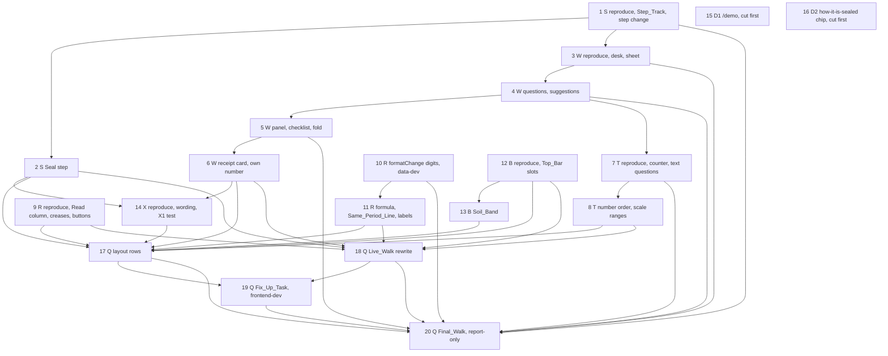

# Implementation Plan: 14 The write desk

## Overview

Spec 14 turns the Write and Seal steps of `/demo/live` into a letter on a desk beside its envelope (groups S and W), makes Testify show the author's questions the way they were written (T), and fixes the persona Read step and the receipts (R), the Top_Bar and the Scene's soil (B), wording and receipt defects (X), and `/demo` and `/how-it-is-sealed` (D, cut first). Group Q adds the layout rows, rewrites the Live_Walk, fixes the product failures they find (the Fix_Up_Task) and runs the Final_Walk. It plans no change under `src/lib/crypto/`, `src/lib/seal-format/`, `src/app/api/`, `src/lib/letter-store/`, `src/lib/db/` or `drizzle/`, so there is no crypto-dev task. One task (10) is data-dev, because `src/lib/figures/format-change.ts` is data-dev's.

The spec runs unattended once this file is committed. No task waits for an owner's look, approval or answer. Where something was unclear, the task text below decides it, and "Decisions made in this plan" at the end lists each decision. The requirements' "Decisions already made" and the design's "Corrections to the requirements" stay in force.

Order (G3.1): S, W, T, then R, B and X, then D, then Q. Task 19 is the Fix_Up_Task. The highest-numbered task (20) is the Final_Walk on merged `main`, and it depends on no group D task (G3.5).

| Group | Tasks | What | Roles |
|---|---|---|---|
| S, the Seal step and the step header | 1, 2 | Reproduce, budget baseline, Step_Track and the step change (1); Seal step layout, Backup_Cards, links, press envelope and Press_Status_Line (2) | frontend-dev |
| W, the Write step | 3, 4, 5, 6 | Reproduce, desk, header, Occasion pills, Letter_Sheet (3); Perforation, questions, suggestions (4); Envelope_Panel, checklist, Write_Check, Fold_Button (5); receipt card, Figure_Rows, own number (6) | frontend-dev |
| T, Testify | 7, 8 | Reproduce, counter, Wax_Disc, text questions, Nav_Row (7); number question order, scale ranges (8) | frontend-dev |
| R, Read step and receipts | 9, 10, 11 | Reproduce, Read column, creases, buttons (9); `formatChange` digits option (10); formula placement, change digits, Same_Period_Line, Number_Line property (11) | frontend-dev, data-dev |
| B, Top_Bar and Scene | 12, 13 | Reproduce, fixed Top_Bar slots, notice, Skip (12); Soil_Band off the text (13) | frontend-dev |
| X, smaller fixes | 14 | Reproduce, wording, double activation, the Q2.12 test | frontend-dev |
| D, `/demo` and `/how-it-is-sealed` (cut first) | 15, 16 | `/demo` alignment and the live card (15); Demo chip on `/how-it-is-sealed` (16) | frontend-dev |
| Q, verification | 17, 18, 19, 20 | Layout rows and retirements (17); Live_Walk rewrite (18); Fix_Up_Task (19); Final_Walk, report-only (20) | platform-dev, frontend-dev (19) |

Each task is one GitHub issue and one PR for one role. Each PR stays under `max_changed_lines` (5,000) as `.github/agents.json` counts it (test files and `package-lock.json` excluded), and inside its role's paths plus `shared` (G1.1, G3.1). Sub-tasks listed under a task belong to the same issue and PR. Estimated sizes: S about 300, M about 1,000, L about 2,000 changed lines. No task is expected to reach 5,000; a task that measures above 5,000 splits before the PR opens, into a first half that leaves `main` working and a second half with the next free number's dependencies.

Follow `design.md` in this folder for file names, constants, copy, values and algorithms, and `requirements.md` for the rules. Every rule of `.kiro/steering/` and of specs 02 to 13 still holds unless requirements.md "Rules this spec replaces" names it. The steering files win any conflict with this plan, the design or the requirements. "Depends on" lists only spec 14 task numbers (G1.2). No task waits for an open spec 13 task (12, 13, 18, 20 to 23); each task works on `main` as it is when the task starts.

## Queue order and dates

| Date | Gate |
|---|---|
| 19 November 2026 | Group S (tasks 1 and 2) merged. |
| 22 November 2026 | Group W (tasks 3 to 6) merged. |
| 23 November 2026 | Group T (tasks 7 and 8) merged. |
| 25 November 2026 | Groups R, B and X (tasks 9 to 14) merged. |
| 26 November 2026 | Group D (tasks 15 and 16) and Q tasks 17 and 18 merged. |
| 27 November 2026, 23:59 UTC | Feature freeze. Group D is the only cuttable work; whatever is merged on `main` at the freeze ships (G3.3). Fix_Up_Task (task 19) and Final_Walk (task 20) done. |

The dates are the plan; only the 27 November freeze is hard. The agent loop runs one run at a time in total, across every role, and takes the lowest-numbered ready issue whose dependencies are closed (G3.1). No two tasks run at once, data-dev's task 10 included, so the tasks run in number order from 1 to 20.

## Rules for every task

- **Branch and PR.** The dispatcher creates `agent/<role>/issue-N` and the PR "Closes #N". Do not push to `main` or merge. After a hook failure, make a new commit; do not amend.
- **Scope (G1.1).** Change only files that match your role's paths in `.github/agents.json` (or `shared`) and are listed in your task's Scope, plus new `*.test.ts(x)` files next to the code they test. Check your diff with `git diff --name-only origin/main` before you finish and put the list in a commit message body.
- **Hard boundaries (G1.3).** No task changes a file under `.kiro/`, `.github/`, `tools/agents/`, `tools/dispatcher/`, `tools/hooks/`, `src/lib/crypto/`, `src/lib/seal-format/`, `src/app/api/`, `src/lib/letter-store/`, `src/lib/db/` or `drizzle/`, or `scripts/check.sh`, `README.md` or `docs/video-script.md`. No task changes a crypto primitive, key step, header field or `format_version`, the Helm chart or an environment variable. Each task states this in a commit message body with the diff check above.
- **Privacy and size (G1.4).** CSP header byte-identical. No request to another origin. New code writes nothing to `localStorage`, `sessionStorage`, IndexedDB, cookies, the URL path, the query string or the fragment. No new `dependencies` entry, animation library, WebGL, font file, sound cue or vibration cue. The Occasion, the Receipt_Toggle view, the failed-fold flag and every disclosure state are memory only.
- **Copy (G1.5, G1.10).** Every string of Our_Copy lives in its feature folder's `copy.ts`, except the Occasion placeholders and suggestions (`occasions.ts`), the Short_Names (`short-names.ts`), and the literal tables `desk/short-units.ts` and `desk/short-publishers.ts`. Second person for sentences that address the reader (letter placeholders exempt), at most 25 words per sentence, no exclamation mark, no pun, nothing on `tone.md`'s avoid list, no Scoring_Words_Always, and no Scoring_Words_Scene in Scene copy modules. Every question default and suggestion names the sealing day and contains none of "right now", "today" or "currently". Each copy task states in a commit message body the result of `node tools/hooks/tone-check.mjs <file>` for every copy file it changed and of a search of the rendered Our_Copy of every page it changed showing no Retired_Phrase remains (G2.7).
- **Accent and contrast (G1.6, G1.7).** The Accent (#ff7b1c and its tints, #ff9a4d and #ff8f3d included) marks only the main buttons, the wax (the Wax_Disc and the seal's halo included), the focus ring, the reader's own answer, the selected Backup_Card, the current Step_Track step and the Press_Status_Line, as `tone.md` lists them. It never marks a figure, a change or a direction, and is never text on purple. Every text and number meets WCAG 2.2 AA on its surface. Decoration never sits under text.
- **Neutrality and data integrity.** Nothing scores, diffs, highlights, summarises or explains a gap between testimony and letter. Up and down get the same visual treatment. Every figure shown carries value, unit, region, period, source and `retrieved_at`, with its period next to it. Nothing is invented, estimated, converted or filled. The change is computed from full precision in `src/lib/figures`; only its display changes.
- **Motion (G1.8).** Decorative motion changes only `transform` and `opacity`, runs only under `prefers-reduced-motion: no-preference` with Calm_Mode off, and the step-change scroll is instant under reduced motion or Calm_Mode. No second Motion_Control.
- **JS budget (G1.9).** Every route stays inside `scripts/check-js-budget.mjs`, and no budget value changes. A task that would push `/demo/live` over 260 kB follows the design's ladder (section 6: `next/dynamic` for `SealStep` and `WriteDesk` per section, then for the section-`all` components), and reports any remaining overage in a commit message body instead of merging over budget.
- **Reports (G2.9).** Anything this spec or a task asks for "in the PR" or "in the PR description" goes in a commit message body on the task's branch, kept short: commit bodies are what reach the PR, and they are cut at 12,000 characters. No task edits the PR description or attaches files to the PR.
- **Reproduce first (G2.6).** The first task of each of groups S, W, T, R, B and X (tasks 1, 3, 7, 9, 12 and 14) starts with a step named "Reproduce". The reproduction is the task's first commit, made before any change: an empty commit (`git commit --allow-empty`) whose body names, for each symptom of its group, the component, the CSS rule or source line behind it, the measured numbers, and the `main` commit SHA they were measured on. It uses no screenshots from `main`.
- **Tests (G2.1, G2.2, G2.8).** Vitest, `renderToStaticMarkup`, every `fetch` stubbed, no network, `DATABASE_URL` unset, no browser (layout-check and the Live_Walk excepted). Property tests use fast-check with `numRuns` of at least 100 and the tag `// Feature: 14-write-desk, Property N: <title>`, with the title from design.md "Correctness Properties". Every size, colour and font value a task's requirements name is pinned by a CSS source test in the style of `src/components/ceremony/constants-css.test.ts` (sizes within 1 CSS px, colours with alpha exact, contrast ratios as at least the G1.7 threshold), or by a computed-style row that task 17 adds.
- **Evidence (G2.3, G2.5).** A commit message body (G2.9) states the final commit SHA, the exit status of `bash scripts/check.sh` and PASS or FAIL; every route budget from `node scripts/check-js-budget.mjs` after `npm run build`; and every earlier-spec test changed or retired, each with its reason. Write "none" for an empty list.
- **Screenshots (G2.4).** Screenshots are QA's. Dev agents attach none. For a change to a route's markup or CSS, the QA review takes PNG shots of every step, Stage or page the task changes at 1440×900 and 390×844, named `<step-or-page>-<width>x<height>.png`, the same set under `prefers-reduced-motion: reduce` named `<step-or-page>-<width>x<height>-reduced.png`, and one full-page capture per changed page at 390×844 without reduced motion named `<page>-390x844-full.png`. Phone shots are First_Viewport captures apart from the full-page one.
- **Layout rows between tasks.** `npm run layout-check` runs against a local production build (`npm run build` then `npm start`). The rows that assert rules this spec replaces (spec 13 `wFailures` column and paper widths, the Occasion heights, the receipt row heights, PH4's 56 px on the persona page, F3.4's notice count) may fail after tasks 3, 6 and 12 and before task 17 retires them. QA records each such failure as `EXPECTED: replaced by <requirement>` and it does not block. Any other row that fails blocks the PR. The new rows named in each task's "QA steps" are added by task 17; until then QA checks those values with the CSS source tests the task adds.
- **Live_Walk between tasks.** The Live_Walk steps that task 18 retires (the "Add a receipt" click, the Receipts_Disclosure own-number read, the lost-passkey checkbox, the Write-step "Next", "See the receipts" as the last step label) may fail after tasks 1, 2, 3, 5 and 6 and before task 18. QA records them as `EXPECTED: retired by task 18`. `npm run live-walk` is not part of `bash scripts/check.sh`.
- **QA (G2.8).** QA runs the tests, layout rows and Live_Walk lines the task lists, and quotes their result lines. A failed check makes the agent fix the code, never the threshold.
- **After the merge (G3.2).** `bash scripts/check.sh` passes on `main`. On a production build, `/`, `/demo`, `/demo/live`, `/how-it-is-sealed`, every persona page and `/l/<an id that does not exist>` each return a status below 500 and render with no uncaught page error at both Evidence_Sizes. QA checks this with `npm run layout-check` (which loads every one of those pages) and quotes the status lines.
- If `design.md` and the code on `main` disagree, re-read the code, keep the design's behaviour, and say what you changed and why in a commit message body. If something is still unclear, decide, record the decision in a commit message body under "Decisions", and continue. Do not stop to ask.

## Cut order (G3.3, G3.4)

Group D (tasks 15 and 16) is the only cuttable work. Whatever is merged on `main` at the 27 November 2026 freeze ships; any merged D work already passed G3.2. Nothing else in this spec is cut. Tasks 19 and 20 depend on no D task, so they run whether or not group D merged, and task 17's D rows report SKIP when `[data-live-entry-card]` is absent.

## Tasks

### Group S: the Seal step and the step header, target 18 to 19 November 2026

- [x] 1. S1, S2 · Reproduce, JS budget baseline, the Step_Track and the step change
  - Agent: `frontend-dev` · Depends on: none · Estimated size: M, ~1,100 changed lines · Target: 18 November 2026
  - Never cut.
  - Scope: `src/components/live/stepper/live-steps.ts`, `StepTrack.tsx` (new), `step-track.module.css` (new), `LiveStepper.tsx`, `stepper.module.css`, `src/components/live/stepper/StepIndicator.tsx` (deleted once nothing imports it), `src/components/live/SealPage.tsx` (its `h1` only), `src/components/live/copy.ts` (`receiptsStep`, `stepTrackPhone`), `src/components/ui/use-keep-in-visual-viewport.ts` (the optional `suspendUntil` ref only, if step 1 shows it is a cause), `src/components/ceremony/scene/TopBar.tsx` (setting `--topbar-clear` on every page, only if step 1 shows it is unset on `/demo/live`), and the `*.test.ts(x)` for each file. `src/components/ui/StepIndicator.tsx` stays if any other page imports it.
  - Design sections: "1.1 Step_Track (S1)", "1.2 The step change (S2)", "6. Cross-cutting" (JS budget), Correctness Property 1.
  - Steps:
    1. **Reproduce (G2.6, S2.5).** The task's first commit, before any code change, is an empty commit whose body records what follows, with the `main` SHA. On `main`, run `npm run build` and `node scripts/check-js-budget.mjs`, and record all five route numbers (`/`, `/demo`, `/demo/personas/[key]`, `/demo/live`, `/l/[id]`) as the spec's baseline (G2.5). On a local build of `main`, at both sizes measure the Top_Bar bottom, the computed `--topbar-clear`, the heading top 1,000 ms after Next and after Back, and `scrollY` over that second. Name which of the design's candidates causes the track and title to end under the Top_Bar: (a) the smooth `scrollIntoView` before the new step has its height, (b) `useKeepInVisualViewport` scrolling again on focus, (c) `--topbar-clear` unset on `/demo/live`. Also name the Seal step symptoms on `main` for task 2: the CSS rule that lets the press envelope overlap the text column at 1440 wide, and the `pressLine` constant in `WriteForm.tsx` that blanks the status line.
    2. Implement `stepTrackStates` and `StepTrack` with `data-step-indicator` and `data-step-track` on its root, so `[data-live-stepper] [data-step-indicator] [aria-current='step']` keeps working (Q1.2). `LIVE_STEP_NAMES[5]` becomes `LIVE_COPY.receiptsStep` ("Receipts"); `BRAND_COPY.ritualSteps` is unchanged (S1.1). The phone text is `aria-hidden` and not a live region; the one `role="status"` announcement stays (S1.4, S1.5).
    3. `LiveStepper` scrolls the Step_Track (not the heading) in a `useLayoutEffect` plus one `requestAnimationFrame`, with `scroll-margin-top: calc(var(--topbar-clear, 96px) + 24px)`, instant under reduced motion or Calm_Mode; it focuses `[data-step-heading]` with `preventScroll`; it draws its step-name `h2` only for `wait` (`stepperDrawsHeading`). Apply the fix for each cause step 1 named, and only those (S2.2 to S2.4).
    4. `SealPage` renders `LIVE_COPY.liveHeading` as its `h1` only when `view.step` is neither `write` nor `seal`. Until tasks 2 and 3 merge, the Write and Seal sections render a temporary `h1` with `data-step-heading` and `tabIndex={-1}` holding `stepName(step)`, so each step keeps exactly one `h1` and a focus target. Tasks 2 and 3 replace these with their own headings.
  - Acceptance:
    - [ ] 1.1 Implement `stepTrackStates`, `StepTrack`, `step-track.module.css` and the two `LIVE_COPY` keys
      - Six steps in one row, labels "Write", "Press the seal", "Wait", "Testify", "Break the seal", "Receipts"; 13 px Inter labels; 36 px by 1 px #3a3350 hairlines; current dot 12 px #ff7b1c with a 4 px rgba(255,123,28,.22) halo, label #ffffff weight 700, `aria-current="step"`; done dot 8 px #bdb4dc with #bdb4dc label; future dot 8 px #3a3350 with #8f86ad label; `data-state` on each step; below 600 px "Step {n} of 6 · {label}" with the dots and no per-step labels.
      - _Requirements: S1.1, S1.2, S1.3, S1.4, S1.5_
    - [ ] 1.2 Implement the step change in `LiveStepper` and the `SealPage` heading rule
      - _Requirements: S2.2, S2.3, S2.4, S2.5_
    - [ ] 1.3 Write property test for the Step_Track states
      - `src/components/live/stepper/step-track.property.test.ts`: `// Feature: 14-write-desk, Property 1: The Step_Track marks one current step`
      - Required (Q2.5).
      - **Validates: Requirements S1.1, S1.3, S1.5, Q2.5**
    - [ ] 1.4 Write markup and CSS source tests
      - `StepTrack.test.tsx`: six `li`, one `aria-current`, the phone text `aria-hidden`, exactly one `role="status"`. `step-track-css.test.ts`: every S1.1, S1.2 value. `LiveStepper.test.tsx`: no step-name `h2` on Write and Seal, an `h2` on Wait, one `h1` per step.
      - _Requirements: S1.1–S1.5, S2.3, G2.8_
  - Earlier-spec tests changed or retired: `StepIndicator` tests and `stepper/indicator.property.test.ts` (S1 replaces the look; retired with `StepIndicator.tsx` if it is deleted); `live-steps.test.ts` for the last label ("Receipts"); `LiveStepper.test.tsx` and `LiveStepper.e2e.test.tsx` for the `h2` on Write and Seal; `SealPage.test.tsx` for the `h1`; name each with the reason.
  - Copy evidence (G2.7): tone-check for `src/components/live/copy.ts`; Retired_Phrase search of every rendered `/demo/live` step.
  - QA shots: `write-*`, `seal-*` and `wait-*` at the four Evidence_Sizes after the change, and `demo-live-390x844-full.png`.
  - QA steps: `npx vitest run src/components/live/stepper`; `npm run layout-check` (existing rows; replaced rows as in "Layout rows between tasks"); the S1, S2.2 and S2.3 rows run in task 17.
  - Validation: `bash scripts/check.sh` (SHA, exit status, PASS or FAIL); the five route budgets after `npm run build`, with the baseline from step 1.
  - _Requirements: S1, S2, G2.5, G2.6_

- [x] 2. S3 to S6, X1.3 · The Seal step: layout, Backup_Cards, links, press envelope and Press_Status_Line
  - Agent: `frontend-dev` · Depends on: 1 · Estimated size: L, ~2,000 changed lines · Target: 19 November 2026
  - Never cut. `press-hold.ts`, `hold.ts`, `seal-machine.ts` and `useSealFlow.ts` keep their behaviour; `usePressEnvelope.ts` changes only to receive `instant`.
  - Scope: `src/components/live/seal-step/SealStep.tsx`, `SealLinks.tsx`, `press-status.ts`, `seal-step.module.css` (all new); `src/components/live/BackupChoice.tsx`, `backup-choice.module.css` (new; the `.backupChoice*` rules move out of `live.module.css`); `src/components/live/press/PressEnvelope.tsx`, `press.module.css`, `press/copy.ts`, `usePressEnvelope.ts` (props only); `src/components/live/WriteForm.tsx` (section `seal` only), `SealPage.tsx` (the temporary Seal `h1` from task 1 removed), `live.module.css` (rule moves only), `src/components/live/copy.ts`; and the `*.test.ts(x)` for each file.
  - Design sections: "1.3 The Seal step", "1.4 The Backup_Choice as two cards", "1.5 The Press_Envelope and its status line", Correctness Property 2.
  - Steps:
    1. `pressStatusLine` and `envelopeCaption` as pure functions, with the design's table. While the crypto module has not loaded and a choice is made, the line keeps the `write` text for the motion setting (design decision). `PRESS_COPY.chooseFirst` becomes "Choose a backup option first." (X1.3, S6.7); new `PRESS_COPY.holdToSeal` and `pressToSeal`.
    2. `BackupChoice` as a `fieldset` with legend `LIVE_COPY.backupChoiceLegend` = "If you lose this passkey" (X1.3) and two Backup_Cards (`label` wrapping a visually hidden native radio, custom `aria-hidden` circle, title as name, help line as description), with the selected, focus-visible and disabled looks; the S4.5 behaviour of spec 13 P7.2 to P7.6 unchanged.
    3. `SealStep` in two grid columns at 900 px and wider (520 px text column, 64 px gap, vertical centres aligned), one column below 900 px with text first. The text column holds the `h1` `LIVE_COPY.sealHeading` "Press the seal." (with `data-step-heading`, `tabIndex={-1}`), `LIVE_COPY.sealParagraph` exactly as S3.3, `LIVE_COPY.warning` as plain body text (`data-warning-text`), `BackupChoice`, the PRF-missing fallback button, and `SealLinks`. No eyebrow, no intro, no `SealPage` `h1`, no step-name `h2`, no `passkeySteps`, no `StepStatus` (S3, S6.6).
    4. `SealLinks`: "Opening on another device?" (`aria-expanded`, toggles `LIVE_COPY.crossDevice`) and "← Back to the letter" (arrow `aria-hidden`, disabled in place while `onBack` is undefined), both text controls, never orange (S5).
    5. `PressEnvelope` gains `caption`, `ready` and `tone`; the press CSS takes the S6.1 to S6.5 values (envelope `min(440px, 100cqi)`, aspect 1.55, #f1e4c8, 6 px radius, the shadow, the flap triangle, the 112 px seal at 440 scaled in proportion, 40 % opacity and `not-allowed` while unready, the double halo while ready, no halo under reduced motion or Calm_Mode). `instant` is passed when the motion setting is not `full` (S6.9). The accessible name stays "Press the seal" (S6.2).
    6. At 390×844, if the Warning_Text box and the seal box do not fit one 844 px window at a single scroll offset (S3.4), reduce the gaps (cards 10 px apart, links line 12 px) before moving anything else. Record the measured numbers in a commit message body.
  - Acceptance:
    - [ ] 2.1 Implement `press-status.ts` and the `PRESS_COPY` keys
      - _Requirements: S6.2, S6.6, S6.7, X1.3_
    - [ ] 2.2 Write property test for the Press_Status_Line
      - `src/components/live/seal-step/press-status.property.test.ts`: `// Feature: 14-write-desk, Property 2: The Press_Status_Line is never empty and follows its table`
      - Required (Q2.6).
      - **Validates: Requirements S6.6, S6.7, Q2.6**
    - [ ] 2.3 Implement the Backup_Cards and their copy
      - _Requirements: S4.1–S4.7, X1.3_
    - [ ] 2.4 Implement `SealStep`, `SealLinks`, the `PressEnvelope` props and CSS, and wire WriteForm section `seal`
      - _Requirements: S3.1–S3.5, S5.1–S5.6, S6.1–S6.5, S6.8, S6.9_
    - [ ] 2.5 Write markup, CSS source and contrast tests
      - `SealStep.test.tsx` (column order, paragraph exact, no "Each time, you press a button first.", Warning_Text outside any `details`, one `h1`, one Accent-filled button); `BackupChoice.test.tsx` (two labels wrapping radios, help ids, none checked at first, disabled while running); `SealLinks.test.tsx` (`aria-expanded`, "←" hidden, Back disabled without `onBack`); `PressEnvelope.test.tsx` (caption not in the accessible name, `data-ready`, `data-tone`, line never empty); `seal-step-css.test.ts` and `backup-choice-css.test.ts` for every S3 to S6 value; the contrast pairs #bdb4dc on #15111f, #bdb4dc on the selected Backup_Card tint, #ff9a4d on #0b0912 in `src/components/live/contrast.test.ts`.
      - _Requirements: S3, S4, S5, S6, G2.8_
  - Earlier-spec tests changed or retired: `press/seal-step-copy.test.ts` and `PressEnvelope.test.tsx` (the blank line and the old `chooseFirst` text); `BackupChoice.test.tsx` (markup); `WriteForm.sections.test.tsx` and `WriteForm.test.tsx` for section `seal` (the section `all` assertions stay); `live/copy.test.ts` where `passkeySteps` is read for `/demo/live`; name each with the reason.
  - Copy evidence (G2.7): tone-check for `live/copy.ts` and `live/press/copy.ts`; Retired_Phrase search of the rendered Seal step.
  - QA shots: `seal-*` before a choice and after "Skip it", `seal-setting-*` and `seal-failure-*` at the four Evidence_Sizes, and `demo-live-390x844-full.png`.
  - QA steps: `npx vitest run src/components/live/seal-step src/components/live/press src/components/live/BackupChoice.test.tsx`; `npm run layout-check` (spec 13 `p1Failures` must still pass: one orange control on the Seal step); the S3.1, S3.4, S6.1, S6.4 to S6.8 rows run in task 17.
  - Validation: `bash scripts/check.sh`; route budgets after `npm run build` (`/demo/live` at most 260 kB; ladder if short).
  - _Requirements: S3, S4, S5, S6, X1.3_

### Group W: the Write step, target 20 to 22 November 2026

- [x] 3. W1 to W5, W3, X1.4 · Reproduce, the desk, the header, the Occasion pills and the Letter_Sheet
  - Agent: `frontend-dev` · Depends on: 1 · Estimated size: L, ~1,900 changed lines · Target: 20 November 2026
  - Never cut. Runs after task 2 in number order; both edit `WriteForm.tsx`, in different section branches.
  - Scope: `src/components/live/desk/WriteDesk.tsx`, `StepHeader.tsx`, `OccasionPills.tsx`, `LetterSheet.tsx`, `SheetDate.tsx`, `use-local-day.ts`, `sheet-date.ts`, `copy.ts`, `desk.module.css`, `sheet.module.css` (all new); `src/components/live/occasions.ts` (placeholders, `applyOccasionQuestions`); `src/components/live/phone.ts` (`deskLetterHeightPx`); `src/components/live/WriteForm.tsx` (section `write` only, plus the `/demo/live` sealing day); `SealPage.tsx` (the temporary Write `h1` from task 1 removed); `src/components/live/copy.ts` (`occasionLabels.blank`); `src/components/ceremony/scene/SceneBackdrop.tsx` (the `--light-x` value for `/demo/live` only, if step 1 shows the glow crosses text); and the `*.test.ts(x)` for each file.
  - Design sections: "2.1 `WriteDesk` and the Step_Container", "2.2 Occasion pills", "2.3 Letter_Sheet and Letter_Field", "Corrections to the requirements" (local sealing day), Correctness Properties 3, 5 and 6.
  - Steps:
    1. **Reproduce (G2.6).** The task's first commit, before any code change, is an empty commit whose body records, from a local build of `main` and with its SHA, the measured numbers below and, for each Write symptom (the cream form panel, the two-column grid rule `.liveWrite:has(> .occasions)`, the underlined Occasion options, the starter written into the letter by `applyOccasion`, the Letter_Field box), the component and the CSS rule or source line. Measure the Scene glow's centre and whether it crosses a text box at both sizes (S2.1). Measure the EB Garamond baseline in the Letter_Field with a `Range` on the first, a middle and the last visible line, for `--rule-offset` (W5.2).
    2. `WriteForm` section `write` returns `WriteDesk` inside the Step_Container (`max-width: 1240px`, 32 px side padding, centred). The row is a wrapping flex row with a 32 px gap, `flex: 999 1 620px` for the sheet and `flex: 1 1 340px` for the panel (W1.1, W1.2, W1.4, W1.5).
    3. **Interim panel.** Until tasks 4, 5 and 6 merge, the desk keeps today's `AuthorQuestions` inside the Letter_Sheet below the field, and today's `ReceiptsDisclosure` and action row ("Add a receipt", "Next") in the panel column, so the step still works on `main` after this merge. Tasks 4, 5 and 6 replace these. No dead code is left after task 6.
    4. `StepHeader` with the eyebrow (`LIVE_COPY.liveHeading` shown in capitals by CSS), the `h1` `DESK_COPY.heading` (56 px, 36 px on a Phone, `data-step-heading`, `tabIndex={-1}`) and the intro; `OccasionPills` with "Start from", five `aria-pressed` pills in the W3.1 order, "A blank page" selected at first, and the phone sideways scroll. `/demo/live` no longer renders `LIVE_COPY.occasionLegend`.
    5. `applyOccasionQuestions` changes only question rows; the desk dispatches `OCCASION_APPLIED` with the text unchanged. `applyOccasion` stays for `/seal`. Placeholders take the Decisions' strings (shared with `/seal`, whose markup does not change). `occasionLabels.blank` becomes "A blank page" (X1.4).
    6. `LetterSheet` with the W4 values, the top row (salutation and `SheetDate`), the ruled `textarea#live-letter` (W5 values, `background-attachment: local`, `--rule-offset` from step 1), the visually hidden label "Your letter", no `maxlength`, the bottom row ("— me, today" and the grouped count), and the problem line under it. `deskLetterHeightPx` drives the field height. `SheetDate` renders an empty fixed-height slot on the server and fills it after mount, with no hydration warning.
    7. On `/demo/live` the sealing day used by the Write_Check and the own number is `useLocalDay().day`, falling back to the UTC day before mount. `/seal` keeps the UTC day (design "Corrections").
  - Acceptance:
    - [ ] 3.1 Implement the `occasions.ts` changes and `occasionLabels.blank`
      - _Requirements: W3.3, W3.4, W3.6, W5.4, X1.4_
    - [ ] 3.2 Implement `sheet-date.ts`, `use-local-day.ts` and `deskLetterHeightPx`
      - _Requirements: W4.2, W4.3, W5.3, W12.2_
    - [ ] 3.3 Implement `WriteDesk`, `StepHeader`, `OccasionPills`, `LetterSheet`, `SheetDate`, `DESK_COPY` and the two CSS modules, and wire WriteForm section `write`
      - _Requirements: S2.1, W1.1–W1.5, W2.1–W2.4, W3.1, W3.2, W3.5, W4.1–W4.4, W5.1–W5.5_
    - [ ] 3.4 Write property test for Occasion picks
      - `src/components/live/desk/occasion-questions.property.test.ts`: `// Feature: 14-write-desk, Property 3: Occasion picks never change the letter or an edited row`
      - Required (Q2.1). Rows that equal a suggestion are added once task 4 adds suggestions; until then the generator covers empty, typed and Occasion-equal rows.
      - **Validates: Requirements W3.3, W3.4, W8.3, Q2.1**
    - [ ]* 3.5 Write property test for the letter field height
      - `src/components/live/desk/letter-height.property.test.ts`: `// Feature: 14-write-desk, Property 5: The letter field height stays between its floor and its cap`
      - **Validates: Requirements W5.3**
    - [ ]* 3.6 Write property test for the sheet and dated formatters
      - `src/components/live/desk/sheet-date.property.test.ts`: `// Feature: 14-write-desk, Property 6: The date formatters name the calendar day of the instant` (the `formatSheetDate`, `formatDatedDay` and `localCalendarDay` parts; task 7 adds `formatWrittenOn`)
      - **Validates: Requirements W4.2, W12.2**
    - [ ] 3.7 Write markup and CSS source tests
      - `OccasionPills.test.tsx` (five pills in order, `aria-pressed`, blank selected, no `occasionLegend`); `LetterSheet.test.tsx` (salutation, sign-off and date not in the textarea value, empty date slot in server HTML, "1,234" and "5,012 of 5,000 characters", no `maxlength`, problem line linked by `aria-describedby`); `StepHeader.test.tsx` (one `h1`, eyebrow text "Seal your own letter"); `desk-css.test.ts` and `sheet-css.test.ts` for every W1 to W5 value, and that no desk module sets `font-synthesis: none`; the contrast pairs #6b5f51, #4a4036 and #1f1b16 on #f6ead4 in `live/contrast.test.ts`.
      - _Requirements: W1–W5, G2.8_
  - Earlier-spec tests changed or retired: `occasions.test.ts` (placeholders, "Blank" label); `OccasionPicker.test.tsx` only where the label text is read; `WriteForm.occasions.test.tsx`, `WriteForm.sections.test.tsx`, `WriteForm.test.tsx`, `write-fit.test.ts` for section `write` (the section `all` assertions stay); `letter-field.module.test.ts` if it reads the desk; name each with the reason.
  - Copy evidence (G2.7): tone-check for `live/copy.ts`, `live/desk/copy.ts` and `live/occasions.ts`; Retired_Phrase search of the rendered Write step.
  - QA shots: `write-*` at the four Evidence_Sizes with each of "A blank page" and "Work" chosen, and `demo-live-390x844-full.png`.
  - QA steps: `npx vitest run src/components/live/desk src/components/live/occasions.test.ts`; `npm run layout-check` (spec 13 `wFailures` column and paper widths and the Occasion heights: `EXPECTED: replaced by W1, W3, W4`); the W1 to W5 rows run in task 17.
  - Validation: `bash scripts/check.sh`; route budgets after `npm run build`.
  - _Requirements: S2.1, W1–W5, X1.4, G2.6_

- [x] 4. W6 to W8 · The Perforation, the question rows and the suggestions
  - Agent: `frontend-dev` · Depends on: 3 · Estimated size: M, ~1,200 changed lines · Target: 21 November 2026
  - Never cut.
  - Scope: `src/components/live/desk/QuestionSection.tsx`, `QuestionRow.tsx`, `WaxDisc.tsx`, `SuggestionPills.tsx`, `suggestions.ts`, `icons.tsx` (all new); `desk/LetterSheet.tsx`, `desk/copy.ts`, `desk/sheet.module.css`; `src/components/live/occasions.ts` (`suggestions`, `SHARED_SUGGESTIONS`); `src/components/live/write-draft.ts` (`QUESTION_ADDED` with `text`); `src/components/live/copy.ts` (only if `authorQuestionLabel` does not read "Question {n}"); and the `*.test.ts(x)` for each file.
  - Design sections: "2.4 Perforation and Question_Section", Correctness Properties 3 and 4.
  - Steps:
    1. The Perforation from edge to edge of the sheet (negative inline margins equal to `--sheet-pad-x`), 36 px below the bottom row or the problem line and 32 px above the Question_Section (W6.1).
    2. `QuestionSection` with the legend, the intro, rows 22 px apart, `nothingToTestify` once under the rows and nowhere else on the step, and with no rows still the legend, intro and pills (W6.2 to W6.6). It replaces the interim `AuthorQuestions` from task 3 on the desk; `AuthorQuestions` stays for `/seal`.
    3. `QuestionRow` with the Wax_Disc, the growing one-row `textarea` (EB Garamond italic 21 px, the bottom border, solid on hover and focus), the `aria-hidden` "Edit" with no Tab stop that focuses the input with the caret at the end, the placeholder, the Lock_Line referenced by `aria-describedby`, and the spec 13 W4 "Remove" (W7).
    4. Each Occasion gets at least two `suggestions` and the module gets `SHARED_SUGGESTIONS`, all naming the sealing day, none equal to an Occasion question. `suggestionsFor` and `SuggestionPills` ("Ask another:", up to two pills, "+ Write my own", "+ " hidden, names "Add the question: {text}" and "Write my own"); "Three is the most a letter holds." at three rows. A suggestion row counts as edited (W8).
  - Acceptance:
    - [ ] 4.1 Implement the suggestion lists, `suggestionsFor` and `QUESTION_ADDED` with text
      - _Requirements: W8.3, W8.4, W8.5, G1.10_
    - [ ] 4.2 Implement the Perforation, `QuestionSection`, `QuestionRow`, `WaxDisc`, `SuggestionPills` and the icons, and wire them into `LetterSheet`
      - _Requirements: W6.1–W6.6, W7.1–W7.7, W8.1, W8.2, W8.6, W8.7_
    - [ ]* 4.3 Write property test for the suggestions
      - `src/components/live/desk/suggestions.property.test.ts`: `// Feature: 14-write-desk, Property 4: Suggestions skip existing rows and keep list order`
      - **Validates: Requirements W8.1, W8.5**
    - [ ] 4.4 Write the Occasion copy example test
      - `src/components/live/desk/occasions-desk.test.ts`: every suggestion matches the spec 10 `SEALING_DAY_ANCHOR` pattern, has none of "right now", "today" or "currently", is at most 200 characters and equals no Occasion question; each Occasion has at least two; each placeholder has at most 12 words. Extend the Property 3 generator from task 3.4 with suggestion rows.
      - Required (Q2.4).
      - _Requirements: W5.4, W8.5, G1.10, Q2.4_
    - [ ] 4.5 Write markup and CSS source tests
      - `QuestionSection.test.tsx` and `QuestionRow.test.tsx` (legend, intro, Edit `aria-hidden` with no `tabIndex`, Lock_Line in `aria-describedby`, "Remove question {n}", the limit line at three rows, pills with no rows, `nothingToTestify` once); `SuggestionPills.test.tsx` (names, hidden "+ "); `sheet-css.test.ts` additions for every W6 to W8 value (the Wax_Disc included).
      - _Requirements: W6, W7, W8, G2.8_
  - Earlier-spec tests changed or retired: `stepper/WriteStep.questions.test.tsx` and `WriteForm.questions.test.tsx` for section `write`; `AuthorQuestions.test.tsx` only where it asserts the `/demo/live` render; `write-draft.test.ts` for `QUESTION_ADDED`; name each with the reason.
  - Copy evidence (G2.7): tone-check for `live/desk/copy.ts` and `live/occasions.ts` (and `live/copy.ts` if changed); Retired_Phrase search of the rendered Write step.
  - QA shots: `write-questions-*` with zero, one and three rows at the four Evidence_Sizes, and `demo-live-390x844-full.png`.
  - QA steps: `npx vitest run src/components/live/desk src/components/live/write-draft.test.ts`; `npm run layout-check` (replaced rows as in "Layout rows between tasks"); the W6 to W8 rows run in task 17.
  - Validation: `bash scripts/check.sh`; route budgets after `npm run build`.
  - _Requirements: W6, W7, W8, Q2.4_

- [ ] 5. W9, W13 · The Envelope_Panel, the checklist, the Write_Check and the Fold_Button
  - Agent: `frontend-dev` · Depends on: 4 · Estimated size: M, ~1,300 changed lines · Target: 21 November 2026
  - Never cut.
  - Scope: `src/components/live/desk/EnvelopePanel.tsx`, `InTheEnvelopeCard.tsx`, `FoldButton.tsx`, `checklist.ts`, `write-check.ts`, `panel.module.css` (all new); `desk/WriteDesk.tsx`, `desk/copy.ts`; `src/components/live/WriteForm.tsx` (section `write`: the old Next and its checks call `writeCheck`); `src/components/live/SealPage.tsx` (stops passing the Rehearsal_Line as `footer` for section `write`); and the `*.test.ts(x)` for each file.
  - Design sections: "2.5 Envelope_Panel and the 'In the envelope' card", "2.6 The Write_Check", Correctness Properties 7, 8 and 9.
  - Steps:
    1. `writeCheck` and `firstFailingField` as pure functions calling `validateWrite` (`warningTicked: true`, `backupCardTicked: false`) and `selfReportedRowsOk`, never reading the figures request status. `WriteForm` section `write` uses it for the step's move to Seal.
    2. `envelopeChecklist` and `wordCount`. Until task 6 merges, the own-number input is the first self-reported row of the interim `ReceiptsDisclosure`.
    3. `EnvelopePanel` (20 px column; sticky through `data-sticky` from a `ResizeObserver` only while the panel fits under the Top_Bar and shares a line with the sheet), `InTheEnvelopeCard` (eyebrow, the 150 px small envelope with the 52 px Blank_Signet `WaxSeal` at 35 % until `writeCheck(...).ok`, three Checklist_Lines with `aria-hidden` markers, the phone line below 600 px, not a live region), `FoldButton` (56 px #ff7b1c pill, #ff8f3d on hover, `aria-hidden` arrow, "Check the note above, then try again." after a failed fold, cleared once the check passes), and the Rehearsal_Line once under it.
    4. A failed fold marks every write field touched, shows each field's message, sets the summary, and focuses the first failing field in page order (letter, question rows, receipt fields; a nothing-to-testify failure focuses row 0 or "+ Write my own"). The switch to the own view or the phone `details` is wired in task 6. No draft text is lost (W13.3).
    5. The Fold_Button replaces the interim "Next" from task 3. The interim "Add a receipt" stays until task 6.
  - Acceptance:
    - [ ] 5.1 Implement `checklist.ts` and `write-check.ts`
      - _Requirements: W9.4, W9.5, W9.7, W13.2, W13.3_
    - [ ] 5.2 Write property test for the checklist
      - `src/components/live/desk/checklist.property.test.ts`: `// Feature: 14-write-desk, Property 7: The checklist states exactly what is in the envelope`
      - Required (Q2.2).
      - **Validates: Requirements W9.5, W9.6, W9.7, W9.8, Q2.2**
    - [ ] 5.3 Write property test for seal readiness
      - `src/components/live/desk/write-check.property.test.ts`: `// Feature: 14-write-desk, Property 8: The seal is ready exactly when the fold would pass`. Keep a frozen copy of the `ba2cd6c` Next condition in the test file as the model.
      - Required (Q2.3).
      - **Validates: Requirements W9.4, W13.2, Q2.3**
    - [ ]* 5.4 Write property test for the failed-fold target
      - Same file: `// Feature: 14-write-desk, Property 9: A failed fold targets the first failing field in page order`
      - **Validates: Requirements W13.3**
    - [ ] 5.5 Implement `EnvelopePanel`, `InTheEnvelopeCard`, `FoldButton` and `panel.module.css`, and wire them into `WriteDesk`
      - _Requirements: W1.3, W1.6, W9.1–W9.4, W9.6, W9.8, W13.1, W13.3, W13.4, W13.5_
    - [ ] 5.6 Write markup and CSS source tests
      - `InTheEnvelopeCard.test.tsx` (markers `aria-hidden`, no live region, `data-ready` follows `writeCheck`, phone line present); `FoldButton.test.tsx` (arrow `aria-hidden`, summary only after a failure); `EnvelopePanel.test.tsx` (Rehearsal_Line once on the step); `panel-css.test.ts` for every W9 and W13 value, and that #ff7b1c, #ff8f3d and `rgba(255,123,28,…)` appear only in the Fold_Button, marker and focus-ring selectors; contrast pairs #0b0912 on #ff7b1c and on #ff8f3d.
      - _Requirements: W9, W13, G1.6, G2.8_
  - Earlier-spec tests changed or retired: `WriteForm.test.tsx`, `WriteForm.sections.test.tsx` for the section `write` Next; `rehearsal-line.property.test.ts` for the line's place on the Write step; `write-validation.property.test.ts` only if it imports from the moved checks; name each with the reason.
  - Copy evidence (G2.7): tone-check for `live/desk/copy.ts`; Retired_Phrase search of the rendered Write step.
  - QA shots: `write-*` empty, ready and after a failed fold at the four Evidence_Sizes, and `demo-live-390x844-full.png`.
  - QA steps: `npx vitest run src/components/live/desk`; `npm run layout-check` (replaced rows as in "Layout rows between tasks"); the W1.3, W1.6, W9 and W13 rows run in task 17.
  - Validation: `bash scripts/check.sh`; route budgets after `npm run build`.
  - _Requirements: W1.3, W1.6, W9, W13, Q2.2, Q2.3_

- [ ] 6. W10 to W12, X1.2 · The "Tuck in a receipt" card, the Figure_Rows and the own number
  - Agent: `frontend-dev` · Depends on: 5 · Estimated size: L, ~2,000 changed lines · Target: 22 November 2026
  - Never cut.
  - Scope: `src/components/live/desk/ReceiptPanel.tsx`, `ReceiptToggle.tsx`, `FigureRows.tsx`, `OwnNumberView.tsx`, `figure-row-text.ts`, `short-units.ts`, `short-publishers.ts` (all new); `src/components/live/SourceDetailsList.tsx` (new, shared by `FigurePicker` and `FigureRows`); `src/components/live/FigurePicker.tsx` (uses `SourceDetailsList`, markup unchanged); `desk/WriteDesk.tsx`, `desk/EnvelopePanel.tsx`, `desk/copy.ts`, `desk/panel.module.css`; `src/components/live/catalogue-list.ts` (`periodType`, `source` on `PickableSeries`); `src/components/live/write-draft.ts` (`OWN_NUMBER_CHANGED`, `ownNumberMissing`); `src/components/live/WriteForm.tsx` (section `write`: the interim `ReceiptsDisclosure` and "Add a receipt" removed); `src/components/live/copy.ts` (`figuresHint`, `figuresHintOne`); and the `*.test.ts(x)` for each file.
  - Design sections: "2.7 Receipt_Card_Panel", "Control boundaries (G1.7)", Correctness Property 10.
  - Steps:
    1. Read the exact `source` strings of `CATALOGUE` in `src/lib/figures/catalogue.ts` for the `SHORT_PUBLISHERS` keys. `shortUnit`, `shortPublisher`, `figureRowPeriod` ("week of {day} {Mon}" for a weekly YYYY-MM-DD period), `sourcesLine` and `figureRowName` as pure functions.
    2. `ReceiptPanel`: the title row, the intro line, `ReceiptToggle` ("A public price" active at first), both views mounted with `hidden`. Below 600 px a native `details` closed by default with the summary "Tuck in a receipt (optional)" and no repeated title. Decide how the phone `details` is rendered, and record it in a commit message body: by default render both forms and hide one with CSS so the server HTML and first paint match; if that cannot keep a single accessibility tree, switch after mount with `PHONE_QUERY` and record the choice. Loading and failed figures show as a `role="status"` line, and the fold never waits (W10).
    3. `FigureRows`: the hint (`figuresHint` "Choose up to {max}.", `figuresHintOne` "You can choose 1.", X1.2), the Picker_Note once, the rows in catalogue order with no region headings, the limit line, the sources line and the Details disclosure with `SourceDetailsList` and `REVEAL_COPY.asPublished`. Each Figure_Row is a full-width `aria-pressed` button with the 18 px square (1.5 px #6d6488 border unselected), Short_Name with the fixture label after it, region and period (and the fallback retrieved date) on the second line, value and short unit on the right; selected is white (1.5 px white border, rgba(245,243,255,.06) tint), never the Accent; focus shows only the ring; blocked rows are `aria-disabled` and keep their colours (W11).
    4. `OwnNumberView` with the four labelled inputs, "Dated {date}" (the local sealing day), "Marked self-reported. Revenant doesn't check it.", `selfReportedMissing` naming only the empty ones of the four, no add, remove or limit control, no bar or pseudo-element beside a control. `OWN_NUMBER_CHANGED` keeps exactly one row and dates it the sealing day only when used (W12).
    5. The failed fold (task 5) now switches the toggle to the own view or opens the phone `details` first when the failing field is there (W13.3). The `/demo/live` Write step renders no `receiptsAction`, `receiptsSummary`, "Receipts" heading or second way to add a receipt (W10.2).
  - Acceptance:
    - [ ] 6.1 Implement the tables, `figure-row-text.ts` and the `PickableSeries` fields
      - _Requirements: W11.2, W11.7, W11.8_
    - [ ] 6.2 Implement `OWN_NUMBER_CHANGED` and `ownNumberMissing`
      - _Requirements: W12.3, W12.4_
    - [ ] 6.3 Implement `ReceiptPanel`, `ReceiptToggle`, `FigureRows`, `SourceDetailsList` and `OwnNumberView`, wire them into the panel and the failed fold, and set `figuresHint` and `figuresHintOne`
      - _Requirements: W10.1–W10.6, W11.1–W11.8, W12.1, W12.2, W12.5, W12.6, W13.3, X1.2, X2.2_
    - [ ]* 6.4 Write property test for the own number
      - `src/components/live/desk/own-number.property.test.ts`: `// Feature: 14-write-desk, Property 10: The own number is one row, dated the sealing day only when used`
      - **Validates: Requirements W12.3, W12.4**
    - [ ] 6.5 Write example, markup and CSS source tests
      - `figure-row-text.test.ts` (every catalogue source has a `SHORT_PUBLISHERS` entry; today's line reads "Sources: U.S. EIA · EU Weekly Oil Bulletin."; "week of 9 Nov"; the accessible name holds the full unit and own region); `ReceiptPanel.test.tsx` (one "Tuck in a receipt", no "Add a receipt", no `receiptsSummary`, no "Receipts" heading, both views mounted); `FigureRows.test.tsx` (catalogue order, no region heading, Picker_Note once, Details `aria-expanded`); `OwnNumberView.test.tsx` (four labels and placeholders, no add or remove, the self-reported line); `panel-css.test.ts` additions for every W10 to W12 value, the pressed rule keyed on `aria-pressed` and never `:focus`, no `::before`, `::after`, `border-left` or `border-right` on `.own*`; the contrast pairs for #bdb4dc on the selected Figure_Row tint and the #6d6488 square on #0b0912.
      - _Requirements: W10, W11, W12, X2.2, G2.8_
  - Earlier-spec tests changed or retired: `ReceiptsDisclosure.test.tsx` and `receipts-focus.test.ts` (they keep testing `/seal` only); `figure-hint.test.ts` and `FigurePicker.test.tsx` for the hint strings; `SelfReportedRows.test.tsx` only where it asserts the `/demo/live` render; `catalogue-list.test.ts` for the new fields; `write-draft.test.ts` and `self-reported-blank.property.test.ts` for `OWN_NUMBER_CHANGED`; name each with the reason.
  - Copy evidence (G2.7): tone-check for `live/desk/copy.ts`, `live/desk/short-units.ts`, `live/desk/short-publishers.ts` and `live/copy.ts`; Retired_Phrase search of the rendered Write step.
  - QA shots: `write-receipt-*` with the public view (none chosen, one chosen, at the limit, Details open) and with the own view filled and partly filled, at the four Evidence_Sizes, plus the phone `details` closed and open, and `demo-live-390x844-full.png`.
  - QA steps: `npx vitest run src/components/live`; `npm run layout-check` (the receipt row heights: `EXPECTED: replaced by W11, W12`); the W10 to W12 and X2.1 rows run in task 17.
  - Validation: `bash scripts/check.sh`; route budgets after `npm run build` (`/demo/live` at most 260 kB; ladder if short).
  - _Requirements: W10, W11, W12, X1.2, X2.2_

### Group T: Testify, target 22 to 23 November 2026

- [ ] 7. T1 · Reproduce, the counter, the Wax_Disc and the text questions
  - Agent: `frontend-dev` · Depends on: 4 · Estimated size: M, ~1,000 changed lines · Target: 22 November 2026
  - Never cut. Depends on task 4 for `desk/WaxDisc.tsx`.
  - Scope: `src/components/ceremony/recall/written-on.ts`, `NavRow.tsx` (new); `RecallPager.tsx`, `RecallPager.module.css`, `TextAnswerField.tsx`, `RecallReader.tsx`, `RecallReader.module.css`; `src/components/reveal/RecallStep.tsx` (passes `writtenOn`); `src/components/reveal/copy.ts` (`questionCounterWrittenOn`, `answerFromMemory`); and the `*.test.ts(x)` for each file. `desk/WaxDisc.tsx` is imported, not edited.
  - Design sections: "3.1 The counter", "3.2 The question and the field", Correctness Property 6.
  - Steps:
    1. **Reproduce (G2.6).** The task's first commit, before any code change, is an empty commit whose body names, from a local build of `main` and with its SHA, the component and source line behind each T1 and T2 symptom (the plain question `h2`, the counter, the Next inside the answer row, the "Read as" line) on a Live_Letter's text question and on Maya's and Tomás's number questions, with the measured numbers.
    2. `formatWrittenOn`; the counter "Question {n} of {total} · you wrote this on {date}" for live and real letters (`data-recall-counter`), `questionCounterAsOf` byte-identical for personas (T1.2).
    3. The question `h2` with the Wax_Disc 16 px left of the EB Garamond italic 26 px text, the accessible name equal to the question text (T1.3); for text questions the visible label "Your answer, from memory" with the field named by the question then the label, and focus as today (T1.4); under the field the count and error, "No answer", then `NavRow` (main button right-aligned on every question, "Previous question" left from question 2 on), then `submitFailed` (T1.5).
    4. `RecallReader` with the same counter (as-of form), Wax_Disc and question style, no answer label, and the fictional label kept (T1.7). If the fit at 390×844 fails for a 200-character question, apply the design's 390 rules (T1.6).
  - Acceptance:
    - [ ] 7.1 Implement `formatWrittenOn` and the two `REVEAL_COPY` keys
      - _Requirements: T1.2, T1.4_
    - [ ] 7.2 Implement the counter, the question style, the text answer label, `NavRow` for text questions and `RecallReader`
      - _Requirements: T1.1–T1.8_
    - [ ]* 7.3 Write property test for the written-on date
      - Extend `src/components/live/desk/sheet-date.property.test.ts` (or add `src/components/ceremony/recall/written-on.property.test.ts` if task 3.6 was skipped): `// Feature: 14-write-desk, Property 6: The date formatters name the calendar day of the instant`, with the `formatWrittenOn` part.
      - **Validates: Requirements W4.2, W12.2, T1.2**
    - [ ] 7.4 Write markup, fit and CSS source tests
      - `RecallPager.text.test.tsx` (counter forms, disc `aria-hidden`, heading name equals the text, the label and the field name order, Nav_Row on question 1 with the main button only); `RecallReader.test.tsx` (no answer label, fictional label kept, the as-of counter); `RecallPager.fit.test.ts` extended for a 200-character question at 390×844; a CSS source test for the Wax_Disc and `.qText` values.
      - _Requirements: T1, G2.8_
  - Earlier-spec tests changed or retired: `RecallPager.text.test.tsx`, `RecallPager.labels.test.tsx`, `RecallPager.primary.test.tsx` and `RecallPager.live-order.test.tsx` for the counter, the label and the Next position on text questions; `TextAnswerField.test.tsx` for `aria-labelledby`; `RecallReader.test.tsx`; name each with the reason.
  - Copy evidence (G2.7): tone-check for `reveal/copy.ts`; Retired_Phrase search of the rendered Testify step of a Live_Letter and a persona letter.
  - QA shots: `testify-text-*` (live), `testify-reader-*` (the text persona) at the four Evidence_Sizes, and `demo-live-390x844-full.png`.
  - QA steps: `npx vitest run src/components/ceremony/recall src/components/reveal`; `npm run layout-check`; the T1.6 row runs in task 17.
  - Validation: `bash scripts/check.sh`; route budgets after `npm run build`.
  - _Requirements: T1, G2.6_

- [ ] 8. T2, T3 · Number questions in one order, and a scale range for every unit
  - Agent: `frontend-dev` · Depends on: 7 · Estimated size: M, ~800 changed lines · Target: 23 November 2026
  - Never cut.
  - Scope: `src/components/ceremony/recall/RecallPager.tsx`, `RecallPager.module.css`, `NavRow.tsx`, `unit-ranges.ts`; `src/components/ceremony/copy.ts` (`parsedValue` removed); and the `*.test.ts(x)` for each file.
  - Design sections: "3.3 Number questions", "3.4 Scale ranges".
  - Steps:
    1. Reorder the number branch to T2.1. The main button moves from the answer row into `NavRow` (T2.5). Remove the `parsedValue` paragraph and its id from `aria-describedby`, and delete `CEREMONY_COPY.parsedValue` (T2.3). The Recall_Scale label shows the value when the field resolves and no value while ambiguous or unreadable.
    2. If the persona number question with its Sample_Note does not fit the 390×844 First_Viewport, apply the design's fit rules (`.navRow` margin-top 16 px, the intro at 15 px below 600 px) (T2.5).
    3. Add a literal `UNIT_RANGE_TABLE` entry, keyed by the exact displayed string, for every displayed unit the Q2.10 test (8.3) finds missing, each with a linear range from 0 to the next round number above the highest bundled value of that unit. Lookup stays exact. Update the module comment to name the keys. `FALLBACK_RANGE` stays (T3.1 to T3.4).
  - Acceptance:
    - [ ] 8.1 Implement the number question order, `NavRow` for number questions and the `parsedValue` removal
      - _Requirements: T2.1–T2.5_
    - [ ] 8.2 Implement the `UNIT_RANGE_TABLE` entries
      - _Requirements: T3.1, T3.2, T3.3, T3.4_
    - [ ] 8.3 Write the scale range tests
      - `unit-ranges.test.ts`: every displayed unit from `CATALOGUE` (`displayUnitFor(metric.unit)`) and from every persona's sealed metrics in `content/personas/personas.json` and its bundled payload data has an own key; every bundled real value and every persona figure value, after rescale, lies within its range; a source scan shows `unit-ranges.ts` imports only `@/lib/figures/rescale` and reads no `value` property.
      - Required (Q2.10).
      - _Requirements: T3.1, T3.2, T3.3, T3.5, Q2.10_
    - [ ] 8.4 Write markup and fit tests
      - `RecallPager.field.test.tsx` and `RecallPager.sample.test.tsx`: T2.1 DOM order, no `parsedValue` text or id, no button in the answer row, the Nav_Row main button on question 1; `RecallPager.fit.test.ts` for every persona number question with its Sample_Note at 390×844.
      - _Requirements: T2.1, T2.3, T2.5_
  - Earlier-spec tests changed or retired: `RecallPager.field.test.tsx`, `RecallPager.primary.test.tsx`, `RecallPager.property.test.tsx`, `RecallPager.sample.test.tsx` for the answer row's Next (spec 10 C1.5) and the "Read as" line (spec 08); `ceremony/copy.test.ts` and `copy-exact.property.test.ts` for `parsedValue`; `unit-ranges.test.ts` and `scale-math-range.test.ts` for "exactly these two keys"; name each with the reason.
  - Copy evidence (G2.7): Retired_Phrase search of the rendered Testify step (no copy is added; one key is removed).
  - QA shots: `testify-number-*` for Maya and Tomás and for a one-figure Live_Letter at the four Evidence_Sizes.
  - QA steps: `npx vitest run src/components/ceremony`; `npm run layout-check`; the T2.1 and T2.5 rows run in task 17.
  - Validation: `bash scripts/check.sh`; route budgets after `npm run build`.
  - _Requirements: T2, T3_

### Group R: the persona Read step and the receipts, target 23 to 25 November 2026

- [x] 9. R1 to R3 · Reproduce, the Read step column, the creases and the two buttons
  - Agent: `frontend-dev` · Depends on: none · Estimated size: M, ~600 changed lines · Target: 24 November 2026
  - Never cut.
  - Scope: `src/components/ceremony/letter/LetterBlock.tsx`, `LetterBlock.module.css`; `src/components/ceremony/ceremony.module.css` (the letter Stage rule only); `src/components/reveal/Reveal.tsx` (button classes only), `reveal.module.css` (`.outlineButton`); and the `*.test.ts(x)` for each file.
  - Design sections: "4.1 The persona Read step".
  - Steps:
    1. **Reproduce (G2.6, R1.1).** The task's first commit, before any code change, is an empty commit whose body records, from a local build of `main` and with its SHA, the measured column width and crease boxes of Maya's Read step at the four Evidence_Sizes, and names the CSS rule that holds the letter column at about 440 px at 1440×900, the `.crease` rule (`left: 0; right: 0`) that crosses the text, and the shared `styles.button` that makes `stage2Next` look disabled.
    2. At 900 px and wider the letter Stage centres the column (`justify-items: center`, `.sheet` `width: min(680px, 100%)`), within 8 px of the Scene_Frame's centre and at least 600 px wide at 1440×900; below 900 px spec 08 R3.3 stays; the Ghost still leaves and moves the column by no more than 1 px (R1).
    3. Each crease becomes two segments (`data-crease="left"` and `"right"`) in the side padding at 1/3 and 2/3 of the paper height, using `--letter-pad-x`; no segment where the padding is under 8 px. If the padding never resolves under 8 px, say so and omit the container rule (R2).
    4. `stage2Next` takes `buttons.primary` from `ui/buttons.module.css`; `showAll` takes `.outlineButton` (transparent, #ffffff text, 1 px #8f86ad border, at least 44 px). Handlers unchanged (R3).
  - Acceptance:
    - [ ] 9.1 Implement the centred column and the crease segments
      - _Requirements: R1.1–R1.3, R2.1, R2.2_
    - [ ] 9.2 Implement the two button styles
      - _Requirements: R3.1–R3.3_
    - [ ] 9.3 Write markup and CSS source tests
      - `LetterBlock.test.tsx` (two segments per crease, `data-crease` left and right); a CSS source test for the column width, the crease positions and both button styles; the contrast pairs #0b0912 on #ff7b1c and #8f86ad on #0b0912 in `ceremony/contrast.test.ts`.
      - _Requirements: R1.2, R2.1, R3, G2.8_
  - Earlier-spec tests changed or retired: `LetterBlock.test.tsx` and `LetterBlock.spacing.test.ts` for the full-width crease; `light-shaft.test.tsx` only if it reads the column width; any `Reveal` test that reads `styles.button` on these two controls; name each with the reason.
  - Copy evidence (G2.7): none, no copy changes.
  - QA shots: `read-*` for Maya and Tomás at the four Evidence_Sizes, before and after the ghost leaves, and `persona-maya-390x844-full.png`.
  - QA steps: `npx vitest run src/components/ceremony/letter src/components/reveal`; `npm run layout-check`; the R1.2, R2.2 and R3 rows run in task 17.
  - Validation: `bash scripts/check.sh`; route budgets after `npm run build`.
  - _Requirements: R1, R2, R3, G2.6_

- [x] 10. R5.1 to R5.3 · `formatChange` gets a `differenceDigits` option
  - Agent: `data-dev` · Depends on: none · Estimated size: S, ~150 changed lines · Target: 23 November 2026
  - Never cut. This is the only data-dev task in the spec.
  - Scope: `src/lib/figures/format-change.ts` and `src/lib/figures/format-change.test.ts`.
  - Design sections: "4.2 Receipts" (R5, data-dev).
  - Steps:
    1. Add the optional third argument `options?: { differenceDigits?: number }`. With it set, the difference magnitude is formatted at that many fraction digits. Without it, output is byte-identical to today, so every existing caller is unchanged.
    2. The sign and direction word still come from the exact `result.difference`: an exact `"0"` gives "unchanged" and no sign; a non-zero difference that rounds to zero keeps its sign. The percentage is unchanged. No `Number(`, `parseFloat` or unary `+` on a value is added.
  - Acceptance:
    - [ ] 10.1 Implement the `differenceDigits` option
      - _Requirements: R5.1, R5.2, R5.3_
    - [ ] 10.2 Write the example tests
      - `format-change.test.ts`: "+0.00" with "rose" for 3.001 − 3.000 at 2 digits; "0.00" with no sign and "unchanged" for an exact zero; unchanged output when the option is absent, for every existing case; the existing `no-number.test.ts` source scan still passes.
      - _Requirements: R5.1, R5.2, R5.3_
  - Earlier-spec tests changed or retired: none.
  - Copy evidence (G2.7): none, no copy changes.
  - QA shots: none (no route markup or CSS changes).
  - QA steps: `npx vitest run src/lib/figures`.
  - Validation: `bash scripts/check.sh`; route budgets after `npm run build`.
  - _Requirements: R5.1, R5.2, R5.3_

- [x] 11. R4 to R7 · Formula under the source, change at the shown precision, the Same_Period_Line, Number_Line labels
  - Agent: `frontend-dev` · Depends on: 10 · Estimated size: M, ~1,300 changed lines · Target: 25 November 2026
  - Never cut.
  - Scope: `src/components/reveal/FormulaLine.tsx`, `formula.ts`, `same-period.ts` (new); `ChangeLine.tsx`, `ReceiptCard.tsx`, `FigureEntry.tsx`, `FiguresThenNow.tsx`, `receipt-kind.ts`, `change-display.ts` (only if the readable formula lives there today), `reveal.module.css`, `reveal/copy.ts` (`samePeriodWeek`, `samePeriodMonth`, `samePeriodOther`); `src/components/ceremony/figures/line-labels.ts` (only if Property 15 finds a failing case); and the `*.test.ts(x)` for each file.
  - Design sections: "4.2 Receipts" (R4, R5 frontend, R6, R7), Correctness Properties 11 to 15.
  - Steps:
    1. `ChangeLine` passes `differenceDigits` = `displayPrecisionForUnit(shownUnit)` or else the larger fraction-digit count of the two shown values (after the display rescale), and drops its formula paragraph (R4.1, R5.2).
    2. `readableFormula` moves to `formula.ts` and `FormulaLine` renders it as the next sibling after the Source `details`, outside it, with one `checkAtSource` link per distinct `source_url` or the series ID where none was sealed. `FigureEntry` builds `ChangeLine` and `FormulaLine` from one `formatChange` call (R4.2, R5.4).
    3. `receiptKindFor` gains `same_period` for a Same_Figure on a live or real letter (persona keeps `single`, spec 12 Z2), and `showsChangeLine`. `FiguresThenNow` passes `letterKind` and draws the same-period card: both rows, the `NumberLine` as on a compared card, `samePeriodLine(then.period)`, no change line, no formula, no `nothingToCompare`. A same-period pair with different values stays not comparable (R7).
    4. Run Property 15. If it finds a collision, fix `placeLineLabels` in `line-labels.ts`, keeping it a pure function (R6).
  - Acceptance:
    - [ ] 11.1 Implement `formula.ts`, `FormulaLine`, the `ChangeLine` digits and the `ReceiptCard` formula slot
      - _Requirements: R4.1, R4.2, R5.2, R5.4_
    - [ ] 11.2 Implement `same_period`, `showsChangeLine`, `samePeriodLine` and the same-period card
      - _Requirements: R7.1–R7.4_
    - [ ] 11.3 Write property test for the displayed change
      - `src/components/reveal/change-digits.property.test.ts`: `// Feature: 14-write-desk, Property 11: The displayed change has the shown precision and the exact sign`
      - Required (Q2.7).
      - **Validates: Requirements R5.1, R5.2, R5.3, Q2.7**
    - [ ]* 11.4 Write property test for the formula
      - `src/components/reveal/formula.property.test.ts`: `// Feature: 14-write-desk, Property 12: The formula shows the inputs and the displayed result`
      - **Validates: Requirements R4.1, R5.4**
    - [ ] 11.5 Write property test for the change line rule
      - `src/components/reveal/receipt-kind.property.test.ts`: `// Feature: 14-write-desk, Property 13: The change line shows only for comparable, different figures`
      - Required (Q2.8).
      - **Validates: Requirements R7.1, R7.4, Q2.8**
    - [ ]* 11.6 Write property test for the same-period line
      - `src/components/reveal/same-period.property.test.ts`: `// Feature: 14-write-desk, Property 14: The same-period line reads the sealed period string`
      - **Validates: Requirements R7.2**
    - [ ] 11.7 Write property test for the Number_Line labels, and fix `line-labels.ts` if it fails
      - `src/components/ceremony/figures/line-labels.property.test.ts`: `// Feature: 14-write-desk, Property 15: Number_Line labels never collide` (three labels, the third covering "No answer", coincident points included)
      - Required (Q2.9).
      - **Validates: Requirements R6.1, R6.2, Q2.9**
    - [ ] 11.8 Write markup tests
      - `ChangeLine.test.tsx` (no formula text); `ReceiptCard.test.tsx` (the formula after the Source `details` and outside it, visible while closed; the same-period card with no change line, no formula and no `nothingToCompare`, both periods and sources shown).
      - _Requirements: R4, R7.1, R7.3_
  - Earlier-spec tests changed or retired: `ChangeLine` and `ReceiptCard` tests for the formula position; `receipt-kind` tests for the new kind; any spec 12 Z2 test that asserts the Single_Figure_View on a Live_Letter (now the same-period card); name each with the reason.
  - Copy evidence (G2.7): tone-check for `reveal/copy.ts`; Retired_Phrase search of the rendered receipts Stage of a persona and a Live_Letter.
  - QA shots: `receipts-*` for Maya and Tomás (compared) and for a one-figure Live_Letter (same period) at the four Evidence_Sizes, and `persona-maya-390x844-full.png`.
  - QA steps: `npx vitest run src/components/reveal src/components/ceremony/figures`; `npm run layout-check`; the R6.1 row runs in task 17.
  - Validation: `bash scripts/check.sh`; route budgets after `npm run build`.
  - _Requirements: R4, R5.2, R5.4, R6, R7, Q2.7, Q2.8, Q2.9_

### Group B: the Top_Bar and the Scene, target 24 to 25 November 2026

- [x] 12. B1 · Reproduce, one fixed Top_Bar
  - Agent: `frontend-dev` · Depends on: none · Estimated size: M, ~900 changed lines · Target: 24 November 2026
  - Never cut. Runs after task 1 in number order; both may touch `TopBar.tsx`.
  - Scope: `src/components/ceremony/scene/TopBar.tsx`, `scene.module.css` (Top_Bar rules only); `src/components/ceremony/intro/TestifyContext.tsx`, `PersonaIntro.tsx`, `intro.module.css` (the notice removed); and the `*.test.ts(x)` for each file.
  - Design sections: "4.3 The Top_Bar (B1)".
  - Steps:
    1. **Reproduce (G2.6).** The task's first commit, before any code change, is an empty commit whose body records, from a local build of `main` and with its SHA, for every persona Stage and every `/demo/live` step at the four Evidence_Sizes and at 360×640, the x and width of the wordmark, chip, notice, Calm, sound and Skip on each, naming the rules that move them (`topBarShowsNotice`, the conditional Skip, `soundIsLast`), and the three places that render the persona notice (`TopBar`, `TestifyContext` `.testifyNotice`, `PersonaIntro` `.notice`). For task 13, also measure the soil strip and canvas boxes against text at the top, half and end scroll offsets on every B2.1 page and name the rule that lets them meet.
    2. Slots in B1.1 order with `data-topbar-slot`; `controls="none"` renders no Calm, sound or Skip. Skip always rendered: enabled with Enter and Space while a sequence runs, a native `disabled` button at 40 % opacity out of the Tab order otherwise; `data-topbar-last` on Skip (B1.3).
    3. `topBarShowsNotice` is true for every Stage and width on a persona page; `TestifyContext` and `PersonaIntro` stop rendering the notice; the fictional label on the persona's pre-written answers stays (B1.4).
    4. Fixed slot boxes (chip, Calm, sound, Skip `flex: none`, notice `flex: 1`); below 600 px on the persona page the notice takes the bar's second line, keeping the controls' x position; at most 96 px tall on the persona page at 360×640 and 390×844, at most 56 px on every other page at the Phone_Sizes (B1.2, B1.5). If the persona bar exceeds 96 px, shorten the bar's inner gaps, never the notice wording.
  - Acceptance:
    - [ ] 12.1 Implement the slots, the Skip slot and the notice in the bar
      - _Requirements: B1.1–B1.5_
    - [ ] 12.2 Write the Top_Bar markup test
      - `src/components/ceremony/scene/topbar-slots.test.tsx`: for every Stage of a persona page and for `/`, `/demo`, `/demo/live` and `/how-it-is-sealed`, the slots in B1.1 order with Skip present and `disabled` when no sequence is registered; the persona page renders `personaNoticeText` exactly once and never inside `TestifyContext` or `PersonaIntro`; the `/l/[id]` Top_Bar renders no Calm, sound or Skip. For `/how-it-is-sealed` this test asserts the slot order and the disabled Skip; the Demo chip and no-backdrop assertions are task 16's (D2.1), in `src/app/how-it-is-sealed/page.test.tsx`.
      - Required (Q2.11).
      - _Requirements: B1.1, B1.3, B1.4, Q2.11_
    - [ ] 12.3 Write CSS source tests
      - The disabled Skip at 40 % opacity; `flex: none` on the fixed slots; no rule that changes a slot's box by Stage or sequence.
      - _Requirements: B1.2, B1.3, G2.8_
  - Earlier-spec tests changed or retired: `topbar-skip-marks.test.tsx`, `topbar-phone-placement.test.ts`, `topbar-sound.test.tsx`, `topbar-clear.test.ts` (Skip and the notice); `TestifyContext.test.tsx` and `PersonaIntro.test.tsx` (the notice, spec 07 R8.3 and spec 11 P3); `persona-scene.test.tsx` if it counts the notice; name each with the reason.
  - Copy evidence (G2.7): none, no copy changes (the notice wording is unchanged).
  - QA shots: `topbar-*` for every persona Stage and `/demo/live` step at the four Evidence_Sizes and 360×640.
  - QA steps: `npx vitest run src/components/ceremony/scene src/components/ceremony/intro`; `npm run layout-check` (PH4's 56 px on the persona page and F3.4's notice count: `EXPECTED: replaced by B1.5, B1.4`); the B1.2, B1.4 and B1.5 rows run in task 17.
  - Validation: `bash scripts/check.sh`; route budgets after `npm run build`.
  - _Requirements: B1, Q2.11, G2.6_

- [x] 13. B2 · The Soil_Band stays out from behind text
  - Agent: `frontend-dev` · Depends on: 12 · Estimated size: S, ~400 changed lines · Target: 25 November 2026
  - Never cut. `src/app/page.tsx` is not edited (platform-dev).
  - Scope: `src/components/ceremony/scene/scene.module.css` (soil rules and `--soil-clear`), `SoilStrip.tsx`, `SoilCanvasLoader.tsx`, `SceneShell.tsx`, `SceneBackdrop.tsx` (position or size only), and the `*.test.ts(x)` for each file.
  - Design sections: "4.4 Soil_Band (B2)".
  - Steps:
    1. Use the measurements and the named rule from task 12 step 1. Reserve the band's drawn height plus 16 px at the bottom of the Scene content (`--soil-clear`), and on pages whose content is taller than the viewport move the band from `position: fixed` to `position: absolute; bottom: 0` of the Scene root, so text never sits on it at the top, half or end scroll offsets (B2.1). Keep `/` as it is if it already passes.
    2. Change only position or size: colours, jagged edge, `aria-hidden` and motion stay byte-identical (B2.2).
  - Acceptance:
    - [ ] 13.1 Implement the Soil_Band position and bottom reserve
      - _Requirements: B2.1, B2.2_
    - [ ] 13.2 Write CSS source tests
      - The soil colour and edge declarations byte-identical to `main`; `aria-hidden` kept on `SoilStrip` and the canvas; `--soil-clear` applied.
      - _Requirements: B2.2, G2.8_
  - Earlier-spec tests changed or retired: `soil-constants.test.ts`, `soil-canvas-start.test.ts`, `scene-frame.test.ts`, `phone-stage-clearance.test.ts` and `intact-clearance.test.ts` if they read the soil position; name each with the reason.
  - Copy evidence (G2.7): none, no copy changes.
  - QA shots: `soil-*` of `/`, `/demo`, each `/demo/live` step before the reveal, every persona Stage and `/l/[id]`, at the top and end scroll offsets, at the four Evidence_Sizes.
  - QA steps: `npx vitest run src/components/ceremony/scene`; `npm run layout-check`; the B2.1 row runs in task 17.
  - Validation: `bash scripts/check.sh`; route budgets after `npm run build`.
  - _Requirements: B2_

### Group X: smaller fixes, target 25 November 2026

- [ ] 14. X1, X2 · Reproduce, wording fixes, double activation and the X1 test
  - Agent: `frontend-dev` · Depends on: 2, 6 · Estimated size: S, ~500 changed lines · Target: 25 November 2026
  - Never cut.
  - Scope: `src/components/live/copy.ts` (`busyBody`); any `src/components/**/copy.ts` reachable from `/demo/live` or `/demo` that holds "Demo 1" or "Demo 2" (for example `src/components/demo/copy.ts`); `src/components/live/live.module.css` (only the rule behind the stray bar, if step 1 shows it is shared CSS); `src/components/live/desk/*.tsx` and `desk/*.module.css` (only for an X2.1 defect or a W12.5 failure step 1 finds); and the `*.test.ts(x)` for each file.
  - Design sections: "4.5 Wording and receipt defects".
  - Steps:
    1. **Reproduce (G2.6, X2.3).** The task's first commit, before any code change, is an empty commit whose body records the following, measured on a local build of the task's starting commit, with its SHA. On `/seal`, which still renders `SelfReportedRows`, open "Add a number of your own" and name the element and the CSS rule behind the stray vertical bar beside it, with its measured box at both sizes, and whether that rule is shared CSS. Then, on `/demo/live`, activate each Write-step control twice and record the result per the design's X2.1 table, naming any control whose second activation changes nothing.
    2. `LIVE_COPY.busyBody` becomes "The live demo is busy right now. Nothing was sealed. Try again later." (shown on `/demo/live` and `/seal`) (X1.1).
    3. Search every Our_Copy string reachable from `/demo/live` and `/demo` for "Demo 1" and "Demo 2", and reword each in its own module with the same meaning (X1.6).
    4. Fix every X2.1 defect step 1 found. If the stray bar's cause is shared CSS, fix it there; otherwise `/seal` keeps its markup and CSS. Confirm W12.5 holds on the new Own_Number_View, and state in a commit message body how it was checked (X2.3).
  - Acceptance:
    - [ ] 14.1 Implement `busyBody`, the "Demo 1"/"Demo 2" rewording and any X2.1 fix
      - _Requirements: X1.1, X1.6, X2.1, X2.3_
    - [ ] 14.2 Write the X1 test
      - `src/components/live/x1-copy.test.tsx`: `busyBody`, `figuresHint`, `figuresHintOne`, `PRESS_COPY.chooseFirst`, `backupChoiceLegend` and `occasionLabels.blank` equal their X1.1 to X1.4 strings exactly; `WriteForm` sections `write` and `seal` render none of `receiptsAction`, `receiptsSummary`, `answerInLetter`, `authorQuestionAdd`, `occasionLegend` or `passkeySteps`, while section `all` still renders every one it rendered at `ba2cd6c` (listed in a fixture taken from that commit), `passkeySteps` unchanged; no Our_Copy string on `/demo/live` or `/demo` contains "Demo 1" or "Demo 2".
      - Required (Q2.12).
      - _Requirements: X1.1–X1.6, Q2.12_
  - Earlier-spec tests changed or retired: `SealFailure.test.tsx` and `SealFailure.real.test.tsx` for `busyBody`; `demo/copy.test.ts` if a "Demo 1"/"Demo 2" string is reworded; name each with the reason.
  - Copy evidence (G2.7): tone-check for every copy file changed; Retired_Phrase search of every rendered `/demo/live` step and `/demo`.
  - QA shots: `seal-own-number-*` (`/seal` with "Add a number of your own" open), `write-receipt-own-*` (the Own_Number_View), `seal-busy-*` (the `SealFailure` busy screen) and `demo-*` at the four Evidence_Sizes, and `demo-390x844-full.png`.
  - QA steps: `npx vitest run src/components/live src/components/demo`; `npm run layout-check`; the X2.1 row runs in task 17.
  - Validation: `bash scripts/check.sh`; route budgets after `npm run build`.
  - _Requirements: X1, X2, Q2.12, G2.6_

### Group D: `/demo` and `/how-it-is-sealed` (cut first), target 26 November 2026

Group D is the only cuttable work (G3.3): whatever is merged on `main` at the freeze ships. Nothing outside group D depends on it.

- [x] 15. D1 · `/demo` lines up and offers the live demo as a card
  - Agent: `frontend-dev` · Depends on: none · Estimated size: S, ~400 changed lines · Target: 26 November 2026
  - **Cuttable (with task 16).** Group D is the only cuttable work; whatever is merged at the 27 November 2026 freeze ships.
  - Scope: `src/app/demo/page.tsx`, `src/app/demo/page.module.css`; `src/components/demo/LiveEntry.tsx`, `LiveEntry.module.css`, `PersonaCard.module.css` (only to expose the paper and button classes for `composes`); and the `*.test.ts(x)` for each file.
  - Design sections: "5. Group D".
  - Steps:
    1. Measure on a local build of `main` the left edges of `DemoLabel`, `h1`, the intro note, the persona list and `LiveEntry` against `[data-wordmark]` at both sizes, and record them in a commit message body.
    2. The page's inline padding uses the Top_Bar's `--frame-pad-x`, so all five left edges equal the wordmark's within 1 px (D1.1).
    3. `LiveEntry` becomes the last `li` of the persona list with `data-live-entry-card`, composing the persona card's paper class; `liveEntryHeading`, `liveEntryBody`, then `liveEntryLink` as an `a href="/demo/live"` composing the persona card's orange button class, working with JavaScript off; no envelope and no wax (D1.2). `/demo` stays at or under 160 kB, with no horizontal scroll at 390 and 1440 (D1.3).
  - Acceptance:
    - [ ] 15.1 Implement the alignment and the `LiveEntry` card
      - _Requirements: D1.1, D1.2, D1.3_
    - [ ] 15.2 Write markup tests
      - `LiveEntry.test.ts` and `src/app/demo/page.test.tsx`: the card is the last `li`, the link is an `a` to `/demo/live`, no `WaxSeal` or envelope in the card, heading, body and link in that order.
      - _Requirements: D1.2_
  - Earlier-spec tests changed or retired: `LiveEntry.test.ts` and `src/app/demo/page.test.tsx` for the text-link layout; name each with the reason.
  - Copy evidence (G2.7): none, no copy changes.
  - QA shots: `demo-*` at the four Evidence_Sizes, and `demo-390x844-full.png`.
  - QA steps: `npx vitest run src/components/demo src/app/demo`; `npm run layout-check`; the D1.1 to D1.3 rows (task 17) run once this merges.
  - Validation: `bash scripts/check.sh`; route budgets after `npm run build` (`/demo` at most 160 kB).
  - _Requirements: D1_

- [x] 16. D2 · `/how-it-is-sealed` carries the Demo chip
  - Agent: `frontend-dev` · Depends on: none · Estimated size: S, ~60 changed lines · Target: 26 November 2026
  - **Cuttable (with task 15).** Group D is the only cuttable work; whatever is merged at the 27 November 2026 freeze ships.
  - Scope: `src/app/how-it-is-sealed/page.tsx` and `src/app/how-it-is-sealed/page.test.tsx`.
  - Design sections: "5. Group D".
  - Acceptance:
    - [ ] 16.1 Render `<SceneShell variant="plain" demo>` and test it
      - The Top_Bar shows `SCENE_COPY.demoChip` in its slot; the page gains no backdrop, Soil_Band or Ghost. `page.test.tsx` asserts the chip in the B1.1 chip slot and the absence of `[data-soil-strip]`, the canvas and the Ghost. This is the `/how-it-is-sealed` part of the Q2.11 markup test.
      - _Requirements: D2.1, Q2.11_
  - Earlier-spec tests changed or retired: `src/app/how-it-is-sealed/page.test.tsx` if it asserts no chip; name it with the reason.
  - Copy evidence (G2.7): none, no copy changes.
  - QA shots: `how-it-is-sealed-*` at the four Evidence_Sizes.
  - QA steps: `npx vitest run src/app/how-it-is-sealed src/components/ceremony/scene/topbar-slots.test.tsx`.
  - Validation: `bash scripts/check.sh`; route budgets after `npm run build`.
  - _Requirements: D2.1_

### Group Q: verification, target 26 to 27 November 2026

- [ ] 17. Q1.1, Q1.2 · Layout-check rows and the retirements
  - Agent: `platform-dev` · Depends on: 2, 6, 8, 9, 11, 12, 13, 14 · Estimated size: L, ~1,800 changed lines · Target: 26 November 2026
  - Never cut. Does not depend on task 15 or 16: the D rows report SKIP when `[data-live-entry-card]` is absent.
  - Scope: `tools/qa/layout-check.mjs`, and the tests that cover it (`tools/qa/*.test.*` where they exist, or `src/test/**`).
  - Design sections: "Testing Strategy" (layout rows table, retired or changed rows).
  - Steps:
    1. Add one row per rule, named after its requirement, reading the design's data attributes, after `document.fonts.ready`, at the Evidence_Sizes (plus 360×640 for B1.2 and B1.5, and 1055 and 1056 wide for W1.4 and W1.5): **S1**, **S2.2**, **S2.3**, **S3.1**, **S3.4**, **S6.1**, **S6.4 to S6.7** (one row per state reachable without a passkey, plus the states the Live_Walk reaches), **S6.8**, **W1 to W13** (every size, colour, font and order the requirements name; the sticky panel; the ruled-line baseline gap at three lines before and after an internal scroll; the Perforation ends against the sheet edges; no Accent fill or border on any desk button except the Fold_Button; no horizontal scroll), **T1.6**, **T2.1**, **T2.5**, **R1.2**, **R2.2**, **R3**, **R6.1** (every persona and one live letter), **B1.2**, **B1.4**, **B1.5**, **B2.1** (top, half and end scroll on every listed page), **X2.1** (each desk control activated twice), and **D1.1 to D1.3** (SKIP when the card is absent).
    2. Retire or change, each with its reason in a commit message body: spec 13 `wFailures` column and paper widths (replaced by W1, W4), the Occasion heights (W3), the receipt row heights (W11, W12), PH4's 56 px limit on the persona page (B1.5; every other page keeps 56 px), and F3.4's notice count (now text equal to `personaNoticeText`, B1.4).
    3. Each failure message names its requirement. Colours compare exactly including alpha; sizes within 1 CSS px; contrast as at least the G1.7 threshold (G2.8).
    4. A row that fails on the merged state of the tasks it depends on because of a product file is a product failure. List each one in the commit notes under the heading "For task 19", with the row name, its output and the suspected file (Q1.7). This task does not edit product files and does not lower a threshold.
  - Acceptance:
    - [ ] 17.1 Add the Q1.1 rows and make the Q1.2 retirements in `layout-check.mjs`
      - A product failure a new row finds is listed under "For task 19" and does not fail this task's QA; only a broken row does (Q1.7).
      - _Requirements: Q1.1, Q1.2, Q1.7, G2.8, G3.2_
    - [ ] 17.2 Write unit tests for the new check functions
      - Each new pure check function (box intersection, slot stability, baseline gap, colour match, contrast threshold) gets an example test with a passing and a failing input, in the style of the existing check tests.
      - _Requirements: Q1.1_
  - Earlier-spec tests changed or retired: the layout-check tests whose asserted rows change (spec 11 and 12 Write-step rows, spec 13 `wFailures`, PH4, F3.4); name each with the reason.
  - Copy evidence (G2.7): none, no copy changes.
  - QA shots: none (rows only).
  - QA steps: `npm run layout-check` against a local production build of the PR branch, with every row's result line quoted; D rows show SKIP or PASS. A FAIL line caused by a product file passes QA when it is listed under "For task 19" in the commit notes. QA fails the task only for a broken row: one that errors, cannot run, or checks something other than its requirement (Q1.7).
  - Validation: `bash scripts/check.sh`; `npm run layout-check`.
  - _Requirements: Q1.1, Q1.2, Q1.7_

- [ ] 18. Q1.3, Q1.4 · Live_Walk rewrite for the desk, the Seal step and the new checks
  - Agent: `platform-dev` · Depends on: 2, 6, 8, 9, 11, 12 · Estimated size: L, ~1,500 changed lines · Target: 26 November 2026
  - Never cut. Test files (`*.test.ts`) are excluded from the size count; the helpers and matrix files count.
  - Scope: `src/test/integration/live-walk.test.ts`, `live-walk-helpers.ts`, `live-walk-matrix.ts`, `live-walk-helpers.test.ts`, `live-walk-matrix.test.ts`, and `package.json` only if a script name changes.
  - Design sections: "Testing Strategy" (Live_Walk).
  - Steps:
    1. Rewrite the walk for both variants (one figure, no figure) at both Evidence_Sizes, with and without reduced motion (the existing `WALK_MATRIX`). Write: pick "Work" then "A blank page" and assert the letter text is unchanged; add a suggested question; "+ Write my own"; at 390 open the receipt `details`; in the one-figure variant tuck in a public price (`[data-figure-row]`); type an own number in all four fields and assert "A receipt" shows "1 own number"; press the Fold_Button with an empty letter and assert focus on `#live-letter` and one `[data-fold-summary]`; write the letter and fold.
    2. Seal: read `[data-press-line]` before a choice ("Choose a backup option first."), choose "Skip it" (`[data-backup-card="skip"]`) and confirm, read the line for the motion setting (S6.7); "← Back to the letter" and assert the draft is kept, then fold again; press the seal as spec 13's walk does (hold at 1440, touch at 390, click under reduced motion).
    3. Wait; Testify of a text question and, in the one-figure variant, a number question, asserting `[data-recall-counter]` contains "you wrote this on"; the receipts, asserting `[data-same-period]` in the one-figure variant; and Maya's persona Read step.
    4. Fail rules (Q1.4) as `StepCheck` helpers: an empty Press_Status_Line, or one that differs from S6.7 for its state, before the letter is stored; the Press_Envelope intersecting the text column at 1440; the Step_Track under the Top_Bar after a step change; a `[data-topbar-slot]` that moves between steps; a Figure_Row with an Accent colour in any computed border, background or outline (outline only while focused); a second Accent button on Write or Seal; a live Testify counter without "you wrote this on"; plus the existing `checkHorizontalScroll`, `checkClippedText` and `checkConsoleErrors`.
    5. `WALK_STEP_NAMES` gains `write-occasion`, `write-receipt`, `write-failed`, `seal-before-choice`, `seal-after-choice` and `persona-read`; `stepShotName` numbering and the helpers and matrix tests change in the same task. `STEP_INDICATOR_EXPECTATIONS` uses "Receipts", and the `[data-live-stepper] [data-step-indicator] [aria-current='step']` hook still reads the Step_Track. Retire the "Add a receipt" click, the Receipts_Disclosure own-number read, the lost-passkey checkbox and the Write-step "Next" (Q1.2). `STEP_SUSPECTED_FILES` names the desk, seal-step, recall and reveal files for the new steps.
  - Acceptance:
    - [ ] 18.1 Rewrite `live-walk.test.ts`, `live-walk-helpers.ts` and `live-walk-matrix.ts`
      - A product failure the walk finds is listed under "For task 19" and does not fail this task's QA; only a broken walk script does (Q1.7).
      - _Requirements: Q1.2, Q1.3, Q1.4, Q1.7_
    - [ ] 18.2 Update and extend `live-walk-helpers.test.ts` and `live-walk-matrix.test.ts`
      - Each new `StepCheck` helper has a passing and a failing example; the step names and numbering match `WALK_STEP_NAMES`.
      - _Requirements: Q1.3, Q1.4_
  - Earlier-spec tests changed or retired: `live-walk-helpers.test.ts`, `live-walk-matrix.test.ts` (step names, numbering, retired steps); name each with the reason.
  - Copy evidence (G2.7): none, no copy changes.
  - QA shots: none (walk script only).
  - QA steps: `npx vitest run src/test/integration/live-walk-helpers.test.ts src/test/integration/live-walk-matrix.test.ts`; one `npm run live-walk` run on the PR branch rebased on `main`, with its result lines quoted. The commit notes list every product failure the walk finds under the heading "For task 19", each with the step, expected result, observed result and suspected file (`STEP_SUSPECTED_FILES`). A product failure listed there does not fail QA; only a broken walk script does (Q1.7).
  - Validation: `bash scripts/check.sh` (the walk itself is skipped unless `WALK=1`).
  - _Requirements: Q1.2, Q1.3, Q1.4, Q1.7_

- [ ] 19. Q1.6 · Fix_Up_Task: fix product code until the layout rows and the Live_Walk pass
  - Agent: `frontend-dev` · Depends on: 17, 18 · Estimated size: M, ~1,000 changed lines · Target: 27 November 2026
  - Never cut. Depends on no group D task, so it runs whether or not tasks 15 and 16 merged.
  - Scope: frontend-dev paths only: `src/components/**`, `src/app/**/*.tsx` and `src/app/**/*.css`, plus the `*.test.ts(x)` next to each file it changes. It does not edit `tools/qa/` or `src/test/`, and it never edits a layout-check row, a threshold or a Live_Walk step.
  - Design sections: "Order, slices and cuts", "Testing Strategy" (layout rows table, Live_Walk).
  - Steps:
    1. Start Postgres with `docker run -d --name revenant-test-pg -e POSTGRES_PASSWORD=<local value> -e POSTGRES_DB=revenant_test -p 5432:5432 postgres:16`. The database name contains "test". Never `export` anything; put `DATABASE_URL=postgres://postgres:<local value>@localhost:5432/revenant_test` in front of each command that needs it, and never commit or log the value.
    2. `DATABASE_URL=… npm run db:migrate`, then `npm run build` (which also builds `dist/seal-personas.mjs`), then `DATABASE_URL=… npm run seal-personas`, then start the app in the background with `PORT=3000 DATABASE_URL=… npm start`. The app must be on port 3000, because the Live_Walk always goes to http://localhost:3000.
    3. Run `npm run layout-check -- --url http://localhost:3000` and `npm run live-walk`. Read the "For task 19" lists in the commit notes of tasks 17 and 18 as the first leads.
    4. For each FAIL line, fix the product file behind it, rebuild and rerun both commands, until both pass. The rebuild restarts the app the same way as in step 2, on port 3000. Never edit a row, a threshold or a walk step. If a row or walk step itself is wrong, say so in the commit notes, with the row or step, its output and why, and leave it unchanged.
    5. If nothing fails on the first run, make one empty commit whose body quotes the passing result lines of both commands, and change no file.
    6. After both runs, stop the app and remove the container (`docker rm -f revenant-test-pg`), even if something failed.
  - Acceptance:
    - [ ] 19.1 Set up the local stack, run both checks and fix product code until both pass
      - The last commit body states the `main` SHA the branch started from, the final commit SHA, and the passing result lines of `npm run layout-check` and `npm run live-walk`, kept short (G2.9). Each fix commit names the FAIL line it fixes and the file it changed.
      - _Requirements: Q1.6, G2.9, G3.2_
    - [ ] 19.2 Write a test for each product fix
      - For each product file changed, a markup or CSS source test next to it that fails before the fix and passes after, in the style of the tests that file already has. None when nothing failed.
      - _Requirements: Q1.6, G2.8_
  - Earlier-spec tests changed or retired: any test a fix changes, named with the reason; "none" if nothing failed.
  - Copy evidence (G2.7): tone-check and the Retired_Phrase search for any copy file a fix changes; none otherwise.
  - QA shots: for each page a fix changes, the G2.4 set for that page; none if nothing failed.
  - QA steps: on the final commit, with the same local stack, rerun `npm run layout-check -- --url http://localhost:3000` and `npm run live-walk` and quote their result lines; both pass, except a row or walk step the commit notes name as wrong. Check that the diff touches no file under `tools/qa/` or `src/test/`.
  - Validation: `bash scripts/check.sh`; route budgets after `npm run build`.
  - _Requirements: Q1.6_

- [ ] 20. Q1.5 · Final_Walk on merged `main`, report-only
  - Agent: `platform-dev` · Depends on: 1, 2, 3, 4, 5, 6, 7, 8, 9, 10, 11, 12, 13, 14, 17, 18, 19 · Estimated size: S, one empty commit · Target: 27 November 2026
  - Never cut. Highest number (G3.1). Depends on no group D task (G3.5), so it runs whether or not tasks 15 and 16 merged.
  - Scope: none. The run record is the body of one empty commit (`git commit --allow-empty`) on the task branch. It changes no product file and no file under `tools/qa/` or `src/test/`.
  - Acceptance:
    - [ ] 20.1 Run the Final_Walk and record it
      - On merged `main`, with the local stack set up as in task 19 steps 1 and 2, run `npm run live-walk` and `npm run layout-check -- --url http://localhost:3000`. After both runs, stop the app and remove the container, as in task 19 step 6, even if something failed.
      - The commit message body states the full `main` commit SHA and every result line both commands print, D rows included (SKIP or PASS), kept short (G2.9).
      - Any FAIL lines stay in the record for the owner. This task fixes no product file and edits no row, threshold or walk step.
      - _Requirements: Q1.5, G2.9, G3.2, G3.5_
  - Earlier-spec tests changed or retired: none.
  - Copy evidence (G2.7): none, no copy changes.
  - QA shots: none (report only).
  - QA steps: rerun `npm run live-walk` and `npm run layout-check -- --url http://localhost:3000` on the SHA in the run record and pass the task when the rerun's result lines match the record (Q1.5). FAIL lines in the record do not fail QA. After both runs, stop the app and remove the container, as in task 19 step 6, even if something failed.
  - Validation: `bash scripts/check.sh`.
  - _Requirements: Q1.5_

## Notes

- **Order.** The agent loop runs one run at a time in total, across every role, and takes the lowest-numbered ready issue (G3.1), so the tasks run in number order from 1 to 20. Tasks 2 to 6 all edit `WriteForm.tsx` and `src/components/live/copy.ts`, so each starts from `main` after the previous one merged. Tasks 9, 10, 12, 15 and 16 have no dependency, but each still waits behind every lower-numbered ready task.
- **Main stays working.** Task 3 keeps today's question rows, receipt disclosure and Next inside the new desk as interim slots; task 4 replaces the questions, task 5 the Next, task 6 the receipt disclosure. Task 1 adds a temporary `h1` on the Write and Seal steps that tasks 2 and 3 replace. After task 6 no interim code remains.
- **Which tests are optional.** Sub-tasks marked `*` are property tests that no Q2 criterion requires (Properties 4, 5, 6, 9, 10, 12, 14). They ship in the same PR when it has room. The property tests that Q2 requires (Properties 1, 2, 3, 7, 8, 11, 13, 15), the Q2.4, Q2.10, Q2.11 and Q2.12 tests, the markup and CSS source tests and the layout rows are required and have no `*`.
- **Property coverage.** Property 1 (task 1); 2 (task 2); 3, 5 and 6 (task 3, 6 completed in task 7); 4 (task 4); 7, 8 and 9 (task 5); 10 (task 6); 11 to 15 (task 11).
- **Requirement coverage.** G1 and G2 in every task's rules; G3 in the order, the cut rule and tasks 17 to 20; S in 1 and 2; W in 3 to 6; T in 7 and 8; R in 9 to 11; B in 12 and 13; X in 2 (X1.3), 3 (X1.4), 6 (X1.2, X2.2) and 14; D in 15 and 16; Q1 in 17 to 20 (Q1.1 and Q1.2 in 17, Q1.2 to Q1.4 in 18, Q1.7 in 17 and 18, Q1.6 in 19, Q1.5 in 20); Q2 in the tasks named under "Property coverage" and in 4, 8, 12, 14 and 16.
- **Host step.** No environment variable, port, secret, health endpoint, migration or job is added, so the Helm chart and `.env.example` do not change and no chart version bump is needed.

## Decisions made in this plan

These are decided so that the spec runs unattended. None changes a requirement. Where a requirement decision applies, it is in requirements.md "Decisions already made".

| Topic | Decision |
|---|---|
| Interim slots | Task 3 keeps today's question rows, receipt disclosure and Next inside the desk until tasks 4, 5 and 6 replace them, so `main` passes G3.2 after every merge. |
| Temporary headings | Task 1 renders a temporary `h1` with `data-step-heading` on the Write and Seal steps, holding the step name, so each step has exactly one `h1` and a focus target until tasks 2 and 3 add their own. |
| `StepIndicator` files | Task 1 deletes `src/components/live/stepper/StepIndicator.tsx` once `LiveStepper` no longer imports it, and keeps `src/components/ui/StepIndicator.tsx` if any other page imports it. |
| Optional tests | Only property tests that no Q2 criterion requires are starred. Q2 is never cut, so its tests are required. |
| Replaced layout rows and walk steps | Between the task that changes a replaced rule and task 17 or 18, the old row or walk step may fail; QA records it as EXPECTED with the replacing requirement, and it does not block. Any other failure blocks. |
| Scale range entries | Task 7 seals no letter to look for a fallback unit. Task 8 adds a `UNIT_RANGE_TABLE` entry for every displayed unit the Q2.10 test finds missing (T3.2, the design's Risks row). |
| Phone receipt `details` | Task 6 renders both forms and hides one with CSS by default, so the server HTML and first paint match; it switches after mount only if that cannot keep one accessibility tree, and records the choice. |
| `/how-it-is-sealed` in the Q2.11 test | Task 12's markup test covers the slot order there; task 16 adds the Demo chip and no-backdrop assertions in the page's own test, so task 16 does not depend on task 12's test file. |
| Layout and walk failures | Tasks 17 and 18 list each product failure in their commit notes under "For task 19"; it does not fail their QA, only a broken row or walk script does. Task 19 fixes product code until both pass and never edits a row, threshold or walk step. Task 20 only reports. Tasks 17, 18 and 20 never edit product files and never lower a threshold. |
| Reports and screenshots | Everything a task reports goes in a short commit message body, because only commit bodies reach the PR and they are cut at 12,000 characters (G2.9). Dev agents attach no screenshots; QA takes them (G2.4). |
| Final_Walk dependencies | Task 20 depends on every task except 15 and 16, so it runs on the full non-D merge after the Fix_Up_Task and stays runnable if group D is cut. |

## Task Dependency Graph



Dependencies: 1 none; 2 after 1; 3 after 1; 4 after 3; 5 after 4; 6 after 5; 7 after 4; 8 after 7; 9 none; 10 none; 11 after 10; 12 none; 13 after 12; 14 after 2 and 6; 15 none; 16 none; 17 after 2, 6, 8, 9, 11, 12, 13 and 14; 18 after 2, 6, 8, 9, 11 and 12; 19 after 17 and 18; 20 after each of tasks 1 to 14, and 17, 18 and 19. Tasks 19 and 20 depend on no group D task. The waves below also keep tasks that edit the same file in different waves (for example `WriteForm.tsx` and `live/copy.ts` across tasks 2 to 6, `TopBar.tsx` across tasks 1 and 12, `reveal/copy.ts` across tasks 7 and 11). Waves show what may run in parallel; the dispatcher's lowest-number rule decides the actual order.

```json
{
  "waves": [
    { "id": 0, "tasks": ["1.1", "9.1", "10.1"] },
    { "id": 1, "tasks": ["1.2", "1.3", "9.2", "10.2"] },
    { "id": 2, "tasks": ["1.4", "9.3", "11.1", "12.1"] },
    { "id": 3, "tasks": ["2.1", "2.3", "11.2", "12.2"] },
    { "id": 4, "tasks": ["2.2", "2.4", "11.3", "11.4", "12.3"] },
    { "id": 5, "tasks": ["2.5", "11.5", "11.6", "11.7", "13.1"] },
    { "id": 6, "tasks": ["3.1", "3.2", "11.8", "13.2"] },
    { "id": 7, "tasks": ["3.3", "3.4", "3.5", "3.6"] },
    { "id": 8, "tasks": ["3.7"] },
    { "id": 9, "tasks": ["4.1"] },
    { "id": 10, "tasks": ["4.2", "4.3", "4.4"] },
    { "id": 11, "tasks": ["4.5"] },
    { "id": 12, "tasks": ["5.1", "7.1"] },
    { "id": 13, "tasks": ["5.2", "5.3", "5.5", "7.2"] },
    { "id": 14, "tasks": ["5.4", "5.6", "7.3", "7.4"] },
    { "id": 15, "tasks": ["6.1", "6.2", "8.1", "8.2"] },
    { "id": 16, "tasks": ["6.3", "6.4", "8.3", "8.4"] },
    { "id": 17, "tasks": ["6.5"] },
    { "id": 18, "tasks": ["14.1", "15.1", "16.1", "18.1"] },
    { "id": 19, "tasks": ["14.2", "15.2", "18.2"] },
    { "id": 20, "tasks": ["17.1"] },
    { "id": 21, "tasks": ["17.2"] },
    { "id": 22, "tasks": ["19.1"] },
    { "id": 23, "tasks": ["19.2"] },
    { "id": 24, "tasks": ["20.1"] }
  ]
}
```
