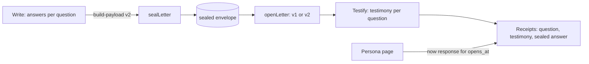

# Design Document

Spec: 15 The flow

## Overview

The prototype in `docs/design/15-flow/` is the visual design. This document records only what the prototype cannot: the data model for sealed answers, which existing component each screen replaces, how the pieces connect, and what is tested. It does not repeat sizes, colours or strings.

Main decisions:

1. **Format version 2 adds one field per author question.** A text recall question gains `sealed_answer`. Everything else in the payload and the header keeps the meaning it has in version 1.
2. **The opening code takes any payload version.** Consumers stop naming `PayloadV1` for what they read and use a structural type that both versions satisfy. This lands first so `main` compiles when version 2 arrives.
3. **One shell, many screens.** The top bar, step track, ghost placement, envelope and soil strip are built once, then every screen uses them.
4. **The live demo continues on `/demo/live`.** The opening flow components are the same ones `/l/{id}` and the persona pages use, loaded with `next/dynamic` when Wait starts.
5. **The persona "now" figure is chosen on the server.** The persona page builds a figures response for the opening date and hands it to the reveal in place of the browser request.
6. **Priya is a new version 2 letter with a new id.** The old row stays in the table and nothing references it.
7. **The receipts read one pairing model.** For each author question the reveal holds `{ question, testimony, sealedAnswer | null }` and renders it without any comparison.

Facts that were checked while writing this design:

| What | Result |
|---|---|
| `parsePayload` and `parseEnvelope` select a schema by version from `formats`, and reject an unknown version as `unsupported_format`. | Read `registry.ts`. |
| The text recall answer limit is 1,000 characters in the Testify field. | `REVEAL_COPY.textCount`. |
| `thenAndNow(metricId, date, data).then` returns the figure at or before `date`. | Read `then-now.ts`. |
| Maya's records: gasoline 2024-05-06 3.643 and 2024-11-04 3.069, diesel 3.894 and 3.536. | `src/lib/figures/real/fuel-figures.json`. |
| Tomás's records at or before 9 June 2024 are dated 2024-06-03. | Same file. |
| `/demo/live` budget is 280 kB. | `scripts/check-js-budget.mjs`. |

## Architecture



## Components and Interfaces

### 1. Sealed format version 2 (`src/lib/seal-format/`, `src/lib/crypto/`)

- `v2/payload.ts` exports `payloadV2Schema` and `PayloadV2`. It is `payloadV1Schema` with `format_version: 2` and a text recall question that requires `sealed_answer` (1 to 1,000 code points, not only whitespace). A number question is unchanged. The cross-reference checks of version 1 stay.
- `v2/header.ts` exports `headerV2Schema`: the version 1 header with `formatVersion` 2 and no other change. The envelope hash, canonical JSON and key steps are unchanged. `crypto.md` governs; if it requires a version field in the additional data, that field carries 2.
- `registry.ts` gains `2: { payload, header }`. `parsePayload` and `parseEnvelope` return `Payload` and `Envelope`, unions of the two versions. A fixture for each version stays in `__fixtures__/` and a v2 golden fixture is added.
- `seal.ts` and `open.ts` accept either version. `OpenResult.payload` is `Payload`.
- `RecallQuestion` is `Payload["recall_questions"][number]`. A helper `sealedAnswerOf(question)` returns the answer or `null` for a version 1 text question.

### 2. Opening code takes any version (task 1)

A new `src/components/reveal/opened-payload.ts` exports `OpenedPayload`, the structural subset the reveal reads (`letter_text`, `written_as_of`, `metrics`, `figures`, `recall_questions`). `opening-machine.ts`, `FiguresThenNow.tsx` and `RecallPager.tsx` use it instead of `PayloadV1`. Behaviour does not change.

### 3. Personas (`scripts/seal-personas*`, `content/personas/**`, `src/lib/personas/**`)

- `seal-personas-core.ts`: `buildPersonaPayload` returns a version 2 payload for a persona that has sealed answers, and a version 1 payload for the others. It reads `sealed-answers.json`. It stays pure and deterministic.
- `seal-personas.ts` gains `--hashes`, which prints each persona's `key`, `letter_id` and `envelope_hash` and exits before the database guard, so the content task can record the new hash without a database.
- `content/personas/letters/sealed-answers.json` maps a persona key to its sealed answers, in question order. `answers.json` holds the recollections.
- `personas.json`: Priya's `author_questions` become the two rewritten questions (the 200 code point limit stays). Her `letter_id` and `envelope_hash` change. The old id is appended to `retired_letter_ids`.
- `src/lib/personas/answers.ts` validates both files (shape, count, 1 to 1,000 code points, `checkAnswerText`), keyed by persona, in the same order as the questions.

### 4. Persona "now" figures (`src/lib/figures/`, persona page)

- `src/lib/figures/at-opening.ts` exports `figureAtOpening(metricId, opensAt, data)`, a thin wrapper over `thenAndNow(...).then` that takes the date part of `opensAt`.
- `personaNowResponse(persona, data)` returns a `FiguresResponseV1` whose `series` hold `figureAtOpening` for the persona's metrics, so `pickNow` works unchanged.
- `src/app/demo/personas/[key]/page.tsx` builds the response on the server and passes it down. `OpeningFlow` uses it for personas and keeps `fetchFigures` for live and real letters.

### 5. The shell (`src/components/ceremony/scene/`, `src/components/ui/`, `src/components/live/stepper/`)

- `TopBar.tsx` is rewritten to the slots of Requirement 5. The Skip slot is rendered first in the group when no sequence runs, with `visibility: hidden` and no tab stop.
- `StepTrack` takes `steps` and `current`, and is used by `/demo/live` (six steps), `/l/{id}` and persona pages (three). It replaces the track components in `stepper/` and `ceremony/steps.ts`.
- `Ghost.tsx` and `scene.module.css`: `.ghostPlace` positioning by `--ghost-x` is removed. The ghost renders in the column, holding `Envelope`, at three sizes `sm`, `md` and `lg`.
- `Envelope.tsx`: the `Dirt` group and its CSS are deleted. `SoilStrip.tsx` draws the strip.
- `/` and `/demo` use the envelope on soil and render no ghost.

### 6. Write (`src/components/live/desk/`, `live/occasions.ts`, `live/build-payload.ts`)

- `QuestionRow.tsx` gets the answer field and an `answer` value. `QuestionSection.tsx` holds `{ question, answer }` pairs.
- `write-check.ts` adds the unanswered and over-length checks, returning the index of the first failing row, and the desk moves focus to that row's answer field.
- `build-payload.ts` builds a version 2 payload with `sealed_answer` for each text question. `applyOccasionQuestions` keeps typed answers.
- `occasions.ts` takes the README table. The `PREDICTION_QUESTION` constant becomes the Work, Year and other suggestions as listed there.

### 7. Press the seal and Wait (`src/components/live/seal-step/`, `live/stepper/`)

- `SealStep.tsx` follows the prototype. `PressEnvelope.tsx` draws the relief in every state through `SealRelief` and keeps `usePressEnvelope` and `seal-machine.ts` behaviour.
- `LiveWaitStep.tsx` becomes the one card. Its "Open your letter" advances the stepper to `testify` on the same page. No link leaves the page.

### 8. Opening flow on both routes (`src/components/reveal/`, `src/components/live/stepper/`)

- One `OpeningFlow` renders unlock, emergence, Testify, Break and the receipts. `LiveStepper` renders it for steps 4 to 6 and lazy-loads it with `next/dynamic` when Wait starts. `/l/{id}` renders the same component with the three-step track.
- `unlock-error` keeps `LIVE_COPY` notices and the cross-device help.

### 9. Testify and receipts (`src/components/ceremony/recall/`, `src/components/reveal/`)

- `RecallPager` shows, for a text question, `AskedLine`, the question on paper, and a field labelled "What you think you answered". For a persona with sealed answers it shows the recollection read-only.
- `unit-ranges.ts` is used unchanged for the figure scale. The scale component must not read the sealed figure or the sample answer.
- `ReceiptsPage` renders `QuestionPair` for each author question, then `LetterPaper`, `FigureReceipt`, `SealLine` and `EndCard`. `FigureReceipt` uses `formatChange` (data-dev, unchanged) for the direction, signed difference and percentage, and renders the formula with its result from the same inputs.
- `QuestionPair` shows the sealed answer, or "No answer was sealed with this question." when `sealedAnswerOf` is `null`. "I don't remember" is shown as that text in the testimony slot.

### 10. Cross-cutting

- **Budget.** The opening flow is in a `next/dynamic` chunk on `/demo/live`. No value in `scripts/check-js-budget.mjs` changes.
- **Privacy.** No new storage, request, dependency or font. The CSP is unchanged. The backup key never leaves the browser.
- **Copy.** Strings are in `copy.ts` files. New strings are listed in the README entry for the screen. Each copy task runs the tone check on its copy files.

## Data Models

```ts
// v2 payload, text recall question (number question unchanged)
type TextQuestionV2 = {
  id: string;
  answer_type: "text";
  text: string;            // 1 to 500 code points
  metric_id?: string;
  sealed_answer: string;   // 1 to 1,000 code points, not only whitespace
};

// what the receipts read for one author question
type QuestionPair = {
  question: string;
  testimony: string | "I don't remember";
  sealedAnswer: string | null;  // null for a version 1 letter
};
```

Persona content: `sealed-answers.json` is `{ [personaKey]: string[] }`, in question order.

## Correctness Properties

### Property 1: Version 2 round trip

For every valid v2 payload, sealing then opening returns an equal payload, and every text question keeps its `sealed_answer`.

**Validates: Requirements 2.1, 2.4**

### Property 2: Version 1 still opens

For every v1 fixture and every generated v1 payload, opening returns it unchanged and `sealedAnswerOf` is `null` for each text question.

**Validates: Requirements 2.3**

### Property 3: A v2 text question needs an answer

A v2 payload whose text question lacks `sealed_answer`, has a blank one, or has one over 1,000 code points is rejected with `invalid` and the question's path.

**Validates: Requirements 2.1, 2.5**

### Property 4: The fold check names the first unanswered question

For any list of question rows with at least one blank answer, the check names the lowest index of a blank answer and no other.

**Validates: Requirements 7.4**

### Property 5: Receipts pair text without changing it

For any question, testimony and sealed answer, the rendered pair contains each string unchanged, in the order question, testimony, sealed answer, and no other text derived from them.

**Validates: Requirements 12.3**

### Property 6: The change line follows the figures

For any two comparable figures, the difference has the same number of decimals as the larger of the two values, the percentage has one, and both come from full precision values.

**Validates: Requirements 12.4**

### Property 7: A persona's "now" is the latest record at or before its opening date

For any series and opening date, `figureAtOpening` returns the record with the greatest period not after the date, or "missing".

**Validates: Requirements 4.1, 4.2, 4.3**

### Property 8: Occasion questions are first person

For every default and suggestion, the text contains "I", "me" or "my" as a word and none of "you", "your", "when you wrote this" or "the day you sealed this".

**Validates: Requirements 8.2**

## Error Handling

- A v2 payload that fails its schema opens as `invalid`, as a v1 failure does today, with the same message.
- An unknown version stays `unsupported_format`.
- A sealing failure, a cancelled prompt, a busy demo and a wrong passkey keep today's messages and recovery.
- A persona with no record at or before its opening date shows the figure as unavailable with its reason, and still shows the sealed figure.

## Testing Strategy

- Vitest with `renderToStaticMarkup`, fetches stubbed, no network. Property tests use fast-check with at least 100 runs and the tag `// Feature: 15-the-flow, Property N: <title>`.
- CSS source tests pin only what the prototype leaves to the code: the ghost sizes, the wax sizes, the Skip slot, and the absence of the dirt band and of percentage placement.
- Tests that pin what this spec replaces are updated or retired, each with its reason, in the task that replaces it:
  - `src/components/live/desk/occasions-desk.test.ts`, `src/components/live/occasions.test.ts`, `src/components/live/copy.test.ts` (the ban on "right now", "today" and "currently", replaced by Property 8);
  - `src/test/retired-phrases.test.ts` (the retired "What's on your mind right now?" entry);
  - `src/lib/personas/answers.test.ts`, `schema*.test.ts`, `intro-line.test.ts`, `index.test.ts` (Priya's questions and answers);
  - `src/components/retired-ids-scan.test.ts` (the new retired id);
  - the Envelope tests (`Envelope.test.tsx`, `envelope-layout.test.tsx`) for the dirt band, the Scene tests (`ghost-placement.test.tsx`, `layout.test.ts`, `light-x.test.ts`, `topbar-*.test.ts`) for the old ghost and bar rules, and the stepper and step tests (`StepTrack.test.tsx`, `step-track-css.test.ts`, `ceremony/steps.test.ts`);
  - the layout-check rows and Live_Walk steps of specs 13 and 14 that assert the old flow (task 14).
- `npm run layout-check` and `npm run live-walk` run against a production build. The rows and steps for this spec are added by the platform task.

## Order

Tasks run in number order. The format and opening-code tasks come first so `main` compiles at every merge. Persona content waits for the sealing script. The shell comes before any screen. Write comes before Press the seal. The opening flow comes before Testify, and Testify before Break and the receipts. The platform task adds the rows and the walk, the fix-up task fixes what they find, and the final walk reports.