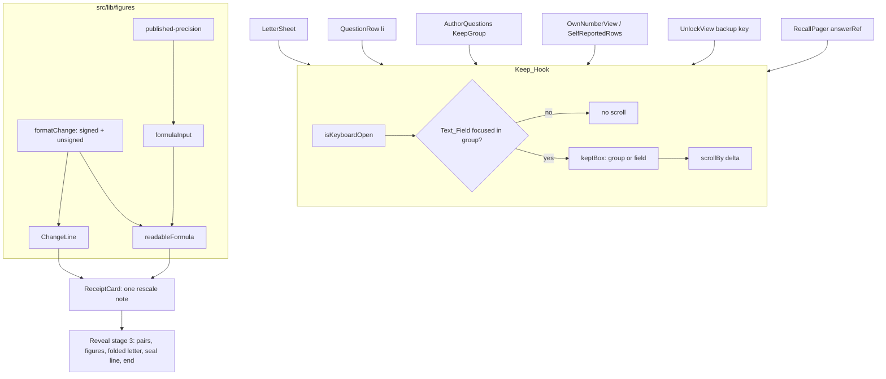

# Design Document

Spec: 16 Remember first

## Overview

This spec changes one hook, a handful of components and many strings. Nothing sealed changes. The spec 15 prototype stays the visual reference for everything below that does not name a change. This document records which file each requirement touches, the one or two new pure functions each needs, and what is tested. It does not repeat strings that `requirements.md` already fixes.

Main decisions:

1. **The Keep_Hook decides per focused element.** It scrolls only while Keyboard_Open and only for a Text_Field, and it measures that field's Field_Group. `LiveStepper` stops calling it. Each field component calls it for its own group. `RecallPager` keeps its call unchanged.
2. **Keyboard_Threshold is 150 CSS px.** That is above the gaps a desktop scrollbar (about 15 to 17 px) or a mobile toolbar (about 56 px) leave between `innerHeight` and `visualViewport.height`. It is below the shortest phone keyboard in portrait (about 216 px without the suggestion bar).
3. **The Press_Test is its own Vitest file on `playwright-core`.** It shares the Live_Walk's base URL, browser launch and passkey stub. Unlike the walk, it fails on a product failure, because Requirement 1.12 needs a run that fails at `1183739`.
4. **The retired-word check reads string values, not source text.** It parses each `copy.ts` and `occasions.ts` with the TypeScript compiler API (`typescript` 5.9.3 is already a dev dependency) and parses persona JSON with `JSON.parse`. No new dependency.
5. **The change line drops signs, and the formula keeps one.** `formatChange` gains unsigned magnitudes next to the signed strings it returns today. `ChangeLine` prints the unsigned ones. `readableFormula` keeps the signed percent.
6. **Published_Precision is a small table in `src/lib/figures/`.** It is keyed by the sealed `series_id`, and each row carries the decimals and an evidence URL. The two EIA series get a row once data-dev has checked the page. The Oil Bulletin gets no row until open question 2 is answered, so Tomás's formula keeps the stored value in full.
7. **The rescale note moves from the rows to the card.** `ReceiptCard` prints it once. `receiptFigureOf` and `ChangeLine` stop carrying it.
8. **The receipts at stage 3 reorder.** The order becomes pairs, figures, then the letter folded in the existing `details` disclosure, then the seal line and the end card. Stage 2 and letters without figures keep spec 15 R12.2.
9. **The number field's message waits for blur or an attempt to advance.** `FieldState` gains one flag, and the pure reducers in `recall-field.ts` set and clear it.
10. **Sound moves to the Top_Bar on `/demo/live` and `/l/{id}`.** `CeremonyRoot` stops rendering its own `SoundToggle`.

Facts checked while writing this design, at `1183739`:

| What | Result |
|---|---|
| The fault. `LiveStepper` passes `primaryRef`, which wraps the whole Write desk. A press on any button fires `focusin` inside it. The desk is taller than the band, so `scrollDeltaFor` aligns the desk's top edge and `scrollBy` runs between pointer down and pointer up. | Read `LiveStepper.tsx` and `use-keep-in-visual-viewport.ts`. |
| On desktop Chromium, `window.visualViewport` exists and its height equals `innerHeight` less any horizontal scrollbar. With Keyboard_Open false, the hook would make no call. | Read the hook. Requirement 1.4. |
| `layout.tsx` sets `interactiveWidget: "resizes-content"`. On Chrome for Android the keyboard shrinks the layout viewport too, so Keyboard_Open stays false and the browser scrolls the focused field itself. Only iOS Safari, which ignores the setting, reaches Keyboard_Open. | `src/app/layout.tsx`, `viewport-export.test.ts`. |
| `RecallPager` wraps the number field alone in `answerRef`. For a text question the group holds the field and `NavRow`. A press on Next inside that group fires `focusin` today. | Read `RecallPager.tsx`. |
| `AuthorQuestions.tsx` renders its rows in a `map`, so it cannot call a hook per row without a row component. | Read `AuthorQuestions.tsx`. |
| Text_Fields on the live steps: `LetterSheet` and `WriteForm` letter (`#live-letter`), `QuestionRow` question and answer, `AuthorQuestions` question and answer, `OwnNumberView` and `SelfReportedRows` inputs (`type="text"`), and `UnlockView` backup key. `RealDatePicker` is `type="date"`, which is not a Text_Field. | Search for `<textarea` and `<input`. |
| `formatChange` returns signed `difference` and `percent`. `ChangeLine` prints both. `readableFormula` prints the inputs as stored (after the rescale) and ends with `shown.percent`. | Read the three files. |
| The rescale note is set on both rows by `receiptFigureOf` and printed again by `ChangeLine` through `rescaledChangeInputs`. A card can show it three times. | Read `FigureLine.tsx`, `change-display.ts`, `ChangeLine.tsx`. |
| The Oil Bulletin `series_id` is a long description: `File Weekly_Oil_Bulletin_Prices_History_maticni_4web.xlsx, sheet "Prices with taxes", column C "EU_price_with_tax_euro95", …`. EIA ids are `EMM_EPMR_PTE_NUS_DPG` and `EMD_EPD2D_PTE_NUS_DPG`, and their stored values have 3 decimals. | `src/lib/figures/real/fuel-figures.json`. |
| `LetterBlock` already has a `collapsible` mode: a `details` with summary `REVEAL_COPY.letterDisclosureSummary` ("Read the letter again"). | Read `LetterBlock.tsx`, `reveal/copy.ts`. |
| On `/demo/live` the embedded flow runs `CeremonyRoot` in `host` mode, and `host` mode renders `SoundToggle` at the top of the region. That toggle is the sound control above the receipts heading. | Read `CeremonyRoot.tsx`, `OpeningFlow.tsx`. |
| The Seal step grid is two columns from 900 px with `align-items: center`. The warning sits in the text column beside the wax. | `seal-step.module.css`. |
| In the `created` state the status line is `PRESS_COPY.setting` and press two's hint is `PRESS_COPY.stepTwoHint`, the same sentence. | `press-status.ts`, `seal-steps.ts`. |
| `KEPT_TOGETHER` in `SceneHeadline.tsx` is "Revenant doesn't.", joined with a non-breaking space by `splitTagline`. | Read the file. |

### Where the code differs from the requirements

The tasks need these decisions. Each default below is the design's choice. The owner approved every default and every **(proposed)** string here as written, on review.

1. **`BRAND_COPY.ritualSteps[3].line` holds "testimony"** ("Your testimony beside what you wrote, then any numbers then and now."). The Proposed wording table has no row for it, but Requirement 2.8 bans the word. Default **(proposed)**: "What you remembered beside what you wrote, then any numbers then and now."
2. **`CEREMONY_COPY.numberLineAltNoAnswer` says "Now"**, which Requirement 7.1 forbids. It has no row in the table. Default **(proposed)**: "Then {then} {unit}, {thenPeriod}. At opening {now} {unit}, {nowPeriod}. No answer."
3. **`REVEAL_COPY.yourAnswer` is also `RecallPager`'s spoken prefix.** Requirement 3.5 keeps the prefix as "Your answer", while 3.3 changes the receipts uses. The design adds `REVEAL_COPY.answerSpokenPrefix: "Your answer"` for the pager and changes `yourAnswer` to the Remembered_Phrase.
4. **`CEREMONY_COPY.lineAnswer` is not rendered.** `NumberLine.tsx` reads `markAnswer` (hidden text), `lineThen`, `lineNow` and `lineNoAnswer`, and it has no visible answer label. The value still changes to the Remembered_Phrase, so the copy stays consistent. Requirement 3.9's layout check has nothing to measure until a label is drawn.
5. **`RememberedAnswers.tsx` and `AuthorTestimony.tsx` have no importer outside their tests.** Their strings (`yourAnswer`, `saidJustNow` "What you said just now") change with the rest. The design deletes neither, because no requirement asks for it. Default for `saidJustNow` **(proposed)**: the Remembered_Phrase.
6. **Priya's Remember step does not follow Requirement 13.2 today.** `RecallReader.tsx` puts "as of {date}" in the counter of every question and has no "As of {date} you asked yourself:" line. Its `ReadingTestify` block also prints "Written as of {date}". The design removes both dates and adds the line.
7. **The fuel persona Remember step names the month a second time.** `TestifyContext` prints `REVEAL_COPY.memoryLine` ("You lived through {month} too. Answer from your own memory of it.") with the written-as-of month. That is not the written-as-of date in the date format, so Requirement 13.5's count stays 1. The design keeps the line and lists it as open question 7.
8. **"Revenant demo" exactly once in every state (14.6) does not hold with today's step hints.** Before a backup choice, press one has no hint. After the first press its hint is "Passkey made". Default: press one always carries a hint. It is `stepOneHint` while pending or current. Once done it is `stepPasskeyMade`, changed **(proposed)** to: Passkey made. Saved as "Revenant demo".
9. **The warning above the wax at 1440 × 900 (14.3) does not hold with the two-column grid.** Default: from 900 px the heading, paragraph and warning sit in one row that spans both columns. The backup choice, the links and the wax sit in the row below. Below 900 px the single column is unchanged. This differs from the spec 15 prototype screens 9 to 15, and QA lists it as expected.
10. **The change line in Requirement 8.1 says every part is separated by " · "**, but its example reads "fell 0.57 · 15.8% · …", with a space after the direction word. The design follows the example: `{direction} {difference} · {percent} · {then period} to {now period}`.
11. **A press on a disabled Next fires no `click` (11.2 and 11.5).** The design catches the attempt with a `pointerdown` listener on the `NavRow` container and with `blur`. If a browser delivers neither for a disabled control, the message shows on the next blur.
12. **The retired-word scan in Requirement 4.2 covers copy modules, `occasions.ts`, persona content and the rendered `/`.** Requirement 2.8 also names `/demo`, the persona pages, `/demo/live` and `/l/{id}`. Those pages draw their strings from the scanned copy modules. A few strings sit inline in components, for example `envelopeCaption` in `press-status.ts` and the table headers in `ResurrectionSection.tsx`. The scan does not see inline strings. None of them holds a retired word today. The design does not widen the scan, because Requirement 4.2 limits it.

## Architecture



## Components and Interfaces

### 1. Keep_Hook (`src/components/ui/use-keep-in-visual-viewport.ts`) — Requirement 1

New exports, all pure except the hook:

```ts
export const KEYBOARD_THRESHOLD_PX = 150;
/** visualViewport.scale within this of 1 counts as unzoomed. */
export const SCALE_TOLERANCE = 0.01;

export type ViewportState = { innerHeight: number; height: number; scale: number };
export function isKeyboardOpen(v: ViewportState): boolean;
// innerHeight - height >= KEYBOARD_THRESHOLD_PX && |scale - 1| <= SCALE_TOLERANCE

export type FieldLike = { tagName: string; type?: string; getAttribute(name: string): string | null };
export function isTextField(el: FieldLike | null): boolean;
// TEXTAREA, or INPUT whose type is text, search, email, tel, url, password or number,
// and whose role is not button or slider

export function keptBox(group: Box, field: Box, band: Box): Box;
// the group's box when it fits the band, else the field's box
```

- `keepInVisualViewport(group, field, host, calm)` returns 0 at once unless `isKeyboardOpen(host)` and `isTextField(field)`. It then measures `keptBox(group.rect, field.rect, band)` and applies `scrollDeltaFor` to that box. A field taller than the band keeps the existing tall-box rule: its own top edge aligns with the band's top. `ViewportHost` gains `innerHeight`, and `VisualViewportBox` gains `scale`.
- `useKeepInVisualViewport(ref, calm)` keeps its signature. On `focusin`, and on visual viewport `resize` and `scroll`, it reads `document.activeElement`. It acts only when that element is inside `ref` and is a Text_Field. It no longer returns early when `visualViewport` is missing, so the hook attaches the same listeners everywhere. Without a visual viewport `isKeyboardOpen` is false, and the hook makes no call (1.4).
- `src/components/ui/KeepGroup.tsx` is new. `<KeepGroup as="li" | "div" className>` owns a ref and calls the hook. List components use it for rows rendered in a `map`.
- **Call sites (1.8):**
  - `LiveStepper.tsx`: the `useKeepInVisualViewport(primaryRef, calm)` call goes. `primaryRef` stays, because the step-change focus still reads `[data-step-heading]` through it.
  - `desk/QuestionRow.tsx`: a ref on the `li` calls the hook. The row is the Field_Group of both its fields, as the Glossary says.
  - `desk/LetterSheet.tsx` and `WriteForm.tsx` (the `all` section letter): the wrapper of label, textarea and help.
  - `AuthorQuestions.tsx`: each row's wrapper becomes a `KeepGroup`.
  - `desk/OwnNumberView.tsx`, `SelfReportedRows.tsx`: the label and input wrapper of each field.
  - `UnlockView.tsx`: the backup key label, hint and input.
  - `RecallPager.tsx`: unchanged (1.9).
- **The four places (1.10).** The task reports one finding per file in its commit body. `LiveStepper` is the source of the fault. `AuthorQuestions` and `QuestionRow` inherit it, because they sit inside `primaryRef`. `RecallPager` has it on text questions, where Next is inside the group.

### 2. Press_Test (`src/test/integration/press-test.test.ts`) — Requirements 1.11, 1.12, 17.2

- `describe.skipIf(process.env.WALK !== "1")`, the same `BASE_URL`, `CHROMIUM_PATH` and `PASSKEY_INIT_SCRIPT` as `live-walk.test.ts`. The launch helpers move to `live-walk-helpers.ts` when both files need them.
- Pure helpers in `press-test-helpers.ts`: `PRESS_SIZES` (1440 × 900, 390 × 844), `PRESS_TARGETS` (the selectors of the Fold_Button, an Occasion pill, a Suggestion_Pill, "Write my own", Remove and each receipt toggle), and `scrollHeld(before, after)`, which is true when the difference is 0.
- For each size and for Calm on and off, the test types a letter and an answer. It reads `scrollY` and then calls `page.mouse.down()`. It waits 600 ms, reads `scrollY` and calls `page.mouse.up()`. Then it reads `scrollY` again in the same task, before the next frame. It asserts equality, and asserts that the step track shows Press the seal as current within 2,000 ms.
- It also runs a touch tap of the Fold_Button at 390 × 844 (a context with `hasTouch`, `page.touchscreen.tap`), and Tab to the Fold_Button with Enter at 1440 × 900. Each scroll read happens on the key-down and key-up events.
- `npm run live-walk` runs both files: `WALK=1 vitest run src/test/integration/live-walk.test.ts src/test/integration/press-test.test.ts`. The failing run at `1183739` comes from checking out that commit with the new test file copied in. Its output goes in the commit body.

### 3. Remember, the Remembered_Phrase and the break line — Requirements 2, 3, 12

- String changes go in `brand/copy.ts`, `ceremony/copy.ts`, `reveal/copy.ts`, `live/copy.ts`, `live/desk/copy.ts` and `landing/copy.ts`, as the Proposed wording table and items 1 to 5 above set them. No key is renamed (2.11, 7.9).
- New keys: `REVEAL_COPY.answerSpokenPrefix` (item 3) and `CEREMONY_COPY.recollectionsRead` (12.2).
- `RecallPager.tsx` passes `REVEAL_COPY.answerSpokenPrefix` to `RecallScale`.
- `SealBreak.tsx` gains `recorded: boolean`. `Reveal.tsx` passes `testimony === undefined`, so Priya gets `false`. The break line is `recorded ? testimonyRecorded : recollectionsRead`.
- The live region reads `stageLive.recall` and `stageLive.marks`, which hold the new values. Persona pages keep announcing the step name.
- Step tracks: `LIVE_STEP_NAMES`, `personaStepLabels` and `REVEAL_COPY.letterTrackSteps` read the new values, so the code does not change (open question 1).

### 4. Retired-word scanner (`src/test/user-strings.ts`, `src/test/retired-phrases.test.ts`) — Requirement 4

```ts
export type UserString = { path: string; line: number; value: string };
export function userStringsOfTs(path: string, source: string): UserString[];
export function userStringsOfJson(path: string, source: string): UserString[];
export function userStringsOfText(path: string, source: string): UserString[];
export const RETIRED_WORD = /\btestif\w*|\btestimon\w*/i;
```

- `userStringsOfTs` calls `ts.createSourceFile(path, source, ts.ScriptTarget.Latest, true)` and walks the tree. It collects `StringLiteral`, `NoSubstitutionTemplateLiteral` and the literal parts of a `TemplateExpression` (head, middles, tails). It skips a literal in each of these positions, because none of them is shown to a reader:
  - a property name (`{ "testify": … }`) or an element access argument;
  - an import or export module specifier;
  - a type position (`LiteralTypeNode`);
  - an operand of `===`, `!==`, `==` or `!=`, or a `case` label.
- Comments and identifiers are never visited as strings.
- `userStringsOfJson` parses the file and returns every string value, recursively, and no key. `userStringsOfText` returns the whole text of a `.txt` letter.
- The scanned files are every non-test `copy.ts`, `src/components/live/occasions.ts`, and the files under `content/personas/` except the `*-copy-test.md` records. The rendered `/` and its metadata stay scanned as today.
- A hit reports `path:line "value"` (4.4).
- `RETIRED_PHRASES` gains "Memory rewrites itself" and keeps its full-text scan (4.6). `AVOIDED_WORDS` moves to `userStrings*`, so it stops matching identifiers too.

### 5. Headline — Requirement 5

- `BRAND_COPY.tagline` changes. `KEPT_TOGETHER` in `SceneHeadline.tsx` becomes "letter doesn't.". `opengraph-image.tsx` replaces "letter doesn't." with `letter${NBSP}doesn't.`.
- `LandingHero.tsx` renders the first sentence in its own span. From 900 px that span has `white-space: nowrap` (5.4). The `.headline` rule gains `text-wrap: balance`. At 390 px the hero also joins "with time." with a non-breaking space in the rendered text only (5.5). The layout-check row measures both.
- Docs and tests named in 5.6 and 5.7 change in the same task.

### 6. Write desk strings — Requirement 6

- `DESK_COPY.psIntro`, `lockLine`, `answerPlaceholder` and `LIVE_COPY.authorQuestionsHint` take the new values.
- `LIVE_COPY.answerInLetter` is deleted, and so is the line in `AuthorQuestions.tsx` that renders it.
- `write-check.ts` and the fold behaviour do not change.

### 7. "At opening" — Requirement 7

- `REVEAL_COPY.now` and `CEREMONY_COPY.lineNow` become "At opening". `numberLineAlt` and `numberLineAltNoAnswer` follow (item 2).
- `figureLabel(figure, "now", "persona")` returns `labelHistoricalRecord`. Live and real letters keep `labelRetrieved`. The fixture and self-reported branches come first, as today.

### 8. Change line, formula and Published_Precision — Requirement 8

`src/lib/figures/format-change.ts`:

```ts
export interface ChangeDisplay {
  direction: "rose" | "fell" | "unchanged";
  difference: string;          // signed, unchanged (used by the formula when then = 0)
  percent: string | null;      // signed, unchanged (used by the formula)
  differenceMagnitude: string; // new: no sign
  percentMagnitude: string | null; // new: no sign, one decimal, with "%"
  thenPeriod: string;
  nowPeriod: string;
}
```

- The magnitudes come from the same `formatValue(magnitude(…))` calls that build the signed strings today, so they always agree.
- `ChangeLine.tsx` prints `direction`, a space, `differenceMagnitude`, then " · " `percentMagnitude` when it is not null, then " · " and the two periods joined by `REVEAL_COPY.periodRange`. The `display` prop and its note go (Requirement 9).
- `src/lib/figures/published-precision.ts` (new, data-dev):

  ```ts
  export type PublishedPrecision = { decimals: number; evidenceUrl: string; checkedOn: string };
  export const PUBLISHED_PRECISION: ReadonlyMap<string, PublishedPrecision>;
  export function publishedPrecisionOf(seriesId: string): PublishedPrecision | undefined;
  ```

  The keys are the exact sealed `series_id`. A row exists only when the task has opened the evidence URL and seen values printed at that precision (8.6).
- `src/lib/figures/formula-input.ts` (new):

  ```ts
  export function formulaInput(storedValue: string, seriesId: string, rescalePower: number): string;
  ```

  With a row, it rounds the stored value half away from zero to `decimals` in the published unit, then shifts it by `rescalePower`. The result has exactly `decimals + rescalePower` decimals, padded with zeros. Without a row, it returns the rescaled stored value in full, as today. It uses a new `roundDecimal(d, digits)` in `decimal.ts` (BigInt, no `Number`). The source-scan test that bans `Number()` and `parseFloat` covers the new files.
- `readableFormula(result, shown, inputs)` takes the two input strings from `formulaInput`. The result stays `shown.percent`, or `shown.difference` when the then value is 0. The percent comes from `computeChange` at full precision (8.5).
- `FigureEntry.tsx` passes `formulaInput(then.value, then.series_id, k)` and `formulaInput(now.value, now.series_id, k)`, where `k` is the base-ten power of the unit's rescale (3 for EUR per 1,000 litres, else 0).
- The same-period and not-comparable branches in `FiguresThenNow.tsx` draw no change line and no formula, as today (8.8).

### 9. One rescale note per card — Requirement 9

- `REVEAL_COPY.rescaledNote` changes to "Shown in {toUnit}. Published in {fromUnit}."
- `receiptFigureOf` no longer sets `note`. `ReceiptFigure.note` is removed.
- `ReceiptCard` gains `rescaleNote?: string` and prints it once, as one line after the rows and before `roundedNote`. It prints it in the single-figure view too.
- `rescaleNoteFor(figures: FigureV1[]): string | undefined` in `FigureLine.tsx` builds the note from the first figure on the card whose shown unit differs from its sealed unit. Every branch of `FiguresThenNow` (comparable, single, unavailable, not comparable) passes the result. Today's `UNIT_DISPLAY` has one entry, so no card can hold two different rescales.
- The "As published" line keeps the stored value and published unit.

### 10. Receipts order and live step 6 — Requirement 10

`Reveal.tsx`, receipts column:

- `foldLetter = stage === 3 && figureCount > 0`. This covers the "Show everything" path, which lands on stage 3.
- When `foldLetter` is true, the column renders the question pairs, the figure receipt (`FigureReceipt` and `FiguresThenNow`, or `SelfReportedOnly`), then `LetterPaper` with `collapsible` and `still`, then the seal line and the end card. `still` keeps the unfold from replaying for a letter already read.
- When `foldLetter` is false, the order stays as today: pairs, letter in full, then the seal line and the end card once `sealEndShown` is true.
- `collapsible` no longer depends on `isPhone`. The `details` element reports its state to assistive technology. Under Calm, `LetterBlock`'s light and calm rules already skip motion.
- The order never reads the direction of a figure.
- `receipts.module.css` `.receipts` gains `inline-size: 100%`, `max-inline-size: var(--content-column-max)` and `margin-inline: auto`. Both the persona column and the live Reveal_Host take their width and centre from this one rule (10.6).
- **Sound (10.7).** `CeremonyRoot` renders no `SoundToggle` and no `soundNote` in any mode, and always reads the inherited `SoundEnabledContext`. `SceneShell` gives the plain variant an optional `sound` prop, which `/demo/live` and `/l/{id}` set. The Top_Bar sound slot then follows spec 15 R5.1. It is reserved with `visibility: hidden` like the Skip slot. It becomes visible once `OpeningFlow` reports through a `SoundSlotContext` setter that it has mounted.

### 11. Number field — Requirement 11

`recall-field.ts`:

```ts
export type FieldState = { typed; parse; pick; mark; checked: boolean }; // checked is new
export function isUnreadable(s: FieldState): boolean; // rejected and not empty
export function checkField(s: FieldState): FieldState; // on blur or attempt: checked = isUnreadable(s)
// typeText: checked = prev.checked && isUnreadable(next)
// setFromScale, pickReading: checked = false
export function unreadableShown(s: FieldState): boolean; // s.checked && isUnreadable(s)
```

- `initialField` sets `checked: false`. `draftTextFor`, `canAdvance` and `resolvedValue` do not read `checked` (11.6).
- `RecallPager` takes `unreadable` from `unreadableShown(field)`, so the message, `aria-invalid` and `aria-describedby` follow it. The `input` gets `onBlur`, which applies `checkField`. `handleSubmit` applies `checkField` before `submitAction` runs (Enter in the field). The `NavRow` container gets `onPointerDownCapture`, which applies `checkField` (item 11). Next stays disabled while the field is unresolved (11.5).
- The example string in `numberUnreadable` stays "1585.76" unless the deployed site shows something else. The task checks `revenant.devclef.se` (11.7).

### 12. Persona date once — Requirement 13

- `REVEAL_COPY.recallIntro` holds no `{date}`. `RecallPager` stops filling it.
- `TestifyContext` (persona): the dates line keeps only `envelopeOpens`. "Written as of {date}" goes. The memory line stays (item 7).
- `RecallReader` (Priya): the counter carries no date, and a new `asked` line above the question reads `REVEAL_COPY.askedAsOf`. `ReadingTestify` drops "Written as of {date}" in the same way as `TestifyContext`.
- `RecallPager` already shows the date in the counter for figure questions only, and in `askedAsOf` for text questions. That stays.
- The live and real "On {date} you asked yourself:" line does not change (13.6).

### 13. Press the seal — Requirement 14

- `LIVE_COPY.sealParagraph` and `PRESS_COPY.stepOneHint` take the new values. `stepPasskeyMade` takes item 8's value.
- `seal-steps.ts`: press one's hint is `stepOneHint` while pending or current, and `stepPasskeyMade` once done. Press two's hint is null in `created`, because the status line already shows `setting`. In `confirming` it stays `stepTwoHint`.
- `seal-step.module.css`, from 900 px: a two-row grid. The heading, paragraph and warning sit in a `data-seal-intro` block spanning both columns. The backup choice, the PRF lines and the links sit left of the press column. No disclosure ever wraps the warning (14.2).
- The press, the backup choice and the no-PRF path keep their code (14.8).

### 14. Home section — Requirement 15

- `LANDING_SECTION_COPY.resurrectedBody` becomes a one-sentence array. `noSealBody` takes its new two-sentence value. `makerTitle` and `makerBody` are new.
- `ResurrectionSection.tsx` renders the heading, `resurrectedBody`, `noSealBody`, then an `h3` with `makerTitle` and `makerBody`. The table goes. `NoSealSection.tsx` is deleted, and `page.tsx` drops it. `noSealTitle` is deleted.
- `/how-it-is-sealed` keeps its own render of `BRAND_COPY.sealMapping`, and the footer link stays.
- `tone.md` gains one line: the maker's story is the only first-person passage in the UI.

### 15. QA tooling and docs — Requirements 4.8, 17

- `tools/qa/layout-check.mjs` gains the rows of 17.3. Each reads `getBoundingClientRect` at both sizes and reports pass or fail. `journey-check.mjs` and `live-walk-helpers.ts` take the new step names and strings.
- `src/test/docs-wording.test.ts` (new) reads `README.md` and `docs/video-script.md`. It checks for "Remember", the headline and the receipts order, and checks that neither "testif", "testimon" nor "Memory rewrites itself" appears outside the README image alt text (17.4, 17.5).

## Data Models

```ts
// Keep_Hook inputs (pure)
type ViewportState = { innerHeight: number; height: number; scale: number };
type Box = { top: number; bottom: number };

// Published_Precision row
type PublishedPrecision = {
  decimals: number;     // decimals the publisher prints, in the published unit
  evidenceUrl: string;  // a page or file where those decimals are printed
  checkedOn: string;    // YYYY-MM-DD the task opened it
};

// Recall number field (adds `checked`)
type FieldState = {
  typed: string;
  parse: RecallNumberParse;
  pick: "decimal" | "grouping" | null;
  mark: string | null;
  checked: boolean;
};
```

No sealed format, store record or database row changes. `checked` lives in component state only.

## Correctness Properties

*A property is a characteristic or behavior that should hold true across all valid executions of a system-essentially, a formal statement about what the system should do. Properties serve as the bridge between human-readable specifications and machine-verifiable correctness guarantees.*

### Property 1: The Keep_Hook scrolls only for a Text_Field while Keyboard_Open

For any viewport state (inner height, visual viewport height and scale), any focused element descriptor (tag, type, role) and any event (`focusin`, `resize`, `scroll`), the hook calls `scrollBy` only if `isKeyboardOpen` holds and the element is a Text_Field inside the group. `isKeyboardOpen` holds exactly when the height shortfall is at least `KEYBOARD_THRESHOLD_PX` and the scale is within `SCALE_TOLERANCE` of 1.

**Validates: Requirements 1.4, 1.5, 1.13**

### Property 2: The kept box lands in the band

For any group box, any field box inside it and any band, with Keyboard_Open and a Text_Field, applying the returned delta puts the group inside the band when the group fits. Otherwise it puts the field inside the band, or aligns the field's top with the band's top when the field is taller than the band. The delta is 0 when that box is already inside. The behaviour is `"auto"` under Calm and `"smooth"` otherwise.

**Validates: Requirements 1.6, 1.7**

### Property 3: The change line carries no sign

For any comparable pair of figures with periods in `YYYY-MM` or `YYYY-MM-DD` form, the rendered change line starts with its direction word, contains none of "+", "-" or U+2212, and shows `differenceMagnitude` and `percentMagnitude`. Each magnitude equals its signed counterpart with the sign removed.

**Validates: Requirements 8.1, 8.2**

### Property 4: The formula's result matches the change

For any comparable pair, the formula ends with `shown.percent` when the then value is not zero, and with `shown.difference` when it is. That is the only signed text on the card. Its percent equals `computeChange`'s percent at full precision, rounded half away from zero to one decimal.

**Validates: Requirements 8.3, 8.5**

### Property 5: Formula inputs keep the published decimals

For any stored value, any recorded precision `p` and any rescale power `k`, `formulaInput` returns a string with exactly `p + k` decimals. Its value equals the stored value rounded to `p` decimals and divided by 10^k. When the stored value has at most `p` decimals, it equals the stored value divided by 10^k exactly. With no record, it equals the rescaled stored value in full.

**Validates: Requirements 8.4, 8.6**

### Property 6: Display precision never changes a result

For any comparable pair, adding, removing or changing a Published_Precision row changes only the two formula inputs. The direction, both magnitudes, the signed percent and the formula's result stay the same.

**Validates: Requirements 8.5, 16.3**

### Property 7: One rescale note per card

For any card input (comparable, single figure, unavailable now or not comparable, with or without a rescaled unit), the rendered card contains the rescale note exactly once when a shown unit differs from its published unit, and not at all otherwise. The "As published" line holds the stored value and published unit unchanged.

**Validates: Requirements 9.1, 9.2, 9.3, 9.4**

### Property 8: The receipts order does not depend on direction

For any letter shape (0 to 3 author questions, 0 to 3 figures, each figure with any then and now values), the receipts column has a fixed block order. At stage 3 with figures it is pairs, figure cards in sealed order, folded letter, seal line, end card. Otherwise it is pairs, letter in full, seal line, end card. Swapping each figure's then and now values gives the same order and the same figure order.

**Validates: Requirements 10.1, 10.4, 10.5, 10.8, 16.4**

### Property 9: The number message waits for a check

For any sequence of type, blur, attempt, scale and reading events on one field, the message shows exactly when the last check found the text unreadable and every edit since then left it unreadable. Removing every blur and attempt event from the sequence leaves `draftTextFor`, `canAdvance` and `resolvedValue` the same after each event.

**Validates: Requirements 11.1, 11.2, 11.3, 11.4, 11.5, 11.6**

### Property 10: The retired-word scan reads values, not names

For any generated TypeScript object literal whose keys, identifiers, comments, comparison operands and type literals may hold a retired word, the scanner reports a hit exactly when a string value holds one. Each hit names the file, the line and the value.

**Validates: Requirements 2.8, 4.1, 4.2, 4.3, 4.4**

### Property 11: A persona Remember screen names its date once

For any written-as-of date and any persona question (figure or author, first or later, Priya's included), the visible text of the rendered Remember screen contains the formatted date exactly once. It is in the counter for a figure question and in the "As of {date} you asked yourself:" line for an author question.

**Validates: Requirements 13.1, 13.2, 13.4, 13.5**

### Property 12: Press the seal shows each sentence once

For any seal state tag, backup choice (including none), motion setting and PRF flag, the Seal step's visible text contains the warning once, contains "Revenant demo" exactly once, and repeats no sentence. No closed disclosure contains the warning.

**Validates: Requirements 14.1, 14.2, 14.6, 14.7**

### Property 13: The now figure's label follows the letter kind

For any official non-fixture figure in the now role, `figureLabel` returns the historical-record label for a persona letter and the retrieved label for a live or real letter. Fixture and self-reported figures keep their own labels for every letter kind.

**Validates: Requirements 7.5, 7.6**

## Error Handling

- **No visual viewport.** `isKeyboardOpen` is false, so the hook makes no call. Older browsers lose nothing they rely on.
- **Pinch zoom with a keyboard open.** The scale check makes Keyboard_Open false, so the hook does not scroll. The browser's own focus scroll still applies.
- **A field taller than the band.** Its top edge aligns with the band's top. On iOS this can pull the letter field back while the reader scrolls inside it. That is open question 4.
- **No Published_Precision row.** The formula shows the stored value in full, as today.
- **A rescale with no `UNIT_DISPLAY` entry.** No note shows, and the value is shown as sealed.
- **The At_Opening_Figure is unavailable or not comparable.** The card keeps the "At opening" label and today's reason, and shows the note once if a shown unit is rescaled.
- **A failed passkey press, a cancelled prompt or a busy demo.** These keep today's messages and recovery.
- **Over budget.** If the Top_Bar sound slot or a new component pushes a route over `check-js-budget.mjs`, the task stops and reports the size (16.6).

## Testing Strategy

- Vitest with `renderToStaticMarkup` and stubbed globals, as today. Property tests use fast-check 4.10.2 with at least 100 runs. Each is tagged `// Feature: 16-remember-first, Property N: <title>`. Each property has one test.
- **Unit tests, by area:**
  - Keep_Hook: the seven cases of 1.13, as examples.
  - Copy: exact-string tests for every row of the Proposed wording table and items 1 to 5, 8.
  - `figureLabel`: the label table.
  - Receipts: the folded `details` is closed on first render and opens on activation.
  - Seal step: the warning is in the spanning intro block from 900 px (CSS source test).
  - Home section: the sentence counts and the absent table (15.9).
  - Break screen: no "Your answer" on the live demo, a fuel persona and a real letter (3.6).
- **Browser checks:** the Press_Test (Requirements 1.11 and 1.12) and the Live_Walk step names (17.1) run with `WALK=1` against a production build. The layout-check rows of 17.3 run with `npm run layout-check`.
- **Tests this spec outdates.** Each task updates or retires these and names them with a reason in its commit body:
  - `use-keep-in-visual-viewport.hook.test.ts`: the focusin and resize cases expect a scroll on any focus.
  - `use-keep-in-visual-viewport.test.ts`.
  - `RecallPager.field.test.tsx`: the message on first paint of "12a".
  - `ChangeLine.test.tsx`, `change-line.property.test.ts`, `formula.property.test.ts`, `FormulaLine.test.tsx`, `ReceiptCard.formula.test.tsx`: signs and inputs.
  - `FigureLine.test.tsx`, `eu-persona-labels.test.tsx`: the note on rows and the now label.
  - `Reveal.receipts-order.test.tsx`, `Reveal.no-figures.test.tsx`.
  - `seal-steps.test.ts`, `SealSteps.test.tsx`, `seal-step-copy.test.ts`, `seal-step-css.test.ts`.
  - `landing-sections.test.tsx`.
  - The tagline tests listed in 5.7.
  - `retired-phrases.test.ts`.
  - `live/copy.test.ts`, `live/desk/occasions-desk.test.ts` and other copy tests that pin a changed string.
  - `CeremonyRoot.test.tsx` and `topbar-sound.test.tsx` for the sound toggle.
- PBT does not fit the CSS, layout and step-track changes. Those use CSS source tests, example renders and the layout-check rows.

## Open questions and the design's defaults

The owner decided every question below on review: the design's default. The owner also approved all proposed wording as written. The questions stay as the record.

| # | Question | Default in this design | Decision |
|---|---|---|---|
| 1 | "Receipts" or "See the receipts" as the step name | "Receipts" in every track and on the ritual card. "See the receipts" stays only as the Read step's button. | Decided: the default. |
| 2 | Oil Bulletin published precision | No row. Tomás's formula shows the stored value in full, rescaled (for example `1.7418449858013737`). The owner's alternative, rounded inputs with the "rounded for display" note, would need a change to Requirement 8.4. | Decided: the default. |
| 3 | "At opening" for real letters read later | One label, "At opening", on every letter kind, with the figure's own period beside it. | Decided: the default. |
| 4 | The visual viewport `scroll` listener | Kept, gated by Keyboard_Open and Text_Field. | Decided: the default. |
| 5 | The maker's story | The proposed wording, unsigned, under "Why I built it". | Decided: the default. |
| 6 | Pictures with old words | Not redrawn. The README alt text keeps "Testify" (17.5). | Decided: the default. |
| 7 | The fuel persona memory line names the month | Kept. It is a month, not the written-as-of date, so 13.5's count stays 1. | Decided: the default. |
| 8 | Wording for items 1, 2, 5 and 8 above | As proposed in "Where the code differs from the requirements". | Decided: the default. Approved as written. |
| 9 | Seal step layout from 900 px (item 9) | The intro block spans both columns above the wax. | Decided: the default. |

## Order

1. The Keep_Hook rewrite and its call sites, with the Press_Test. These block the rest (decision 1 of the requirements).
2. The retired-word scanner, so later copy tasks run against it.
3. The copy rename to Remember and the Remembered_Phrase (Requirements 2, 3 and 12).
4. The headline (Requirement 5).
5. The Write desk strings (Requirement 6).
6. Data-dev: Published_Precision, `formulaInput` and `formatChange` magnitudes.
7. The receipts: "At opening", the change line, the formula, the single rescale note, the order with the folded letter, live step 6 and sound in the Top_Bar (Requirements 7 to 10).
8. The number field (Requirement 11).
9. Persona dates (Requirement 13).
10. Press the seal (Requirement 14).
11. The home section (Requirement 15).
12. The steering and docs edits (Requirements 2.10, 10.9, 15.6, 17.4).
13. The platform task: layout rows and walk names.
14. Fix-up.
15. The final walk on merged `main` with its expected-difference report (Requirement 17.6).
