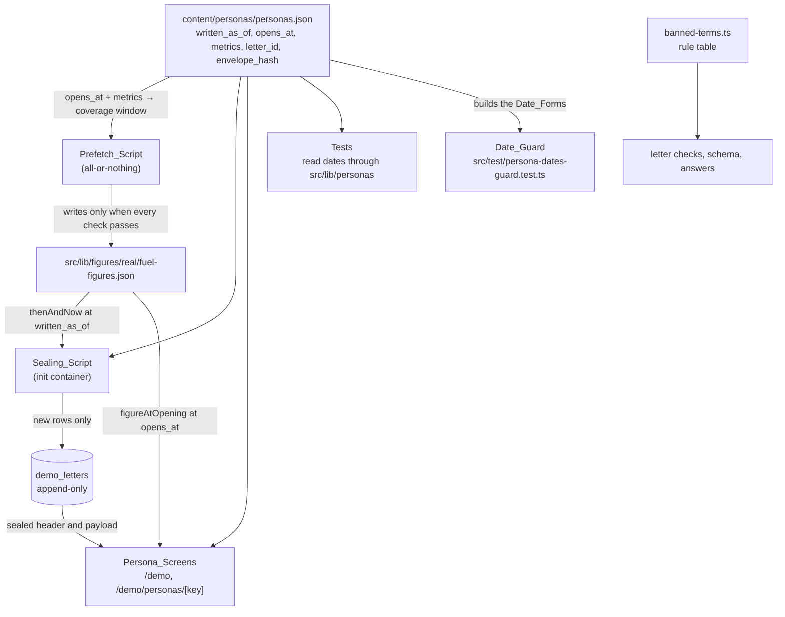

# Design Document

Spec: 18 Persona dates

## Overview

This spec moves the three persona letters to one written-as-of date (Sunday 17 November 2024) and one opening date (17 November 2026), rewrites their texts for a November Sunday, refetches the fuel figures past the opening date, and reseals the letters with new ids. After it, `content/personas/personas.json` is the only place a persona date is written, and a guard test keeps it that way.

Nothing sealed is changed in place. The sealed format, the crypto, the `thenAndNow` and `figureAtOpening` rules, the API routes, the migrations and the Helm chart stay as they are (Requirement 15). The new letters are new `demo_letters` rows. The old rows stay stored under their retired ids.

This document holds what the owner asked to see before anything is sealed: the three letters, the intro lines, Priya's questions, sealed answers and recollections, the eight figures with their sources, the price lines, the new sample answers and the agent's copy-test self-check. The four at-opening figures cannot be shown yet, because the committed figure file ends at `2026-10-26`. Their rows are marked "pending refetch (task 3)". Task 3 runs the Prefetch_Script, commits the file and fills those rows from it. The design is then presented again for the Approval_Gate. Nothing is sealed before the owner records it.

Main decisions:

1. **One date source.** Screens already read persona dates from the Persona_List or the sealed letter. Tests that describe a real Persona read them through `src/lib/personas` too. The Date_Guard fails on a current persona date written anywhere else.
2. **The then figure is the week of 11 November 2024** for all four series. Weekly periods are week-start Mondays and `periodEnd` returns a weekly period unchanged, so `2024-11-11` is the latest period on or before `2024-11-17`. The next week, `2024-11-18`, is after it.
3. **The at-opening figure is the week of 16 November 2026**, if the sources have published it. `2026-11-16` is the only Monday in the coverage window `2026-11-11` to `2026-11-17` (Requirement 2.1). The refetch fails if that week is missing.
4. **The Prefetch_Script becomes all-or-nothing.** Today a failed series still lets the run write the file and exit 1. Requirement 2.9 needs the committed file left unchanged on any failure. The entry now checks everything first and writes only when every check passes.
5. **Coverage comes from the Persona_List.** The entry reads each Persona's `opens_at` and metrics and asks for a figure in the seven days up to that date. No date is written into the prefetch code.
6. **Banned terms become a small rule table.** Each entry keeps its readable form in `ELECTION_PARTY_TERMS`. A rule (prefix, whole word or phrase) builds its pattern. One matcher serves every persona text check.
7. **The sealed-for-demo line reads "Sealed later, for this demo, on {sealedAt}."** It is left out when `sealedAt` cannot be formatted.
8. **The reseal is two small PRs around one deploy.** PR A carries the approved texts, dates and new ids. The owner deploys it, and the init container seals the three new rows. PR B records the three production hashes. J10 fails between the two deploys. That window is expected and recorded.

Facts checked while writing this design, at the current checkout:

| What | Result |
|---|---|
| Weekly period end. `periodEnd(period, "weekly")` returns the period unchanged. EIA and Oil Bulletin periods are Mondays. | Read `src/lib/figures/periods.ts` and the Figure_File. |
| The then figure for each series at `2024-11-17` is the `2024-11-11` week. | Ran `thenAndNow(metricId, "2024-11-17", DEMO_FIGURES)` from a temporary script outside the content files. No content file was changed. |
| `figureAtOpening(metricId, "2026-11-17T00:00:00.000Z", …)` returns the `2026-10-26` week today, because that is the file's last period. A missing refetch would show a three-week-old figure as the at-opening figure with no error. | Same run. That value is not quoted here. Requirement 2.3's coverage check closes this. |
| `recordCandidate` gives `3.05`, `3.52`, `1.63` and `1.53`. `formatValue` uses `roundingMode: "halfExpand"`. | Same run. |
| `classifyCandidate` compares exact BigInts: near when `100 × |c − t| ≤ 5 × t`, below when `100 × c ≤ 85 × t`, above when `100 × c ≥ 115 × t`. `t` is the shown value at full precision (after the rescale), not the two-decimal Record_Candidate. | Read `spread.ts` and `samples.test.ts`. |
| The draft letters, intro lines, sealed answers and recollections below pass `checkLetterText`, `checkAnswerText` and `firstPoliticalTerm` as they stand today. They also match none of the terms Requirement 8 adds. | Ran the checks on copies in `/tmp`. `git status` showed no change outside this spec folder. |
| `scripts/prefetch-figures-main.ts` writes the figure file and `fetch-status.json` before it reports failed series, then exits 1. | Read the file. |
| The catalogue holds exactly the four Persona_Series. | `src/lib/figures/catalogue.ts`. |
| `src/lib/events/` does not exist. | `ls src/lib/events` fails. No code sets a persona date from events. |
| `REVEAL_COPY.sealedForThisDemo` renders only in the persona variant of `SealedLetterCaption`. It uses `formatLetterDate(header.sealedAt, { kind: "utc" })`, which returns `""` for a bad instant, so today a bad value would print "Sealed for this demo on " with no date. | Read `SealedLetter.tsx`. |
| `ANSWER_MAX_CODE_POINTS.recollection` is 500 in `answers.ts`. Requirement 6.3 allows up to 1,000. | Read `answers.ts`. The tighter code limit stays, and every recollection below is under 100 code points. |
| At `643aac5a` no sealed answer or recollection names "the summer". The letter does ("later in the summer"). Requirement 6.3's code fact is wrong on this point. All four are still rewritten, so that the coast trip matches the new letter's winter weekend. | Read `answers.json` and `sealed-answers.json`. |
| The retired id `wom_GdH6gqP6AGgnyhIMgA` is written in six test files, and `ydsos6hcjdEUOs3sK42RQg` and `8t6Bz4bWlaUky-byt1mzGg` in `retired-ids-scan.test.ts`. Requirement 11.7 forbids that outside the Persona_List. | `git grep`. |
| `docs/readme-hero2x.png` shows "as of 12 May 2024", "3.643" and "week of 6 May 2024". | Viewed the image. |
| `.kiro/steering/product.md` lines 57 and 113 say "demo windows", which Requirement 14.7 bans, as well as the Demo 1 bullets. | `grep` on `.kiro/steering/`. |

### Where the code differs from the requirements

Each item below needs the owner's decision. The design's default is stated, and the open questions table repeats it.

1. **Date_Guard month form.** Requirement 12.4 asks for a case-sensitive exact substring match on all five Date_Forms. The month form `November 2026` is a substring of every November 2026 day date, for example "the 20 November 2026 go/no-go" in `retired-ids-scan.test.ts` and `regions-scan.test.ts` (a real product date in `product.md`) and fixtures such as "19 November 2026" in five reveal tests. About 30 files would fail for dates that are not persona dates. **Default:** the three ISO and day forms are exact substrings, as written. The two month forms (`November 2024`, `November 2026`) count only when the text before them is not a day number and a space, so "17 November 2026" is still caught by the day form and a bare "November 2026" is caught by the month form. This changes the wording of Requirement 12.4. If the owner prefers the strict rule, the design lists the extra files in task 6 and changes their fixtures, and the go/no-go date gets an exemption.
2. **Prefetch all-or-nothing.** Spec 08 R21.2 lets a run store the series that succeeded when one fails. Requirement 2.9 needs the committed file unchanged when any Persona_Series fails. The catalogue holds only the four Persona_Series, so for the Prefetch_Script the two rules cannot both hold. **Default:** the Prefetch_Script follows Requirement 2.9 and writes nothing on any failure. The Fetch_Job (the CronJob) keeps spec 08 R21.2 unchanged.
3. **Priya's questions stay as written.** "What am I looking forward to most right now?" and "What am I worried about right now?" already meet Requirement 6.2: first person, present tense, no date and no season. The owner's request says "reworded questions". **Default:** unchanged. The owner can ask for new wording at the gate.
4. **More public-event terms.** Requirement 5.13 names Christmas and New Year, which Requirement 8.1 does not list. **Default:** add `christmas` (prefix) and `new year` (phrase). Words such as "strike" or "summit" are not added, because as prefixes they would match "striking" and ordinary uses of "summit". The copy-test self-check covers them instead.

## Architecture



Data paths that this spec does not change: `thenAndNow`, `figureAtOpening`, the sealed format v1 and v2 modules, `src/lib/crypto/`, the API routes and the persona page steps.

## Components and Interfaces

### 1. Persona_List (`content/personas/personas.json`) — Requirements 1, 11

After the Approval_Gate (task 8), each of the three entries holds:

```json
"written_as_of": "2024-11-17",
"opens_at": "2026-11-17T00:00:00.000Z"
```

Each gets a new `letter_id` (22 characters of URL-safe base64, matching `demo_letters_id_format`), generated with `crypto.randomBytes(16).toString("base64url")` and checked against `retired_letter_ids`. `retired_letter_ids` gains `NvKu8C4wTJsMYe8uv1AkAQ`, `zGQh3PULIzdSxkyu9elzUA` and `9cvEPNCigWy7H7peQprIWg`. The slugs, `display_name`, `region`, `metrics` and `letter_path` stay.

`envelope_hash`: PR A keeps each Persona's old hash, because the new hash exists only once production has sealed the row (see component 9). PR B replaces it.

The schema in `src/lib/personas/schema.ts` keeps its rules (Requirement 1.3). Two additions:

- The `intro_line` refine and a new `authorQuestionSchema` refine call `firstBannedTerm` (component 4), so both use the extended list (Requirement 8.5).
- A zod issue for a bad `written_as_of` or `opens_at` already carries the path. The error message for the list is prefixed with `persona "<key>": <field>`, so the failure names the key and the field (Requirement 1.4). `seal-personas.ts` already exits non-zero when `PERSONAS` fails to load.

### 2. Screens read dates — Requirements 1.5 to 1.9, 10

No screen holds a persona date literal today. The strings and their sources:

| String | Filled from | Formatter |
|---|---|---|
| `REVEAL_COPY.letterDisclosure` {writtenAsOf} | sealed payload `written_as_of` | `formatCalendarDate` |
| `REVEAL_COPY.writtenAsOfPrefix` {date} | Persona_List `written_as_of` | `formatCalendarDate` |
| `REVEAL_COPY.memoryLine` {month} | Persona_List `written_as_of` | `formatCalendarMonth` |
| `CEREMONY_COPY.envelopeOpens` {date} | Persona_List or sealed header `opens_at` | `formatLetterDate(…, { kind: "utc" })` |
| `REVEAL_COPY.sealedForThisDemo` {sealedAt} | sealed header `sealedAt` | `formatLetterDate(…, { kind: "utc" })` |
| `labelHistoricalRecord` {date} | that figure's `retrieved_at` | `formatShortDate` |

All of these read UTC calendar parts, so the output does not depend on the browser timezone (Requirement 1.7).

**The sealed-for-demo line (Requirement 10.5, 10.6).** `REVEAL_COPY.sealedForThisDemo` becomes **(proposed)** "Sealed later, for this demo, on {sealedAt}." `SealedLetterCaption` computes the formatted date first. When it is `""` (no value, or a value `Date.parse` rejects), the `<p>` is not rendered. Nothing takes its place.

The Date_Forms each formatter can produce, and the form each contains:

| Formatter | Output for the new dates | Date_Form it contains |
|---|---|---|
| `formatCalendarDate("2024-11-17")` | 17 November 2024 | en-GB day date |
| `formatLetterDate("2026-11-17T00:00:00.000Z", utc)` | 17 November 2026 | en-GB day date |
| `formatCalendarMonth("2024-11-17")` | November 2024 | en-GB month |
| `formatShortDate("2026-11-17T00:00:00.000Z")` | 17 Nov 2026 | en-GB short date |
| `formatWeekdayDate(…, "UTC")` | Sunday, 17 November 2024 / Tuesday, 17 November 2026 | en-GB day date |
| raw field | 2024-11-17, 2026-11-17T00:00:00.000Z | ISO date, ISO instant |

### 3. Prefetch_Script — Requirement 2

Changes in `src/lib/sources/prefetch.ts` (pure) and `scripts/prefetch-figures-main.ts` (entry). The adapters and `refresh.ts` merge rules do not change (Requirement 15.2).

New pure functions in `prefetch.ts`:

```ts
/** A Weekly_Gap: two consecutive periods of one series not exactly 7 days apart. */
export type WeeklyGap = { metricId: string; before: string; after: string };
export function findWeeklyGaps(
  figures: readonly FigureV1[],
  metricIds: readonly string[],
): WeeklyGap[];

/** One series must hold a period in [from, to] inclusive. */
export type CoverageNeed = { metricId: string; from: string; to: string };
export type CoverageMiss = { metricId: string; latest: string | null };
export function findCoverageMisses(
  figures: readonly FigureV1[],
  needs: readonly CoverageNeed[],
): CoverageMiss[];

/** An added figure whose unit, region, source or series_id differs from the series. */
export type ProvenanceMismatch = {
  metricId: string; period: string;
  field: "unit" | "region" | "source" | "series_id";
};
export function findProvenanceMismatches(
  existing: readonly FigureV1[],
  added: readonly FigureV1[],
): ProvenanceMismatch[];
```

`findWeeklyGaps` sorts each series by period and compares neighbours with `Date.UTC` day arithmetic. A duplicate period counts as a gap of 0 days.

`PrefetchDeps` gains `coverage?: readonly CoverageNeed[]`. `runPrefetch` gains three new error kinds, `weekly_gap`, `opening_coverage` and `provenance`, raised after the merge and before serialising, each carrying every finding. It also throws a new `series_failed` `PrefetchError` when any series failed, instead of returning a partial outcome.

The entry builds the coverage needs from the Persona_List:

```ts
// For each Persona with metrics, for each metric:
//   to   = opens_at date part
//   from = to minus 6 days
// For the move in this spec: { from: "2026-11-11", to: "2026-11-17" } for all four.
```

The entry order becomes:

1. Read the Figure_File and `fetch-status.json`.
2. `runPrefetch(existing, { coverage })`.
3. On any `PrefetchError` or other thrown error: print every finding line, then one `prefetch failed: <kind>` line, and exit 1. Neither file is written.
4. On success: write both files through the temp-and-rename path, print the Report, exit 0.

Finding lines, one per finding, in `formatReportLine` style:

```
weekly-gap <metricId> <before> <after>
opening-coverage <metricId> latest <period|none>
provenance <metricId> <period> <field>
series-failed <metricId> reason=<token>
```

`<token>` is the existing fixed reason token (`http_status`, `parse`, `missing_api_key` and so on), never a secret or a URL with a key. Revision lines are printed as today. The PR that commits the refetch copies them into its description, or states that there were none (Requirement 2.6).

`retrieved_at` stays per download (`downloadedAt`), so the added weeks carry the refetch time, and the committed weeks keep `2026-11-01T16:39:37Z` or `2026-11-01T16:39:38Z` (Requirement 2.5). The then figures are committed weeks, so their "historical record, retrieved" label shows 1 Nov 2026, and the at-opening figures show the refetch date (Requirement 2.7, open question 2).

Tests that pin the last period `2026-10-26` (`bundled-latest`, `real-file.test.ts`, `then-now.test.ts` "now" assertions) read the last period from the Figure_File instead (Requirement 2.8). `real-file.test.ts` `LATE_COVERAGE_LIMIT` becomes the latest `opens_at` date in the Persona_List, and a new assertion checks that each persona metric's `figureAtOpening` period falls in the coverage window.

### 4. Banned terms — Requirement 8

`src/lib/personas/banned-terms.ts` keeps `ELECTION_PARTY_TERMS` as readable entries and adds one rule per entry:

```ts
export type TermRule = "prefix" | "word" | "phrase";
export const TERM_RULES: Readonly<Record<string, TermRule>>;
export type BannedMatch = { term: string; index: number; line: number };
export function findBannedTerms(text: string): BannedMatch[];   // every match
export function firstBannedTerm(text: string): string | null;   // first match as written
/** @deprecated name kept for callers; same as firstBannedTerm. */
export const firstPoliticalTerm: typeof firstBannedTerm;
```

Every pattern is case-insensitive and anchored at a word start: `(?:^|[^A-Za-z0-9_])`. `term` is the text as written. `line` is 1-based.

| Entry | Rule | Pattern after the word start | Notes |
|---|---|---|---|
| election, vote, voting, ballot, campaign, candidate, party, parties, democrat, republican, president, congress, senate, government, policy, policies, politic, governor, mayor, senator, minister, parliament, riksdag | prefix | the entry | kept from `643aac5a` |
| electoral | prefix | `electoral` | "electorate" does not match; "election" already covers it |
| inaugurat | prefix | `inaugurat` | inaugurate, inauguration, inaugurated |
| poll | word | `poll(?![A-Za-z0-9_])` | "pollen" and "pollinate" do not match |
| polls | word | `polls(?![A-Za-z0-9_])` | |
| referendum | prefix | `referendum` | referendums |
| midterm | prefix | `midterm` | midterms |
| primaries | prefix | `primaries` | "primary" does not match |
| caucus | prefix | `caucus` | caucuses |
| swing state | phrase | `swing\s+state` | swing states, across a line break |
| thanksgiving | prefix | `thanksgiving` | |
| veterans day | phrase | `veteran(?:s['’]?\|['’]s)\s+day` | veterans day, veteran's day, veterans' day |
| armistice | prefix | `armistice` | |
| remembrance | prefix | `remembrance` | "remember" and "remembered" do not match |
| black friday | phrase | `black\s+friday` | "black" or "Friday" alone do not match |
| holiday | prefix | `holiday` | holidays |
| christmas | prefix | `christmas` | added by this design (item 4 above) |
| new year | phrase | `new\s+year` | new years; added by this design |

Negative examples, each tested to match no entry: pollen, pollinate, electric, selection, primary, remember, remembered, black, Friday, state, day, holy, devote, apolicy, electorate, newly, yearly.

Callers: `checkLetterText`, `checkAnswerText`, the `intro_line` refine and the new `author_questions` refine all call `firstBannedTerm`. No caller keeps its own list (Requirement 8.5).

**Problem messages (Requirement 8.7).** A new test file `src/lib/personas/persona-texts.test.ts` runs `findBannedTerms` on every Persona_Text and reports:

```
content/personas/letters/us-maya.txt:12: contains banned term "Holiday"
content/personas/personas.json us-priya author_questions[1]: contains banned term "poll"
content/personas/letters/sealed-answers.json us-priya sealed answer[2]: contains banned term "vote"
content/personas/letters/answers.json us-priya recollection[1]: contains banned term "Thanksgiving"
```

Indexes are 1-based. `CLEAN_WORDS` in `letter-checks.property.test.ts` holds no word any entry matches (checked: none of its 33 words match), so the clean-text property stays as it is (Requirement 8.8). `RETIRED_PHRASES` keeps both entries (Requirement 8.6).

### 5. Persona_Texts and their checks — Requirements 5, 6, 9

The texts are in "Data Models". Two new checks join the existing ones in `persona-texts.test.ts`:

- **Season words (5.2, 6.1 to 6.3).** In the letter files: no whole-word month name from January to September and no whole word `spring`, `summer`, `springtime` or `summertime`, in any case. Requirement 5.2 allows "may" as a verb. The test bans the whole word `May` only with a capital M, so "may" as a verb passes and "Maybe" is not a whole-word match. The three letters use neither. In intro lines, questions, sealed answers and recollections: no month other than November, no weekday other than Sunday, and no season word other than autumn, fall or winter.
- **Period words (5.6).** `weekOfMonthWords(period)` in `src/lib/personas/price-lines.ts` returns "first week of November" for days 1 to 7, "second week of …" for 8 to 14, and so on to "fifth" for 29 to 31. The test finds each price phrase, takes the sentence that holds it, and checks that the sentence contains `weekOfMonthWords(then.period)` for that series.

The no-exclamation-mark rule (5.11) and the plain-text rule (5.10: no `<tag>`, no `#` at a line start, no `*`, `_` or backtick emphasis, no `- ` or `1. ` list marker, no `[text](url)`) are added to `checkLetterText`.

### 6. Sample answers — Requirement 7

`content/personas/letters/samples.json` gets the values in "Data Models". `samples.test.ts` keeps Property 15 and the spread and no-record checks. Its literal list of shown then values becomes `["1.53", "1.63", "3.05", "3.52"]`. Each then figure is read through `thenAndNow` at the Persona_List's `written_as_of`, so a missing then figure fails with the metric id (Requirement 7.6).

`sample-seed.ts`, the sample label and `SAMPLE_SEED = 1` are unchanged. The layout check and its baseline name no literal sample value today (checked with `git grep`). Component tests such as `RecallPager.sample.test.tsx` use "3.59" as a generic sample fixture, not as a persona's pinned sample, and keep it.

### 7. Copy-test records — Requirement 9

Each record (`us-copy-test.md`, `eu-copy-test.md`, `us-priya-copy-test.md`) is rewritten in task 8 with:

- Persona labels: `Written as of: 2024-11-17 (plain date, no event name)` and `Opens: 2026-11-17T00:00:00.000Z (plain date, no event name)`.
- "Texts under review": the letter by path, the intro line in full, and for `us-priya` both questions in full and both sealed answers and recollections by file and key.
- The checklist, with question 8 replaced by: "Does the text name an election, a vote, a public holiday or any other public event? (Expected: no.)"
- "Agent self-check (does not count as a pass)": the tables from "Copy-test self-check" below.
- "Points for the reviewer".
- `Reviewer: Jacob Morgan`, `Result: pending`.
- The section "Removal of the opening event (spec 10 X4, issue #300)", wording unchanged, under the label "History: spec 18 replaced the dates this section names." The two "Opens: … (U.S. presidential election day …)" and "(European Parliament election …)" lines in the persona labels are removed.
- The price-line notes refer to "the week of 11 November 2024" and no longer to May.

The three records are exempt from the Date_Guard and from the retired-phrases scan, as today.

### 8. Date_Guard — Requirement 12

New file `src/test/persona-dates-guard.test.ts`.

```ts
export const SCAN_ROOTS = ["src", "tools", "scripts", ".github", "content", "README.md", "docs/video-script.md"];
export const SKIP_DIRS = ["node_modules", ".next", "dist", ".git", ".kiro/specs", "docs/design"];
export const EXEMPT_FILES = [
  "content/personas/personas.json",
  "content/personas/letters/us-maya.txt",
  "content/personas/letters/eu-tomas.txt",
  "content/personas/letters/us-priya.txt",
  "content/personas/letters/us-copy-test.md",
  "content/personas/letters/eu-copy-test.md",
  "content/personas/letters/us-priya-copy-test.md",
  // Regenerated by the layout check; its GO1 rows quote the rendered "Opens {date}".
  "tools/qa/layout-gate-baseline.json",
  // A dated evidence record from spec 12 ("Checked on …"), kept as written.
  "tools/qa/patches/spec-12-tasks.evidence.md",
];
export function dateFormsOf(value: string): string[]; // five forms, built with the letter-date formatters
export function scanText(path: string, text: string, forms: readonly DateForm[]): Finding[];
```

- Forms come from `PERSONAS` (`written_as_of`, `opens_at`) through `formatCalendarDate`, `formatShortDate` and `formatCalendarMonth`. The test file itself holds no date literal.
- A file with a NUL byte is skipped as binary.
- Matching: ISO date, ISO instant, day date and short date are exact, case-sensitive substrings per line. A month form matches when the text before it on the line does not end with one or two digits and a space or no-break space (item 1 of "Where the code differs"; open question 10).
- Figure_File fields: a `period` or `retrieved_at` value that contains a form is exempt for that field only (Requirement 12.8). No such value exists today: periods are Mondays and both new dates are not Mondays (17 November 2024 is a Sunday, 17 November 2026 a Tuesday). Task 9 checked the file refetched on 2026-11-23: none.
- `PERSONAS` empty or unreadable: the test fails with "Date_Guard: content/personas/personas.json yielded no persona dates" (Requirement 12.9).
- All findings are collected and reported in one failure: `<path>:<line>: "<form>"`.

**Per-file actions (Requirement 12.3).** Built with `git grep` for every Old_Persona_Date and every Date_Form of the new dates under the scanned roots. The grep finds 71 files with an Old_Persona_Date (the requirement's 63 left out the content files and the `12 May 2027` live-demo fixtures that the `12 May` form also matches) and five more that hold only a new-date form. Actions: **R** reads the Persona_List; **F** keeps an unrelated fixture date; **F→** keeps a fixture but moves it off a current Date_Form; **C** comment updated; **E** exempt in the Date_Guard; **P** Persona_List or Persona_Text, changed by task 8.

| File | Action | Reason |
|---|---|---|
| content/personas/personas.json | P | The one date source. |
| content/personas/letters/us-copy-test.md, eu-copy-test.md, us-priya-copy-test.md | P, E | Records name the dates (9.1). |
| src/app/api/letters/[id]/route.test.ts | F | API row fixture, not a Persona. `src/app/api/` is frozen (15.1). |
| src/app/api/letters/[id]/secret/route.test.ts | F | Same. |
| src/app/api/openings/leak.test.ts | F | Same. |
| src/app/api/openings/route.test.ts | F | Same. |
| src/app/demo/page.test.tsx | F | Mocks `PERSONAS` with synthetic entries. |
| src/app/demo/personas/[key]/page.test.tsx | F | Synthetic persona fixture. |
| src/components/ceremony/ceremony-gates.property.test.tsx | F | Flow-state fixture. |
| src/components/ceremony/CeremonyRoot.test.tsx | F | Flow-state fixture. |
| src/components/ceremony/envelope/envelope-layout.test.tsx | F | Synthetic persona. |
| src/components/ceremony/envelope/envelope-show-dates.test.tsx | F | Synthetic persona; asserts its own formatted date. |
| src/components/ceremony/envelope/Envelope.test.tsx | F | Same. |
| src/components/ceremony/envelope/envelope-turn.test.tsx | F | Same. |
| src/components/ceremony/envelope/EnvelopeView.test.tsx | F | Same. |
| src/components/ceremony/focusable-under-hidden.stages.test.tsx | F | Flow-state fixture. |
| src/components/ceremony/intro/PersonaIntro.test.tsx | F | Synthetic persona. |
| src/components/ceremony/intro/TestifyContext.test.tsx | F | Synthetic persona; "You lived through May 2024" is its own fixture month. |
| src/components/ceremony/letter/LetterBlock.test.tsx | F | Opened-letter fixture. |
| src/components/ceremony/letter/light-shaft.test.tsx | F | Same. |
| src/components/ceremony/live-reveal-contrast.test.ts | F | Same. |
| src/components/ceremony/recall/RecallPager.labels.test.tsx | R | Keyed by the real persona keys `us-maya` and `eu-tomas`. |
| src/components/ceremony/recall/RecallPager.property.test.tsx | F | Generated fixture date. |
| src/components/ceremony/recall/RecallPager.text.test.tsx | F→ | Keeps its `2024-05-12` fixture. Its `2026-11-17T09:00:00Z` and `2026-11-17T23:30:00Z` move to `2026-11-18T…`, with "On 19 November 2026" for the zone-crossing case. |
| src/components/ceremony/recall/RecallReader.test.tsx | F | Synthetic persona. |
| src/components/ceremony/recall/testify-author.test.tsx | F | Synthetic. |
| src/components/ceremony/recall/written-on.ts | C | Comment example becomes "19 November 2026". |
| src/components/ceremony/recall/written-on.property.test.ts | F→ | Its instant moves forward two days (note 1). |
| src/components/ceremony/scene/persona-scene.test.tsx | F | Synthetic persona. |
| src/components/ceremony/stages.test.ts | F | Flow-state fixture. |
| src/components/demo/PersonaCard.test.tsx | F | Synthetic props. |
| src/components/live/copy.ts | F | "12 May 2027" is a live-demo example. |
| src/components/live/RealDatePicker.test.tsx | F | Live-demo fixture. |
| src/components/live/real-opening.test.ts | F | Live-demo fixture. |
| src/components/live/seal-runner.real.test.ts | F | Live-demo fixture. |
| src/components/live/desk/sheet-date.ts | C | Comment examples become "Thursday, 19 November 2026" and "19 November 2026". |
| src/components/live/desk/sheet-date.property.test.ts | F→ | Kiritimati and Pago Pago instants move by two days, to `2026-11-19T23:30:00.000Z`; the expected days follow. |
| src/components/reveal/copy.ts | C | `memoryLine` comment names `written_as_of` instead of "May 2024". |
| src/components/reveal/eu-persona-labels.test.tsx | R | Describes `eu-tomas`; reads its dates from the Persona_List. |
| src/components/reveal/no-figures-ending.property.test.tsx | F | Opened-letter fixture. |
| src/components/reveal/OpeningFlow.live.test.tsx | F | Synthetic persona. Its retired id literal is replaced (component 10). |
| src/components/reveal/OpeningFlow.test.tsx | F | Synthetic. |
| src/components/reveal/opening-machine.property.test.ts | F | Comment and fixture describe a synthetic letter. |
| src/components/reveal/recall-answer-echo.test.tsx | F | Synthetic. |
| src/components/reveal/RecallStep.test.tsx | F→ | `2026-11-17T10:00:00.000Z` and `2026-11-17T23:30:00.000Z` move to `2026-11-18T…`; expected "sealed on 18 November 2026" and "19 November 2026". |
| src/components/reveal/ReceiptCard.rescale-note.property.test.tsx | F | Period fixture. |
| src/components/reveal/receipts.test.tsx | F | Label function fixture. |
| src/components/reveal/RememberedAnswers.test.tsx | F | Synthetic. |
| src/components/reveal/remembered-phrase.stages.test.tsx | R | Iterates the real `PERSONAS`; its `opensAt` comes from each persona. |
| src/components/reveal/remembered-phrase.test.tsx | F | Synthetic. |
| src/components/reveal/Reveal.marks.test.tsx | F | Synthetic. |
| src/components/reveal/Reveal.no-figures.test.tsx | F | Synthetic. |
| src/components/reveal/Reveal.test.tsx | F | Synthetic. |
| src/components/reveal/Reveal.text-persona.test.tsx | F | Synthetic. |
| src/components/reveal/SealedLetter.test.tsx | F | Synthetic. Its `sealedForThisDemo` assertion changes with component 2. |
| src/components/reveal/StagePanel.test.tsx | F | Synthetic. |
| src/components/reveal/tamper/tamper-copy-evidence.test.tsx | F | Synthetic. |
| src/components/ui/letter-date.test.ts | F | Formatter tests on fixed inputs. |
| src/components/ui/letter-date.ts | C | Examples become `persona.written_as_of`, "19 November 2026" and "Thursday, 19 November 2026" (13.8). |
| src/components/ui/WaxSeal.test.tsx | F | Synthetic. |
| src/lib/crypto/persona-sealing-v2.test.ts | F | Crypto fixture; `src/lib/crypto/` is frozen (15.1). |
| src/lib/figures/at-opening.test.ts | R | Describes Maya and Tomás; reads dates from the Persona_List and the expected figure through `thenAndNow`. |
| src/lib/figures/at-opening.ts | C | Comment says `opens_at`, an ISO instant at 00:00 UTC (13.8). |
| src/lib/figures/real/real-file.test.ts | R | Coverage limit is the latest `opens_at`. |
| src/lib/figures/then-now.test.ts | F | Rule test on fixture figures at a fixed date (15.3). |
| src/lib/letter-store/queries.test.ts | F | Row fixture. |
| src/lib/personas/eu-entry.test.ts | R | Pins `eu-tomas`. |
| src/lib/personas/index.test.ts | R | Pins `us-maya`. |
| src/lib/personas/intro-line.test.ts | R | Line 113 names `us-maya`. Its retired id literal is replaced. |
| src/lib/personas/schema.property.test.ts | F | Generated invalid-list fixtures. |
| src/lib/personas/schema.test.ts | F | Synthetic valid and invalid lists. The real list is accepted through `PERSONAS` with no literal. |
| src/test/integration/sealed-letters.test.ts | F | Real-letter integration fixture. |
| tools/qa/layout-gate-baseline.json | E | Regenerated (13.4). |
| tools/qa/patches/spec-12-tasks.evidence.md | E | Dated record. |

Note 1: `written-on.property.test.ts` checks that one instant formats as different days in UTC and Stockholm ("16 November 2026" and "17 November 2026" today). Task 6 moves the instant forward two days, so the expected strings become "18 November 2026" and "19 November 2026", and keeps the assertion shape.

No fixture kept with **F** equals or contains a Date_Form of `2024-11-17` or `2026-11-17` (Requirement 12.2). The guard checks this.

### 9. Reseal — Requirement 11

Order of operations, after the Approval_Gate:

```mermaid
sequenceDiagram
  participant Agent
  participant GH as GitHub (PR, CI, build)
  participant Owner
  participant Fleet
  participant Init as Init container (seal-personas)
  participant Prod as revenant.devclef.se

  Agent->>GH: PR A: texts, dates, new ids, retired ids, samples, Date_Guard, steering, docs
  GH-->>Owner: ci-gate green
  Owner->>Prod: record demo_letters row count (before)
  Owner->>GH: merge PR A
  GH->>GH: build pushes image
  Owner->>Fleet: bump image tag in the GitOps repo
  Fleet->>Init: roll out; migrate, then seal-personas
  Init->>Prod: insert 3 new demo_letters rows
  Note over Prod: J10 fails here: envelope_hash in personas.json is still the old one
  Owner->>Prod: record row count (after = before + 3)
  Agent->>Prod: GET /api/letters/{new id} for each persona
  Agent->>GH: PR B: three envelope_hash values only
  Owner->>Fleet: deploy PR B image
  Agent->>Prod: journey-check J2, J10
```

- PR A keeps each Persona's old `envelope_hash` because the schema requires a 64-hex value and the new one does not exist yet. During the window the closed envelope's wax is drawn from the old hash, and Break the seal draws from the new one. That mismatch is cosmetic and lasts until PR B is deployed. The PR A description says so.
- If the init container's Sealing_Script fails for a Persona (`stored_letter_differs`, `real_letter_collision`, `missing_then_figure`), the pod does not start and Fleet keeps the old ReplicaSet. The owner copies the result line into the PR or issue (Requirement 11.8). PR B records no hash for a failed Persona.
- The row counts need database access, which only the owner has. The owner runs `SELECT count(*) FROM demo_letters` before and after, and `SELECT id, envelope_hash FROM demo_letters WHERE id IN (…old ids…)` after, and records the results in PR B (Requirement 11.6).
- Before the deploy, the Sealing_Script can be run against a local database to prove the build and the payload (task 9). That run seals local rows only.
- Each persona page opens straight on the first question: the opening date is already past on 23 November 2026, and the server releases the demo secret for persona rows (Requirement 11.11).

### 10. Retired ids — Requirement 11.7

`src/components/retired-ids-scan.test.ts` part 1 becomes: read every id from `RETIRED_LETTER_IDS`, list tracked files with `git ls-files -z`, and fail on any id found outside `content/personas/personas.json` and `.kiro/specs/`. The test fails if `git` is unavailable rather than pass with nothing scanned. The six test files that write `wom_GdH6gqP6AGgnyhIMgA`, and the two ids in the scan test itself, use `RETIRED_LETTER_IDS[n]` instead.

### 11. QA tools and docs — Requirement 13

- `tools/qa/journey-check.mjs` already reads `personas.json` at run time for J10 and holds no Old_Persona_Date or Old_Letter_Id (checked). No change beyond a check in task 10.
- `tools/qa/layout-gate-baseline.json` is regenerated against a build with the new dates (task 10). The four GO1 rows "Opens 5 November 2024" and the rows for "Opens 9 June 2024" become "Opens 17 November 2026". The PR lists every row added, removed or changed, and flags any change other than date, price, letter or sample text.
- `README.md`: the text has no persona date or price. `docs/readme-hero2x.png` shows "as of 12 May 2024" and May 2024 figures. **Default:** a caption directly under the image: "This picture shows the earlier persona letters, written as of an earlier date." Retaking the image is optional (open question 12).
- `docs/video-script.md`: the shot list names no persona date, month, season, price or letter line today. The task re-checks it and records "none found" or each change.

### 12. Steering — Requirement 14

`.kiro/steering/product.md`, Demo 1. Replace the line "One or two personas per region, chosen from these fixed windows (the 12 months up to and including the date):" and its three bullets with **(proposed)**:

> - Each persona letter is written as of one date and opens on one date, both set in `content/personas/personas.json`. Today every persona is written as of a November Sunday and opens two years later.

Keep "Opening dates are shown as plain dates, with no event name." and "A persona letter's "now" figures are the official records for the week of its opening date." unchanged. Line 57 "cover the demo windows" becomes "cover the persona dates". Line 113 "cover the demo windows and today" becomes "cover the persona dates and today".

`.kiro/steering/neutrality.md`. The heading becomes "## Election dates (suggested opening dates, after the MVP)". The first bullet becomes **(proposed)**:

> - In the MVP, election dates are not used. Persona dates are plain dates set in `content/personas/personas.json`, and a persona opening date is shown with no event name. Describing a date in plain terms ("2028 U.S. presidential election day") applies only to suggested opening dates after the MVP.

The other bullets and "Show an event name next to a persona opening date" in "Revenant does not" stay.

`.kiro/steering/structure.md`. `src/lib/events/` does not exist, so no code sets a persona date (Requirement 14.5). The line becomes: `events/  # Planned: event dates with provenance, for suggested opening dates after the MVP`.

These edits go in PR A, with the owner's approval of the proposed wording recorded in it (Requirement 14.8).

## Data Models

No schema, table or format changes. The data below is content.

### The eight Persona_Figures

Then figures are copied from the committed Figure_File (`thenAndNow(metricId, "2024-11-17", …).then`). "Value as shown" is the stored value after the Display_Rescale, at two decimals, as the reveal shows it. The at-opening rows are not filled: the committed file ends at `2026-10-26`, before the coverage window. No value for them is written here.

Shared fields:

- EIA rows: source `U.S. Energy Information Administration (EIA), Weekly Retail Gasoline and Diesel Prices`, region `U.S.`, unit `USD per gallon`.
- Oil Bulletin rows: source `European Commission, Weekly Oil Bulletin`, region `EU27, weighted average`, unit `EUR per 1,000 litres` (shown as `EUR per litre`), `source_url` `https://energy.ec.europa.eu/data-and-analysis/weekly-oil-bulletin_en`.
- Oil Bulletin `series_id`, petrol: `File Weekly_Oil_Bulletin_Prices_History_maticni_4web.xlsx, sheet "Prices with taxes", column C "EU_price_with_tax_euro95", country EU27 weighted average (rows marked EU_)`. Diesel: the same with `column D "EU_price_with_tax_diesel"`.

| Persona | Metric | Side | Value as stored | Value as shown | Unit | Region | Period | Source | series_id | source_url | retrieved_at |
|---|---|---|---|---|---|---|---|---|---|---|---|
| us-maya | us-gasoline-regular | Then | 3.052 | 3.05 USD per gallon | USD per gallon | U.S. | 2024-11-11 | EIA (above) | EMM_EPMR_PTE_NUS_DPG | https://www.eia.gov/dnav/pet/hist/LeafHandler.ashx?n=PET&s=EMM_EPMR_PTE_NUS_DPG&f=W | 2026-11-01T16:39:37Z |
| us-maya | us-gasoline-regular | At opening | 3.805 | 3.81 USD per gallon | USD per gallon | U.S. | 2026-11-16 | EIA (above) | EMM_EPMR_PTE_NUS_DPG | https://www.eia.gov/dnav/pet/hist/LeafHandler.ashx?n=PET&s=EMM_EPMR_PTE_NUS_DPG&f=W | 2026-11-23T19:40:49Z |
| us-maya | us-diesel | Then | 3.521 | 3.52 USD per gallon | USD per gallon | U.S. | 2024-11-11 | EIA (above) | EMD_EPD2D_PTE_NUS_DPG | https://www.eia.gov/dnav/pet/hist/LeafHandler.ashx?n=PET&s=EMD_EPD2D_PTE_NUS_DPG&f=W | 2026-11-01T16:39:37Z |
| us-maya | us-diesel | At opening | 5.937 | 5.94 USD per gallon | USD per gallon | U.S. | 2026-11-16 | EIA (above) | EMD_EPD2D_PTE_NUS_DPG | https://www.eia.gov/dnav/pet/hist/LeafHandler.ashx?n=PET&s=EMD_EPD2D_PTE_NUS_DPG&f=W | 2026-11-23T19:40:49Z |
| eu-tomas | eu-petrol-euro95 | Then | 1631.0766322029144 | 1.63 EUR per litre | EUR per 1,000 litres | EU27, weighted average | 2024-11-11 | Oil Bulletin (above) | petrol (above) | Oil Bulletin page (above) | 2026-11-01T16:39:38Z |
| eu-tomas | eu-petrol-euro95 | At opening | 1829.367794653689 | 1.83 EUR per litre | EUR per 1,000 litres | EU27, weighted average | 2026-11-16 | Oil Bulletin (above) | petrol (above) | Oil Bulletin page (above) | 2026-11-23T19:40:49Z |
| eu-tomas | eu-diesel | Then | 1534.9327680766019 | 1.53 EUR per litre | EUR per 1,000 litres | EU27, weighted average | 2024-11-11 | Oil Bulletin (above) | diesel (above) | Oil Bulletin page (above) | 2026-11-01T16:39:38Z |
| eu-tomas | eu-diesel | At opening | 2049.7103140755485 | 2.05 EUR per litre | EUR per 1,000 litres | EU27, weighted average | 2026-11-16 | Oil Bulletin (above) | diesel (above) | Oil Bulletin page (above) | 2026-11-23T19:40:49Z |

The four at-opening rows were filled in task 9 from the file refetched on 2026-11-23, read through `figureAtOpening(metricId, "2026-11-17T00:00:00.000Z", …)`. The four then rows were re-read from the same file and none differs from this table (Requirement 4.7). The design is presented again for the Approval_Gate.

Priya's letter holds no figure.

### Price lines

Each price equals the then figure as shown, and each sentence names the then period's month and week (day 11 is in days 8 to 14, so "second week").

| Letter | Sentence as written | Metric | Then value as shown | Then period | Period named |
|---|---|---|---|---|---|
| us-maya.txt | On the radio this morning they said the national average for regular was about $3.05 a gallon in the second week of November. | us-gasoline-regular | 3.05 | 2024-11-11 | second week of November |
| us-maya.txt | The radio put diesel at about $3.52 a gallon in the second week of November, which is what the van runs on. | us-diesel | 3.52 | 2024-11-11 | second week of November |
| eu-tomas.txt | The news said the EU average for unleaded was about €1.63 a litre in the second week of November. | eu-petrol-euro95 | 1.63 | 2024-11-11 | second week of November |
| eu-tomas.txt | Diesel was about €1.53 a litre, also in the second week of November. | eu-diesel | 1.53 | 2024-11-11 | second week of November |

### Letter: `content/personas/letters/us-maya.txt`

```text
Dear future me,
It is a Sunday evening in November, and it was dark before supper. The maple next door dropped the last of its leaves this week. I wanted to write this down before the week starts again.
Work is steady. The early shifts at the clinic are hard on the alarm clock, and now I leave the house in the dark, but I like the quiet drive in, when the roads are empty and the frost is still on the fields. I fill the tank on Thursdays at the station by the bridge. On the radio this morning they said the national average for regular was about $3.05 a gallon in the second week of November. I have started keeping the receipts in the glove box, though I never look at them.
On Saturdays I ride along with Jess in her van for the bakery deliveries. She drives, I carry the trays, and we eat the broken scones on the way home with the heater on. The radio put diesel at about $3.52 a gallon in the second week of November, which is what the van runs on. She says she wants a second van one day. I hope she gets it.
Mom's knee is healing. We are planning to drive out to the lake once the weather turns, all of us, if the car holds up. I keep saying I will learn to fix the small things on it myself. Maybe by the time you read this, I will have.
The bills are paid this month, with a little left over. I would like to put some aside for an evening class after the winter. I have not decided which one yet.
I don't know what you will remember of this fall. I think you will remember the maple.
Love,
Maya
```

1,507 code points. The file ends with one newline after "Maya", as today.

### Letter: `content/personas/letters/eu-tomas.txt`

```text
Dear future me,
It is a cold Sunday evening in November, and the balcony door has stayed shut all week. It gets dark before five now, and the street smells of wood smoke. I wanted to write this down before the winter gets busy.
Work at the hospital pharmacy is steady. The shifts rotate every few weeks, which is tiring, but I have got used to the early starts and the tram that is always half empty at that hour. Filling the car at the petrol station on the ring road has become a monthly habit. The news said the EU average for unleaded was about €1.63 a litre in the second week of November. Diesel was about €1.53 a litre, also in the second week of November. I now check the price before I pull in, and I have started keeping the receipts in a folder, though I never look at them.
On Saturdays I go to the covered market with Inês. We split the list: she takes the fish and the bread, I take the vegetables and the cheese. The stalls have chestnuts and squash now, and we always come home with more fruit than we planned. She is saving for a trip to see her brother in Gdańsk and talks about it constantly.
Dad's new flat is small but bright. He has found a café on the corner where they know his order. I hope that by the time you read this, he feels at home there.
I am halfway through the bookbinding course. The materials need a separate budget, but the class is on Thursdays, which fits. I would like to make a notebook for you, something with a proper spine.
I don't know what you will remember of this autumn. I think you will remember the wood smoke, and the smell of the market on Saturday morning.
Love,
Tomás
```

1,624 code points.

### Letter: `content/personas/letters/us-priya.txt`

```text
Dear Priya,
It is a Sunday in November, and the house is quiet before the week starts. The light goes early now, so the lamp is on by four in the afternoon. I am writing this so you can see what the week looked like from here.
The Saturday class is going well. The children have started asking questions I cannot answer yet, and I am trying to take that as a good sign. I have a new reading list and I am a little behind on it.
My sister and I are planning a weekend at the coast in the winter, when the beaches are empty. She wants to drive and I want the train, so we are looking for a way that suits us both. I hope we have managed it by the time you read this.
At work there is a choice in front of me: whether to take the extra morning shift or keep my weekday evenings free. I keep changing my mind. I hope that by the time you open this letter I will have chosen the thing I wanted, and not the thing I felt I ought to want.
Mostly I want you to know that I was tired but hopeful. I hope you still have the Saturday mornings, the coffee on the step with a coat on, and the long phone calls with my sister.
Write back if you like.
Priya
```

1,142 code points.

### Intro lines (`intro_line` in the Persona_List)

`us-maya`:

```text
Maya, who works early shifts at a clinic, writes on a November Sunday about her commute, filling the tank and Saturday deliveries.
```

`eu-tomas`:

```text
Tomás, who works shifts at a hospital pharmacy, writes on a November Sunday about his commute, the car and the market with Inês.
```

`us-priya`:

```text
Priya, who teaches a Saturday class, writes on a November Sunday about her week, a plan with her sister and a choice at work.
```

130, 128 and 125 characters. Only "May" changes to "November" in each.

### Priya's questions (`author_questions`, unchanged)

```text
What am I looking forward to most right now?
```

```text
What am I worried about right now?
```

### Priya's sealed answers (`content/personas/letters/sealed-answers.json`, `us-priya`)

Answer 1:

```text
The winter weekend at the coast with my sister, even though we have not agreed how to get there. And a Sunday with nothing on the list.
```

Answer 2:

```text
The extra morning shift. I keep changing my mind, and either way I worry that I will fall behind on the reading list.
```

### Priya's recollections (`content/personas/letters/answers.json`, `us-priya`, labelled fictional on screen)

Recollection 1:

```text
The weekend by the sea with my sister, mostly. I think I also wanted one quiet Sunday at home.
```

Recollection 2:

```text
I think I had already decided against the extra shift. Mostly I worried about the reading list.
```

Each differs from the letter and the sealed answer only in a detail ("by the sea", "at home"), the emphasis (the reading list first) or the order. None uses a verdict word (right, wrong, close, near, off, accurate, changed, mistaken), refers to the letter, remembering or forgetting, or, in a recollection, to changing a mind.

### Sample_Candidates (`content/personas/letters/samples.json`)

```json
{
  "us-maya": {
    "us-gasoline-regular": ["2.99", "3.15", "2.49", "3.69"],
    "us-diesel": ["3.45", "3.65", "2.89", "4.15"]
  },
  "eu-tomas": {
    "eu-petrol-euro95": ["1.59", "1.69", "1.35", "1.99"],
    "eu-diesel": ["1.49", "1.59", "1.25", "1.85"]
  }
}
```

Arithmetic, with `t` the shown then value at full precision. The code compares exact BigInts. The decimals here are rounded to six places for reading only.

**us-gasoline-regular**, t = 3.052. 5 % of t = 0.152600. 85 % of t = 2.594200. 115 % of t = 3.509800. Record_Candidate 3.05.

| Candidate | \|c − t\| | c as % of t | Class |
|---|---|---|---|
| 2.99 | 0.062000 ≤ 0.152600 | 97.969 % | near |
| 3.15 | 0.098000 ≤ 0.152600 | 103.211 % | near |
| 2.49 | 0.562000 | 81.586 % ≤ 85 % | below |
| 3.69 | 0.638000 | 120.904 % ≥ 115 % | above |

**us-diesel**, t = 3.521. 5 % of t = 0.176050. 85 % = 2.992850. 115 % = 4.049150. Record_Candidate 3.52.

| Candidate | \|c − t\| | c as % of t | Class |
|---|---|---|---|
| 3.45 | 0.071000 ≤ 0.176050 | 97.984 % | near |
| 3.65 | 0.129000 ≤ 0.176050 | 103.664 % | near |
| 2.89 | 0.631000 | 82.079 % ≤ 85 % | below |
| 4.15 | 0.629000 | 117.864 % ≥ 115 % | above |

**eu-petrol-euro95**, t = 1.6310766322029144 (1631.0766322029144 ÷ 1,000). 5 % of t = 0.081554. 85 % = 1.386415. 115 % = 1.875738. Record_Candidate 1.63.

| Candidate | \|c − t\| | c as % of t | Class |
|---|---|---|---|
| 1.59 | 0.041077 ≤ 0.081554 | 97.482 % | near |
| 1.69 | 0.058923 ≤ 0.081554 | 103.613 % | near |
| 1.35 | 0.281077 | 82.767 % ≤ 85 % | below |
| 1.99 | 0.358923 | 122.006 % ≥ 115 % | above |

**eu-diesel**, t = 1.5349327680766019. 5 % of t = 0.076747. 85 % = 1.304693. 115 % = 1.765173. Record_Candidate 1.53.

| Candidate | \|c − t\| | c as % of t | Class |
|---|---|---|---|
| 1.49 | 0.044933 ≤ 0.076747 | 97.073 % | near |
| 1.59 | 0.055067 ≤ 0.076747 | 103.588 % | near |
| 1.25 | 0.284933 | 81.437 % ≤ 85 % | below |
| 1.85 | 0.315067 | 120.526 % ≥ 115 % | above |

Every value has two decimals, sits inside its Unit_Range_Table range (0 to 10 USD per gallon, 0 to 3 EUR per litre), reads back as itself through `parseRecallNumber` (checked), and differs from its Record_Candidate. The near, below and above classes above were also produced by `classifyCandidate` itself. When task 3 fills the at-opening rows, it also checks that no candidate equals a shown at-opening value at two decimals, so a sample cannot be read as a hint about the later figure, and replaces any that does before the gate.

### Copy-test self-check (agent self-check, does not count as a pass)

This is the agent's own reading of the `neutrality.md` copy test. It is not a pass. Jacob Morgan's result is pending for every text below.

Checklist questions, with the expected answer:

1. Would this sentence read the same to someone who holds the opposite political view? (Expected: yes.)
2. Does it name, praise or criticise any party, candidate, official or movement? (Expected: no.)
3. Does it say who the persona will vote for, or whether they will vote? (Expected: no.)
4. Does it explain or attribute a price or cost change to a cause, policy or government? (Expected: no.)
5. Does it describe any cost as good or bad, or as rising or falling in a loaded way? (Expected: no.)
6. Does it avoid stereotypes tied to region, class, age, nationality or background? (Expected: yes.)
7. Is it about everyday life only: work, family, bills, plans and hopes? (Expected: yes.)
8. Does it name an election, a vote, a public holiday or any other public event? (Expected: no.)

Expected answers in order: **Y N N N N Y Y N**. "Agent" is the agent's answers in the same order.

**us-maya.txt**

| # | Sentence | Agent | Same as expected |
|---|---|---|---|
| M1 | Dear future me, | Y N N N N Y Y N | yes |
| M2 | It is a Sunday evening in November, and it was dark before supper. | Y N N N N Y Y N | yes |
| M3 | The maple next door dropped the last of its leaves this week. | Y N N N N Y Y N | yes |
| M4 | I wanted to write this down before the week starts again. | Y N N N N Y Y N | yes |
| M5 | Work is steady. | Y N N N N Y Y N | yes |
| M6 | The early shifts at the clinic are hard on the alarm clock, and now I leave the house in the dark, but I like the quiet drive in, when the roads are empty and the frost is still on the fields. | Y N N N N Y Y N | yes |
| M7 | I fill the tank on Thursdays at the station by the bridge. | Y N N N N Y Y N | yes |
| M8 | On the radio this morning they said the national average for regular was about $3.05 a gallon in the second week of November. | Y N N N N Y Y N | yes |
| M9 | I have started keeping the receipts in the glove box, though I never look at them. | Y N N N N Y Y N | yes |
| M10 | On Saturdays I ride along with Jess in her van for the bakery deliveries. | Y N N N N Y Y N | yes |
| M11 | She drives, I carry the trays, and we eat the broken scones on the way home with the heater on. | Y N N N N Y Y N | yes |
| M12 | The radio put diesel at about $3.52 a gallon in the second week of November, which is what the van runs on. | Y N N N N Y Y N | yes |
| M13 | She says she wants a second van one day. | Y N N N N Y Y N | yes |
| M14 | I hope she gets it. | Y N N N N Y Y N | yes |
| M15 | Mom's knee is healing. | Y N N N N Y Y N | yes |
| M16 | We are planning to drive out to the lake once the weather turns, all of us, if the car holds up. | Y N N N N Y Y N | yes |
| M17 | I keep saying I will learn to fix the small things on it myself. | Y N N N N Y Y N | yes |
| M18 | Maybe by the time you read this, I will have. | Y N N N N Y Y N | yes |
| M19 | The bills are paid this month, with a little left over. | Y N N N N Y Y N | yes |
| M20 | I would like to put some aside for an evening class after the winter. | Y N N N N Y Y N | yes |
| M21 | I have not decided which one yet. | Y N N N N Y Y N | yes |
| M22 | I don't know what you will remember of this fall. | Y N N N N Y Y N | yes |
| M23 | I think you will remember the maple. | Y N N N N Y Y N | yes |
| M24 | Love, Maya | Y N N N N Y Y N | yes |

**eu-tomas.txt**

| # | Sentence | Agent | Same as expected |
|---|---|---|---|
| T1 | Dear future me, | Y N N N N Y Y N | yes |
| T2 | It is a cold Sunday evening in November, and the balcony door has stayed shut all week. | Y N N N N Y Y N | yes |
| T3 | It gets dark before five now, and the street smells of wood smoke. | Y N N N N Y Y N | yes |
| T4 | I wanted to write this down before the winter gets busy. | Y N N N N Y Y N | yes |
| T5 | Work at the hospital pharmacy is steady. | Y N N N N Y Y N | yes |
| T6 | The shifts rotate every few weeks, which is tiring, but I have got used to the early starts and the tram that is always half empty at that hour. | Y N N N N Y Y N | yes |
| T7 | Filling the car at the petrol station on the ring road has become a monthly habit. | Y N N N N Y Y N | yes |
| T8 | The news said the EU average for unleaded was about €1.63 a litre in the second week of November. | Y N N N N Y Y N | yes |
| T9 | Diesel was about €1.53 a litre, also in the second week of November. | Y N N N N Y Y N | yes |
| T10 | I now check the price before I pull in, and I have started keeping the receipts in a folder, though I never look at them. | Y N N N N Y Y N | yes |
| T11 | On Saturdays I go to the covered market with Inês. | Y N N N N Y Y N | yes |
| T12 | We split the list: she takes the fish and the bread, I take the vegetables and the cheese. | Y N N N N Y Y N | yes |
| T13 | The stalls have chestnuts and squash now, and we always come home with more fruit than we planned. | Y N N N N Y Y N | yes |
| T14 | She is saving for a trip to see her brother in Gdańsk and talks about it constantly. | Y N N N N Y Y N | yes |
| T15 | Dad's new flat is small but bright. | Y N N N N Y Y N | yes |
| T16 | He has found a café on the corner where they know his order. | Y N N N N Y Y N | yes |
| T17 | I hope that by the time you read this, he feels at home there. | Y N N N N Y Y N | yes |
| T18 | I am halfway through the bookbinding course. | Y N N N N Y Y N | yes |
| T19 | The materials need a separate budget, but the class is on Thursdays, which fits. | Y N N N N Y Y N | yes |
| T20 | I would like to make a notebook for you, something with a proper spine. | Y N N N N Y Y N | yes |
| T21 | I don't know what you will remember of this autumn. | Y N N N N Y Y N | yes |
| T22 | I think you will remember the wood smoke, and the smell of the market on Saturday morning. | Y N N N N Y Y N | yes |
| T23 | Love, Tomás | Y N N N N Y Y N | yes |

**us-priya.txt**

| # | Sentence | Agent | Same as expected |
|---|---|---|---|
| P1 | Dear Priya, | Y N N N N Y Y N | yes |
| P2 | It is a Sunday in November, and the house is quiet before the week starts. | Y N N N N Y Y N | yes |
| P3 | The light goes early now, so the lamp is on by four in the afternoon. | Y N N N N Y Y N | yes |
| P4 | I am writing this so you can see what the week looked like from here. | Y N N N N Y Y N | yes |
| P5 | The Saturday class is going well. | Y N N N N Y Y N | yes |
| P6 | The children have started asking questions I cannot answer yet, and I am trying to take that as a good sign. | Y N N N N Y Y N | yes |
| P7 | I have a new reading list and I am a little behind on it. | Y N N N N Y Y N | yes |
| P8 | My sister and I are planning a weekend at the coast in the winter, when the beaches are empty. | Y N N N N Y Y N | yes |
| P9 | She wants to drive and I want the train, so we are looking for a way that suits us both. | Y N N N N Y Y N | yes |
| P10 | I hope we have managed it by the time you read this. | Y N N N N Y Y N | yes |
| P11 | At work there is a choice in front of me: whether to take the extra morning shift or keep my weekday evenings free. | Y N N N N Y Y N | yes |
| P12 | I keep changing my mind. | Y N N N N Y Y N | yes |
| P13 | I hope that by the time you open this letter I will have chosen the thing I wanted, and not the thing I felt I ought to want. | Y N N N N Y Y N | yes |
| P14 | Mostly I want you to know that I was tired but hopeful. | Y N N N N Y Y N | yes |
| P15 | I hope you still have the Saturday mornings, the coffee on the step with a coat on, and the long phone calls with my sister. | Y N N N N Y Y N | yes |
| P16 | Write back if you like. | Y N N N N Y Y N | yes |
| P17 | Priya | Y N N N N Y Y N | yes |

**Other Persona_Texts and the sealed-for-demo line**

| Text | Agent | Same as expected |
|---|---|---|
| `us-maya` intro_line | Y N N N N Y Y N | yes |
| `eu-tomas` intro_line | Y N N N N Y Y N | yes |
| `us-priya` intro_line | Y N N N N Y Y N | yes |
| `us-priya` question 1 | Y N N N N Y Y N | yes |
| `us-priya` question 2 | Y N N N N Y Y N | yes |
| `us-priya` sealed answer 1 | Y N N N N Y Y N | yes |
| `us-priya` sealed answer 2 | Y N N N N Y Y N | yes |
| `us-priya` recollection 1 | Y N N N N Y Y N | yes |
| `us-priya` recollection 2 | Y N N N N Y Y N | yes |
| `REVEAL_COPY.sealedForThisDemo` "Sealed later, for this demo, on {sealedAt}." | Y N N N N Y Y N | yes |

**Points for the reviewer.** No answer differs from the expected one. These sentences deserve a look:

- M8 and M12 have a radio report quote the national average, as the May letter did. The figure is EIA's. The receipts show its source.
- M19 mentions money left over after the bills. It describes the persona's month and does not grade any price.
- T13 replaces "We always end up buying too much fruit", because "too much" is on Requirement 5.11's list of judging words, even though it was about fruit.
- T15 to T17 replace the line about Dad joking about the rent. That line could be read as saying the rent was hard to bear. The new lines are about the flat and the street.
- The written-as-of month, November 2024, was U.S. election month. No text names it or any public event. The Memory_Line "You lived through November 2024 too. Answer from your own memory of it." names only the month.

### Approval_Gate

Only the owner fills this section. An agent does not write or edit it. A change to any letter, intro line, question, sealed answer, recollection, figure row, price line or sample above, after this entry is filled, voids it (Requirement 4.10).

- Owner's name:
- Approval date:
- Commit id of the approved `design.md`:
- Sealing waits for Jacob Morgan's copy-test pass (Requirement 6.11): yes / no
- Changes to the proposed wording (sealed-for-demo line, steering lines), if any:

## Correctness Properties

*A property is a characteristic or behavior that should hold true across all valid executions of a system-essentially, a formal statement about what the system should do. Properties serve as the bridge between human-readable specifications and machine-verifiable correctness guarantees.*

### Property 1: Weekly gaps are found exactly

*For any* set of weekly figures across the Persona_Series, built from a gap-free run of Mondays with any periods removed or duplicated, `findWeeklyGaps` reports exactly the neighbouring pairs whose periods are not 7 days apart, each named by series and the two periods, and reports nothing for a gap-free series.

**Validates: Requirements 2.2**

### Property 2: Coverage is met exactly when a period falls in the window

*For any* series of periods and any coverage window `[from, to]`, `findCoverageMisses` reports the series, with its latest period or `none`, if and only if no period of that series lies in `[from, to]` inclusive.

**Validates: Requirements 2.1, 2.3**

### Property 3: The Prefetch_Script writes nothing unless every check passes

*For any* run outcome, including any mix of source failures, weekly gaps, coverage misses and provenance mismatches, the prefetch entry writes the Figure_File and `fetch-status.json` if and only if there are no findings. When there are findings it exits non-zero, prints one line per finding, and prints no secret.

**Validates: Requirements 2.2, 2.3, 2.9, 2.10**

### Property 4: The refetch only appends

*For any* committed figure file and any fresh download, every committed figure keeps its `value` and `retrieved_at`, every added figure's `value` equals the value the source returned for that period and carries the download's `retrieved_at`, and every differing fresh value for a committed period appears as one revision line and is not applied.

**Validates: Requirements 2.4, 2.5, 2.6**

### Property 5: Provenance mismatches are found

*For any* existing series and any added figure, `findProvenanceMismatches` reports the series, period and field if and only if the added figure's `unit`, `region`, `source` or `series_id` differs from the series.

**Validates: Requirements 2.10**

### Property 6: Banned terms match by their rule

*For any* entry of `ELECTION_PARTY_TERMS`, any letter casing, any clean prefix and suffix text, and (for phrase entries) any non-empty run of whitespace between the words, `findBannedTerms` finds the entry when it starts a word, with the matched text as written and its 1-based line. For a prefix entry an inflected form also matches. For `poll` and `polls` a following letter or digit prevents the match. A term that starts inside another word never matches.

**Validates: Requirements 8.2, 8.7**

### Property 7: Clean text matches no banned term

*For any* text built from `CLEAN_WORDS` and the listed negative words (pollen, pollinate, electric, selection, primary, remember, remembered, black, Friday, state, day, holy and the rest), `findBannedTerms` returns nothing, and `checkLetterText` with no prices returns no problem.

**Validates: Requirements 8.3, 8.8**

### Property 8: Week-of-month words follow the day ranges

*For any* real calendar date, `weekOfMonthWords` names the month of that date and the ordinal "first" for days 1 to 7, "second" for 8 to 14, "third" for 15 to 21, "fourth" for 22 to 28 and "fifth" for 29 to 31.

**Validates: Requirements 5.6**

### Property 9: Persona dates render from the list in every timezone

*For any* Persona_List whose `written_as_of` and `opens_at` are valid and different from the committed ones, and any browser timezone offset from UTC−12:00 to UTC+14:00, the rendered persona strings (`letterDisclosure`, `writtenAsOfPrefix`, `memoryLine`, `envelopeOpens`) contain the UTC calendar forms of the new dates and none of the forms of the committed dates.

**Validates: Requirements 1.5, 1.7, 1.9, 10.1**

### Property 10: Invalid persona dates are rejected with the key and field

*For any* Persona_List in which one entry has a `written_as_of` that is not an ISO date, an `opens_at` that is not a UTC ISO instant, or an `opens_at` not later than midnight UTC of its `written_as_of`, parsing fails with a message naming that entry's key and the field.

**Validates: Requirements 1.4**

### Property 11: The sealed-for-demo line shows only the sealing date

*For any* `sealedAt` string, the persona caption either shows exactly "Sealed later, for this demo, on {d}." where `d` is `formatLetterDate(sealedAt, utc)`, when that is not empty, or shows no sealed-for-demo line at all. It never shows the written-as-of or opening date in its place.

**Validates: Requirements 10.4, 10.5, 10.6**

### Property 12: The Date_Guard finds every current persona date and only those

*For any* set of Persona_Dates and any file text with Date_Forms planted at random lines, `scanText` reports every planted ISO, day and short form with its path, 1-based line and form; reports a planted month form exactly when it is not preceded by a day number and a space; and reports nothing for an exempt path.

**Validates: Requirements 12.4, 12.5**

### Property 13: Date_Forms come from the UI formatters

*For any* real calendar date `d`, `dateFormsOf(d)` holds `d`, `d` + `T00:00:00.000Z`, `formatCalendarDate(d)`, `formatShortDate(d + "T00:00:00.000Z")` and `formatCalendarMonth(d)`, and every output of `formatWeekdayDate` for `d` at UTC contains one of them.

**Validates: Requirements 12.1, 12.4**

## Error Handling

| Case | Behaviour |
|---|---|
| A source is down, returns an error status, needs a missing API key or returns an unparseable response | `series-failed <metricId> reason=<token>`, exit 1, both files unchanged. No secret printed. |
| A Weekly_Gap anywhere in a Persona_Series | `weekly-gap` line per gap, exit 1, files unchanged. If the Oil Bulletin skipped a week, the move waits until the source fills it (open question 3). |
| No figure in the coverage window | `opening-coverage` line, exit 1, files unchanged. Typical cause: the week of 16 November 2026 not yet published. Re-run later. |
| An added figure with a different unit, region, source or series ID | `provenance` line, exit 1, files unchanged. |
| A committed figure revised at the source | Revision line, committed value kept, PR lists it. |
| A then value in the refetched file differs from this design | Task 3 stops, reports persona, metric, both values, corrects the design and asks for the gate again. |
| A then figure missing at sealing | `missing_then_figure`, no row stored, exit non-zero, pod does not start. |
| An at-opening figure missing on screen | The existing "no figure" gap with its reason. The then figure still shows. No change line. |
| Then and at-opening figures not comparable | Both raw figures with their periods. No change line. |
| `stored_letter_differs` or `real_letter_collision` | Sealing stops for that Persona. No hash recorded. The owner reports the result line. |
| Envelope hash does not verify on the page | The existing tamper state. Contents are not presented as verified. |
| `sealedAt` missing or unparseable | The sealed-for-demo line is left out. |
| The Persona_List cannot be read | The Date_Guard and every persona test fail, naming the file. |
| A Persona_Text breaks a check | The check names the file, key, field, index or line and the rule. No sealing in that run. |
| J10 fails after PR A's deploy | Expected until PR B's deploy. If it still fails after PR B, the PR records persona, expected and found hash, and the spec is not done. |

## Testing Strategy

- Vitest, as today. Property tests use fast-check (already a dev dependency) with at least 100 runs each, one test per property, tagged `// Feature: 18-persona-dates, Property N: <title>`.
- **Unit and example tests:**
  - Prefetch: one example per finding kind through `main(deps)` with in-memory files, checking that neither file changed (byte-for-byte) and the exit code is 1. One passing run that writes both files.
  - Banned terms: one positive sentence per added entry; the negative word list; the apostrophe forms of "veterans day"; a phrase across a line break.
  - `persona-texts.test.ts`: every Persona_Text against the extended list, the season words, the period words, the no-exclamation and plain-text rules, two questions, two sealed answers, two recollections, in order.
  - `samples.test.ts`: the new shown then list `["1.53", "1.63", "3.05", "3.52"]`; spread classes; no Record_Candidate.
  - `SealedLetter.test.tsx`: the new wording, and no line for a bad `sealedAt`.
  - `retired-ids-scan.test.ts`: every retired id absent from tracked files outside the two allowed places.
  - Date_Guard: passes on the checkout. Task 8's commit body records one run that fails after planting "17 November 2024" in `src/lib/personas/index.ts` (file, line and form named) and one that passes after removing it (Requirement 12.6).
  - Seal payload: `buildPersonaPayload` seals the four then figures exactly as stored in the Figure_File, with format v1 for the fuel personas and v2 for Priya, as today.
- **Integration and browser checks:**
  - Live_Walk (`WALK=1`) against a local production build with the resealed letters: three personas at 1440 × 900 and 390 × 844. It asserts the dates against the letter-date formatters applied to the Persona_List, the sealed-for-demo line against the served header, the receipts values and periods against this design's figure table, and the absence of any Old_Persona_Date or the old price strings in letter text.
  - Journey check J2 and J10 on production after PR B.
  - Layout check regeneration with the baseline diff in the PR.
  - `scripts/check.sh` and `scripts/check-js-budget.mjs` on the head commit of each PR.
- **Tests this spec outdates.** Each task updates or retires these and names them with a reason in its commit body: `index.test.ts`, `eu-entry.test.ts`, `intro-line.test.ts`, `at-opening.test.ts`, `real-file.test.ts`, `bundled-latest` tests, `then-now.test.ts` "now" assertions, `RecallPager.labels.test.tsx`, `eu-persona-labels.test.tsx`, `remembered-phrase.stages.test.tsx`, `samples.test.ts`, `letter-prices.test.ts`, `price-lines.test.ts`, `SealedLetter.test.tsx`, `retired-ids-scan.test.ts`, the six files holding `wom_GdH6gqP6AGgnyhIMgA`, and the F→ files in component 8.
- PBT does not fit the steering, README, layout baseline or deploy steps. Those are checked by review, the guard tests and the journey check.

## Open questions and the design's defaults

| # | Question | Default in this design |
|---|---|---|
| 1 | Six or eight figures | Eight: a then and an at-opening figure for each of the four series. |
| 2 | Which retrieval date the label shows | Each figure's own `retrieved_at`. Then figures show 1 Nov 2026; at-opening figures show the refetch date. |
| 3 | What a missing week means | Fail on any Weekly_Gap in a Persona_Series, as asked. |
| 4 | "Sealed for this demo on" wording | "Sealed later, for this demo, on {sealedAt}." |
| 5 | "Opens {date}" for a past date | Kept: "Opens 17 November 2026". |
| 6 | Steering windows | The proposed Demo 1 wording. No Sweden window. |
| 7 | Public events in the banned list | Requirement 8.1's list plus `christmas` and `new year`. "holiday" stays in. |
| 8 | Who runs the reseal | The owner merges PR A and deploys through Fleet; the init container seals; the agent reads the three hashes; PR B records them; the owner deploys PR B. J10 fails in between. |
| 9 | Does sealing wait for Jacob Morgan's pass? | No. Sealing waits for the Approval_Gate only, unless the owner answers "yes" in the Approval_Gate section. |
| 10 | Date_Guard month form (design item 1) | A month form counts only when not preceded by a day number and a space. Needs Requirement 12.4's wording changed. |
| 11 | Prefetch all-or-nothing (design item 2) | The Prefetch_Script writes nothing on any failure. The Fetch_Job keeps spec 08 R21.2. |
| 12 | README hero image | Caption under the image. Retake optional. |
| 13 | Priya's questions | Unchanged. |
| 14 | Recollection length limit | The code's 500 code points stays, which is inside Requirement 6.3's 1,000. |

Questions 10 and 11 change what `requirements.md` says. If the owner prefers the requirements as written, the design changes back, or the requirements are updated before tasks start.

## Order

1. **Banned terms** (component 4) and the new Persona_Text checks (component 5) against today's texts. No content change.
2. **Prefetch all-or-nothing** with the gap, coverage and provenance checks (component 3), tested with recorded excerpts. No network.
3. **Refetch.** Run `node scripts/prefetch-figures.mjs`, commit `fuel-figures.json` and `fetch-status.json`, list revisions in the PR, update the last-period tests. Fill the four at-opening rows in this design from the file, re-check the then rows and the samples against them, and present the design again for the Approval_Gate.
4. **Sealed-for-demo line** (component 2), with its test.
5. **Retired ids** (component 10).
6. **Tests that describe a Persona read the Persona_List** (the R rows), the F→ fixture moves and the C comment updates. They pass with today's dates and with the new ones.
7. **Approval_Gate.** The owner fills the section above. Nothing below starts before that.
8. **PR A:** the Persona_List dates, new ids and retired ids, the three letters, intro lines, Priya's answers and recollections, `samples.json`, the copy-test records, `samples.test.ts` literals, the Date_Guard (it lands here, because before the move the current dates are still the old ones that F fixtures keep), steering, the README caption and the video-script check. The commit body records the planted Date_Guard run.
9. **Local reseal check:** run the Sealing_Script against a local database and a local production build, and confirm the three rows and pages.
10. **Layout baseline** regeneration with its row diff.
11. **Deploy and seal:** the owner merges PR A, records the row count, deploys through Fleet, records the row count again and the old rows' hashes.
12. **PR B:** the three production `envelope_hash` values. The owner deploys it. Journey check J2 and J10 pass on production.
13. **Verification:** full suite and the Live_Walk on one commit, with the walk report compared against this design's figure table.
