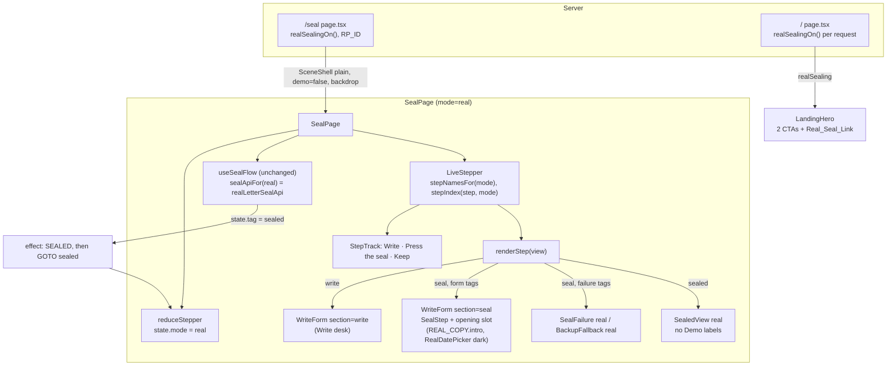

# Design Document

Spec: 19 Real sealing stepper

## Overview

`/seal` moves from the single `renderState()` form into the Live_Stepper that `/demo/live` already uses. Real_Mode gets its own three-step list (Write, Press the seal, Keep) inside the same pure Stepper_Module. The Write desk and the Seal_Step are the same components as in Demo_Mode. The Keep_Step is the existing `SealedView real`. The home page gets one quiet text link to `/seal` while real sealing is on.

The change is page-layer only. No file under `src/app/api/`, `src/lib/crypto/`, `src/lib/seal-format/`, `src/lib/letter-store/`, `src/lib/db/`, `drizzle/` or `deploy/helm/` changes. No environment variable is added. `useSealFlow.ts`, `seal-runner.ts`, `build-payload.ts`, `seal-machine.ts` and `api.ts` are not edited either, so the sealed payload, header, hash and request bodies can only differ if the `SealDraft` or `SealDeps` that SealPage hands to `useSealFlow` differ. The tests pin both (Requirement 7.3, 7.4).

Demo_Mode keeps its code paths. Every Demo_Mode change is a new optional prop whose default is today's behaviour, or a new branch that only runs when `mode` is `real`. A golden-markup test recorded at `3bee3055` before any code change proves it (Requirement 5.1).

Main decisions:

1. **One reducer, two lists.** `StepperState` gains a `mode` field. `reduceStepper` sends a `demo` state to today's reducer body, unchanged, and a `real` state to a small real reducer. Lookup helpers (`stepIndex`, `stepName`, `canGoBack`) take an optional `mode` that defaults to `demo`, so every current caller and test keeps working.
2. **`sealed` is a real-only step.** `LIVE_STEPS` and `LIVE_STEP_NAMES` stay as they are. A new `REAL_STEPS = ["write", "seal", "sealed"]` and `REAL_STEP_NAMES` sit beside them. `StepperStep = LiveStep | "sealed"` is the type the reducer and StepView carry.
3. **The page moves the real stepper to Keep in one effect.** When the seal is stored, SealPage dispatches `SEALED` and then, in Real_Mode only, `GOTO "sealed"`. The reducer handles them in order, so the GOTO sees `sealed: true` and is accepted (Requirement 1.7). Demo_Mode keeps `SealedStep`'s `advanceTo("wait")`.
4. **Real-mode copy is chosen by a `real` prop.** `SealFailure`, `BackupFallback`, `BackupKeyCard` (as `showDemoLabel`), `BackupChoice` (as `skipHelp`), `SealStep`, `SealSteps`, `FigureRows` and `RealDatePicker` (as `surface`) each get one optional prop. Its default renders today's markup.
5. **The Date_Picker moves to the Seal_Step, on the dark surface.** WriteForm passes `REAL_COPY.intro` and the picker to `SealStep` through a new `opening` slot at the top of its text column. The picker gets a `surface="dark"` variant, because its current classes use the paper ink (`--ink`) and would fail contrast on the Seal_Step's `#0b0912`.
6. **The Seal_Step names a missing date in its status line.** With a backup choice made and no date, the press line reads `REAL_COPY.pressNeedsDate` ("Choose an opening date first.") instead of "Press and hold the wax to seal it.", which would read as an open invitation while the press is blocked.
7. **`/seal` gets `backdrop`.** `SceneShell variant="plain" demo={false} backdrop`. No sound, no Demo chip.
8. **The landing link is a plain text link in its own wrapper** after `data-block="actions"` and before `data-block="seal"`. It carries no `data-cta` and no button class, so the two-CTA rule (spec 11 L6.3) holds by construction.

Facts checked while writing this design, at `3bee3055`:

| What | Result |
|---|---|
| `StepTrack` already sizes itself from `steps.length` for the dots, `stepTrackStates` and `{total}` in the phone line. | Read `StepTrack.tsx`. Only `LiveStepper` hard-codes `LIVE_STEPS` and `LIVE_STEP_NAMES`. `step-track.ts` needs no change. |
| `initialStepperState("write", mode)` is already called with `real` today, to pick the empty real draft. | `SealPage.tsx` line 169. |
| The demo reducer's `NEXT` moves `seal` to `wait` with no check on `sealed`. | `live-steps.ts`. The real `NEXT` must not copy that (Requirement 1.6). |
| `rehearsal` reaches the Write desk only through the `rehearsal` prop, and `/seal` does not pass it. | `SealPage.tsx`, `WriteDesk.tsx`, `EnvelopePanel.tsx`. Real_Mode already shows no `rehearsalLine` on the desk. |
| `BackupChoice` always renders `LIVE_COPY.backupChoiceSkipHelp` ("Fine for a 30-second rehearsal.") under the skip option. | `BackupChoice.tsx`. |
| `PRESS_COPY.stepOneHint` and `PRESS_COPY.stepPasskeyMade` say the passkey is saved as "Revenant demo". `SealSteps` shows one of them on every Seal_State. Requirement 4.13 does not list them, but Requirement 4.11 forbids the word "demo" on the real Seal_Step. In Real_Mode the passkey is named `REAL_COPY.passkeyUserName` ("Revenant letter · opens {date}"), so the demo lines would also be untrue. | `press/copy.ts`, `seal-step/seal-steps.ts`, `seal-runner.ts` line 141, `useSealFlow.ts` line 98. |
| `PressEnvelope` never sets the native `disabled` attribute. A blocked press has `aria-disabled="true"`, starts nothing and calls `onAttempt`. | `press/PressEnvelope.tsx`, `press/usePressEnvelope.ts` line 179. See "Where the code differs from the requirements", item 1. |
| `RealDatePicker` uses `live.module.css` `.label`, `.hint`, `.count`, `.problem` and `.dateInput`, all in `--ink` on `--paper`. | `RealDatePicker.tsx`, `live.module.css`. |
| On the demo Seal_Step, the `cannot_lock` and `cancelled` screens render two `h1` elements: the page's temporary "Press the seal" `h1` and the screen's own title. The `failed` screen has no title of its own, so it has one. | `SealPage.tsx` `renderDemoStep`, `SealFailure.tsx`. Demo_Mode is left as it is (Requirement 5.1). Real_Mode drops the temporary `h1` where the screen has its own (Requirement 3.8). |
| `SealedView` renders `<DemoLabel />` itself, and `SealedKeepsakes` and `BackupKeyCard` render one each. `LetterCard` and `SealedKeepsakes` already take `showDemoLabel`. `BackupKeyCard` does not. | `SealedView.tsx`, `SealedKeepsakes.tsx`, `LetterCard.tsx`, `BackupKeyCard.tsx`. |
| `SealedView`'s `h1` has no `data-step-heading`, so the Live_Stepper would not move focus on arrival at Keep. | `SealedView.tsx`. The real `h1` gets `data-step-heading` and `tabIndex={-1}`. |
| The project has no DOM test library. Tests render with `renderToStaticMarkup` and drive reducers and hooks directly. Browser walks use `playwright-core` under `src/test/integration`, skipped unless `WALK=1`. | `vitest.config.ts` (`environment: "node"`), `useSealFlow.test.ts`, `live-walk.test.ts`. |
| The landing tests count accent buttons with `/class="[^"]*accent[^"]*"/`. A new class name that contains "accent" would break them. | `LandingHero.test.tsx` line 20. The link class is `realSealLink`. |
| At 1280×800 the second landing CTA ends at y 580, 12 px above the Soil strip at y 592 (comment in `landing.module.css`). A link under the CTAs at that size lands on the strip. | `landing.module.css`. See Components, section 9. |
| The Test_Notice text appears in `src/` only in `copy.ts` and `WriteForm.tsx`. | `grep -rn "This is a test site" src`. |

### Where the code differs from the requirements

Each item needs the owner's decision. The design's default is stated.

1. **Requirement 3.5 asks for the `disabled` attribute on the press.** The Seal_Step press is `PressEnvelope`, which blocks with `aria-disabled="true"` and calls `onAttempt` when a blocked press is used. That call is what makes `REAL_COPY.dateMissing` appear after "a seal has been attempted with no date" (Requirement 3.4). With the native `disabled` attribute the browser fires no event, so that half of Requirement 3.4 could never happen, and the press would differ from the demo press. **Default:** the press is blocked with `aria-disabled="true"`, sends no request, and records the attempt. Requirement 3.5 is read as "blocked". If the owner wants the native attribute, `PressEnvelope` gets a `hardDisabled` prop and the date message then shows only after the date field is touched.
2. **`initialStepperState("sealed", "real")`.** Requirement 1.11 asks the invariant test to start from every Real_Step_List step, including `sealed`, and requires that the step is `sealed` only while `sealed` is true. Requirement 1.10 only covers steps outside the list. **Default:** starting on `sealed` creates a sealed state (`sealed: true`, cleared draft). No page does this. It keeps the invariant true from the first state.
3. **The seal-step hints that name "Revenant demo"** (`PRESS_COPY.stepOneHint`, `PRESS_COPY.stepPasskeyMade`) are not in Requirement 4.13's list but are forbidden by Requirement 4.11. **Default:** Real_Mode replaces them with two new `REAL_COPY` strings (see "New copy for owner review").
4. **`SealedView real` gains `data-step-heading` and `tabIndex={-1}` on its `h1`.** Requirement 3.6 says the Keep_Step renders as at `3bee3055` apart from the Demo labels. Requirement 3.9 needs a `[data-step-heading]` for focus to move. **Default:** add both attributes, in Real_Mode only. The visible markup does not change.
5. **The `failed` screen keeps the temporary "Press the seal" `h1` in Real_Mode**, because `SealFailure` gives it no title. That satisfies Requirement 3.8 with no new copy. The `cannot_lock`, `cancelled` and `fallback_key` screens use their own titles.

## Architecture



The Seal_State machine (`useSealFlow`) and the Stepper_Module stay separate, as today. The flow decides what happens to the letter. The stepper decides which screen shows. They meet in SealPage at one place each way:

- The stepper's draft feeds the flow's `SealDraft` (unchanged `useMemo`).
- The flow's `sealed` state moves the stepper (`SEALED`, then in Real_Mode `GOTO "sealed"`).

### Real-mode step and Seal_State table

| Stepper step | Seal_State | Content | The step's one `h1` |
|---|---|---|---|
| `write` | `write` | Write desk (`WriteForm section="write"`) | Desk `StepHeader` h1 (`DESK_COPY.heading`) |
| `seal` | `write`, `creating`, `created`, `confirming`, `preparing`, `sealing` | `SealStep` with the opening slot | `SealStep` h1 (`LIVE_COPY.sealHeading`) |
| `seal` | `cannot_lock`, `cancelled` | `SealFailure real` | The screen's own title |
| `seal` | `failed` | `SealFailure real` | Temporary `h1` with `stepName("seal", "real")` |
| `seal` | `fallback_key` | `BackupFallback real` | `LIVE_COPY.fallbackTitle` |
| `seal` (one render) then `sealed` | `sealed` | `SealedView real` | `REAL_COPY.stillSealed`, with `data-step-heading` |

The Step_Track shows "Press the seal" as current on every failure row, because no failure moves the stepper.

## Components and Interfaces

### 1. Stepper_Module (`src/components/live/stepper/live-steps.ts`) — Requirement 1, 2.3, 2.5

```ts
// Unchanged
export const LIVE_STEPS = ["write", "seal", "wait", "testify", "break", "receipts"] as const;
export type LiveStep = (typeof LIVE_STEPS)[number];
export const LIVE_STEP_NAMES: readonly string[]; // same six names, same constants

// New
export const REAL_STEPS = ["write", "seal", "sealed"] as const;
export type RealStep = (typeof REAL_STEPS)[number];
export type StepperStep = LiveStep | RealStep;
export type StepperMode = WriteMode; // "demo" | "real", from ../form
export const REAL_STEP_NAMES: readonly string[] = [
  RITUAL[0].name,       // "Write"
  RITUAL[1].name,       // "Press the seal"
  REAL_COPY.keepStep,   // "Keep"
];

export function stepsFor(mode: StepperMode): readonly StepperStep[];
export function stepNamesFor(mode: StepperMode): readonly string[];
export function isDemoStep(step: StepperStep): step is LiveStep;

// Widened, with mode defaulting to "demo"
export function stepIndex(step: StepperStep, mode?: StepperMode): number;   // -1 when not in the list
export function stepName(step: StepperStep, mode?: StepperMode): string;    // "" when not in the list
export function canGoBack(step: StepperStep, sealed: boolean, mode?: StepperMode): boolean;

// Widened to StepperStep; each returns false or null for "sealed", so demo results are unchanged
export function hasPrimaryCard(step: StepperStep): boolean;
export function stepperDrawsHeading(step: StepperStep): boolean;
export function flowMounted(step: StepperStep, countdownDone: boolean): boolean;
export function flowPortalTarget<T>(host: T | null, step: StepperStep, countdownDone: boolean): T | null;
export function movesFocus(from: StepperStep, to: StepperStep): boolean;

export interface StepperState {
  mode: StepperMode;   // new, set once by initialStepperState
  step: StepperStep;
  draft: WriteDraft;
  sealed: boolean;
  stage: Stage;
}

export type StepperAction =
  | { type: "NEXT" }
  | { type: "BACK" }
  | { type: "DRAFT"; event: WriteDraftEvent }
  | { type: "SEALED" }
  | { type: "GOTO"; step: StepperStep }
  | { type: "STAGE"; stage: Stage };

export function initialStepperState(step?: StepperStep, mode?: StepperMode): StepperState;
export function reduceStepper(state: StepperState, action: StepperAction): StepperState;
```

`initialStepperState(step = "write", mode = "demo")`:

- If `step` is not in `stepsFor(mode)`, it starts on `write` (Requirement 1.10). For Demo_Mode only `"sealed"` can be outside the list, and the oracle never receives it.
- Starting on `sealed` in Real_Mode creates `sealed: true` with `CLEARED_WRITE_DRAFT` (decision 2 above).
- Otherwise `{ mode, step, draft: initialWriteDraft(mode), sealed: false, stage: "emerging" }`, which matches today's state plus `mode`.

`reduceStepper(state, action)` returns `reduceDemo(state, action)` when `state.mode` is `demo`, and `reduceReal(state, action)` when it is `real`. Neither ever writes `mode`.

`reduceDemo` is today's reducer body, moved as is. Its index lookups pass `"demo"` explicitly. A `GOTO "sealed"` in Demo_Mode gives index `-1`, which is at or before every step, so it returns the same state, as today's reducer would for any unknown step.

`reduceReal`:

| Action | Result |
|---|---|
| `NEXT` | `write` → `seal` (new state). `seal` → `sealed` only if `sealed` is true. Otherwise the same object. |
| `BACK` | If `step` is `seal` and `sealed` is false: step `write`, draft kept. Otherwise the same object. |
| `DRAFT` | Same as demo: the same object once `sealed`, else `reduceWriteDraft`. |
| `SEALED` | `{ ...state, sealed: true, draft: CLEARED_WRITE_DRAFT }`, as in demo. |
| `GOTO target` | The same object if `target` is not in `REAL_STEPS`, or its index is at or before the current index, or `target` is `sealed` while `sealed` is false. Otherwise step `target`. |
| `STAGE stage` | The same object if `state.stage` already equals `stage`. Otherwise `{ ...state, stage }`. The step never moves. |

`canGoBack(step, sealed, "real")` is `step === "seal" && !sealed`.

### 2. Live_Stepper (`src/components/live/stepper/LiveStepper.tsx`) — Requirement 2, 3.9, 5.5

The only change is that list lookups read the state's mode:

```tsx
const names = stepNamesFor(state.mode);
const current = stepIndex(state.step, state.mode);
<StepTrack steps={names} current={current} … />
<p role="status" aria-live="polite">
  {LIVE_COPY.stepAnnounce
    .replace("{n}", String(current + 1))
    .replace("{total}", String(names.length))
    .replace("{label}", stepName(state.step, state.mode))}
</p>
```

`StepView.step` and `advanceTo` widen to `StepperStep`. `canGoBack` passes `state.mode`. The focus effect, scroll, card and Reveal_Host are unchanged, so Real_Mode uses the same focus rule and timing (Requirement 3.9). `hasPrimaryCard("sealed")` and `stepperDrawsHeading("sealed")` are false, so the Keep_Step sits on the bare section, like the Seal_Step.

`step-track.ts` and `StepTrack.tsx` do not change. `STEP_TRACK_COUNT` stays 6 as the default for the demo callers.

### 3. Seal_Page (`src/components/live/SealPage.tsx`) — Requirements 3, 4.1, 4.2, 5, 7.6

Render:

```tsx
<div data-rp-id … data-seal-mode={mode} data-live-step={state.tag}>
  {mode === "demo" ? (
    <p className={styles.backToDemo}><Link href="/demo">{LIVE_COPY.backToDemo}</Link></p>
  ) : null}
  <StageReportContext.Provider value={reportStage}>
    <LiveStepper state={stepper} dispatch={dispatchStepper} renderStep={renderStep} />
  </StageReportContext.Provider>
</div>
```

In Demo_Mode this is the same element tree as today, in the same child positions. That matters because `useId` values depend on tree position and appear in the golden markup.

`renderStep(view)` (today's `renderDemoStep`, renamed) picks the heading and the content:

- Heading. Demo_Mode keeps `sealOwnsHeading = view.step === "seal" && SEAL_FORM_TAGS.has(state.tag)`. Real_Mode uses `realOwnsHeading(view.step, state.tag)`, true for `write`, for every `SEAL_FORM_TAGS` tag, and for `sealed`, `cannot_lock`, `cancelled` and `fallback_key`. Only `failed` gets the temporary `h1` from `stepHeading("seal", mode)`.
- Content, in this order:
  1. `state.tag === "sealed"`: Demo_Mode renders today's `SealedStep` around `LiveWaitStep` (with `step={view.step}` narrowed by `isDemoStep`). Real_Mode renders `SealedView real`. It shows on the one render where the step is still `seal`, and stays mounted in the same tree slot after the step becomes `sealed`.
  2. A failure tag: `failureScreen()`, which is today's failure branches of `renderState()` with `real={mode === "real"}` passed to `SealFailure` and `BackupFallback`.
  3. Otherwise `writeForm({ section, sealHeading, onNext, onBack })`, exactly as the demo path does now. `onBack` is passed only while `view.canGoBack && state.tag === "write"` in both modes (Requirement 3.10, 3.14).

`renderState()`'s `sealed` and default branches are deleted. No step or Seal_State renders the `all` form from SealPage any more (Requirement 3.1).

The sealed effect:

```ts
useEffect(() => {
  if (state.tag === "sealed" && !stepper.sealed) {
    dispatchStepper({ type: "SEALED" });
    if (mode === "real") dispatchStepper({ type: "GOTO", step: "sealed" });
  }
}, [state.tag, stepper.sealed, mode]);
```

Unchanged in SealPage: `sealApiFor`, `sealDeps`, the `draft` `useMemo`, `pressedFigures`, `opensOn` (held here, so Back and Try again keep it), `touched`, `timeZone` and the `realDate` object passed to `WriteForm`. The page still has no static value import of `@/lib/crypto`, `@/lib/letter-store` or `@/lib/feature-flags` (Requirement 7.6). It imports `earliestOpeningDate` from `@/lib/seal-format`, as today.

### 4. WriteForm (`src/components/live/WriteForm.tsx`) — Requirements 3.2 to 3.5, 4.8

- `mode` is still `real` when `realDate` is set, so the UTC sealing day and the real draft rules stay (Requirement 3.12).
- `section="write"`: `deskReceipt` gains `real: mode === "real"`, passed through `ReceiptPanel` to `FigureRows`. Nothing else changes on the desk. `rehearsal` stays false on `/seal`.
- `section="seal"` passes three new props to `SealStep`:
  - `real={mode === "real"}`
  - `needsDate={dateMissing}`, which is already computed (`realDate` set, no value, Seal_State `write`)
  - `opening`, only when `realDate` is set:

    ```tsx
    <>
      <p className={…} data-real-intro="">{REAL_COPY.intro}</p>
      <RealDatePicker surface="dark" value={realDate.value} min={realDate.min}
        timeZoneFallback={realDate.timeZoneFallback} problem={dateProblem}
        onChange={…} onTouch={…} />
    </>
    ```

- `pressBlocked` already includes `dateMissing` through `inputBlocked`, so a press with no date is blocked, calls `onAttempt`, and sends nothing (Requirement 3.5, see the note on `disabled` above).
- The `all` form drops `<p className={styles.explain}>{REAL_COPY.testNotice}</p>` (Requirement 4.8, 4.9). The `all` form is otherwise untouched. `WriteForm.test.tsx` and other tests still render it.

### 5. Seal step (`seal-step/SealStep.tsx`, `SealSteps.tsx`, `seal-steps.ts`, `press-status.ts`, `BackupChoice.tsx`) — Requirements 3.3, 4.3, 4.4, 4.11

New optional `SealStep` props, all defaulting to today's output:

```ts
real?: boolean;          // default false
needsDate?: boolean;     // default false
opening?: ReactNode;     // default undefined
```

- `opening` renders first in the `data-seal-text` column, inside `<div data-seal-opening="">`, before `BackupChoice`. Document order is then: SealStep `h1`, `sealParagraph`, `warning`, `REAL_COPY.intro`, Date_Picker, Backup_Choice, PRF hint and fallback, `SealLinks`, then the press column (Requirement 3.3).
- `BackupChoice` gains `skipHelp?: boolean` (default true). SealStep passes `skipHelp={!real}`. With `skipHelp` false the skip card renders its title once, no help `span`, and no `aria-describedby` that would point at a missing id (Requirement 4.3, 4.4).
- `pressStatusLine` gains an optional `needsDate` input. With `tag` `write`, a backup choice made and `needsDate` true, it returns `{ text: REAL_COPY.pressNeedsDate, tone: "muted" }`. Every other input gives today's line. No backup choice still gives `PRESS_COPY.chooseFirst`.
- `sealStepsView` gains an optional `real` input. With `real` true, `PRESS_COPY.stepOneHint` becomes `REAL_COPY.stepOneHint` and `PRESS_COPY.stepPasskeyMade` becomes `REAL_COPY.stepPasskeyMade`. States are unchanged. `SealSteps` passes `real` through.
- `SealLinks`, `PressEnvelope` and `press/copy.ts` do not change.

### 6. Date_Picker (`src/components/live/RealDatePicker.tsx`) — Requirement 3.4

New optional `surface?: "paper" | "dark"` (default `paper`). `paper` keeps today's classes and markup. `dark` uses a new `real-date-picker.module.css`:

| Part | Dark surface style |
|---|---|
| Label | `#ffffff`, 600 weight, same size as the seal-step body |
| Hint, chosen line, UTC fallback line | `#bdb4dc` (the seal-step `.body` colour) |
| Problem | `#ffffff` |
| Input | `#ffffff` text, transparent fill, 1 px `#bdb4dc` border, `color-scheme: dark`, at least 44 px tall, `max-width: 100%` |
| Input focus | `outline: 3px solid var(--accent); outline-offset: 2px` (orange is the focus ring) |

Ids, `min`, `aria-describedby`, the UTC fallback, the chosen-date line and the `onChange`/`onBlur` rules are the same for both surfaces. The contrast test (`contrast.test.ts` pattern) checks the label, hint and problem colours against `#0b0912` at 4.5:1 or more.

### 7. Keep_Step and keepsakes (`SealedView.tsx`, `BackupKeyCard.tsx`) — Requirements 3.6, 3.8, 4.5 to 4.7

`SealedView` with `real`:

- renders no `<DemoLabel />`;
- passes `showDemoLabel={!real}` to `SealedKeepsakes` (and so to `LetterCard`);
- passes `showDemoLabel={!real}` to `BackupKeyCard`;
- gives its `h1` `data-step-heading=""` and `tabIndex={-1}`.

The countdown, opening time, link rule (link only after the countdown, spec 08 R24.10), key reminder and backup card offer are unchanged. Without `real`, `SealedView` renders exactly what it renders today.

`BackupKeyCard` gains `showDemoLabel?: boolean` (default true). `LiveWaitStep` does not pass it, so the demo Wait step is unchanged.

### 8. Failure screens and figure rows (`SealFailure.tsx`, `BackupFallback.tsx`, `desk/FigureRows.tsx`, `desk/ReceiptPanel.tsx`) — Requirements 3.7, 4.5, 4.13

| Demo_Text_Source | Real_Mode |
|---|---|
| `LIVE_COPY.figuresNoneLink` and the `/demo` link in `FigureRows` | `REAL_COPY.figuresNoneAvailable`, plain text, no link |
| `<DemoLabel />` in `LetterCard` and `BackupKeyCard` on the Keep_Step | Omitted (section 7) |
| `LIVE_COPY.backToDemo` link in `SealFailure` (`cannot_lock`) | Omitted |
| `LIVE_COPY.passkeyDeleteNote` | `REAL_COPY.passkeyDeleteNote` |
| `LIVE_COPY.clockBody` | `REAL_COPY.clockBody` |
| `LIVE_COPY.busyBody` | `REAL_COPY.busyBody` |
| `<DemoLabel />` in `BackupFallback` | Omitted |
| `PRESS_COPY.stepOneHint`, `PRESS_COPY.stepPasskeyMade` (not in 4.13, see above) | `REAL_COPY.stepOneHint`, `REAL_COPY.stepPasskeyMade` |
| `LIVE_COPY.backupChoiceSkipHelp` | Omitted (section 5) |
| Page-level `LIVE_COPY.backToDemo` link | Omitted (section 3) |

`SealFailure` and `BackupFallback` each gain `real?: boolean` (default false). `FigureRows` and `ReceiptPanel` gain `real?: boolean` (default false).

Lines kept in Real_Mode because they hold none of the text Requirement 4.11 forbids: `LIVE_COPY.cannotLockNext2` and `LIVE_COPY.noPrfOther`, which both suggest opening a persona letter. The owner may want real wording for them (Open questions).

### 9. `/seal` page (`src/app/seal/page.tsx`) — Requirement 3.13, 3.15

```tsx
<SceneShell variant="plain" demo={false} backdrop>
```

The `realSealingOn()` and `RP_ID` branches are unchanged. `/demo/live` (`src/app/demo/live/page.tsx`) is not edited (Requirement 5.6).

### 10. Landing (`src/app/page.tsx`, `src/components/landing/LandingHero.tsx`, `copy.ts`, `landing.module.css`) — Requirement 6

`page.tsx` (server, `force-dynamic`):

```tsx
import { realSealingOn } from "@/lib/feature-flags";
…
const realSealing = realSealingOn();          // per request
<LandingHero personaCount={personaCount} demo2On={demo2On} realSealing={realSealing} />
```

`LandingHero` gains `realSealing?: boolean` (default false). Between the actions block and the seal block:

```tsx
{realSealing ? (
  <p className={styles.realSeal} data-real-seal="">
    <Link href="/seal" className={styles.realSealLink}>{LANDING_COPY.realSealLink}</Link>
  </p>
) : null}
```

No `data-cta`, no `cta`, `accent` or `outlined` class. With `realSealing` false the output is byte-identical to today (Requirement 6.3). `LandingHero` stays a server component with no `"use client"`, and no client module imports `@/lib/feature-flags` (Requirement 6.9).

CSS:

```css
.realSeal {
  margin: -0.75rem 0 0;      /* pulls the link toward the CTAs; the hero gap is 1.5rem */
  align-self: flex-start;
  background: var(--bg);     /* the Soil strip and its glow never sit under the text */
}
.realSealLink {
  display: inline-flex;
  align-items: center;
  min-height: 2.75rem;       /* 44 px */
  min-width: 2.75rem;
  color: var(--text);        /* #f5f3ff on #0b0912 */
  text-decoration: underline;
  text-underline-offset: 3px;
}
.realSealLink:focus-visible {
  outline: 3px solid var(--accent);
  outline-offset: 3px;
}
@media (max-width: 599.98px) {
  .realSeal { order: 1; margin-top: -0.25rem; }   /* stays after the CTAs, which take order 1 on phones */
}
```

`.realSealLink` copies `.covenLink`, which already passes the landing tests for 44 px and the focus ring. The phone rule keeps the link after the CTAs, since `.actions` moves below the seal box there. At 1280×800 the link sits at about y 592 to 636, on the Soil strip. The opaque `--bg` box keeps the text off the dirt (tone.md: texture never sits on text). The QA run checks this at 1280×800, 1440×900 and 390×844 (Testing Strategy).

### 11. Path ownership (from `.github/agents.json`)

| Path | Owner |
|---|---|
| `src/components/live/**` (stepper, SealPage, WriteForm, seal-step, desk, SealedView, SealFailure, BackupFallback, BackupKeyCard, RealDatePicker, `copy.ts`, new CSS) | frontend-dev |
| `src/app/seal/page.tsx` | frontend-dev (`src/app/**/*.tsx`) |
| `src/components/landing/**` | frontend-dev |
| `src/app/page.tsx` | platform-dev (listed by name; it also matches frontend-dev's `src/app/**/*.tsx`, and `structure.md` gives the landing page to platform-dev) |
| `*.test.ts`, `*.test.tsx`, `src/test/integration/**` | shared |
| `.kiro/steering/product.md` (the answered open question) | owner |

A sensible split is three tickets: (a) frontend-dev: golden recording, Stepper_Module, Live_Stepper; (b) frontend-dev: SealPage, WriteForm, seal step, picker, Keep_Step, failure screens, `/seal` page, copy; (c) platform-dev with frontend-dev: the landing link (`page.tsx` by platform-dev, `LandingHero`, copy and CSS by frontend-dev). Ticket (a) must land first, because its golden files are recorded at `3bee3055`.

## Data Models

### Step lists

| Mode | Positions 0 … n-1 | Visible names | Source constants |
|---|---|---|---|
| `demo` | `write`, `seal`, `wait`, `testify`, `break`, `receipts` | Write, Press the seal, Wait, Testify, Break the seal, Receipts | `BRAND_COPY.ritualSteps[0..2]`, `LIVE_COPY.waitStep`, `CEREMONY_COPY.steps[1]`, `LIVE_COPY.receiptsStep` (unchanged) |
| `real` | `write`, `seal`, `sealed` | Write, Press the seal, Keep | `BRAND_COPY.ritualSteps[0].name`, `BRAND_COPY.ritualSteps[1].name`, `REAL_COPY.keepStep` |

### `StepperState`

| Field | Type | Notes |
|---|---|---|
| `mode` | `"demo" \| "real"` | New. Set by `initialStepperState`, never changed by an action. |
| `step` | `StepperStep` | Always in `stepsFor(mode)`. |
| `draft` | `WriteDraft` | Kept across Back. Cleared on `SEALED`. |
| `sealed` | `boolean` | True once the seal is stored. Never set back to false. |
| `stage` | `Stage` | Last reported reveal Stage. Real_Mode stores it and never moves the step for it. |

No key material, passkey data or opening date is held in the stepper state. The opening date stays in SealPage's `opensOn` state, as today.

### New props (all optional, defaults give today's markup)

| Component | Prop | Default |
|---|---|---|
| `LandingHero` | `realSealing: boolean` | `false` |
| `SealStep` | `real: boolean`, `needsDate: boolean`, `opening: ReactNode` | `false`, `false`, none |
| `SealSteps` | `real: boolean` | `false` |
| `BackupChoice` | `skipHelp: boolean` | `true` |
| `RealDatePicker` | `surface: "paper" \| "dark"` | `"paper"` |
| `SealFailure` | `real: boolean` | `false` |
| `BackupFallback` | `real: boolean` | `false` |
| `BackupKeyCard` | `showDemoLabel: boolean` | `true` |
| `ReceiptPanel`, `FigureRows` | `real: boolean` | `false` |

Pure-function inputs: `pressStatusLine({ …, needsDate? })`, `sealStepsView({ …, real? })`.

### Copy changes

Removed: `REAL_COPY.testNotice`.

### New copy for owner review

Every string below goes in `REAL_COPY` (`src/components/live/copy.ts`) except the last, which goes in `LANDING_COPY` (`src/components/landing/copy.ts`). Each passes `toneProblems` as it stands (checked by hand against `copy-tone.ts`: no "!", no sentence over 25 words, no cliché, judgement or political word). The new `real-copy-tone.test.ts` and the existing `landing/copy-tone.test.ts` check them in CI.

| Key | Text | Replaces in Real_Mode | Where it shows |
|---|---|---|---|
| `REAL_COPY.keepStep` | Keep | (new third step name) | Step_Track, phone line, step announcement |
| `REAL_COPY.pressNeedsDate` | Choose an opening date first. | `PRESS_COPY.holdToSeal` / `pressToSeal` while the date is missing | Press status line on the Seal_Step |
| `REAL_COPY.stepOneHint` | Press the wax. The passkey is named for this letter's opening date. | `PRESS_COPY.stepOneHint` ("…saved as "Revenant demo".") | Under "Make your passkey" |
| `REAL_COPY.stepPasskeyMade` | Passkey made. It is named for this letter's opening date. | `PRESS_COPY.stepPasskeyMade` | Under "Make your passkey", once done |
| `REAL_COPY.figuresNoneAvailable` | No figure can be sealed right now. Your letter doesn't need one. | `LIVE_COPY.figuresNoneAvailable` with its `/demo` link | Write desk receipt card, when no figure can be sealed |
| `REAL_COPY.passkeyDeleteNote` | If your device created a passkey for this letter, you can delete it from your passkey manager. | `LIVE_COPY.passkeyDeleteNote` ("…named "Revenant demo"…") | `cannot_lock` screen |
| `REAL_COPY.clockBody` | Your device clock differs from Revenant's clock by too much. Nothing was sealed. Check your device time and try again. | `LIVE_COPY.clockBody` ("…than the demo allows…") | `failed` screen, kind `clock` |
| `REAL_COPY.busyBody` | Revenant is busy right now. Nothing was sealed. Try again later. Your letter is still here. | `LIVE_COPY.busyBody` ("The live demo is busy…") | `failed` screen, kind `busy` |
| `LANDING_COPY.realSealLink` | Seal a real letter | (new) | Home page hero, under the CTAs, while real sealing is on |

Tone notes: all are second person or plain statements, calm, with no exclamation mark. None grades the reader or the letter. The passkey hints say what is true in Real_Mode: the passkey name holds the opening date (`REAL_COPY.passkeyUserName`). The warning lines about a lost passkey (`LIVE_COPY.warning`, `backupChoiceSkip`) are kept word for word, so atmosphere softens nothing (tone.md, "Locking").


## Correctness Properties

*A property is a characteristic or behavior that should hold true across all valid executions of a system-essentially, a formal statement about what the system should do. Properties serve as the bridge between human-readable specifications and machine-verifiable correctness guarantees.*

The properties cover the pure parts of the change: the Stepper_Module, `stepTrackStates`, the Seal_Step copy functions and the landing hero, which is a server render of three props. Page markup, focus, routes and payloads are covered by golden, example and walk tests (Testing Strategy), because their input space is a small finite table or needs a browser.

Reflection on overlap: the real action-table check implies most of the real invariant, but Requirement 8.2 names the invariant test, and the invariant states the guarantee the page relies on in one line, so both stay. Requirement 1.3's "mode never changes" is folded into the demo oracle check and the real invariant instead of standing alone. Requirements 6.2 to 6.5 share one generator and one render, so they are one property.

### Property 1: The demo reducer matches the `3bee3055` oracle

*For any* Demo_Step_List start step and *for any* sequence of 0 to 40 actions drawn from `NEXT`, `BACK`, `DRAFT` (any `WriteDraftEvent`), `SEALED`, `GOTO` (any `StepperStep`, including `sealed`) and `STAGE` (any `Stage`), applying the sequence with `reduceStepper` from `initialStepperState(step, "demo")` and with the oracle reducer copied from `3bee3055` from the oracle's initial state gives, after every action, deeply equal `step`, `draft`, `sealed` and `stage`, returns the input object exactly when the oracle returns its input object, and keeps `mode` equal to `demo`.

**Validates: Requirements 1.2, 1.3, 1.9, 5.5**

### Property 2: The real stepper stays inside its three steps

*For any* Real_Step_List start step and *for any* sequence of 0 to 40 actions drawn as in Property 1, every state from `initialStepperState(step, "real")` onward has its step in `write`, `seal`, `sealed`, has step `sealed` only while `sealed` is true, never has a lower step position than the state before it once `sealed` is true, and keeps `mode` equal to `real`.

**Validates: Requirements 1.3, 1.11**

### Property 3: The real reducer follows the real action table

*For any* Real_Mode state reached by a random action sequence and *for any* next action, `reduceStepper` returns what a reference model of the table in Components section 1 returns: `NEXT` moves `write` to `seal`, and `seal` to `sealed` only while sealed; `BACK` moves `seal` to `write` with the same draft only while not sealed; `GOTO` moves only forward, only to a Real_Step_List step, and to `sealed` only while sealed; `STAGE` stores the Stage and never moves the step. Wherever the table says "the same object", the result is the input object (`===`).

**Validates: Requirements 1.5, 1.6, 1.7, 1.8, 3.10**

### Property 4: Step lookups read only the mode's list

*For any* mode and *for any* position `i` in `stepsFor(mode)`, `stepIndex(stepsFor(mode)[i], mode)` is `i`, `stepName(stepsFor(mode)[i], mode)` is `stepNamesFor(mode)[i]`, `stepsFor(mode).length` is 3 for `real` and 6 for `demo`, `canGoBack(step, false, "real")` is true only for `seal`, and *for any* step outside `stepsFor(mode)`, `stepIndex` is -1 and `stepName` is `""`.

**Validates: Requirements 1.1, 1.4, 2.3, 2.5**

### Property 5: `stepTrackStates` marks exactly one current step

*For any* `stepCount` from 1 to 6 and *for any* `current` from 0 to `stepCount - 1`, `stepTrackStates(current, stepCount)` has exactly `stepCount` entries, exactly one of them `current` at position `current`, every earlier entry `done` and every later entry `todo`.

**Validates: Requirements 2.2, 2.6**

### Property 6: Real seal-step lines change only where specified and never name the demo

*For any* Seal_Step tag (`write`, `creating`, `created`, `confirming`, `preparing`, `sealing`), backup choice (none, `card`, `skip`), motion setting and `needsDate` value: `pressStatusLine` and `sealStepsView` called without the new inputs return the same values as with `needsDate: false` and `real: false`; `sealStepsView` with `real: true` has the same step states as without it, with `PRESS_COPY.stepOneHint` and `PRESS_COPY.stepPasskeyMade` replaced by their `REAL_COPY` counterparts; `pressStatusLine` with `needsDate: true` differs only when the tag is `write` and a choice is made, and then returns `REAL_COPY.pressNeedsDate`; and no line returned with `real: true` matches the Requirement 4.11 pattern (`demo`, `rehearsal`, or `30 seconds` / `30-second` not preceded by a digit, case-insensitive).

**Validates: Requirements 3.5, 4.11, 4.13**

### Property 7: The landing hero keeps two CTAs and shows the real link only while on

*For any* persona count from 0 to 50 and *for any* `demo2On` and `realSealing`, the `LandingHero` markup has at most two `data-cta` elements and at most one element whose class contains `accent`; with `realSealing` true it has exactly one `href="/seal"` anchor, with the text `LANDING_COPY.realSealLink`, no `data-cta` attribute and no `cta`, `accent` or `outlined` class, placed after `data-block="actions"` and before `data-block="seal"`; with `realSealing` false it has no `href="/seal"`, no `LANDING_COPY.realSealLink` text, and is byte-identical to the markup rendered without the `realSealing` prop.

**Validates: Requirements 6.2, 6.3, 6.4, 6.5**

## Error Handling

| Situation | Real_Mode behaviour |
|---|---|
| `REAL_SEALING` is not exactly `on` | `/seal` renders the branded not-found page, as today. No Live_Stepper. The home page shows no Real_Seal_Link. |
| `RP_ID` is empty | `/seal` renders `Unavailable`, as today. The home page still shows the link if the flag is on; `/seal` then explains that sealing is not available (`LIVE_COPY.unavailable` is unchanged; see Open questions). |
| The crypto module has not loaded | The press stays blocked (`formReady` false), as in Demo_Mode. |
| No opening date | The press is blocked (`aria-disabled="true"`). The status line reads `REAL_COPY.pressNeedsDate`. A press records an attempt and `REAL_COPY.dateMissing` shows under the picker. No request is sent. |
| The browser's time zone cannot be read | The picker shows `REAL_COPY.utcFallback`, and the letter opens at midnight UTC, as today. |
| The server rejects the date (`too_early`, `invalid_date`) | `SealFailure real` shows `REAL_COPY.tooEarly` or `REAL_COPY.invalidDate` with Try again. The step stays `seal`. Try again returns to the Seal_Step with the date and the draft kept. |
| `cannot_lock` | `SealFailure real`: its own title and body, `REAL_COPY.passkeyDeleteNote` if a passkey was made, the backup-key fallback button, and no link to `/demo`. |
| `cancelled` | `SealFailure real`, same as demo: "Nothing was sealed" and Try again. |
| `failed` (`network`, `server`, `missing_then`, `clock`, `busy`) | `SealFailure real` with the kind's body (`clock` and `busy` use the `REAL_COPY` bodies), Try again, and the temporary "Press the seal" `h1`. |
| `fallback_key` | `BackupFallback real`: no Demo label. The key, the warning, the saved tick and Not now are unchanged. |
| Figures request loading or failed | The desk shows `LIVE_COPY.receiptsLoading` or `LIVE_COPY.receiptsUnavailable`, as today. Sealing never waits for figures. |
| No figure can be sealed | The desk shows `REAL_COPY.figuresNoneAvailable`, with no link. |
| The countdown on the Keep_Step | Unchanged: `LIVE_COPY.countdown` in seconds (Open questions). The letter link and Go to your letter show only after the opening time. |

Every failure screen keeps the plain statement that nothing was sealed and the letter is still here. No warning about a lost passkey or key is shortened (tone.md, "Locking").

## Testing Strategy

The project runs Vitest in Node with no DOM library, and `fast-check` 4.10.2 is already a dev dependency. No dependency is added (Requirement 7.5). Property tests use `fast-check`, run at least 100 times each (`{ numRuns: 100 }` or more), and implement one design property each. Each starts with a tag comment:

```ts
// Feature: 19-real-sealing-stepper, Property 1: The demo reducer matches the 3bee3055 oracle
```

### Step 0: record the goldens at `3bee3055`, before any code change

This is the first task and lands on its own, so the recordings come from the unchanged code.

- **Demo markup goldens** (Requirement 5.1). `SealPage.demo-golden.test.tsx` renders SealPage in Demo_Mode with `renderToStaticMarkup` for each pair in the table below. It mocks `useSealFlow` (state per pair), `useCryptoModule` (null), `usePrfHint` (`none`), `useFigures` (a fixed `ready` response from `DEMO_FIGURES`), and wraps the real `initialStepperState` to set the step and one fixed draft (letter text, two questions with answers, one figure). The clock is fixed with `vi.setSystemTime` and `deps.nowMs`. With `RECORD_GOLDEN=1` it writes `src/components/live/__golden__/seal-page-demo/<step>--<tag>.html`. Without it, it reads each file and compares byte for byte.

  | Step | Seal_States |
  |---|---|
  | `write` | `write` |
  | `seal` | `write`, `creating`, `created`, `confirming`, `preparing`, `sealing`, `cannot_lock` (passkey made and not), `cancelled`, `failed` (`network`, `server`, `missing_then`, `clock`, `busy`), `fallback_key` |
  | `wait`, `testify`, `break`, `receipts` | `sealed` (backup and passkey factors) |

- **Draft and request goldens** (Requirements 5.3, 7.3, 7.4). `seal-draft.golden.test.tsx` renders SealPage in each mode with the same mocks, but `useSealFlow` is a spy that records its `draft` argument and the `api` and `rpId` of its `deps`. At `3bee3055` Real_Mode is the `renderState()` path. The recorded `SealDraft` (with `opensOn` set to a fixed date in the test, since a static render cannot type) is then sealed through the real `pressCreate` and `sealWithPasskey` with the crypto module loaded by dynamic `import()`, a fake authenticator port that returns a fixed PRF output, a seeded `crypto.getRandomValues` stub, a fixed clock and a stubbed `fetch` that records every request and returns fixed prepare and seal responses. The golden JSON holds the `SealDraft`, the request list (method, path, body) and, for each mode, the decrypted payload, the header and the envelope hash. After the change the same test runs through the stepper path and must match.

- **Reducer oracle.** `live-steps.oracle.property.test.ts` holds a verbatim copy of `3bee3055`'s `reduceStepper`, `stepIndex`, `canGoBack`, `stepForStage` and `initialStepperState` inside the test file, so no oracle code ships in `src/` outside tests.

### Property-based test files (one per design property)

| File | Property |
|---|---|
| `stepper/live-steps.oracle.property.test.ts` | 1 |
| `stepper/real-steps.property.test.ts` | 2 and 3 (two `it` blocks, each one property) |
| `stepper/step-lookups.property.test.ts` | 4 |
| `stepper/step-track.property.test.ts` (extended) | 5 |
| `seal-step/real-lines.property.test.ts` | 6 |
| `landing/LandingHero.real-link.property.test.tsx` | 7 |

Generators: start steps from `LIVE_STEPS` or `REAL_STEPS`; actions from a weighted `fc.oneof` with `DRAFT` events built from the existing write-draft arbitraries in `back-draft.property.test.ts`; `GOTO` targets from all seven `StepperStep` values; `STAGE` from every `Stage`. Sequences are 0 to 40 long.

### Unit and example tests

- **`live-steps.test.ts`** (Requirement 8.1): the real list and names, `stepIndex` 0 to 2, `stepName`, `canGoBack`, and one passing example each for Requirements 1.5, 1.6, 1.7, 1.8 and 1.10, plus `initialStepperState()` defaults (`write`, `demo`).
- **`LiveStepper.test.tsx`, `StepTrack.test.tsx`** (Requirement 8.3): in Real_Mode, three dots labelled Write, Press the seal, Keep; on each step exactly one `data-state="current"` with `aria-current="step"`; announcement "Step {n} of 3: {label}" and phone line "Step {n} of 3 · {label}" for `n` 1 to 3. Demo_Mode still shows six dots and `of 6`.
- **`SealPage.real.test.tsx`** (Requirements 3, 4, 8.4, 8.5), using the golden harness in Real_Mode for every step and Seal_State pair:
  - `data-live-stepper` present, no `data-card="live-write"`;
  - exactly one `h1` per pair, matching the table in Architecture; `REAL_COPY.stillSealed` is the only `h1` on Keep;
  - zero `href="/demo"`, zero `data-demo-label`, zero `data-live-rehearsal`, no `backupChoiceSkipHelp`, no Test_Notice text;
  - the visible text (tags stripped) matches no Requirement 4.11 pattern;
  - on `seal`, `REAL_COPY.intro` once, and its index, the picker's, the Backup_Choice's and the press's in that order; on `write`, no `real-opens-on` input;
  - with no date, the press has `aria-disabled="true"` and the status line is `REAL_COPY.pressNeedsDate`;
  - the `useSealFlow` spy received `deps.api === realLetterSealApi`, and the request recording from the golden harness lists `/api/letters/prepare` and `/api/letters/seal` and no demo path;
  - Back: `onBack` reaches `SealLinks` only while the tag is `write`.
- **Copy:** `real-copy-tone.test.ts` runs `toneProblems` over every `REAL_COPY` string; `copy.test.ts` asserts `keepStep === "Keep"` and no `testNotice` key; a source scan finds no Test_Notice text in non-test `src/` files (Requirement 4.9).
- **Components:** `BackupChoice` with `skipHelp={false}` renders the skip title once and no help line; `SealedView real` has no `data-demo-label` and an `h1` with `data-step-heading`; `SealedView` without `real` matches its golden; `SealFailure real` and `BackupFallback real` render the `REAL_COPY` bodies and no `/demo` link or Demo label; `FigureRows real` renders `REAL_COPY.figuresNoneAvailable` and no link; `RealDatePicker surface="dark"` keeps its ids and `min`, and its colours clear 4.5:1 on `#0b0912`.
- **Pages:** `src/app/seal/page.test.tsx` asserts `SceneShell` gets `variant="plain"`, `demo={false}`, `backdrop`, and no `sound`, and the off and empty-`RP_ID` branches are unchanged. `src/app/page.test.tsx` renders `/` with `REAL_SEALING` set to `on` and then to `off` in the same test file, with no module reload, and finds the link only in the first case (Requirements 6.1, 8.6).
- **Landing CSS:** `.realSealLink` has `min-height: 2.75rem`, `min-width: 2.75rem`, `color: var(--text)`, no `background` fill, no `border`, and a `:focus-visible` outline of `3px solid var(--accent)` with an offset; the phone block gives `.realSeal` `order: 1`; `#f5f3ff` on `#0b0912` computes above 4.5:1 (Requirements 6.6, 6.7).
- **Boundaries:** a source scan of `SealPage.tsx` finds no static value import (including `export … from` and relative paths) that resolves to `@/lib/crypto`, `@/lib/letter-store` or `@/lib/feature-flags` (Requirement 7.6). A scan of client modules (`"use client"` files) finds no import of `@/lib/feature-flags` (Requirement 6.9).

### Tests expected to change

Requirement 5.7 allows changing a test only where it asserted the Real_Mode single form, the Test_Notice in Real_Mode, or the Back_To_Demo_Link in Real_Mode. Known cases, to be named by file and title in the commit body:

- `SealPage.test.tsx`: "renders the /seal form outside the demo scope the two-column rule needs" (asserts `data-card="live-write"` in Real_Mode) and "shows the PRF_Hint on the Write step" in Real_Mode (the hint now shows on the Seal_Step, where `SealStep` already renders it).
- `src/app/seal/page.test.tsx`: "renders SealPage in real mode when REAL_SEALING is on", if it pins the `SceneShell` props.

### Integration walk and QA evidence

- **`src/test/integration/real-walk.test.ts`**, skipped unless `WALK=1`, follows `live-walk.test.ts`: headless Chromium with a virtual WebAuthn authenticator that reports PRF. It walks `/seal` (served with `REAL_SEALING=on`, `RP_ID=localhost`) from Write to Keep. It checks that focus lands on each step's `[data-step-heading]` (Requirement 3.9), that Back from the Seal_Step keeps the letter, answers and chosen date (Requirements 3.4, 3.10), that every request goes to `/api/letters/*` (Requirement 3.11), and that the Keep_Step shows the still-sealed heading. It takes the 12 QA_Shots of Requirement 8.9 under `qa-shots/real-walk/`.
- **Landing check** in the same walk: at 1280×800, 1440×900 and 390×844 the Real_Seal_Link box is fully on `--bg` (its bounding box sits inside the opaque `.realSeal` box), and the CTAs and the link keep their order.
- `npx vitest run src/components/live src/components/landing src/app` and `scripts/check.sh` exit 0 (Requirements 8.7, 8.8). The PR shows each `/seal` shot beside the `/demo/live` shot of the same step and size and lists every difference (Requirement 8.10).

## Open questions and the design's defaults

| Question | Default |
|---|---|
| Requirement 3.5: native `disabled` or `aria-disabled` on the press? | `aria-disabled="true"`, so an attempt shows the date message (see "Where the code differs"). |
| Start state for `initialStepperState("sealed", "real")` | A sealed state with a cleared draft. |
| Real wording for the "Revenant demo" passkey hints | `REAL_COPY.stepOneHint` and `REAL_COPY.stepPasskeyMade` as listed. |
| `LIVE_COPY.cannotLockNext2` and `LIVE_COPY.noPrfOther` suggest opening a persona letter on a real failure screen | Kept. They contain no forbidden word. The owner may ask for real wording. |
| `LIVE_COPY.unavailable` ("…Go back to the demo.") on `/seal` when `RP_ID` is empty | Kept. Requirement 3.15 keeps that branch as it is, and the Live_Stepper is not rendered there. |
| Countdown in seconds on the Keep_Step | Unchanged (requirements' open question). |
| The Write desk's sheet date uses the local day, while real sealing uses the UTC day for the self-reported period rule | Unchanged. The sheet date is display only and Requirement 3.2 asks for the demo desk as it is. Near midnight UTC the two can differ by one day. |
| `product.md` open question and spec 11 L6.3 | Owner edit, outside this change. |
