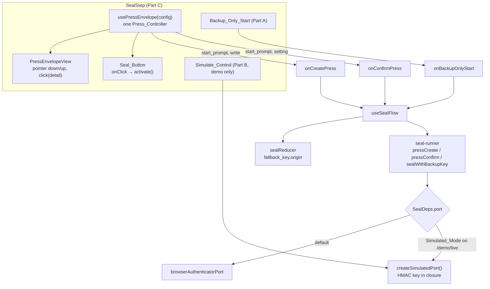
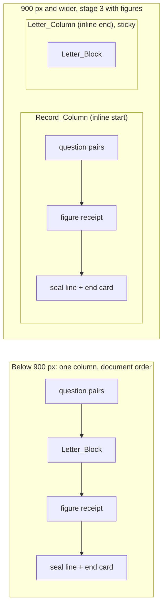
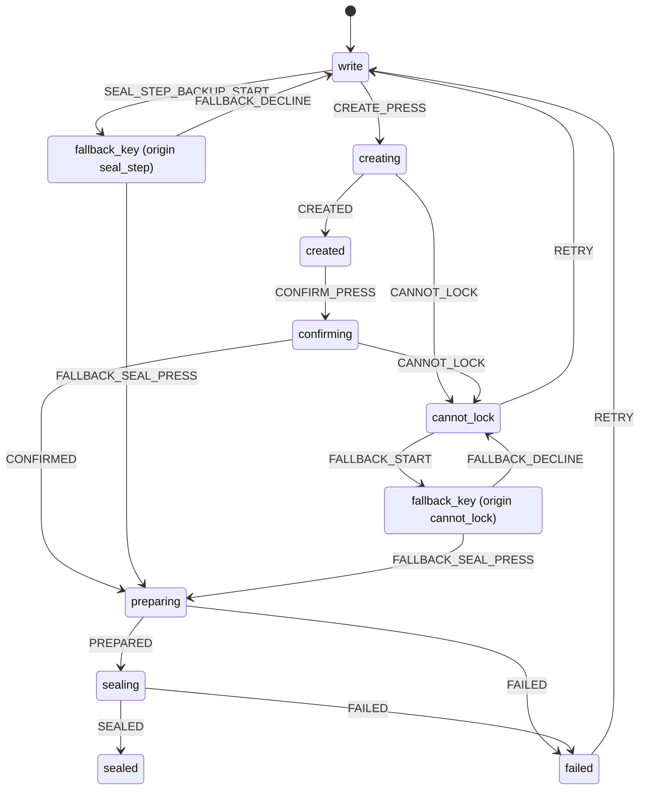

# Design Document

Spec: 20 Easier sealing and receipts

## Overview

This spec makes sealing easier to finish and keeps the letter in view on the receipts. It has four parts, and each one ships as its own PR:

- **Part C, the Seal_Button.** A plain primary button sits under the wax. It sends one `ACTIVATE` through the same Press_Controller as the wax, inside its own `click` handler, so the passkey prompt is still the first asynchronous operation of the click (spec 06 R15.1.1, R15.1.2). The status line names both ways to press.
- **Part D, the open letter.** At stage 3 with figures, the letter stays in its one slot after the question pairs. A CSS grid in `receipts.module.css` puts it in a sticky right column at 900 px and wider. Below 900 px the blocks stay in one column in document order. The fold (`foldLetter`, `collapsible`, `letterDisclosureSummary`) is removed.
- **Part A, backup key only.** The Seal_Step always offers "Seal with a backup key instead". A new seal-machine event enters `fallback_key` from `write`, and the state records where it was entered from, so "Not now" can return to the Seal_Step.
- **Part B, the simulated passkey.** A new `createSimulatedPort()` in `src/lib/crypto/simulated-port.ts` gives an `AuthenticatorPort` whose PRF is HMAC-SHA256 over a random in-memory key. `/demo/live` can opt into it. The backup key is then required. `/seal` never offers it.

Parts C and D change no file that Parts A or B need first. Part A follows Part C only because both edit `SealStep.tsx`. Part B's crypto module can be written at any time; its page work follows Part A.

Nothing in the sealed format, the routes, the database, the Helm chart or the environment variables changes. Parts A, C and D change no file under `src/lib/crypto/`. Part B adds one module there and adds export lines to the barrel (Requirement 15.2).

### Main decisions

1. **The press hook moves up one level.** Today `PressEnvelope` calls `usePressEnvelope` itself, so the controller is private to it. `SealStep` now calls `usePressEnvelope` and passes the binding to both the wax and the Seal_Button. `PressEnvelope` keeps its current API for its other caller (the `all` form in `WriteForm.tsx`) by wrapping a new presentational `PressEnvelopeView`.
2. **The Seal_Button uses a new `activate()` controller method.** `click(detail)` ignores pointer clicks in full motion, because the wax's release already handled them. The button needs the opposite: every click is the press. `activate()` sends `ACTIVATE` whatever the click's `detail` and the motion setting, and calls `onAttempt` when disabled. The model in `press-hold.ts` does not change: `pressed` already ignores every event but `RESET`, which is what makes one press start at most one prompt across the button and the wax.
3. **The receipts grid is chosen by a data attribute, not by width.** `Reveal` sets `data-receipts-layout="split"` on `[data-receipts]` whenever it shows stage 3 with at least one figure. The attribute is the same at every width. Only the CSS media query at 900 px turns it into two columns, so the static markup is the same at every width (Requirement 3.5).
4. **The letter has one slot.** `letterStage` renders once, after the question pairs, at every stage. It is never moved, so `LetterBlock` never remounts and never replays its unfold. `still` depends on `jumpedToEnd` only.
5. **`fallback_key` records its origin.** `{ tag: "fallback_key"; origin: "seal_step" | "cannot_lock"; passkeyCreated: boolean }`. A new event `SEAL_STEP_BACKUP_START` is accepted only in `write`. `FALLBACK_DECLINE` returns to `write` or `cannot_lock` by origin.
6. **The Simulated_Port is created asynchronously.** `createSimulatedPort(): Promise<AuthenticatorPort>` resolves once the HMAC key is imported. Until it resolves, the Seal_Page treats the crypto module as not loaded, so the press is blocked (Requirement 11.5). The port object has only `isAvailable`, `create` and `get`. The key and the issued credential IDs live in the closure.
7. **The demo fallback screen gets one h1.** Demo_Mode now treats `fallback_key` as a screen that owns its heading, as Real_Mode already does. This resolves the open question about two h1 elements and gives Requirement 7.7 a single focus target.

### Facts checked while writing this design, at `c2bf2db8`

These add to the code facts in requirements.md. Where a fact differs from requirements.md, the row says so.

| What | Result |
|---|---|
| The press controller is created inside `PressEnvelope` through `usePressEnvelope`. No other component can reach it. | `press/PressEnvelope.tsx`, `press/usePressEnvelope.ts`. Decision 1. |
| `PressEnvelope`'s line id comes from `useId()` inside `PressEnvelope`. The Seal_Button needs the same id for `aria-describedby` (Requirement 1.12). | `PressEnvelope.tsx`. `SealStep` will own the `useId()` call, which changes `useId` values in the demo markup goldens. Requirement 17.3 allows re-recording them. |
| `controller.click(detail)` in `setting` mode with full motion ignores `detail !== 0`, the same as `write`. | `usePressEnvelope.ts` `click`. The button cannot reuse `click`. |
| A cancelled or failed prompt replaces the Seal_Step with `SealFailure`, so `SealStep` unmounts. "Try again" mounts a new `SealStep` and so a new controller. | `SealPage.tsx` `stepContent` (`FAILURE_TAGS`). Requirement 1.14 holds by remount. The design also resets on `RETRY` for safety (section 1.3). |
| `useSealFlow.onFallbackStart` already returns unless `phase.current.tag === "cannot_lock"`, before it generates a key. | `useSealFlow.ts`. requirements.md says the key is generated before the check. The check is there; the new start handler copies it. |
| `WriteForm` already computes `pressLine = PRESS_COPY.fixFields` for the Seal_Step case, but `SealStep` never receives it. | `WriteForm.tsx` around line 513. `SealStep` gets a `fieldProblem` flag instead, so `pressStatusLine` stays the one place that picks the line. |
| `BACKUP_CHOICE_CHANGED` with `card` sets `backupChoice: "card"`, `warningTicked: true`, `backupCardTicked: true`. | `write-draft.ts` line 209. Requirement 12.1 uses that event as it is. |
| `reveal.module.css` `.flowLive .letterCol` sets `min-width: min(560px, 100%)` and `width: min(760px, 100%)` on the Letter_Block in the live flow. In a grid column of 300 px to 500 px this would overflow. | `reveal.module.css` line 78. The split rule resets both (section 5.2). |
| `--content-column-max` is `min(34rem, 46vw)` at 900 px and wider, too narrow for two 280 px columns and a gap. | `scene.module.css` line 630. The split rule sets its own cap (section 5.2). |
| `--topbar-clear` holds the Top_Bar's real height and is already used for sticky offsets. | `desk/panel.module.css` line 20, `stepper.module.css` line 133. |
| The Letter_Block's own heading is the `h2` with `data-letter-heading` and `REVEAL_COPY.stage2Title`, from `SealedLetterCaption`. | `SealedLetter.tsx` lines 72 and 101. |
| `useOpeningFlow.ts` loads `@/lib/crypto` with `import()`. `crypto-module.ts` names the barrel only in a type query (`typeof import("@/lib/crypto")`). No file under `src/components` or `src/app` imports the barrel statically. | `grep` over `src/components` and `src/app`. Requirement 13.3's scan treats type queries and `import()` of the barrel as allowed. |
| `press.module.css` already turns the wax transitions off under `prefers-reduced-motion` and `:root[data-calm]`. | `press.module.css` lines 128 to 142. Requirement 1.8 needs no new CSS for the final pose. |

## Architecture





The document order is the same in both diagrams: question pairs, Letter_Block, figure receipt, seal line and end card. At the wide width only the Letter_Block's grid placement changes.

### Seal machine after Part A



The other transitions (`cancelled`, `creating` and `confirming` to `failed`) are unchanged and left out of the diagram.

## Components and Interfaces

### 1. Part C: the press and the Seal_Button

Owner: frontend-dev (`src/components/live/press/**`, `src/components/live/seal-step/**`, `src/components/live/WriteForm.tsx`, the copy modules).

#### 1.1 Press_Controller (`press/usePressEnvelope.ts`) — Requirements 1.2, 1.3, 1.6, 1.7, 1.11, 1.13

One new method on `PressController`:

```ts
export type PressController = {
  down(now: number): boolean;     // unchanged
  up(now: number): void;          // unchanged
  cancel(now: number): void;      // unchanged
  tick(now: number): boolean;     // unchanged
  click(detail: number): void;    // unchanged: the wax's click
  /** The Seal_Button's click. One ACTIVATE, whatever the detail or motion. */
  activate(): void;               // new
  reset(): void;                  // unchanged
};
```

```ts
activate() {
  const config = sync();
  if (config.mode === "inert") return;
  if (config.disabled) {
    config.onAttempt?.();
    return;
  }
  apply(config, { type: "ACTIVATE" });
}
```

`apply` calls `pressStep`, stores the new state, and calls `onCreatePress` or `onConfirmPress` before it returns. Nothing in that path awaits. So the passkey call in `useSealFlow.onCreatePress` (through `pressCreate`, which calls `createPasskey` synchronously) and in `onConfirmPress` (through `pressConfirm`) starts inside the button's `click` handler (Requirement 1.4).

`down`, `up`, `cancel`, `tick` and `click` are unchanged, so the wax keeps its hold behaviour (Requirement 1.11). A full hold on the wax followed by a button click gives one `start_prompt`: the first event moves the model to `pressed`, and `pressed` ignores the second. A button click during a hold moves `holding` to `pressed` with one `start_prompt`, and the later pointer release is ignored. A mode change still resets the controller, so the `setting` press gets its own single prompt (Requirement 1.7).

`UsePressEnvelope` gains `activate` and `lineId` is not part of it:

```ts
export type UsePressEnvelope = {
  handlers: PressEnvelopeHandlers;   // unchanged
  elementRef: RefObject<HTMLButtonElement | null>;
  stage: PoolStage | null;
  reset: () => void;
  activate: () => void;              // new, stable identity
};
```

#### 1.2 PressEnvelope split (`press/PressEnvelope.tsx`) — Requirements 1.8, 1.11

```tsx
export type PressEnvelopeViewProps = Omit<PressEnvelopeProps,
  "onCreatePress" | "onConfirmPress" | "onAttempt"> & {
  press: UsePressEnvelope;   // the binding from the caller's usePressEnvelope
  lineId: string;            // the id of the Press_Status_Line
};
export function PressEnvelopeView(props: PressEnvelopeViewProps): JSX.Element;

/** Unchanged API. Calls useId and usePressEnvelope, then renders PressEnvelopeView. */
export function PressEnvelope(props: PressEnvelopeProps): JSX.Element;
```

`PressEnvelopeView` renders exactly today's markup: the `.wrap` div, the native button with `aria-label={PRESS_COPY.name}`, `aria-describedby={lineId}`, `aria-disabled`, `data-seal-pose`, `data-pool-stage`, `data-press-mode`, `data-press-running`, `data-ready`, the envelope, and the `role="status"` line. It calls `usePressSkip`. `PressEnvelope` keeps its current props and is still used by the `all` form.

After a Seal_Button activation, `apply` reports progress 1, `stageFor` gives `poolStage(1)` (`full`), and `data-pool-stage="full"` shows through the same `stage` state as a completed hold. `data-press-running` comes from the Seal_State, as today (Requirement 1.8). No Signet pose is added.

#### 1.3 SealStep (`seal-step/SealStep.tsx`) — Requirements 1.1, 1.4, 1.5, 1.9, 1.10, 1.12, 1.13, 1.14, 2.8

`SealStep` now owns the press binding:

```tsx
const lineId = useId();
const press = usePressEnvelope({
  mode, disabled: pressBlocked, instant: motion !== "full",
  onCreatePress, onConfirmPress, onAttempt,
});
// Try again remounts SealStep. This also resets if the tag goes back to write in place.
useEffect(() => { if (tag === "write") press.reset(); }, [tag, press.reset]);
```

The press column becomes:

```tsx
<div data-press-column="" className={styles.press}>
  <PressEnvelopeView press={press} lineId={lineId} mode={mode} disabled={pressBlocked}
    instant={motion !== "full"} line={status.text} tone={status.tone}
    caption={envelopeCaption(questionCount)} ready={ready} running={running} />
  <SealButton
    label={sealButtonLabel(tag, simulated)}
    blocked={pressBlocked}
    describedBy={lineId}
    onActivate={press.activate}
  />
  <SealSteps tag={tag} backupChoice={backupChoice} real={real} simulated={simulated} />
</div>
```

New file `seal-step/SealButton.tsx`, modelled on the "Break the seal" button under `HeldSeal` in `ceremony/seal/SealBreak.tsx`:

```tsx
export function SealButton({ label, blocked, describedBy, onActivate }: SealButtonProps) {
  return (
    <button
      type="button"
      className={`${buttonStyles.primary} ${styles.sealButton}`}
      data-seal-button=""
      aria-disabled={blocked ? "true" : "false"}
      aria-describedby={describedBy}
      onClick={onActivate}
    >
      {label}
    </button>
  );
}
```

- It has no `onPointerDown`, no pointer capture and no `disabled` attribute, so a pointer going down starts nothing and the button stays focusable (Requirements 1.5, 1.13).
- `onClick={onActivate}` calls `controller.activate()` directly. No wrapper, state read, timer or `await` sits between the click and the press handler (Requirement 1.4).
- Its `aria-disabled` comes from the same `pressBlocked` prop as the wax, so the two always agree (Requirement 1.5).
- `.sealButton` in `seal-step.module.css` sets `min-block-size: 2.75rem`, `min-inline-size: 2.75rem` and `margin-block-start: 1rem`. The shared primary class already draws the focus ring (Requirement 1.12).
- The accessible name is the visible text. There is no `aria-label`.

`sealButtonLabel(tag, simulated)` is a pure function in `seal-step/seal-button.ts`:

| Seal_State | Simulated_Mode off | Simulated_Mode on |
|---|---|---|
| `write`, `creating` | `PRESS_COPY.sealButtonCreate` ("Make your passkey") | `PRESS_COPY.sealButtonCreateSimulated` ("Make the simulated passkey") |
| `created`, `confirming`, `preparing`, `sealing` | `PRESS_COPY.sealButtonSet` ("Set the seal") | `PRESS_COPY.sealButtonSet` |

`PRESS_COPY.sealButtonCreate` and `sealButtonSet` are new keys whose values equal `stepOne` and `stepTwo`. They are separate keys so the press list and the button can change apart later.

Orange (Requirement 1.10): the Seal_Button is the second orange control. The Backup_Only_Start uses `styles.fallback`, which today has no `--accent` (section 3.4 adds a test). This replaces spec 13 P1.3 ("THE Press_Envelope SHALL be the only orange control on the Seal_Step"), P5.4, the "or a second orange button" clause of P5.5, and the Q1.2 failure rule.

Rendering on failure screens (Requirement 1.1, second sentence): `SealStep` renders only in `SEAL_FORM_TAGS`. The `cannot_lock`, `cancelled`, `failed`, `fallback_key` and `sealed` screens do not render `SealStep`, so no Seal_Button appears there.

#### 1.4 Press_Status_Line (`seal-step/press-status.ts`) — Requirement 2

```ts
export function pressStatusLine(input: {
  tag: PressStatusTag;
  backupChoice: BackupChoiceValue | null;
  motion: MotionSetting;
  needsDate?: boolean;
  fieldProblem?: boolean;   // new: crypto loaded, a field has a problem
  simulated?: boolean;      // Part B: the Simulated_Mode strings
}): PressStatus;
```

| Tag | Condition, in precedence order | Text | Tone |
|---|---|---|---|
| `write` | no Backup_Choice | `PRESS_COPY.chooseFirst` | muted |
| `write` | `needsDate` | `REAL_COPY.pressNeedsDate` | muted |
| `write` | `fieldProblem` | `PRESS_COPY.fixFields` | muted |
| `write` | otherwise, full motion | `PRESS_COPY.holdToSeal` | accent |
| `write` | otherwise, reduced or calm | `PRESS_COPY.pressToSeal` | accent |
| `creating` | | `LIVE_COPY.stepCreating` (simulated: `stepCreatingSimulated`) | muted |
| `created` | | `PRESS_COPY.setting` (simulated: `settingSimulated`) | muted |
| `confirming` | | `LIVE_COPY.stepConfirming` (simulated: `stepConfirmingSimulated`) | muted |
| `preparing` | | `LIVE_COPY.stepPreparing` | muted |
| `sealing` | | `LIVE_COPY.stepSealing` | muted |

`WriteForm` passes `fieldProblem={cryptoLoaded && state.tag === "write" && !buttonLive(state, problems)}`. The crypto-not-loaded case gives the press text, as `pressStatusLine` does today (Requirement 2.1). `SealStep.test.tsx`'s assertion that `fixFields` is absent is updated to match (Requirement 2.3).

#### 1.5 Copy (`press/copy.ts`, `copy.ts`) — Requirements 2.1 to 2.6

| Key | Today | New |
|---|---|---|
| `PRESS_COPY.holdToSeal` | Press and hold the wax to seal it. | Press and hold the wax, or use the button under it. |
| `PRESS_COPY.pressToSeal` | Press the wax to seal it. | Press the wax, or use the button under it. |
| `PRESS_COPY.setting` | Your device will ask once more to set the seal. Press the wax. | Your device will ask once more to set the seal. Press the wax, or use the button under it. |
| `PRESS_COPY.fixFields` | Fix the fields marked above, then press the wax. | Fix the fields marked above. Then press the wax, or use the button under it. |
| `PRESS_COPY.stepOneHint` | Press the wax. The passkey is saved as "Revenant demo". | Press the wax, or use the button under it. The passkey is saved as "Revenant demo". |
| `PRESS_COPY.stepTwoHint` | Your device will ask once more to set the seal. Press the wax. | Your device will ask once more to set the seal. Press the wax, or use the button under it. |
| `REAL_COPY.stepOneHint` | Press the wax. The passkey is named for this letter's opening date. | Press the wax, or use the button under it. The passkey is named for this letter's opening date. |
| `PRESS_COPY.sealButtonCreate` | (new) | Make your passkey |
| `PRESS_COPY.sealButtonSet` | (new) | Set the seal |

`PRESS_COPY.stepPasskeyMade` and `REAL_COPY.stepPasskeyMade` do not change.

### 2. Part D: the receipts

Owner: frontend-dev for `src/components/reveal/**` and `src/components/ceremony/letter/**`. platform-dev for `README.md`, `docs/video-script.md`, `tools/qa/layout-check.mjs` and `src/lib/*.test.ts`.

#### 2.1 Reveal (`src/components/reveal/Reveal.tsx`) — Requirements 3.1, 3.5, 3.7, 4.1 to 4.4, 5.1 to 5.3, 6.1

Removed: `foldLetter`, the second `letterStage` slot after the figures, and the `collapsible` prop on `LetterPaper`.

```tsx
const splitReceipts = stage === 3 && figureCount > 0;
const letterStage = (
  <LetterColumn split={splitReceipts}>
    <LetterPaper opened={opened} personaName={personaName} variant={variant}
      letterId={letterId} still={jumpedToEnd} letterKind={letterKind} />
  </LetterColumn>
);
…
<div className={receiptsStyles.receipts} data-receipts="" data-content-column=""
     data-receipts-layout={splitReceipts ? "split" : undefined}>
  {showQuestions ? <section data-author-testimony="">…</section> : null}
  {letterStage}
  {stage >= 3 && figures !== null && record !== null ? <FigureReceipt>…</FigureReceipt> : null}
  {stage >= 3 && figures === null && figureCount > 0 ? <FigureReceipt>…</FigureReceipt> : null}
  {sealEndShown ? <div>…SealLine, EndCard…</div> : null}
</div>
```

- `letterStage` sits in the same child position at every stage. The question pairs before it are present from stage 2 on, so the React tree before it does not change between stage 2 and stage 3. The `[data-letter-stage]` node stays mounted (Requirement 5.1).
- `still={jumpedToEnd}`. `LetterBlock` reads `still` once at mount. On "See the receipts" the letter is already mounted and does not run its layout effect again, because `lightStatic` does not change. On "Show everything" from stage 1 the letter mounts at stage 3 with `jumpedToEnd` true and starts no animation (Requirements 5.2, 5.3).
- The `.fade` class on the wrapper plays its CSS animation once, at mount. Setting `data-receipts-layout` on the parent changes grid placement and not `animation-name` or `display`, so the fade does not restart (Requirement 5.2).
- Focus is unchanged: `focusTargetFor` in `ceremony/stages.ts` is not edited (Requirement 5.4).
- `testimonyCollapsed` and `marksGone` are unchanged. They act on the stage-1 marks card, which sits outside `[data-receipts]`.

#### 2.2 LetterColumn (`src/components/reveal/LetterColumn.tsx`, new) — Requirements 3.3, 3.4, 3.10

```tsx
export function LetterColumn({ split, children }: { split: boolean; children: ReactNode }) {
  const ref = useRef<HTMLDivElement>(null);
  const scrollable = useOwnScroll(ref, split);
  return (
    <div ref={ref}
      className={`${styles.stage} ${styles.fade} ${styles.letterCol} ${receiptsStyles.letterColumn}`}
      data-letter-stage=""
      {...(scrollable
        ? { tabIndex: 0, role: "region", "aria-label": REVEAL_COPY.stage2Title, "data-letter-scroll": "" }
        : {})}>
      {children}
    </div>
  );
}
```

The `[data-letter-stage]` element is the Letter_Column at the wide width. It holds only the Letter_Block (Requirement 3.10).

`useOwnScroll(ref, enabled)` lives in `src/components/reveal/own-scroll.ts`. It returns `false` on the server and on the first client render, so the server and client markup match. In an effect, while `enabled` is true, it watches the element with a `ResizeObserver` and returns `scrollHeight > clientHeight + 1`. Below 900 px the CSS sets no height cap, so the result is `false` and the column is not in the tab order. It reads no viewport width, so the column choice stays CSS-only (Requirement 3.5). When `ResizeObserver` is missing it returns `false`, and the letter can still be read by scrolling the column with a pointer; the QA walk runs in Chromium, which has it.

A focused scroll container scrolls with the arrow, Page Up, Page Down, Home and End keys by browser default, so no key handler is added (Requirement 3.4).

#### 2.3 Receipts CSS (`src/components/reveal/receipts.module.css`) — Requirements 3.1 to 3.6, 3.8, 3.9

The `.receipts` rule keeps its `inline-size`, `max-inline-size` and `margin-inline` declarations, so `receipts-column.test.ts` and the one-column layout are unchanged (Requirement 3.7). New rules:

```css
/* Two columns only at 900 px and wider, and only at stage 3 with figures.
   Document order stays: question pairs, letter, figures, seal line, end card. */
@media (min-width: 900px) {
  .receipts[data-receipts-layout="split"] {
    display: grid;
    grid-template-columns: minmax(280px, 1fr) minmax(280px, 1fr);
    column-gap: 2.5rem;
    row-gap: 0;                      /* empty implicit rows add no space */
    align-items: start;
    max-inline-size: min(72rem, 100%);
  }
  .receipts[data-receipts-layout="split"] > * {
    grid-column: 1;
    min-inline-size: 0;
    margin-block-end: 2.5rem;        /* replaces the flex gap */
  }
  .receipts[data-receipts-layout="split"] > .letterColumn {
    grid-column: 2;
    grid-row: 1 / span 3;            /* at most three Record_Blocks */
    position: sticky;
    top: calc(var(--topbar-clear, 96px) + 16px);
    max-block-size: calc(100dvh - var(--topbar-clear, 96px) - 32px);
    overflow-y: auto;
    overscroll-behavior: contain;
    width: auto;                     /* undoes .flowLive .letterCol */
    min-width: 0;
    margin-inline: 0;
  }
}
```

How the grid holds the order. The Receipts_Area has at most four children: question pairs (optional), Letter_Block, one figure receipt, and the seal-line wrapper. The letter has a definite row and column, so the grid places it first. The others have only a column, so the sparse auto-placement cursor puts them in column 1 in document order, one row each, and never moves back up. With no question pairs, the third implicit row is empty and, with `row-gap: 0`, takes no space.

How the sticky column holds. A grid item's sticky range is its grid area. The letter spans every row, so its area is the full height of the grid, and `align-items: start` gives it room to stick. It stops when the grid's bottom edge reaches its own bottom edge, and it never extends past the Receipts_Area (Requirement 3.3). `top` uses `--topbar-clear`, which `TopBar` keeps at the bar's real height for both the compact bar and the persona bar with its notice, so the offset is 16 px below the bar for both (inside the 32 px allowed).

How a long letter reads. `max-block-size` caps the column at the viewport height minus the bar and the two 16 px margins. A taller letter scrolls inside the column, and `useOwnScroll` makes the column focusable and named (Requirement 3.4). `overscroll-behavior: contain` keeps a scroll that reaches the letter's end from scrolling the page, so scrolling one column never scrolls the other (Requirement 3.10).

Widths. At 900 px the scene content box is about 836 px wide (32 px side padding), which fits 280 + 40 + 280 px. At 1280 and 1440 px both columns are well over 280 px. The persona and live Receipts_Areas use the same class and the same cap, so their outer widths and centres match (Requirement 3.6). This replaces spec 16 R10.6 (one centred column as wide as the persona column). `.receipts` keeps `margin-inline: auto`, so the grid is centred.

Horizontal scroll. Both tracks use `minmax(280px, 1fr)` with `min-inline-size: 0` on each item, and the cap is `min(72rem, 100%)`. Nothing can be wider than the content box, so the document gets no horizontal scroll (Requirement 3.8).

Colour. The new rules set no colour. `.testimony`'s left border stays the only `--accent` use in the Receipts_Area. Up and down changes keep their shared style (Requirement 3.9).

Neutrality of the order (Requirements 3.11, 4.5). The layout depends on two facts only: the stage, and whether the letter holds at least one figure. It reads no figure value, no change direction, no availability state and no word of the letter or the answers.

#### 2.4 Justification of the order against `neutrality.md` (Requirement 4)

`neutrality.md` forbids choosing, reordering or hiding blocks by which story they tell, and forbids pointing at the gap between what the reader remembered and what was sealed. The design meets both:

- The letter stays exactly where the reader read it on the Read_Stage. "See the receipts" adds blocks after it and moves or hides nothing. No block is moved before the letter, after it or out of sight because of what it says or which way a figure moved.
- The order is fixed by block type alone (questions, letter, figures, seal line, end card) and is the same for fuel personas, live letters and real letters. It tells no story about the content.
- The letter is one whole block with its own `h2`. Nothing is placed inside it, between its lines or aligned against one of its lines. The two columns are not linked: no connector, shared highlight or synced scroll. So Revenant puts nothing beside the letter that could read as a comment on the gap.
- "See the receipts" moves focus to the Figures_Heading, so a reader below 900 px lands on the new block without scrolling past the letter.

#### 2.5 Fold removal — Requirements 6.1 to 6.4, 6.7, 6.8

| File | Change |
|---|---|
| `ceremony/letter/LetterBlock.tsx` | Drop `collapsible` from the destructuring and the `details` branch. The paper renders directly. |
| `reveal/SealedLetter.tsx` | Drop `collapsible` from `SealedLetterProps`, the `details` branch and the `Omit<…, "collapsible">` in `SealedLetterCaptionProps`. |
| `reveal/LetterPaper.tsx` | No code change. `LetterPaperProps` loses `collapsible` through `LetterBlockProps`. |
| `reveal/copy.ts` | Remove `letterDisclosureSummary`. Keep `letterDisclosure` byte-equal. |
| `reveal/reveal.module.css`, `ceremony/letter/LetterBlock.module.css` | Remove every `.letterDisclosure` rule. |
| `LetterBlock.spacing.test.ts`, `live-reveal-contrast.test.ts` | Drop only the `.letterDisclosure > summary` check and the `letterDisclosure` entry. |
| `Reveal.receipts-order.test.tsx`, `receipts-order.property.test.tsx`, `SealedLetter.test.tsx`, `copy.test.ts` | Rewrite to assert the open letter (Testing Strategy). |

This replaces spec 16 Requirements 10.1, 10.2, 10.3 and 10.8 (the letter folded under "Read the letter again" after the figures, closed at first render, also on the "Show everything" path), spec 16 R10.6 (one centred column), and spec 15 R12.2's "in one scrolling column" at the wide width. Spec 15 R12.2's order stays as the document order.

#### 2.6 Docs and Layout_Check (platform-dev) — Requirements 6.5, 6.6, 17.5

`README.md` line 54 (ritual step 6), new text:

> 6. **Receipts.** Break the seal. Each question with what you remembered beside the answer you sealed. The letter stays open, beside them on a wide screen and in its place on a phone. Then any figures, then and now. Revenant does not explain the difference.

`docs/video-script.md` line 99 (item 3 of the receipts list), new text:

> 3. The letter, in full, on warm paper. It stays open the whole time: beside items 1 and 2 on a wide screen, and between them on a phone.

`src/lib/docs-wording.test.ts` asserts each new sentence verbatim and asserts neither file contains "Read the letter again".

`tools/qa/layout-check.mjs`:

- `receiptsOrderFailures({ blocks, disclosurePresent, letterTextVisible })` replaces `receiptsOrderFailures({ blocks, letterClosed })`. It fails when the block order is not question pairs (if any), Letter_Block, figure receipt, seal line, end card; when `disclosurePresent` is true; or when `letterTextVisible` is false. The page reader computes `disclosurePresent = !!document.querySelector("[data-letter-disclosure]")` and `letterTextVisible` from `[data-letter-text]`'s client rects and `checkVisibility()`. The row's expected text becomes "question pairs, the open letter, figures, the seal line, the end card".
- `splitColumnFailures({ record, letter, width, centre, viewportCentre, personaWidth })` replaces `receiptColumnFailures` for `R10.6` at 1280×800 and 1440×900. It fails when the letter's left edge is less than the record column's right edge, when their tops differ by more than 1 px, when either is narrower than 280 px, when the area's centre is more than 1 px from the viewport centre, or when the live width differs from the persona width by more than 1 px.
- New readings for Requirement 17.5 (c) to (g), listed under QA in the Testing Strategy.
- `R10.1` and `R10.6` stay in `SPEC15_CHECKS`, the always-blocking set.
- The row comments at lines 181 to 192 are rewritten to describe the new checks.

`src/lib/layout-check-spec16-rows.test.ts` shows that `receiptsOrderFailures` returns no failure for an open letter in order, a failure for a letter after the figures, and a failure for a present disclosure.

### 3. Part A: seal with the backup key from the Seal_Step

Owner: frontend-dev (`seal-machine.ts`, `useSealFlow.ts`, `SealPage.tsx`, `WriteForm.tsx`, `seal-step/SealStep.tsx`, `BackupFallback.tsx`, `copy.ts`).

#### 3.1 Seal machine (`src/components/live/seal-machine.ts`) — Requirements 7.6, 8.1, 8.5, 8.6

```ts
export type FallbackOrigin = "seal_step" | "cannot_lock";

export type SealState =
  | …
  | { tag: "fallback_key"; origin: FallbackOrigin; passkeyCreated: boolean }
  | …;

export type SealEvent =
  | …
  | { type: "SEAL_STEP_BACKUP_START" }   // new: the Backup_Only_Start
  | { type: "FALLBACK_START" }           // unchanged: from cannot_lock
  | { type: "FALLBACK_SEAL_PRESS" }
  | { type: "FALLBACK_DECLINE" };
```

| State | Event | Result |
|---|---|---|
| `write` | `CREATE_PRESS` | `{ tag: "creating" }` (unchanged) |
| `write` | `SEAL_STEP_BACKUP_START` | `{ tag: "fallback_key", origin: "seal_step", passkeyCreated: false }` |
| `cannot_lock` | `FALLBACK_START` | `{ tag: "fallback_key", origin: "cannot_lock", passkeyCreated: state.passkeyCreated }` |
| `fallback_key` | `FALLBACK_SEAL_PRESS` | `{ tag: "preparing" }` (unchanged) |
| `fallback_key`, origin `seal_step` | `FALLBACK_DECLINE` | `{ tag: "write" }` |
| `fallback_key`, origin `cannot_lock` | `FALLBACK_DECLINE` | `{ tag: "cannot_lock", passkeyCreated: state.passkeyCreated }` (unchanged) |
| any other state | `SEAL_STEP_BACKUP_START`, `FALLBACK_START`, `FALLBACK_DECLINE` | the same state object |

This replaces spec 06 R15.9.5 (declining the Backup_Fallback shows the cannot-lock message) when the origin is `seal_step`. R15.9.5 still holds for origin `cannot_lock`.

#### 3.2 useSealFlow (`src/components/live/useSealFlow.ts`) — Requirements 7.3, 7.6, 7.12, 8.1, 8.6, 8.7, 9.1, 9.2, 9.7

```ts
export interface SealFlow {
  …                                    // unchanged members
  /** Generates one key and enters the Backup_Fallback from the Seal_Step. True when it started. */
  onBackupOnlyStart: () => boolean;    // new
}
```

```ts
const onBackupOnlyStart = useCallback((): boolean => {
  // The guard runs before any key is made, so a refused start holds no key bytes.
  if (deps === null || inFlight.current || phase.current.tag !== "write") return false;
  const bytes = deps.crypto.generateBackupKey();
  holdBackupKey(bytes, deps.crypto.formatBackupKey(bytes));
  send({ type: "SEAL_STEP_BACKUP_START" });
  return true;
}, [deps, holdBackupKey, send]);
```

- `send` updates `phase.current` synchronously, so a second activation before the re-render sees `fallback_key` and returns `false`. One key is made (Requirement 7.12).
- No port method and no request runs in this handler (Requirement 7.3).
- `onFallbackDecline` is unchanged: it checks `phase.current.tag === "fallback_key"`, clears both refs and sends `FALLBACK_DECLINE`. The reducer picks the target by origin. In `preparing` or `sealing` the check fails and nothing happens (Requirement 8.6).
- `onFallbackSealPress` and `sealWithBackupKey` are unchanged, so both origins build the same request bodies, payload and header for the same inputs (Requirement 9.10). Its `inFlight` and `phase` guards give one `prepare` request for two quick presses (Requirement 9.2). A failure clears the key, and the failure event carries `passkeyCreated: false`, so no passkey-delete note shows (Requirement 9.7).
- `onRetry` is unchanged. It clears the key and returns to `write` (Requirement 9.8).

#### 3.3 SealPage (`src/components/live/SealPage.tsx`) — Requirements 7.3, 7.7, 8.2 to 8.4, 9.5, 9.6

```tsx
const onBackupOnlyStart = useCallback(() => {
  if (flow.onBackupOnlyStart()) setPressedFigures(liveFigures);   // same freeze as the Create_Press
}, [flow.onBackupOnlyStart, liveFigures]);

const onFallbackDecline = useCallback(() => {
  const fromSealStep = state.tag === "fallback_key" && state.origin === "seal_step";
  flow.onFallbackDecline();
  if (fromSealStep) {
    setPressedFigures(null);           // Requirement 8.4
    focusSealHeading.current = true;   // Requirement 8.3
  }
}, [state, flow.onFallbackDecline]);
```

- `writeForm()` passes `onBackupStart={onBackupOnlyStart}` to `WriteForm`, which passes it to `SealStep`. Today SealPage never passes it.
- `failureScreen()` passes `onDecline={onFallbackDecline}`, `origin={state.origin}` to `BackupFallback`.
- After "Not now", an effect runs when `state.tag` becomes `write` with `focusSealHeading.current` set. It clears the flag and, in one `requestAnimationFrame`, focuses the stepper's `[data-step-heading]`. The draft sits in the stepper state, which "Not now" does not touch, so the letter, questions, answers, figures, self-reported rows, Backup_Choice and `opensOn` are unchanged (Requirement 8.2).
- Heading rule: `demoSealOwnsHeading` becomes `view.step === "seal" && (SEAL_FORM_TAGS.has(state.tag) || state.tag === "fallback_key")`. The demo fallback screen then has one h1, its own (resolves the requirements' open question). `realOwnsHeading` already includes `fallback_key`.
- Keep and Wait need no change. `SealedView real` and `LiveWaitStep` already show `keyReminder` and the `backupCardShow` offer when `factors` is `backup` and `getBackupKeyText()` is not null (Requirements 9.5, 9.6).
- Opening needs no change. `UnlockView` already shows `LIVE_COPY.backupOnly` and the key field, with no passkey control, for a header with `factors` `backup` (Requirement 9.9).

#### 3.4 SealStep and WriteForm — Requirements 7.1, 7.2, 7.4, 7.5

`SealStep` props change:

```ts
prfMissing: boolean;                       // unchanged: shows LIVE_COPY.prfHint
onBackupStart?: () => void;                // now shown for every PRF hint value
backupOnlyBlocked?: boolean;               // new: crypto not loaded, field problem or missing date
```

The text column renders, in this order: the `opening` slot and `BackupChoice` (one slot, as today), the Simulate_Control and its lines (Part B, demo only), the PRF hint while `prfMissing`, the Backup_Only_Start while `tag === "write"` and `onBackupStart` is set, then `SealLinks`.

```tsx
{tag === "write" && onBackupStart !== undefined ? (
  <button type="button" className={styles.fallback} data-backup-only-start=""
    aria-disabled={backupOnlyBlocked ? "true" : undefined}
    onClick={backupOnlyBlocked ? onAttempt : onBackupStart}>
    {LIVE_COPY.fallbackButton}
  </button>
) : null}
```

`WriteForm` computes `backupOnlyBlocked = !cryptoLoaded || state.tag !== "write" || !buttonLive(state, problems) || dateMissing`. It does not read `backupChoice`, so the button works with no choice made (Requirement 7.5). A blocked click calls `onAttempt`, which marks the attempt so the same field messages show as after a blocked wax press (Requirement 7.4).

`styles.fallback` keeps a 44 × 44 px minimum and the shared focus ring, and has no `--accent` background, border or text colour. `seal-step-css.test.ts` gains that check (Requirements 7.2, 1.10).

#### 3.5 BackupFallback (`src/components/live/BackupFallback.tsx`) — Requirements 7.7 to 7.11

New props: `origin: FallbackOrigin` (required) and `focusOnMount?: boolean`.

- The h1 gains `data-step-heading=""` and `tabIndex={-1}`. With `focusOnMount` (SealPage sets it for origin `seal_step`), an effect focuses it once in `requestAnimationFrame`.
- `noPrfOther` renders only for origin `cannot_lock`.
- The key, Copy, `fallbackIntro`, `fallbackWarning`, the checkbox and "Seal with this key" stay in the open markup. The seal control keeps `disabled={!saved}`.
- `real` keeps hiding the Demo label for both origins.

Copy:

| Key | Today | New |
|---|---|---|
| `LIVE_COPY.noPrfPress` | Save the key and tick the box. Then press the wax. | Save the key and tick the box. Then choose Seal with this key. |
| `LIVE_COPY.fallbackWarning` | A lost key means a lost letter. Revenant cannot recover it. | unchanged |

### 4. Part B: the Simulated_Port and Simulated_Mode

#### 4.1 Simulated_Port (`src/lib/crypto/simulated-port.ts`, new) — Requirement 10

Owner: crypto-dev. Based on the spec 06 QA stub ("Stubbing WebAuthn and the routes"), with three differences: the key is random per instance instead of a fixed string, `get` checks the credential, and nothing touches `navigator.credentials`.

```ts
import { PortError, type AuthenticatorPort, type PortCreateOptions,
  type PortGetOptions, type PortResult } from "./authenticator-port";

const SECRET_BYTES = 32;
const CREDENTIAL_ID_BYTES = 32;

/**
 * A software stand-in for a platform passkey, for live demo letters only.
 * The HMAC key is random, non-extractable and lives in this closure. It is never
 * stored, logged or sent. A page reload loses it, and with it the passkey wrap.
 */
export async function createSimulatedPort(): Promise<AuthenticatorPort> {
  const raw = crypto.getRandomValues(new Uint8Array(SECRET_BYTES));
  let key: CryptoKey;
  try {
    key = await crypto.subtle.importKey("raw", raw,
      { name: "HMAC", hash: "SHA-256" }, false, ["sign"]);
  } catch {
    throw new PortError("failed");
  } finally {
    raw.fill(0);
  }
  const issued: Uint8Array[] = [];

  async function prf(salt: Uint8Array): Promise<Uint8Array> {
    try {
      return new Uint8Array(await crypto.subtle.sign("HMAC", key, salt));
    } catch {
      throw new PortError("failed");
    }
  }

  return Object.freeze({
    isAvailable: () => true,
    async create(options: PortCreateOptions): Promise<PortResult> {
      const credentialId = crypto.getRandomValues(new Uint8Array(CREDENTIAL_ID_BYTES));
      const prfResult = await prf(options.prfSalt);
      issued.push(credentialId.slice());
      return { credentialId: credentialId.slice(), prfResult };
    },
    async get(options: PortGetOptions): Promise<PortResult> {
      const match = options.allowCredentialIds.find((id) => issued.some((own) => bytesEqual(own, id)));
      if (match === undefined) throw new PortError("failed");
      return { credentialId: match.slice(), prfResult: await prf(options.prfSalt) };
    },
  });
}
```

- WebCrypto's `importKey` copies the key bytes when it is called, so zeroing `raw` in `finally` leaves the key intact and no raw bytes in memory the module holds (Requirement 10.2). On a rejected import the bytes are zeroed too (Requirement 10.11).
- `create` ignores every option but `prfSalt`. It returns copies, so a caller that changes the result does not change `issued` (Requirement 10.3).
- `get` ignores `rpId`. The hostname check stays in `assertPasskey`, which returns `wrong_domain` before any port call (Requirement 10.4).
- The returned object is frozen and has three own properties. Its prototype is `Object.prototype`, which has no enumerable properties. The key, the issued IDs and `prf` live in the closure, so no property, getter, error message or `toString` result exposes them. `PortError` messages are fixed (Requirement 10.7).
- `bytesEqual` is a module-local helper that compares length and every byte.
- The module imports only `./authenticator-port`. It does not import `./testing/fake-authenticator.ts` (Requirement 10.8).

The barrel `src/lib/crypto/index.ts` gains two added lines and changes no line:

```ts
// Software passkey for live demo letters only (spec 20, Part B). Never used for a real letter.
export { createSimulatedPort } from "./simulated-port";
```

`src/components/live/source-scan.test.ts` (or a new `src/lib/crypto/simulated-port.scan.test.ts`) adds the module to the storage scan with the extra patterns `history.`, `fetch(`, `XMLHttpRequest` and `sendBeacon`, and fails when the file does not exist (Requirements 15.6, 15.7).

#### 4.2 Simulated_Mode state in SealPage — Requirements 10.9, 10.10, 11.1 to 11.5, 12.1 to 12.4, 13.1, 13.2

Owner: frontend-dev.

```ts
const simulatedAllowed = mode === "demo";
const [simulateOn, setSimulateOn] = useState(false);              // unchecked on every mount
const simulated = simulatedAllowed && simulateOn;
const [simPort, setSimPort] = useState<AuthenticatorPort | null>(null);
const [simUnavailable, setSimUnavailable] = useState(false);

useEffect(() => {
  if (!simulated || crypto === null) { setSimPort(null); return; }
  let active = true;
  crypto.createSimulatedPort().then(
    (port) => { if (active) setSimPort(port); },
    () => { if (active) { setSimulateOn(false); setSimUnavailable(true); } },
  );
  return () => { active = false; };
}, [simulated, crypto]);
```

- The factory comes from the crypto module that `useCryptoModule` loads with `import()`. `SealPage.tsx` keeps no static value import of `@/lib/crypto` (Requirements 10.9, 13.3).
- `simulated` is false whenever `mode` is `real`, whatever any prop, deps field or draft value says. `SealPageProps` and `SealPageDeps` gain no field for it. In Real_Mode the effect never calls the factory (Requirements 13.1, 13.2).
- Turning the control off sets `simPort` to null and the effect cleanup ignores a late result. Turning it on again runs the effect again and makes a new port with a new key (Requirement 11.3). Unmount drops the state (Requirement 10.10).
- `sealDeps` becomes:

  ```ts
  if (crypto === null || (simulated && simPort === null)) return null;
  return { crypto, port: simulated ? simPort! : deps?.port ?? crypto.browserAuthenticatorPort, … };
  ```

  and `WriteForm` gets `cryptoLoaded={sealDeps !== null}`. While the port is not ready the press and the Seal_Button are blocked, and a click calls `onAttempt` (Requirement 11.5).
- `LiveWaitStep` gets `port={simulated ? simPort ?? undefined : deps?.port}` and `simulated={simulated}`, so the in-page unlock uses the same Simulated_Port (Requirement 11.2).
- The control is disabled outside `write`, and `simulateOn` and `simPort` keep their values. "Try again" returns to `write` with both kept (Requirement 11.4).
- Turning Simulated_Mode on dispatches `{ type: "BACKUP_CHOICE_CHANGED", choice: "card" }`. While it is on, SealPage's `onBackupChoice` wrapper drops any change whose choice is not `card` (Requirements 12.1, 12.3). The rule is one pure function in `seal-step/simulated-mode.ts`, `simulatedChoice(simulated: boolean, choice: BackupChoiceValue | null): BackupChoiceValue | null | "ignore"`, so Property 14 tests the same code the page runs. Turning it off dispatches nothing, so the choice stays `card`, and no key is made (Requirement 12.4).
- A Backup_Only_Start while Simulated_Mode is on runs the Part A path. That path never calls a port. "Not now" returns to `write` with `simulateOn` unchanged (Requirement 11.11).

#### 4.3 Seal_Step in Simulated_Mode — Requirements 11.1, 11.6 to 11.10, 12.2

`SealStep` gets `simulate?: { on: boolean; disabled: boolean; onChange(on: boolean): void; unavailable: boolean }`. SealPage passes it only in Demo_Mode. The text column renders, directly after the Backup_Choice:

```tsx
<label className={styles.simulate} data-simulate-control="">
  <input type="checkbox" checked={simulate.on} disabled={simulate.disabled}
    onChange={(e) => simulate.onChange(e.target.checked)} />
  <span>{LIVE_COPY.simulateLabel}</span>
</label>
{simulate.on ? <p className={styles.body} data-simulated-notice="">{LIVE_COPY.simulatedNotice}</p> : null}
{simulate.unavailable && !simulate.on ? <p className={styles.body} role="status">{LIVE_COPY.simulatedUnavailable}</p> : null}
```

The checkbox's accessible name is its label text. Changing it moves no focus.

`BackupChoice` gains `skipDisabled?: boolean` and `note?: string`. With `skipDisabled`, the `skip` radio carries `disabled`. With `note`, a paragraph with its own id renders under the options and the fieldset's `aria-describedby` names it. SealStep passes `skipDisabled={simulated}` and `note={simulated ? LIVE_COPY.simulatedBackupRequired : undefined}` (Requirement 12.2).

String swaps, all chosen by one pure function `sealStepCopy(simulated)` in `seal-step/simulated-copy.ts`, so every component reads its Seal_Step lines from one table:

| Used by | Passkey mode key | Simulated_Mode key |
|---|---|---|
| `SealStep` intro | `LIVE_COPY.sealParagraph` | `LIVE_COPY.sealParagraphSimulated` |
| `SealStep` warning (`data-warning-text`) | `LIVE_COPY.warning` | `LIVE_COPY.warningSimulated` |
| `pressStatusLine` `creating` | `LIVE_COPY.stepCreating` | `LIVE_COPY.stepCreatingSimulated` |
| `SealSteps` / `created` lines | `LIVE_COPY.stepCreated` | `LIVE_COPY.stepCreatedSimulated` |
| `pressStatusLine` `confirming` | `LIVE_COPY.stepConfirming` | `LIVE_COPY.stepConfirmingSimulated` |
| `pressStatusLine` `created` | `PRESS_COPY.setting` | `PRESS_COPY.settingSimulated` |
| `sealStepsView` | `PRESS_COPY.stepOneHint` | `PRESS_COPY.stepOneHintSimulated` |
| `sealStepsView` | `PRESS_COPY.stepPasskeyMade` | `PRESS_COPY.stepPasskeyMadeSimulated` |
| `sealStepsView` | `PRESS_COPY.stepTwoHint` | `PRESS_COPY.stepTwoHintSimulated` |
| `SealButton` | `PRESS_COPY.sealButtonCreate` | `PRESS_COPY.sealButtonCreateSimulated` |

Lines hidden in Simulated_Mode (Requirement 11.8): `LIVE_COPY.prfHint` (SealStep), `LIVE_COPY.crossDeviceQuestion` and `LIVE_COPY.crossDevice` (`SealLinks` gains `simulated` and renders only the Back link), and `LIVE_COPY.passkeyDeleteNote` and `LIVE_COPY.passkeySteps` (`SealFailure` gains `simulated` and skips both). The warning element and its class stay the same; only its text changes (Requirement 11.10).

#### 4.4 Wait step in Simulated_Mode — Requirements 12.5 to 12.8

`LiveWaitStep` gains `simulated?: boolean` (default false):

- `useState(simulated)` for `showBackupCard`, so the card is open at the first render and the `backupCardShow` button is not rendered.
- The reminder reads `LIVE_COPY.simulatedKeyReminder` instead of `LIVE_COPY.keyReminder`.

The seal itself needs no change. With `backupCard` true in the draft, `onConfirmPress` makes the backup key after the confirm and `sealWithPasskey` adds the Backup_Wrap, so the header carries both wraps and `factors` is `both` (Requirement 12.5). A failure after the key was made clears it through the existing `clearBackupKey`, and the next Create_Press makes a new one (Requirement 12.8).

`BackupKeyCard` and `LetterCard` contain none of the forbidden phrases today (`backupCardTitle`, `backupCardWhat`, `backupCardKeep`, `letterCardHint` and the rest). A render test pins that (Requirement 12.7).

#### 4.5 The Letter_Page and reload — Requirement 14

No file changes for Requirement 14. The behaviour comes from what exists:

- The Simulated_Port lives in SealPage's React state. A reload starts a new JS realm with no port, key or PRF value. Nothing was written to storage, the URL or `history` (Requirement 14.1).
- `/l/<id>` renders `LiveLetter` with no port, so `UnlockView` uses `browserAuthenticatorPort` (Requirement 14.3). A Simulated_Letter's header has a passkey wrap and a Backup_Wrap, so `UnlockView` shows the passkey control and the key field.
- The browser holds no credential with the header's `credentialId`, so `navigator.credentials.get` rejects with `NotAllowedError` (or the reader dismisses the browser's dialog). The port maps it to `cancelled` and the notice reads `LIVE_COPY.noticeCancelled`. The key field, its text and `backupSubmit` stay on screen and enabled (Requirements 14.4, 14.5).
- The key from the card unlocks through the Backup_Wrap, as for any two-wrap letter (Requirement 14.2).

### 5. Path ownership (from `.github/agents.json`)

| Part | Paths | Owner |
|---|---|---|
| C | `src/components/live/press/**`, `src/components/live/seal-step/**`, `src/components/live/WriteForm.tsx`, `src/components/live/copy.ts` | frontend-dev |
| D (UI) | `src/components/reveal/**`, `src/components/ceremony/letter/**` | frontend-dev |
| D (docs, QA) | `README.md`, `docs/video-script.md`, `tools/qa/layout-check.mjs`, `src/lib/docs-wording.test.ts`, `src/lib/layout-check-spec16-rows.test.ts` | platform-dev |
| A | `src/components/live/seal-machine.ts`, `useSealFlow.ts`, `SealPage.tsx`, `WriteForm.tsx`, `seal-step/SealStep.tsx`, `BackupFallback.tsx`, `copy.ts` | frontend-dev |
| B (port) | `src/lib/crypto/simulated-port.ts`, its tests, two added lines in `src/lib/crypto/index.ts` | crypto-dev |
| B (mode) | `src/components/live/**` (SealPage, SealStep, BackupChoice, SealLinks, SealFailure, LiveWaitStep, copy) | frontend-dev |
| All | `src/**/*.test.ts(x)`, `src/test/integration/**` | shared |

A sensible ticket split is six tickets: C; D UI; D docs and Layout_Check (after D UI); A (after C); B port (any time); B mode (after A and B port). C and D each leave `main` releasable on their own.

## Data Models

### Seal machine

| Type | Before | After |
|---|---|---|
| `SealState["fallback_key"]` | `{ tag; passkeyCreated }` | `{ tag; origin: "seal_step" \| "cannot_lock"; passkeyCreated }` |
| `SealEvent` | … `FALLBACK_START`, `FALLBACK_SEAL_PRESS`, `FALLBACK_DECLINE` | adds `SEAL_STEP_BACKUP_START` |

No secret enters the machine. The key bytes and printed key stay in `useSealFlow`'s refs, as today.

### Press controller

| Member | Type | Note |
|---|---|---|
| `PressController.activate` | `() => void` | New. One `ACTIVATE` or one `onAttempt`. |
| `UsePressEnvelope.activate` | `() => void` | New, stable identity. |
| `PressState`, `PressEvent`, `pressStep` | unchanged | `press-hold.ts` is not edited. |

### Page state added to SealPage

| State | Type | Lifetime | Holds a secret |
|---|---|---|---|
| `simulateOn` | `boolean` | Seal_Page instance, starts false | no |
| `simPort` | `AuthenticatorPort \| null` | until turned off or unmount | the port's closure holds the HMAC `CryptoKey` (non-extractable) |
| `simUnavailable` | `boolean` | Seal_Page instance | no |
| `focusSealHeading` | ref `boolean` | one "Not now" | no |

Nothing is written to `localStorage`, `sessionStorage`, IndexedDB, cookies, the URL or `history`.

### Receipts markup

| Attribute | Element | Values |
|---|---|---|
| `data-receipts-layout` | `[data-receipts]` | `"split"` at stage 3 with at least one figure; absent otherwise |
| `data-letter-scroll`, `tabindex="0"`, `role="region"`, `aria-label` | `[data-letter-stage]` | present only while the column scrolls on its own |
| `data-letter-disclosure` | (removed) | never rendered |

### New props (all optional unless stated)

| Component | Prop | Default |
|---|---|---|
| `PressEnvelopeView` | `press: UsePressEnvelope`, `lineId: string` (required) | none |
| `SealButton` | `label`, `blocked`, `describedBy`, `onActivate` (required) | none |
| `SealStep` | `fieldProblem`, `backupOnlyBlocked`, `simulate` | `false`, `false`, none |
| `SealSteps`, `SealLinks`, `SealFailure` | `simulated` | `false` |
| `BackupChoice` | `skipDisabled`, `note` | `false`, none |
| `BackupFallback` | `origin` (required), `focusOnMount` | none, `false` |
| `LiveWaitStep` | `simulated` | `false` |
| `LetterColumn` | `split` (required) | none |

Removed: `collapsible` from `LetterBlockProps`, `LetterPaperProps` and `SealedLetterProps`.

Pure-function inputs: `pressStatusLine({ …, fieldProblem?, simulated? })`, `sealStepsView({ …, simulated? })`, `sealButtonLabel(tag, simulated)`, `sealStepCopy(simulated)`.

### Copy

Removed: `REVEAL_COPY.letterDisclosureSummary`.

New and changed keys for owner review. Each was checked by hand against `copy-tone.ts`: no "!", no sentence over 25 words, no cliché, judgement or political word ("close", "right", "near" and the rest do not appear). Changed press keys are listed in section 1.5.

| Key | Text |
|---|---|
| `LIVE_COPY.noPrfPress` | Save the key and tick the box. Then choose Seal with this key. |
| `LIVE_COPY.simulateLabel` | This computer can't use passkeys. Simulate the passkey in this tab. |
| `LIVE_COPY.simulatedNotice` | The passkey is simulated in this tab. No passkey is made on this device or saved in a passkey manager. After you leave or reload this tab, only the backup key opens the letter. |
| `LIVE_COPY.simulatedBackupRequired` | The backup key is required with a simulated passkey. After you leave or reload this tab, only the backup key opens the letter. A lost key means a lost letter. Revenant cannot recover it. |
| `LIVE_COPY.simulatedKeyReminder` | After you leave or reload this tab, only your backup key opens this letter. A lost key means a lost letter. Revenant cannot recover it. |
| `LIVE_COPY.simulatedUnavailable` | The simulated passkey could not start in this tab. You can seal with a backup key instead. |
| `LIVE_COPY.sealParagraphSimulated` | Press the wax twice: once to make the simulated passkey, once to set the seal. |
| `LIVE_COPY.warningSimulated` | After you leave or reload this tab, the backup key is the only way into this letter. A lost key means a lost letter. Revenant cannot recover it. |
| `LIVE_COPY.stepCreatingSimulated` | Making the simulated passkey in this tab. |
| `LIVE_COPY.stepCreatedSimulated` | The simulated passkey is made. Set the seal next. |
| `LIVE_COPY.stepConfirmingSimulated` | Checking the simulated passkey in this tab. |
| `PRESS_COPY.settingSimulated` | The simulated passkey is ready. Press the wax, or use the button under it. |
| `PRESS_COPY.stepOneHintSimulated` | Press the wax, or use the button under it. The simulated passkey lives only in this tab. |
| `PRESS_COPY.stepPasskeyMadeSimulated` | Simulated passkey made. It lives only in this tab. |
| `PRESS_COPY.stepTwoHintSimulated` | The simulated passkey sets the seal in this tab. Press the wax, or use the button under it. |
| `PRESS_COPY.sealButtonCreateSimulated` | Make the simulated passkey |

`LIVE_COPY.simulatedUnavailable` is not named in Requirement 16.2. It is new copy for an error path the requirements do not cover (Error Handling), so the tone test lists it too.

Tone notes. Every warning keeps "A lost key means a lost letter" and "Revenant cannot recover it" as plain statements, with no "may" or "might" (Requirement 16.5, tone.md "Locking"). Every leave-the-tab line says "leave or reload" and never "close" (Requirement 16.4). Each Simulated_Mode string that names the passkey calls it the simulated passkey (Requirement 16.6). `simulatedNotice` holds the one allowed "passkey manager" phrase, which says nothing is saved there.

## Correctness Properties

*A property is a characteristic or behavior that should hold true across all valid executions of a system-essentially, a formal statement about what the system should do. Properties serve as the bridge between human-readable specifications and machine-verifiable correctness guarantees.*

The properties cover the pure parts of this change: the press controller, the status line and button label functions, the seal machine, the backup-only start in `useSealFlow`, the receipts markup, and the Simulated_Port. Layout, stickiness, focus, mounted nodes and animation counts need a browser and are covered by the QA walks and the Layout_Check. Fixed tables (which control shows in which Seal_State, which strings are absent in Real_Mode) are example tests.

Reflection on overlap. Requirements 1.2, 1.3, 1.6 and 1.7 all follow from one statement about the controller over event sequences, so they are one property. Requirement 1.11 needs its own oracle property, because Property 1 says nothing about what the wax does with no Seal_Button. Requirements 3.7, 3.10, 3.11, 4.1 to 4.6 and 6.8 are all claims about the same stage-2 and stage-3 render, so they are one receipts property. Requirement 6.2 is about the letter components on their own, with any props, so it stays separate. Requirements 7.6, 8.1 (the state part), 8.5 and 8.6 are one table over states and events. The three Simulated_Port claims of 10.6 (agreement, distinct instances, known answer) test different failure modes and stay as three properties, with 10.3 and 10.4 folded into the agreement property and 10.5 kept apart because it is the error path.

### Property 1: One press starts at most one prompt across the Seal_Button and the wax

*For any* press config (mode `write` or `setting`, `instant` true or false, `disabled` true or false) and *for any* sequence of 1 to 6 events drawn from `activate()`, `down(now)`, `up(now)`, `click(0)`, `click(1)`, `cancel(now)` and `tick(now)` with `now` from 0 to 2,000 ms, the controller calls `onCreatePress` (in `write`) or `onConfirmPress` (in `setting`) at most once between two resets. When the first `activate()` arrives while not disabled and no earlier event completed the press, that `activate()` makes exactly that one call before it returns. While disabled, every `activate()` calls `onAttempt` once and neither press handler.

**Validates: Requirements 1.2, 1.3, 1.6, 1.7**

### Property 2: The wax behaves as at `c2bf2db8` when the Seal_Button is not used

*For any* press config and *for any* sequence of 0 to 20 events drawn from `down`, `up`, `cancel`, `tick`, `click(0)`, `click(1)` and `reset`, with `now` from 0 to 3,000 ms, the controller and a verbatim copy of the `c2bf2db8` `createPressController` kept in the test produce the same calls to `onCreatePress`, `onConfirmPress` and `onAttempt` in the same order, and the same `(progress, stage)` frames.

**Validates: Requirements 1.11, 1.13**

### Property 3: The Seal_Button and the wax agree, and the label follows the Seal_State

*For any* Seal_State tag in `write`, `creating`, `created`, `confirming`, `preparing`, `sealing`, *for any* Backup_Choice, crypto-loaded flag, field-problem flag, date-missing flag and Simulated_Mode flag, the `renderToStaticMarkup` of `SealStep` holds exactly one `[data-seal-button]` whose `aria-disabled` equals the wax's `aria-disabled`, which is a later sibling of the wax's wrapper and an earlier sibling of the press list inside `[data-press-column]`, whose `aria-describedby` equals the id of the one `[data-press-line]`, and whose text equals `sealButtonLabel(tag, simulated)`. That function returns `sealButtonCreate` (or `sealButtonCreateSimulated`) for `write` and `creating`, and `sealButtonSet` for the other four tags.

**Validates: Requirements 1.1, 1.5, 1.9, 1.12, 2.8, 11.7**

### Property 4: The Press_Status_Line is total and follows its precedence

*For any* tag in the six seal-form tags, Backup_Choice (`null`, `card`, `skip`), motion setting (`full`, `reduced`, `calm`), `needsDate`, `fieldProblem` and `simulated` flag, `pressStatusLine` returns a non-empty text from the table in section 1.4. For tag `write` it returns `chooseFirst` when there is no choice, else `pressNeedsDate` when the date is missing, else `fixFields` when a field has a problem, else `holdToSeal` for full motion and `pressToSeal` otherwise. For the other tags the text depends only on the tag and `simulated`.

**Validates: Requirements 2.1, 2.2, 2.3, 2.4, 2.7, 11.7**

### Property 5: The receipts keep one open letter in one place

*For any* opened letter (persona or live, with 0 to 3 author questions, 1 to 4 figures that rise, fall, stay the same, are not comparable or are unavailable, or only self-reported figures) and *for any* path to stage 3 ("See the receipts" from stage 2, or "Show everything" from stage 1), the stage-2 and stage-3 markups each hold exactly one `[data-letter-stage]` that contains the sealed letter text in full, no `[data-letter-disclosure]`, no `details` ancestor of `[data-letter-text]`, and no `[data-author-testimony]`, `[data-figures-panel]` or testimony element inside it. In both markups the Letter_Block comes straight after `[data-author-testimony]` (or first, with no author questions). The stage-3 markup has the figure receipt, then the seal line and end card, after it, and is the stage-2 markup's block list with those blocks appended. `data-receipts-layout="split"` is present at stage 3 and absent at stage 2, and the block order is the same for every figure direction.

**Validates: Requirements 3.1, 3.7, 3.10, 3.11, 4.1, 4.2, 4.3, 4.4, 4.5, 4.6, 6.1, 6.8**

### Property 6: The letter components never fold

*For any* props accepted by `LetterBlock`, `LetterPaper` and `SealedLetter` (any variant, persona name, letter id, `still` value, letter kind, written-as-of date or none), the rendered markup holds no `[data-letter-disclosure]` and no `details` element that is an ancestor of `[data-letter-text]`, and contains `REVEAL_COPY.letterDisclosure` with both placeholders filled exactly when the letter is a persona letter with a written-as-of date.

**Validates: Requirements 6.2, 6.4**

### Property 7: Backup-only start and decline follow the origin

*For any* `SealState` and *for any* event among `SEAL_STEP_BACKUP_START`, `FALLBACK_START` and `FALLBACK_DECLINE`, `sealReducer` returns `{ tag: "fallback_key", origin: "seal_step", passkeyCreated: false }` for `SEAL_STEP_BACKUP_START` from `write`; `fallback_key` with origin `cannot_lock` and the same `passkeyCreated` for `FALLBACK_START` from `cannot_lock`; `{ tag: "write" }` for `FALLBACK_DECLINE` from origin `seal_step`; `{ tag: "cannot_lock", passkeyCreated }` for `FALLBACK_DECLINE` from origin `cannot_lock`; and the input object itself (`===`) in every other case.

**Validates: Requirements 7.6, 8.1, 8.5, 8.6**

### Property 8: A backup-only start makes one key and touches no port

*For any* number of Backup_Only_Start activations from 1 to 5 before a re-render, starting in `write` with the crypto module loaded, `useSealFlow` with a counting fake port, a counting fake `SealApi` and a counting `generateBackupKey` calls `generateBackupKey` exactly once, enters `fallback_key` with origin `seal_step` once, returns true only for the first activation, and records 0 port calls and 0 requests. Starting in any other Seal_State, it calls `generateBackupKey` 0 times and holds no key text.

**Validates: Requirements 7.3, 7.6, 7.12**

### Property 9: "Not now" from the Seal_Step changes nothing in the letter

*For any* write draft reached by 0 to 30 random draft events, and *for any* opening date in Real_Mode, running the Backup_Only_Start and then "Not now" leaves the stepper's draft and `opensOn` deep-equal to their values before the start, leaves the Seal_State `write`, and leaves `getBackupKeyText()` null.

**Validates: Requirements 8.1, 8.2**

### Property 10: Both backup-only paths seal the same bytes

*For any* seal draft (letter text, questions and answers, figures and self-reported rows from the existing draft arbitraries) with a fixed clock and a seeded random source, sealing through the Seal_Step origin and through the `cannot_lock` origin gives byte-equal request bodies, decrypted payloads and headers, and the header has `factors` "backup" and no `rpId`, `credentialId` or `prfSalt`.

**Validates: Requirements 9.3, 9.10**

### Property 11: The Simulated_Port's create and get agree with HMAC-SHA256

*For any* 32-byte salt, a Simulated_Port's `create({ prfSalt: salt, … })` returns a 32-byte `credentialId` and a 32-byte `prfResult`, a following `get({ allowCredentialIds: [credentialId], prfSalt: salt, … })` returns the same `credentialId` and a byte-equal `prfResult`, `confirmPasskey` with that port returns `ok: true`, and changing the returned arrays does not change a later `get`. With `crypto.getRandomValues` stubbed to give a known secret, the `prfResult` equals an HMAC-SHA256 of the salt that the test computes on its own from that secret.

**Validates: Requirements 10.3, 10.4, 10.6**

### Property 12: Two Simulated_Ports never share a PRF

*For any* two distinct 32-byte secrets supplied through a seeded stub of `crypto.getRandomValues`, and *for any* 32-byte salt, the two ports' `prfResult` values for that salt differ.

**Validates: Requirements 10.6, 10.10**

### Property 13: The Simulated_Port refuses credentials it did not issue

*For any* list of 0 to 4 credential IDs (lengths 0 to 64 bytes) that contains no ID byte-equal to one the instance returned from `create`, `get` rejects with a `PortError` of kind `failed`, computes no PRF (the `sign` spy is not called), and calls no `navigator.credentials` method.

**Validates: Requirements 10.5**

### Property 14: Simulated_Mode keeps the backup key card chosen

*For any* starting Backup_Choice (`null`, `card`, `skip`) and *for any* sequence of 0 to 10 events drawn from Simulated_Mode on, Simulated_Mode off and Backup_Choice changes to `null`, `card` or `skip`, run through the pure gate `simulatedChoice(simulated, choice)` that SealPage uses and the write-draft reducer, the draft has `backupChoice` "card", `backupCardTicked` true and `warningTicked` true after every event while Simulated_Mode is on, and after turning it off the choice stays `card` until a later change.

**Validates: Requirements 12.1, 12.3, 12.4**

## Error Handling

| Situation | Behaviour |
|---|---|
| A Seal_Button click while the press is blocked (no choice, field problem, missing date, crypto not loaded, Simulated_Port not ready, mid-flow) | `activate()` calls `onAttempt`. The field messages show as after a blocked wax press. No prompt, no request, no state change. |
| A Seal_Button click and a wax release for the same press | The first completes the press. The model is then `pressed` and ignores the second. `useSealFlow`'s `inFlight` and `phase` guards refuse a second call too. |
| The passkey prompt is cancelled or fails after a Seal_Button press | The existing `cancelled`, `cannot_lock` or `failed` screen. "Try again" remounts `SealStep`, so the controller starts fresh. |
| `ResizeObserver` is missing | `useOwnScroll` returns false. A long letter still scrolls inside its column by pointer, and the Record_Column is unaffected. |
| The Backup_Only_Start is used while blocked | `onAttempt`, no key, no state change. |
| The Backup_Only_Start is used twice quickly | One key, one `fallback_key` (Property 8). |
| "Not now" during the backup-only seal | Ignored: the state is `preparing` or `sealing`. |
| The backup-only seal fails (`network`, `server`, `clock`, `busy`, `missing_then`, `too_early`, `invalid_date`) | The key is cleared. The existing failure screen shows with "Try again" and no passkey-delete note (`passkeyCreated: false`). |
| The Simulated_Port's key import fails | `createSimulatedPort` rejects with `PortError("failed")`. SealPage turns Simulated_Mode off, keeps the choice at `card`, and shows `LIVE_COPY.simulatedUnavailable` under the control. The Backup_Only_Start stays available. |
| `crypto.subtle.sign` fails inside `create` or `get` | The port rejects with `PortError("failed")`. `pressCreate` or `pressConfirm` maps it to `cannot_lock` as for a browser port failure. In Simulated_Mode the `cannot_lock` screen shows no passkey-delete note. |
| The tab is reloaded after a Simulated_Mode seal | The port is gone. The Letter_Page offers the passkey control and the key field. A passkey attempt ends in `noticeCancelled` (or the unsupported or failed notice), and the key field still opens the letter. |
| The Letter_Page host differs from the header's `rpId` | `assertPasskey` returns `wrong_domain` before any port call. The key field stays available. Unchanged. |
| Real_Mode receives anything that asks for Simulated_Mode | Ignored. `simulated` is false whenever `mode` is `real`. |

No warning about a lost passkey or a lost key is shortened in any of these screens (tone.md, "Locking").

## Testing Strategy

The repo runs Vitest in Node with no DOM library. Tests use pure reducer and model tests, runner and `useSealFlow` tests with a fake port (the harness already in `useSealFlow.test.ts`), `renderToStaticMarkup`, and source scans. Browser walks under `src/test/integration/` use `playwright-core` and are skipped unless `WALK=1`. `fast-check` is already a dev dependency. No dependency is added (Requirement 17.1).

Each property test runs at least 100 times (`{ numRuns: 100 }` or more), implements one design property, and starts with a tag comment:

```ts
// Feature: 20-easier-sealing-and-receipts, Property 1: One press starts at most one prompt across the Seal_Button and the wax
```

### Property test files

| File | Property | Part |
|---|---|---|
| `src/components/live/press/press-activate.property.test.ts` | 1 | C |
| `src/components/live/press/press-oracle.property.test.ts` (holds the `c2bf2db8` controller copy) | 2 | C |
| `src/components/live/seal-step/seal-button.property.test.tsx` | 3 | C (simulated flag added in B) |
| `src/components/live/seal-step/press-status.property.test.ts` (extended) | 4 | C (simulated flag added in B) |
| `src/components/reveal/receipts-order.property.test.tsx` (rewritten) | 5 | D |
| `src/components/ceremony/letter/letter-no-fold.property.test.tsx` | 6 | D |
| `src/components/live/seal-machine.backup-start.property.test.ts` | 7 | A |
| `src/components/live/useSealFlow.backup-only.property.test.ts` | 8, 9 | A (two `it` blocks) |
| `src/components/live/backup-only-bytes.property.test.ts` | 10 | A |
| `src/lib/crypto/simulated-port.property.test.ts` | 11, 12, 13 (three `it` blocks) | B port |
| `src/components/live/seal-step/simulated-choice.property.test.ts` | 14 | B mode |

Generators reuse the existing arbitraries: the write-draft events in `back-draft.property.test.ts`, the opened-letter builders in the receipts tests, and `fc.uint8Array({ minLength: 32, maxLength: 32 })` for salts and secrets.

### Part C: unit and example tests

- `usePressEnvelope.test.ts`: `activate()` in `write` and `setting`, in full and instant mode, calls the handler once; a disabled `activate()` calls `onAttempt`; `inert` ignores it.
- **Synchronous prompt (Requirement 1.4, 17.2 b):** in `seal-button.sync.test.ts`, a controller whose `onCreatePress` is `useSealFlow`'s handler with a fake crypto module whose `createPasskey` is a spy. The test calls the Seal_Button's `onClick` and checks the spy count is 1 before the call returns, with no microtask flushed. The same check runs in `setting` with a spy `confirmPasskey`.
- `useSealFlow` double-press run (Requirement 17.2 a): with a fake port, two create activations and two confirm activations give 1 `create` and at most 1 `get` call on the port before the seal settles.
- `SealStep.test.tsx`: the button is inside `[data-press-column]` between the wax and the press list; no `[data-seal-button]` on failure screens (SealPage renders); no `onpointerdown` handler on the button (source check of `SealButton.tsx`); `fixFields` shows with a field problem (the old absence assertion is updated).
- `seal-step-css.test.ts`: `.sealButton` minimum 2.75rem by 2.75rem; `.fallback`, the Back link and the Backup_Choice cards have no `--accent` in background, border or colour.
- `press/seal-step-copy.test.ts`: the new values of section 1.5.
- **Goldens (Requirement 17.3):** re-record `src/components/live/__golden__/seal-page-demo/` with `RECORD_GOLDEN=1`, because `SealStep` now owns the line `useId` and renders the Seal_Button. List every changed file in the commit body. `__golden__/seal-draft/` must not change, and `seal-draft.golden.test.tsx` must pass without `RECORD_GOLDEN` (Requirement 15.4).

### Part D: unit and example tests

- `Reveal.receipts-order.test.tsx` (rewritten, Requirement 17.2 g): Maya's letter and a live letter with one figure, reached from stage 2 and through "Show everything". Each stage-3 render has one `[data-letter-stage]`, no `[data-letter-disclosure]`, no `details` around the letter text, no "Read the letter again" text, the order of Requirement 4.1, and `data-receipts-layout="split"`.
- `SealedLetter.test.tsx`: the collapsible tests become "renders no disclosure for any props".
- `copy.test.ts`: `letterDisclosureSummary` is absent; `letterDisclosure` is byte-equal.
- `receipts-column.test.ts` (unchanged) still pins the `.receipts` declarations. A new `receipts-split-css.test.ts` pins the split rule: inside `@media (min-width: 900px)`, two `minmax(280px, 1fr)` tracks, `position: sticky`, `top` from `--topbar-clear`, `overflow-y: auto`, `grid-row: 1 / span 3`, and no `--accent`.
- A source scan of `Reveal.tsx` finds neither `foldLetter` nor `collapsible`. A scan of `Reveal.tsx`, `LetterColumn.tsx` and `own-scroll.ts` finds no `matchMedia`, `innerWidth` or `isPhone` in the receipts layout code (Requirement 3.5). A scan of non-test files under `src/`, `README.md`, `docs/video-script.md` and `tools/qa/layout-check.mjs` finds no "Read the letter again" (Requirement 6.3).
- `focus-table.test.ts` and `stages.focus.property.test.ts` pass unchanged (Requirement 5.4).
- `LetterBlock.spacing.test.ts` and `live-reveal-contrast.test.ts` drop only the disclosure entries (Requirement 6.7).
- platform-dev: `docs-wording.test.ts` and `layout-check-spec16-rows.test.ts` as in section 2.6.

### Part A: unit and example tests

- `seal-machine.test.ts`: the table of section 3.1, both origins (Requirement 17.2 c).
- `useSealFlow.test.ts`: after "Not now" from origin `seal_step`, the state is `write` and `getBackupKeyText()` is null; two starts with a seeded random source give two different keys (Requirement 8.7); a double "Seal with this key" gives one `prepare` request (Requirement 9.2); a failure clears the key (Requirement 9.7).
- `SealStep.test.tsx`: the Backup_Only_Start renders in `write` for PRF hints `none`, `missing` and `unknown`, with each Backup_Choice, after the Backup_Choice and before `SealLinks`; not in the other tags; `aria-disabled="true"` while blocked and no `disabled` attribute.
- `BackupFallback.test.tsx`: `noPrfOther` only for origin `cannot_lock`; the h1 has `data-step-heading` and `tabindex="-1"`; `noPrfPress` has no "wax"; Real_Mode shows no Demo label for both origins.
- `SealPage.test.tsx`: with a fake fetch, a backup-only seal in each mode sends requests only to that mode's routes (Requirement 9.4); the demo `fallback_key` render has exactly one h1.
- Goldens: re-record the demo `fallback_key` goldens (one h1, the new `noPrfPress`, the origin rule).

### Part B: unit and example tests

- `simulated-port.test.ts` (crypto-dev): `isAvailable()` returns true and reads no `navigator`; `importKey` is called with `extractable` false and usages `["sign"]`, and the raw array is all zero after the factory resolves (spy on `crypto.subtle`); `importKey` and `sign` rejections give `PortError("failed")` with the fixed message; the instance's `for…in` keys and `Object.getOwnPropertyNames` are exactly `isAvailable`, `create`, `get`; `JSON.stringify` and `String()` of the instance and of thrown errors contain no secret byte pattern.
- Storage scan (Requirements 15.6, 15.7): the module, with comments and strings blanked, has none of the forbidden APIs, and the scan fails when the path is missing.
- `no-fake-import.test.ts` and `seal-page-imports.test.ts` pass unchanged (Requirements 10.8, 10.9).
- **Reach scan (Requirement 13.3):** `simulated-port-reach.test.ts` follows every static `import`, `import type` and `export … from`, transitively, from `src/app/seal/**`, `src/app/l/**` and `src/components/live/LiveLetter.tsx`. It fails on any edge to `src/lib/crypto/simulated-port` and on any `import()` with that path. `import("@/lib/crypto")` and the `typeof import("@/lib/crypto")` type query in `crypto-module.ts` are dynamic and not followed, which is the allowed path.
- `SealPage.simulated.test.tsx` with the golden harness and a crypto module stub whose `createSimulatedPort` returns a counting port:
  - one Simulate_Control in the demo seal form, unchecked, after the Backup_Choice and before the Backup_Only_Start; disabled outside `write` (Requirements 11.1, 11.4);
  - a seal and in-page unlock with Simulated_Mode on give 1 `create` and 2 `get` calls on the Simulated_Port and 0 on a counting browser port (Requirement 11.2);
  - off then on calls the factory twice (Requirement 11.3);
  - the press is blocked until the factory resolves (Requirement 11.5);
  - for every seal-form Seal_State, `cannot_lock`, `cancelled`, `failed` and the Wait step, the visible text outside `[data-simulated-notice]` contains none of the Requirement 11.8 phrases and none of the hidden keys (Requirements 11.8, 12.7);
  - the route sequence and body keys equal those of a seal with the test fake port (Requirement 11.9);
  - the sealed header has both wraps and `factors: "both"` (Requirement 12.5);
  - the Wait step shows the backup key card open with no `[data-live-backup-offer]`, `simulatedKeyReminder` and no `keyReminder` (Requirement 12.6).
- **Real_Mode absence (Requirements 13.1, 13.2, 13.4, 17.2 f):** `SealPage.real.simulated-absence.test.tsx` imports the `PAIRS` table from spec 19's `SealPage.real.test.tsx` (exported for this use), fails when it has fewer entries than at `c2bf2db8`, and renders each pair with no extra value and with each of `{ simulated: true }` as a prop, `deps.simulated: true` and a draft field `simulated: true` (passed by cast). No render holds `[data-simulate-control]` or any Requirement 13.1 string. A driven run (both presses, a backup-only seal, a retry) finds the factory spy called 0 times.
- **Copy (Requirement 16.2):** `seal-copy-tone.test.ts` lists every new and changed key by name (sections 1.5 and Data Models) and asserts each is a non-empty string with `toneProblems(value)` empty. It also asserts "leave or reload" in `simulatedNotice` and `simulatedKeyReminder`, "lost key means a lost letter" and "cannot recover" in `fallbackWarning`, `warningSimulated`, `simulatedBackupRequired` and `simulatedKeyReminder`, and no "tab" next to "close" or "shut" (Requirements 16.3 to 16.6). No exemption list gains an entry.

### Boundary checks for every part (Requirement 15)

- `git diff --name-status <base>..HEAD` lists nothing under `src/app/api/`, `src/lib/seal-format/`, `src/lib/letter-store/`, `src/lib/db/`, `drizzle/`, `deploy/helm/`, and not `.env.example` or `package-lock.json`. For Parts A, C and D it lists nothing under `src/lib/crypto/`. For the Part B port PR it lists only added files there plus `M src/lib/crypto/index.ts` with added lines only.
- The `process.env` name set is unchanged.
- `npx vitest run src/components src/lib src/app` and `bash scripts/check.sh` exit 0 (`LAYOUT_CHECK=1` for Part D), and no `.skip`, `.only` or `.todo` is added.
- `scripts/check-js-budget.mjs` is run as part of `check.sh`. The Simulated_Port adds a few hundred bytes to the lazily loaded crypto chunk. If it trips the budget, the task reports it instead of raising the budget.

### QA browser steps

Each walk runs with `WALK=1`, reports every check as pass or fail with route, viewport, expected and observed result, and the task lists the results in its commit body (Requirement 17.9).

**Part C, `src/test/integration/seal-button-walk.test.ts`** (Requirement 17.4). `/demo/live` with the spec 06 QA stub (`window.__qa`), at 1440×900 and 390×844, full motion, a fresh page load per check, a letter written and the `card` choice made:

| Check | Action | Expected |
|---|---|---|
| a | pointer down and up on the wax within 200 ms, wait 1,000 ms | `__qa.creates === 0` |
| b | one Seal_Button click | `__qa.creates === 1` |
| c | after (b) and the `created` state, one click on "Set the seal" | `__qa.gets === 1` |
| d | Seal_Button click and wax click within 100 ms, in `write`; then the same pair in `setting` | `creates === 1`, then `gets === 1` |
| e | before any press | `[data-press-line]` text equals `PRESS_COPY.holdToSeal` |
| Calm | turn Calm on, then (a) as a pointer down on the wax with no release, wait 1,000 ms; then (b) | (a) `creates === 0`, (b) `creates === 1`, line equals `PRESS_COPY.pressToSeal` |

Under Calm the wax is in instant mode, so a down and up within 200 ms is a click, and a click runs the press. Check (a) under Calm therefore uses a pointer down with no release. See Open questions.

**Part D, the Layout_Check on the receipts** (Requirement 17.5). `LAYOUT_CHECK=1` runs `tools/qa/layout-check.mjs` on Maya's Receipts step and on `/demo/live` step 6, at 360×640, 768×1024, 1280×800 and 1440×900, through "See the receipts" and through "Show everything". An init script wraps `Element.prototype.animate` to count calls per target before the page loads. Readings:

| Reading | Fails when |
|---|---|
| a | `scrollWidth > clientWidth` on the Read_Stage or Receipts_Stage |
| b | the block order is not question pairs, Letter_Block, figure receipt, seal line, end card |
| c | at 1280×800 and 1440×900, the Letter_Column's left edge is less than the Record_Column's right edge, or their tops differ by more than 1 px; at 360×640 and 768×1024, any two blocks sit side by side |
| d | at the wide width, after scrolling until the Record_Column's end is in view, the Letter_Column's top is outside the Top_Bar's bottom edge plus 0 to 32 px, unless the Receipts_Area's end has reached it |
| e | the focused heading's top is above the Top_Bar's bottom or its bottom is below the viewport, 1,000 ms after the move |
| f | at full motion, more than one `animate` call targets the Letter_Block's sheet; the node held from stage 2 is not `===` the stage-3 `[data-letter-stage]` 2,000 ms after the move |
| g | a figure value, change line, period or figure label has a computed colour equal to the computed `--accent` |

A long-letter fixture (5,000 characters, live letter) at 1280×800 also checks that the Letter_Column has `tabindex="0"`, scrolls with End, and brings the last character into view (Requirement 3.4). The reduced-motion run repeats (f) and expects zero `animate` calls and no animation in `document.getAnimations()` on the Letter_Block subtree (Requirement 5.7).

**Part A, `src/test/integration/backup-only-walk.test.ts`** (Requirement 17.6). With the QA stub, on `/demo/live` and on a local `/seal` with `REAL_SEALING=on`:

| Check | Expected |
|---|---|
| a | after the Backup_Only_Start: `creates === 0`, `gets === 0`, no request in `__qa.log` |
| b | after "Not now": the Seal_Step `[data-step-heading]` is `document.activeElement`, and the letter field holds the typed text |
| c | after a second start, the tick and "Seal with this key": `creates === 0`, `gets === 0`, and `__qa.log` holds the prepare and seal requests of that mode's routes only |
| d | the backup key card (Keep step on `/seal`, the Wait step offer on `/demo/live`) shows the key text from the Backup_Fallback screen |
| demo | after 31 seconds, the letter opens with that key and reaches the unsealed letter |
| real | the letter link shows the still-sealed state with a countdown and no letter content |

**Part B, `src/test/integration/simulated-walk.test.ts`** (Requirement 17.7). `/demo/live` with no QA stub and no virtual authenticator. An init script counts calls to `navigator.credentials.create` and `get` and makes them reject at once with `NotAllowedError`, so a stray call cannot hang the walk.

| Check | Expected |
|---|---|
| a | Simulated_Mode on: `simulatedNotice` visible, the `skip` radio disabled |
| b | two Seal_Button presses seal the letter; both counts 0 |
| c | the backup key card is open on the Wait step |
| d | after 31 seconds, the in-page "Unlock with your passkey" opens the letter; both counts still 0 |
| e | reload, open `/l/<id>`, press the passkey control: `get` count 1, `noticeCancelled` shown, the key field and `backupSubmit` shown and enabled |
| e2 | press the passkey control four more times; the key field stays usable after each |
| f | enter the backup key: the unsealed letter |
| reload | after the reload, none of the 32-byte values recorded before the reload appears in `localStorage`, `sessionStorage`, IndexedDB, cookies, the URL or `history.state` |
| g | a local `/seal` with `REAL_SEALING=on` has no `[data-simulate-control]` and no `simulateLabel` text |

The reload check needs the values from before the reload. The same init script wraps `crypto.getRandomValues` and `crypto.subtle.sign` and records, in hex, every 32-byte array they return before the reload: the Simulated_Port secret, the credential ID and each PRF output. After the reload it searches the stores for each recorded value in hex and base64url. The page code never reads these records; only the walk does.

## Steering edits for the owner

Steering files are owner-only. This design does not edit them. Quotes are from `c2bf2db8`.

| File and place | Today | Proposed |
|---|---|---|
| `product.md` line 34 (core loop step 7) | "On the Receipts step the questions come first, then the figures. The letter, already read, is folded after the figures under "Read the letter again". A letter with no figures ends on what they remembered and the letter, shown in full." | "On the Receipts step the questions come first, then the letter, then the figures. The letter stays open: beside the questions and figures on a wide screen, and in its place before the figures on a phone. A letter with no figures ends on what they remembered and the letter, shown in full." |
| `tone.md` line 49 ("See the receipts") | "By then the reader has already read the letter, so on the Receipts step it sits folded after the figures, one control away ("Read the letter again")." | "By then the reader has already read the letter, so on the Receipts step it stays open where they read it: beside the receipts on a wide screen, before the figures on a phone." |
| `product.md` line 65 (Decisions, Unlocking) | "A backup key card is offered as a second way in and is optional when the passkey works. Skipping it needs an explicit confirmation that a lost passkey means a lost letter. If the user's passkey can't produce a PRF key at sealing, the backup key becomes required." | Keep the three sentences and add: "The author may also seal with the backup key only, before any passkey prompt, on `/demo/live` and `/seal`. That letter has no passkey wrap and opens only with its backup key." |
| `product.md` line 97 (Demo 2) | "The judge writes a short letter, optionally adds figures, and seals it for real with their own passkey (and optionally a backup key). … When the countdown ends, they scan the QR code and unlock with the same passkey." | Add after it: "A judge whose computer can't use passkeys may seal with the backup key only, or turn on the simulated passkey. The simulated passkey lives only in that tab, no passkey is saved on the device, and the backup key is required. The in-page unlock uses the simulated passkey; after a reload only the backup key opens the letter." |
| `tech.md` line 35 | "PRF support must be checked at sealing on the user's actual device. If it passes, the backup key is optional. If it fails, the backup key is required." | "PRF support must be checked at sealing on the user's actual device. If it passes, the backup key is optional. If it fails, the backup key is required. The author may skip the passkey and seal with the backup key only. In the simulated-passkey mode of `/demo/live`, the check runs against the in-memory simulated port and the backup key is required." |
| `crypto.md` "PRF check at sealing" (lines 48 to 60) | Opens "Support depends on browser, OS and passkey provider … Never assume it works." Ends "If the check passes, the backup key is optional. Skipping it requires an explicit confirmation that a lost passkey means the letter can never be opened." | Add at the end: "A backup-key-only seal skips the check and stores no passkey wrap. For live demo letters only, the simulated port passes the check in software: its PRF is HMAC-SHA256 over a random, non-extractable key held in memory for one page. Real letters never use it." |
| `crypto.md` "Demo letters" (lines 90 to 93) | "Live demo letters use the real flow, including the PRF check, letter card and `.ics`, with `opensAt = sealedAt + 30 seconds`. The server accepts this only for the demo table." | Add: "Live demo letters may also be backup-only, or sealed with the simulated port: a random 32-byte secret per page, imported as a non-extractable HMAC-SHA256 key, never stored, logged or sent. A simulated letter always carries the backup wrap too. `/seal` never offers the simulated port." |

`structure.md` also needs a line under `lib/crypto/` naming the simulated port ("`simulated-port.ts`: software passkey for live demo letters only"), and a line for `src/components/reveal/LetterColumn.tsx` is optional.

## Open questions and the design's defaults

| Question (from requirements.md unless marked) | Default in this design |
|---|---|
| The Letter_Page notice for a Simulated_Letter. "Nothing was opened. Press the button to try again." invites a loop. | Carried forward. Requirement 14.7 forbids a `UnlockView` change in this spec. Proposed follow-up: for a header with both wraps, `noticeCancelled` gains a second line "You can also open it with your backup key below." That needs a small `UnlockView` change and new copy, in its own spec. |
| `REAL_COPY.intro` says "Your letter is sealed with your own passkey." A backup-only real letter is not. | Resolved with new copy for owner review, in Part A: "Your letter is sealed in this browser with your passkey or a backup key. It opens at midnight on the date you choose, and no one can open it before then." It passes the Tone_Check (two sentences, 14 and 17 words), and `seal-copy-tone.test.ts` lists `REAL_COPY.intro`. The owner may strike it, and the intro then stays as it is. |
| Two h1 elements on the demo Backup_Fallback screen. | Resolved: Demo_Mode treats `fallback_key` as owning its heading (section 3.3). The demo `fallback_key` goldens are re-recorded. The demo `cannot_lock` and `cancelled` screens keep their two h1 elements, which this spec does not touch. |
| Long letters in the sticky Letter_Column. | Resolved as Requirement 3.4 asks: the column scrolls on its own, is focusable and named only while it overflows, and keeps `overscroll-behavior: contain`. The alternative (no inner scroll, the column scrolls away) would leave the end of a long letter out of reach beside the receipts. |
| (New) The QA walk for Part C check (a) under Calm. | In instant mode a wax click runs the press, so "down and up within 200 ms" would seal. The walk uses a pointer down with no release under Calm. If the owner reads Requirement 17.4 as a literal down-and-up under Calm, that check cannot pass by design. |
| (New) `LIVE_COPY.simulatedUnavailable` for a failed key import. | Added as new copy. Requirement 16.2 does not name it; the tone test lists it. |
| (New) Should the demo `cannot_lock` and `cancelled` screens also drop the temporary h1? | Left as they are. Outside this spec. |
