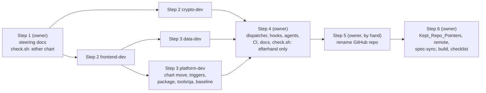

# Design Document

Spec: 20 Efterhand rename

## Overview

The rename is mechanical. Each task applies the Rename_Map (`Revenant` → `Efterhand`, `revenant` → `efterhand`, `REVENANT` → `EFTERHAND`) to the files it owns, moves the files whose names hold the Old_Name with `git mv`, and recomputes the few fixed test values that depend on a renamed string. No behaviour changes, and no code reads an old name.

The design adds only three pieces of real code:

1. **The chart-lint block of `scripts/check.sh`**, rewritten twice: in Step 1 it accepts either chart folder and fails when neither exists; in Step 4 it accepts only `deploy/helm/efterhand` and fails on a missing chart or any other folder under `deploy/helm/`.
2. **`figures-stub.ts` reads the format from the schema** (`figuresResponseV1Schema.shape.format.value`), so the frontend change in Step 2 needs no edit when data-dev changes the literal in Step 3.
3. **A record mode for Golden_V2** in `golden-v2.test.ts`, with a seeded random stream, so the reseal is reproducible byte for byte and its procedure is written down (Requirement 2.5, 2.8).

Everything else is text replacement, checked by the Residual_Search and by a "Rename_Map oracle" diff (below).

### Facts checked while writing this design, at `e3087997`

| What | Result |
|---|---|
| `figuresResponseV1Schema` is exported from `src/lib/figures/now.ts`, which imports only `zod` and `@/lib/seal-format`. | `now.ts` lines 10 to 24. The module says it is safe in the browser and on the server. `src/components/live/figures-state.ts` (a client module) already imports runtime values from it. |
| In zod 4.6.7, `figuresResponseV1Schema.shape.format.value` returns the literal string. | Checked with a throwaway Vitest file, deleted afterwards. |
| `figures-stub.ts` writes `format: "revenant-figures-v1"` and imports `FiguresResponseV1` as a type only. | `src/components/reveal/figures-stub.ts`. It is a test helper used by six test files. |
| `src/app/api/figures/build-response.ts` line 83 writes the format literal. | data-dev renames it (Requirement 7.4). |
| `public/icon.svg`, `opengraph-image.tsx` and `apple-icon.tsx` hold no Old_Name. `layout.tsx` holds two. | `grep -ci`. Requirement 5.11's report is "no Old_Name text" for three of the four. |
| No file under `public/` or `content/` holds the Old_Name. | `git grep -Iil`. The `public/**` overlap between platform-dev and frontend-dev changes nothing in this spec. |
| Golden_V2's header has no `rpId` and its payload holds no Old_Name. It is sealed through `sealLetter` (`src/lib/crypto/seal.ts`), which takes `letterId`, `serverSecret`, `sealedAt`, `opensAt` as inputs and draws the DEK and every nonce from `globalThis.crypto.getRandomValues`. | `seal.ts` lines 99 to 117, 157, 317. A seeded `getRandomValues` makes the reseal deterministic. |
| No procedure for producing Golden_V2 is committed. The test only says it was "produced once". | `golden-v2.test.ts` line 16. Requirement 2.8 applies. |
| No test decrypts Golden_V1. `unlock.test.ts`, `hash.test.ts`, `registry.test.ts` and `v2/payload.test.ts` read it for parsing, hashing and header building. | `git grep golden-v1-envelope`. Golden_V1 stays unchanged (Requirement 6.8). |
| The QR vector `https://efterhand.devclef.se/l/k7q2m9x4p1` (41 bytes) encodes at version 3, size 29 with `qrencode 4.1.1 -8 -l M -m 0 -t ASCII`, the same version and size as the old 40-byte text. | Ran `qrencode` on this machine (4.1.1 installed). |
| The seal-page goldens under `src/components/live/__golden__/seal-page-demo/` hold "Revenant demo" and "Revenant cannot recover it", from frontend copy. They are rewritten with `RECORD_GOLDEN=1`. | `SealPage.demo-golden.test.tsx` line 197. |
| The integration tests check trigger rejections with `/UPDATE on figures is not allowed/`, `/immutable/` and similar. None checks the `revenant:` prefix. | `src/test/integration/figures.test.ts`, `letter-drafts.test.ts`, `sealed-letters.test.ts`. See "Where the requirements meet each other", item 2. |
| `src/test/integration/sealed-letters.test.ts` names `revenant_forbid_change` in two comments and uses `https://revenant.test/...` URLs. | Lines 241 to 520. |
| The Top_Bar wordmark is `.wordmark` in `scene.module.css`: `1rem`, `letter-spacing: 0.12em`, and below 900 px `0.92rem`, `0.08em`. | Lines 191 and 304. The 9-letter "EFTERHAND" is the fit risk at 360 and 390 px. |
| `check.sh` runs with `set -euo pipefail`. Its header promises each check runs only when its files exist. | Lines 1 to 6. The new missing-chart failure is a deliberate exception, decided in requirements.md. |

### Where the requirements meet each other

Each item states the design's default. The owner may change it.

1. **`src/test/integration/**` is touched by two Step 2/3 tasks that may run in parallel.** Requirement 6.3 gives it to crypto-dev (Step 2). Requirement 8.7 needs platform-dev (Step 3) to assert the `efterhand:` prefix there, and platform-dev's `src/test/**` path covers it. Step 3 does not depend on crypto-dev. **Default:** crypto-dev applies the Rename_Map to every Old_Name in `src/test/integration/**`, including the comments naming the trigger function. Platform-dev only adds the prefix assertions (item 2) and renames nothing else there. Platform-dev's Residual_Search for Requirement 1.10 excludes `src/test/integration/**`. If crypto-dev's PR is not merged when platform-dev opens its PR, platform-dev rebases after it, since the files may conflict on nearby lines.
2. **Requirement 8.7 versus Requirement 1.8.** Requirement 1.8 says assertions differ from `e3087997` only by Rename_Map substitutions. Requirement 8.7 asks for an assertion that the message starts with `efterhand:`, which exists nowhere today. **Default:** platform-dev keeps every existing assertion line as it is and adds one `toThrow(/^efterhand: /)` expectation beside each (table, operation) that the integration tests already cover. Adding an assertion is read as allowed by Requirement 8.7, and existing assertions stay unchanged under Requirement 1.8.
3. **`drizzle/**` is listed under platform-dev, data-dev and crypto-dev in `agents.json`.** Requirements 7.7 and 8.5 assign both edited migrations to platform-dev. Crypto-dev's and data-dev's Residual_Search uses the path lists in Requirements 6.3 and 7.4, which leave out `drizzle/**` and `src/lib/db/schema/figures*`.
4. **`src/app/layout.tsx` and `src/app/globals.css` match both platform-dev and frontend-dev globs.** Requirement 5.1 gives them to frontend-dev. Platform-dev does not touch them.
5. **The new missing-chart failure in `check.sh`** breaks the script's "passes on an empty repo" promise in its header. The header comment gets one added sentence naming the exception.

## Architecture



### The figures format across Steps 2 and 3

```mermaid
sequenceDiagram
  participant FE as Step 2 frontend-dev
  participant NOW as src/lib/figures/now.ts
  participant DA as Step 3 data-dev
  FE->>NOW: figures-stub reads figuresResponseV1Schema.shape.format.value
  Note over FE,NOW: value is still "revenant-figures-v1"; stub output still parses
  DA->>NOW: z.literal("efterhand-figures-v1")
  Note over DA,NOW: stub now emits "efterhand-figures-v1" with no stub change (R7.2)
```

### The Rename_Map oracle

Several requirements ask that a changed file differ from its old version "only by the Rename_Map" (Requirements 3.3, 5.7, 7.8, 8.1, 8.10). The check for one file is:

```bash
rmap() { sed -e 's/Revenant/Efterhand/g' -e 's/revenant/efterhand/g' -e 's/REVENANT/EFTERHAND/g'; }
diff <(git show e3087997:"$OLD_PATH" | rmap) "$NEW_PATH"   # prints nothing
```

It is run by hand or in the task's verification, not committed. A file that also has an allowed non-rename change (the chart `version`, the reseal fixtures, the baseline, the stub, `check.sh`) is listed in the PR with that change named.

## Components and Interfaces

Per-role file lists are the files that hold the Old_Name at `e3087997` (`git grep -Iil revenant`) within that role's paths. Each task re-runs the search when it starts. Exact old → new strings are in Data Models.

### 1. Step 1 Owner_Task: steering docs and check.sh — Requirements 3, 4.1 to 4.6

**Steering docs.** All eight files in `.kiro/steering/` get `rmap` applied and nothing else. The oracle diff prints nothing for each file. `crypto.md` then names the three new labels, "Efterhand demo" and "Efterhand letter · opens 5 Nov 2030" by substitution alone, and `deploy.md` keeps its migration and PVC rules word for word. The commit touches only `.kiro/steering/`. It is merged before any Role_Task is dispatched.

**`check.sh` chart-lint block, Step 1 version.** Replaces lines 72 to 80:

```bash
# Helm chart. During spec 20 the chart moves from deploy/helm/revenant to
# deploy/helm/efterhand, so either folder is checked. A missing chart fails even
# without helm, so a move cannot silently turn this check off.
chart_dirs=()
for d in deploy/helm/revenant deploy/helm/efterhand; do
  if [[ -f "$d/Chart.yaml" ]]; then chart_dirs+=("$d"); fi
done
if (( ${#chart_dirs[@]} == 0 )); then
  echo "No Helm chart found. Looked for deploy/helm/revenant/Chart.yaml and deploy/helm/efterhand/Chart.yaml." >&2
  exit 1
fi
if command -v helm >/dev/null; then
  for d in "${chart_dirs[@]}"; do
    step "helm lint and template: $d"
    helm lint "$d" || { echo "helm lint failed for $d" >&2; exit 1; }
    rendered=$(helm template ci "$d") || { echo "helm template failed for $d" >&2; exit 1; }
    if grep -q '^kind: Secret' <<<"$rendered"; then
      echo "Chart $d must not render a Secret (use existingSecret)." >&2
      exit 1
    fi
  done
fi
```

The `step` line prints the folder before each check (Requirement 4.1). Without `helm` only the missing-chart check runs (Requirement 4.6).

### 2. frontend-dev (Step 2) — Requirement 5

Files: every Old_Name file under `src/app/**/*.tsx`, `src/app/**/*.css`, `src/app/fonts/**` (`NOTE.md`), `src/components/**`, `src/lib/cards/**`, `src/lib/ics/**`, plus the test files in shared paths that assert a value this task changes (for example `src/test/landing.test.tsx`, `src/test/footer-layout.test.tsx`, `src/test/layout-metadata.test.ts`, `src/test/retired-phrases.test.ts`, `src/test/user-content.ts` where its assertions read frontend values). A file in `src/test/**` that asserts only platform values is left to platform-dev.

Specific changes:

- `Wordmark.tsx`, `scene/copy.ts` (`wordmark`), `layout.tsx` (title default and template), `live/copy.ts` (`REAL_COPY.passkeyUserName`), `press/copy.ts` (the "Revenant demo" and "Revenant cannot recover it" lines), `ics/build-ics.ts` (`PRODID`), `live/keepsake-files.ts`, `cards/letter-card-svg.ts`.
- `brand/copy.ts`: the comparison-row key `revenant` becomes `efterhand`. Every reader of the key (search `\.revenant\b` and `"revenant"` under `src/components/`) is renamed in the same commit. The rendered rows match `e3087997` with `rmap` applied.
- `figures-stub.ts`:

  ```ts
  import { figuresResponseV1Schema, type FiguresResponseV1 } from "@/lib/figures/now";
  /** The figures body (format from figuresResponseV1Schema) for every series in `loaded`. */
  // ...
  format: figuresResponseV1Schema.shape.format.value,
  ```

  The import becomes a value import from a module that is already browser-safe. No literal Format_String remains in the file.
- CSS comments at `scene.module.css` 153 and 617 and `landing.module.css` 306 quote "letter doesn't.", the text `SceneHeadline.tsx` renders.
- `RecallPager.fit.test.ts`: `REVENANT_LAYOUT_URL` → `EFTERHAND_LAYOUT_URL`, `REVENANT_CHROMIUM` → `EFTERHAND_CHROMIUM`.
- `opengraph-image.test.tsx`: the negative check becomes "does not contain `Efterhand${NBSP}doesn't.`".

**QR_Vectors** (Requirement 5.6). For the entry whose text holds the Old_Name:

```bash
qrencode -8 -l M -m 0 -t ASCII "https://efterhand.devclef.se/l/k7q2m9x4p1"
```

Each output row becomes one `matrix` string: the ASCII output prints two characters per module, so `##` → `1` and two spaces → `0` (checked against the first row of the existing vector). The entry records `version: 3`, `size: 29`. Other entries stay byte-identical. The commit body names the command, the tool version and the text.

**Seal-page goldens** (Requirement 5.7). After the copy change: `RECORD_GOLDEN=1 npx vitest run src/components/live/SealPage.demo-golden.test.tsx`, then the oracle diff on every changed file under `__golden__/seal-page-demo/`, pasted (as "no output") into the commit body. At `e3087997` no other file under `src/components/live/__golden__/` holds the Old_Name, so the `seal-draft.golden.test.tsx` goldens stay unchanged.

**Fit checks** (Requirements 5.9, 5.10). Run against a local build:

```bash
npm run layout-check -- --url http://localhost:3000 --only-sizes 360x640,390x844,1440x900,1920x1080,2560x1440
```

The existing rules cover overflow and the Landing_Ghost (`LG1`, `PH1`, `G3`, `BO1`). Three measurements have no rule, so the task measures them once with a short `playwright-core` snippet run from the shell (not committed) and pastes the numbers into the PR:

| Check | Measure | Pass |
|---|---|---|
| Tagline_Line one line | `getClientRects().length` of the headline's nowrap span on `/` | 1 at all five sizes |
| Tagline_Line clear of ghosts | span rect versus `[data-ghost-box]` on `/` and the Ghost_Body_Box on `/demo/personas/<key>` during emergence | no intersection |
| Wordmark fits the Top_Bar | `[data-wordmark]` `getClientRects().length`, every Top_Bar slot rect, `document.documentElement.scrollWidth` | 1 line, no two slots intersect, scroll width ≤ viewport, at 360×640 and 390×844 |

If the Wordmark does not fit, only `.wordmark` `letter-spacing` (step 0.01em, starting at the old value in that media block) or `font-size` (step 1 px) changes, to the nearest passing value. The commit body names old and new values.

**Tone_Check.** A throwaway run of `toneProblems` over every changed copy string; the PR lists the strings and "no problems". The existing copy tone tests also run in `npm test`.

### 3. crypto-dev (Step 2) — Requirement 6

Files: `src/lib/crypto/kdf.ts`, `passkey.ts`, and the Old_Name tests under `src/lib/crypto/**`, `src/lib/seal-format/**` (`v1/header.test.ts`, `v1/is-rp-id.test.ts`), `src/lib/letter-store/**` (`config.test.ts`), `src/test/integration/**` (`live-letters.test.ts`, `sealed-letters.test.ts`, see item 1 above), and the fixture `golden-v2-envelope.json`.

- `kdf.ts`: the three `INFO_*` constants and their comments.
- `passkey.ts`: `PASSKEY_RP_NAME = "Efterhand"`, `PASSKEY_USER_NAME = PASSKEY_USER_DISPLAY_NAME = "Efterhand demo"`.
- `kdf.test.ts`: label and plaintext literals become `efterhand-kek-backup-v1`, `efterhand-kek-passkey-v1`, `efterhand-kat-plaintext`, still written as literals and still fed to `hkdfSync`. No stored hex changes because there is none.
- `is-rp-id.test.ts`: `Revenant.devclef.se` becomes `Efterhand.devclef.se` and stays in the rejected list.

**Golden_V2 reseal** (Requirements 6.5 to 6.7, 2.5, 2.8). `golden-v2.test.ts` gains a record mode, written into the test file so the procedure is committed:

```ts
// To reseal: RECORD_GOLDEN=1 npx vitest run src/lib/crypto/golden-v2.test.ts
// Inputs: GOLDEN_PAYLOAD below, PUBLIC_DEMO_BACKUP_KEY, goldenServerSecret()
// (byte i = (7i + 3) mod 256), letterId/sealedAt/opensAt from GOLDEN_HEADER,
// and getRandomValues replaced by goldenRandom(): byte n of the stream is
// (11n + 5) mod 256, so the DEK and every nonce are fixed.
const GOLDEN_HEADER = {
  letterId: "BRAbJjE8R1JdaHN-iZSfqg",
  sealedAt: "2026-10-31T12:00:00.000Z",
  opensAt: "2027-02-01T00:00:00.000Z",
} as const;
```

With `RECORD_GOLDEN=1`, one `it` stubs `globalThis.crypto.getRandomValues` with `goldenRandom` (restored in `finally`), calls `sealLetter` with the inputs above, and writes `{ envelope, envelopeHash }` to the fixture with two-space JSON and a trailing newline. Without it, the file is only read. `sealLetter` already returns `envelopeHash` as SHA-256 over RFC 8785 canonical JSON, and the existing hash test recomputes it. Running record mode twice gives the same bytes (checked before commit with `git diff --exit-code` after the second run).

The old fixture is copied, byte for byte from `e3087997`, to `src/lib/seal-format/__fixtures__/golden-v2-envelope.pre-rename.json`. A new case in `golden-v2.test.ts` opens it with the demo key and fixed secret and expects `ok: false`, `error.kind === "wrong_key"` and no `payload`.

Golden_V1 and `PUBLIC_DEMO_BACKUP_KEY` stay byte-identical. The commit body says no test decrypts Golden_V1.

### 4. data-dev (Step 3, after frontend-dev) — Requirement 7

Files: `src/lib/figures/now.ts`, `at-opening.ts`, `src/lib/sources/fetch-gate.ts`, `src/app/api/figures/build-response.ts`, and the Old_Name tests in those paths (`now.test.ts`, `at-opening.test.ts`, `last-success-at.test.ts`, `demo/no-fixture.test.ts`, `fetch-gate.test.ts`, `fetch-figures-freshness.test.ts`, `prefetch-figures-main.test.ts`, `src/app/api/figures/*.test.ts`), plus any test elsewhere that asserts the Format_String or lock name.

- `now.ts`: `format: z.literal("efterhand-figures-v1")`, and the doc comment.
- `fetch-gate.ts`: `FETCH_LOCK_NAME = "efterhand-fetch-figures"`, comment `hashtext('efterhand-fetch-figures')`.
- The rejection test in `now.test.ts` uses a string with no Old_Name (Property 2's generator, or a fixed `"other-figures-v1"`).
- No change to `figures-stub.ts`, `src/lib/db/schema/figures.ts` or `drizzle/`. Demo figure files change only in Old_Name text, if any; the oracle diff proves it.

### 5. platform-dev (Step 3, after frontend-dev) — Requirement 8

**Chart.** `git mv deploy/helm/revenant deploy/helm/efterhand` in a commit with no content change. A second commit applies `rmap` to every file under `deploy/helm/efterhand/` and bumps `Chart.yaml` `version` by one minor version. `helm lint` and `helm template ci deploy/helm/efterhand` pass, and `helm template ... | grep -i revenant` prints nothing. During Step 3 the Step 1 `check.sh` lints whichever folder exists.

**Migrations.** `drizzle/0000_sealed_letters.sql` lines 44 to 54 and `drizzle/0002_figures.sql` lines 36 to 39: `revenant_forbid_change` → `efterhand_forbid_change`, message `'efterhand: % on % is not allowed; sealed records are immutable'`. No file added, `drizzle/meta/` unchanged. Trigger names (`letters_forbid_change` and so on) hold no Old_Name and stay.

**Integration assertions.** Beside each existing rejection assertion in `figures.test.ts`, `letter-drafts.test.ts` and `sealed-letters.test.ts`, one added `rejects.toThrow(/^efterhand: /)` on the same statement. Existing lines unchanged (item 2 above).

**Other files:** `src/lib/db/**` (`schema/figures.ts` comment, `client.test.ts`), `src/lib/page-metadata.ts` (`SITE_NAME = "Efterhand"`) and its test, `src/lib/security-headers.ts`, `src/lib/layout-gate.test.ts`, `src/lib/layout-baseline-cache.test.ts`, `src/lib/persona-release-frozen.test.ts`, `src/middleware.test.ts`, `src/app/api/health/ready/route.test.ts`, `src/test/**` outside `integration/` (including the chart path in `fetch-figures-chart.test.ts` and `seed-job.test.ts`), `tools/qa/**`, `README.md`, `docs/video-script.md`, `docs/writeup-gaps.md`, `Dockerfile`, `.dockerignore`, `package.json`, `package-lock.json` (the two `name` lines only).

**`tools/qa`.** `REVENANT_LAYOUT_BASELINE_DIR` → `EFTERHAND_LAYOUT_BASELINE_DIR`, cache `~/kiro/efterhand-crew/layout-baseline/`, temp prefixes `efterhand-layout-` and `efterhand-layout-gate`, `BLOCKERS_FORMAT = "efterhand-layout-blockers/1"`. No read of the old variable.

**Gate_Baseline** (Requirements 8.12, 8.13). On a checkout of `main` after the frontend-dev merge, with this task's `tools/qa/**` change applied, a local Postgres migrated and the personas sealed (`node scripts/migrate.mjs`, then `node scripts/seal-personas.mjs`), and Chromium available:

```bash
LAYOUT_GATE_SAVE=tools/qa/layout-gate-baseline.json npm run layout-gate
```

The PR compares the new file with `git show <base>:tools/qa/layout-gate-baseline.json | rmap`, ignoring `createdAt`, and lists each added, removed or changed row with its cause. The commit body names the `main` commit.

The new chart is not installed until Step 6 has pushed an image to `ghcr.io/devclef/efterhand` (Requirement 10.8). The PR description says so.

### 6. Step 4 Owner_Task — Requirements 9, 4.7 to 4.9

- `git mv tools/dispatcher/revenant_dispatch.py tools/dispatcher/efterhand_dispatch.py` (no content change in that commit), then `rmap` over `tools/dispatcher/**` except the three Kept_Repo_Pointers lines (`REPO` in `efterhand_dispatch.py`, `REPO_URL` and the `os.environ.get("REPO", "devclef/Revenant")` default in `spec_sync.py`). Imports become `from efterhand_dispatch import GitHub`.
- `tools/agents/generate_agents.py`: `rmap`, then `python3 tools/agents/generate_agents.py` to rewrite `.kiro/agents/*.json`.
- `rmap` over `.kiro/agents/prompts/**`, `.kiro/hooks/**`, `tools/hooks/**`, `docs/agent-loop.md`, `docs/kiro-writeup.md`, `docs/design/**` text files, `.github/ISSUE_TEMPLATE/**`, `.github/pull_request_template.md`, `.github/labels.json` if it holds the name, `ci.yml`, `journey-check.yml`, and every other unowned Scope file the Residual_Search lists. `build.yml` keeps `ghcr.io/devclef/revenant`.
- A dispatcher unit test: with only `REVENANT_CREW_HOME` set, the crew home is the `EFTERHAND_CREW_HOME` default (`~/kiro/efterhand-crew`). The same for the token and the run cap, each behaving as unset.
- **`check.sh` Step 4 version** (no Old_Name in the file):

  ```bash
  # Helm chart. Fails without helm too if the chart is missing or another chart
  # folder sits beside it.
  chart=deploy/helm/efterhand
  if [[ ! -f "$chart/Chart.yaml" ]]; then
    echo "No Helm chart found. Looked for $chart/Chart.yaml." >&2
    exit 1
  fi
  for d in deploy/helm/*/; do
    d=${d%/}
    if [[ "$d" != "$chart" ]]; then
      echo "Unexpected folder $d in deploy/helm/. Only $chart belongs there." >&2
      exit 1
    fi
  done
  if command -v helm >/dev/null; then
    step "helm lint and template: $chart"
    helm lint "$chart" || { echo "helm lint failed for $chart" >&2; exit 1; }
    rendered=$(helm template ci "$chart") || { echo "helm template failed for $chart" >&2; exit 1; }
    if grep -q '^kind: Secret' <<<"$rendered"; then
      echo "Chart $chart must not render a Secret (use existingSecret)." >&2
      exit 1
    fi
  fi
  ```

  The glob lists directories in the working tree, tracked or not (Requirement 4.9). With no match bash leaves the literal pattern `deploy/helm/*`, which is not `$chart`, but that case cannot happen because the `Chart.yaml` check ran first.
- Done when the Residual_Search lists only `efterhand_dispatch.py`, `spec_sync.py` and `build.yml`, each hit a Kept_Repo_Pointer, and `generate_agents.py --check`, the dispatcher tests and `check.sh` pass.

### 7. Step 5 and Step 6 — Requirements 10.1, 11

**Step 5** is the owner renaming the repository on GitHub to `devclef/Efterhand`. Nothing in this repository changes.

**Step 6 Owner_Task**, in order:

1. `gh repo view devclef/Efterhand --json name`. If it fails, stop and report (Requirement 11.2).
2. One commit changing exactly the four Kept_Repo_Pointers lines (`git diff --stat` shows three files, four lines).
3. `git remote set-url origin <same protocol>devclef/Efterhand(.git)` for fetch and push; report `git remote -v`.
4. Push to `main`. Run spec-sync once against `devclef/Efterhand` (`REPO=devclef/Efterhand python3 tools/dispatcher/spec_sync.py ...` with the token from `EFTERHAND_GITHUB_TOKEN`); pass is exit 0 and zero created issues.
5. Wait for `build.yml` on that commit; report the run URL and pushed tag at `ghcr.io/devclef/efterhand`. Wait for `ci-gate`.
6. Both Residual_Search commands on `main` print nothing; `check.sh` passes.
7. Report ends with the User_Checklist (Requirement 11.9 items, plus Requirement 9.13's `EFTERHAND_*` variables).

## Data Models

### Old → new strings

| Where | Old | New | Task |
|---|---|---|---|
| Domain, `RP_ID`, `APP_ORIGIN` | `revenant.devclef.se`, `https://revenant.devclef.se` | `efterhand.devclef.se`, `https://efterhand.devclef.se` | per file owner |
| Repo | `devclef/Revenant` | `devclef/Efterhand` (Kept_Repo_Pointers in Step 6) | owner |
| Image | `ghcr.io/devclef/revenant` | `ghcr.io/devclef/efterhand` (chart default Step 3, push path Step 6) | platform-dev, owner |
| Chart folder, name, helpers | `deploy/helm/revenant`, `revenant`, `revenant.*` | `deploy/helm/efterhand`, `efterhand`, `efterhand.*` | platform-dev |
| KDF labels | `revenant-kek-passkey-v1`, `revenant-kek-backup-v1`, `revenant-opening-v1` | `efterhand-kek-passkey-v1`, `efterhand-kek-backup-v1`, `efterhand-opening-v1` | crypto-dev |
| KAT plaintext | `revenant-kat-plaintext` | `efterhand-kat-plaintext` | crypto-dev |
| Passkey names | `Revenant`, `Revenant demo` | `Efterhand`, `Efterhand demo` | crypto-dev |
| Real passkey user | `Revenant letter · opens {date}` | `Efterhand letter · opens {date}` | frontend-dev |
| Wordmark | `Revenant`, `revenant` | `Efterhand`, `efterhand` | frontend-dev |
| Titles | `Revenant`, `%s · Revenant`; `SITE_NAME = "Revenant"` | `Efterhand`, `%s · Efterhand`; `SITE_NAME = "Efterhand"` | frontend-dev; platform-dev |
| `.ics` | `-//Revenant//Live demo//EN`, `revenant-letter-<id>.ics` | `-//Efterhand//Live demo//EN`, `efterhand-letter-<id>.ics` | frontend-dev |
| Brand row key | `revenant:` | `efterhand:` | frontend-dev |
| Figures format | `revenant-figures-v1` | `efterhand-figures-v1` | data-dev |
| Fetch lock | `revenant-fetch-figures` | `efterhand-fetch-figures` | data-dev |
| Trigger function, message | `revenant_forbid_change()`, `revenant: …` | `efterhand_forbid_change()`, `efterhand: …` | platform-dev |
| Layout tools | `REVENANT_LAYOUT_BASELINE_DIR`, `revenant-layout-blockers/1`, `revenant-layout-*` temp | `EFTERHAND_…`, `efterhand-layout-blockers/1`, `efterhand-layout-*` | platform-dev |
| Fit test env | `REVENANT_LAYOUT_URL`, `REVENANT_CHROMIUM` | `EFTERHAND_LAYOUT_URL`, `EFTERHAND_CHROMIUM` | frontend-dev |
| Package | `"name": "revenant"` | `"name": "efterhand"` | platform-dev |
| CI | `revenant_test`, `revenant:ci`, journey URL | `efterhand_test`, `efterhand:ci`, `https://efterhand.devclef.se` | owner Step 4 |
| Dispatcher | `revenant_dispatch.py`, `REVENANT_GITHUB_TOKEN`, `REVENANT_CREW_HOME`, `REVENANT_MAX_DEV_RUNS`, `~/kiro/revenant-crew`, `revenant-dispatch`, `revenant-agent-notes`, `revenant-dispatcher` | the `efterhand` forms | owner Step 4 |
| Agents, hooks | `revenant-prompts`, `revenant-hooks`, `~/kiro/revenant-crew/hooks.log`, role descriptions | the `efterhand` forms | owner Step 4 |

### Fixtures

| Fixture | Changes | Procedure |
|---|---|---|
| Golden_V2 | Resealed (wrapped key, payload ciphertext, hash) | Record mode in `golden-v2.test.ts` |
| `golden-v2-envelope.pre-rename.json` | New, byte copy of the `e3087997` Golden_V2 | `git show e3087997:… > …` |
| Golden_V1 | None | — |
| QR_Vectors | One entry's `text` and `matrix` | `qrencode` 4.1.1 |
| Seal-page goldens | Old_Name text only | `RECORD_GOLDEN=1` |
| Gate_Baseline | `format`, rows the rename moved | `LAYOUT_GATE_SAVE` on `main` |

## Correctness Properties

*A property is a characteristic or behavior that should hold true across all valid executions of a system-essentially, a formal statement about what the system should do. Properties serve as the bridge between human-readable specifications and machine-verifiable correctness guarantees.*

Most of this spec is a fixed text change on a fixed repository, checked by the Residual_Search, the oracle diff and example tests. No Rename_Map helper is added to the code, so the case mapping has no function to test. The chart-lint selection in `check.sh` has eight input states (two folders, `helm` present or not) and is covered by an example matrix. The seal and open round trip under the new labels is already a property (`seal-open-v2.property.test.ts`, `seal-open-passkey.property.test.ts`) and keeps running unchanged. Two properties are new.

### Property 1: The figures stub always produces a body the schema accepts

*For any* `LoadedFigures` value (zero or more series, each with zero or more figures), `figuresResponseFrom(loaded)` parses with `figuresResponseV1Schema`, and its `format` equals `figuresResponseV1Schema.shape.format.value`.

**Validates: Requirements 5.5, 7.2**

### Property 2: The figures schema accepts only its own format

*For any* string `s` other than `efterhand-figures-v1` (generated strings, including case variants, prefixes and suffixes of the literal, filtered to hold no Old_Name), a body that is valid except for `format: s` fails `parseFiguresResponse`, and the same body with `format: "efterhand-figures-v1"` passes.

**Validates: Requirements 7.1**

## Error Handling

- **`check.sh`, no chart or a stray folder:** exits non-zero with the paths it looked for, or the folder it found. Fix: restore or move the chart; remove the stray folder.
- **`helm lint` or `helm template` fails:** the message names the folder. `set -e` would stop anyway; the explicit `||` makes the folder name appear.
- **Golden_V2 reseal not reproducible:** a second record run changes the file. The task does not commit; the usual cause is a `getRandomValues` call outside the stub's lifetime or an unstubbed `Date`.
- **A Role_Task's check fails because a dependency is unmerged:** wait and rebase (Requirement 10.6). No compatibility code.
- **Fit check fails:** only the CSS values named in Requirements 5.9 and 5.10 change.
- **Gate baseline gains rows unrelated to the rename:** the PR lists them and the owner decides before merge. They are not hidden by editing the baseline by hand.
- **Step 6 preconditions fail** (repo not found, spec-sync exits non-zero or creates issues, build fails): stop, report, change nothing further, close no issue without the owner.

## Testing Strategy

`fast-check` 4.10.2 is already a dev dependency. No dependency is added.

### Property-based tests

Each runs at least 100 times (`{ numRuns: 100 }`) and starts with a tag comment.

| File | Property | Owner |
|---|---|---|
| `src/components/reveal/figures-stub.property.test.ts` | 1 | frontend-dev |
| `src/lib/figures/now.format.property.test.ts` | 2 | data-dev |

```ts
// Feature: 20-efterhand-rename, Property 1: The figures stub always produces a body the schema accepts
```

Property 1's generator builds `LoadedFigures` from figures and metrics that pass `figureV1Schema` and `metricDefinitionV1Schema` (reuse the arbitraries in the `build-payload*.property.test.ts` files if they export them, otherwise a local one in the test). At Step 2 it passes with the old literal and keeps passing after Step 3 with no edit. Property 2's generator is `fc.oneof` of arbitrary strings, case variants of the literal, and the literal with characters added or removed, each filtered with `!/revenant/i.test(s) && s !== literal`.

### Example tests

- **KDF and passkey constants:** existing equality tests in `kdf.test.ts` and `passkey.test.ts`, with renamed expected values.
- **Golden_V2:** the five existing cases against the resealed fixture, plus the new "pre-rename fixture does not open" case.
- **QR:** `encode.test.ts` compares the encoder with the regenerated vector.
- **Figures lock:** `fetch-gate.test.ts` asserts `FETCH_LOCK_NAME === "efterhand-fetch-figures"`.
- **Triggers:** the integration tests, with the added `/^efterhand: /` expectations, run in CI against Postgres.
- **Dispatcher:** one test per old variable showing it is ignored.
- **`check.sh` matrix (owner, by hand, in temporary worktrees):**

  | State | Step 1 script | Step 4 script |
  |---|---|---|
  | only `revenant` | lints `revenant`, exit 0 | — |
  | only `efterhand` | lints `efterhand`, exit 0 | lints, exit 0 |
  | neither | exit 1, both paths | exit 1, path printed |
  | `efterhand` plus another folder | — | exit 1, folder named |
  | `helm` removed from `PATH` | lint skipped; missing-chart check still applies | same |

### Searches and diffs

- Residual_Search per role path list on each Role_Task head (Requirement 1.10), on the Step 4 head (Requirement 9.10) and on `main` after Step 6 (Requirement 11.7).
- `git diff e3087997 -- .kiro/specs ':!.kiro/specs/20-efterhand-rename'` prints nothing on every merge.
- The oracle diff for the steering docs, the moved chart files, the golden markup files and the demo figure files.
- Visual_Language_Names match counts before and after each task (`git grep -c Ghost_Body_Box` and so on).
- `npm test` case count on head is at least the count on the merge base, with zero failures (Requirement 2.4). The PR states both counts.

### Not tested by automation

The User_Checklist actions, the GitHub repository rename, DNS, TLS and the cluster install are owner actions outside the repository.
