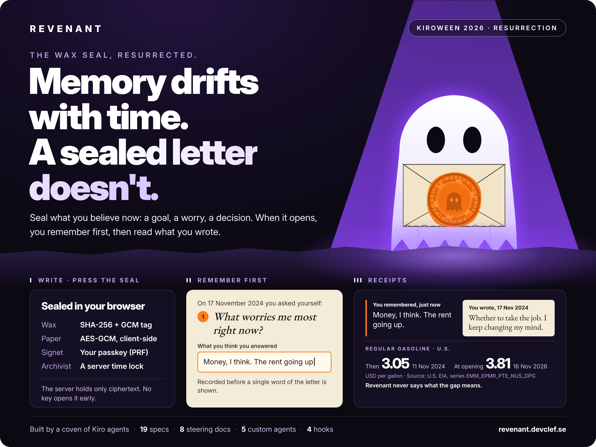
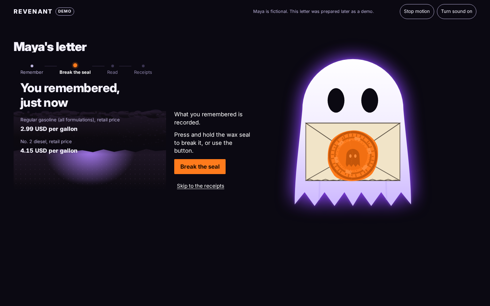

# Revenant

*The wax seal, resurrected. Memory drifts with time. A sealed letter doesn't.*

A wax seal did two jobs: it showed whose letter it was, and whether anyone broke it before its time. Revenant brings the wax seal back with a passkey and browser crypto that do both jobs again ([job by job](#the-wax-seal-job-by-job)).

**Live:** [Seal your own letter](https://revenant.devclef.se/demo/live) · [Open a persona letter](https://revenant.devclef.se/demo) · **Demo video:** [DEMO VIDEO LINK]

## For judges: 60 seconds, no passkey needed

1. Open [revenant.devclef.se/demo/personas/us-maya](https://revenant.devclef.se/demo/personas/us-maya) and answer the two questions from your own memory of the month Maya wrote in.
2. Press "Record my answers", then "Break the seal". Read the letter, then press "See the receipts".
3. At the end of the receipts, press "Try to tamper with it", then "Also fix the fingerprint".
4. Then seal your own at [revenant.devclef.se/demo/live](https://revenant.devclef.se/demo/live). It opens 30 seconds later. If your computer cannot use passkeys, tick "This computer can't use passkeys. Simulate the passkey in this tab." on the seal step.

**Kiroween 2026 · Resurrection**

<p align="center">
  
  <br><em>The one-pager. The gasoline figures are real U.S. EIA records (series EMM_EPMR_PTE_NUS_DPG, weeks of 11 Nov 2024 and 16 Nov 2026, USD per gallon). The question and the two answers are an example, not a sealed letter.</em>
</p>

Since 1735 the French Académie des sciences has kept *plis cachetés*, sealed envelopes that prove what someone knew, and when. Even Pasteur used them.

In school we wrote letters to our future selves, and they were mailed back to us years later. Email and cloud drives took the letter digital and left the seal behind: a file can be edited, read by the operator, and opened any time.

## The wax seal, job by job

| The wax seal | Revenant |
|---|---|
| Wax that shows whether it was broken | A SHA-256 hash of the canonical envelope, checked at sealing and at opening, plus the AES-GCM tag |
| The folded paper that hides the page | AES-GCM encryption in your browser. The server only holds ciphertext |
| The signet ring that made it yours | **A passkey (WebAuthn PRF)**, pressed with fingerprint, face or PIN. No account, no password. An optional backup key card is the spare key |
| The archivist who won't open it early | A server time lock. The server releases its half of the key only when its own UTC clock reaches the opening date |

Passkey sealing works today at [`/demo/live`](https://revenant.devclef.se/demo/live) and [`/seal`](https://revenant.devclef.se/seal). PRF works with current iCloud Keychain, Google Password Manager and Windows Hello; Revenant checks PRF on your device when you seal, and requires the backup key if the check fails.

## What no wax seal could do

A wax seal proves the letter wasn't changed. It can't stop you changing your memory of it.

So before the seal breaks, you remember first. You write what you think you answered, and it is stored, encrypted, before anything sealed is shown. Then you see what you remembered beside the answer you sealed. Revenant never says what the gap means.

## Try it

| | | Needs |
|---|---|---|
| **[Seal your own letter](https://revenant.devclef.se/demo/live)** | Answer your questions while writing, seal with your passkey, wait 30 seconds, open the letter, remember first, break the seal. A rehearsal of a letter that would normally stay sealed for months. | A passkey with PRF, or "Seal with a backup key instead". Hold the wax or press the seal button under it. A computer that cannot use passkeys can tick "This computer can't use passkeys. Simulate the passkey in this tab." Then nothing is saved on the device, and the backup key is required |
| **[Seal a real letter](https://revenant.devclef.se/seal)** | The same Write and Press the seal steps, then a Keep step with the sealed letter. Opens at least 3 months later. | A passkey with PRF, or a backup key |
| **[Maya's letter](https://revenant.devclef.se/demo/personas/us-maya)** | US, with fuel price receipts. Remember first, break the seal, see then and now. | Nothing |
| **[Tomás's letter](https://revenant.devclef.se/demo/personas/eu-tomas)** | EU, with fuel price receipts. | Nothing |
| **[Priya's letter](https://revenant.devclef.se/demo/personas/us-priya)** | Text only, with two questions she left for herself. | Nothing |
| **[How it is sealed](https://revenant.devclef.se/how-it-is-sealed)** | A short read on the cryptography. | Nothing |

## The ritual

1. **Write.** Start from an occasion (the year ahead, work, family, a decision, or blank), or start blank. Each occasion offers a letter starter and one question in your own voice. Add up to three questions and answer each one as you write. Plain text, up to 5,000 characters. Fuel price receipts (US or EU) are optional.
2. **Press the seal.** Pick an opening date. Hold the wax, or press the seal button under it, and seal with your passkey. You can also choose "Seal with a backup key instead" and skip the passkey; that letter opens only with its backup key. On `/demo/live`, a computer that cannot use passkeys can simulate one in the tab, and then the backup key is required. The questions and your answers to them are sealed with the letter, and you cannot change them afterwards.
3. **Keep.** A letter card with a QR link, a backup key card and an `.ics` file.
4. **Wait.** Scanning early shows "still sealed" and a countdown.
5. **Remember.** After the opening date, open the letter and unlock with your passkey or backup key. Revenant recalls each question you wrote, and you write what you remember answering. What you remember is stored before anything sealed is shown.
6. **Receipts.** Break the seal. Each question with what you remembered beside the answer you sealed. The letter stays open, beside them on a wide screen and in its place on a phone. Then any figures, then and now. Revenant does not explain the difference.

<p align="center">
  
  <br><em>Maya's letter at the Break the seal step, before the seal is pressed. The two numbers under "You remembered, just now" are the demo's sample answers, kept as filled in. They stand for what a judge remembered, and they are not records.</em>
</p>

## What's built and running

- Passkey sealing and unlocking, all in the browser ([the table above](#the-wax-seal-job-by-job)).
- The live demo: six steps, a 30-second lock, a real passkey named "Revenant demo", or a simulated passkey that lives only in the tab.
- Real sealing at `/seal`: the same Write and Press the seal steps, then a Keep step. Real letters open at least 3 months after sealing.
- A seal button under the wax, and "Seal with a backup key instead" on the seal step, with no passkey prompt.
- Three fictional persona letters, openable with no passkey. Their figures are real historical records.
- The ceremony: soil, light, the ghost rising with the envelope, the seal breaking, and receipts with the letter kept open. The first render needs no JavaScript, and reduced motion turns the motion off.
- Letter card, backup key card and `.ics`, generated in the browser.
- EIA and EU Weekly Oil Bulletin adapters with full provenance, fetched daily by a CronJob.
- Database triggers that block any change to a sealed row.
- Self-contained letters that open even if every data source disappears.

Real sealing at `/seal` is on for judging, and the home page links to it ("Seal a real letter").

## How I built it with Kiro

I wrote the steering, the specs and the loop tooling. A crew of Kiro agents wrote the product through tickets. The detail, with the command behind every number, is in [docs/kiro-writeup.md](docs/kiro-writeup.md). Numbers were counted at `main` commit `0371699` on 27 November 2026.

| Kiro feature | What it did here | Where to look | Number |
|---|---|---|---|
| Specs | Requirements, design and tasks per feature. One task is one GitHub issue and one pull request | [`.kiro/specs/`](.kiro/specs/), [write-up §4](docs/kiro-writeup.md#4-spec-driven-development-compared-with-vibe-coding) | 21 spec folders |
| Steering | Non-negotiables: data integrity, neutrality, tone, crypto and more. Six load always; crypto and deploy rules load only for their files | [`.kiro/steering/`](.kiro/steering/), [write-up §5](docs/kiro-writeup.md#5-steering) | 8 docs |
| Custom agents | `platform-dev`, `crypto-dev`, `data-dev`, `frontend-dev`, each fenced to its own paths, and `qa`, which reviews every PR | [`.kiro/agents/`](.kiro/agents/), [write-up §2](docs/kiro-writeup.md#2-the-custom-agents) | 5 agents |
| IDE hooks | On save: a tone check on copy, a ceremony-truth check, crypto tests, an agents check | [`.kiro/hooks/`](.kiro/hooks/), [write-up §3](docs/kiro-writeup.md#3-hooks) | 4 hooks |
| Agent stop hooks | A path-scope check for every build agent, and a tone check for `frontend-dev`, before a run can finish | [`tools/hooks/`](tools/hooks/), [write-up §3](docs/kiro-writeup.md#3-hooks) | 35 scope blocks and 5 tone blocks, 31 Oct to 27 Nov 2026 |
| MCP | Playwright MCP lets `qa` and `frontend-dev` click through each build and cite screenshots | [`.kiro/agents/qa.json`](.kiro/agents/qa.json), [write-up §6](docs/kiro-writeup.md#6-mcp) | 2 agents |
| Property-based tests | fast-check properties for the adapters, the change formula, the sealed format and the ceremony | [write-up §7](docs/kiro-writeup.md#7-property-based-testing) | 106 files |
| Kiro Crew loop | Claim an issue, build, open a PR, CI, QA, merge or retry. After three failed fix runs it hands the issue to me | [`docs/agent-loop.md`](docs/agent-loop.md), [write-up §1](docs/kiro-writeup.md#1-kiro-surfaces) | 371 merged pull requests |


The full runbook is in [docs/agent-loop.md](docs/agent-loop.md).

### Who wrote what

I wrote the steering, the specs, and the dispatcher and loop tooling: the QA prompt, CI and the agent prompts. The loop tooling had no spec. Most of the 99 commits that did not come through a ticket pull request are that direct work, with spec and steering changes. The role agents wrote the product: 292 of the 371 merged pull requests came from an agent branch. Eleven issues reached `status:blocked` and came back to me ([write-up §1](docs/kiro-writeup.md#1-kiro-surfaces), [§4](docs/kiro-writeup.md#4-spec-driven-development-compared-with-vibe-coding)).

## Known limits

These are stated on [How it is sealed](https://revenant.devclef.se/how-it-is-sealed).

- Opening needs the Revenant server, which must release its time-lock secret. If the service or its database is gone, sealed letters cannot be opened.
- A lost passkey with no backup key means the letter is lost, and Revenant cannot recover it.
- If daylight saving time changes between sealing and opening, the sealed date can move by one day. This happens only to letters sealed in the last hour before local midnight.

## Principles, enforced in code

- **Data integrity.** Every number has value, unit, region, period, source and retrieval time. An honest "unavailable" beats a guess.
- **Neutrality.** No political side. Up and down get the same visual treatment, and no change is called good or bad.
- **Tone.** A dark room, one shaft of purple light, one orange seal. Spooky the way a quiet night is spooky.

## Stack, local run and deployment

TypeScript, Next.js (App Router), PostgreSQL with Drizzle, WebCrypto and WebAuthn in the browser, Zod, Vitest with fast-check. One Docker image (`ghcr.io/devclef/revenant`) and a Helm chart with its own Postgres in `deploy/helm/revenant`.

```bash
npm install
cp .env.example .env      # set DATABASE_URL
npm run db:migrate && npm run dev
./scripts/check.sh        # lint, typecheck and tests, as CI runs them
```

Passkeys need HTTPS on their domain, or `localhost`. Production runs at `revenant.devclef.se` on a self-hosted RKE2 cluster via Fleet.

## License

MIT. See [LICENSE](LICENSE).
