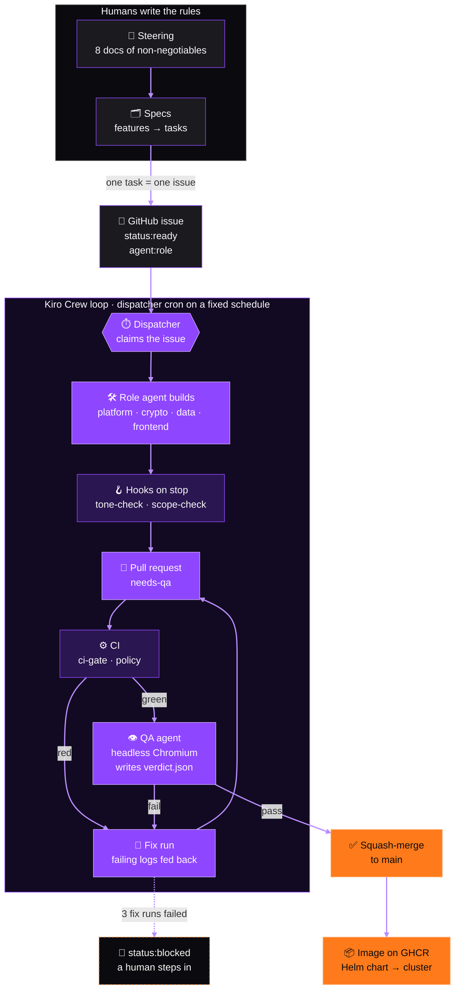

# Revenant

*The wax seal, resurrected. Memory rewrites itself. Revenant doesn't.*

<p align="center">
  
</p>

<p align="center">
  <a href="https://revenant.devclef.se/demo"></a>
</p>

**Kiroween 2026 · Resurrection category.** The dead technology is the **wax seal**: the *pli cacheté*, the sealed envelope the French Académie des sciences has kept since 1735 to prove what someone knew, and when. Revenant brings it back with a **passkey**. You press the seal with your fingerprint, face or device PIN, and the letter is locked in your browser with a key that comes from that passkey. It works today, with your own passkey, in about two minutes.

## Try it in two minutes

| | | Needs |
|---|---|---|
| **[Seal your own letter](https://revenant.devclef.se/demo/live)** | Write a letter, press the seal with your passkey, wait 30 seconds, unlock it with the same passkey, testify, break the seal. It is a rehearsal of a letter that would normally stay sealed for months. | A passkey with PRF, or use the backup key |
| **[Open Maya's letter](https://revenant.devclef.se/demo/personas/us-maya)** | A pre-sealed letter with price receipts. Testify, break the seal, see then and now. | Nothing |
| **[Open Priya's letter](https://revenant.devclef.se/demo/personas/us-priya)** | A text-only letter with two questions she left for herself. | Nothing |
| **[How it is sealed](https://revenant.devclef.se/how-it-is-sealed)** | A short read on the cryptography. | Nothing |

Passkeys with PRF work with iCloud Keychain on macOS and iOS 18+, Google Password Manager on Android, and Windows Hello on Windows 11 24H2/25H2 with the February 2026 update and Chrome/Edge 147+ or Firefox 148+. Some third-party passkey managers don't support it. Revenant checks PRF on your device at sealing, and if it fails the backup key card becomes required.

## The problem

Memory rewrites itself. Every time you recall something, you edit it a little, and you can't cross-examine your own past: the only witness is a memory that has already been rewritten. Email, notes apps and cloud drives made letters digital and left the seal behind. A file can be edited, read by whoever runs the server, and opened whenever you like.

## What we resurrected: the seal, with a passkey

Since 1735 the Académie des sciences has kept *plis cachetés*. Pasteur and Niépce left them. A classroom time capsule works the same way. When I was in school, my teacher had us each write a letter to our future selves and mailed them back years later. The seal carries the meaning: this was written then, by you, and nobody has touched it since.

Each part of the old seal has a modern replacement, and the passkey is the signet ring:

| The wax seal | Revenant |
|---|---|
| The signet ring that made the seal yours | **A passkey (WebAuthn PRF).** Fingerprint, face or device PIN. The passkey produces a secret that wraps the letter's key. No account, no password |
| The folded paper that hides the page | AES-GCM encryption in your own browser. The server only ever holds ciphertext |
| Wax that shows whether it was broken | A SHA-256 hash of the canonical envelope, checked at sealing and again at opening, plus the AES-GCM tag over the contents |
| The archivist who won't open it before its date | A server time lock. The server releases its half of the key only when its own UTC clock reaches the opening date |
| A spare key kept somewhere safe | An optional backup key card, a printable PDF with a QR code |

The operator cannot read your letter, your answers or your numbers. Not even you can read it early.

## What no wax seal could do

A wax seal proves the letter wasn't changed. It can't stop you changing your memory of it.

So Revenant adds one step the Académie never needed. **Before the seal breaks, you testify.** For each question you wrote, you say what you think you answered, and your testimony is recorded. Only then do you see what you sealed, side by side with what you remembered. The gap between your testimony and the record is the whole product. Revenant never says what the gap means. It doesn't grade, score or comment on it.

## The ritual

1. **Write.** A letter to your future self, plain text, up to 5,000 characters. Start from an Occasion (the year ahead, work, family, a decision, or blank). Add up to three questions in your own voice, each answered as you write. Add receipts if you want: official price figures for the US, EU or Sweden, with value, source, period, unit and region. A letter with no figures seals the same way.
2. **Press the seal.** Pick an opening date and lock the letter with your passkey. Real letters open at least three months out. The live demo opens after 30 seconds. From then on the letter is unreadable and unchangeable.
3. **Keep.** A letter card with a QR link (no key in it), a backup key card, and an `.ics` calendar file for the opening date.
4. **Wait.** Scanning early shows only "still sealed" and a countdown.
5. **Testify.** Unlock with your passkey or backup key. Before anything sealed is shown, you write what you remember.
6. **See the receipts.** The ghost of your past self rises out of the dark carrying the letter and the seal breaks. Each question appears with your testimony beside the answer you sealed, then the letter, then any figures then and now, with the plain change between them.

## What's built and running

- **Real passkey sealing in the browser.** WebAuthn PRF, HKDF, a random content key wrapped twice (by the passkey and by the backup key), both wraps also bound to the server's time-lock secret. The passkey shows up in your password manager, named so it is obviously a Revenant demo.
- **The live demo** at [`/demo/live`](https://revenant.devclef.se/demo/live): Write, Press the seal, Wait, Testify, Break the seal, See the receipts.
- **Persona demos** for judges with no passkey: [Maya](https://revenant.devclef.se/demo/personas/us-maya) (US, receipts), [Tomás](https://revenant.devclef.se/demo/personas/eu-tomas) (EU, receipts) and [Priya](https://revenant.devclef.se/demo/personas/us-priya) (text only). They are fictional, written as of a date in their window and sealed with a published demo key. Their figures are real historical records with full provenance.
- **The reveal ceremony.** Dark room, light finding the soil, the ghost rising with the envelope while the seal is really checked, the seal breaking. The first render works without JavaScript, and `prefers-reduced-motion` turns the motion off.
- **Cards and calendar.** Letter card, backup key card and `.ics`, all generated in the browser. The backup key never reaches the server.
- **Real data.** Adapters for the US EIA and the European Commission Weekly Oil Bulletin return figures with full provenance, and a daily fetch job runs as a Kubernetes CronJob. Nothing is invented, interpolated or currency-converted.
- **Immutability in the database.** PostgreSQL `BEFORE UPDATE OR DELETE` triggers make sealed rows unchangeable. Application code cannot alter a sealed letter.
- **Self-contained letters.** A sealed letter carries its text, questions, answers and every figure with provenance. It opens even if every data source disappears.

Real letters at `/seal` are built but switched off for judging. Only demo letters are live, and they are stored apart from real ones. See [How it is sealed](https://revenant.devclef.se/how-it-is-sealed) for the model and its one accepted limit: opening needs the Revenant server, because it holds the time-lock secret.

## How we used Kiro

Revenant was started on 30 October 2026, the first day of the Kiroween submission period (the first commit is dated 2026-10-30). Kiro was the whole team. **Almost none of this code was written by a human at a keyboard.** The full write-up is in [docs/kiro-writeup.md](docs/kiro-writeup.md). It is also our entry for the **Best Kiro Crew App** prize. In short:

- **Steering** (`.kiro/steering/`): eight documents of non-negotiables (data integrity, neutrality, tone, crypto, tech, deploy, product, structure). Every agent reads them, and the crypto rules load automatically for the code they govern.
- **Specs** (`.kiro/specs/`): fifteen spec folders with requirements, design and tasks. One task is one GitHub issue and one pull request.
- **Custom agents** (`.kiro/agents/`): `platform-dev`, `crypto-dev`, `data-dev`, `frontend-dev` and an independent `qa` agent that clicks through each PR in a headless browser and writes a verdict before anything merges. Each has its own file-ownership boundary.
- **Hooks** (`.kiro/hooks/` and agent stop hooks): a tone check that blocks judgemental wording, a path-scope check that keeps each agent in its lane, crypto tests on save, and a ceremony-truth check.
- **MCP**: the `qa` and `frontend-dev` agents drive a real headless browser through the Playwright MCP server, so QA clicks through each PR's build and cites screenshots.
- **Property-based testing**: fast-check properties (72 property test files) guard the source adapters, the decimal rules and the sealed format.
- **Kiro Crew** ran the loop: a dispatcher claims ready issues, starts a build run as the right role, opens the PR, waits for CI, runs QA, then merges or feeds failures back. Three failed fixes and it stops and asks a human. The repository has over 540 commits and 240 merged pull requests.



The full runbook is in [docs/agent-loop.md](docs/agent-loop.md).

## Principles, enforced in code

- **Data integrity.** No number exists without value, unit, region, period, source and retrieval time. An honest "unavailable" beats a guessed number. Property-based tests guard the source adapters.
- **Neutrality.** Revenant takes no political side. It shows people their own words and real data, and never says why a number changed or whether the change was good or bad. Up and down get identical visual treatment.
- **Tone.** A dark room and one shaft of purple light. Something you buried comes back up, carrying your letter. Spooky the way a quiet night is spooky.
- **Privacy.** The browser encrypts. The server stores ciphertext, a minimal header and the time-lock secret. Backup keys, PRF output and content keys never leave the browser and are never logged.

## Stack

TypeScript (strict) end to end. Next.js (App Router, standalone output), PostgreSQL with Drizzle migrations, WebCrypto and WebAuthn used directly in the browser, Zod at every route boundary, Vitest with fast-check for property tests. One Docker image and a Helm chart that bundles its own Postgres. Strict Content Security Policy and no third-party scripts.

## Run locally

Requires Node.js and a PostgreSQL database.

```bash
npm install
cp .env.example .env      # set DATABASE_URL (see .env.example for every variable)
npm run db:migrate
npm run dev
```

Checks:

```bash
npm run lint
npm run typecheck
npm test
./scripts/check.sh        # the one command CI and the agents run
```

Passkeys are bound to the domain and need HTTPS. Outside the cluster they fall back to `localhost`.

## Deployment

The Helm chart lives in `deploy/helm/revenant` and includes PostgreSQL. The image is published to `ghcr.io/devclef/revenant`. It runs at `revenant.devclef.se`, deployed by a separate Fleet GitOps repo onto a self-hosted RKE2 cluster. See the chart's README for values and secrets.

## License

See [LICENSE](LICENSE).
