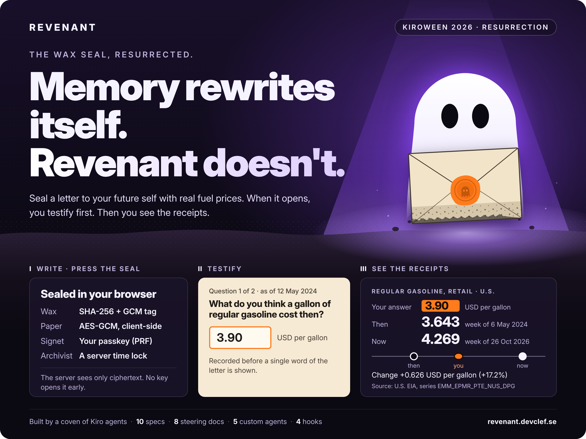

# Revenant

*The wax seal, resurrected. Memory rewrites itself. Revenant doesn't.*

A wax seal did two jobs: it showed whose letter it was, and whether anyone broke it before its time. Revenant brings the wax seal back with a passkey and browser crypto that do both jobs again ([job by job](#the-wax-seal-job-by-job)).

**Live:** [Seal your own letter](https://revenant.devclef.se/demo/live) · [Open a persona letter](https://revenant.devclef.se/demo) · **Demo video:** [DEMO VIDEO LINK]

**Kiroween 2026 · Resurrection**

<p align="center">
  
  <br><em>The concept one-pager. The fuel figures are real EIA records; the counts in its footer are out of date.</em>
</p>

Since 1735 the French Académie des sciences has kept *plis cachetés*, sealed envelopes that prove what someone knew, and when. Even Pasteur used them.

When I was in school, my teacher had us write letters to our future selves, then mailed them back years later. Email and cloud drives took the letter digital and left the seal behind: a file can be edited, read by the operator, and opened any time.

## The wax seal, job by job

| The wax seal | Revenant |
|---|---|
| Wax that shows whether it was broken | A SHA-256 hash of the canonical envelope, checked at sealing and at opening, plus the AES-GCM tag |
| The folded paper that hides the page | AES-GCM encryption in your browser. The server only holds ciphertext |
| The signet ring that made it yours | **A passkey (WebAuthn PRF)**, pressed with fingerprint, face or PIN. No account, no password. An optional backup key card is the spare key |
| The archivist who won't open it early | A server time lock. The server releases its half of the key only when its own UTC clock reaches the opening date |

Passkey sealing works today at [`/demo/live`](https://revenant.devclef.se/demo/live). PRF works with current iCloud Keychain, Google Password Manager and Windows Hello; Revenant checks PRF on your device when you seal, and requires the backup key if the check fails.

## What no wax seal could do

A wax seal proves the letter wasn't changed. It can't stop you changing your memory of it.

So before the seal breaks, you testify. You write what you think you answered, and it is stored, encrypted, before anything sealed is shown. Then you see your testimony beside the answer you sealed. Revenant never says what the gap means.

## Try it

| | | Needs |
|---|---|---|
| **[Seal your own letter](https://revenant.devclef.se/demo/live)** | Answer your questions while writing, seal with your passkey, wait 30 seconds, open the letter, testify, break the seal. A rehearsal of a letter that would normally stay sealed for months. | A passkey with PRF, or the backup key |
| **[Maya's letter](https://revenant.devclef.se/demo/personas/us-maya)** | US, with fuel price receipts. Testify, break the seal, see then and now. | Nothing |
| **[Tomás's letter](https://revenant.devclef.se/demo/personas/eu-tomas)** | EU, with fuel price receipts. | Nothing |
| **[Priya's letter](https://revenant.devclef.se/demo/personas/us-priya)** | Text only, with two questions she left for herself. | Nothing |
| **[How it is sealed](https://revenant.devclef.se/how-it-is-sealed)** | A short read on the cryptography. | Nothing |

## The ritual

1. **Write.** Start from an occasion (the year ahead, work, family, a decision, or blank), or start blank. Each occasion offers a letter starter and one question in your own voice. Add up to three questions and answer each one as you write. Plain text, up to 5,000 characters. Fuel price receipts (US or EU) are optional.
2. **Press the seal.** Pick an opening date and seal with your passkey. The questions and your answers to them are sealed with the letter, and you cannot change them afterwards.
3. **Keep.** A letter card with a QR link, a backup key card and an `.ics` file.
4. **Wait.** Scanning early shows "still sealed" and a countdown.
5. **Testify.** After the opening date, open the letter and unlock with your passkey. Revenant recalls each question you wrote, and you write what you remember answering. Your testimony is stored before anything sealed is shown.
6. **See the receipts.** Break the seal. Each question with your testimony beside the answer you sealed, then the letter, then any figures then and now. Revenant does not explain the difference.

<!-- TODO(owner): ceremony screenshot. On https://revenant.devclef.se/demo/personas/us-maya at 1440x900, answer both questions, then capture the Break the seal step: the ghost risen from the soil holding the envelope, orange seal centred, before pressing. Save as docs/ceremony-break.png and add it here. -->

## What's built and running

- Passkey sealing and unlocking, all in the browser ([the table above](#the-wax-seal-job-by-job)).
- The live demo: six steps, a 30-second lock, a real passkey named "Revenant demo".
- Three fictional persona letters, openable with no passkey. Their figures are real historical records.
- The ceremony: soil, light, the ghost rising with the envelope, the seal breaking. The first render needs no JavaScript, and reduced motion turns the motion off.
- Letter card, backup key card and `.ics`, generated in the browser.
- EIA and EU Weekly Oil Bulletin adapters with full provenance, fetched daily by a CronJob.
- Database triggers that block any change to a sealed row.
- Self-contained letters that open even if every data source disappears.

Real letters at `/seal` are built but switched off for judging. Opening needs the Revenant server, which holds the time-lock secret.

## How I built it with Kiro

I wrote the steering, the specs and the dispatcher. A crew of Kiro agents wrote the product; almost none of the code was typed by a human. The detail is in [docs/kiro-writeup.md](docs/kiro-writeup.md).

- **Steering:** 8 docs of non-negotiables (data integrity, neutrality, tone, crypto and more). Crypto rules load only for crypto code.
- **Specs:** 16 spec folders. One task is one GitHub issue and one pull request.
- **Custom agents:** `platform-dev`, `crypto-dev`, `data-dev`, `frontend-dev`, each fenced to its own paths, and a `qa` agent that reviews every PR in a headless browser.
- **Hooks:** a tone check on copy, a path-scope check per agent, crypto tests on save and a ceremony-truth check.
- **MCP:** Playwright MCP lets `qa` and `frontend-dev` click through each build and cite screenshots.
- **Property-based testing:** 72 fast-check property test files cover the adapters, the change formula and the sealed format.
- **Kiro Crew** runs the build loop: claim an issue, build, open a PR, CI, QA, merge or retry. After three failed fixes it asks me. 280 pull requests merged so far.


The full runbook is in [docs/agent-loop.md](docs/agent-loop.md).

## Principles, enforced in code

- **Data integrity.** Every number has value, unit, region, period, source and retrieval time. An honest "unavailable" beats a guess.
- **Neutrality.** No political side. Up and down get the same visual treatment, and no change is called good or bad.
- **Tone.** A dark room, one shaft of purple light, one orange seal. Spooky the way a quiet night is spooky.

## Stack, local run and deployment

TypeScript, Next.js (App Router), PostgreSQL with Drizzle, WebCrypto and WebAuthn in the browser, Zod, Vitest with fast-check. One Docker image (`ghcr.io/devclef/revenant`) and a Helm chart with its own Postgres in `deploy/helm/revenant`.

```bash
npm install
cp .env.example .env      # set DATABASE_URL
npm run db:migrate && npm run dev
./scripts/check.sh        # lint, typecheck and tests, as CI runs them
```

Passkeys need HTTPS on their domain, or `localhost`. Production runs at `revenant.devclef.se` on a self-hosted RKE2 cluster via Fleet.

## License

MIT. See [LICENSE](LICENSE).
