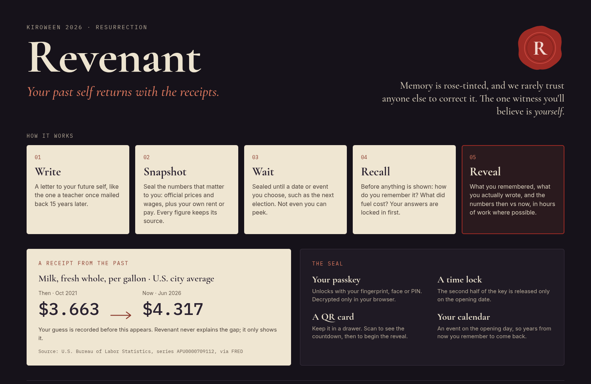

# Revenant

*Your past self returns with the receipts.*

Built for the Kiroween 2026 hackathon, Resurrection category. The technology being resurrected is the sealed letter to your future self: the classroom time capsule a teacher mails back years later.



*Design concept. Figures and some wording in the mock are illustrative and not product data.*

## The idea

Memory is rose-tinted, and we rarely trust anyone else to correct it. The one witness you will believe is yourself.

Revenant lets you write a letter to your future self and seal it together with the numbers that matter to you. When it opens, you are asked what you remember before you are shown what you wrote.

## The ritual

1. **Write.** A letter to your future self. Plain text, up to 5,000 characters.
2. **Seal the figures.** Pick everyday costs (fuel, groceries, rent) from official sources for the US, EU or Sweden, and optionally your own numbers, labelled as self-reported. Every figure keeps its source, period, unit and region.
3. **Wait.** Choose an opening date at least three months away. Until then the letter is sealed and unreadable, even to you.
4. **Recall.** After the opening date you unlock the letter. Before anything is shown, Revenant asks how you remember it. Your answers are recorded first.
5. **Reveal.** What you remembered, what you wrote, then the numbers then and now with the plain change between them. Revenant does not explain the gap.

## How the seal works

- **The browser encrypts.** The server stores only ciphertext, a minimal header and a per-letter time-lock secret. The operator cannot read letters, personal numbers or recall answers.
- **A passkey** (WebAuthn PRF) unlocks the letter with fingerprint, face or device PIN. An optional **backup key card** is a second way in.
- **A time lock.** The server releases its half of the key only once its UTC clock reaches the opening date. Neither the passkey nor the backup key can open a letter early.
- **Immutable.** Sealed rows are protected by database triggers. The sealed envelope is hashed (SHA-256 over canonical JSON) and verified again at opening.
- **Self-contained.** A letter carries everything needed to open and present it, with no dependence on the app's catalogue or on any data source still existing.
- **A QR card and a calendar file** help you find the letter again. The QR code is only a link and contains no key.

Known limitation for the MVP: opening needs the Revenant server, because it holds the time-lock secret.

## Principles

- **Data integrity.** No number without value, unit, region, period, source and retrieval time. Nothing is invented, estimated or converted between currencies. An honest gap beats a guessed number.
- **Neutrality.** Revenant takes no political side. It shows people their own words and real data, and never says why a number changed or whether the change is good or bad.
- **Tone.** A letter found in an attic: wax seals, faded ink, calm second person. Spooky the way a candlelit room is spooky.

## Demo

Judges cannot wait years, so there are two clearly labelled demos under `/demo`, stored separately from real letters.

- **Persona letters.** Pre-sealed letters from fictional people, written for recent election windows in the US, EU and Sweden. Break the seal, answer the recall questions, see the figures then and now. No passkey needed.
- **Lock and unlock.** Seal a short letter with your own passkey and a 30-second lock, then unlock it.

## Status

Work in progress. See `.kiro/specs/` for what is done and planned.

- Done: deployable skeleton, health checks, image, Helm chart, sealed letter storage with immutability triggers, browser crypto, letter and opening API routes.
- In progress: demo figures and the persona demo.
- Later: passkey sealing for real letters, backup key card, PDF cards, `.ics` file, daily figure fetch.

## Stack

TypeScript (strict), Next.js App Router, PostgreSQL with Drizzle migrations, WebCrypto and WebAuthn in the browser, Vitest. Shipped as one Docker image and a Helm chart.

## Run locally

Requires Node.js and a PostgreSQL database.

```bash
npm install
cp .env.example .env      # set DATABASE_URL
npm run db:migrate
npm run dev
```

Checks:

```bash
npm run lint
npm run typecheck
npm test
./scripts/check.sh        # the one command CI and agents run
```

Passkeys are bound to the domain and need HTTPS. Outside the cluster they use `localhost`.

## Deployment

The Helm chart lives in `deploy/helm/revenant` and includes PostgreSQL. The image is published to `ghcr.io/devclef/revenant`. The MVP runs at `revenant.devclef.se`. See the chart's README for values and secrets.

## Built with Kiro: a coven of agents

- **Steering** in `.kiro/steering/` holds data integrity, neutrality and tone as rules every agent follows.
- **Specs** in `.kiro/specs/` define one feature each, one GitHub issue per task.
- **Role agents** in `.kiro/agents/` (platform, crypto, data, frontend, QA) pull labelled issues and open pull requests.
- **Reviewers** check each PR against its ticket and the steering docs before merge.
- **Hooks** in `.kiro/hooks/` run checks such as the tone check.

The runbook is in [docs/agent-loop.md](docs/agent-loop.md).

## License

See [LICENSE](LICENSE).
