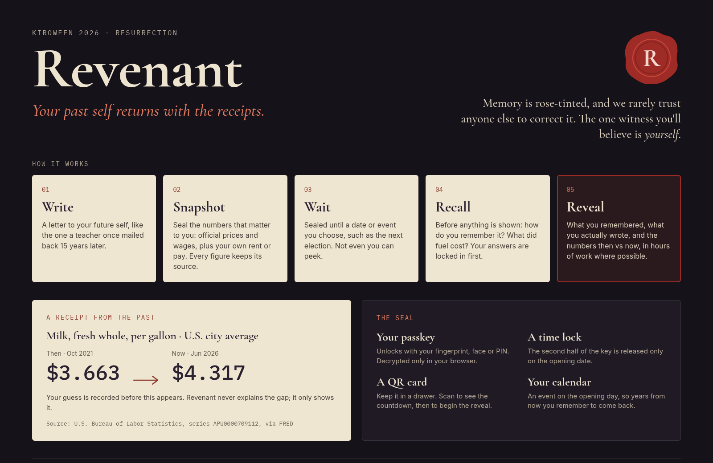

# Revenant

*The wax seal, resurrected. Memory rewrites itself. Revenant doesn't.*

Built for Kiroween 2026, Resurrection category. Letters survived the move to digital, but the seal didn't. Revenant resurrects it with cryptography: no one else can read your letter, tampering is detectable, and no key can open it early. Then it adds what no wax seal ever could: it makes you testify before you read.



*Design concept. Figures and some wording in the mock are illustrative and not product data.*

## What we resurrected

Since 1735 the French Académie des sciences has kept *plis cachetés*: sealed envelopes that scientists and inventors deposit to prove what they knew, and when. Pasteur and Niépce left them. Around 18,000 have been deposited, each closed with wax and opened only at the author's request or after a hundred years. A classroom time capsule works the same way. When I was in school, my teacher had us each write a letter to our future selves. She kept them sealed for 15 years, then mailed them back to us. The seal carries the meaning: this was written then, by you, and nobody has touched it since.

Email, notes apps and cloud drives took the letter digital and left the seal behind. A file can be edited after the fact, read by whoever runs the server, and opened whenever you like. Revenant is the pli cacheté reinvented for the browser. Each part of the old seal has a modern replacement:

| The wax seal | Revenant |
|---|---|
| Wax that shows whether it was broken | A SHA-256 hash of the canonical envelope, checked at sealing and again at opening, plus the AES-GCM tag over the contents |
| The folded paper that hides the page | AES-GCM encryption in your own browser. The server only ever holds ciphertext |
| The signet ring that made the seal yours | A passkey (WebAuthn PRF) unlocked by fingerprint, face or device PIN, with an optional backup key card |
| The archivist who won't open it before its date | A server time lock. The server releases its half of the key only when its own UTC clock reaches the opening date |

## What no wax seal could do

A wax seal proves the letter wasn't changed. It can't stop you changing your memory of it.

Every time you recall something, you edit it a little, and the edits favour the story you'd rather be true. You can't cross-examine your own past, because the only witness is a memory that has already been rewritten.

So Revenant adds one step the Académie never needed. Before the seal breaks, you testify: you say what you remember, and your answer is recorded. Only then do you see what you wrote and what things cost. The gap between your testimony and the record is the whole product. Revenant never tells you what that gap means. It just doesn't let your memory have the last word.

## The ritual

1. **Write.** Write down what you believe: a letter to your future self, plain text, up to 5,000 characters.
2. **Seal the figures.** Pick the metrics you care about from official sources for your region. Every figure keeps its value, source, period, unit and region.
3. **Press the seal.** Choose an opening date at least three months away and lock the letter with your passkey. From then on it is sealed and unreadable, even to you, and nothing inside can change.
4. **Testify.** After the opening date you unlock the letter. Before a single word is shown, Revenant asks what you remember. Your testimony is recorded first.
5. **See the receipts.** What you remembered, then what you actually wrote, then the numbers then and now with the plain change between them. No commentary. No "soared", no "finally". Just the record.

## What's actually built

This is not a slide deck. It runs. The sealing-and-opening ceremony, the live passkey demo, the pre-sealed persona demo, and the real-data figure pipeline are all implemented and tested.

- **The reveal ceremony** — the dark room, the light finding the soil, the ghost rising with your letter, the recall scale, the seal breaking, and the then-vs-now figures. It degrades gracefully: the first render is the settled scene with no JavaScript, and `prefers-reduced-motion` turns the whole sequence off.
- **Browser-side crypto** — WebAuthn passkeys with the PRF extension, a double-wrapped content key, a per-letter server time lock, an optional backup key card, and an SHA-256 hash over the canonical envelope that's verified again at opening.
- **The persona demo** at `/demo/personas` — a fictional author's letter, pre-sealed for a real US election window, openable by a judge in two minutes with no passkey.
- **The live demo** at `/demo/live` — seal a letter with your own passkey and a 30-second lock, then unlock it. The passkey is real and shows up in your password manager, named so it's obviously a Revenant demo.
- **Real figures** — adapters for the US EIA and the European Commission Weekly Oil Bulletin, each returning figures with full provenance and never inventing, interpolating or currency-converting anything.
- **The database** — PostgreSQL with `BEFORE UPDATE OR DELETE` triggers that make sealed rows physically immutable. Application code *cannot* change a sealed letter; the trigger raises an exception.

Specs 01 through 07 are complete; spec 08 (judge polish) is in progress. See `.kiro/specs/` for the task-level status.

## How the seal works

- **The browser encrypts.** The server stores only ciphertext, a minimal header and a per-letter time-lock secret. The operator cannot read letters, personal numbers or recall answers.
- **A passkey** (WebAuthn PRF) unlocks the letter with fingerprint, face or device PIN. An optional **backup key card** is the second way in.
- **A time lock.** The server releases its half of the key only once its own UTC clock reaches the opening date. The client clock never gets a vote; neither the passkey nor the backup key can open a letter early.
- **Self-contained letters.** A sealed letter carries everything needed to open and present it — the text, every figure with its provenance, the metric definitions, and the recall questions. It does not depend on the app's catalogue or on any data source still existing when it opens.
- **A QR card and a calendar file** help you find the letter again. The QR code is only a link and contains no key.

Known limitation for the MVP: opening needs the Revenant server, because it holds the time-lock secret.

## Principles, enforced in code

- **Data integrity.** No number exists without value, unit, region, period, source and retrieval time. Nothing is invented, estimated or converted between currencies. An honest "unavailable" beats a guessed number. Property-based tests guard the source adapters.
- **Neutrality.** Revenant takes no political side. It shows people their own words and real data, and never says why a number changed or whether the change was good or bad. Up and down get identical visual treatment — no red, no green, no victory arrows. A tone-check hook fails the build on judgemental words.
- **Tone.** A dark room and one shaft of purple light. Something you buried comes back up, carrying your letter. Spooky the way a quiet night is spooky, not the way a haunted house is.

## Stack

TypeScript (strict mode) end to end. Next.js (App Router, standalone output), PostgreSQL with Drizzle migrations, WebCrypto and WebAuthn directly in the browser, Zod at every route boundary, and Vitest with fast-check for property tests. Shipped as one Docker image and a Helm chart that bundles its own Postgres.

## Run locally

Requires Node.js and a PostgreSQL database.

```bash
npm install
cp .env.example .env      # set DATABASE_URL (see .env.example for every variable)
npm run db:migrate
npm run dev
```

Checks:

```bash
npm run lint
npm run typecheck
npm test
./scripts/check.sh        # the one command CI and the agents run
```

Passkeys are bound to the domain and need HTTPS. Outside the cluster they fall back to `localhost`.

## Deployment

The Helm chart lives in `deploy/helm/revenant` and includes PostgreSQL. The image is published to `ghcr.io/devclef/revenant`. The MVP runs at `revenant.devclef.se`, deployed by a separate Fleet GitOps repo onto a self-hosted RKE2 cluster. See the chart's README for values and secrets.

## Built by a coven of agents

Here's the part we're genuinely proud of: **almost none of this code was written by a human sitting at a keyboard.** Revenant was built by a team of specialist AI agents orchestrated by [Kiro Crew](https://kiro.dev/docs/crew.md), running an autonomous build loop that ran for 227+ merged pull requests.

The setup works like a real engineering org:

- **Steering** (`.kiro/steering/`) is the team's constitution. Eight documents — data integrity, neutrality, tone, crypto, tech, deploy, product, structure — encode the non-negotiables. Every agent reads them, and the rules that matter most load automatically for the code they govern.
- **Specs** (`.kiro/specs/`) break the product into features, and each feature into tasks. One task becomes one GitHub issue.
- **Role agents** (`.kiro/agents/`) are the engineers, each with its own system prompt, its own file-ownership boundary, and its own tools:
  - `platform-dev` — scaffold, config, health routes, DB client, migrations, Docker, Helm.
  - `crypto-dev` — browser crypto, the sealed format, the letter and opening APIs, the immutability triggers.
  - `data-dev` — source adapters, the figure catalogue, the figures API.
  - `frontend-dev` — pages, the ceremony, cards, `.ics`, and every word of user-facing copy.
  - `qa` — an independent reviewer with a real headless browser, who clicks through each PR and writes a verdict before anything merges.
- **A dispatcher** (a Kiro Crew cron job) runs the loop: it claims ready issues, starts a build run as the right role, opens a pull request, waits for CI, then starts a QA run on the result. Pass and it squash-merges; fail and it feeds the logs back for a fix run. Three failed fixes and it stops and asks a human.
- **Hooks** enforce the steering docs at the moment code is written — a tone check that blocks judgemental language, a path-scope check that keeps each agent inside its lane, and crypto-test and ceremony-truth checks.

Commits are tagged by their author: `[frontend-dev]`, `[crypto-dev]`, `[data-dev]`, `[platform-dev]`. The humans wrote the steering, the specs and the dispatcher. The agents wrote the product.

The full runbook is in [docs/agent-loop.md](docs/agent-loop.md).

## License

See [LICENSE](LICENSE).
