# Design 15: the whole flow

A clickable, standalone prototype of every page and state of Revenant. Open [`index.html`](index.html) in a browser (no server, no build). Each screen has a yellow prototype bar at its top with previous, next and index links; add `?bare` to hide it. On the opening screens the bar has a "toggle /l/{id} track" link (or add `#real`) that switches the six-step live track to the three-step track used by a real letter.

Nothing under `src/`, `content/`, `.kiro/`, `.github/`, `tools/` or `scripts/` was changed. Colour tokens are copied from `src/components/ceremony/scene/tokens.css`. Fonts load from `src/app/fonts/`.

To redo everything after a revision (from the repo root):

```
npx tsx docs/design/15-flow/prep.ts   # only if the source drawings change; writes assets.json
node docs/design/15-flow/build.mjs    # writes the HTML
node docs/design/15-flow/capture.mjs  # writes shots/, strings.json and prints the layout and contrast checks
node docs/design/15-flow/readme.mjs   # rewrites this file
```

## What changes, in one page

- **One shell.** One top bar (wordmark and DEMO chip; persona notice, Calm, Sound, Skip), one step track, one centred column. No cream cards on dark, no older plain UI on `/l/{id}`.
- **Paper means then.** Warm paper and EB Garamond hold only what was sealed: the letter, the author's questions as written and the sealed answers. Everything else is Inter on the dark page.
- **Orange means you, now.** The reader's testimony on the receipts screen carries the orange rule.
- **The ghost is in the column.** Centred, in the flow, from unlock to the break, then it leaves. It is not on Write, Press the seal, Wait, home, `/demo` or the receipts.
- **A question has a sealed answer.** The author answers when writing. At opening the reader writes what they think they answered. The receipts put the two side by side with no comment.
- **No dirt band** on any envelope. Soil is a strip under the envelope.

### Shared shell strings (not repeated per screen)

- Top bar: "revenant", "Demo", "Calm" (aria-label "Turn off motion"), "Sound" (aria-label "Turn sound on"), "Skip".
- Live track: Write · Press the seal · Wait · Testify · Break the seal · Receipts. Phone line: "Step {n} of 6 · {label}".
- `/l/{id}` and persona track: Testify · Break the seal · Receipts. Phone line: "Step {n} of 3 · {label}".
- Persona notice, on desktop in the bar and on phone in a strip under it, shown once: "{name} is fictional. This letter was prepared later as a demo."

Strings marked **new or changed** are not found verbatim in today's source or content. The check is automatic, so a string built from a template today (for example "Question 1 of 3") can be marked new although only the template filling differs.

---

## Entry

### 1. `home`: Home

- **Route:** /
- **State:** The landing page, resting state.
- **Fixes:** 9 (Home and /demo)
- **Renders today:** src/app/page.tsx with src/components/landing/*

| Desktop 1440 × 900 | Phone 390 × 844 |
|---|---|
| 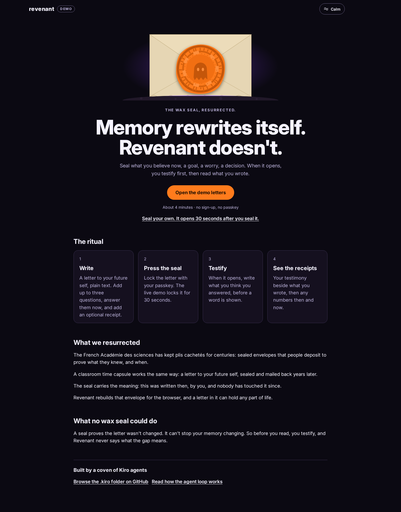 | 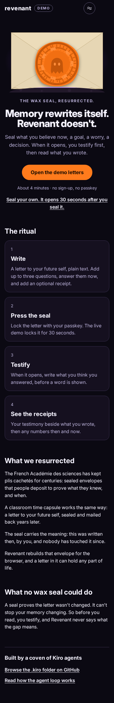 |

<details><summary>Every string on this screen</summary>

- "The wax seal, resurrected."
- "Memory rewrites itself."
- "Revenant doesn't."
- "Seal what you believe now, a goal, a worry, a decision. When it opens, you testify first, then read what you wrote."
- "Open the demo letters"
- **new or changed** "About 4 minutes · no sign-up, no passkey"
- "Seal your own. It opens 30 seconds after you seal it."
- "The ritual"
- **new or changed** "A letter to your future self, plain text. Add up to three questions, answer them now, and add an optional receipt."
- "Lock the letter with your passkey. The live demo locks it for 30 seconds."
- **new or changed** "When it opens, write what you think you answered, before a word is shown."
- "See the receipts"
- **new or changed** "Your testimony beside what you wrote, then any numbers then and now."
- "What we resurrected"
- "The French Académie des sciences has kept plis cachetés for centuries: sealed envelopes that people deposit to prove what they knew, and when."
- "A classroom time capsule works the same way: a letter to your future self, sealed and mailed back years later."
- "The seal carries the meaning: this was written then, by you, and nobody has touched it since."
- "Revenant rebuilds that envelope for the browser, and a letter in it can hold any part of life."
- "What no wax seal could do"
- "A seal proves the letter wasn't changed. It can't stop your memory changing. So before you read, you testify, and Revenant never says what the gap means."
- "Built by a coven of Kiro agents"
- "Browse the .kiro folder on GitHub"
- "Read how the agent loop works"

</details>

### 2. `demo`: The demo letters

- **Route:** /demo
- **State:** Three persona cards and the live card in one grid.
- **Fixes:** 9 (Home and /demo)
- **Renders today:** src/app/demo/page.tsx, src/components/demo/PersonaCard.tsx, LiveEntry.tsx

| Desktop 1440 × 900 | Phone 390 × 844 |
|---|---|
| 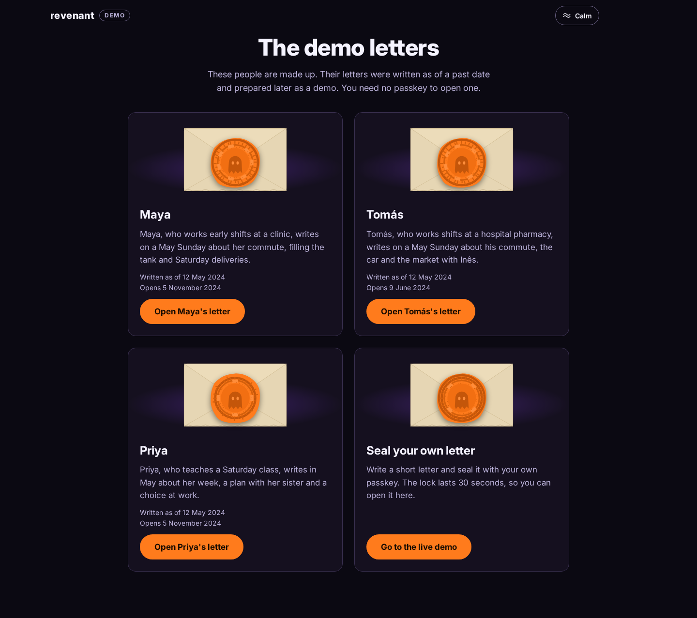 | 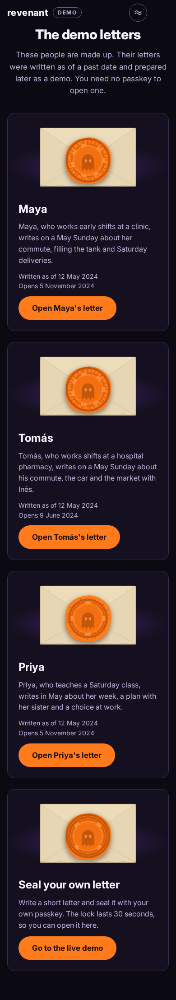 |

<details><summary>Every string on this screen</summary>

- "The demo letters"
- "These people are made up. Their letters were written as of a past date and prepared later as a demo. You need no passkey to open one."
- "Maya"
- "Maya, who works early shifts at a clinic, writes on a May Sunday about her commute, filling the tank and Saturday deliveries."
- **new or changed** "Written as of 12 May 2024"
- **new or changed** "Opens 5 November 2024"
- "Open Maya's letter"
- "Tomás"
- "Tomás, who works shifts at a hospital pharmacy, writes on a May Sunday about his commute, the car and the market with Inês."
- **new or changed** "Opens 9 June 2024"
- **new or changed** "Open Tomás's letter"
- "Priya"
- "Priya, who teaches a Saturday class, writes in May about her week, a plan with her sister and a choice at work."
- **new or changed** "Open Priya's letter"
- "Seal your own letter"
- "Write a short letter and seal it with your own passkey. The lock lasts 30 seconds, so you can open it here."
- "Go to the live demo"

</details>

### 3. `how`: How the seal works

- **Route:** /how-it-is-sealed
- **State:** The explainer page.
- **Fixes:** 3 (Three visual systems)
- **Renders today:** src/app/how-it-is-sealed/page.tsx, src/components/how/*

| Desktop 1440 × 900 | Phone 390 × 844 |
|---|---|
| 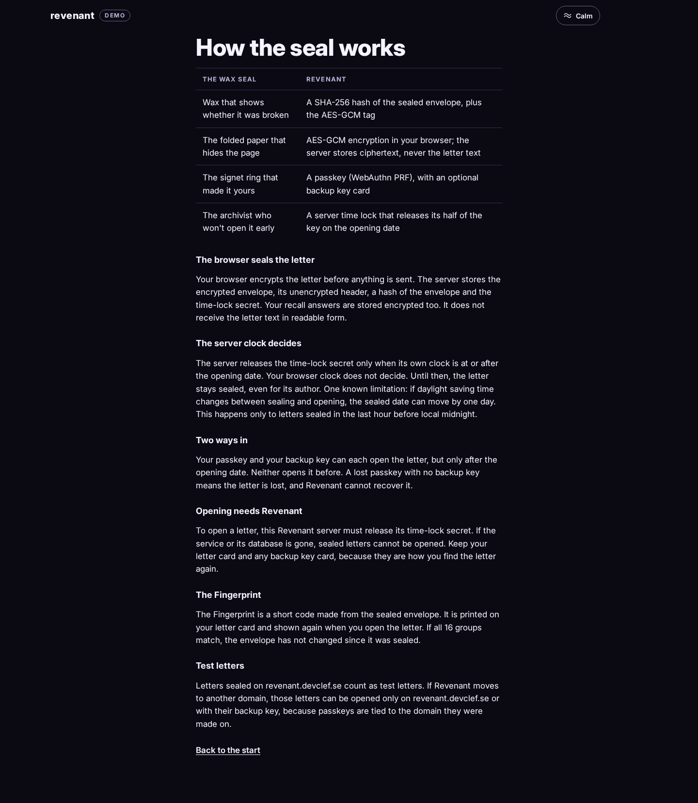 | 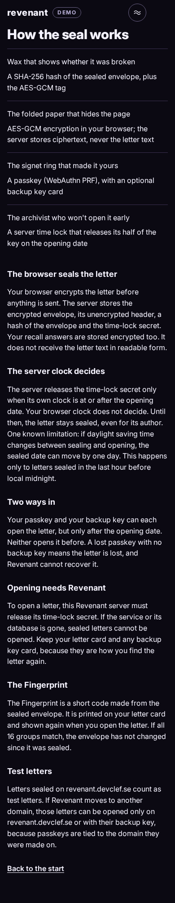 |

<details><summary>Every string on this screen</summary>

- "How the seal works"
- "The wax seal"
- "Revenant"
- "Wax that shows whether it was broken"
- "A SHA-256 hash of the sealed envelope, plus the AES-GCM tag"
- "The folded paper that hides the page"
- "AES-GCM encryption in your browser; the server stores ciphertext, never the letter text"
- "The signet ring that made it yours"
- "A passkey (WebAuthn PRF), with an optional backup key card"
- "The archivist who won't open it early"
- "A server time lock that releases its half of the key on the opening date"
- "The browser seals the letter"
- "Your browser encrypts the letter before anything is sent. The server stores the encrypted envelope, its unencrypted header, a hash of the envelope and the time-lock secret. Your recall answers are stored encrypted too. It does not receive the letter text in readable form."
- "The server clock decides"
- "The server releases the time-lock secret only when its own clock is at or after the opening date. Your browser clock does not decide. Until then, the letter stays sealed, even for its author. One known limitation: if daylight saving time changes between sealing and opening, the sealed date can move by one day. This happens only to letters sealed in the last hour before local midnight."
- "Two ways in"
- "Your passkey and your backup key can each open the letter, but only after the opening date. Neither opens it before. A lost passkey with no backup key means the letter is lost, and Revenant cannot recover it."
- "Opening needs Revenant"
- "To open a letter, this Revenant server must release its time-lock secret. If the service or its database is gone, sealed letters cannot be opened. Keep your letter card and any backup key card, because they are how you find the letter again."
- "The Fingerprint"
- "The Fingerprint is a short code made from the sealed envelope. It is printed on your letter card and shown again when you open the letter. If all 16 groups match, the envelope has not changed since it was sealed."
- "Test letters"
- "Letters sealed on revenant.devclef.se count as test letters. If Revenant moves to another domain, those letters can be opened only on revenant.devclef.se or with their backup key, because passkeys are tied to the domain they were made on."
- **new or changed** "Back to the start"

</details>

### 4. `not-found`: No letter here

- **Route:** 404, and /seal while real sealing is off
- **State:** Plain not-found page.
- **Fixes:** 3 (Three visual systems)
- **Renders today:** src/app/not-found.tsx

| Desktop 1440 × 900 | Phone 390 × 844 |
|---|---|
| 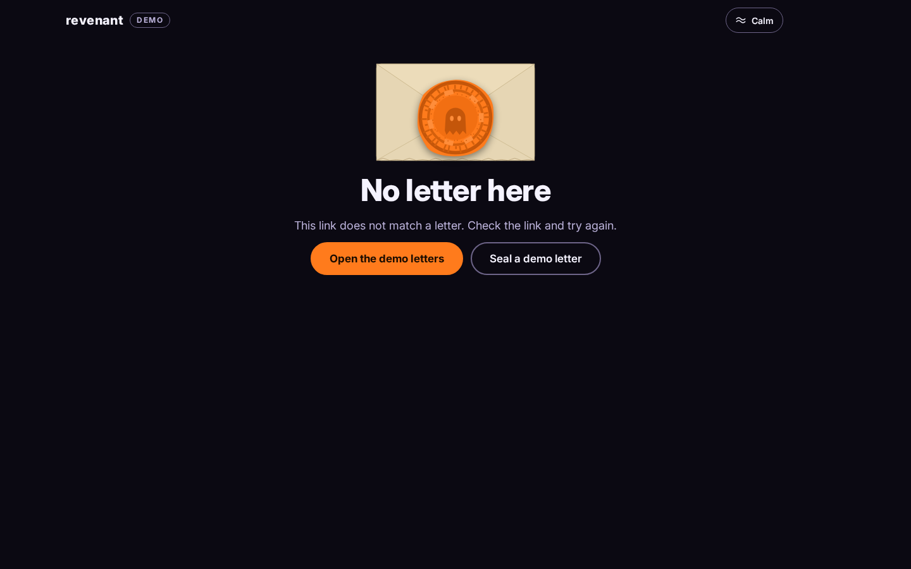 | 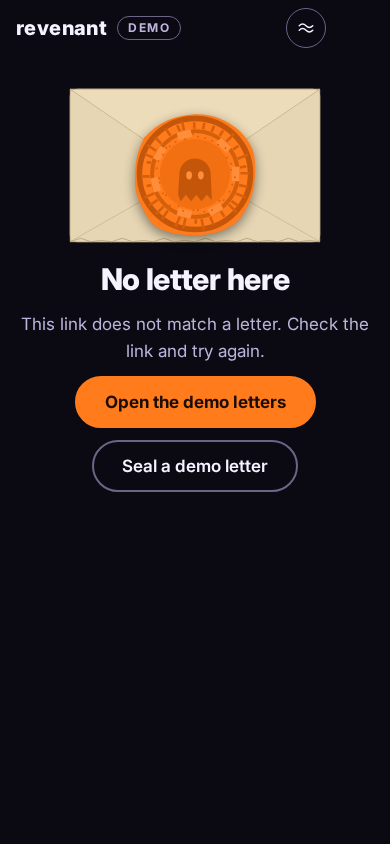 |

<details><summary>Every string on this screen</summary>

- "No letter here"
- "This link does not match a letter. Check the link and try again."
- "Open the demo letters"
- "Seal a demo letter"

</details>

## Write

### 5. `write-empty`: Write: a blank page

- **Route:** /demo/live (step 1)
- **State:** First load. One empty question row with an empty answer.
- **Fixes:** 1 (Questions have no sealed answer); 3 (Three visual systems)
- **Renders today:** src/components/live/desk/WriteDesk.tsx

| Desktop 1440 × 900 | Phone 390 × 844 |
|---|---|
| 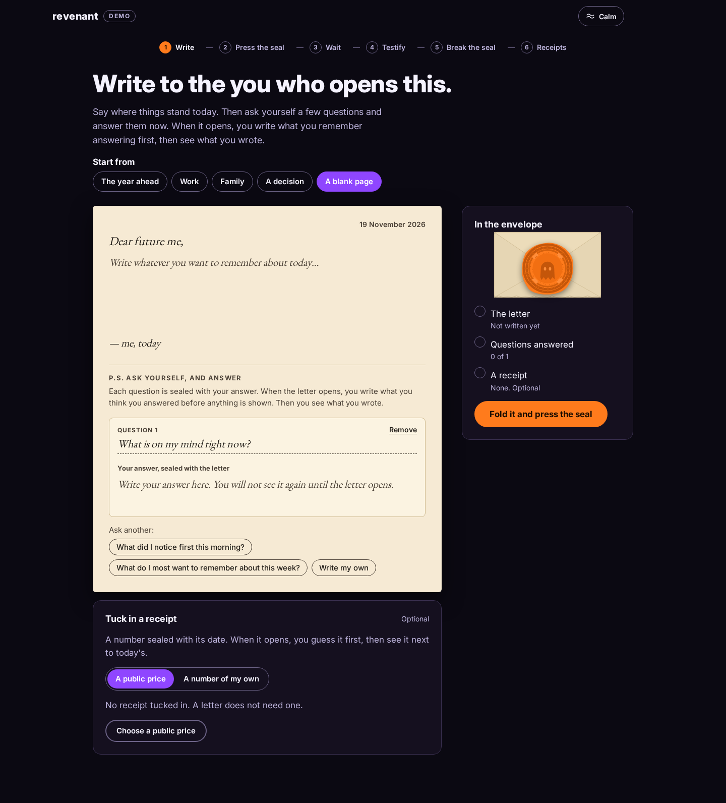 | 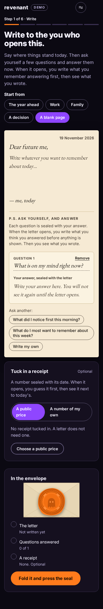 |

<details><summary>Every string on this screen</summary>

- "Write to the you who opens this."
- **new or changed** "Say where things stand today. Then ask yourself a few questions and answer them now. When it opens, you write what you remember answering first, then see what you wrote."
- "Start from"
- "The year ahead"
- "Work"
- "Family"
- "A decision"
- "A blank page"
- **new or changed** "19 November 2026"
- "Dear future me,"
- "Write whatever you want to remember about today…"
- "— me, today"
- **new or changed** "P.S. Ask yourself, and answer"
- **new or changed** "Each question is sealed with your answer. When the letter opens, you write what you think you answered before anything is shown. Then you see what you wrote."
- "Question 1"
- "Remove"
- **new or changed** "What is on my mind right now?"
- **new or changed** "Your answer, sealed with the letter"
- **new or changed** "Write your answer here. You will not see it again until the letter opens."
- "Ask another:"
- **new or changed** "What did I notice first this morning?"
- **new or changed** "What do I most want to remember about this week?"
- "Write my own"
- "Tuck in a receipt"
- "Optional"
- "A number sealed with its date. When it opens, you guess it first, then see it next to today's."
- "A public price"
- "A number of my own"
- **new or changed** "No receipt tucked in. A letter does not need one."
- **new or changed** "Choose a public price"
- "In the envelope"
- "The letter"
- **new or changed** "Not written yet"
- **new or changed** "Questions answered"
- **new or changed** "0 of 1"
- "A receipt"
- **new or changed** "None. Optional"
- "Fold it and press the seal"

</details>

### 6. `write-filled`: Write: Work, filled in

- **Route:** /demo/live (step 1)
- **State:** Work, letter written, two questions answered, one public price.
- **Fixes:** 1 (Questions have no sealed answer)
- **Renders today:** WriteDesk.tsx, QuestionSection.tsx, QuestionRow.tsx

| Desktop 1440 × 900 | Phone 390 × 844 |
|---|---|
| 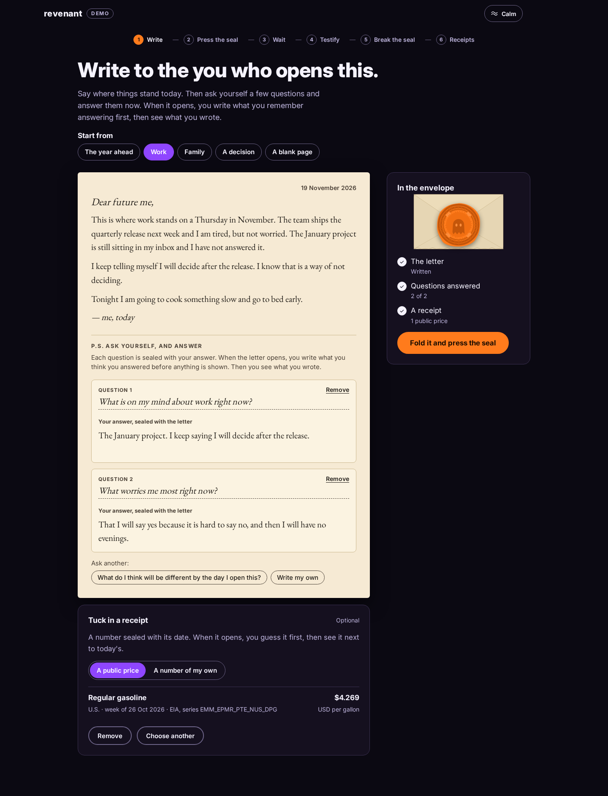 | 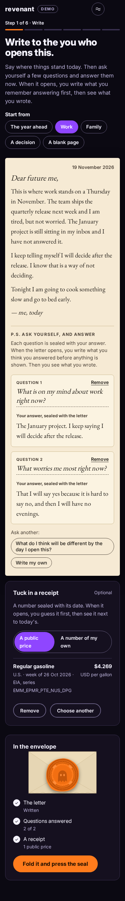 |

<details><summary>Every string on this screen</summary>

- "Write to the you who opens this."
- **new or changed** "Say where things stand today. Then ask yourself a few questions and answer them now. When it opens, you write what you remember answering first, then see what you wrote."
- "Start from"
- "The year ahead"
- "Work"
- "Family"
- "A decision"
- "A blank page"
- **new or changed** "19 November 2026"
- "Dear future me,"
- **new or changed** "This is where work stands on a Thursday in November. The team ships the quarterly release next week and I am tired, but not worried. The January project is still sitting in my inbox and I have not answered it."
- **new or changed** "I keep telling myself I will decide after the release. I know that is a way of not deciding."
- **new or changed** "Tonight I am going to cook something slow and go to bed early."
- "— me, today"
- **new or changed** "P.S. Ask yourself, and answer"
- **new or changed** "Each question is sealed with your answer. When the letter opens, you write what you think you answered before anything is shown. Then you see what you wrote."
- "Question 1"
- "Remove"
- **new or changed** "What is on my mind about work right now?"
- **new or changed** "Your answer, sealed with the letter"
- **new or changed** "The January project. I keep saying I will decide after the release."
- **new or changed** "Question 2"
- **new or changed** "What worries me most right now?"
- **new or changed** "That I will say yes because it is hard to say no, and then I will have no evenings."
- "Ask another:"
- **new or changed** "What do I think will be different by the day I open this?"
- "Write my own"
- "Tuck in a receipt"
- "Optional"
- "A number sealed with its date. When it opens, you guess it first, then see it next to today's."
- "A public price"
- "A number of my own"
- "Regular gasoline"
- **new or changed** "U.S. · week of 26 Oct 2026 · EIA, series EMM_EPMR_PTE_NUS_DPG"
- **new or changed** "$4.269"
- "USD per gallon"
- "Choose another"
- "In the envelope"
- "The letter"
- "Written"
- **new or changed** "Questions answered"
- **new or changed** "2 of 2"
- "A receipt"
- **new or changed** "1 public price"
- "Fold it and press the seal"

</details>

### 7. `write-check`: Write: fold check

- **Route:** /demo/live (step 1)
- **State:** Fold pressed with question 2 unanswered. Focus is on question 2's answer.
- **Fixes:** 1 (Questions have no sealed answer)
- **Renders today:** WriteDesk.tsx, desk/write-check.ts

| Desktop 1440 × 900 | Phone 390 × 844 |
|---|---|
| 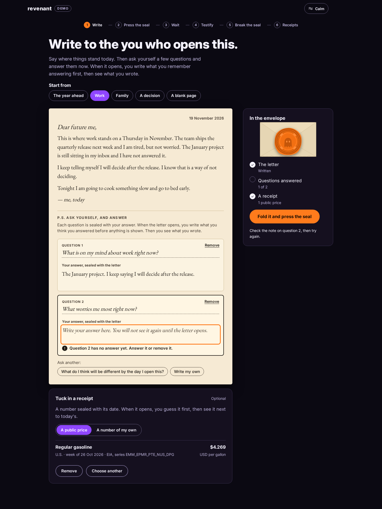 | 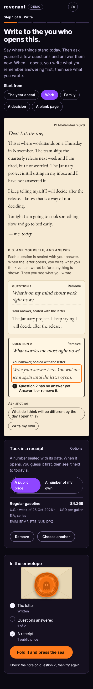 |

<details><summary>Every string on this screen</summary>

- "Write to the you who opens this."
- **new or changed** "Say where things stand today. Then ask yourself a few questions and answer them now. When it opens, you write what you remember answering first, then see what you wrote."
- "Start from"
- "The year ahead"
- "Work"
- "Family"
- "A decision"
- "A blank page"
- **new or changed** "19 November 2026"
- "Dear future me,"
- **new or changed** "This is where work stands on a Thursday in November. The team ships the quarterly release next week and I am tired, but not worried. The January project is still sitting in my inbox and I have not answered it."
- **new or changed** "I keep telling myself I will decide after the release. I know that is a way of not deciding."
- **new or changed** "Tonight I am going to cook something slow and go to bed early."
- "— me, today"
- **new or changed** "P.S. Ask yourself, and answer"
- **new or changed** "Each question is sealed with your answer. When the letter opens, you write what you think you answered before anything is shown. Then you see what you wrote."
- "Question 1"
- "Remove"
- **new or changed** "What is on my mind about work right now?"
- **new or changed** "Your answer, sealed with the letter"
- **new or changed** "The January project. I keep saying I will decide after the release."
- **new or changed** "Question 2"
- **new or changed** "What worries me most right now?"
- **new or changed** "Write your answer here. You will not see it again until the letter opens."
- "!"
- **new or changed** "Question 2 has no answer yet. Answer it or remove it."
- "Ask another:"
- **new or changed** "What do I think will be different by the day I open this?"
- "Write my own"
- "Tuck in a receipt"
- "Optional"
- "A number sealed with its date. When it opens, you guess it first, then see it next to today's."
- "A public price"
- "A number of my own"
- "Regular gasoline"
- **new or changed** "U.S. · week of 26 Oct 2026 · EIA, series EMM_EPMR_PTE_NUS_DPG"
- **new or changed** "$4.269"
- "USD per gallon"
- "Choose another"
- "In the envelope"
- "The letter"
- "Written"
- **new or changed** "Questions answered"
- **new or changed** "1 of 2"
- "A receipt"
- **new or changed** "1 public price"
- "Fold it and press the seal"
- **new or changed** "Check the note on question 2, then try again."

</details>

### 8. `write-own-number`: Write: a number of my own

- **Route:** /demo/live (step 1)
- **State:** The own-number receipt view.
- **Fixes:** 1 (Questions have no sealed answer)
- **Renders today:** desk/OwnNumberView.tsx, ReceiptPanel.tsx

| Desktop 1440 × 900 | Phone 390 × 844 |
|---|---|
| 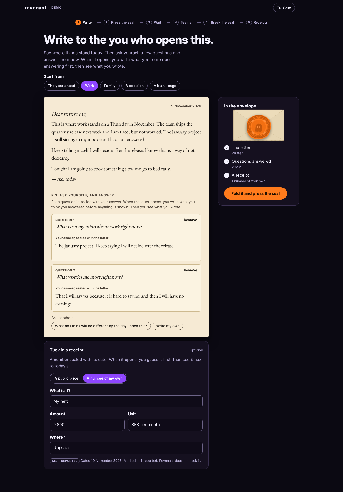 | 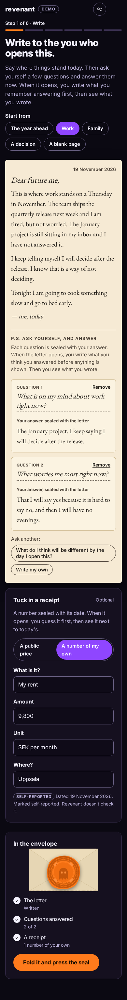 |

<details><summary>Every string on this screen</summary>

- "Write to the you who opens this."
- **new or changed** "Say where things stand today. Then ask yourself a few questions and answer them now. When it opens, you write what you remember answering first, then see what you wrote."
- "Start from"
- "The year ahead"
- "Work"
- "Family"
- "A decision"
- "A blank page"
- **new or changed** "19 November 2026"
- "Dear future me,"
- **new or changed** "This is where work stands on a Thursday in November. The team ships the quarterly release next week and I am tired, but not worried. The January project is still sitting in my inbox and I have not answered it."
- **new or changed** "I keep telling myself I will decide after the release. I know that is a way of not deciding."
- **new or changed** "Tonight I am going to cook something slow and go to bed early."
- "— me, today"
- **new or changed** "P.S. Ask yourself, and answer"
- **new or changed** "Each question is sealed with your answer. When the letter opens, you write what you think you answered before anything is shown. Then you see what you wrote."
- "Question 1"
- "Remove"
- **new or changed** "What is on my mind about work right now?"
- **new or changed** "Your answer, sealed with the letter"
- **new or changed** "The January project. I keep saying I will decide after the release."
- **new or changed** "Question 2"
- **new or changed** "What worries me most right now?"
- **new or changed** "That I will say yes because it is hard to say no, and then I will have no evenings."
- "Ask another:"
- **new or changed** "What do I think will be different by the day I open this?"
- "Write my own"
- "Tuck in a receipt"
- "Optional"
- "A number sealed with its date. When it opens, you guess it first, then see it next to today's."
- "A public price"
- "A number of my own"
- "What is it?"
- "My rent"
- "Amount"
- **new or changed** "9,800"
- "Unit"
- **new or changed** "SEK per month"
- "Where?"
- **new or changed** "Uppsala"
- "self-reported"
- **new or changed** "Dated 19 November 2026. Marked self-reported. Revenant doesn't check it."
- "In the envelope"
- "The letter"
- "Written"
- **new or changed** "Questions answered"
- **new or changed** "2 of 2"
- "A receipt"
- **new or changed** "1 number of your own"
- "Fold it and press the seal"

</details>

## Press the seal

### 9. `seal-choose`: Press the seal: choose a backup

- **Route:** /demo/live (step 2)
- **State:** Before a backup choice. The wax is at 35% with its relief.
- **Fixes:** 4 (Press the seal)
- **Renders today:** src/components/live/seal-step/SealStep.tsx, press/PressEnvelope.tsx, BackupChoice.tsx

| Desktop 1440 × 900 | Phone 390 × 844 |
|---|---|
| 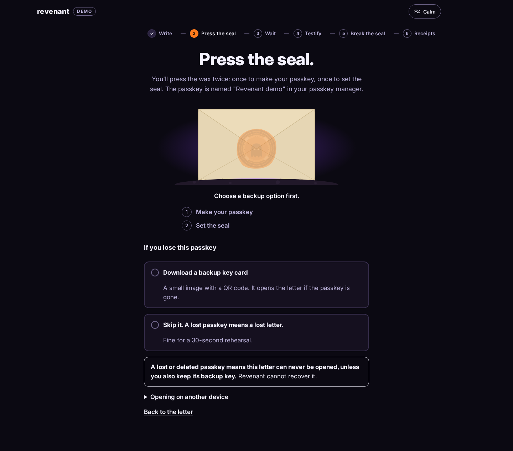 | 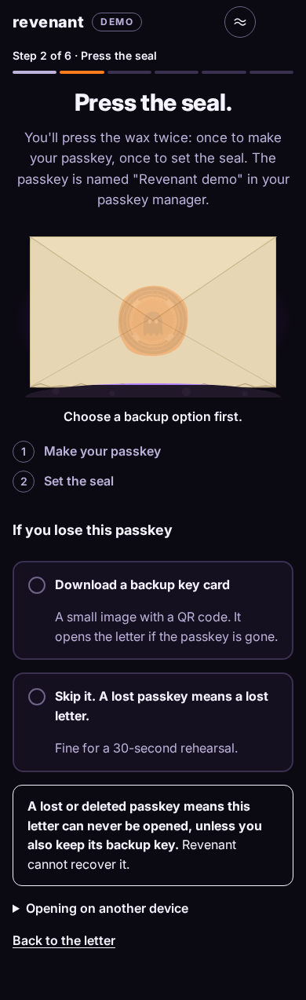 |

<details><summary>Every string on this screen</summary>

- "Press the seal."
- **new or changed** "You'll press the wax twice: once to make your passkey, once to set the seal. The passkey is named "Revenant demo" in your passkey manager."
- "Choose a backup option first."
- **new or changed** "Make your passkey"
- **new or changed** "Set the seal"
- "If you lose this passkey"
- "Download a backup key card"
- "A small image with a QR code. It opens the letter if the passkey is gone."
- "Skip it. A lost passkey means a lost letter."
- "Fine for a 30-second rehearsal."
- "A lost or deleted passkey means this letter can never be opened, unless you also keep its backup key."
- "Revenant cannot recover it."
- "Opening on another device"
- "Back to the letter"

</details>

### 10. `seal-step-1`: Press the seal: first press

- **Route:** /demo/live (step 2)
- **State:** Backup chosen (skip, with the warning confirmed). Ready for the first press.
- **Fixes:** 4 (Press the seal)
- **Renders today:** SealStep.tsx, PressEnvelope.tsx

| Desktop 1440 × 900 | Phone 390 × 844 |
|---|---|
|  | 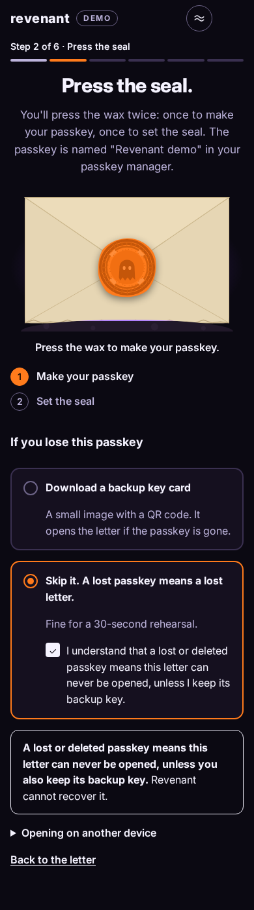 |

<details><summary>Every string on this screen</summary>

- "Press the seal."
- **new or changed** "You'll press the wax twice: once to make your passkey, once to set the seal. The passkey is named "Revenant demo" in your passkey manager."
- **new or changed** "Press the wax to make your passkey."
- **new or changed** "Make your passkey"
- **new or changed** "Set the seal"
- "If you lose this passkey"
- "Download a backup key card"
- "A small image with a QR code. It opens the letter if the passkey is gone."
- "Skip it. A lost passkey means a lost letter."
- "Fine for a 30-second rehearsal."
- "I understand that a lost or deleted passkey means this letter can never be opened, unless I keep its backup key."
- "A lost or deleted passkey means this letter can never be opened, unless you also keep its backup key."
- "Revenant cannot recover it."
- "Opening on another device"
- "Back to the letter"

</details>

### 11. `seal-step-2`: Press the seal: second press

- **Route:** /demo/live (step 2)
- **State:** Passkey made. The second press is the next action.
- **Fixes:** 4 (Press the seal)
- **Renders today:** SealStep.tsx, press/press-status

| Desktop 1440 × 900 | Phone 390 × 844 |
|---|---|
| 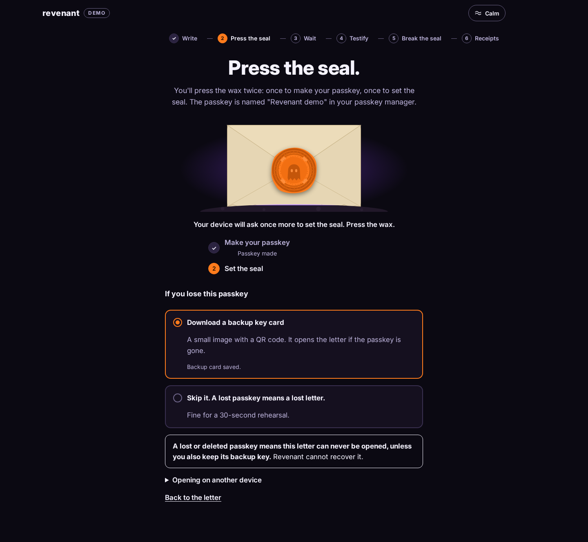 |  |

<details><summary>Every string on this screen</summary>

- "Press the seal."
- **new or changed** "You'll press the wax twice: once to make your passkey, once to set the seal. The passkey is named "Revenant demo" in your passkey manager."
- "Your device will ask once more to set the seal. Press the wax."
- **new or changed** "Make your passkey"
- **new or changed** "Passkey made"
- **new or changed** "Set the seal"
- "If you lose this passkey"
- "Download a backup key card"
- "A small image with a QR code. It opens the letter if the passkey is gone."
- **new or changed** "Backup card saved."
- "Skip it. A lost passkey means a lost letter."
- "Fine for a 30-second rehearsal."
- "A lost or deleted passkey means this letter can never be opened, unless you also keep its backup key."
- "Revenant cannot recover it."
- "Opening on another device"
- "Back to the letter"

</details>

### 12. `seal-sealing`: Press the seal: sealing

- **Route:** /demo/live (step 2)
- **State:** Sealing in progress. The wax is shown pressed.
- **Fixes:** 4 (Press the seal)
- **Renders today:** SealStep.tsx

| Desktop 1440 × 900 | Phone 390 × 844 |
|---|---|
| 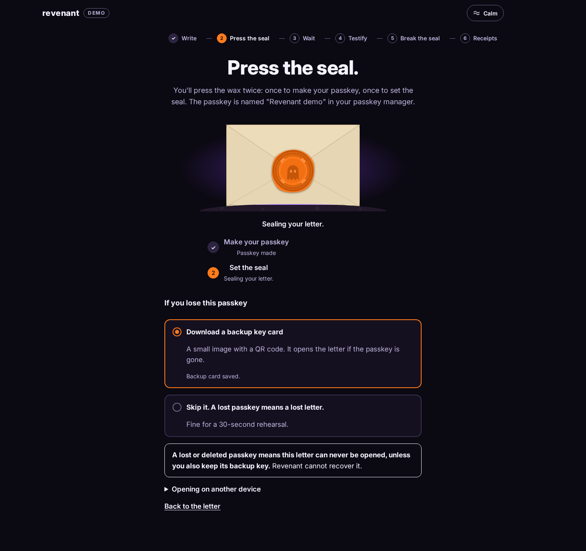 | 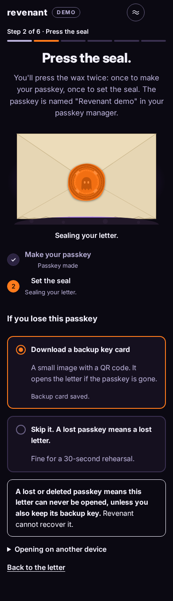 |

<details><summary>Every string on this screen</summary>

- "Press the seal."
- **new or changed** "You'll press the wax twice: once to make your passkey, once to set the seal. The passkey is named "Revenant demo" in your passkey manager."
- "Sealing your letter."
- **new or changed** "Make your passkey"
- **new or changed** "Passkey made"
- **new or changed** "Set the seal"
- "If you lose this passkey"
- "Download a backup key card"
- "A small image with a QR code. It opens the letter if the passkey is gone."
- **new or changed** "Backup card saved."
- "Skip it. A lost passkey means a lost letter."
- "Fine for a 30-second rehearsal."
- "A lost or deleted passkey means this letter can never be opened, unless you also keep its backup key."
- "Revenant cannot recover it."
- "Opening on another device"
- "Back to the letter"

</details>

### 13. `seal-backup`: Press the seal: backup card

- **Route:** /demo/live (step 2)
- **State:** 'Download a backup key card' chosen, card ready to save.
- **Fixes:** 4 (Press the seal)
- **Renders today:** BackupChoice.tsx, BackupKeyCard.tsx

| Desktop 1440 × 900 | Phone 390 × 844 |
|---|---|
| 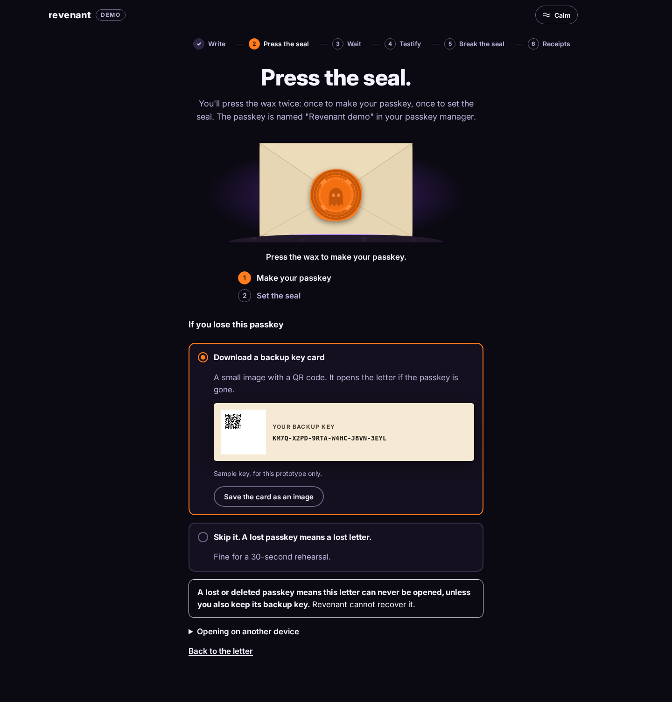 | 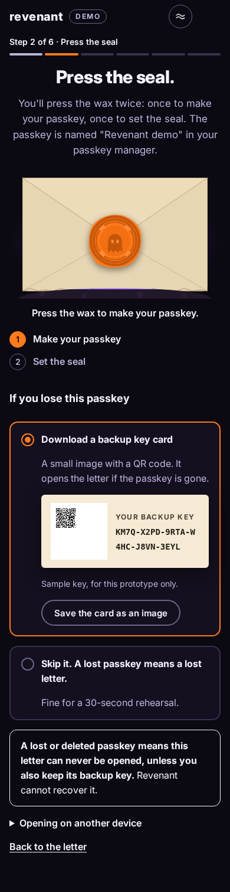 |

<details><summary>Every string on this screen</summary>

- "Press the seal."
- **new or changed** "You'll press the wax twice: once to make your passkey, once to set the seal. The passkey is named "Revenant demo" in your passkey manager."
- **new or changed** "Press the wax to make your passkey."
- **new or changed** "Make your passkey"
- **new or changed** "Set the seal"
- "If you lose this passkey"
- "Download a backup key card"
- "A small image with a QR code. It opens the letter if the passkey is gone."
- "Your backup key"
- **new or changed** "KM7Q-X2PD-9RTA-W4HC-J8VN-3EYL"
- **new or changed** "Sample key, for this prototype only."
- "Save the card as an image"
- "Skip it. A lost passkey means a lost letter."
- "Fine for a 30-second rehearsal."
- "A lost or deleted passkey means this letter can never be opened, unless you also keep its backup key."
- "Revenant cannot recover it."
- "Opening on another device"
- "Back to the letter"

</details>

### 14. `seal-no-prf`: Press the seal: no passkey key

- **Route:** /demo/live (step 2)
- **State:** The passkey can't make a key. The backup key is now required. The wax waits for the key to be saved.
- **Fixes:** 4 (Press the seal)
- **Renders today:** BackupFallback.tsx, SealFailure.tsx

| Desktop 1440 × 900 | Phone 390 × 844 |
|---|---|
| 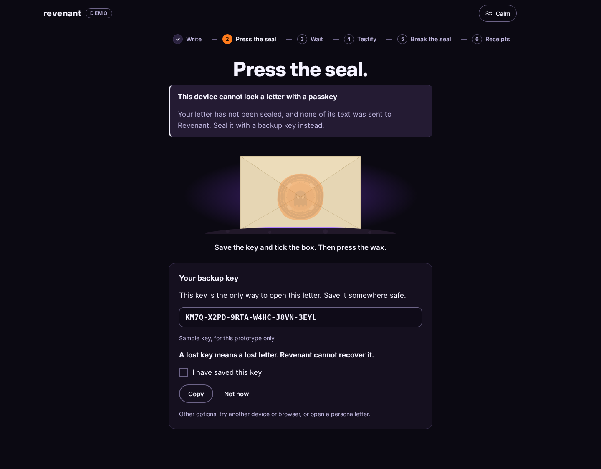 | 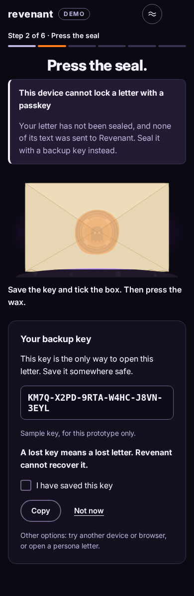 |

<details><summary>Every string on this screen</summary>

- "Press the seal."
- "This device cannot lock a letter with a passkey"
- **new or changed** "Your letter has not been sealed, and none of its text was sent to Revenant. Seal it with a backup key instead."
- **new or changed** "Save the key and tick the box. Then press the wax."
- "Your backup key"
- "This key is the only way to open this letter. Save it somewhere safe."
- **new or changed** "KM7Q-X2PD-9RTA-W4HC-J8VN-3EYL"
- **new or changed** "Sample key, for this prototype only."
- "A lost key means a lost letter. Revenant cannot recover it."
- "I have saved this key"
- "Copy"
- "Not now"
- **new or changed** "Other options: try another device or browser, or open a persona letter."

</details>

### 15. `seal-failed`: Press the seal: failed

- **Route:** /demo/live (step 2)
- **State:** Sealing failed because the live demo is busy.
- **Fixes:** 4 (Press the seal)
- **Renders today:** SealFailure.tsx

| Desktop 1440 × 900 | Phone 390 × 844 |
|---|---|
| 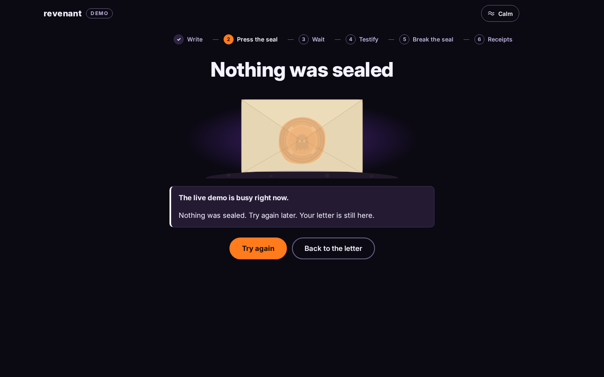 | 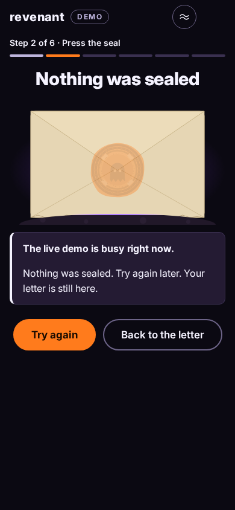 |

<details><summary>Every string on this screen</summary>

- "Nothing was sealed"
- "The live demo is busy right now."
- **new or changed** "Nothing was sealed. Try again later. Your letter is still here."
- "Try again"
- "Back to the letter"

</details>

## Wait

### 16. `wait-counting`: Wait: counting

- **Route:** /demo/live (step 3)
- **State:** Countdown running.
- **Fixes:** 5 (Wait)
- **Renders today:** src/components/live/stepper/LiveWaitStep.tsx, SealedEnvelopeView.tsx, SealedKeepsakes.tsx, LetterCard.tsx

| Desktop 1440 × 900 | Phone 390 × 844 |
|---|---|
| 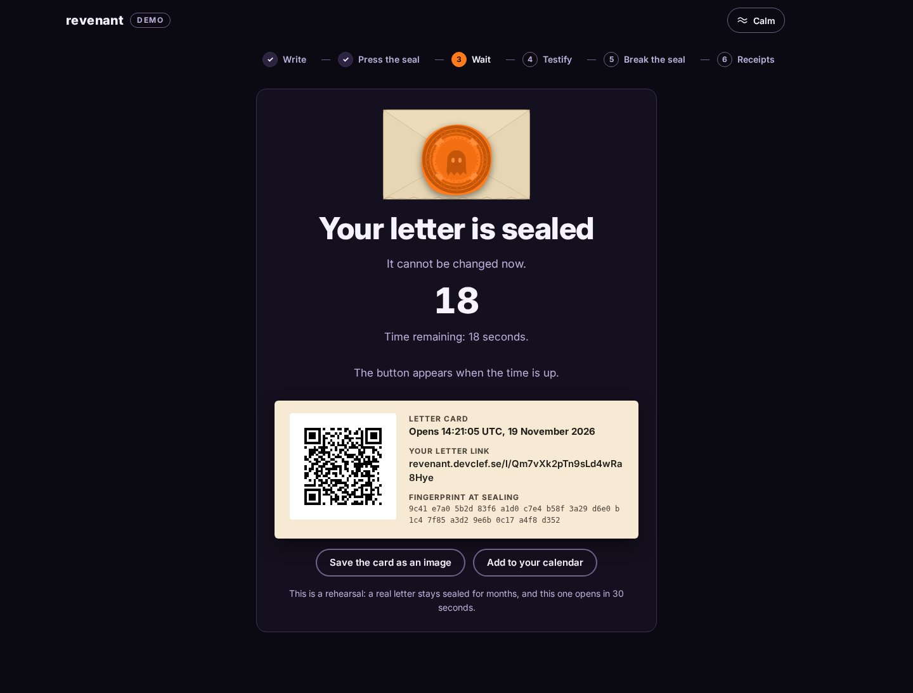 | 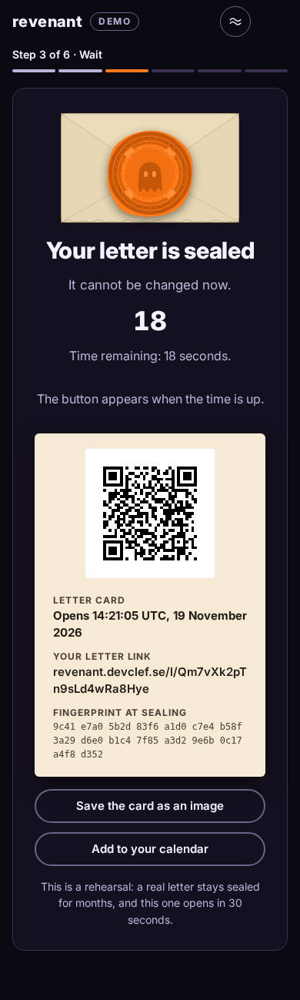 |

<details><summary>Every string on this screen</summary>

- "Your letter is sealed"
- "It cannot be changed now."
- "18"
- **new or changed** "Time remaining: 18 seconds."
- **new or changed** "The button appears when the time is up."
- "Letter card"
- **new or changed** "Opens 14:21:05 UTC, 19 November 2026"
- "Your letter link"
- **new or changed** "revenant.devclef.se/l/Qm7vXk2pTn9sLd4wRa8Hye"
- "Fingerprint at sealing"
- **new or changed** "9c41 e7a0 5b2d 83f6 a1d0 c7e4 b58f 3a29 d6e0 b1c4 7f85 a3d2 9e6b 0c17 a4f8 d352"
- "Save the card as an image"
- "Add to your calendar"
- "This is a rehearsal: a real letter stays sealed for months, and this one opens in 30 seconds."

</details>

### 17. `wait-ready`: Wait: ready

- **Route:** /demo/live (step 3)
- **State:** Time is up. One action: Open your letter.
- **Fixes:** 5 (Wait)
- **Renders today:** LiveWaitStep.tsx

| Desktop 1440 × 900 | Phone 390 × 844 |
|---|---|
| 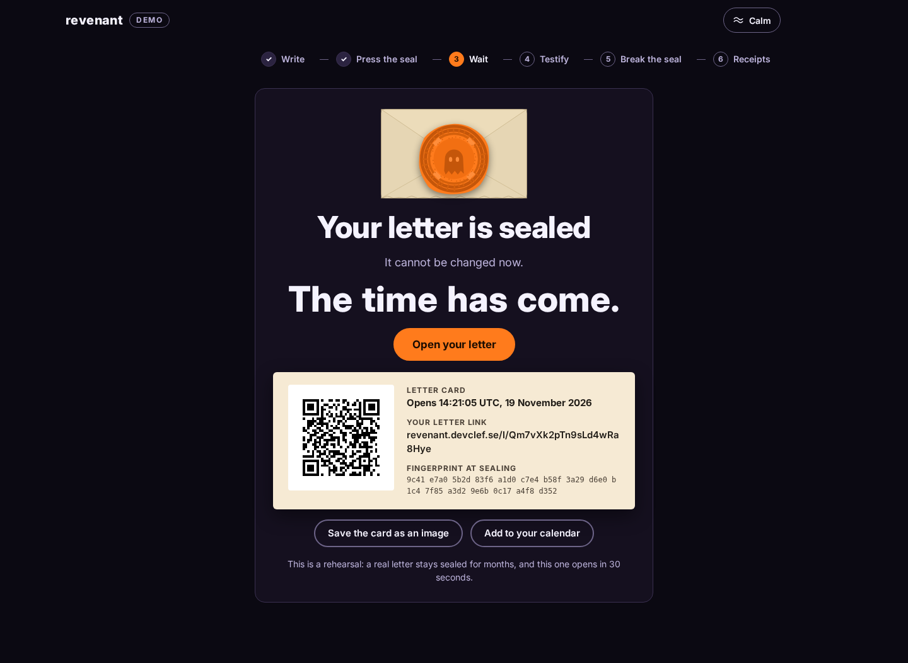 | 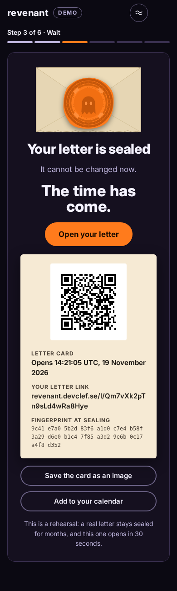 |

<details><summary>Every string on this screen</summary>

- "Your letter is sealed"
- "It cannot be changed now."
- "The time has come."
- **new or changed** "Open your letter"
- "Letter card"
- **new or changed** "Opens 14:21:05 UTC, 19 November 2026"
- "Your letter link"
- **new or changed** "revenant.devclef.se/l/Qm7vXk2pTn9sLd4wRa8Hye"
- "Fingerprint at sealing"
- **new or changed** "9c41 e7a0 5b2d 83f6 a1d0 c7e4 b58f 3a29 d6e0 b1c4 7f85 a3d2 9e6b 0c17 a4f8 d352"
- "Save the card as an image"
- "Add to your calendar"
- "This is a rehearsal: a real letter stays sealed for months, and this one opens in 30 seconds."

</details>

## Opening

### 18. `still-sealed`: Still sealed

- **Route:** /l/{id} before the opening date
- **State:** Only that the letter is sealed, and the time remaining.
- **Fixes:** 3 (Three visual systems)
- **Renders today:** src/components/reveal/StillSealed.tsx

| Desktop 1440 × 900 | Phone 390 × 844 |
|---|---|
| 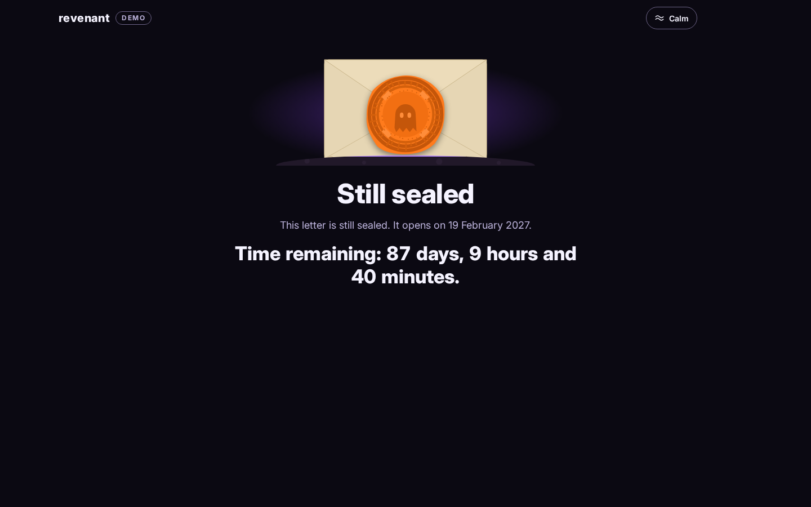 | 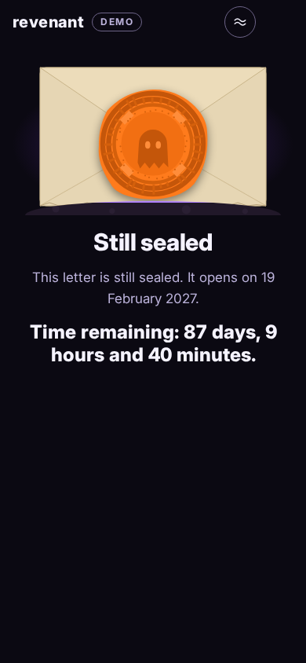 |

<details><summary>Every string on this screen</summary>

- "Still sealed"
- **new or changed** "This letter is still sealed. It opens on 19 February 2027."
- **new or changed** "Time remaining: 87 days, 9 hours and 40 minutes."

</details>

### 19. `unlock`: Unlock

- **Route:** /l/{id} and the live demo
- **State:** Unlock with the passkey or the backup key. No ghost yet.
- **Fixes:** 3 (Three visual systems)
- **Renders today:** src/components/live/UnlockView.tsx

| Desktop 1440 × 900 | Phone 390 × 844 |
|---|---|
| 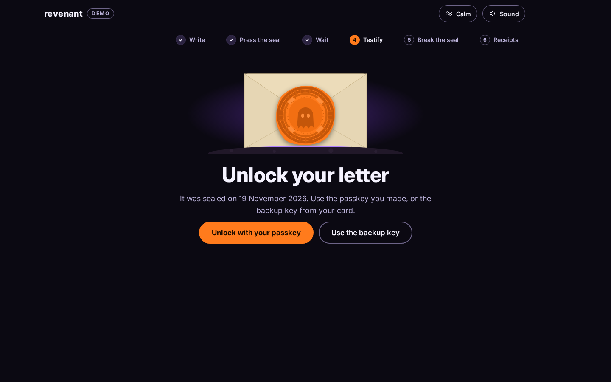 | 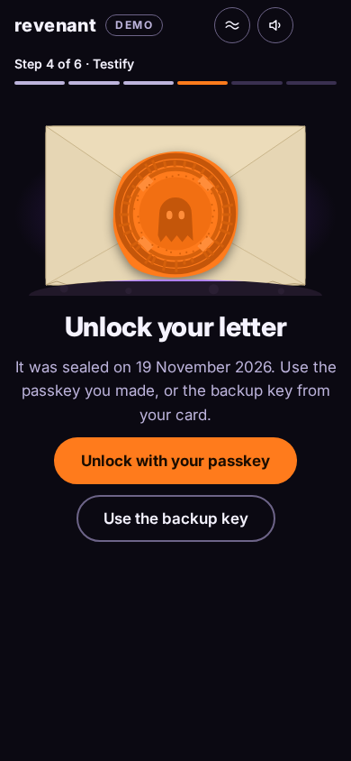 |

<details><summary>Every string on this screen</summary>

- "Unlock your letter"
- **new or changed** "It was sealed on 19 November 2026. Use the passkey you made, or the backup key from your card."
- "Unlock with your passkey"
- **new or changed** "Use the backup key"

</details>

### 20. `unlock-backup`: Unlock: backup key

- **Route:** /l/{id} and the live demo
- **State:** Entering or scanning the backup key.
- **Fixes:** 3 (Three visual systems)
- **Renders today:** UnlockView.tsx, BackupFallback.tsx

| Desktop 1440 × 900 | Phone 390 × 844 |
|---|---|
| 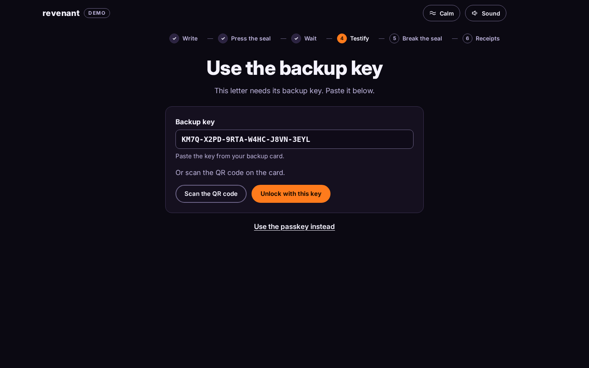 | 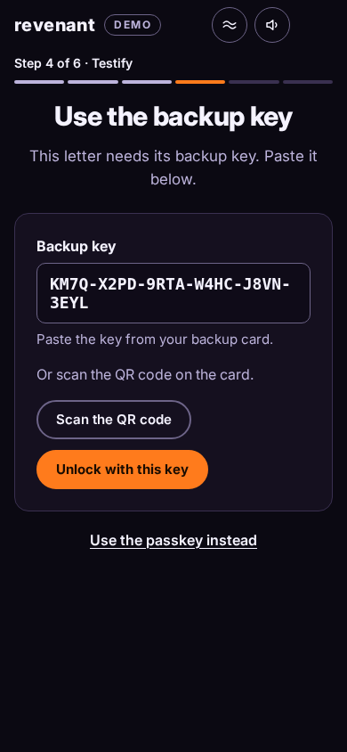 |

<details><summary>Every string on this screen</summary>

- **new or changed** "Use the backup key"
- "This letter needs its backup key. Paste it below."
- "Backup key"
- **new or changed** "KM7Q-X2PD-9RTA-W4HC-J8VN-3EYL"
- "Paste the key from your backup card."
- **new or changed** "Or scan the QR code on the card."
- **new or changed** "Scan the QR code"
- "Unlock with this key"
- **new or changed** "Use the passkey instead"

</details>

### 21. `unlock-error`: Unlock: passkey not on this device

- **Route:** /l/{id} and the live demo
- **State:** The passkey isn't here. The cross-device help shows.
- **Fixes:** 3 (Three visual systems)
- **Renders today:** UnlockView.tsx

| Desktop 1440 × 900 | Phone 390 × 844 |
|---|---|
| 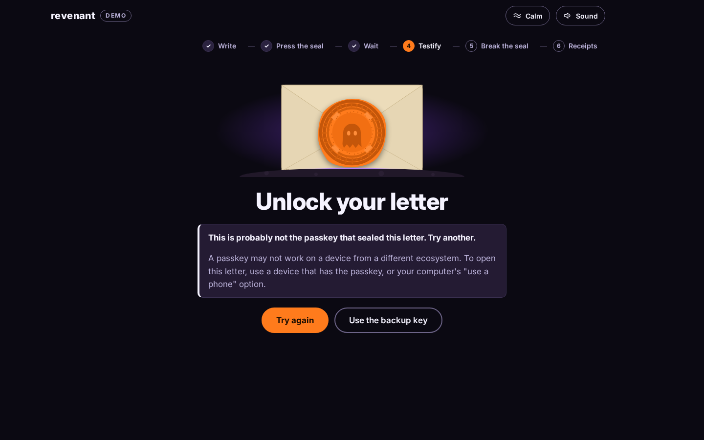 | 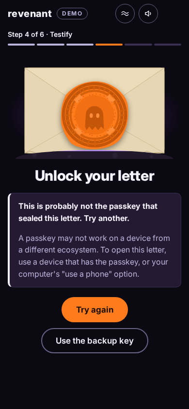 |

<details><summary>Every string on this screen</summary>

- "Unlock your letter"
- "This is probably not the passkey that sealed this letter. Try another."
- "A passkey may not work on a device from a different ecosystem. To open this letter, use a device that has the passkey, or your computer's "use a phone" option."
- "Try again"
- **new or changed** "Use the backup key"

</details>

### 22. `emergence`: Emergence

- **Route:** /l/{id} and the live demo
- **State:** The ghost has risen with the envelope. The seal check has passed.
- **Fixes:** 2 (The ghost is a background layer); 3 (Three visual systems)
- **Renders today:** src/components/ceremony/Ceremony.tsx, scene/PersonaGhost.tsx

| Desktop 1440 × 900 | Phone 390 × 844 |
|---|---|
| 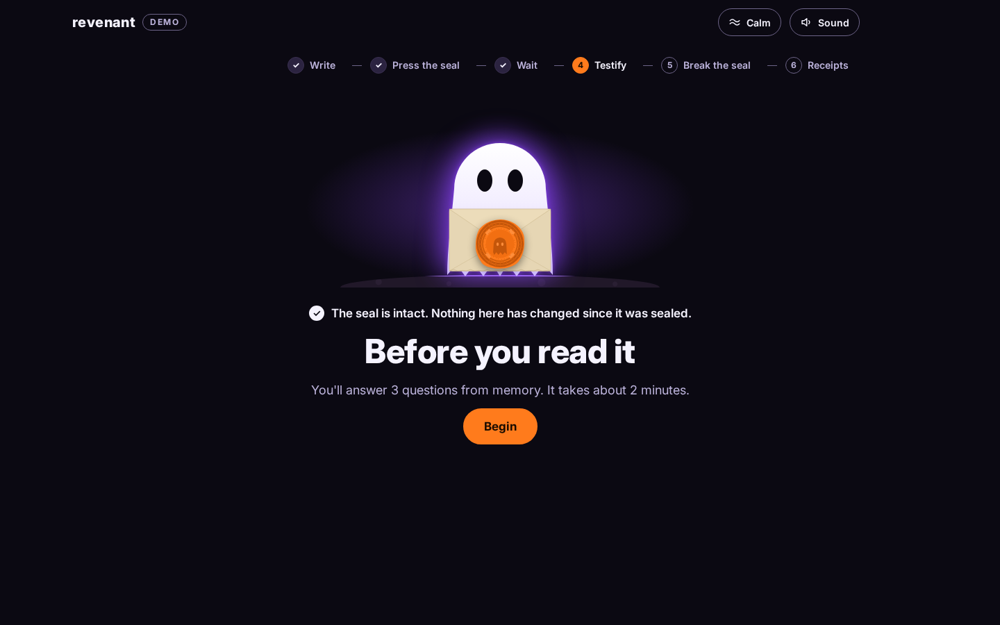 | 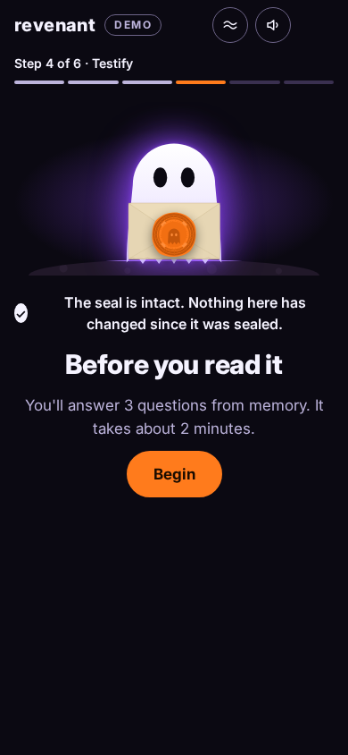 |

<details><summary>Every string on this screen</summary>

- "The seal is intact. Nothing here has changed since it was sealed."
- "Before you read it"
- **new or changed** "You'll answer 3 questions from memory. It takes about 2 minutes."
- "Begin"

</details>

### 23. `testify-text`: Testify: your question

- **Route:** /l/{id} and the live demo
- **State:** Author question 1 of 3.
- **Fixes:** 1 (Questions have no sealed answer); 2 (The ghost is a background layer); 6 (Testify)
- **Renders today:** src/components/ceremony/recall/RecallReader.tsx

| Desktop 1440 × 900 | Phone 390 × 844 |
|---|---|
| 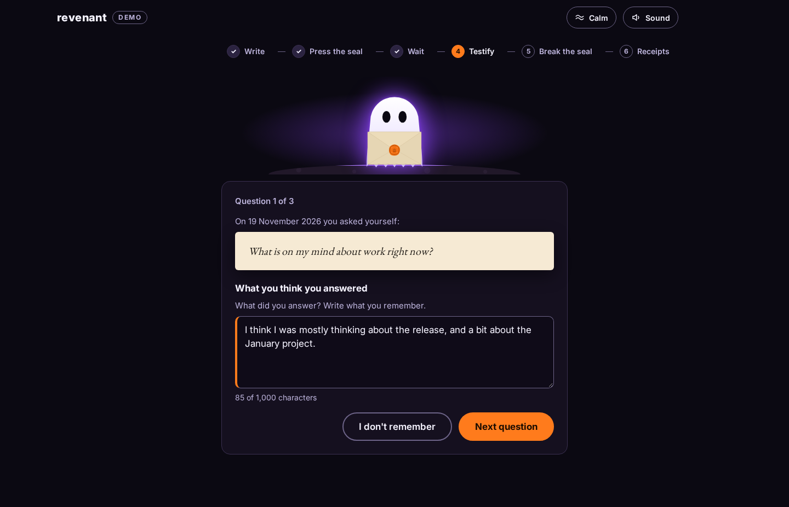 | 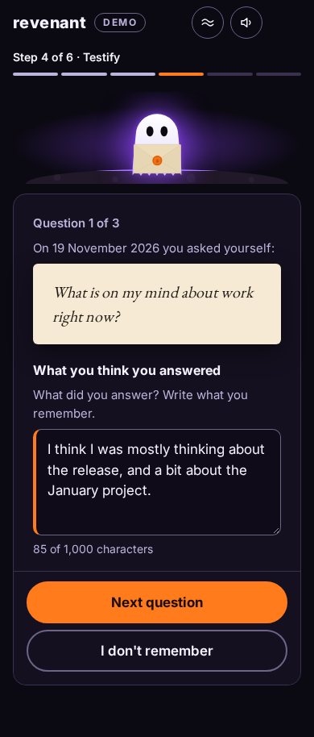 |

<details><summary>Every string on this screen</summary>

- **new or changed** "Question 1 of 3"
- **new or changed** "On 19 November 2026 you asked yourself:"
- **new or changed** "What is on my mind about work right now?"
- **new or changed** "What you think you answered"
- **new or changed** "What did you answer? Write what you remember."
- **new or changed** "I think I was mostly thinking about the release, and a bit about the January project."
- **new or changed** "85 of 1,000 characters"
- **new or changed** "I don't remember"
- "Next question"

</details>

### 24. `testify-number`: Testify: a figure question

- **Route:** /l/{id} and the live demo
- **State:** Question 3 of 3, a figure with the scale, before an answer is placed.
- **Fixes:** 6 (Testify)
- **Renders today:** RecallReader.tsx, recall/NumberLine.tsx

| Desktop 1440 × 900 | Phone 390 × 844 |
|---|---|
|  | 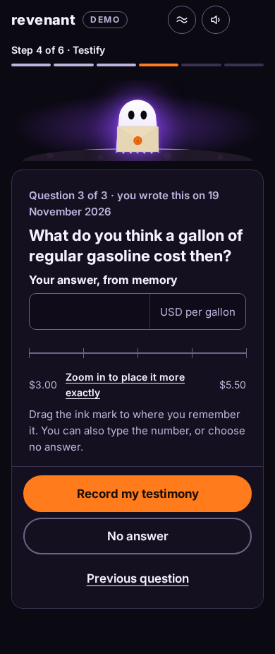 |

<details><summary>Every string on this screen</summary>

- **new or changed** "Question 3 of 3 · you wrote this on 19 November 2026"
- **new or changed** "What do you think a gallon of regular gasoline cost then?"
- "Your answer, from memory"
- "USD per gallon"
- **new or changed** "$3.00"
- **new or changed** "Zoom in to place it more exactly"
- **new or changed** "$5.50"
- "Drag the ink mark to where you remember it. You can also type the number, or choose no answer."
- "Previous question"
- "No answer"
- **new or changed** "Record my testimony"

</details>

### 25. `testify-last`: Testify: the last question

- **Route:** /l/{id} and the live demo
- **State:** The last question answered. Previous question and Record my testimony.
- **Fixes:** 6 (Testify)
- **Renders today:** RecallReader.tsx

| Desktop 1440 × 900 | Phone 390 × 844 |
|---|---|
| 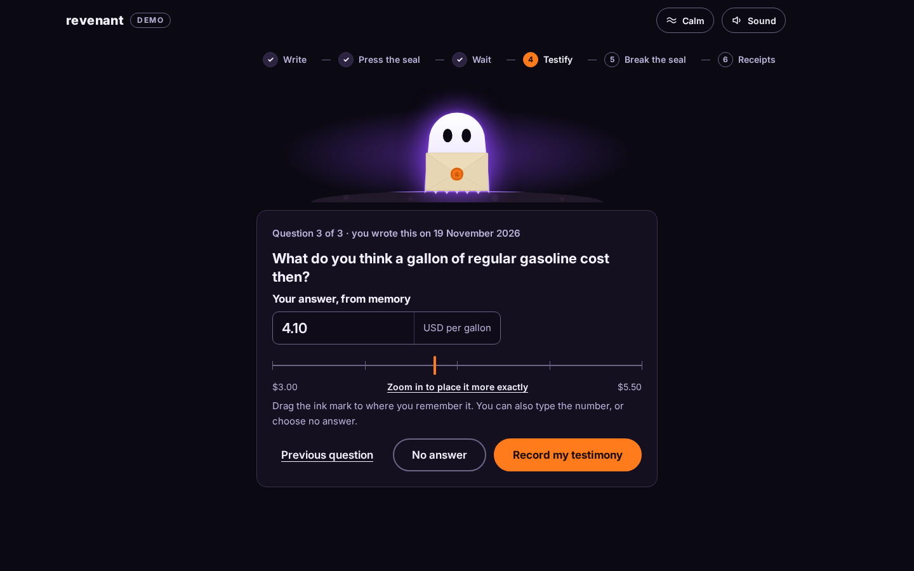 | 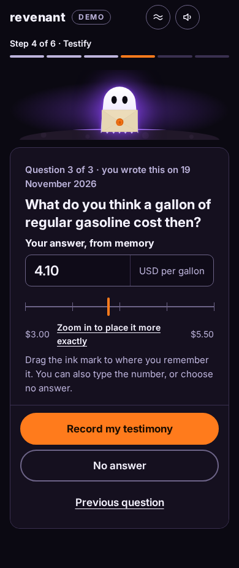 |

<details><summary>Every string on this screen</summary>

- **new or changed** "Question 3 of 3 · you wrote this on 19 November 2026"
- **new or changed** "What do you think a gallon of regular gasoline cost then?"
- "Your answer, from memory"
- "USD per gallon"
- **new or changed** "$3.00"
- **new or changed** "Zoom in to place it more exactly"
- **new or changed** "$5.50"
- "Drag the ink mark to where you remember it. You can also type the number, or choose no answer."
- "Previous question"
- "No answer"
- **new or changed** "Record my testimony"

</details>

### 26. `break`: Break the seal

- **Route:** /l/{id} and the live demo
- **State:** The ghost centred, the wax large and ready to press.
- **Fixes:** 2 (The ghost is a background layer)
- **Renders today:** src/components/ceremony/seal/BreakSeal.tsx, Ceremony.tsx

| Desktop 1440 × 900 | Phone 390 × 844 |
|---|---|
| 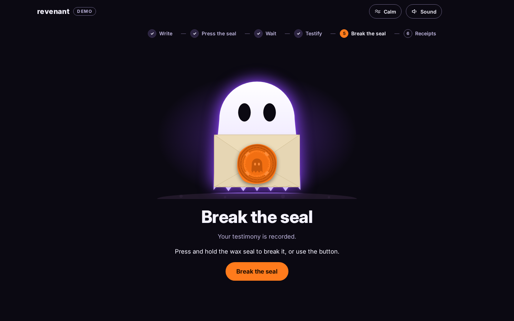 | 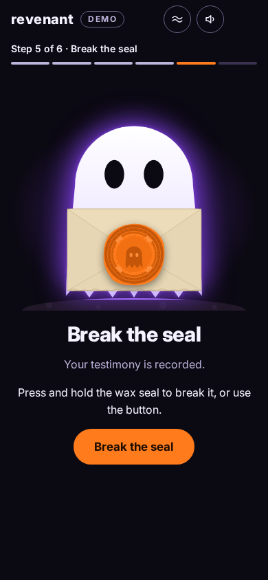 |

<details><summary>Every string on this screen</summary>

- **new or changed** "Your testimony is recorded."
- "Press and hold the wax seal to break it, or use the button."

</details>

### 27. `receipts-live`: See the receipts: live letter

- **Route:** /l/{id} and the live demo
- **State:** Two answered questions, the letter, one figure in the same-week case, the seal line, the end card.
- **Fixes:** 1 (Questions have no sealed answer); 7 (Read and receipts)
- **Renders today:** src/components/reveal/Reveal.tsx, reveal/*

| Desktop 1440 × 900 | Phone 390 × 844 |
|---|---|
| 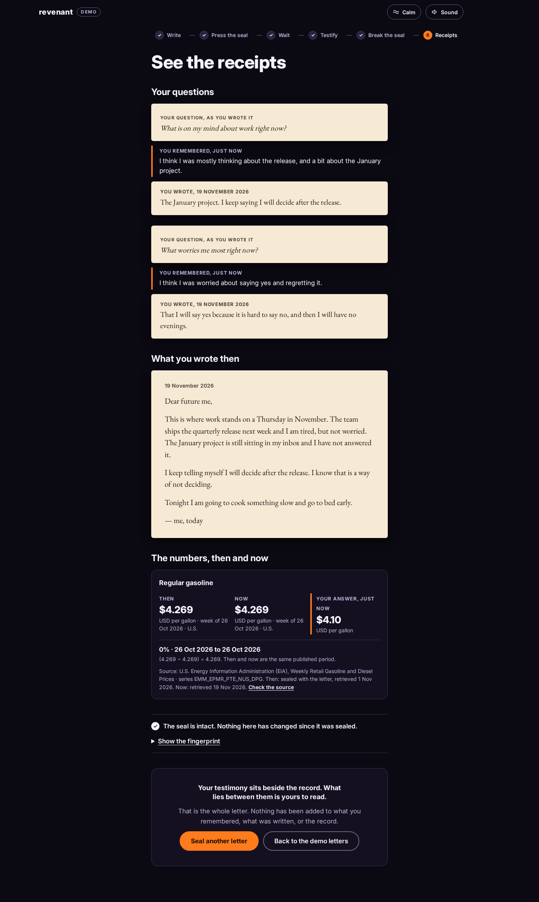 |  |

<details><summary>Every string on this screen</summary>

- "See the receipts"
- **new or changed** "Your questions"
- **new or changed** "Your question, as you wrote it"
- **new or changed** "What is on my mind about work right now?"
- **new or changed** "You remembered, just now"
- **new or changed** "I think I was mostly thinking about the release, and a bit about the January project."
- **new or changed** "You wrote, 19 November 2026"
- **new or changed** "The January project. I keep saying I will decide after the release."
- **new or changed** "What worries me most right now?"
- **new or changed** "I think I was worried about saying yes and regretting it."
- **new or changed** "That I will say yes because it is hard to say no, and then I will have no evenings."
- **new or changed** "What you wrote then"
- **new or changed** "19 November 2026"
- "Dear future me,"
- **new or changed** "This is where work stands on a Thursday in November. The team ships the quarterly release next week and I am tired, but not worried. The January project is still sitting in my inbox and I have not answered it."
- **new or changed** "I keep telling myself I will decide after the release. I know that is a way of not deciding."
- **new or changed** "Tonight I am going to cook something slow and go to bed early."
- "— me, today"
- **new or changed** "The numbers, then and now"
- "Regular gasoline"
- "Then"
- **new or changed** "$4.269"
- **new or changed** "USD per gallon · week of 26 Oct 2026 · U.S."
- "Now"
- **new or changed** "Your answer, just now"
- **new or changed** "$4.10"
- "USD per gallon"
- **new or changed** "0% · 26 Oct 2026 to 26 Oct 2026"
- **new or changed** "(4.269 − 4.269) ÷ 4.269. Then and now are the same published period."
- **new or changed** "Source: U.S. Energy Information Administration (EIA), Weekly Retail Gasoline and Diesel Prices · series EMM_EPMR_PTE_NUS_DPG. Then: sealed with the letter, retrieved 1 Nov 2026. Now: retrieved 19 Nov 2026."
- **new or changed** "Check the source"
- "The seal is intact. Nothing here has changed since it was sealed."
- "Show the fingerprint"
- "Your testimony sits beside the record. What lies between them is yours to read."
- "That is the whole letter. Nothing has been added to what you remembered, what was written, or the record."
- **new or changed** "Seal another letter"
- "Back to the demo letters"

</details>

## Personas

### 28. `maya-testify`: Maya: a figure question

- **Route:** /demo/personas/us-maya
- **State:** A figure question with its sample answer, labelled as a sample.
- **Fixes:** 2 (The ghost is a background layer); 6 (Testify)
- **Renders today:** src/components/reveal/OpeningFlow.tsx (persona), ceremony/recall/*

| Desktop 1440 × 900 | Phone 390 × 844 |
|---|---|
|  |  |

<details><summary>Every string on this screen</summary>

- **new or changed** "Maya is fictional. This letter was prepared later as a demo."
- "Maya's letter"
- **new or changed** "Written as of 12 May 2024 · Opens 5 November 2024"
- **new or changed** "Question 1 of 2 · as of 12 May 2024"
- **new or changed** "What do you think a gallon of regular gasoline cost then?"
- **new or changed** "You lived through May 2024 too. Answer from your own memory of it."
- "Your answer, from memory"
- "USD per gallon"
- **new or changed** "· sample answer."
- "A sample answer is filled in. Change it if you remember differently."
- **new or changed** "$2.99"
- **new or changed** "Zoom in to place it more exactly"
- **new or changed** "$4.25"
- "Drag the ink mark to where you remember it. You can also type the number, or choose no answer."
- "No answer"
- "Next question"

</details>

### 29. `maya-break`: Maya: break the seal

- **Route:** /demo/personas/us-maya
- **State:** The ghost centred, the wax ready to press.
- **Fixes:** 2 (The ghost is a background layer)
- **Renders today:** ceremony/seal/BreakSeal.tsx

| Desktop 1440 × 900 | Phone 390 × 844 |
|---|---|
|  |  |

<details><summary>Every string on this screen</summary>

- **new or changed** "Maya is fictional. This letter was prepared later as a demo."
- **new or changed** "Your testimony is recorded."
- "Press and hold the wax seal to break it, or use the button."

</details>

### 30. `maya-receipts`: Maya: the receipts

- **Route:** /demo/personas/us-maya
- **State:** The full receipts page with two figures that changed.
- **Fixes:** 7 (Read and receipts)
- **Renders today:** reveal/Reveal.tsx, reveal/tamper/TamperControl.tsx

| Desktop 1440 × 900 | Phone 390 × 844 |
|---|---|
|  |  |

<details><summary>Every string on this screen</summary>

- **new or changed** "Maya is fictional. This letter was prepared later as a demo."
- "See the receipts"
- **new or changed** "What she wrote, as of 12 May 2024"
- **new or changed** "Written as of 12 May 2024"
- "Dear future me,"
- "It is a Sunday evening in May, and the windows are open for the first time this year. The lilac next door is out. I wanted to write this down before the week starts again."
- "Work is steady. The early shifts at the clinic are hard on the alarm clock, but I like the quiet drive in, when the roads are empty and the sky is still grey. I fill the tank on Thursdays at the station by the bridge. On the radio this morning they said the national average for regular was about $3.64 a gallon in the first week of May. I have started keeping the receipts in the glove box, though I never look at them."
- "On Saturdays I ride along with Jess in her van for the bakery deliveries. She drives, I carry the trays, and we eat the broken scones on the way home. The radio put diesel at about $3.89 a gallon in the first week of May, which is what the van runs on. She says she wants a second van by next spring. I hope she gets it."
- "Mom's knee is healing. We are planning to drive out to the lake this summer, all of us, if the car holds up. I keep saying I will learn to fix the small things on it myself. Maybe by the time you read this, I will have."
- "The bills are paid this month, with a little left over. I would like to put some aside for an evening class in the fall. I have not decided which one yet."
- "I don't know what you will remember of this spring. I think you will remember the lilac."
- "Love,"
- "Maya"
- **new or changed** "The numbers, then and now"
- **new or changed** "A gallon of regular gasoline"
- "Then"
- **new or changed** "$3.643"
- **new or changed** "USD per gallon · week of 6 May 2024 · U.S."
- "Now"
- **new or changed** "$3.069"
- **new or changed** "USD per gallon · week of 4 Nov 2024 · U.S."
- **new or changed** "Your answer · sample answer"
- **new or changed** "$3.59"
- "USD per gallon"
- **new or changed** "−15.8% · 6 May 2024 to 4 Nov 2024"
- **new or changed** "(3.069 − 3.643) ÷ 3.643"
- **new or changed** "Source: U.S. Energy Information Administration (EIA), Weekly Retail Gasoline and Diesel Prices · series EMM_EPMR_PTE_NUS_DPG. Then: historical record, retrieved 1 Nov 2026. Now: historical record, retrieved 1 Nov 2026."
- **new or changed** "Check the source"
- **new or changed** "A gallon of diesel"
- **new or changed** "$3.894"
- **new or changed** "$3.536"
- **new or changed** "$3.79"
- **new or changed** "−9.2% · 6 May 2024 to 4 Nov 2024"
- **new or changed** "(3.536 − 3.894) ÷ 3.894"
- **new or changed** "Source: U.S. Energy Information Administration (EIA), Weekly Retail Gasoline and Diesel Prices · series EMD_EPD2D_PTE_NUS_DPG. Then: historical record, retrieved 1 Nov 2026. Now: historical record, retrieved 1 Nov 2026."
- "The seal is intact. Nothing here has changed since it was sealed."
- "Show the fingerprint"
- "Try to tamper with it"
- "This runs on a copy in your browser. The stored letter is not changed."
- "Your testimony sits beside the record. What lies between them is yours to read."
- "That is the whole letter. Nothing has been added to what you remembered, what was written, or the record."
- "Seal your own. It opens 30 seconds after you seal it."
- "Back to the demo letters"

</details>

### 31. `maya-tampered`: Maya: tamper check

- **Route:** /demo/personas/us-maya
- **State:** The tamper control has run on the copy and the check fails.
- **Fixes:** 7 (Read and receipts)
- **Renders today:** reveal/tamper/TamperControl.tsx

| Desktop 1440 × 900 | Phone 390 × 844 |
|---|---|
|  |  |

<details><summary>Every string on this screen</summary>

- **new or changed** "Maya is fictional. This letter was prepared later as a demo."
- "See the receipts"
- **new or changed** "What she wrote, as of 12 May 2024"
- **new or changed** "Written as of 12 May 2024"
- "Dear future me,"
- "It is a Sunday evening in May, and the windows are open for the first time this year. The lilac next door is out. I wanted to write this down before the week starts again."
- "Work is steady. The early shifts at the clinic are hard on the alarm clock, but I like the quiet drive in, when the roads are empty and the sky is still grey. I fill the tank on Thursdays at the station by the bridge. On the radio this morning they said the national average for regular was about $3.64 a gallon in the first week of May. I have started keeping the receipts in the glove box, though I never look at them."
- "On Saturdays I ride along with Jess in her van for the bakery deliveries. She drives, I carry the trays, and we eat the broken scones on the way home. The radio put diesel at about $3.89 a gallon in the first week of May, which is what the van runs on. She says she wants a second van by next spring. I hope she gets it."
- "Mom's knee is healing. We are planning to drive out to the lake this summer, all of us, if the car holds up. I keep saying I will learn to fix the small things on it myself. Maybe by the time you read this, I will have."
- "The bills are paid this month, with a little left over. I would like to put some aside for an evening class in the fall. I have not decided which one yet."
- "I don't know what you will remember of this spring. I think you will remember the lilac."
- "Love,"
- "Maya"
- **new or changed** "The numbers, then and now"
- **new or changed** "A gallon of regular gasoline"
- "Then"
- **new or changed** "$3.643"
- **new or changed** "USD per gallon · week of 6 May 2024 · U.S."
- "Now"
- **new or changed** "$3.069"
- **new or changed** "USD per gallon · week of 4 Nov 2024 · U.S."
- **new or changed** "Your answer · sample answer"
- **new or changed** "$3.59"
- "USD per gallon"
- **new or changed** "−15.8% · 6 May 2024 to 4 Nov 2024"
- **new or changed** "(3.069 − 3.643) ÷ 3.643"
- **new or changed** "Source: U.S. Energy Information Administration (EIA), Weekly Retail Gasoline and Diesel Prices · series EMM_EPMR_PTE_NUS_DPG. Then: historical record, retrieved 1 Nov 2026. Now: historical record, retrieved 1 Nov 2026."
- **new or changed** "Check the source"
- **new or changed** "A gallon of diesel"
- **new or changed** "$3.894"
- **new or changed** "$3.536"
- **new or changed** "$3.79"
- **new or changed** "−9.2% · 6 May 2024 to 4 Nov 2024"
- **new or changed** "(3.536 − 3.894) ÷ 3.894"
- **new or changed** "Source: U.S. Energy Information Administration (EIA), Weekly Retail Gasoline and Diesel Prices · series EMD_EPD2D_PTE_NUS_DPG. Then: historical record, retrieved 1 Nov 2026. Now: historical record, retrieved 1 Nov 2026."
- "The seal is cracked. Revenant refuses to open this copy."
- "This runs on a copy in your browser. The stored letter is not changed."
- "Where each attempt stopped"
- "The one-byte change"
- "Refused at the fingerprint check. The copy's fingerprint does not match the stored one."
- "The one-byte change, with its fingerprint fixed"
- "Refused at the authentication tag check. The fingerprint matches, and the encrypted text does not."
- "Show the fingerprint"
- "Stored fingerprint"
- "5925def5dd62f6719db9f9bbc05fbbf210eac1fdd3d4c3018b3b97cb84a4728f"
- "Fingerprint of the copy"
- **new or changed** "5a25def5dd62f6719db9f9bbc05fbbf210eac1fdd3d4c3018b3b97cb84a4728f"
- "Close"
- "Your testimony sits beside the record. What lies between them is yours to read."
- "That is the whole letter. Nothing has been added to what you remembered, what was written, or the record."
- "Seal your own. It opens 30 seconds after you seal it."
- "Back to the demo letters"

</details>

### 32. `priya-testify`: Priya: her recollection

- **Route:** /demo/personas/us-priya
- **State:** Her fictional recollection of her answer, one question at a time.
- **Fixes:** 2 (The ghost is a background layer); 6 (Testify)
- **Renders today:** ceremony/recall/PersonaTestimony.tsx, OpeningFlow.tsx

| Desktop 1440 × 900 | Phone 390 × 844 |
|---|---|
|  |  |

<details><summary>Every string on this screen</summary>

- **new or changed** "Priya is fictional. This letter was prepared later as a demo."
- **new or changed** "Priya's letter"
- **new or changed** "Written as of 12 May 2024 · Opens 5 November 2024"
- **new or changed** "Question 1 of 2"
- **new or changed** "On 12 May 2024 she asked herself:"
- **new or changed** "What am I looking forward to most right now?"
- **new or changed** "What she thinks she answered · fictional"
- **new or changed** "The coast trip with my sister, mostly. I think I also wanted one quiet Sunday."
- "Next question"

</details>

### 33. `priya-receipts`: Priya: the receipts

- **Route:** /demo/personas/us-priya
- **State:** Her recollection beside her sealed answer for each question, then her letter.
- **Fixes:** 1 (Questions have no sealed answer); 7 (Read and receipts)
- **Renders today:** reveal/Reveal.tsx, reveal/tamper/TamperControl.tsx

| Desktop 1440 × 900 | Phone 390 × 844 |
|---|---|
|  |  |

<details><summary>Every string on this screen</summary>

- **new or changed** "Priya is fictional. This letter was prepared later as a demo."
- "See the receipts"
- "Her questions"
- **new or changed** "Her question, as she wrote it"
- **new or changed** "What am I looking forward to most right now?"
- **new or changed** "She remembered · fictional"
- **new or changed** "The coast trip with my sister, mostly. I think I also wanted one quiet Sunday."
- **new or changed** "She wrote, as of 12 May 2024"
- **new or changed** "The trip to the coast with my sister, even though we haven't agreed how to get there. And a Sunday with nothing on the list."
- **new or changed** "What am I worried about right now?"
- **new or changed** "Whether to take the extra morning shift. And I think I was worried about the reading list."
- **new or changed** "The extra morning shift. I can't decide, and I'm worried I'll fall behind on my reading either way."
- **new or changed** "What she wrote, as of 12 May 2024"
- **new or changed** "Written as of 12 May 2024"
- "Dear Priya,"
- "It is a Sunday in May, and the house is quiet before the week starts. I am writing this so you can see what the week looked like from here."
- "The Saturday class is going well. The children have started asking questions I cannot answer yet, and I am trying to take that as a good sign. I have a new reading list and I am a little behind on it."
- "My sister and I are planning the trip to the coast for later in the summer. She wants to drive and I want the train, so we are looking for a way that suits us both. I hope we have managed it by the time you read this."
- "At work there is a choice in front of me: whether to take the extra morning shift or keep my weekday evenings free. I keep changing my mind. I hope that by the time you open this letter I will have chosen the thing I wanted, and not the thing I felt I ought to want."
- "Mostly I want you to know that I was tired but hopeful. I hope you still have the Saturday mornings, the coffee on the step and the long phone calls with my sister."
- "Write back if you like."
- "Priya"
- "The seal is intact. Nothing here has changed since it was sealed."
- "Show the fingerprint"
- "Try to tamper with it"
- "This runs on a copy in your browser. The stored letter is not changed."
- "Her testimony and her letter are side by side. What they say is yours to read."
- "That is the whole letter. Nothing has been added to what you remembered, what was written, or the record."
- "Seal your own. It opens 30 seconds after you seal it."
- "Back to the demo letters"

</details>

## Keepsakes

### 34. `letter-card`: Letter card

- **Route:** downloaded at sealing
- **State:** The printable letter card. Contains no key.
- **Fixes:** 3 (Three visual systems)
- **Renders today:** src/lib/cards/letter-card-svg.ts

| Desktop 1440 × 900 | Phone 390 × 844 |
|---|---|
|  |  |

<details><summary>Every string on this screen</summary>

- "Letter card"
- "Your letter is sealed"
- "Opens"
- **new or changed** "14:21:05 UTC, 19 November 2026"
- "Your letter link"
- **new or changed** "revenant.devclef.se/l/Qm7vXk2pTn9sLd4wRa8Hye"
- "Fingerprint at sealing"
- **new or changed** "9c41 e7a0 5b2d 83f6 a1d0 c7e4 b58f 3a29 d6e0 b1c4 7f85 a3d2 9e6b 0c17 a4f8 d352"
- **new or changed** "Scan the code to open the letter. Before the opening time it shows only that the letter is still sealed. This card holds no key."
- **new or changed** "Printable keepsake, shown at screen size."
- "Save the card as an image"
- "Print or save as PDF"

</details>

### 35. `backup-card`: Backup key card

- **Route:** downloaded at sealing
- **State:** The printable backup key card. The only place the key exists.
- **Fixes:** 3 (Three visual systems)
- **Renders today:** src/components/live/BackupKeyCard.tsx

| Desktop 1440 × 900 | Phone 390 × 844 |
|---|---|
|  |  |

<details><summary>Every string on this screen</summary>

- "Backup key card"
- **new or changed** "This card opens your letter on its own after the opening date. Keep it somewhere safe, like a house key."
- "Your backup key"
- **new or changed** "KM7Q-X2PD-9RTA-W4HC-J8VN-3EYL"
- "Opens"
- **new or changed** "14:21:05 UTC, 19 November 2026"
- "Your letter link"
- **new or changed** "revenant.devclef.se/l/Qm7vXk2pTn9sLd4wRa8Hye"
- "Scan this code to open the letter link with your backup key."
- **new or changed** "Sample key, for this prototype only. Printable keepsake, shown at screen size."
- "Save the card as an image"
- "Print or save as PDF"

</details>

---

## Question wording (Occasions)

Rule: the author writes in their own voice and present tense. The opening screens add the date ("On 19 November 2026 you asked yourself:"). One question row by default. The rest are "Ask another" suggestions. This replaces the tables in `src/components/live/occasions.ts`.

| Occasion | Default question (one row) | Suggestions |
|---|---|---|
| The year ahead | What do I hope this year holds? | Which goal for the year feels most real to me? · What do I think will be different by the day I open this? |
| Work | What is on my mind about work right now? | What worries me most right now? · What do I want my working week to look like? · What do I think will be different by the day I open this? |
| Family | Who am I thinking about most right now? | What do I most want to say to the people at home? · What do I hope the people closest to me are doing when I open this? |
| A decision | What am I weighing right now? | What do I expect the choice to give me? · What would make this decision feel settled? |
| A blank page | What is on my mind right now? | What did I notice first this morning? · What do I most want to remember about this week? |
| Shared, after the Occasion's own | | What small thing am I looking forward to? · Who would I call first with good news? · What have I promised myself? |

Old wording for comparison: "Before you read it, what do you remember about the day you sealed this?", "When you wrote this, …", "What did you promise yourself the day you sealed this?".

## Priya: copy for the owner to approve

Fictional. Everyday and neutral, no price, party, policy or election term, no wording that grades. Her letter is unchanged (`content/personas/letters/us-priya.txt`).

Her questions (rewritten to the new rule):

1. What am I looking forward to most right now?
2. What am I worried about right now?

What she answered on 12 May 2024 (sealed):

1. "The trip to the coast with my sister, even though we haven't agreed how to get there. And a Sunday with nothing on the list."
2. "The extra morning shift. I can't decide, and I'm worried I'll fall behind on my reading either way."

What she remembers at opening (fictional recollection, small natural drift):

1. "The coast trip with my sister, mostly. I think I also wanted one quiet Sunday."
2. "Whether to take the extra morning shift. And I think I was worried about the reading list."

The live-letter text, questions and answers on the live screens are sample copy for the prototype only.

## Decisions

Things this brief did not settle, and what I chose:

- **Persona notice on phone.** The brief puts it in the bar, but the full sentence does not fit beside two icon buttons. On desktop it sits in the bar. On phone it sits in a thin strip directly under the bar. Only one of the two is visible at any width, so it is never shown twice.
- **Skip.** Its space is always reserved. No screen is captured mid-sequence, so no screenshot shows it. During the rise (emergence) and the unfold after the break it becomes visible in the reserved slot.
- **Unlock and still-sealed have no ghost.** Nothing is unlocked yet. The ghost first rises on `emergence`. The brief says "from the moment the letter is unlocked".
- **Ghost sizes.** Held, with the envelope in front of its lower body (no hands). Testify: 160 px tall on desktop, 96 px on phone. Emergence: 240 and 168. Break: about 384 and 312, with the wax 120 px across on desktop and 96 px on phone, pressable. Other seals are 28% of their envelope's width.
- **`testify-number` and `testify-last`.** The live letter has two author questions and one figure question, so the figure question is both the first figure question and the last question. `testify-number` is it before an answer is placed. `testify-last` is it answered.
- **Phone action bar.** On Testify, the buttons stick to the bottom of the card on phone, so Next question is always in view even when the scale pushes the card past the fold. The primary button is first, "I don't remember" or "No answer" second, "Previous question" last.
- **"Look closer at the mark"** becomes "Zoom in to place it more exactly", and sits on the scale's end row.
- **Unit echo** is now inside the number field's border, to the right of the digits, so it cannot overlap.
- **Two presses.** Under the wax: steps 1 "Make your passkey" and 2 "Set the seal", with the current step in orange. After the first press it reads "Passkey made". Choosing "Skip it" shows the confirmation tick inside that option. The warning box stays below the options at all times.
- **`seal-no-prf`.** The wax stays visible at 35% and waits for "I have saved this key". The old "Seal with this key" button is gone, so the wax is the one primary action on every Press-the-seal state.
- **Wait.** The letter card is drawn on paper, because it is a keepsake of what was sealed. It has no seal drawing of its own, so the seal appears once (the envelope). While the countdown runs the button slot shows plain text, so nothing jumps when "Open your letter" appears.
- **Persona recollection** uses a purple rule, not orange, because orange means the reader. Her recollection is labelled "fictional".
- **Receipts for personas.** Maya's "now" figures are the records for the week of her opening date (4 Nov 2024). Her sample answers are marked "sample answer" in the figure.
- **Same-week case** on the live letter: then and now are the same published period, so the change is 0% and the formula line says "Then and now are the same published period." No more explanation is given.
- **Backup key and QR** on the card screens are sample values for the prototype and not real keys. The QR is a real code made with the repo's encoder, and it points at a sample letter link.
- **New art, only where none existed.** The crack across the wax on `maya-tampered` (a plain dark line over the existing seal relief), the soil strip (flat, with a lit edge and a few clods, instead of the canvas Soil), and the top-bar icons (simple strokes, not copied from `scene/icons.tsx`). The ghost, the seal relief and the envelope are copied from the source, and the envelope has no dirt band. The three seal reliefs come from the maya and priya fingerprints, and a sample fingerprint for the live letter.
- **Ritual copy on the home page** changes for "Write" and "Testify" to match the new model.
- **Track on `/l/{id}`.** The same screens, with the three-step track. Use the toggle link in the prototype bar or `#real`.

### Checks run before capture

For every screen at both sizes, `capture.mjs` checks for horizontal scroll, text clipped by an overflow, overlapping text boxes and text contrast (4.5:1, or 3:1 for large text, against the nearest solid background; text on a gradient or image is reported). It reported nothing on the final run. Screens were also read by eye. The first primary action sits above the fold at 1440 × 900 and 390 × 844 on Press the seal, Wait, Unlock, every Testify question and Break the seal. The Write desk's fold button may sit lower.

## Steering changes needed

Not edited. Proposed wording follows.

1. **`tone.md`, Copy:** "A question is written for the reader on the opening day and names the sealing day ("when you wrote this", "the day you sealed this"). It never says "right now", "today" or "currently"."
   → "A question is written by the author, in their own voice and in the present tense ("What worries me most right now?"). The opening screens add the sealing date ("On 19 November 2026 you asked yourself:"), so the question carries no date of its own."
2. **`tone.md`, Testify:** "one question at a time, gentle prompts, no hints about what's inside. … For the text persona the step shows one question and her answer at a time, with a plain control to go on. Her answers are labelled as fictional."
   → "…For each author question the reader writes what they think they answered. For the text persona the step shows one question and her recollection of her answer at a time. Her recollections are labelled as fictional."
3. **`tone.md`, See the receipts:** "testimony first, then the letter, then the numbers."
   → "each question with the reader's testimony beside the answer sealed with it, then the letter, then the numbers."
4. **`tone.md`, Orange:** add "the reader's testimony on the receipts screen" to the list of what orange means.
5. **`tone.md`, Visual direction:** add "Warm paper and EB Garamond are only for what was sealed. The ghost is in the column from unlock to the break, never behind a card, and leaves when the seal breaks."
6. **`product.md`, Core loop 1:** "Questions are written to be read on the opening day and name the sealing day." → "Each question is answered when writing, in the author's own voice and present tense. A question can't be sealed without an answer."
7. **`product.md`, Core loop 6:** "first the questions the user wrote, then the questions about the figures. Their answers are recorded." → "For each question the user wrote, they write what they think they answered. Then come the questions about the figures. Their testimony is recorded before anything sealed is shown."
8. **`product.md`, Core loop 7:** "Each of their own questions with the answer they just gave, and their testimony on the figures (just now)." → "Each of their own questions, with what they remembered just now beside what they wrote on the sealing day, with no comment on the difference. Then the letter. Then the figures."
9. **`product.md`, Decisions, Testify step (MVP):** "the questions the author wrote for their future self (up to three, sealed as written, each written to be read on the opening day and naming the sealing day)" → "(up to three, sealed as written with the author's answer to each)". The reader's reply is what they think they answered.
10. **`product.md`, Demo 1:** "Her answers to them are pre-written content, labelled as fictional on every screen that shows them. The judge reads her answers, breaks the seal and reads her letter." → "Her letter carries her own questions, each with an answer she sealed. At opening the judge reads her fictional recollection of each answer, breaks the seal, and sees each recollection beside her sealed answer, then her letter."
11. **`product.md`, Demo 2:** "every Occasion starts with a default question anchored to the sealing day" → "every Occasion starts with one default question in the author's own voice, which they answer, change or remove". "the answers the judge gives 30 seconds later" stays true.
12. **`neutrality.md`:** "Score, diff, highlight, summarise or interpret the gap between the testimony and the letter, or between a written answer and any line of the letter." → add ", or between a recollection and the answer sealed with its question". The paragraph "A persona's pre-written answers follow the same rules as her letter" → "A persona's sealed answers and recollections follow the same rules as her letter".
13. **`tech.md`, The letter is self-contained:** "The recall questions, written out in full at sealing time." → "The recall questions, written out in full at sealing time, with the answer sealed with each author question."
14. **`structure.md`, scene:** "`src/components/ceremony/scene/` holds the Scene shared by `/`, `/demo` and `/demo/personas/[key]`" → the Scene's ghost is rendered only in the opening flow. Home and `/demo` show the envelope on soil without the ghost.

## Sealed format changes needed

A sealed answer for each author question needs a new `format_version` (2). Version 1 letters keep opening exactly as today. The v2 payload gains, for each author question, the question text as written and the author's answer as a plain-text string with a length limit. Everything else in v1 is unchanged. The reveal handles a v1 letter by showing each question and the reader's testimony with no sealed answer beside it, and a plain line saying the letter was sealed before answers were kept. That line is not drawn in this prototype and needs wording. The persona Priya must be sealed again as v2 with her sealed answers, which gives her a new letter id and fingerprint. Her recollections stay outside the sealed letter, as `content/personas/letters/answers.json` does now.

## Questions for the owner

1. Approve Priya's questions, sealed answers and recollections above.
2. On phone, is the persona notice in a strip under the bar acceptable, or should it be an icon in the bar that opens the notice?
3. The same-week receipts line says only "Then and now are the same published period." Is that the wording you want?
