# PR description: owner check and QA run for #135 (spec 06, task 10)

The owner check list is in `owner-check.md` in this folder. The owner ticks it on the live site. This file records the build measurements and the browser run.

## JS budget

`npm run build`, then `node scripts/check-js-budget.mjs`. Gzipped first load, from the build output:

| Route | First load | Budget | Result |
|---|---|---|---|
| `/demo` | 111.4 kB | 130 kB | ok |
| `/demo/live` | 158.9 kB | 190 kB | ok |
| `/l/[id]` | 177.2 kB | 190 kB | ok |

## Browser run

Throwaway Postgres, `npm run db:migrate`, `npm run seal-personas`, then the app on a local port. WebAuthn was stubbed as in `design.md`. Each step was captured at 1280 px and at 360 px.

| Step | Stage | 1280 px | 360 px |
|---|---|---|---|
| 02 | Write | 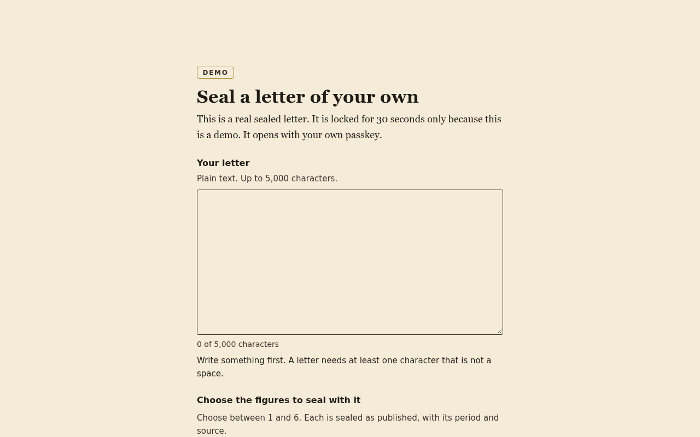 | 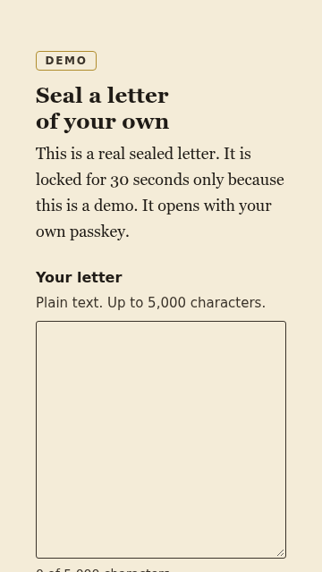 |
| 07 | Sealed | 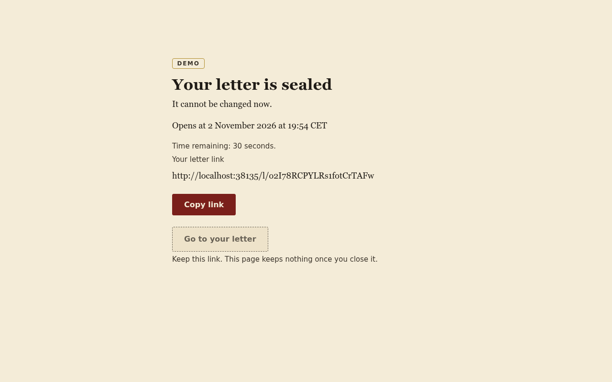 | 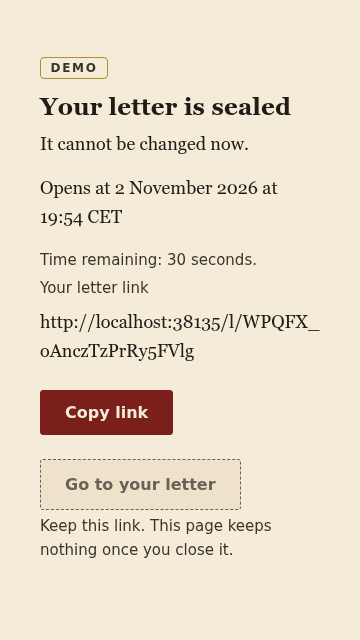 |
| 09 | Unlock (seal intact) | 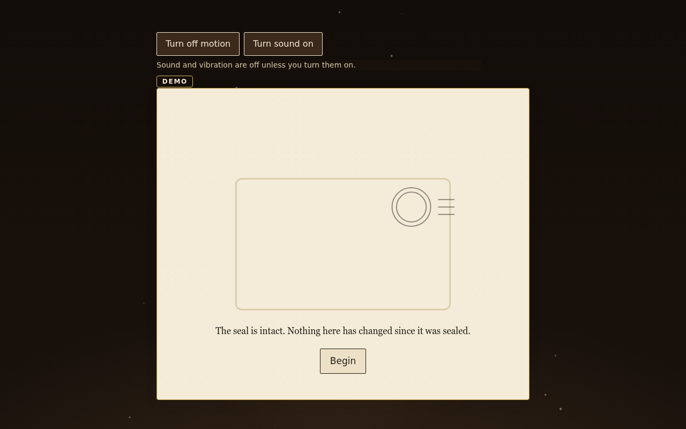 | 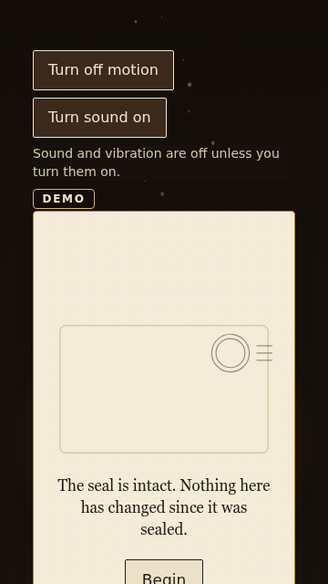 |
| 10 | Recall | 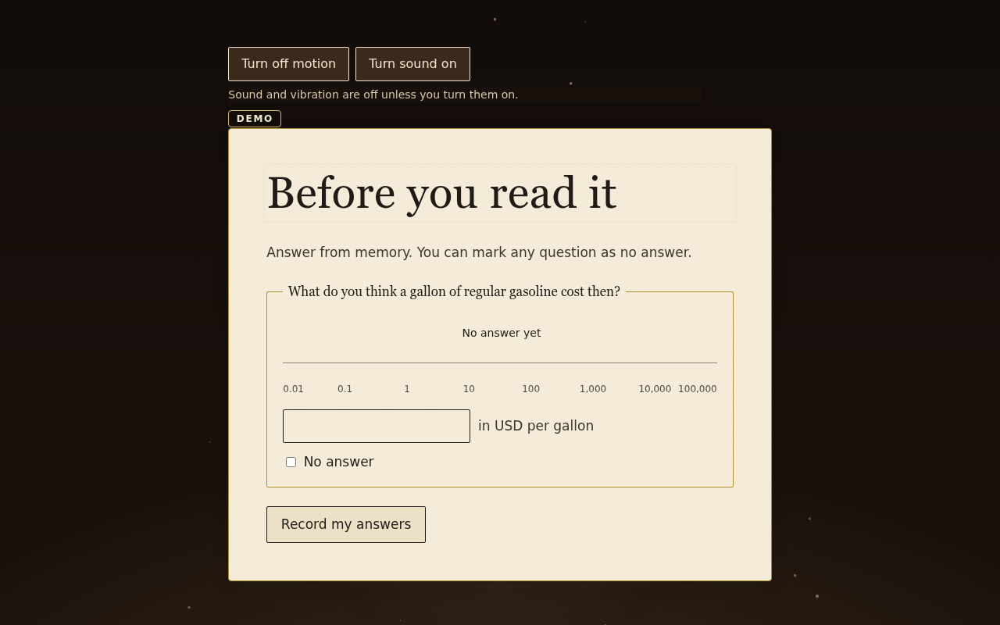 | 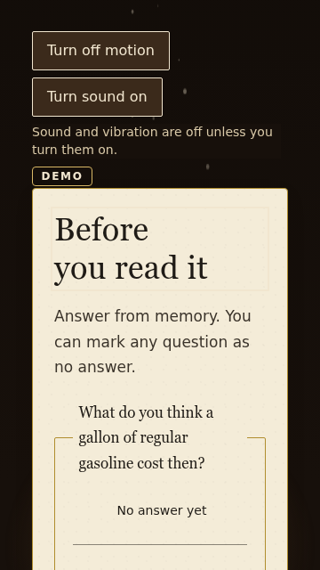 |
| 11 | Reveal | 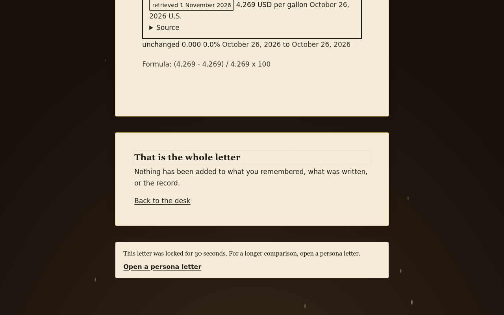 | 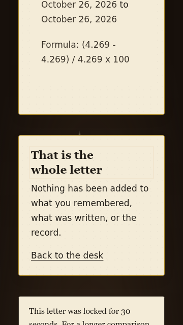 |
| 13 | Cannot lock (no PRF) | 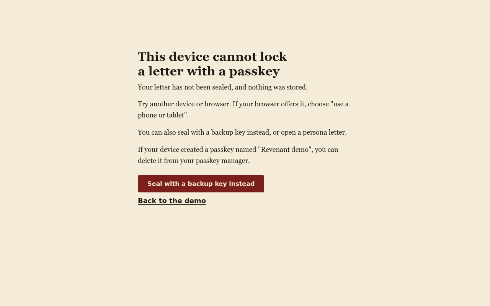 | 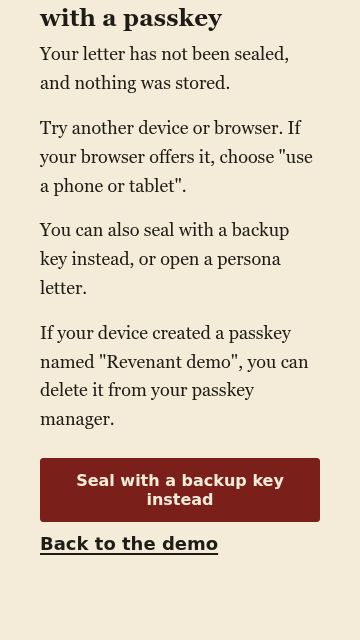 |

Screenshots are committed in `owner-check-shots/` next to this file. The images above are from the final run. The `/demo` entry page is also committed there as `01-entry.png` and `01-entry-360.png`.

`node scripts/check-js-budget.mjs` output from the same build:

```
ok   /demo: 111.4 kB gzipped first load (budget 130 kB, 7 chunks)
ok   /demo/live: 158.9 kB gzipped first load (budget 190 kB, 8 chunks)
ok   /l/[id]: 177.2 kB gzipped first load (budget 190 kB, 10 chunks)
```

## Findings

- Final run: `/demo`, `/demo/live` and a sealed `/l/[id]` were opened at 1280 px and 360 px. No unreadable, unstyled or off-contrast text, stray box or unstyled control was found in the screenshots, so no code changed in this task.
- The step 13 screenshots come from the first run of this task. The second run did not repeat step 13, and the build did not change between the runs.
- The reveal runs marks, then passage, then close. Two controls are needed after the recall answers: "Show everything" and "Skip". The flow is in the browser run.
- Recall: the first "Record my answers" press did not register after a typed guess. A "Look closer at the mark" button appeared instead. Marking "No answer" recorded the answer. Not fixed here; the owner may want to look at it.
- Step 07: no letter text or figure value is in the sealed-page DOM.
